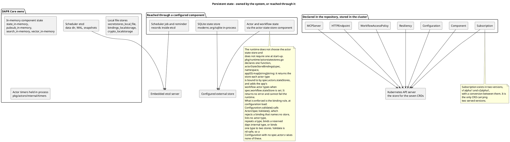
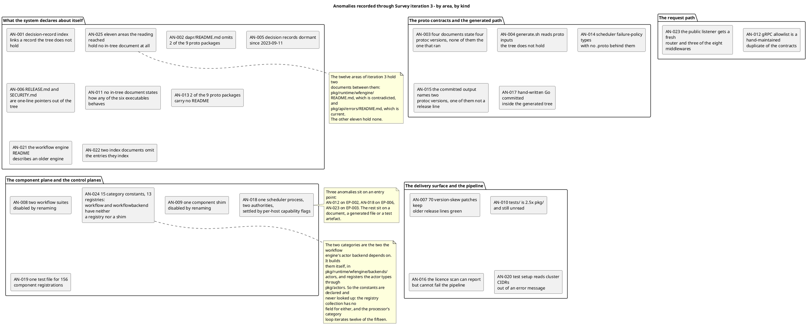

## Document Control
Phase: Survey
Status: Draft — iteration 3. The Perimeter is closed against the code: Components, External actors and systems, and Entry points are written, and the Components row that F4 named now states the component plane from the files that hold it — fifteen `Category` constants, thirteen registries, two categories reachable by neither a registry nor a shim (AN-024). Technology and Size covers every top-level area of the tree, with the parent-and-child areas under `cmd`, `dapr`, `docs` and `pkg` listed separately. Persistent Data, Documentation, History, Anomalies and Priorities are carried forward from the reads of all three iterations with iteration 3's slice added; Documentation now grades what the twelve areas of that slice hold, and it is the one finding of absence in the tree (AN-025). Anomalies states 25, each with its evidence and its likelihood and impact. Coverage states each iteration's read against what it was assigned, every count reproducible from the files enumerated on its own row, and derives the never-assigned count from the foot of its own table rather than asserting it: 103 distinct files opened of the 6 631 entries the tree holds.
Milestone Target: end-of-Survey (SBC) — not achieved

## Perimeter
The boundary is drawn by what the code reaches for. Six Go executables run from `cmd/` and share one library;
each exposes its own listeners, and the sidecar alone opens seven: the HTTP API port, a separate public port,
a pprof port when profiling is on, the gRPC API port, the internal gRPC port, the `/healthz` port and the
metrics port. `pkg/api/grpc/server.go` builds **two** gRPC servers from one file with different trust. The
three control planes reach the Kubernetes API server and each other over signed gRPC. A component a caller
configures goes out through a shim in `cmd/daprd/components/` to a backend; the workflow engine is the one
part of the runtime that does not take that path — it builds its own actor backend and registers its actor
types through `pkg/actors` (AN-024), which is why the component plane below holds thirteen registries for
fifteen declared categories.

## Technology and Size
| Area | Language | Platform and frameworks, with version | Files | Anchor |
|---|---|---|---|---|
| `.build-tools` | Go | A separate module, `dapr-build-tools`; its own `go.mod` and `go.sum`, and a `cmd/` of five drivers — `root`, `e2e`, `perf`, the lint-version check and a tag-guarded variant — with three YAML fixtures under `testdata/` | 14 | `.build-tools/` |
| `.github` | YAML, Python, JavaScript, Shell | GitHub Actions; `dependabot.yml`; 25 workflow definitions under `workflows/`; 82 helper scripts under `scripts/`, 70 of which are version-skew patch files | 120 | `.github/` |
| `charts` | YAML, Go | Helm 3 chart `dapr` with 7 subcharts (`dapr_config`, `dapr_operator`, `dapr_placement`, `dapr_rbac`, `dapr_scheduler`, `dapr_sentry`, `dapr_sidecar_injector`), 7 CRD manifests under `crds/`, and `embed.go` | 67 | `charts/dapr/`; `charts/dapr/Chart.yaml`; `charts/dapr/charts/` (7 subcharts); `charts/dapr/crds/` (7 files) |
| `cmd` | Go | Go 1.26.11; the six executables plus five build and test driver files; `dapr/components-contrib v1.19.1-0.20261126140908-2c9078d426b0`, `dapr/kit v0.19.1-0.20261030175054-be979ab98cc4`, `dapr/durabletask-go v0.16.1-0.20261109153237-98658f38d8cb` | 183 | `cmd/`; `go.mod` (the `go` directive and the first `require` block) |
| `cmd/daprd/components` | Go | One registration file per component family, 156 files; builds only under the `allcomponents` or `stablecomponents` tag, and `zz_notag.go` panics at init otherwise | 156 | `cmd/daprd/components/`; `cmd/daprd/components/zz_notag.go` |
| `CODEOWNERS` | Text | — | 1 | `CODEOWNERS` |
| `CONTRIBUTING.md` | Markdown | — | 1 | `CONTRIBUTING.md` |
| `dapr` | Protocol Buffers (proto3) | 37 `.proto` definitions in 9 packages — `common`, `components`, `internals`, `operator`, `placement`, `runtime`, `scheduler`, `sentry`, `workflows`; seven package READMEs (`scheduler/v1` and `workflows/v1` have none, AN-013) and one directory overview, `dapr/README.md`, which is the eighth non-`.proto` file; `protoc` version disputed across four documents (AN-003) and two more in the committed headers (AN-015); consumed by `connectrpc.com/connect v1.19.1` and `google.golang.org/grpc v1.83.2` | 45 | `dapr/` (45 files: `README.md` + `proto/` 44, of which 37 `.proto` and 7 package READMEs); `go.mod` |
| `docker` | Dockerfile, Shell | Eight Dockerfiles — the runtime image, a debug image, a dev image, Mariner and five Windows base images — plus `docker.mk` and `library-scripts/` of five Debian provisioning scripts | 22 | `docker/`; `docker/Dockerfile`; `docker/docker.mk` |
| `docs` | Markdown, PNG | 198 files: two at the top of the directory, 24 decision records including their index, 13 development files, 153 release-note files, and the six under `docs/artifacts/` this process wrote | 198 | `docs/`; `docs/artifacts/` (6 files, written by this process and not part of the system) |
| `docs/decision_records` | Markdown | 23 records in five categories (`api` 12, `architecture` 3, `cli` 2, `engineering` 4, `sdk` 2) plus `decision_records.md` | 24 | `docs/decision_records/` |
| `docs/development` | Markdown, PNG | Six guides — setup, setup in VS Code, CI, developing, metrics, preview features — plus five screenshots and an image of the debug flow | 13 | `docs/development/` |
| `docs/release_notes` | Markdown, PNG | One note per release from `v0.1.0` to `v1.19.3`, plus `template.md` and an `assets/` folder of 5 PNGs | 153 | `docs/release_notes/` |
| `GOVERNANCE.md` | Markdown | — | 1 | `GOVERNANCE.md` |
| `go.mod` | Go module manifest | `module github.com/dapr/dapr`; `go 1.26.11`; a large direct `require` block, a large indirect block, and four replacement rules plus a licence-motivated replace block | 1 | `go.mod` |
| `go.sum` | Go checksums | The resolved module graph for every `require` in `go.mod` and its transitive closure; states no version of its own | 1 | `go.sum` |
| `grafana` | JSON | Five dashboard definitions — actor, scheduler, sidecar, system-services and workflow — and a README | 6 | `grafana/`; `grafana/grafana-scheduler-dashboard.json` |
| `img` | PNG, SVG, JPEG | Banner, conceptual model and overview diagram, the last embedded by `README.md` | 3 | `img/` |
| `LICENSE` | Text | Apache License 2.0 | 1 | `LICENSE` |
| `pkg/acl` | Go | The service-invocation access-control rules over a trie of operations and HTTP verbs, with deny-wins merging and a canonical HTTP path (`canonicalHTTPOperation`) that both the decoded and the parameter-stripped form must pass; plus a `workflow/` of 8 files that extracts, holds and evaluates the workflow-operation policy | 10 | `pkg/acl/acl.go`; `pkg/acl/workflow/policy.go` |
| `pkg/actors` | Go | The actor runtime: `api/` 11, `callbackstream/`, `errors/`, `fake/`, `hashing/rendezvous/`, `hostauthz/`, `hostconfig/`, `internal/{apilevel,key,placement,timers}`, `reminders/`, `reserved/`, `router/`, `state/`, `table/`, `targets/{app,workflow}`, `timers/`. The `targets/workflow/` subtree alone holds 124 files | 243 | `pkg/actors/` (243 files); `pkg/actors/actors.go`; `pkg/actors/table/table.go` |
| `pkg/api` | Go | The request path: `net/http` with the `chi`-style router of `pkg/api/http`, gRPC servers on `google.golang.org/grpc v1.83.2`, the internal `ServiceInvocation` server, the 29-file `universal/` handler layer, and the hand-maintained gRPC allowlist map (AN-012) | 124 | `pkg/api/`; `pkg/api/grpc/server.go`; `pkg/api/http/server.go` |
| `pkg/apis` | Go | The seven custom resource kinds — `components`, `configuration`, `httpEndpoint`, `mcpserver`, `resiliency`, `subscriptions` (two served versions with a conversion), `workflowaccesspolicy` — each with a `v1alpha1/types.go` and deep-copy code, over `common/` and the three helpers `namevalue.go`, `scoped.go`, `tls.go` | 46 | `pkg/apis/` (46 files); the tree listing of `pkg/apis/` |
| `pkg/apphealth` | Go | The app-health probe loop: a ticker, a one-slot probe queue, a failure counter with a threshold, and a change callback. Uses `k8s.io/utils/clock` for a testable ticker; imports `pkg/config` for `AppHealthConfig` | 3 | `pkg/apphealth/health.go`; `pkg/apphealth/status.go` |
| `pkg/backoff` | Go | A jitter helper and its test | 2 | `pkg/backoff/jitter.go` |
| `pkg/buildinfo` | Go | Build-time version and enabled-feature values read through `-ldflags` | 2 | `pkg/buildinfo/buildinfo.go` |
| `pkg/channel` | Go | The app channel: an HTTP client for the application workload, a gRPC client for the same, `crypto/tls` with `AppChannelMinTLSVersion = tls.VersionTLS12`, and the fake and testing doubles | 14 | `pkg/channel/channel.go`; `pkg/channel/http/http_channel.go`; `pkg/channel/grpc/grpc_channel.go` |
| `pkg/client` | Go | The generated Kubernetes clientset, informers and listers for the resource kinds the operator serves — 28 files of clientset, 9 of informers, 4 of listers | 41 | `pkg/client/`; `pkg/client/clientset/versioned/clientset.go` |
| `pkg/components` | Go | The component plane, and the count it holds is thirteen of the fifteen declared kinds. `category.go` declares fifteen `Category` constants. Thirteen have a registry under `pkg/components/<category>/`, and those thirteen are the twelve the processor dispatches on (`pkg/runtime/processor/manager.go`, `category()`) plus `nameresolution`; `pkg/runtime/registry/registry.go` holds all thirteen as fields of one `Registry`. The remaining two, `workflow` and `workflowbackend`, have no registry anywhere in the tree and no shim in `cmd/daprd/components/`: the workflow engine builds its actor backend directly. Also holds the pluggable-component discovery and gRPC clients and the state and lock configuration decoders. Against `dapr/components-contrib v1.19.1-0.20261126140908-2c9078d426b0` | 53 | `pkg/components/` (53 files: 13 category directories each holding a `registry.go`, plus `category.go`, `loader/` 2, `pluggable/` 6, `versioning.go`, `wasm.go`); `pkg/components/category.go` (the fifteen constants); `pkg/runtime/registry/registry.go` (the thirteen registry fields and their accessors) |
| `pkg/config` | Go | The Configuration resource as the runtime reads it: the seven preview features and their defaults, the actor-state binding rules, the workflow and activity limits, the preview ACL and secrets scopes, the metric, tracing, mTLS and pipeline specs. `gopkg.in/yaml.v3`, `k8s.io/apimachinery`, `github.com/spf13/cast` | 30 | `pkg/config/configuration.go`; `pkg/config/testdata/` (19 fixtures) |
| `pkg/cors` | Go | Two constants and nothing else: the empty default origin and the `*` wildcard | 1 | `pkg/cors/cors.go` |
| `pkg/diagnostics` | Go | Tracing and monitoring: OpenTelemetry and Zipkin exporters (`go.opentelemetry.io/otel/exporters/otlp/otlptrace{,grpc,http}`, `.../zipkin`), the `ocgrpc` and OpenCensus views behind every `dapr_*` metric name, and one monitoring module per building block. `metrics.go` holds the seven default meters — service, gRPC, HTTP, component, resiliency, workflow and error-code — and the two size distributions | 35 | `pkg/diagnostics/metrics.go`; `pkg/diagnostics/tracing.go`; `docs/development/dapr-metrics.md` (which names each module) |
| `pkg/encryption` | Go | State-store envelope encryption: the key and cipher handling, and the state wrapper | 4 | `pkg/encryption/encryption.go`; `pkg/encryption/state.go` |
| `pkg/expr` | Go | One expression helper and its test | 2 | `pkg/expr/expr.go` |
| `pkg/healthz` | Go | The readiness mechanism: a target registry, a per-target healthy/unhealthy flag, a lock, and `target.go`. `IsReady` is false when no target is registered | 8 | `pkg/healthz/healthz.go`; `pkg/healthz/target.go`; `pkg/healthz/server/server.go` |
| `pkg/healthz/server` | Go | The `/healthz` HTTP listener, one per process, honouring `--healthz-listen-address` | 2 | `pkg/healthz/server/server.go` |
| `pkg/injector` | Go | The admission webhook: `service/` 12 files (the handler, the config, the metrics and the service-account matcher), `patcher/` 14 files (container, volumes, components, sidecar), `annotations/` and `consts/`. The handler declines on four grounds — a body that is not JSON, a kind that is not `Pod`, a pod without `dapr.io/enabled=true`, and a service account outside the allowlist — and records a metric on each decline but the non-Dapr one | 29 | `pkg/injector/service/handler.go`; `pkg/injector/patcher/patcher.go` |
| `pkg/internal` | Go | The resource loaders: `disk/` 16 files over `dirdata/` (5), `kubernetes/` 9, and `validate/` 5 for MCP servers and workflow access policies | 32 | `pkg/internal/loader/loader.go`; `pkg/internal/loader/disk/disk.go`; `pkg/internal/loader/kubernetes/kubernetes.go` |
| `pkg/messages` | Go | The legacy API error set in `predefined.go`, the `api_error.go` type, and `errorcodes/` | 5 | `pkg/messages/predefined.go`; `pkg/messages/api_error.go` |
| `pkg/messaging` | Go | The service-invocation message types and the direct-messaging client: `InvokeMethodRequest`/`InvokeMethodResponse`, the replayable request body, the method-name normaliser, and the gRPC proxy | 16 | `pkg/messaging/v1/messaging.go`; `pkg/messaging/direct_messaging.go`; `pkg/messaging/v1/` (9 files) |
| `pkg/metrics` | Go | The Prometheus exporter: `contrib.go.opencensus.io/exporter/prometheus` on a private `prometheus/client_golang` registry, gathered together with the default registry so third-party collectors are served, plus the caller-supplied extra handlers | 6 | `pkg/metrics/exporter.go`; `pkg/metrics/{meter,options}.go` |
| `pkg/middleware` | Go | The component-middleware contract: a single `HTTP func(http.Handler) http.Handler` type, the `http/` pipeline that composes it, and the `store/` that holds the loaded handlers | 7 | `pkg/middleware/middleware.go`; `pkg/middleware/http/pipeline.go` |
| `pkg/modes` | Go | Two constants and nothing else: the `kubernetes` and `standalone` runtime modes | 1 | `pkg/modes/modes.go` |
| `pkg/operator` | Go | The operator: `api/` 21 files serving each resource kind over seven informers and one gRPC server, `informer/` 6, `loops/` 4, `cache/` 4 for pod metadata, plus `handlers/`, `meta/`, `monitoring/`, `watchdog.go`. The API server builds one `informer.Interface` per kind — Components, Subscriptions, HTTPEndpoints, Configurations, Resiliencies, MCPServers and WorkflowAccessPolicies — and serves them over `operatorv1pb.RegisterOperatorServer` with mTLS | 38 | `pkg/operator/operator.go`; `pkg/operator/api/api.go` (`NewAPIServer`, the seven informers, `Run`) |
| `pkg/outbox` | Go | The outbox that makes a publish idempotent across a state transaction, with its fake | 3 | `pkg/outbox/outbox.go` |
| `pkg/placement` | Go | The placement service: `internal/` 21 files over `authorizer/`, `leadership/` (with `fsm/`, `logr/`, `spiffenet/`), `loops/` 14 and `server/`, plus `hashing/`, `monitoring/` and `peers/`. The gRPC server refuses `ReportDaprStatus` and `StatePlacementTables` from any node that is not the leader | 26 | `pkg/placement/placement.go`; `pkg/placement/internal/server/server.go`; `pkg/placement/internal/leadership/leadership.go` |
| `pkg/ports` | Go | The standalone port chooser: a SHA-256 over the app ID, working directory, user ID and hostname, mapped into the port range above the requested start, checked for availability and otherwise left to `phayes/freeport` | 2 | `pkg/ports/ports.go` |
| `pkg/proto` | Go, generated | `protoc-gen-go`, `protoc-gen-go-grpc` and `protoc-gen-connect-go` output, committed rather than built at release time; 66 files including 9 Connect handlers | 66 | `pkg/proto/` |
| `pkg/resiliency` | Go | The policy provider: retry, timeout and circuit breaker resolved per app endpoint, per actor type before and after the lock, and per component direction, over `dapr/kit/retry` and an `lru.Cache` of breaker instances per app and per actor type | 13 | `pkg/resiliency/resiliency.go`; `pkg/resiliency/breaker/` (2 files) |
| `pkg/responsewriter` | Go | A fork of the negroni response writer, carrying its upstream licence | 3 | `pkg/responsewriter/response_writer.go`; `pkg/responsewriter/README.md` |
| `pkg/retry` | Go | One retry helper and its test | 1 | `pkg/retry/retry.go` |
| `pkg/runtime` | Go | The runtime core, 308 files: compstore 25, processor 61, hot reload 44, pub/sub 30, subscription 23, scheduler client 26, wfengine 62, with `authorizer/`, `channels/`, `errors/`, `meta/`, `registry/` and the top-level `runtime.go`, `actorstatestores.go` and `mcpservers.go`. The processor owns a loop per category and an instance loop per named component; the workflow engine reaches the actor plane through `pkg/runtime/wfengine/backends/actors`, not through `pkg/components` | 308 | `pkg/runtime/`; `pkg/runtime/runtime.go`; `pkg/runtime/processor/loops/category/category.go`; `pkg/runtime/registry/registry.go` |
| `pkg/scheduler` | Go | The scheduler process: `server/internal/` 68 files over `etcd/`, `pool/` 33 with its pull dispatch, `placement/` 12, `controller/`, `cron/`, `handoff/`, `authz/`, `serialize/`, plus `monitoring/scaling/` and `client/`. Its gRPC server registers a single `Scheduler` service, advertises its own placement capability on the host record it publishes, and bounds its own graceful drain at five seconds | 76 | `pkg/scheduler/server/server.go`; `pkg/scheduler/server/internal/etcd/etcd.go` |
| `pkg/scopes` | Go | The resource-scope matcher an operator resource is filtered by | 2 | `pkg/scopes/scopes.go` |
| `pkg/security` | Go | SPIFFE identities, workload certificates, mTLS options, the API token and JWT handling, with `consts/`, `fake/`, `spiffe/` and `token/`. The `Handler` interface is the whole surface the servers attach: TLS and gRPC server and dial options, trust anchors, a SVID context, and JWT minting | 13 | `pkg/security/security.go` (the `Handler` and `Provider` interfaces, `New`, `MintJWT`); `pkg/security/spiffe/spiffe.go` |
| `pkg/sentry` | Go | Sentry: `server/ca/` 15 files (the bundle, the JWT, the Kubernetes and self-hosted sources, validation), `server/validator/` 10 (insecure, JWKS, Kubernetes), `server/oidc/`, `server/images/`, plus `config/` and `monitoring/`. The gRPC server registers the `CA` service and serves it with no client auth, authenticating on the request's own validator instead | 36 | `pkg/sentry/sentry.go`; `pkg/sentry/server/server.go`; `pkg/sentry/server/ca/ca.go` |
| `pkg/sse` | Go | One server-sent-events helper | 1 | `pkg/sse/sse.go` |
| `pkg/testing` | Go | The 26-file mock substrate: app channel, app, bindings, component, context, direct messaging, failure, state store, lock, name resolution, pubsub adapter, querier, resiliency, secrets, subtle crypto and transactional store mocks, plus a gRPC server, a trace helper and a null logger | 26 | `pkg/testing/`; `pkg/testing/component.go` |
| `pkg/validation` | Go | One validation helper and its test | 2 | `pkg/validation/validation.go` |
| `README.md` | Markdown | — | 1 | `README.md` |
| `RELEASE.md` | Markdown | — | 1 | `RELEASE.md` |
| `SECURITY.md` | Markdown | — | 1 | `SECURITY.md` |
| `swagger` | JSON | The generated OpenAPI description of the HTTP API | 1 | `swagger/swagger.json` |
| `tests` | Go, YAML, C#, Java, Python, PHP, JavaScript, Shell, Bicep | The test substrate, 3 335 files: `integration/suite/` 2 073 over the nine areas and a 185-file framework, `apps/` 267 of sample applications in eight languages, `perf/` 631 including 580 committed chart images, `e2e/` 47, `config/` 76 manifests, and `test-infra/` 12 Bicep and shell files | 3 335 | `tests/`; `tests/README.md`; `tests/integration/suite/` (2 073 files) |
| `tools` | Go, Shell | The proto generation script, the licence boilerplate template, `codegen.mk` and a `tools.go` that pins the generator dependencies | 4 | `tools/proto/generate.sh`; `tools/boilerplate.go.txt`; `tools/codegen.mk` |
| `utils` | Go | The cross-package helpers: host resolution, HTTP middlewares, the Kubernetes client helper, `resolvconf.go` for DNS configuration | 9 | `utils/utils.go`; `utils/host.go`; `utils/resolvconf.go` |

## Persistent Data
Which stores this system keeps, and which it only reaches. The distinction the code draws: a store whose
lifecycle DAPR Core owns is listed; a store it merely writes through a configured component is listed at the
boundary, with the component named as the data manager.

| Store | Kind | Data manager | Anchor |
|---|---|---|---|
| Scheduler etcd — the durable job and actor-reminder store | Structured document | Embedded etcd server started by the scheduler, `go.etcd.io/etcd/server/v3 v3.5.33`; or an external etcd cluster when `--etcd-embed=false` | `cmd/scheduler/options/options.go` (`--etcd-embed`, `--etcd-data-dir`, `--etcd-initial-cluster`, `--etcd-client-endpoints`); `pkg/scheduler/server/internal/etcd/etcd.go`; `go.mod` |
| The seven Dapr custom resources — `Component`, `Configuration`, `Resiliency`, `Subscription`, `HTTPEndpoint`, `MCPServer`, `WorkflowAccessPolicy` | Structured document | Kubernetes API server, through `k8s.io/client-go v0.32.3` informers; `Subscription` is served as both `v1alpha1` and `v2alpha1` with a conversion | `apis/{components,configuration,resiliency,subscriptions,httpEndpoint,mcpserver,workflowaccesspolicy}/v1alpha1/types.go`; `apis/subscriptions/v2alpha1/conversion.go`; `charts/dapr/crds/` (7 files) |
| Actor and workflow state | Relational schema where the configured actor state store component is a SQL store; the store itself is outside the boundary | A state-store component, bound per actor type. `actorStateStoreBindings` reports those bindings and enforces nothing; the binding rules are refused at configuration load by `ActorsSpec.Validate`. Which component serves an unbound actor type is decided by the actor state resolver, which this inventory has not opened | `pkg/runtime/actorstatestores.go` (`actorStateStoreBindings`); `pkg/config/configuration.go` (`ActorsSpec.Validate`, `StateStoreByActorType`, `WorkflowSpec.GetStateStore`); `pkg/actors/state/resolver.go` (unread); `pkg/runtime/wfengine/state/` (9 files); `pkg/config/testdata/{actor_state_stores_config.yaml,invalid_actor_state_stores_config.yaml,workflow_state_store_config.yaml}` |
| SQLite state store | Relational schema | `modernc.org/sqlite v1.42.2` through the state-store shim, in-process | `cmd/daprd/components/state_sqlite.go`; `go.mod` |
| Local file secret store | Record file | Files read from a configured directory | `cmd/daprd/components/secretstores_local_file.go` |
| Local file crypto store | Record file | Keys read from a configured directory | `cmd/daprd/components/crypto_localstorage.go` |
| Local storage binding | Record file | Files written to a configured directory | `cmd/daprd/components/bindings_localstorage.go` |
| In-memory component stores — state, pub/sub, search and vector | Structured document | Process memory; lost when the sidecar exits | `cmd/daprd/components/state_in-memory.go`, `pubsub_in-memory.go`, `search_in-memory.go`, `vector_in-memory.go` |
| Actor timers held by the host | Structured document | In-process timer table, not durable; actor reminders are durable through the scheduler instead | `pkg/actors/internal/timers/inmemory/` (4 files); `pkg/actors/timers/timers.go` |

## Documentation
What the delivery says about itself, graded against the tree. The owner's `.iari/README.md` names the stakeholder
and points to no document, so the perimeter documents were found from the tree and from each other.

```plantuml
@startuml
title Documentation the delivery carries, graded against the repository tree
skinparam componentStyle rectangle
skinparam wrapWidth 250

package "Current - nothing in the tree contradicts it" {
  [README.md\nsystem statement] as D1
  [docs/README.md\nin-tree docs index] as D2
  [docs/CONTRIBUTING.md\nproject contribution contract] as D3
  [CONTRIBUTING.md\nupstream contribution guide] as D4
  [GOVERNANCE.md\nmaintainer governance] as D5
  [CODEOWNERS\nreview ownership] as D6
  [LICENSE\nApache-2.0] as D7
  [RELEASE.md and SECURITY.md\none-line pointers out of the tree] as D8
  [docs/development/\nsetup, build, debug, metrics] as D9
  [docs/release_notes/\n147 notes, v0.1.0 to v1.19.3] as D10
  [docs/release_notes/template.md] as D11
  [.github/pull_request_template.md] as D12
  [.github/ISSUE_TEMPLATE/\n9 forms] as D13
  [pkg/api/errors/README.md\nthe rich error model] as D14
  [pkg/responsewriter/README.md\nnegroni fork and its provenance] as D15
  [tests/README.md\nthe nine directories of the substrate] as D16
  [.build-tools/README.md\nthe build-tools CLI] as D17
}

package "Contradicted by the code" {
  [docs/decision_records/decision_records.md\nindexes ARC-004, absent from the tree] as X1
  [dapr/README.md\npackage table omits scheduler/ and workflows/] as X2
  [tools/proto/generate.sh\nreads proto inputs the tree does not hold] as X3
  [dapr/proto/runtime/v1/README.md\nprotoc v4.25.4] as X4
  [.github/copilot-instructions.md\nprotoc v34.1] as X5
  [pkg/runtime/wfengine/README.md\nstates no purge and no workflow e2e test] as X6
  [charts/dapr/README.md\nchart details name 6 of the 7 subcharts] as X7
}

package "Outdated - true when written, not true now" {
  [docs/decision_records/**\nno record added since 2023-09-11] as O1
  [docs/development/\nsetup-ci.md predates the current CI] as O2
  [cmd/*/README.md\nfive three-line redirects to docs.dapr.io] as O3
  [docs/development/README.md\nindexes 5 of the 6 guides] as O4
}

package "The twelve areas of iteration 3 - what documentation holds" {
  [pkg/runtime\none README, in wfengine/, and it is contradicted] as A1
  [pkg/api/errors\none README, current] as A2
  [pkg/scheduler, pkg/placement, pkg/actors,\npkg/security, pkg/sentry, pkg/operator,\npkg/apis, pkg/client, pkg/injector,\npkg/acl, pkg/diagnostics\nno in-tree document at all] as A3
}

note bottom of X6
  Both stale claims are contradicted by code read in
  iteration 3, not only by directories: pkg/runtime/wfengine/
  backends/actors/actors.go wires the retentioner actor and
  its RetentionPolicy into the workflow actor factories.
end note
note bottom of A3
  Eleven of the twelve areas iteration 3 read hold no
  in-tree document: no README, no design note. The only
  in-tree text about their metric names is
  docs/development/dapr-metrics.md, which names the source
  file of each metric group rather than what an area does
  (AN-025).
end note
note bottom of D16
  It names the nine directories the substrate holds and
  each exists. It states no behaviour of the system
  under test, so nothing in it can go stale against the
  code it exercises.
end note
@enduml
```

| Document | Useful for | How up to date | Anchor |
|---|---|---|---|
| `README.md` | What the system is, the twelve APIs it exposes, the platforms it runs on, the SDKs, the repository family | Current — every claim checked against the tree holds: six binaries, the API set, the sidecar model | `README.md`, § The runtime for durable execution / Distributed Application APIs / Run Anywhere |
| `docs/README.md` | The index of in-tree runtime documentation: three pointers — decision records, development, release notes | Current — the three it names all exist | `docs/README.md`, § Runtime docs |
| `docs/CONTRIBUTING.md` | This project's contract: the rules of the owner's guide it replaces, the label vocabulary, the branch rule, the conventions table, what a review checks | Current — every path it cites was checked and exists | `docs/CONTRIBUTING.md`, § 1 Rules of the existing guide this file replaces through § 5 What a review checks |
| `CONTRIBUTING.md` (root, the owner's) | The upstream contribution workflow: DCO sign-off, the four issue types, the pull-request sequence, third-party licensing, slash commands | Current — it is the owner's text, unchanged below the one pointer line added at its top with the stakeholder's approval | `CONTRIBUTING.md`, § Issues / Contributing to Dapr / Developer Certificate of Origin |
| `GOVERNANCE.md` | How the project is governed: maintainer responsibility, the three-month activity rule, the super-majority vote, the CODEOWNERS pull request | Current — the CODEOWNERS file it names exists and holds the two maintainer teams | `GOVERNANCE.md`, § Project Maintainers |
| `CODEOWNERS` | Who owns review of the whole tree | Current | `CODEOWNERS` |
| `LICENSE` | The licence grant: Apache 2.0, with the Dapr Authors copyright form | Current | `LICENSE` |
| `RELEASE.md` | The pointer to the release process | Current as a pointer — the process it names lives in `dapr/community`, outside the delivery | `RELEASE.md` |
| `SECURITY.md` | The pointer to the security-issue policy | Current as a pointer — the policy lives in `docs.dapr.io`, outside the delivery | `SECURITY.md`, § Security Policy |
| `docs/decision_records/decision_records.md` | The decision-record index, the five category prefixes, the naming rule and the required fields of a record | Contradicted by the code — it links `ARC-004-http-server.md`, and `docs/decision_records/architecture/` holds three records; the index counts 24 links against 23 files | `docs/decision_records/decision_records.md`, § Dapr decision record organization and index (Architecture list, fourth entry) against `docs/decision_records/{api,architecture,cli,engineering,sdk}/` (23 records) |
| `docs/decision_records/**` — 23 records in ARC, API, CLI, SDK, ENG | The architecture, API, CLI, SDK and engineering decisions in force | Outdated — the newest record was committed on 2023-09-11 (`c338385`), while features landed through 2026-11 (scheduler placement authority `3d9dbe6`, search and vector blocks `04215fd`, workflow schedules `61914fd`); the only later commit touching the folder is a typo fix (`62d5128`, 2026-11-25) | `docs/decision_records/{architecture,api,cli,sdk,engineering}/`; commit log of the folder |
| `docs/development/README.md` | The index of the development guides | Outdated — it lists five of the six guides and omits `preview-features.md`, the only in-tree statement of how a feature flag is declared, toggled and removed at GA (AN-022) | `docs/development/README.md` (5 links) against `docs/development/` (six guides) |
| `docs/development/developing-dapr.md`, `dapr-metrics.md`, `preview-features.md` | How to be build, test and lint the runtime; the metric catalogue per process and per component with the source file of every group; how a preview feature is declared, toggled and removed at GA | Current — the commands `developing-dapr.md` gives (`make build`, `make test`, `make check`, `make docker-deploy-k8s`, golangci-lint v2.10.1) match `.github/copilot-instructions.md` and the `Makefile` targets; every source file `dapr-metrics.md` names exists under `pkg/{operator,injector,placement,sentry,scheduler}/monitoring/`, `pkg/scheduler/monitoring/scaling/` or `pkg/diagnostics/`, and it marks the metrics retired in 1.17 as retired; the seven feature constants and `IsFeatureEnabled` that `preview-features.md` describes are the ones `pkg/config/configuration.go` declares | `docs/development/developing-dapr.md`, § Build the Dapr binaries / Run unit tests; `docs/development/dapr-metrics.md`, § Dapr Common metrics through § Job metrics; `docs/development/preview-features.md`, § Declaring / Toggling / Using / Release GA; `pkg/config/configuration.go` (the `Feature` constants and `IsFeatureEnabled`) |
| `docs/development/setup-ci.md` | How to set up GitHub Actions in a fork: the secrets it needs, and what a pull request, a push to the default branch and a release tag each trigger | Outdated — its trigger table still matches `.github/workflows/dapr.yml` for the pull-request, push and tag cases, but it describes a CI of build, docker push and GitHub release and names none of the gates the workflow now runs: the merge-queue `required` job, the five workflow-mode integration jobs, the in-flight workflow upgrade job, the scheduler-placement leg, CodeQL, `govulncheck`, the gen-proto diff check and the helm release chain | `docs/development/setup-ci.md`, § Trigger the build against `.github/workflows/dapr.yml` (the `required`, `integration-tests-workflow-modes`, `integration-tests-workflow-upgrade`, `integration-tests-scheduler-placement`, `helm` and `helmpublish` jobs) |
| `docs/development/setup-dapr-development-env.md`, `setup-dapr-development-using-vscode.md` | Environment setup, on the host and in a dev container | Not read — the two guides this inventory has not opened, so nothing is claimed about them | `docs/development/` |
| `docs/release_notes/` — 147 notes, `v0.1.0` to `v1.19.3`, plus a template and 5 asset images | What changed in each release: the problem, the impact, the root cause and the solution, per fix | Current — the newest notes (`v1.19.3`, `v1.18.12`, `v1.17.21`) accompany commits of 2026-11-26 | `docs/release_notes/` (153 files: 147 notes, `template.md`, `assets/` 5 files); `docs/release_notes/v1.19.3.md` |
| `docs/release_notes/template.md` | The shape of a release note and its substitution variables | Current — its sections are the ones the newest notes fill | `docs/release_notes/template.md`, § New in this release / Upgrading / Breaking Changes / Deprecation Notices |
| `.github/copilot-instructions.md` | Build, test, lint, formatting and convention guidance for a contributor or an agent: package layout, build tags, the licence header, import grouping, test patterns, the PR checklist | Contradicted by the code — the build, test and lint guidance matches the tree, but it states `protoc` v34.1 while `dapr/proto/runtime/v1/README.md` states v4.25.4, `dapr/README.md` states v25.4 and `tools/proto/generate.sh` pins 3.10.0 | `.github/copilot-instructions.md`, § Protobuf / gRPC (required tools) |
| `.github/pull_request_template.md` | The pull-request checklist a change is asked to satisfy | Current — every item is checkable against the tree (compile, tests, docs and spec issue in `dapr/docs`, sample) | `.github/pull_request_template.md`, § Checklist |
| `.github/ISSUE_TEMPLATE/` — 9 forms | The intake shape of a bug, a discussion, an endgame, a feature request, a minor patch release, a proposal, a question and a release planning item | Current | `.github/ISSUE_TEMPLATE/` |
| `cmd/daprd/README.md`, `cmd/injector/README.md`, `cmd/operator/README.md`, `cmd/placement/README.md`, `cmd/sentry/README.md` | A pointer to the published documentation of each executable | Outdated as documentation — each is a three-line redirect to `docs.dapr.io`, so no in-tree document states how any of the five behaves; `cmd/scheduler/` carries no README at all (AN-011) | `cmd/daprd/README.md`; `cmd/injector/README.md`; `cmd/operator/README.md`; `cmd/placement/README.md`; `cmd/sentry/README.md` |
| `dapr/README.md` | The proto package overview and the client-generation steps | Contradicted by the code — the package table lists `common`, `internals`, `runtime`, `operator`, `placement`, `sentry`, `components`, and the tree also holds `scheduler/` and `workflows/`; it names `protoc` v25.4 | `dapr/README.md`, § Overview and § Proto client generation |
| `dapr/proto/**/README.md` — 7 package notes | Per-package proto notes and the generation prerequisite | Contradicted by the code for `runtime/v1` (protoc v4.25.4); the other six state no version | `dapr/proto/runtime/v1/README.md`, § Proto client generation |
| `pkg/runtime/wfengine/README.md` | How the workflow engine works: internal actors, the workflow state key scheme, the reminder-per-step execution model, how to build and test it | Contradicted by the code in both of the places a reader relies on. It states "there is no automatic purging of state for completed workflows" and "There are no end-to-end tests that directly target the Dapr Workflows engine yet". The code read at iteration 3 wires the purge in: `pkg/runtime/wfengine/backends/actors/actors.go` builds `retentioner.Options{Actors, WorkflowActorType, ActorType}` into the workflow actor factories and passes `RetentionPolicy` from `config.WorkflowStateRetentionPolicy` into the orchestrator; the tree also holds `pkg/actors/targets/workflow/retentioner/` (2 files), `tests/integration/suite/daprd/workflow/` (836 files) and `tests/e2e/workflows/` (AN-021) | `pkg/runtime/wfengine/README.md`, § State storage ("IMPORTANT") and § Manual testing; `pkg/runtime/wfengine/wfengine.go` (`Options.Spec.StateRetentionPolicy`); `pkg/runtime/wfengine/backends/actors/actors.go` (`factoryOptions`, the `retentioner.Options` block); `pkg/config/configuration.go` (`WorkflowStateRetentionPolicy`) |
| `pkg/api/errors/README.md` | How to add an error to the rich error model: check for an existing file, name it after the building block, build it with the `github.com/dapr/kit/errors` builder and `WithFieldViolation`, and test it where the state API's errors are tested | Current — both files it names as the location of errors exist (`pkg/messages/predefined.go` for the legacy set, `pkg/api/errors/` for the new one), its named reference implementation `pkg/api/errors/state.go` exists, and the two integration files it points at are under `tests/integration/suite/daprd/state/` | `pkg/api/errors/README.md`, § Step 1 Understanding the Current Error Handling and § Step 3 Designing Rich Error Messages; `pkg/api/errors/` (7 files, `state.go` among them); `tests/integration/suite/daprd/state/{grpc,http}/` |
| `pkg/responsewriter/README.md` | The provenance of a forked package: which upstream it came from, at which commit, and the MIT licence it carries | Current — `response_writer.go` sits beside it and the licence text is the upstream's | `pkg/responsewriter/README.md`, § License; `pkg/responsewriter/response_writer.go` |
| `tests/README.md` | The layout of the test substrate: what each of the nine directories holds, and a pointer to the how-to guides under `tests/docs/` | Current — all nine directories it names exist, and the five guides it links are among the eight files under `tests/docs/` | `tests/README.md`, § End-to-end tests; `tests/docs/` (8 files) |
| `.build-tools/README.md` | What the separate `dapr-build-tools` module is, how to run it from source and from a compiled binary | Current — the directory holds its own `main.go`, `go.mod` and a `cmd/` of subcommands, which is what the note describes | `.build-tools/README.md`, § Running the CLI; `.build-tools/` (14 files: `main.go`, `go.mod`, `cmd/` 6, `testdata/` 3) |
| `charts/dapr/README.md` | The deployment reference: every chart parameter with its default — registry, tag, HA, mTLS, per-service replicas, resources, the scheduler's etcd tuning, the injector's service-account allowlist | Contradicted by the code in one place — the option tables are current and match the chart's `values.yaml`, but § Chart Details names six of the seven subcharts, omitting `dapr_config`, the one that renders the Configuration resource every sidecar reads (AN-022). `charts/dapr/charts/` holds seven | `charts/dapr/README.md`, § Chart Details and § Configuration (the global, operator, placement, RBAC, scheduler, sentry and sidecar-injector option tables) against `charts/dapr/charts/dapr_config/templates/dapr_default_config.yaml` |
| `tools/proto/generate.sh` | How proto clients for the SDKs are generated, and which proto files are the inputs | Contradicted by the code — the `generate()` loop reads `${top_root}/pkg/proto/dapr/dapr.proto` and `${top_root}/pkg/proto/daprclient/daprclient.proto`; `pkg/proto/` holds 66 generated `.pb.go` files and no `.proto`, and the definitions live under `dapr/proto/`. It also pins protoc 3.10.0 and the Java gRPC plugin 1.24.1 | `tools/proto/generate.sh`, § generate() and § Download and install tools |
| `pkg/scheduler/`, `pkg/placement/`, `pkg/actors/`, `pkg/security/`, `pkg/sentry/`, `pkg/operator/`, `pkg/apis/`, `pkg/client/`, `pkg/injector/`, `pkg/acl/`, `pkg/diagnostics/` — eleven areas | Nothing: no in-tree document states what any of them does | Absent from the delivery — none of the eleven holds a README, a design note or any other document; their behaviour is stated only on `docs.dapr.io`, outside the tree. `pkg/diagnostics/` metric names are the one exception, and `docs/development/dapr-metrics.md` names their source files without describing the area (AN-025) | `pkg/scheduler/` (76 files), `pkg/placement/` (26), `pkg/actors/` (243), `pkg/security/` (13), `pkg/sentry/` (36), `pkg/operator/` (38), `pkg/apis/` (46), `pkg/client/` (41), `pkg/injector/` (29), `pkg/acl/` (10), `pkg/diagnostics/` (35) — no `README.md` or other document in any; `docs/development/dapr-metrics.md` |
| `.iari/README.md` | Who leads the project | Current — stakeholder input, not part of the delivery | `.iari/README.md` |

## History
Each row states the commits listed and the period they cover. A reading is drawn only from what those commits
show being added or taken out — never from how the code looks today.

| Area | Commits read and period | What was removed or reworked | Reading | Commits |
|---|---|---|---|---|
| `cmd` | 25 commits, 2026-06-23 → 2026-11-17 | The placement-to-scheduler cutover ran as five numbered steps (add protos, add scheduler placement, helm and flags, daprd takes placement from the scheduler, authority detection with rollback); search and vector building blocks added; binary-store building block added; metrics listen address made configurable on sentry, operator and injector; scheduler made to exit when it cannot bind its port and to retry client creation instead of exiting | Unstable | `2707e0a`, `effad08`, `9000808`, `1275498`, `04215fd`, `ee35baa`, `d221275`, `180905c`, `9abc62a`, `397d859`, `ec2ac5f`, `8608664`, `ece6ec7`, `3d9dbe6`, `9aeab3b`, `0ba3c1b`, `e87872a`, `5e54d0c`, `f2d92bc`, `5aeedcb`, `b8216ba`, `35a729a`, `6365688`, `717d62f`, `b334e5f` |
| `dapr` (proto contracts) | 25 commits, 2026-04-20 → 2026-11-18 | Scheduler placement protos added; actor list/get timers added; the MCP proto types replaced with the upstream Go SDK's types; workflow access policy extended to all operations; global and per-name concurrency limits added; cross-app workflow operations added; pull dispatch of reminders to sidecars added | Unstable | `14c3158`, `f664c59`, `5573c4e`, `2dab9fd`, `effad08`, `04215fd`, `397d859`, `3759a59`, `1d282c9`, `92bbb0e`, `3d9dbe6`, `e2030a5`, `19e9dbd`, `cd72c15`, `8fd31d1`, `df9137c`, `a86c03b`, `d16e4de`, `6d8290e`, `88a04dd`, `1ebb858`, `1b4bef8`, `39c1ef7`, `c581fa8`, `c8463fc` |
| `.github` | 25 commits, 2026-10-13 → 2026-11-26 | CI reworked for duration and reliability rather than for new function: a dedicated integration-test build cache and more parallelism, more packages per KinD run, a required gate because of generated names, DCO fixed for the merge queue, backport auto-merge added, version-skew runs retargeted as the previous minor moved, MacOS runner versions bumped, the perf cluster moved to a new region | Unstable | `acde1d4`, `14eea71`, `c783324`, `79b189f`, `9d1b21a`, `75a49d9`, `41ac782`, `a872136`, `9000808`, `e92225e`, `a8e26cf`, `edff789`, `c5a9d80`, `903a585`, `24f5c3c`, `cbeb475`, `a24a198`, `7f1b470`, `a4b1184`, `66f70d0`, `04215fd`, `aed36f3`, `c2c0842`, `0d489b3`, `10d05f1` |
| `docs/decision_records` | 20 commits, 2020-04-16 → 2026-11-25 | Records added until 2023-09-11 and nothing after it; a mis-titled file corrected in 2023-08; one record renumbered from API-008 to API-009 in 2020 when the numbering collided; the only commit after 2023 is a typo fix in 2026-11 | Consolidating — dormant rather than settling | `62d5128`, `c338385`, `0904549`, `bac6ae6`, `855f09c`, `3ab2591`, `6299e15`, `f4cc6b8`, `47b8651`, `856d8cd`, `8f34ff0`, `71086c4`, `08b630d`, `9f4356c`, `39335d8`, `5f6e428`, `d325087`, `5295e0a`, `50988ac`, `904a928` |
| `docs/release_notes` | 20 commits, 2026-10-30 → 2026-11-26 | A run of security and correctness fixes each took its own patch note across the 1.17, 1.18 and 1.19 lines: SQLite driver update, gRPC header cap and constant-time token compare, forged outbox messages, malformed encrypted state, ACL verb rules without metadata, brotli advisory, Redis pub/sub read timeout | Stable — one note per fix, no rework of older notes | `ffbf163`, `0337c32`, `298d459`, `cd15eb6`, `b7d4231`, `4313e79`, `12c6cbd`, `29f2d37`, `4433e2f`, `7ee17e2`, `f09a418`, `0be3f04`, `55312d1`, `c10b835`, `bd54d83`, `3342040`, `f2baba4`, `ee602ae`, `6eb861d`, `30eeca1` |
| `go.mod` | 20 commits, 2026-10-13 → 2026-11-26 | The Go toolchain moved three times (1.26.9 → 1.26.10 → 1.26.11); `components-contrib`, `kit` and `durabletask-go` were pinned to exact pseudo-versions after periods of tracking HEAD; OpenTelemetry, gorilla/websocket and lz4 bumped together for `govulncheck`; `modernc.org/sqlite` bumped to stop leaking read transactions; brotli bumped for an advisory | Unstable | `ffbf163`, `f1895d6`, `298d459`, `4313e79`, `61914fd`, `24bfe82`, `2dab9fd`, `dc63861`, `effad08`, `c10b835`, `1275498`, `cded45a`, `9dcb298`, `d23b217`, `02f0b3c`, `accd8c8`, `04215fd`, `7f85241`, `397d859`, `05080a2` |
| `go.sum` — i2 | 10 commits, 2026-10-28 → 2026-11-26 | Every entry moves with `go.mod` and none independently: the same dependency bumps, the same three toolchain moves. No commit touches `go.sum` alone | Stable — it is `go.mod`'s shadow; its history is `go.mod`'s history | `ffbf163`, `f1895d6`, `298d459`, `4313e79`, `61914fd`, `2dab9fd`, `dc63861`, `effad08`, `c10b835`, `1275498` |
| `docs` (whole directory) | 25 commits, 2026-11-16 → 2026-11-27 | Before 2026-11-27 the only entries are release notes, typo fixes and the 1.17/1.18/1.19 patch notes; the 2026-11-27 entries are this project's own artifact and guide commits and carry no claim about the system | — not read for the system; the burst is this process writing | `9ebb541`, `5b90dc4`, `b1fe75e`, `84d16e0`, `21da553`, `83002fe`, `131c28c`, `9bdd38e`, `c72f585`, `65471ae`, `ea9c027`, `afb2e0c`, `2a61738`, `79ede0e`, `da96edb`, `0e06a44`, `71bbf5b`, `ffbf163`, `0337c32`, `62d5128`, `298d459`, `cd15eb6`, `b7d4231`, `4313e79`, `12c6cbd` |
| `pkg/config` — i2 | 20 commits, 2026-03-10 → 2026-11-26 | The Configuration spec was extended in almost every recent commit and reworked in two: the workflow actor types became bindable to their own state store (`fcf8200`) three hours after actor types became bindable at all (`44df256`); the `MCPServerResource` and `WorkflowAccessPolicy` feature gates were removed at GA (`53dba81`); `HotReload` was enabled by default (`f8d0f61`). Priority blocks, pull dispatch, staged operations and the fast path each added a spec block | Unstable | `fcf8200`, `44df256`, `958a210`, `a6975cf`, `46c815e`, `ce93de6`, `ea364f3`, `6f3a997`, `c8c52f1`, `35a729a`, `57951e8`, `53dba81`, `39c1ef7`, `f8d0f61`, `163259a`, `d68ce05`, `c581fa8`, `f2d6198`, `60cd667`, `b2d1592` |
| `pkg/api` — i2 | 20 commits, 2026-10-09 → 2026-11-26 | The recent history is corrections to access control and to the app-facing contract rather than new surface: four security fixes landed inside three weeks (percent-encoded path ACL bypass `c39b0ae`, the reserved executor actor `0aa92f4`, the public port narrowed to GET endpoints `4a023d1`, header-size cap and constant-time token compare `ee602ae`), and the trace context was repaired twice (`12c6cbd`, `2e4b02d` in the sibling area). Only two commits add a building block — search and vector (`04215fd`), binary store (`397d859`) | Unstable | `44df256`, `12c6cbd`, `7ee17e2`, `61914fd`, `2dab9fd`, `bd54d83`, `3342040`, `ee602ae`, `4a023d1`, `5d5ae9a`, `e407edc`, `dcb1b1e`, `04215fd`, `2c9b171`, `66eddb5`, `2263bb9`, `397d859`, `0aa92f4`, `c39b0ae`, `3759a59` |
| `pkg/messaging` — i2 | 20 commits, 2025-07-22 → 2026-10-29 | The service-invocation path has been reworked repeatedly for security and for stream correctness: caller-identity and namespace headers were added and then repaired (`649d790`, `d2d4329`), the ACL bypasses were closed twice (`b330104`, `c39b0ae`), hop-by-hop and stale `Content-Length` forwarding were fixed (`e701ac8`, `f7427a1`), and the internal gRPC proxy stopped relaying to other apps (`cfc9ca5`). The only structural change is the replacement of a deep `proto.Clone` with a shallow copy (`0fba2e7`) | Unstable | `cfc9ca5`, `d3858e4`, `8999ca5`, `c39b0ae`, `d2d4329`, `0832cbf`, `9de85fe`, `3be34e3`, `4d43893`, `b330104`, `e701ac8`, `f7427a1`, `4625b1c`, `0fba2e7`, `856e8b2`, `269ef8c`, `70a3c7e`, `1333540`, `649d790`, `84550b5` |
| `pkg/channel` — i2 | 15 commits, 2026-02-04 → 2026-10-09 | Reworked for correctness on the app boundary rather than extended: a shared middleware pipeline handler across concurrent HTTP requests was fixed (`33df9ba`), the singleton connection limit for the local app was removed (`3be34e3`), SSE header copying and response stream buffering were fixed (`b0ac679`, `5199801`), and the reminder-targeting bypass was closed (`3759a59`). One commit added the app-initiated gRPC actor callback stream (`a86c03b`) | Unstable | `33df9ba`, `3759a59`, `2e4b02d`, `ac88108`, `8fd31d1`, `3be34e3`, `a86c03b`, `c8463fc`, `b330104`, `e701ac8`, `f7427a1`, `42bfae5`, `5199801`, `856e8b2`, `b0ac679` |
| `pkg/resiliency` — i2 | 15 commits, 2025-03-12 → 2026-10-20 | Mostly timeout semantics corrected rather than policy shape changed: a policy timeout racing the operation now returns `DeadlineExceeded` (`bf24b90`), and a gRPC `DeadlineExceeded` and a `Canceled` under a timeout are each treated as the timeout (`9f63450`, `ad5770c`); the circuit-breaker gauge was made to follow state transitions (`663fb9c`); the default-policy template expansion was cached after profiling (`c5522ce`). Two building blocks added their component types (`04215fd`, `397d859`) | Consolidating — the policy model is fixed and the corrections are in how a timeout is classified | `04215fd`, `ad5770c`, `397d859`, `9f63450`, `bf24b90`, `45947f6`, `297b0b3`, `f192439`, `c5522ce`, `b334e5f`, `663fb9c`, `f2d6198`, `856e8b2`, `f668523`, `cf9e2ec` |
| `pkg/components` — i2 | 15 commits, 2024-12-16 → 2026-10-20 | Extended twice for new building blocks (search and vector `04215fd`, binary store `397d859`), and otherwise reworked around graceful shutdown: pub/sub messages were stopped from being NACKed during shutdown (`2b2d526`), subscriptions were made to pause and drain (`88a04dd`), and in-flight input binding events were stopped from being cancelled (`7fe7262`). Pluggable components gained a response body limit (`8b14a11`) and had concurrent dispatch restored (`3ca99b7`). No commit in this period adds or removes a `Category` constant, so `workflow` and `workflowbackend` have stood unreachable for longer than the window read (AN-024) | Consolidating — the registries are stable and the churn is in shutdown ordering | `04215fd`, `397d859`, `8b14a11`, `3ca99b7`, `ea364f3`, `88a04dd`, `2b2d526`, `856e8b2`, `02b550f`, `7fe7262`, `94615f5`, `e4b2cd6`, `cf9e2ec`, `3ddf21a`, `f0f6a03` |
| `pkg/diagnostics` — i2, extended i3 | 15 commits, 2026-08-20 → 2026-11-12 | The churn is trace-context correctness and per-workflow metric additions: a duplicated `traceparent` in gRPC metadata (`464764b`), pub/sub tracestate and baggage propagation across both protocols (`2e4b02d`), baggage ordering (`e73f6ba`), and one meter's aggregations leaking into another (`717c3e3`). The workflow engine added five metric families of its own (`e77ac60`, `41ac782`, `f192439`, `b974ab6`). No commit adds a new default meter: the seven in `metrics.go` — service, gRPC, HTTP, component, resiliency, workflow, error-code — are unchanged across the window, and the corrections land inside them | Unstable | `e77ac60`, `41ac782`, `04215fd`, `397d859`, `e4b3a66`, `464764b`, `e73f6ba`, `717c3e3`, `2e4b02d`, `f192439`, `54bb0c5`, `2fb4f01`, `b974ab6`, `566665b`, `b6f6236` |
| `pkg/metrics` — i2 | 14 commits, 2023-08-17 → 2026-10-28 | Reworked for the scheduler and for restarts: etcd metrics were restored on the scheduler after a regression (`6ad2e88`), the in-flight and undeliverable job gauges were added on `/metrics/scaling` (`1275498`), duplicate Prometheus samples after a hot-reload restart were fixed (`ece6ec7`), and the endpoint was restricted to `GET` and `HEAD` (`070f52f`) | Consolidating — three of the four recent commits correct a regression rather than add surface | `1275498`, `070f52f`, `ece6ec7`, `6ad2e88`, `f2d6198`, `80e5106`, `78343f1`, `cf9e2ec`, `8864e29`, `19cd93d`, `eb49e56`, `58edd57`, `328da65`, `b6540a1`, `605a7c3` |
| `pkg/healthz` — i2 | 7 commits, 2024-06-27 → 2026-08-21 | Two rewrites and little else. The package was replaced wholesale in 2024-06 (`eb49e56`, "Healthz overhaul") and gained named targets in 2025-06 (`78343f1`); since then only the listen-address flag was honoured (`f2d92bc`) and the Go and lint bumps. The most recent structural change in a neighbouring area — the placement client refactor (`91df244`) — touched its use, not its code | Consolidating | `f2d92bc`, `b4a8b94`, `856e8b2`, `91df244`, `78343f1`, `c900e90`, `eb49e56` |
| `pkg/apphealth` — i2 | 10 commits, 2025-03-10 → 2026-03-02 | Concentrated in one week of 2025-03 when the status handling was settled: the rate limiter was removed (`dc3b73b`), the status became a bool and was reported only on change (`e96251b`, `5d5919d`, `5d7f85f`), and the tests followed. One later functional change — a health transition stops reminders (`7f2b5e0`) — reached it from the workflow engine | Consolidating — no change for eight months except the Go bump | `856e8b2`, `7f2b5e0`, `dc3b73b`, `ec21527`, `5d7f85f`, `cf9e2ec`, `1a7a38c`, `5d5919d`, `e3c0ebf`, `e96251b` |
| `pkg/middleware` — i2 | 10 commits, 2019-12-06 → 2026-10-09 | The contract has not changed since the configurable HTTP pipeline landed in 2019 (`ba49ad5`); the later commits added the component kind (`f0dd0f5`, `e842111`), made the pipeline reloadable (`3eef69f`), and fixed one handler being shared by concurrent requests (`33df9ba`) | Stable | `33df9ba`, `3eef69f`, `e842111`, `9fbdf3a`, `f0dd0f5`, `3fbb932`, `23f2de8`, `1c145e0`, `9341e3f`, `ba49ad5` |
| `pkg/ports` — i2 | 3 commits, 2023-11-03 → 2026-04-20 | Nothing was reworked: the three commits are a `dapr/kit` update and two unrelated test-flake and workflow fixes that touched it in passing | Stable | `58fc395`, `2e4aff6`, `5e9dc0c` |
| `pkg/modes` — i2 | 9 commits, 2019-07-19 → 2021-12-01 | Nothing since 2021-12, and nothing before it but licence headers, a linter pass and the original name change. The two constants have not been added to or removed | Stable | `3fbb932`, `23f2de8`, `9341e3f`, `c10a2c3`, `a3ca79f`, `e1f8000`, `3fbd7d0`, `10406f3`, `90b3b2f` |
| `pkg/cors` — i2 | 5 commits, 2020-10-19 → 2025-10-07 | The package was created when CORS became optional (`4164950`) and changed once functionally since — the default filter was disabled (`42b7d73`). The other three are licence and linter passes | Stable | `42b7d73`, `3fbb932`, `23f2de8`, `9341e3f`, `4164950` |
| `img` — i2 | 10 commits, 2019-10-03 → 2025-03-25 | The diagrams were added and replaced in the repository's first three weeks (`2c4269a`, `6db6e12`, `64b8fc5`, `6cd8463`, `bd37004`) and the logo a month later (`1526f05`). The only change in five years is a README edit that touched the folder (`c3d9f19`, 2025-03) | Consolidating — frozen assets | `c3d9f19`, `dbc3d7f`, `db54b1e`, `9116115`, `1526f05`, `6cd8463`, `64b8fc5`, `6db6e12`, `bd37004`, `2c4269a` |
| `pkg/scheduler` — i3 | 15 commits, 2026-10-01 → 2026-11-26 | Extended continuously through the window and the one area where every recent commit is functional: pull dispatch of actor reminders to sidecars with free slots (`5573c4e`), holding a pull trigger for its sidecar across a stream drop (`f664c59`), ordering parked triggers by priority and fairness weight (`14c3158`), releasing all concurrency gates before draining pending triggers (`0be3f04`), resolving a trigger whose result has an unknown status (`63d0767`), handing off etcd leadership before stopping cron (`10e268f`), and falling back to placement on a cold start (`73d8bf1`). Three of the fifteen are security corrections against this process — the job-prefix delete key delimiter (`616ad7c`), internal actor-type ownership checked on `WatchJobs` (`6829fe9`), and a reminder targeting another app's internal workflow actors (`3759a59`) | Unstable | `44df256`, `1da4fd0`, `14c3158`, `f664c59`, `5573c4e`, `0be3f04`, `63d0767`, `616ad7c`, `6829fe9`, `1275498`, `d221275`, `3e0e436`, `3759a59`, `73d8bf1`, `10e268f` |
| `pkg/placement` — i3 | 12 commits, 2026-03-02 → 2026-11-05 | Consolidating under the cutover rather than growing: the placement-to-scheduler server work landed inside it (`0ba3c1b`, Part 3 of five), and the rest are dissemination-correctness corrections — a stream closure reported exactly once (`f54b9dd`), the coalesce timer always armed after a round (`3ad7604`), a post-round coalesce window and stable scheduler reload (`f06c177`), the hash map reused in `VirtualNodesCache.setHashes` (`618b5d9`), connection and dissemination churn (`48f52bb`), and an ack ignored when it does not belong to the current phase (`55312d1`). No commit adds an authority or an endpoint; one removes unnecessary dissemination to hosts with no actor types (`77f4666`) | Consolidating | `55312d1`, `0ba3c1b`, `f54b9dd`, `3ad7604`, `f06c177`, `05073af`, `618b5d9`, `48f52bb`, `b4a8b94`, `77f4666`, `de59ddc`, `856e8b2` |
| `pkg/runtime` — i3 | 12 commits, 2026-11-09 → 2026-11-26 | Every commit in the window is workflow work, and most of it is rework of where the workflow's state and its activity execution live: the workflow actor types became bindable to their own state store (`fcf8200`) hours after actor types became bindable at all (`44df256`); the sidecar half of pull activity dispatch (`8f98ee0`) with its configuration and slot counting (`46c815e`); a priority block added to the spec (`958a210`); run-activity reminders of purged workflows dropped (`e77ac60`); workflow schedules added (`61914fd`); a staged-operations test matrix (`79b189f`); and a force purge made to evict its actor on its owner (`2a49aa7`). One hot-reload correction sits beside it (`4433e2f`) | Unstable | `fcf8200`, `44df256`, `14eea71`, `958a210`, `cd15eb6`, `8f98ee0`, `4433e2f`, `46c815e`, `e77ac60`, `61914fd`, `79b189f`, `2a49aa7` |
| `pkg/actors` — i3 | 12 commits, 2026-11-05 → 2026-11-26 | The same workflow programme seen from the actor side: every one of the twelve touches the workflow target subtree rather than the actor table itself — state-store binding (`44df256`, `fcf8200`), pull activity dispatch (`8f98ee0`, `46c815e`), a failed-execution metric restricted to `FAILED` completions (`8975868`), run-activity reminders dropped on purge (`e77ac60`), an access policy rejecting cross-app child results (`f09a418`), a purged instance's residency released in one place (`edc8343`), a force purge evicting the owner (`2a49aa7`) and staged operations returning at once (`41ac782`). Nothing in the window changes the actor table, the reminders or the timers | Unstable — for the workflow targets; the actor runtime proper does not appear in the window | `fcf8200`, `44df256`, `958a210`, `8f98ee0`, `8975868`, `46c815e`, `e77ac60`, `79b189f`, `f09a418`, `edc8343`, `2a49aa7`, `41ac782` |
| `pkg/sentry` — i3 | 12 commits, 2026-03-02 → 2026-11-16 | Extended along one line — what a validator may put into the certificate it signs — and corrected twice on the OIDC side: a validator may now add extensions (`8194361`) and set the certificate TTL, which caps the JWT SVID (`11c1ad2`); JWT SVIDs can be minted on demand (`effad08`), with the typed `typ` header added (`1a435c8`) and per-audience tokens supported (`d4c6ba5`); container image references were stamped into SVIDs (`dba9e62`). The corrections are both OIDC `X-Forwarded-Host` handling (`6384f63`, `10aa529`) and the Kubernetes validator's pod cache was scoped to injected pods (`7d38107`). Ed25519 replaced the previous key algorithm (`712a817`) | Unstable | `8194361`, `11c1ad2`, `effad08`, `10aa529`, `7d38107`, `1a435c8`, `dba9e62`, `6384f63`, `f2d6198`, `712a817`, `d4c6ba5`, `856e8b2` |
| `pkg/security` — i3 | 12 commits, 2026-03-02 → 2026-11-12 | Reworked around the JWT SVID rather than growing: minting on demand (`effad08`), then the fallback to the startup-issued token when Sentry cannot mint (`024375e`), then minting when the certificate request is overridden (`fd7fb57`) — three commits in seven days on one path. One correction treats an interrupt during the identity fetch as a shutdown rather than an error (`906228c`); the SVID context was added for all component operations (`b334e5f`); workflow history signing was added for tamper detection (`163259a`); RSA keys were adopted for the webhook serving certificates (`dfd4ab3`) | Unstable | `fd7fb57`, `024375e`, `effad08`, `906228c`, `ea364f3`, `b334e5f`, `d16e4de`, `dfd4ab3`, `163259a`, `712a817`, `d4c6ba5`, `856e8b2` |
| `pkg/operator` — i3 | 12 commits, 2026-04-08 → 2026-10-21 | Extended and then corrected on the same subject — which sidecar a resource belongs to: app scopes and configuration assignment were enforced (`d26af14`), then a sidecar was made to hot-reload only for its assigned Configuration (`db2e2e2`), and a workflow sidecar outage on configuration hot-reload was fixed (`1f7315b`). Missing CRDs in the informers were tolerated (`9515d43`); `appProtocol` was added to every Dapr Service (`25fd263`); the `MCPServerResource` and `WorkflowAccessPolicy` gates were removed at GA (`53dba81`) after the latter was added (`39c1ef7`); RSA keys were adopted for webhook serving (`dfd4ab3`) | Unstable | `d26af14`, `f2d92bc`, `25fd263`, `db2e2e2`, `5b2ea17`, `1f7315b`, `6d8290e`, `dfd4ab3`, `53dba81`, `39c1ef7`, `f2d6198`, `9515d43` |
| `pkg/apis` — i3 | 12 commits, 2026-05-04 → 2026-11-26 | The type surface moved with the workflow programme and the operator's scoping: `WorkflowAccessPolicy` was added, extended to all operations, made a pure allow-list with a self-call exemption, then given `requires` to gate on caller history (`39c1ef7`, `1b4bef8`, `4a11336`, `a22097f`); cross-app operations (`cd72c15`); per-state-store binding for actor and workflow types (`44df256`, `fcf8200`); a workflow priority block (`958a210`) and pull-dispatch configuration (`46c815e`); workflow metric buckets (`57951e8`); a stale `increasedCardinality` default warning fixed (`a6975cf`) | Unstable | `fcf8200`, `44df256`, `958a210`, `a6975cf`, `46c815e`, `d26af14`, `cd72c15`, `57951e8`, `a22097f`, `d16e4de`, `4a11336`, `1b4bef8` |
| `pkg/client` — i3 | 11 commits, 2019-06-20 → 2026-04-10 | Generated code that moves with what it is generated from and almost never otherwise: a CRD clientset for the `mcp` CLI command was the only change in six years (`30d4ffe`, 2026-04). Everything between 2022-11 and that commit is either unrelated (`Fix tracing sampler`, `fixconflict`) or a Kubernetes library bump (`310e670`, to 1.20 in 2020). The clientset covers three of the seven kinds the operator serves | Stable | `30d4ffe`, `9fd599a`, `daec9aa`, `310e670`, `c3776ad`, `e395c40`, `ba49ad5`, `e1f8000`, `90b3b2f`, `0a8b3e3`, `c65691e` |
| `pkg/injector` — i3 | 12 commits, 2026-01-21 → 2026-11-13 | Corrected around the pod patch and the admission decision rather than extended: `dapr.io/enable-metrics: false` now actually closes the metrics endpoint (`3afc53a`), the liveness and readiness probe defaults were widened and tightened respectively (`6fbccad`), glob service accounts were supported (`62336de`), the injector was made to ignore non-Dapr pods before checking service-account authorization (`fa54a60`), native sidecars were supported (`7bf9adb`), binding `OPTIONS` probe timeouts were made configurable (`35a729a`), and the init endpoints gained a disable switch (`e9a79fb`). The placement cutover reached it twice as a flag and env-var change (`9aeab3b`, `cd5e4af`) | Unstable | `3afc53a`, `effad08`, `9aeab3b`, `35a729a`, `f06c177`, `7bf9adb`, `6fbccad`, `62336de`, `fa54a60`, `856e8b2`, `cd5e4af`, `e9a79fb` |
| `pkg/acl` — i3 | 12 commits, 2026-04-09 → 2026-11-26 | The most security-driven history of the twelve: three ACL bypasses were closed inside six months — service-invocation path traversal (`b330104`), HTTP ACL operations matched on the decoded path (`fa18291`), and a forged workflow task result through the reserved executor actor (`0aa92f4`) — and spoofed caller-identity headers were stopped from reaching the target app (`d2d4329`). The workflow half of the package grew in five steps: `WorkflowAccessPolicy` added, extended to all operations, made a pure allow-list, given `requires`, then made to accept cross-app child results (`39c1ef7`, `1b4bef8`, `4a11336`, `a22097f`, `f09a418`) | Unstable — and the churn is bypass corrections, not surface | `44df256`, `f09a418`, `fa18291`, `0aa92f4`, `d2d4329`, `cd72c15`, `a22097f`, `4a11336`, `1b4bef8`, `39c1ef7`, `b330104`, `f2d6198` |
| Root documents — `README.md`, `CONTRIBUTING.md`, `GOVERNANCE.md`, `LICENSE`, `CODEOWNERS`, `RELEASE.md`, `SECURITY.md` | Commits not read | — | Not read — their content was read for the Perimeter and the Documentation grading; no commit log was listed for them, so nothing is claimed about how they changed | — |
| `pkg/proto` | Commits not read | — | Not read — generated code; its history is `dapr/proto`'s history | — |

## Anomalies
Twenty-five anomalies, each cited to the file it was read from. Nothing here is a judgement of quality: each row states what does not hold together, the anchor that shows it, and the risk it carries for whoever reads the system next.

| ID | Anomaly | Kind | Evidence | Likelihood | Impact |
|---|---|---|---|---|---|
| AN-001 | The decision-record index links a record the delivery does not hold: `ARC-004-http-server.md` is listed under Architecture, and `docs/decision_records/architecture/` holds three records. The index offers 24 links; the folder holds 23 records. A reader following the index reaches a 404. | Missing from the delivery | `docs/decision_records/decision_records.md`, § Dapr decision record organization and index (Architecture list, fourth entry) against `docs/decision_records/architecture/` (3 files: ARC-001, ARC-002, ARC-003) | likely | moderate |
| AN-002 | The proto package overview in `dapr/README.md` describes seven packages while the tree holds nine: `scheduler/` and `workflows/` are absent from the table. The two omitted packages carry the scheduler contract the actor-reminder cutover depends on and the MCP server contract, and both are declared in this inventory's entry points (EP-006, and the MCP server external system). | Document contradicted by the code | `dapr/README.md`, § Overview (a 7-row table) against `dapr/proto/scheduler/v1/{scheduler,placement}.proto` and `dapr/proto/workflows/v1/mcp.proto` | likely | low |
| AN-003 | Four documents each claim to be the proto generation path and each states a different `protoc` version: `tools/proto/generate.sh` pins 3.10.0, `dapr/README.md` names v25.4, `dapr/proto/runtime/v1/README.md` names v4.25.4, and `.github/copilot-instructions.md` names v34.1 and adds three plugin versions. Regenerating the committed bindings from any one of them does not reproduce the others, and the committed headers state two further versions again (AN-015). | Document contradicted by the code | `tools/proto/generate.sh`, § the `VERSION=` assignment; `dapr/README.md`, § Proto client generation; `dapr/proto/runtime/v1/README.md`, § Proto client generation; `.github/copilot-instructions.md`, § Protobuf / gRPC (Required tools) | likely | moderate |
| AN-004 | The documented client-generation script reads proto inputs the tree does not hold and writes into sibling repositories: its `generate()` loop reads `pkg/proto/dapr/dapr.proto` and `pkg/proto/daprclient/daprclient.proto`, while `pkg/proto/` holds generated `.pb.go` files and no `.proto`, and the definitions live under `dapr/proto/`. It also generates the JS, Java, Python and .NET SDKs into `../<language>-sdk/`, which are not part of this delivery. | Document contradicted by the code | `tools/proto/generate.sh`, § generate() (the `for proto_file in ...` loop) and § Download and install tools; against `pkg/proto/` and `dapr/proto/` | likely | moderate |
| AN-005 | No decision record has been added since 2023-09-11 (`c338385`) although decisions of the first rank landed after it: scheduler-hosted actor placement with a cutover and rollback (`3d9dbe6`, 2026-09-21), the search and vector building blocks (`04215fd`, 2026-10-20), MCP server resources, and workflow schedules (`61914fd`, 2026-11-11). The system's own statement of its architecture stops three years before its architecture did. | Missing from the delivery | Commit log of `docs/decision_records/` (last substantive commit `c338385`, 2023-09-11; last commit `62d5128`, 2026-11-25, a typo fix) against the `cmd` and `dapr` commit logs | likely | moderate |
| AN-006 | The release process and the security-issue policy are not in the delivery. `RELEASE.md` is a single link into `dapr/community` and `SECURITY.md` is a single link into `docs.dapr.io`, so how a release is cut and how a vulnerability is reported, triaged and disclosed cannot be read from the tree that produces the release. | Missing from the delivery | `RELEASE.md` (one line); `SECURITY.md`, § Security Policy (one link) | likely | moderate |
| AN-007 | Compatibility with older releases is kept by patching the old release's test tree rather than by adapting the current one: `.github/scripts/version-skew-test-patches/` holds 70 patch files across `release-1.12` to `release-1.18`, split between `dapr-sidecar-master` and `control-plane-master`. Each new release line adds a folder of patches that must keep applying. | Exceptional entity | `.github/scripts/version-skew-test-patches/e2e/` (18 files in 5 release folders) and `.../integration/` (52 files in 6 release folders) | likely | moderate |
| AN-008 | Two test files are disabled by renaming rather than deleted or fixed: `actors_test.go-TODO` and `wfengine_test.go-TODO` sit beside the suites they belong to, in the two `pkg/runtime/wfengine/` locations this iteration's slice reaches. The rename removes them from the build silently and leaves no record of what they assert or why they stopped passing. | Suspicious coding style | `pkg/runtime/wfengine/backends/actors/actors_test.go-TODO`; `pkg/runtime/wfengine/wfengine_test.go-TODO` — tree evidence, in the area this iteration read | likely | moderate |
| AN-009 | One component shim is disabled by renaming: `bindings_kitex.go_disabled` sits among the 156 component registrations, so the Kitex binding is neither registered nor removed. A reader counting components from the directory counts one that does not build. | Suspicious coding style | `cmd/daprd/components/bindings_kitex.go_disabled` | possible | low |
| AN-010 | The test substrate is larger than the code it tests and is the delivery's weight centre: `tests/` holds 3 335 files against `pkg/`'s 1 330 and `cmd/`'s 183, and the integration suite alone is 2 073 files. Reading it is the phase's overrun risk; the cut assigns it to iteration 4. | Exceptional entity | Repository tree: `tests/` (3 335 files), `tests/integration/suite/` (2 073 files), `pkg/` (1 330 files), `cmd/` (183 files) | likely | moderate |
| AN-011 | No in-tree document says how any of the six executables behaves. Five of them carry a three-line README that redirects to `docs.dapr.io`; `cmd/scheduler/` carries none. Behaviour a reader of this repository needs — what the scheduler's placement mode does, when the injector declines to inject, what placement's leadership does — is only on a documentation site outside the delivery, and had to be read out of the handlers instead: `pkg/injector/service/handler.go` holds the four grounds on which a pod is declined or patched, `pkg/placement/internal/server/server.go` the leader gate, `pkg/scheduler/server/server.go` the service it registers. | Missing from the delivery | `cmd/daprd/README.md`, `cmd/injector/README.md`, `cmd/operator/README.md`, `cmd/placement/README.md`, `cmd/sentry/README.md` (each a redirect); `cmd/scheduler/` (no README; the directory holds `main.go`, `app/` and `options/` only) | likely | moderate |
| AN-012 | The gRPC API allowlist is a hand-maintained duplicate of the proto contracts. `pkg/api/grpc/endpoints.go` holds a literal map of some 120 fully-qualified method strings, grouped by API name and version, and nothing generates it from `dapr/proto/`. An RPC added to a `.proto` but not to this map cannot be named in a Configuration's `api` allowlist or denylist, so it silently escapes the access control the operator set; an RPC removed from a `.proto` leaves a dead entry that matches nothing. | Suspicious coding style | `pkg/api/grpc/endpoints.go` (`var endpoints = map[string][]string{…}`) against `dapr/proto/runtime/v1/dapr.proto`; consumed by `apiAccessRuleToMap` in the same file and by `getMiddlewareOptions` in `pkg/api/grpc/server.go` | likely | moderate |
| AN-013 | Two of the nine proto packages carry no README while the other seven do: `dapr/proto/scheduler/v1/` and `dapr/proto/workflows/v1/`. They are the two newest packages — the placement cutover and the MCP server contract — so the notes exist for exactly the packages whose semantics are settled and are missing for the ones a reader most needs explained. | Missing from the delivery | `dapr/proto/{common,components,internals,operator,placement,runtime,sentry}/v1/README.md` (7 files) against `dapr/proto/scheduler/v1/` (`scheduler.proto`, `placement.proto`) and `dapr/proto/workflows/v1/` (`mcp.proto`) | likely | low |
| AN-014 | A scheduler failure-policy type family in the committed bindings has no definition in the delivery. `pkg/proto/scheduler/v1/failurepolicy.pb.go` declares `dapr.proto.scheduler.v1.FailurePolicy`, `FailurePolicyDrop` and `FailurePolicyConstant`, generated from `dapr/proto/scheduler/v1/failurepolicy.proto` — a file the tree does not hold. The scheduler contract in use does not reference them: `scheduler.proto` imports `dapr/proto/common/v1/common.proto` and types `Job.failure_policy` as `common.v1.JobFailurePolicy`, so two parallel failure-policy families exist in one package and only one has a source. | Missing from the delivery | `pkg/proto/scheduler/v1/failurepolicy.pb.go` (header `source: dapr/proto/scheduler/v1/failurepolicy.proto`, and the `FailurePolicy`/`FailurePolicyDrop`/`FailurePolicyConstant` declarations) against `dapr/proto/scheduler/v1/` (2 files: `scheduler.proto`, `placement.proto`); `dapr/proto/scheduler/v1/scheduler.proto`, § `message Job` and the import block; `dapr/proto/common/v1/common.proto`, § `JobFailurePolicy` | likely | moderate |
| AN-015 | The committed generated tree records two different `protoc` versions in its own headers, so it cannot have been produced by one run of one toolchain. `pkg/proto/scheduler/v1/failurepolicy.pb.go` names `protoc v5.29.3`; `pkg/proto/common/v1/common.pb.go` and `pkg/proto/workflows/v1/mcp.pb.go` name `protoc v7.34.1`, all three sharing `protoc-gen-go v1.32.0`. Neither version appears in any of the four documents that state a version (AN-003), and `v7.34.1` matches none of them in any form. | Document contradicted by the code | `pkg/proto/scheduler/v1/failurepolicy.pb.go`, header `// protoc v5.29.3`; `pkg/proto/common/v1/common.pb.go` and `pkg/proto/workflows/v1/mcp.pb.go`, header `// protoc v7.34.1`; against the four version statements listed in AN-003 | likely | moderate |
| AN-016 | The licence-compliance scan can report but cannot fail the pipeline. `.github/workflows/fossa.yml` runs `fossas/fossa-action` to upload a scan, and the step that would act on the result — `run-tests: true` — is commented out with the note that it had been failing on FOSSA server issues, with the comment left in place: "VIEW RESULTS IN FOSSA PORTAL INSTEAD". The API key the job uses is written into the workflow file in plain text, annotated as a push-only token that is safe to expose. A dependency-licence failure therefore reaches no gate and no reviewer. | Inferior quality | `.github/workflows/fossa.yml`, § the `fossa-scan` job — the `FOSSA_API_KEY` env assignment and the commented-out "Run FOSSA Test" step | likely | moderate |
| AN-017 | Hand-written Go is committed inside the generated tree. Alongside the 66 `*.pb.go` files, `pkg/proto/` holds `proto.go`, `runtime/v1/dapr_additional.go`, `runtime/v1/dapr_tracing.go`, `runtime/v1/dapr_tracing_test.go`, `internals/v1/service_invocation_additional.go` and `internals/v1/service_invocation_additional_test.go` — files no protoc invocation produces and that a regeneration of the directory would overwrite. Their names state they are additions to generated types; nothing in the tree states which generation step preserves them. | Suspicious coding style | `pkg/proto/proto.go`, `pkg/proto/runtime/v1/{dapr_additional.go,dapr_tracing.go,dapr_tracing_test.go}`, `pkg/proto/internals/v1/{service_invocation_additional.go,service_invocation_additional_test.go}` — tree evidence; the six files were not opened in any iteration | possible | moderate |
| AN-018 | One scheduler process serves two authorities, and the split between them is negotiated at runtime rather than fixed by deployment. With `--placement-enabled` it answers `ReportActorTypes` as the actor-placement leader in addition to holding the durable job and reminder store; every host advertises `supports_pull_slots`, `scheduler_placement_enabled`, `leader` and `supports_scheduler_placement` on the stream, and a mixed-version cluster is kept on a single placement authority by withholding the advertisement while any connected sidecar or any probed placement service lacks the capability. The server read at this iteration confirms the advertisement is built from configuration into the host record it publishes (`&schedulerv1pb.Host{Address: broadcastAddr, SchedulerPlacementEnabled: opts.PlacementEnabled, SupportsPullSlots: true}`), and that a scheduler without the flag still runs placement detection so it can withhold its election. Two behaviour sets, one process, one etcd store, and the authority in force is a property of what the connected peers report. | Exceptional entity | `dapr/proto/scheduler/v1/scheduler.proto`, § `service Scheduler` (`ReportActorTypes`), § `message Host` (`leader`, `scheduler_placement_enabled`, `supports_pull_slots`), § `message WatchJobsRequestInitial` (`supports_scheduler_placement`, `placement_addresses`, `pull_slots`, `inflight_reminders`); `pkg/scheduler/server/server.go` (`New`, the `cron.Options.Host` literal and the placement-detection comment); `cmd/scheduler/options/options.go`; `pkg/scheduler/server/` (72 files) | likely | moderate |
| AN-019 | One test file covers 156 component registrations. `cmd/daprd/components/` holds 156 files that register every in-tree component implementation, and exactly one of them is a test: `pubsub_pulsar_test.go`. No unit test in the directory states that a registration compiles into the registry, so the build tags the package depends on (`allcomponents`, `stablecomponents`, `zz_notag.go` panicking otherwise) are exercised only when a whole binary is built. Whether the behaviour of a component is covered at all is stated in `tests/integration/`, which no iteration of this phase has read yet. | Missing from the delivery | `cmd/daprd/components/` (156 files; `pubsub_pulsar_test.go` the only `_test.go`); `cmd/daprd/components/zz_notag.go`; `cmd/daprd/app/app.go` (registry chaining) | likely | moderate |
| AN-020 | Test harness setup derives the cluster's service CIDR by reading an error message. `tests/setup_tailscale.sh` applies a Service with `clusterIP: 1.1.1.1` and extracts the real CIDR by `sed 's/.*valid IPs is //'` from whatever `kubectl` prints back, and derives the pod CIDR by grepping `kubectl cluster-info dump` for `cluster-cidr`. Both are free-text parses of another tool's output: a change in either message breaks the setup silently or with an unreadable failure. | Suspicious coding style | `tests/setup_tailscale.sh`, § the `POD_CIDR` and `SERVICE_CIDR` assignments | likely | low |
| AN-021 | The workflow engine's README describes an engine that no longer exists, in the two places a reader would rely on most. It states that "there is no automatic purging of state for completed workflows", and that "there are no end-to-end tests that directly target the Dapr Workflows engine yet". The code read at iteration 3 wires the purge in: `pkg/runtime/wfengine/backends/actors/actors.go` passes `RetentionPolicy` into the orchestrator options and builds `retentioner.Options{Actors, WorkflowActorType, ActorType}` into the workflow actor factories it registers; `pkg/runtime/wfengine/wfengine.go` reads the policy off `config.WorkflowSpec.StateRetentionPolicy` and hands it to that backend. The tree also holds `pkg/actors/targets/workflow/retentioner/` (2 files), 836 integration files under `tests/integration/suite/daprd/workflow/` and `tests/e2e/workflows/`. A maintainer following this README purges state by hand and concludes the engine has no test coverage. | Document contradicted by the code | `pkg/runtime/wfengine/README.md`, § State storage ("IMPORTANT") and § Manual testing; `pkg/runtime/wfengine/wfengine.go` (`Options.Spec.StateRetentionPolicy`, `backendactors.Options.RetentionPolicy`); `pkg/runtime/wfengine/backends/actors/actors.go` (`factoryOptions`, the `retentioner.Options` block in the returned `workflow.Options`); `pkg/config/configuration.go` (`WorkflowStateRetentionPolicy`); `tests/integration/suite/daprd/workflow/` (836 files); `tests/e2e/workflows/` (8 files) | likely | moderate |
| AN-022 | Two index documents omit the entries they exist to index. `docs/development/README.md` links five guides while its own directory holds six — `preview-features.md`, the only in-tree statement of how a feature flag is declared, toggled and removed at GA, is absent. `charts/dapr/README.md` introduces the chart as installing the CRDs, the operator, the sidecar injector, Sentry, Placement and the Scheduler — six items — while `charts/dapr/charts/` holds seven subcharts, the seventh being `dapr_config`, whose single template renders the default Configuration resource the sidecar reads. In both cases the missing entry is the one a reader would not otherwise know to look for. | Document contradicted by the code | `docs/development/README.md` (5 links) against `docs/development/` (six guides); `charts/dapr/README.md`, § Chart Details against `charts/dapr/charts/dapr_config/templates/dapr_default_config.yaml` | likely | low |
| AN-023 | The public API listener is a second HTTP router over the same handler functions, and it is wired with a strict subset of the pipeline the primary listener gets. `StartNonBlocking` builds the primary router and applies to it `useMaxBodySize`, `useContextSetup`, `useTracing`, `useMetrics`, `useCors`, `useAPIAuthentication`, `useComponents` and `useAPILogging`; for the public port it builds a fresh router and applies only `useContextSetup`, `useTracing`, `useMetrics` and the routes. The endpoint list is narrowed to `PublicEndpoints()`, so the surface is smaller — but a request on the public port reaches those handlers with no request-body ceiling, no CORS policy, no API-token check and no component middleware. A deployment that sets a public port to expose the GET surface therefore exposes it without the body limit and the token check the operator configured for the main port. | Suspicious coding style | `pkg/api/http/server.go`, § `StartNonBlocking` — the primary block applying all eight middlewares against the `if s.config.PublicPort != nil` block applying three; `pkg/api/http/endpoints/endpoint.go` (`PublicEndpoints`) | possible | high |
| AN-024 | Two of the fifteen component categories the code declares are reachable by no registry and no shim. `pkg/components/category.go` declares `CategoryWorkflow` and `CategoryWorkflowBackend`; there is no `pkg/components/workflow/` or `pkg/components/workflowbackend/` in the tree, no field for either in `pkg/runtime/registry/registry.go`'s thirteen-registry collection, no entry for either in the processor's twelve-category dispatch loop (`pkg/runtime/processor/manager.go`, `category()`), and no `workflow_*` or `workflowbackend_*` file among the 156 shims in `cmd/daprd/components/`. The workflow engine reaches the actor plane another way: `pkg/runtime/wfengine/wfengine.go` builds `backendactors.New(...)` itself and the backend registers the workflow, activity and retentioner actor types through `pkg/actors`' table. So the two constants are declared and never looked up, and the `WorkflowBackendManager` the processor exposes to the engine is never read by the engine. A reader who counts fifteen categories and looks for fifteen registries finds thirteen, and a reader who assumes the workflow engine is plugged in as a component will not find where. | Exceptional entity | `pkg/components/category.go` (`CategoryWorkflow`, `CategoryWorkflowBackend`); `pkg/runtime/registry/registry.go` (thirteen fields, none of them workflow); `pkg/runtime/processor/manager.go` (`category()`, twelve categories); `cmd/daprd/components/` (no workflow shim); `pkg/runtime/wfengine/wfengine.go` (`New`: `backendactors.New(bopts)`); `pkg/runtime/wfengine/backends/actors/actors.go` (`RegisterActors`, `atable.RegisterActorTypes`) | likely | moderate |
| AN-025 | Eleven of the twelve areas this iteration's slice reaches hold no in-tree document at all. `pkg/scheduler/`, `pkg/placement/`, `pkg/actors/`, `pkg/security/`, `pkg/sentry/`, `pkg/operator/`, `pkg/apis/`, `pkg/client/`, `pkg/injector/`, `pkg/acl/` and `pkg/diagnostics/` — 350 files between them — carry no README, no design note and no document of any kind. What each does is stated only on `docs.dapr.io`, outside the delivery; the sole in-tree text that touches any of them is `docs/development/dapr-metrics.md`, which names the source file of each metric group for `pkg/diagnostics` without describing the area. Every contract this iteration recorded — the injector's four grounds for declining, placement's leader gate, the scheduler's capability advertisement, the ACL's deny-wins trie and its canonical-path rule — had to be read out of the code because no document states it. The consequence is not that the code is unclear; it is that nothing in the delivery tells a reader where to look, and the areas that carry the most authority (the scheduler, the trust domain, the access-control decisions) are the ones with the least. | Missing from the delivery | `pkg/scheduler/` (76 files), `pkg/placement/` (26), `pkg/actors/` (243, whose only document is a README inside `pkg/runtime/wfengine/`), `pkg/security/` (13), `pkg/sentry/` (36), `pkg/operator/` (38), `pkg/apis/` (46), `pkg/client/` (41), `pkg/injector/` (29), `pkg/acl/` (10), `pkg/diagnostics/` (35) — no `README.md` or other document in any of the eleven; `docs/development/dapr-metrics.md` | likely | moderate |

## Priorities
Ordered by two things only: what the code concentrates its weight in, and what the reading itself needs before the next area can be stated. A rank is a reading order, not a value judgement — an area ranked twelfth is unread for that reason alone.

```plantuml
@startuml
title Reading order - thirteen ranks, and what each one is for
skinparam componentStyle rectangle
skinparam wrapWidth 240

package "The contracts everything else is read against" {
  [1  dapr/proto/\n9 services read, message shape remains] as P1
}

package "The request path and the code it runs through" {
  [2  cmd/daprd/\nthe registry and the runtime config] as P2
  [3  pkg/runtime/\n308 files, 11 read: registry, processor, wfengine] as P3
  [4  pkg/api/ and pkg/diagnostics/\nthe operations and what instruments them] as P4
}

package "The stateful and control-plane machinery" {
  [5  pkg/actors/\nthe table, reminders, timers] as P5
  [6  pkg/scheduler/\netcd store and pull dispatch] as P6
  [7  pkg/placement/\nthe one it supersedes] as P7
  [8  pkg/sentry/ and pkg/security/\nthe CA and the JWT path] as P8
  [9  pkg/operator/, pkg/injector/, apis/, client/] as P9
}

package "The delivery surface" {
  [10 .github/workflows/\nthe gates the delivery is held to] as P10
  [11 charts/ and docker/\nwhat ships] as P11
  [12 tests/\n3 335 files, the overrun risk] as P12
}

package "Legible only through their callers" {
  [13 the helper layer\ninternal/, utils/, the small pkg/ packages] as P13
}

note bottom of P3
  Iteration 3 read eleven of the 308. What is
  still open there is the hot reload and the
  component processor's instance loops; the
  registry collection and the workflow engine's
  own path to the actor plane are closed.
end note
note bottom of P6
  The server is read. What is not is the etcd
  job store and the 33-file pull pool, which is
  where the scheduler's own behaviour lives.
end note
note bottom of P11
  charts/dapr/README.md is read and its option tables
  match values.yaml, but its chart-details list omits
  dapr_config (AN-022). The templates and the eight
  Dockerfiles are unread.
end note
@enduml
```

| Order | Area | Why it comes first | Anchor |
|---|---|---|---|
| 1 | `dapr/proto/` | The contracts declare every operation the system offers, and every other area is read against them. Iteration 1 read all nine service definitions and closed the Perimeter on them; what remains is message shape — the `common/v1` types every request reuses, which the Use-Case Model needs to state a flow — and the two packages whose README is missing (AN-013). The package is also where the delivery is least coherent: two failure-policy families for one field (AN-014) and two `protoc` versions in the committed output (AN-015). | `dapr/proto/` (45 files); the nine service definitions read, listed in Coverage; `dapr/proto/common/v1/common.proto` and `dapr/proto/scheduler/v1/scheduler.proto` read in full |
| 2 | `cmd/daprd/` | The primary executable: `app.go` fixes the registry the 156 shims register into and the `runtime.Config` every knob arrives through. The shims answer which components exist at all, 155 of them are unread, and the directory carries one test file for the whole registration surface (AN-019). It is also now the only place a component is wired in at all: iteration 3 established that the workflow engine does not arrive through the component plane (AN-024), so the registry `app.go` builds is the whole component surface. | `cmd/daprd/app/app.go`; `cmd/daprd/components/` (156 files, 1 `_test.go`) |
| 3 | `pkg/runtime/` | The largest library subtree (308 files) and the one the others bind together: hot reload, compstore, the component processor, the scheduler client and `wfengine/`. Iteration 3 read eleven of its files and closed the component-plane and workflow-engine questions there; what is still open is the hot-reload reconciler and the processor's remaining category loops, which is where a changed resource becomes a running component. Two of its suites are still disabled by renaming (AN-008), and its README is the one document in the tree that describes a `pkg/` area and has gone stale (AN-021). | `pkg/runtime/` (308 files; 11 read); `pkg/runtime/runtime.go`; `pkg/runtime/hotreload/` (44 files); `pkg/runtime/processor/loops/` (22 files); `pkg/runtime/wfengine/` (62 files) |
| 4 | `pkg/api/` and `pkg/diagnostics/` | The request path itself, with the instrumentation that measures it. Two iterations read the two servers, the route construction, the allowlist map and the errors package — enough to name the entry points and to see that the public listener receives a subset of the middleware pipeline (AN-023), but not to state what an operation does. `pkg/api/universal/` (29 files) is where each operation is actually implemented, and the allowlist map read here is the anomaly that reaches EP-002 (AN-012). `pkg/diagnostics/` (35 files) holds the OpenTelemetry and Zipkin exporters and one monitoring module per building block; `metrics.go` is read — the seven default meters and the two size distributions — and the remaining 34 files are read against the operation they instrument. Its commits are dominated by trace-context corrections and per-workflow metric additions rather than new surface. | `pkg/api/` (124 files; 6 read); `pkg/api/universal/` (29 files, unread); `pkg/diagnostics/` (35 files; 1 read); `docs/development/dapr-metrics.md` |
| 5 | `pkg/actors/` | The stateful abstraction with its own table, placement client, reminders and workflow targets (243 files); the placement and scheduler cutover is argued over the semantics of this package, and its workflow target subtree is where the whole recent commit programme lands. Iteration 3 read the runtime side that drives it and none of the package itself, so the table, the placement client and the dissemination loops are the next open question — the three things every actor call depends on. | `pkg/actors/` (243 files; 1 read); `pkg/actors/table/table.go`; `pkg/actors/internal/placement/` (44 files); `pkg/actors/internal/placement/loops/` (32 files) |
| 6 | `pkg/scheduler/` | A separate process with its own etcd, leadership, placement authority and concurrency gates (76 files), and the newest control plane: it took the reminder and job authority from the sidecar and then placement from the placement service. Its server is read; what remains is the behaviour behind it — the etcd job store, the 33-file pull pool, the concurrency gates and the handoff. It is the one process whose behaviour depends on what its peers report rather than on its configuration alone (AN-018), so it is read before the placement service it supersedes. | `pkg/scheduler/` (76 files; 1 read); `pkg/scheduler/server/internal/etcd/` (4 files); `pkg/scheduler/server/internal/pool/` (33 files); `dapr/proto/scheduler/v1/scheduler.proto` |
| 7 | `pkg/placement/` | The older control plane it replaced, still carrying Raft leadership and dissemination (26 files); the cutover cannot be read without it. Its server is read and its leadership gate is recorded; the dissemination loops, the consistent-hash table and the peer set remain, and they are what the scheduler's placement mode reuses. Its history is consolidating, not growing — no commit in the window adds an authority or an endpoint. | `pkg/placement/` (26 files; 1 read); `pkg/placement/internal/leadership/` (5 files); `pkg/placement/internal/loops/` (14 files); `pkg/placement/hashing/consistent_hash.go` |
| 8 | `pkg/sentry/` and `pkg/security/` | The trust domain every other component depends on to talk at all: SVID issuance, trust bundles, JWT and OIDC validation, and the mTLS options the gRPC servers attach. Both areas' contracts are read — the whole `Handler` and `Provider` surface, the on-demand JWT mint and its fallback, and the certificate authority's request path per validator. What remains is the CA's own key and bundle handling, the ten validators and the OIDC handler — the code behind the three decisions recorded. | `pkg/sentry/` (36 files; 1 read), `pkg/security/` (13 files; 1 read); `pkg/sentry/server/ca/` (15 files); `pkg/sentry/server/validator/` (10 files) |
| 9 | `pkg/operator/`, `pkg/injector/`, `apis/`, `client/` | How a Dapr resource becomes a running sidecar: the reconcile loop, the admission patch and the CRD type surface. The operator's API server and the injector's admission handler are read, which names the resource set and the decision; the informer loops, the 14-file patcher, the seven type surfaces and the generated clientset are not. `pkg/client/` is the most stable of the four — six years between functional changes. | `pkg/operator/` (38 files; 1 read), `pkg/injector/` (29 files; 1 read), `pkg/apis/` (46 files), `pkg/client/` (41 files) |
| 10 | `.github/workflows/` | The gates the delivery is held to — 25 workflows naming the build, test, version-skew, e2e and release steps, and the 70 version-skew patches the current test tree depends on (AN-007). Unread, and it is where the tree's own quality claims are either kept or not: the one workflow read shows a compliance gate that reports and cannot fail (AN-016). | `.github/workflows/` (25 files), `.github/scripts/` (82 files) |
| 11 | `charts/` and `docker/` | The delivery surface: seven subcharts and eight Dockerfiles are what actually ships, and the Deployment Model's trigger has fired on them. The chart's README is read and its option tables match `values.yaml`, but its chart-details list names six of the seven subcharts (AN-022); the templates and the Dockerfiles are unread. | `charts/dapr/` (67 files; 1 read), `docker/` (22 files) |
| 12 | `tests/` | The only empirical statement of behaviour in the tree, and its largest area (3 335 files). Read last because it is read against the systems under test. Its layout README is read; the suites are not. | `tests/` (3 335 files), `tests/integration/suite/` (2 073 files) |
| 13 | The helper layer — `internal/`, `utils/`, the eleven small `pkg/` packages | These expose no entry point of their own; they are legible only once their callers are known. Two iterations read `pkg/{config,modes,ports,cors,apphealth,healthz,metrics}` in full or in substance, and the contract of `pkg/{components,resiliency,middleware,messaging,channel}` — which is why this rank stays last: each is a contract the callers explain. | `internal/` (32 files), `utils/` (9 files); `pkg/modes` (1 file), `pkg/cors` (1), `pkg/ports` (2), `pkg/middleware` (7), `pkg/apphealth` (3), `pkg/healthz` (8), `pkg/metrics` (6), `pkg/resiliency` (13), `pkg/components` (53), `pkg/messaging` (16), `pkg/channel` (14), `pkg/config` (30) |

## Coverage
Files opened against files in the tree, per area. An area at zero is declared unread, not skimmed. Each read count is the number of files enumerated after it on the same row, so every count here reproduces from its own enumeration. A row marked *outside a slice* holds a file opened because a perimeter fact, an anomaly's evidence or a comparison could not be closed without it; the reason is in its last column rather than counted against any slice area. `i1`, `i2` and `i3` name the iteration that opened the row; a row marked *extended* began earlier and gained a file later.

Iteration 1 was assigned 13 areas holding 620 files and opened 48 distinct files in them, which is the sum of the thirteen i1 rows below as they stood at i1 (3 + 1 + 1 + 1 + 1 + 1 + 1 + 1 + 12 + 13 + 9 + 1 + 3). It also opened 12 files outside its slice, in 7 areas: `tools` 2, `.build-tools` 1, `pkg/api` 5, `pkg/channel` 1, `pkg/healthz` 1, `pkg/injector` 1, `tests` 1. Iteration 1 therefore opened 60 distinct files.

Iteration 2 was assigned 16 areas holding 317 files. It opened 20 files that were not open before: 18 across the fifteen of its 16 assigned areas that yielded a file (1 + 3 + 1 + 2 + 1 + 1 + 1 + 1 + 1 + 0 + 1 + 1 + 1 + 1 + 1 + 1, in slice order — the `pkg/api`, `pkg/channel` and `pkg/healthz` rows contributing only the one file each that iteration 1 had not already opened, and `pkg/diagnostics` none), plus 1 in `docs` and 1 in `.github`, both iteration-1 areas it extended (`setup-ci.md`, `workflows/dapr.yml`). It also re-opened 3 files iteration 1 had first opened (the same `pkg/api` 1, `pkg/channel` 1, `pkg/healthz` 1), and opened 8 further files outside its slice: `.build-tools` 1, `pkg/runtime` 3, `pkg/actors` 1, `pkg/responsewriter` 1, `charts` 1, `tests` 1. Iteration 2 therefore opened 28 distinct files it had not opened before. Fifteen of its 16 assigned areas yielded a file; `pkg/diagnostics` was declared unread.

Iteration 3 was assigned 12 areas holding 901 files and opened 15 that were not open before: 1 + 1 + 8 + 0 + 1 + 1 + 1 + 0 + 0 + 0 + 1 + 1, in slice order — `pkg/scheduler`, `pkg/placement`, `pkg/runtime`, `pkg/actors`, `pkg/sentry`, `pkg/security`, `pkg/operator`, `pkg/apis`, `pkg/client`, `pkg/injector`, `pkg/acl`, `pkg/diagnostics`. Four of its 12 assigned areas yielded no file of their own — `pkg/actors`, `pkg/apis`, `pkg/client`, `pkg/injector` — and each is declared unread below with the reason the slice's questions did not need it. It re-opened 3 files earlier iterations had already opened: `pkg/injector/service/handler.go` (i1, to confirm the four grounds on which the webhook declines), `pkg/runtime/wfengine/README.md` (i2, to grade it against the code now read) and `pkg/components/category.go` (i2, to state the fifteen kinds against the registries that hold thirteen). It opened no file outside its slice.

Across the Survey reading so far: **103 distinct files opened of the 6 631 entries the tree holds** — 60 from iteration 1, 28 from iteration 2 and 15 from iteration 3. Every gRPC service the delivery declares is read from its definition; the message bodies, the component shims, the test substrate and most of the request-path implementations are not. The areas at the foot of this table, none of them assigned to a slice, are declared unread there.

| Area | Files | Read | Unread and why |
|---|---|---|---|
| `.github` — i1, extended i2 | 120 | 4 — `copilot-instructions.md`, `pull_request_template.md`, `workflows/fossa.yml` (i1), `workflows/dapr.yml` (i2) | 116 unread: 23 of the 25 workflow definitions and all 82 helper scripts state behaviour in code rather than about it; they are priority 10 and belong to a later iteration. `fossa.yml` was opened because it is the one workflow whose contents bear on a gate the delivery claims to hold (AN-016). `dapr.yml` was opened at i2 to grade `docs/development/setup-ci.md` against the workflow it describes, which is where that guide's staleness becomes checkable. The 9 issue templates were read only as a directory listing. |
| `CODEOWNERS` — i1 | 1 | 1 — `CODEOWNERS` | — |
| `CONTRIBUTING.md` — i1 | 1 | 1 — `CONTRIBUTING.md` | — |
| `GOVERNANCE.md` — i1 | 1 | 1 — `GOVERNANCE.md` | — |
| `LICENSE` — i1 | 1 | 1 — `LICENSE` | — |
| `README.md` — i1 | 1 | 1 — `README.md` | — |
| `RELEASE.md` — i1 | 1 | 1 — `RELEASE.md` | — |
| `SECURITY.md` — i1 | 1 | 1 — `SECURITY.md` | — |
| `cmd` — i1 | 183 | 12 — `daprd/README.md`, `injector/README.md`, `operator/README.md`, `placement/README.md`, `sentry/README.md`, `daprd/main.go`, `daprd/app/app.go`, `daprd/components/zz_notag.go`, `operator/app/app.go`, `scheduler/app/app.go`, `scheduler/options/options.go`, `injector/app/app.go` | 171 unread: 155 of the 156 component shims, every `options.go` except the scheduler's, `placement/app/app.go`, `sentry/app/app.go`, and the three tool drivers. A shim is read where a component's behaviour is in question, not as a sweep. |
| `dapr` — i1 | 45 | 13 — `README.md`, `proto/runtime/v1/dapr.proto`, `proto/runtime/v1/appcallback.proto`, `proto/operator/v1/operator.proto`, `proto/sentry/v1/sentry.proto`, `proto/placement/v1/placement.proto`, `proto/scheduler/v1/scheduler.proto`, `proto/scheduler/v1/placement.proto`, `proto/internals/v1/service_invocation.proto`, `proto/components/v1/state.proto`, `proto/common/v1/common.proto`, `proto/components/v1/README.md`, `proto/internals/v1/README.md` | 32 unread: the message bodies of `runtime/v1` outside `dapr.proto` and `appcallback.proto` (`actors`, `ai`, `state`, `pubsub`, `workflow`, `jobs`, `search`, `vector`, `binarystore`, `crypto`, `lock`, `metadata`, `configuration`, `secret`, `binding`, `invoke`), the four remaining component contracts, and the five remaining package READMEs. Every service the tree declares is read from its definition; what remains is message shape, which the Use-Case Model needs and the Perimeter does not. |
| `docs` — i1, extended i2 | 198 | 10 — `README.md`, `CONTRIBUTING.md`, `decision_records/decision_records.md`, `development/README.md`, `development/developing-dapr.md`, `development/dapr-metrics.md`, `development/preview-features.md`, `development/setup-ci.md`, `release_notes/template.md`, `release_notes/v1.19.3.md` | 188 unread: the 23 decision-record bodies, 151 further release notes, the 8 remaining development files (the two setup guides, 5 screenshots and the debug-flow image), and `artifacts/` (six files this process wrote, not part of the system). The decision-record bodies are architecture evidence for Excavation. |
| `go.mod` — i1 | 1 | 1 — `go.mod` | — |
| `pkg/proto` — i1 | 66 | 3 — `scheduler/v1/failurepolicy.pb.go`, `common/v1/common.pb.go`, `workflows/v1/mcp.pb.go` | 63 unread: committed generated code. Three were opened for the generation header every file carries and for the failure-policy family that has no `.proto` (AN-014, AN-015, AN-017); the other 63 are read only where a handler's behaviour is in question. |
| `tools` — outside a slice, i1 | 4 | 2 — `proto/generate.sh`, `boilerplate.go.txt` | The reason these were opened, and it is not a slice: `generate.sh` is cited by `dapr/README.md` and `docs/CONTRIBUTING.md` as the proto-generation path (AN-003, AN-004), and the boilerplate file was opened to check the licence-header claim in `.github/copilot-instructions.md`. `codegen.mk` and `tools.go` unread. |
| `.build-tools` — outside a slice, i1 and i2 | 14 | 2 — `cmd/root.go` (i1), `README.md` (i2) | The reason, and it is not a slice: it is the seventh Go entry point (EP-014) and a separate module (`dapr-build-tools`), which is why the component table lists it apart from the six in `cmd/`. Its README was opened at i2 to grade it as documentation. Twelve unread: the four drivers and their three test fixtures. |
| `pkg/api` — assigned at i2, outside a slice at i1 | 124 | 6 — `http/http.go`, `http/server.go`, `http/endpoints/endpoint.go`, `grpc/server.go`, `grpc/endpoints.go`, `errors/README.md` | 118 unread, including all of `universal/` (29 files), which is priority 4. At i1 the five files were opened for the listener count, the route families, the two gRPC servers and the hand-maintained allowlist (AN-012); at i2 the errors README was opened as documentation of the slice and `server.go` was re-opened for the public-port and profiling listeners EP-003 and EP-013 rest on, and for the middleware each of them receives (AN-023). |
| `pkg/channel` — assigned at i2, outside a slice at i1 | 14 | 2 — `http/http_channel.go`, `channel.go` | 12 unread: the gRPC channel, the fake and the testing doubles. The app channel is the boundary to the application workload; the interface carries the operations it offers, which is what the external-actors row states. |
| `pkg/healthz` — assigned at i2, outside a slice at i1 | 8 | 2 — `server/server.go`, `healthz.go` | 6 unread: the target lifecycle, `target.go`, the fake and the tests. The server is the anchor for EP-011 and the interface is what a target registers against. |
| `pkg/messaging` — i2 | 16 | 2 — `v1/messaging.go`, `direct_messaging.go` | 14 unread: `v1/`'s request, response and replay types, and the gRPC proxy. The interface and the direct-messaging entry point were read to fix the shape of the service-invocation path the allowlist duplicates (AN-012). |
| `pkg/components` — i2, extended i3 | 53 | 1 — `category.go` (re-opened at i3) | 52 unread: the thirteen category registries and their tests. The category list is now stated against the registries that hold it — `pkg/runtime/registry/registry.go` carries all thirteen as fields of one `Registry`, and `pkg/runtime/processor/manager.go` dispatches on twelve of them — so the plane's shape is closed without opening a registry. A registry is read with the processor that calls it, at priority 3, and no registry file itself has yet been opened. |
| `pkg/resiliency` — i2 | 13 | 1 — `resiliency.go` | 12 unread: the breaker, retry and policy implementations and their tests. The provider interface, the built-in policy names and the target types are what the component row states. |
| `pkg/middleware` — i2 | 7 | 1 — `middleware.go` | 6 unread: the HTTP pipeline, the component store and their tests. The `HTTP` type is the whole contract the `middleware.http` component kind implements. |
| `pkg/config` — i2 | 30 | 1 — `configuration.go` | 29 unread: the ACL trie, the mode and protocol helpers, and the 19 testdata fixtures. This file is where the actor-state binding rules are enforced and where the preview features are declared. |
| `pkg/metrics` — i2 | 6 | 1 — `exporter.go` | 5 unread: the meter, the options and their tests. The exporter is the `/metrics` endpoint, so it is the anchor for EP-012. |
| `pkg/ports` — i2 | 2 | 1 — `ports.go` | 1 unread — `ports_test.go`. The stable-port derivation is how a standalone sidecar's ports are chosen; the package exposes no entry point of its own. |
| `pkg/modes` — i2 | 1 | 1 — `modes.go` | — Two constants, `kubernetes` and `standalone`. This is the whole package. |
| `pkg/apphealth` — i2 | 3 | 1 — `health.go` | 2 unread — `status.go` and `health_test.go`. The probe loop is what makes the app-health signal an input to the sidecar's readiness. |
| `pkg/cors` — i2 | 1 | 1 — `cors.go` | — Two constants, the empty default origin and `*`. This is the whole package. |
| `go.sum` — i2 | 1 | 1 — `go.sum` | — Read to check the one claim `go.mod` cannot settle: that the resolved module graph is closed. It is a checksum list and states no behaviour. |
| `img` — i2 | 3 | 3 — `dapr_logo.svg`, `overview.png`, `dapr_conceptual_model.jpg` | — Read to settle whether any of the three states a fact about the perimeter. None does: the banner is a logo and the two diagrams restate `README.md`. |
| `pkg/responsewriter` — outside a slice, i2 | 3 | 1 — `README.md` | The reason, and it is not a slice: it was the only `pkg/` README not yet graded, and it is where a forked third-party library is recorded. 2 unread: `response_writer.go` and its test. |
| `charts` — outside a slice, i2 | 67 | 1 — `dapr/README.md` | The reason, and it is not a slice: it is the document for the area priority 11 carries, and the only in-tree statement of what the chart deploys. Its option tables match `values.yaml` and its chart-details list omits the seventh subchart (AN-022). 66 unread: the 7 subcharts, the 7 CRDs and the templates. |
| `tests` — outside a slice, i1 and i2 | 3 335 | 2 — `setup_tailscale.sh` (i1), `README.md` (i2) | The reason, and it is not a slice: the first is the pipeline's evidence of how the test cluster is provisioned, which is where AN-020 comes from; the second was opened at i2 to grade it as documentation. 3 333 unread — the phase's overrun risk (AN-010) and priority 12. |
| `pkg/diagnostics` — assigned at i3 | 35 | 1 — `metrics.go` | 34 unread: the thirteen monitoring and tracing modules, their helpers and their tests. `metrics.go` was opened because the slice's documentation question needed the one in-tree document that describes this area held against the code — `docs/development/dapr-metrics.md` names a source file for every metric group, and `metrics.go` is where the seven default meters it names are constructed. The modules themselves are read with the request path they instrument (priority 4). |
| `pkg/scheduler` — assigned at i3 | 76 | 1 — `server/server.go` | 75 unread: the etcd store, the 33-file pull pool, the placement subset, the cron and controller, handoff and serialisation. The server was opened for the listeners and the service it registers (EP-006), for the placement capability it advertises on its own host record (AN-018) and for the five-second bound on its own drain. The job store and the pull dispatch are read at priority 6, against the workloads they schedule. |
| `pkg/placement` — assigned at i3 | 26 | 1 — `internal/server/server.go` | 25 unread: Raft leadership and its fsm, the 14-file loops with the disseminator, the authorizer, the consistent-hash table and the peer set. The server was opened for the leadership gate that refuses `ReportDaprStatus` and `StatePlacementTables` from a non-leader (EP-007). The dissemination itself is read at priority 7, beside the scheduler it now shares authority with. |
| `pkg/runtime` — assigned at i3, outside a slice at i2 | 308 | 11 — `registry/registry.go`, `components.go`, `processor/manager.go`, `processor/components.go`, `processor/loops/category/category.go`, `wfengine/wfengine.go`, `wfengine/wfregistrar/registrar.go`, `wfengine/backends/actors/actors.go`, plus `actorstatestores.go`, `wfengine/README.md` and `mcpservers.go` opened at i2 | 297 unread: the 25-file component store, the 44-file hot reload, the 30-file pub/sub and 23-file subscription pipelines, the 26-file scheduler client, the remaining 54 files of `wfengine/` and the rest of the processor. What was read at i3 closes three questions and opens the next: the thirteen-registry collection (F4), the category loop that dispatches to an instance loop per named component, and the workflow engine's own path to the actor plane — it builds `backendactors` and registers actor types through `pkg/actors` directly, never consulting the `WorkflowBackendManager` the processor hands it (AN-024). |
| `pkg/actors` — assigned at i3, outside a slice at i2 | 243 | 1 — `targets/workflow/retentioner/retentioner.go` (i2) | 242 unread: the actor table, the 44-file placement client, the 32-file dissemination loops, the timers, reminders and the 124-file workflow target subtree. The slice's own questions about this area were answered from the side that drives it — `pkg/runtime/wfengine/backends/actors/actors.go` builds the actor factories, names the four actor types and registers them through the table — so the runtime side was read and the table itself was not. Priority 5, read next. |
| `pkg/sentry` — assigned at i3 | 36 | 1 — `server/server.go` | 35 unread: the 15-file certificate authority with its bundle, JWT and both identity sources, the 10-file validator set, the OIDC handler and the images handler. The server was opened for the service it registers, the client-auth mode it deliberately does not use and the validator it selects per request (EP-009). The CA is read at priority 8 with the trust domain it serves. |
| `pkg/security` — assigned at i3 | 13 | 1 — `security.go` | 12 unread: the SPIFFE identity source, the token and JWT handling with `usergroup.go`, and the fakes. The file read holds the whole `Handler` and `Provider` surface the servers attach and the on-demand JWT mint with its fallback to a startup-issued token; the rest implements behind it. |
| `pkg/operator` — assigned at i3 | 38 | 1 — `api/api.go` | 37 unread: the 21-file API surface with one handler per resource kind, the informer loops, the four-file pod-metadata cache and the watchdog. The server was opened because the operator is EP-010 and the seven informers it builds are the resource set EP-015 is watched through. |
| `pkg/acl` — assigned at i3 | 10 | 1 — `acl.go` | 9 unread: the eight-file `workflow/` policy extractor, holder and evaluator, and the tests. The service-invocation rules were the slice's documentation question — this is the file an area with no README states its contract in — and they are read in full: the trie, the deny-wins merge, the canonical path both forms must pass, and the SPIFFE identity the decision is keyed on. |
| `pkg/apis` — assigned at i3 | 46 | 0 | Unread in full: the seven resource kinds, their deep-copy code and the one conversion. This area's role was already fixed from the tree listing and from the operator and loader that consume it — the seven kinds are named in Persistent Data and EP-015, and the operator's seven informers name the same set — so no file of its own was needed to close a slice question. Its field surface is priority 9. |
| `pkg/client` — assigned at i3 | 41 | 0 | Unread in full: the generated clientset, informers and listers for three of the seven kinds the operator serves. Generated code; it is the same set `pkg/apis` declares, and it is read where a client's behaviour is in question, at priority 9. |
| `pkg/injector` — assigned at i3, outside a slice at i1 | 29 | 1 — `service/handler.go` (re-opened at i3) | 28 unread: the 14-file patcher and the remaining `service/` files. The handler was re-opened because the area holds no document and the entry point's contract had to be read rather than claimed: it declines on a body that is not JSON, a kind that is not `Pod` and a service account outside the allowlist, allows a pod without `dapr.io/enabled=true` silently, and records a metric on each decline but that one. |
| `docker` — never assigned | 22 | 0 | Unread in full: eight Dockerfiles, `docker.mk`, the five custom scripts and the five library scripts. No slice has reached it; it is priority 11 with `charts/`. |
| `grafana` — never assigned | 6 | 0 | Unread in full: five dashboard definitions and a README. They restate the metric names `docs/development/dapr-metrics.md` already carries, so nothing in them could change the Perimeter. |
| `pkg/backoff` — never assigned | 2 | 0 | Unread in full: a jitter helper and its test. Nothing in the Perimeter rests on it. |
| `pkg/buildinfo` — never assigned | 2 | 0 | Unread in full: the build-time version and feature values. Reached only through `LoadFeatures`, which `pkg/config` calls. |
| `pkg/encryption` — never assigned | 4 | 0 | Unread in full: state-store envelope encryption. It sits under the state component path, which is priority 4 and 5. |
| `pkg/expr` — never assigned | 2 | 0 | Unread in full: one expression helper and its test. |
| `pkg/internal` — never assigned | 32 | 0 | Unread in full: the disk and Kubernetes resource loaders and the two validators. Referenced as an anchor for EP-015 and EP-016 from the tree listing; the loaders themselves are priority 9. |
| `pkg/messages` — never assigned | 5 | 0 | Unread in full: the legacy error set and the error-code table. `pkg/api/errors/README.md` describes how the newer model sits beside it. |
| `pkg/outbox` — never assigned | 3 | 0 | Unread in full: the outbox that makes a publish idempotent across a state transaction. Read with the pub/sub pipeline, priority 3. |
| `pkg/retry` — never assigned | 1 | 0 | Unread in full: one retry helper and its test. |
| `pkg/scopes` — never assigned | 2 | 0 | Unread in full: the resource-scope matcher. Its behaviour is visible only through the operator resource it filters, priority 9. |
| `pkg/sse` — never assigned | 1 | 0 | Unread in full: one server-sent-events helper. |
| `pkg/testing` — never assigned | 26 | 0 | Unread in full: the mock substrate. It states what the tests expect, not what the system does, so it is read with `tests/` at priority 12. |
| `pkg/validation` — never assigned | 2 | 0 | Unread in full: one validation helper and its test. |
| `swagger` — never assigned | 1 | 0 | Unread in full: the generated OpenAPI description of the HTTP API. Generated from the route table EP-001 already cites. |
| `utils` — never assigned | 9 | 0 | Unread in full: the cross-package helpers for host, HTTP middleware, Kubernetes and DNS. Legible only through their callers, priority 13. |

## Counts

## Traceability
| Element | Traces From | Link Type | Traces To |
|---|---|---|---|
| EP-001 | — | — | — |
| EP-002 | — | — | — |
| EP-003 | — | — | — |
| EP-004 | — | — | — |
| EP-005 | — | — | — |
| EP-006 | — | — | — |
| EP-007 | — | — | — |
| EP-008 | — | — | — |
| EP-009 | — | — | — |
| EP-010 | — | — | — |
| EP-011 | — | — | — |
| EP-012 | — | — | — |
| EP-013 | — | — | — |
| EP-014 | — | — | — |
| EP-015 | — | — | — |
| EP-016 | — | — | — |
| AN-001 | — | — | — |
| AN-002 | — | — | — |
| AN-003 | — | — | — |
| AN-004 | — | — | — |
| AN-005 | — | — | — |
| AN-006 | — | — | — |
| AN-007 | — | — | — |
| AN-008 | — | — | — |
| AN-009 | — | — | — |
| AN-010 | — | — | — |
| AN-011 | — | — | — |
| AN-012 | — | DependsOn | EP-002 |
| AN-013 | — | — | — |
| AN-014 | — | — | — |
| AN-015 | — | — | — |
| AN-016 | — | — | — |
| AN-017 | — | — | — |
| AN-018 | — | DependsOn | EP-006 |
| AN-019 | — | — | — |
| AN-020 | — | — | — |
| AN-021 | — | — | — |
| AN-022 | — | — | — |
| AN-023 | — | DependsOn | EP-003 |
| AN-024 | — | — | — |
| AN-025 | — | — | — |

An entry point has no upstream: it is the first element the reading produces, and every use case recovered from it will cite it. An anomaly has no upstream either — its source is the evidence cited in its own row — except where it sits on an entry point, and the three that do carry `DependsOn` the entry point whose reading exposed them: AN-012 on EP-002, the gRPC surface whose allowlist the map duplicates; AN-018 on EP-006, the scheduler contract whose capability flags negotiate the two authorities; AN-023 on EP-003, the public listener whose middleware pipeline is the subset. AN-024 and AN-025 are anomalies of the component plane and of what the delivery documents, not of an entry point, so neither carries a link; the same holds for AN-021 and AN-022, which are anomalies of documents.

