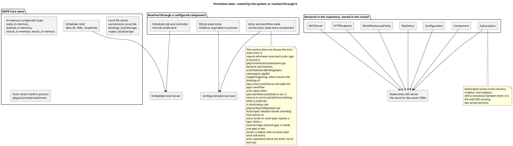
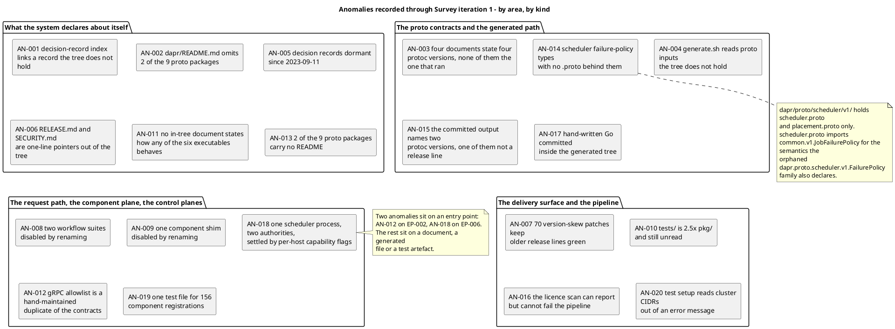

## Document Control
Phase: Survey
Status: Draft — iteration 2. Perimeter closed against the code: 16 entry points, 26 components, 15 external systems, each counted from its own table below and stated nowhere else. Documentation graded in full against the tree. Anomalies (22), Priorities (13). Coverage counts iteration 1's read of 13 areas and iteration 2's read of the 16 areas of its slice, each count reproducible from the files enumerated on its own row.
Milestone Target: end-of-Survey (SBC) — not achieved

## Perimeter
The boundary is drawn by what the code reaches for. Six Go executables run from `cmd/` and share one library;
each exposes its own listeners, and the sidecar alone opens seven: the HTTP API port, a separate public port,
a pprof port when profiling is on, the gRPC API port, the internal gRPC port, the `/healthz` port and the
metrics port. `pkg/api/grpc/server.go` builds **two** gRPC servers from one file with different trust. The
three control planes reach the Kubernetes API server and each other over signed gRPC; everything a component
does beyond the boundary goes through a shim in `cmd/daprd/components/` to a backend the operator configured.

```plantuml
@startuml
title Perimeter of the existing system - DAPR Core, as the code declares it
skinparam componentStyle rectangle
skinparam packageStyle rectangle
skinparam wrapWidth 210

package "DAPR Core - inside the boundary" {
  package "Processes - cmd/" {
    [daprd\nsidecar runtime] as DAPRD
    [operator] as OPER
    [placement] as PLACE
    [scheduler] as SCHED
    [sentry\ncertificate authority] as SENTRY
    [injector\nadmission webhook] as INJ
    [dapr-build-tools\nseparate Go module] as BTOOLS
  }

  package "daprd surfaces - pkg/api" {
    [HTTP API surface] as HTTPAPI
    [Public HTTP port\nread-only subset] as HTTPPUB
    [pprof debug port\nwhen profiling on] as PPROF
    [gRPC API\nservice Dapr] as GRPCAPI
    [Internal gRPC\nservice ServiceInvocation] as GRPCINT
    [Universal API layer] as UNIV
    [App channel\noutbound to the app] as APPCH
  }

  package "Runtime library - pkg/" {
    [Actor runtime] as ACTORS
    [Workflow engine] as WF
    [Component processor,\nhot reload, compstore] as PROC
    [Security\nSPIFFE, mTLS, tokens] as SEC
    [Diagnostics and metrics] as DIAG
    [Resiliency] as RES
  }

  package "Component shims - cmd/daprd/components" {
    [156 registration files:\nstate, pubsub, bindings, secrets,\nconfiguration, locks, crypto,\nconversation, search, vector,\nbinarystore, nameresolution,\nmiddleware] as SHIMS
  }

  package "Contracts and delivery surface" {
    [dapr/proto\n37 .proto, 9 packages] as PROTO
    [pkg/proto\n66 generated Go files] as GEN
    [apis/ and client/\n7 CRD types, generated clients] as CRD
    [charts/dapr\n7 subcharts, 7 CRDs] as CHARTS
    [docker/\n8 Dockerfiles] as DOCKER
  }
}

package "Outside the boundary" {
  [Application workload\nand its SDK] as APP
  [Kubernetes API server] as K8S
  [etcd - embedded by default,\nexternal when --etcd-embed=false] as ETCD
  [In-tree component backends:\nstate, pubsub, bindings, secrets,\nconfiguration, locks, search,\nvector, binarystore] as COMPS
  [Pluggable component process\nout of tree, over gRPC] as PLUG
  [Cloud provider APIs] as CLOUD
  [LLM and conversation providers] as LLM
  [MCP servers\nstdio, SSE or HTTP] as MCP
  [External HTTP endpoints\ndeclared as an HTTPEndpoint CR] as EXTEP
  [OTel and Zipkin collectors] as OTEL
  [Prometheus and the\nscaling metrics reader] as PROM
  [SPIFFE trust domain and\nmTLS peers] as SPIFFE
  [Helm repo and container registry] as REG
  [GitHub Actions] as GHA
  [Dapr CLI and SDKs] as CLI
}

DAPRD --> HTTPAPI
DAPRD --> HTTPPUB
DAPRD --> PPROF
DAPRD --> GRPCAPI
DAPRD --> GRPCINT
DAPRD --> APPCH
DAPRD --> ACTORS
DAPRD --> WF
DAPRD --> PROC
DAPRD --> SEC
DAPRD --> DIAG
DAPRD --> RES
HTTPAPI --> UNIV
GRPCAPI --> UNIV
GRPCINT --> UNIV
UNIV --> PROC
UNIV --> ACTORS
UNIV --> WF
PROC --> SHIMS
ACTORS --> WF
PROTO --> GEN
CRD --> GEN

OPER --> K8S
INJ --> K8S
SCHED --> K8S
SENTRY --> K8S
CHARTS --> K8S

DAPRD --> APP : app channel in and out,\nAppCallback services
DAPRD --> PLACE : actor placement stream
DAPRD --> SCHED : jobs, reminders,\nplacement when scheduler-served
DAPRD --> SENTRY : certificate signing
PLACE --> SENTRY
SCHED --> SENTRY
INJ --> SENTRY
DAPRD --> SPIFFE
SHIMS --> COMPS
SHIMS --> PLUG
SHIMS --> CLOUD
SHIMS --> LLM
SHIMS --> MCP
APPCH --> EXTEP : invocation to a BaseURL\ndeclared in an HTTPEndpoint
DAPRD --> OTEL
DAPRD --> PROM
SCHED --> ETCD : durable job store
CLI --> HTTPAPI
CLI --> GRPCAPI
GHA --> REG

note bottom of GRPCAPI
  pkg/api/grpc/server.go builds two servers from one file.
  NewAPIServer registers runtimev1pb.RegisterDaprServer and
  takes the messaging proxy as UnknownServiceHandler;
  NewInternalServer registers RegisterServiceInvocationServer
  and attaches mTLS through the security handler. Two ports,
  two trust rules, one implementation file.
end note
note bottom of HTTPPUB
  StartNonBlocking opens the API port, the public port when
  PublicPort is set, and a pprof port when EnableProfiling is
  set. The public port serves only GET metadata and health
  endpoints, because it carries no API token auth.
end note
note bottom of SCHED
  One process, two roles: the durable job store on etcd, and -
  with --placement-enabled - actor placement through the
  ReportActorTypes stream, which the scheduler answers
  Unimplemented when it does not serve placement.
end note
@enduml
```

### Components

| Component | Kind | Responsibility | Implemented by |
|---|---|---|---|
| daprd (sidecar runtime) | Component | The process the application talks to: builds the component registry, starts the security provider, reserves the internal gRPC port before components initialise, runs the runtime, and re-runs it on SIGHUP so a hot reload does not lose the port | `cmd/daprd/main.go`; `cmd/daprd/app/app.go` (`Run`, `runWithContext`, `ReserveInternalGRPCPort`); `pkg/runtime/runtime.go` |
| HTTP API surface | Component | Registers and serves the `/v1.0`, `/v1.0-alpha1`, `/v1.0-alpha2` and `/v1.0-beta1` routes for state, pub/sub, bindings, secrets, actors, configuration, crypto, subtle crypto, distributed lock, workflows, jobs, conversation, search, vector, binary store, metadata, health and shutdown; applies the API allowlist, token auth, tracing, metrics, CORS and API logging as middleware | `pkg/api/http/http.go` (`NewAPI`, `construct*Endpoints`); `pkg/api/http/server.go` (`StartNonBlocking`, `setupRoutes`, `allowedEndpoints`, `useAPIAuthentication`) |
| Public HTTP port | Component | A second listener on its own port serving only the `GET` metadata and health endpoints, deliberately without API token auth | `pkg/api/http/http.go` (`publicEndpoints`, comment "The public port has no API token auth"); `pkg/api/http/server.go` (the `PublicPort` block) |
| pprof debug surface | Component | Exposes `net/http/pprof` from the default mux on its own port, only when `EnableProfiling` is set | `pkg/api/http/server.go` (the `_ "net/http/pprof"` import and the `EnableProfiling` block serving `http.DefaultServeMux`) |
| gRPC API surface | Component | Serves `service Dapr`: state and bulk state, query, transactions, publish and bulk publish, the topic-event stream, bindings, secrets, actor reminders, timers, state and invocation, the actor-event stream, configuration, lock, crypto, subtle crypto, metadata, workflows (Alpha1 and Beta1), jobs (Alpha1 and stable), conversation (Alpha1 and Alpha2), search, vector and binary store; also hosts the workflow engine's own gRPC services | `pkg/api/grpc/server.go` (`NewAPIServer`, `RegisterDaprServer`, `workflowEngine.RegisterGrpcServer`); `dapr/proto/runtime/v1/dapr.proto` |
| Internal gRPC surface | Component | Serves `service ServiceInvocation` for sidecar-to-sidecar traffic — `CallActor`, `CallLocal`, `CallActorReminder`, `CallLocalStream`, `CallActorStream` — and receives every unregistered method through the proxy handler, which is what makes gRPC proxying work | `pkg/api/grpc/server.go` (`NewInternalServer`, `RegisterServiceInvocationServer`, `proxy.InternalHandler`); `dapr/proto/internals/v1/service_invocation.proto` |
| Universal API layer | Layer | One handler per operation, called by both the HTTP and the gRPC surface, so the two protocols cannot drift apart | `pkg/api/universal/` (29 files); `pkg/api/http/universal.go` |
| App channel | Component | The outbound half of the app conversation: builds the request to the application over HTTP or gRPC, reads `/dapr/config`, posts a triggered job to `/job/<name>`, relays server-sent events, strips hop-by-hop headers, and appends the app API token and trace context | `pkg/channel/http/http_channel.go` (`InvokeMethod`, `GetAppConfig`, `TriggerJob`, `HealthProbe`, `constructRequest`, `copyHeader`); `pkg/channel/grpc/grpc_channel.go` |
| Actor runtime | Component | Virtual actor table, placement client, reminders and timers, reentrancy locks, actor state resolution, and the actor targets that host workflow and activity actors | `pkg/actors/` (243 files, 141 of them under `targets/`) |
| Workflow engine | Component | Durable orchestration over the actor runtime: history, retention, purge, rerun, workflow access policy, signing and verification of propagated history, and the in-process MCP tool bridge | `pkg/runtime/wfengine/` (62 files); `pkg/runtime/wfengine/inprocess/mcp/` (11 files) |
| Component processor, hot reload and component store | Component | Turns declared resources into running components and reconciles component, configuration, resiliency, subscription, HTTPEndpoint, MCPServer and workflow-access-policy changes, from the operator stream or from disk | `pkg/runtime/processor/` (61 files); `pkg/runtime/hotreload/` (44 files); `pkg/runtime/compstore/` (25 files) |
| In-tree component shims | Component | Register every component implementation by category with the registry `runWithContext` builds. The package panics at init unless built with `allcomponents` or `stablecomponents`, so the binary always names its flavour | `cmd/daprd/components/` (156 files); `cmd/daprd/app/app.go` (registry chaining); `cmd/daprd/components/zz_notag.go` |
| Operator | Component | Reconciles the seven Dapr custom resources and serves `service Operator` to sidecars: list and stream updates for components, subscriptions, configurations, resiliency, HTTP endpoints, MCP servers and workflow access policies; also the pod watchdog and service reconciler | `cmd/operator/app/app.go`; `pkg/operator/` (38 files); `dapr/proto/operator/v1/operator.proto` |
| Placement | Component | Consistent-hash actor placement table with dissemination rounds and Raft-backed leadership — the standalone placement service the scheduler supersedes | `cmd/placement/`; `pkg/placement/` (26 files); `dapr/proto/placement/v1/placement.proto` |
| Scheduler | Component | Durable job and actor-reminder scheduling on etcd, embedded by default and external on `--etcd-client-endpoints`; and, with `--placement-enabled`, the newer actor placement authority with its own lock/update/unlock dissemination protocol and rendezvous hashing | `cmd/scheduler/app/app.go`; `cmd/scheduler/options/options.go`; `pkg/scheduler/` (76 files); `dapr/proto/scheduler/v1/{scheduler,placement}.proto` |
| Sentry | Component | Certificate authority: signs a workload certificate from a CSR, mints JWT SVIDs and per-audience JWTs, maintains trust bundles, and validates the caller through the insecure, Kubernetes or JWKS validator | `cmd/sentry/`; `pkg/sentry/` (36 files); `dapr/proto/sentry/v1/sentry.proto` |
| Injector | Component | The mutating admission webhook: decodes the `AdmissionReview`, declines a non-Pod kind, a pod without `dapr.io/enabled: true` and an unauthorised service account, and otherwise returns the JSON patch adding the daprd container; also re-patches the webhook `caBundle` when trust anchors rotate | `cmd/injector/app/app.go`; `pkg/injector/service/handler.go` (`handleRequest`, `isAuthorizedUser`, `podHasDaprEnabled`, `writeAdmissionResponse`) |
| Security layer | Layer | SPIFFE workload identity, the mTLS server and client options each process obtains before serving, API and app tokens, and the Sentry client | `pkg/security/` (13 files); `pkg/security/spiffe/` |
| Diagnostics and metrics layer | Layer | OpenTelemetry and Zipkin tracing, the Prometheus exporter with its extra-handler map, per-building-block monitoring and the metric catalogue | `pkg/diagnostics/` (35 files); `pkg/metrics/` (6 files) |
| Resiliency layer | Layer | Retry, timeout and circuit-breaker policies resolved per component and per API, wrapping the outbound component and app calls | `pkg/resiliency/` (13 files) |
| Proto contracts | Layer | The declared perimeter in proto3: nine packages of definitions, eight gRPC services declared in-tree (Dapr, Operator, Placement, Scheduler, CA, ServiceInvocation, and the pluggable component contracts) plus the app-callback services the application is asked to serve | `dapr/proto/` (45 files: 37 `.proto`, 8 package READMEs) |
| Generated Go bindings | Layer | Committed protoc output — messages, gRPC stubs and nine Connect handlers — never built at release time | `pkg/proto/` (66 files) |
| CRD types and generated clients | Layer | The seven custom-resource Go types with their deepcopy, and the generated clientset, informers and listers the operator and sidecar use | `apis/` (46 files); `client/` (41 files); `charts/dapr/crds/` (7 files) |
| Helm charts | Component | Deployment of all six executables with RBAC and default configuration: 7 subcharts, 7 CRDs | `charts/dapr/` (67 files) |
| Container images | Component | Eight Dockerfiles covering Linux, Windows, debug, dev and CBL-Mariner | `docker/` (22 files) |
| Build and test tooling | Component | A separate Go module (`dapr-build-tools`) beside the production executables, plus the lint-version, e2e and perf drivers that live in `cmd/` | `.build-tools/` (14 files, own `go.mod`); `cmd/check-lint-version.go`, `cmd/e2e.go`, `cmd/perf.go`, `cmd/root.go` |

### External actors and systems

| External actor or system | Reached through | Anchor |
|---|---|---|
| Application workload and its language SDK | Service — the sidecar is called by the app over HTTP and gRPC, and calls back into it through the `AppCallback` services; the app channel is the only path to the app's own code | `dapr/proto/runtime/v1/appcallback.proto` (`AppCallback`, `AppCallbackHealthCheck`, `AppCallbackAlpha`); `pkg/channel/http/http_channel.go` (`InvokeMethod`, `GetAppConfig`, `TriggerJob`); `pkg/api/http/http.go` (`configurationEventHandler.updateEventHandler`, which calls `AppChannel.InvokeMethod`) |
| Kubernetes API server | Remote call — pod and service-account reads, the webhook `caBundle` patch, CRD informers, leadership election, the scheduler's placement-pod informer | `cmd/injector/app/app.go` (`MutatingWebhookConfigurations().Patch`, `AllowedControllersServiceAccountUID`); `pkg/operator/api/informer/informer.go`; `cmd/scheduler/app/app.go` (`server.NewController`); `pkg/injector/service/handler.go` |
| etcd — embedded in each scheduler by default, or an external cluster when `--etcd-embed=false` | Data manager — the scheduler's durable job store. Embedded mode starts the etcd server in-process with its own data directory, peer cluster, space quota, compaction mode and WAL retention; external mode takes endpoints and credentials instead | `cmd/scheduler/options/options.go` (`--etcd-embed`, `--etcd-initial-cluster`, `--etcd-data-dir`, `--etcd-client-endpoints`, `--etcd-client-username`); `go.mod` (`go.etcd.io/etcd/server/v3 v3.5.33`); `pkg/scheduler/server/internal/etcd/etcd.go` |
| In-tree component backends — state stores, brokers, bindings, secret stores, configuration stores, lock stores, search, vector and binary-store backends | Service — one component operation dispatched by the runtime through a registered shim; the implementation is compiled in from `dapr/components-contrib` or written in this repository | `cmd/daprd/components/` (156 files); `pkg/components/*/registry.go`; `go.mod` (`github.com/dapr/components-contrib v1.19.1-0.20261126140908-2c9078d426b0`) |
| Pluggable component process — a component that runs outside this delivery | Service — DAPR Core is the client of a contract declared in-tree, with discovery over a socket and a health check | `dapr/proto/components/v1/{state,pubsub,bindings,secretstore,common}.proto`; `pkg/components/pluggable/` (6 files, including `discovery.go` and `grpc.go`) |
| Cloud provider APIs — Azure, AWS, GCP, Alibaba Cloud, Huawei Cloud, Tencent Cloud, Oracle Cloud | Remote call — through the cloud SDKs the individual shims import | `go.mod` (the `github.com/Azure/azure-sdk-for-go`, `github.com/aws/aws-sdk-go-v2`, `cloud.google.com/go`, `github.com/alibabacloud-go`, `github.com/huaweicloud/huaweicloud-sdk-go-v3` and `github.com/tencentcloud/tencentcloud-sdk-go` blocks); `cmd/daprd/components/state_azure_cosmosdb.go`, `bindings_aws_sqs.go`, `secretstores_gcp_secretmanager.go`, `state_alicloud_tablestore.go`, `secretstores_huaweicloud_csms.go`, `secretstores_tencentcloud_ssm.go`, `state_oracledatabase.go` |
| LLM and conversation providers — OpenAI, Anthropic, AWS Bedrock, Google AI, Mistral, HuggingFace, DeepSeek, Ollama | Remote call — the Conversation API and its component shims, with a prompt-scrubbing stage and header injection in the API path | `cmd/daprd/components/conversation_*.go` (9 files); `dapr/proto/runtime/v1/ai.proto`; `pkg/api/http/conversation.go` |
| MCP servers — a tool server reached over stdio, SSE or streamable HTTP | Remote call — MCP server resources declared as a CRD, called from the workflow engine's in-process MCP registry and from the runtime's MCP server runtime | `dapr/proto/workflows/v1/mcp.proto`; `pkg/runtime/mcp/auth/`; `pkg/runtime/wfengine/inprocess/mcp/` (11 files); `pkg/runtime/mcpservers.go` |
| External HTTP endpoints declared as an `HTTPEndpoint` custom resource | Remote call — service invocation against an app ID resolves the resource and uses its `BaseURL` and headers in place of the local app address | `pkg/channel/http/http_channel.go` (`constructRequest`, the `compStore.GetHTTPEndpoint` branch); `apis/httpEndpoint/v1alpha1/types.go` |
| OpenTelemetry and Zipkin collectors | Remote call — OTLP gRPC, OTLP HTTP and Zipkin exporters, wired per `TracingSpec`, with tracing switchable at runtime through SIGHUP | `go.mod` (`go.opentelemetry.io/otel/exporters/otlp/otlptrace{,grpc,http}`, `.../zipkin`, `github.com/openzipkin/zipkin-go`); `pkg/diagnostics/tracing.go` |
| Prometheus, and whatever reads the scheduler scaling metric | Service — the metrics exporter's `/metrics` port, and `/metrics/scaling` registered as an extra handler on the scheduler's exporter | `pkg/metrics/exporter.go`; `cmd/scheduler/app/app.go` (the `metrics.Options.Handlers` map carrying `scaling.Path`); `pkg/scheduler/monitoring/scaling/` (2 files) |
| SPIFFE trust domain and mTLS peers | Service — workload SVIDs, trust anchors and peer verification; every process obtains its identity from Sentry before it serves, and the internal gRPC server attaches mTLS through the security handler | `pkg/security/spiffe/`; `pkg/security/security.go`; `pkg/api/grpc/server.go` (`s.sec.GRPCServerOptionMTLS()`); `go.mod` (`github.com/spiffe/go-spiffe/v2 v2.7.0`) |
| Helm chart repository and container registry | Remote call — the install and upgrade paths the release notes record | `docs/release_notes/template.md`, § Upgrading; `charts/dapr/Chart.yaml` |
| GitHub Actions, with the scripts under `.github/scripts/` | Messaging — the pipeline that builds, tests and releases the tree: 25 workflow definitions and 82 helper scripts, including the version-skew patch folders | `.github/workflows/` (25 files); `.github/scripts/` (82 files under it) |
| Dapr CLI and the language SDKs — separate repositories that drive these APIs | Service — the CLI and the SDKs are the ordinary callers of the HTTP and gRPC surfaces; the CLI also sets the scheduler's broadcast address in standalone mode | `README.md`, § Repositories (the CLI and SDK table); `cmd/scheduler/options/options.go` (`--override-broadcast-host-port`, "should only be set by the CLI when in standalone mode") |

### Entry points

| ID | Entry point | Kind | Initiated by | Anchor |
|---|---|---|---|---|
| EP-001 | daprd HTTP API — the `/v1.0`, `/v1.0-alpha1`, `/v1.0-alpha2` and `/v1.0-beta1` route families | Service operation | Application workload and language SDKs | `pkg/api/http/http.go` (`NewAPI`, `apiVersionV1`, `construct*Endpoints`); `pkg/api/http/server.go` (`setupRoutes`, `handle`) |
| EP-002 | daprd gRPC API — `service Dapr`, including the app-initiated `SubscribeTopicEventsAlpha1` and `SubscribeActorEventsAlpha1` streams and the workflow engine's registered services | Service operation | Application workload and language SDKs | `dapr/proto/runtime/v1/dapr.proto` (`service Dapr`); `pkg/api/grpc/server.go` (`NewAPIServer`, `RegisterDaprServer`, `workflowEngine.RegisterGrpcServer`) |
| EP-003 | App callback services — `AppCallback`, `AppCallbackHealthCheck`, `AppCallbackAlpha` | Service operation | daprd, on a component event, an actor call, a job trigger or a configuration update | `dapr/proto/runtime/v1/appcallback.proto`; `pkg/channel/http/http_channel.go`; `pkg/channel/grpc/grpc_channel.go` |
| EP-004 | Operator gRPC service — `service Operator`, sixteen RPCs: list and stream updates for components, subscriptions, configurations, resiliency, HTTP endpoints, MCP servers and workflow access policies | Service operation | daprd, through the hot-reload loader | `dapr/proto/operator/v1/operator.proto` (`service Operator`); `pkg/operator/api/api.go`; `pkg/runtime/hotreload/loader/operator/` |
| EP-005 | Placement gRPC service — the `ReportDaprStatus` bidirectional stream | Service operation | daprd actor runtime, on stream connect and on each placement-table dissemination | `dapr/proto/placement/v1/placement.proto` (`service Placement`); `pkg/placement/internal/server/server.go` |
| EP-006 | Scheduler gRPC service — `ScheduleJob`, `GetJob`, `DeleteJob`, `WatchJobs`, `ListJobs`, `WatchHosts`, `DeleteByMetadata`, `DeleteByNamePrefix`, `ReportActorTypes` | Service operation | daprd, for jobs and actor reminders; `ReportActorTypes` only when the scheduler serves placement | `dapr/proto/scheduler/v1/scheduler.proto` (`service Scheduler`); `pkg/scheduler/server/api.go` |
| EP-007 | Sentry gRPC service — `service CA`: `SignCertificate` and `FetchJWTSVID` | Service operation | daprd, operator, placement, scheduler and injector, at start-up and on certificate renewal | `dapr/proto/sentry/v1/sentry.proto`; `pkg/sentry/server/server.go` |
| EP-008 | Sidecar-injector admission webhook — a `POST`ed `AdmissionReview` answered with an `AdmissionReview` patch | Service operation | Kubernetes API server, on pod creation | `pkg/injector/service/handler.go` (`handleRequest`); `charts/dapr/charts/dapr_sidecar_injector/templates/dapr_sidecar_injector_webhook_config.yaml`; `cmd/injector/app/app.go` |
| EP-009 | Pluggable component services — `StateStore`, `QueriableStateStore`, `TransactionalStateStore`, `TransactionalStoreMultiMaxSize` and the pub/sub, bindings and secret-store contracts: declared here, served by a process outside this delivery | Service operation | daprd, when a component is declared as a pluggable one | `dapr/proto/components/v1/state.proto` (`service StateStore`, `QueriableStateStore`, `TransactionalStateStore`, `TransactionalStoreMultiMaxSize`); `dapr/proto/components/v1/{pubsub,bindings,secretstore}.proto`; `pkg/components/pluggable/grpc.go` |
| EP-010 | Internal gRPC service — `service ServiceInvocation`: `CallActor`, `CallLocal`, `CallActorReminder`, `CallLocalStream`, `CallActorStream` | Service operation | A remote daprd, on a service-to-service or actor call, and the actor-reminder path | `dapr/proto/internals/v1/service_invocation.proto` (`service ServiceInvocation`); `pkg/api/grpc/server.go` (`NewInternalServer`) |
| EP-011 | Health endpoint — `GET /healthz` on each process's health port, plus the health handlers on the public HTTP port and the API port | Service operation | Kubernetes liveness and readiness probes, and operators | `pkg/healthz/server/server.go` (`New`, the `/healthz` handler, `Target.Ready`); `cmd/scheduler/app/app.go`, `cmd/operator/app/app.go`, `cmd/injector/app/app.go` (each starts the healthz server) |
| EP-012 | Metrics endpoints — `/metrics` on the exporter port of each process, and `/metrics/scaling` on the scheduler | Service operation | Prometheus scrapers and the scaling reader | `pkg/metrics/exporter.go`; `cmd/scheduler/app/app.go` (the `metrics.Options.Handlers` map); `pkg/scheduler/monitoring/scaling/scaling.go` |
| EP-013 | Custom-resource informer events — add, update and delete on the Dapr custom resources, delivered to the operator and forwarded to the sidecar's hot-reload loader | Platform event | Kubernetes API server | `pkg/operator/api/informer/informer.go`; `dapr/proto/operator/v1/operator.proto` (the `*UpdateEvent` streams and `ResourceEventType`); `pkg/runtime/hotreload/loader/operator/` |
| EP-014 | Build and test tooling commands — lint-version check, e2e and perf drivers, and the `dapr-build-tools` module | Platform event | A maintainer or CI, through the `Makefile` and the workflow definitions | `cmd/check-lint-version.go`, `cmd/e2e.go`, `cmd/perf.go`, `cmd/root.go`; `.build-tools/cmd/root.go` |
| EP-015 | Public HTTP port — the `GET` metadata and health endpoints served on a second listener | Service operation | Anything that can reach the port: the surface carries no API token authentication | `pkg/api/http/http.go` (`publicEndpoints`; the comment "The public port has no API token auth, so it only serves read-only endpoints"); `pkg/api/http/server.go` (the `PublicPort` block) |
| EP-016 | pprof debug port — `net/http/pprof` on the default mux, opened only when `EnableProfiling` is set | Service operation | A developer or operator debugging a sidecar, and anything else that can reach the port | `pkg/api/http/server.go` (the `_ "net/http/pprof"` import and the `EnableProfiling` block serving `http.DefaultServeMux`) |

## Technology and Size
| Area | Language | Platform and frameworks, with version | Files | Anchor |
|---|---|---|---|---|
| `.github` | YAML, Python, JavaScript, Shell | GitHub Actions; `dependabot.yml`; 25 workflow definitions under `workflows/`; 82 helper scripts under `scripts/`, 70 of which are version-skew patch files | 120 | `.github/` |
| `CODEOWNERS` | Text | — | 1 | `CODEOWNERS` |
| `CONTRIBUTING.md` | Markdown | — | 1 | `CONTRIBUTING.md` |
| `GOVERNANCE.md` | Markdown | — | 1 | `GOVERNANCE.md` |
| `LICENSE` | Text | Apache License 2.0 | 1 | `LICENSE` |
| `README.md` | Markdown | — | 1 | `README.md` |
| `RELEASE.md` | Markdown | — | 1 | `RELEASE.md` |
| `SECURITY.md` | Markdown | — | 1 | `SECURITY.md` |
| `cmd` | Go | Go 1.26.11; the six executables plus five build and test driver files; `dapr/components-contrib v1.19.1-0.20261126140908-2c9078d426b0`, `dapr/kit v0.19.1-0.20261030175054-be979ab98cc4`, `dapr/durabletask-go v0.16.1-0.20261109153237-98658f38d8cb` | 183 | `cmd/`; `go.mod` (the `go` directive and the first `require` block) |
| `cmd/daprd/components` | Go | One registration file per component family, 156 files; builds only under the `allcomponents` or `stablecomponents` tag, and `zz_notag.go` panics at init otherwise | 156 | `cmd/daprd/components/`; `cmd/daprd/components/zz_notag.go` |
| `dapr` | Protocol Buffers (proto3) | 37 `.proto` definitions in 9 packages — `common`, `components`, `internals`, `operator`, `placement`, `runtime`, `scheduler`, `sentry`, `workflows`; seven package READMEs (`scheduler/v1` and `workflows/v1` have none, AN-013) and one directory overview, `dapr/README.md`, which is the eighth non-`.proto` file; `protoc` version disputed across four documents (AN-003) and two more in the committed headers (AN-015); consumed by `connectrpc.com/connect v1.19.1` and `google.golang.org/grpc v1.83.2` | 45 | `dapr/` (45 files: `README.md` + `proto/` 44, of which 37 `.proto` and 7 package READMEs); `go.mod` |
| `docs` | Markdown, PNG | 192 documents the delivery carries: 2 at the top of the directory, 24 decision records including their index, 13 development files, 153 release-note files. The directory holds 198 files; the six under `docs/artifacts/` are written by this process and are not part of the system | 198 | `docs/`; `docs/artifacts/` (6 files) |
| `docs/decision_records` | Markdown | 23 records in five categories (`api` 12, `architecture` 3, `cli` 2, `engineering` 4, `sdk` 2) plus `decision_records.md` | 24 | `docs/decision_records/` |
| `docs/development` | Markdown, PNG | Six guides — setup, setup in VS Code, CI, developing, metrics, preview features — plus five screenshots and an image of the debug flow | 13 | `docs/development/` |
| `docs/release_notes` | Markdown, PNG | One note per release from `v0.1.0` to `v1.19.3`, plus `template.md` and an `assets/` folder of 5 PNGs | 153 | `docs/release_notes/` |
| `go.mod` | Go module manifest | `module github.com/dapr/dapr`; `go 1.26.11`; a large direct `require` block, a large indirect block, and four replacement rules plus a licence-motivated replace block | 1 | `go.mod` |
| `go.sum` | Go checksums | The resolved module graph for every `require` in `go.mod` and its transitive closure; states no version of its own | 1 | `go.sum` |
| `img` | PNG, SVG, JPEG | Banner, conceptual model and overview diagram, the last embedded by `README.md` | 3 | `img/` |
| `pkg/apphealth` | Go | The app-health probe loop: a ticker, a one-slot probe queue, a failure counter with a threshold, and a change callback. Uses `k8s.io/utils/clock` for a testable ticker; imports `pkg/config` for `AppHealthConfig` | 3 | `pkg/apphealth/health.go`; `pkg/apphealth/status.go` |
| `pkg/api` | Go | The request path: `net/http` with the `chi`-style router of `pkg/api/http`, gRPC servers on `google.golang.org/grpc v1.83.2`, the internal `ServiceInvocation` server, the 29-file `universal/` handler layer, and the hand-maintained gRPC allowlist map (AN-012) | 124 | `pkg/api/`; `pkg/api/grpc/server.go`; `pkg/api/http/server.go` |
| `pkg/channel` | Go | The app channel: an HTTP client for the application workload, a gRPC client for the same, `crypto/tls` with `AppChannelMinTLSVersion = tls.VersionTLS12`, and the fake and testing doubles | 14 | `pkg/channel/channel.go`; `pkg/channel/http/http_channel.go`; `pkg/channel/grpc/grpc_channel.go` |
| `pkg/components` | Go | The component registries: 15 category constants, one registry per category, the pluggable-component discovery and gRPC clients, and the state and lock configuration decoders. Against `dapr/components-contrib v1.19.1-0.20261126140908-2c9078d426b0` | 53 | `pkg/components/category.go`; `pkg/components/{state,pubsub,bindings,secretstores,configuration,lock,nameresolution,middleware,search,vector,binarystore,conversation,crypto}/registry.go` |
| `pkg/config` | Go | The Configuration resource as the runtime reads it: the seven preview features and their defaults, the actor-state binding rules, the workflow and activity limits, the preview ACL and secrets scopes, the metric, tracing, mTLS and pipeline specs. `gopkg.in/yaml.v3`, `k8s.io/apimachinery`, `github.com/spf13/cast` | 30 | `pkg/config/configuration.go`; `pkg/config/testdata/` (19 fixtures) |
| `pkg/cors` | Go | Two constants and nothing else: the empty default origin and the `*` wildcard | 1 | `pkg/cors/cors.go` |
| `pkg/diagnostics` | Go | Tracing and monitoring: OpenTelemetry and Zipkin exporters (`go.opentelemetry.io/otel/exporters/otlp/otlptrace{,grpc,http}`, `.../zipkin`), the `ocgrpc` and OpenCensus views behind every `dapr_*` metric name, and one monitoring module per building block | 35 | `pkg/diagnostics/tracing.go`; `docs/development/dapr-metrics.md` (which names each module) |
| `pkg/healthz` | Go | The readiness mechanism: a target registry, a per-target healthy/unhealthy flag, and a lock. `IsReady` is false when no target is registered | 8 | `pkg/healthz/healthz.go`; `pkg/healthz/server/server.go` |
| `pkg/healthz/server` | Go | The `/healthz` HTTP listener, one per process, honouring `--healthz-listen-address` | 2 | `pkg/healthz/server/server.go` |
| `pkg/messaging` | Go | The service-invocation message types and the direct-messaging client: `InvokeMethodRequest`/`InvokeMethodResponse`, the replayable request body, the method-name normaliser, and the gRPC proxy | 16 | `pkg/messaging/v1/messaging.go`; `pkg/messaging/direct_messaging.go`; `pkg/messaging/v1/` (9 files) |
| `pkg/metrics` | Go | The Prometheus exporter: `contrib.go.opencensus.io/exporter/prometheus` on a private `prometheus/client_golang` registry, gathered together with the default registry so third-party collectors are served, plus the caller-supplied extra handlers | 6 | `pkg/metrics/exporter.go`; `pkg/metrics/{meter,options}.go` |
| `pkg/middleware` | Go | The component-middleware contract: a single `HTTP func(http.Handler) http.Handler` type, and the HTTP pipeline that composes it | 7 | `pkg/middleware/middleware.go`; `pkg/middleware/http/pipeline.go` |
| `pkg/modes` | Go | Two constants and nothing else: the `kubernetes` and `standalone` runtime modes | 1 | `pkg/modes/modes.go` |
| `pkg/ports` | Go | The standalone port chooser: a SHA-256 over the app ID, working directory, user ID and hostname, mapped into the port range above the requested start, checked for availability and otherwise left to `phayes/freeport` | 2 | `pkg/ports/ports.go` |
| `pkg/proto` | Go, generated | `protoc-gen-go`, `protoc-gen-go-grpc` and `protoc-gen-connect-go` output, committed rather than built at release time; 66 files including 9 Connect handlers | 66 | `pkg/proto/` |
| `pkg/resiliency` | Go | The policy provider: retry, timeout and circuit breaker resolved per app endpoint, per actor type before and after the lock, and per component direction, over `dapr/kit/retry` and an `lru.Cache` of breaker instances per app and per actor type | 13 | `pkg/resiliency/resiliency.go`; `pkg/resiliency/breaker/` (2 files) |

## Persistent Data
Which stores this system keeps, and which it only reaches. The distinction the code draws: a store whose
lifecycle DAPR Core owns is listed; a store it merely writes through a configured component is listed at the
boundary, with the component named as the data manager.

| Store | Kind | Data manager | Anchor |
|---|---|---|---|
| Scheduler etcd — the durable job and actor-reminder store | Structured document | Embedded etcd server started by the scheduler, `go.etcd.io/etcd/server/v3 v3.5.33`; or an external etcd cluster when `--etcd-embed=false` | `cmd/scheduler/options/options.go` (`--etcd-embed`, `--etcd-data-dir`, `--etcd-initial-cluster`, `--etcd-client-endpoints`); `pkg/scheduler/server/internal/etcd/etcd.go`; `go.mod` |
| The seven Dapr custom resources — `Component`, `Configuration`, `Resiliency`, `Subscription`, `HTTPEndpoint`, `MCPServer`, `WorkflowAccessPolicy` | Structured document | Kubernetes API server, through `k8s.io/client-go v0.32.3` informers; `Subscription` is served as both `v1alpha1` and `v2alpha1` with a conversion | `apis/{components,configuration,resiliency,subscriptions,httpEndpoint,mcpserver,workflowaccesspolicy}/v1alpha1/types.go`; `apis/subscriptions/v2alpha1/conversion.go`; `charts/dapr/crds/` (7 files) |
| Actor and workflow state | Relational schema where the configured actor state store component is a SQL store; the store itself is outside the boundary | A state-store component, one per actor type where the app binds them: `actorStateStoreBindings` returns the store each actor type is bound to and enforces nothing; the binding rules — a named store, at least one actor type, no type bound twice, no reserved `dapr.internal` type — are refused at configuration load by `ActorsSpec.Validate`. An app that binds no store uses the default actor state store, which the tree does not name | `pkg/runtime/actorstatestores.go` (`actorStateStoreBindings`); `pkg/config/configuration.go` (`ActorsSpec.Validate`, `StateStoreByActorType`, `WorkflowSpec.GetStateStore`); `pkg/actors/state/resolver.go`; `pkg/runtime/wfengine/state/` (9 files); `pkg/config/testdata/{actor_state_stores_config.yaml,invalid_actor_state_stores_config.yaml,workflow_state_store_config.yaml}` |
| SQLite state store | Relational schema | `modernc.org/sqlite v1.42.2` through the state-store shim, in-process | `cmd/daprd/components/state_sqlite.go`; `go.mod` |
| Local file secret store | Record file | Files read from a configured directory | `cmd/daprd/components/secretstores_local_file.go` |
| Local file crypto store | Record file | Keys read from a configured directory | `cmd/daprd/components/crypto_localstorage.go` |
| Local storage binding | Record file | Files written to a configured directory | `cmd/daprd/components/bindings_localstorage.go` |
| In-memory component stores — state, pub/sub, search and vector | Structured document | Process memory; lost when the sidecar exits | `cmd/daprd/components/state_in-memory.go`, `pubsub_in-memory.go`, `search_in-memory.go`, `vector_in-memory.go` |
| Actor timers held by the host | Structured document | In-process timer table, not durable; actor reminders are durable through the scheduler instead | `pkg/actors/internal/timers/inmemory/` (4 files); `pkg/actors/timers/timers.go` |

## Documentation
What the delivery says about itself, graded against the tree. The owner's `.iari/README.md` names the stakeholder
and points to no document, so the perimeter documents were found from the tree and from each other.

```plantuml
@startuml
title Documentation the delivery carries, graded against the repository tree
skinparam componentStyle rectangle
skinparam wrapWidth 250

package "Current - nothing in the tree contradicts it" {
  [README.md\nsystem statement] as D1
  [docs/README.md\nin-tree docs index] as D2
  [docs/CONTRIBUTING.md\nproject contribution contract] as D3
  [CONTRIBUTING.md\nupstream contribution guide] as D4
  [GOVERNANCE.md\nmaintainer governance] as D5
  [CODEOWNERS\nreview ownership] as D6
  [LICENSE\nApache-2.0] as D7
  [RELEASE.md and SECURITY.md\none-line pointers out of the tree] as D8
  [docs/development/\nsetup, build, debug, metrics] as D9
  [docs/release_notes/\n147 notes, v0.1.0 to v1.19.3] as D10
  [docs/release_notes/template.md] as D11
  [.github/pull_request_template.md] as D12
  [.github/ISSUE_TEMPLATE/\n9 forms] as D13
  [pkg/api/errors/README.md\nthe rich error model] as D14
  [pkg/responsewriter/README.md\nnegroni fork and its provenance] as D15
  [tests/README.md\nthe nine directories of the substrate] as D16
  [.build-tools/README.md\nthe build-tools CLI] as D17
  [charts/dapr/README.md\nevery chart parameter and its default] as D18
}

package "Contradicted by the code" {
  [docs/decision_records/decision_records.md\nindexes ARC-004, absent from the tree] as X1
  [dapr/README.md\npackage table omits scheduler/ and workflows/] as X2
  [tools/proto/generate.sh\nreads proto inputs the tree does not hold] as X3
  [dapr/proto/runtime/v1/README.md\nprotoc v4.25.4] as X4
  [.github/copilot-instructions.md\nprotoc v34.1] as X5
  [pkg/runtime/wfengine/README.md\nstates no purge and no workflow e2e test] as X6
}

package "Outdated - true when written, not true now" {
  [docs/decision_records/**\nno record added since 2023-09-11] as O1
  [cmd/*/README.md\nfive three-line redirects to docs.dapr.io] as O2
  [docs/development/README.md\nindexes 5 of the 6 guides] as O3
}

note bottom of X6
  The README states that completed workflow state is
  never purged and must be cleaned by hand, and that
  no end-to-end test targets workflows. The tree holds
  pkg/runtime/wfengine/state/retentioner/, the
  stateRetentionPolicy fields of the Configuration
  spec, tests/integration/suite/daprd/workflow/ (836
  files) and tests/e2e/workflows/ (AN-021).
end note
note bottom of O3
  docs/development/ holds six guides. The index links
  five of them; preview-features.md, the only in-tree
  statement of how a feature flag is declared, toggled
  and removed at GA, is not among them (AN-022).
end note
note bottom of D16
  It names the nine directories the substrate holds and
  each exists. It states no behaviour of the system
  under test, so nothing in it can go stale against the
  code it exercises.
end note
@enduml
```

| Document | Useful for | How up to date | Anchor |
|---|---|---|---|
| `README.md` | What the system is, the twelve APIs it exposes, the platforms it runs on, the SDKs, the repository family | Current — every claim checked against the tree holds: six binaries, the API set, the sidecar model | `README.md`, § The runtime for durable execution / Distributed Application APIs / Run Anywhere |
| `docs/README.md` | The index of in-tree runtime documentation: three pointers — decision records, development, release notes | Current — the three it names all exist | `docs/README.md`, § Runtime docs |
| `docs/CONTRIBUTING.md` | This project's contract: the rules of the owner's guide it replaces, the label vocabulary, the branch rule, the conventions table, what a review checks | Current — every path it cites was checked and exists | `docs/CONTRIBUTING.md`, § 1 Rules of the existing guide this file replaces through § 5 What a review checks |
| `CONTRIBUTING.md` (root, the owner's) | The upstream contribution workflow: DCO sign-off, the four issue types, the pull-request sequence, third-party licensing, slash commands | Current — it is the owner's text, unchanged below the one pointer line added at its top with the stakeholder's approval | `CONTRIBUTING.md`, § Issues / Contributing to Dapr / Developer Certificate of Origin |
| `GOVERNANCE.md` | How the project is governed: maintainer responsibility, the three-month activity rule, the super-majority vote, the CODEOWNERS pull request | Current — the CODEOWNERS file it names exists and holds the two maintainer teams | `GOVERNANCE.md`, § Project Maintainers |
| `CODEOWNERS` | Who owns review of the whole tree | Current | `CODEOWNERS` |
| `LICENSE` | The licence grant: Apache 2.0, with the Dapr Authors copyright form | Current | `LICENSE` |
| `RELEASE.md` | The pointer to the release process | Current as a pointer — the process it names lives in `dapr/community`, outside the delivery | `RELEASE.md` |
| `SECURITY.md` | The pointer to the security-issue policy | Current as a pointer — the policy lives in `docs.dapr.io`, outside the delivery | `SECURITY.md`, § Security Policy |
| `docs/decision_records/decision_records.md` | The decision-record index, the five category prefixes, the naming rule and the required fields of a record | Contradicted by the code — it links `ARC-004-http-server.md`, and `docs/decision_records/architecture/` holds three records; the index counts 24 links against 23 files | `docs/decision_records/decision_records.md`, § Dapr decision record organization and index (Architecture list, fourth entry) against `docs/decision_records/{api,architecture,cli,engineering,sdk}/` (23 records) |
| `docs/decision_records/**` — 23 records in ARC, API, CLI, SDK, ENG | The architecture, API, CLI, SDK and engineering decisions in force | Outdated — the newest record was committed on 2023-09-11 (`c338385`), while features landed through 2026-11 (scheduler placement authority `3d9dbe6`, search and vector blocks `04215fd`, workflow schedules `61914fd`); the only later commit touching the folder is a typo fix (`62d5128`, 2026-11-25) | `docs/decision_records/{architecture,api,cli,sdk,engineering}/`; commit log of the folder |
| `docs/development/README.md` and its five linked guides | How to set up a development environment, build, debug, run unit tests, and configure CI | Current as guides — the commands they give (`make build`, `make test`, `make check`, `make docker-deploy-k8s`, golangci-lint v2.10.1) match `.github/copilot-instructions.md` and the `Makefile` targets they name. The index itself is Outdated: it lists five of the six guides and omits `preview-features.md` (AN-022) | `docs/development/README.md`; `docs/development/developing-dapr.md`, § Build the Dapr binaries / Run unit tests / One-line command for local development |
| `docs/development/preview-features.md` | How a preview feature is gated: the flag is declared in `pkg/config/configuration.go`, toggled on a Configuration resource, checked with `IsFeatureEnabled`, and removed at GA | Current — the seven feature constants and the `IsFeatureEnabled` method it names are the ones the file declares, and the `spec.features` list it shows is the one `ConfigurationSpec` declares | `docs/development/preview-features.md`, § Declaring / Toggling / Using / Release GA; `pkg/config/configuration.go` (the `Feature` constants and `IsFeatureEnabled`) |
| `docs/development/dapr-metrics.md` | The metric catalogue per process and per component, the tags each metric carries, and the source file of every group | Current — every source file it names exists under `pkg/{operator,injector,placement,sentry,scheduler}/monitoring/` or `pkg/diagnostics/`; it marks the metrics retired in 1.17 as retired and documents the scheduler's `/metrics/scaling` handlers | `docs/development/dapr-metrics.md`, § Dapr Common metrics through § Job metrics; `pkg/metrics/exporter.go` (the extra-handler map it describes) |
| `docs/release_notes/` — 147 notes, `v0.1.0` to `v1.19.3`, plus a template and 5 asset images | What changed in each release: the problem, the impact, the root cause and the solution, per fix | Current — the newest notes (`v1.19.3`, `v1.18.12`, `v1.17.21`) accompany commits of 2026-11-26 | `docs/release_notes/` (153 files: 147 notes, `template.md`, `assets/` 5 files); `docs/release_notes/v1.19.3.md` |
| `docs/release_notes/template.md` | The shape of a release note and its substitution variables | Current — its sections are the ones the newest notes fill | `docs/release_notes/template.md`, § New in this release / Upgrading / Breaking Changes / Deprecation Notices |
| `.github/copilot-instructions.md` | Build, test, lint, formatting and convention guidance for a contributor or an agent: package layout, build tags, the licence header, import grouping, test patterns, the PR checklist | Contradicted by the code — the build, test and lint guidance matches the tree, but it states `protoc` v34.1 while `dapr/proto/runtime/v1/README.md` states v4.25.4, `dapr/README.md` states v25.4 and `tools/proto/generate.sh` pins 3.10.0 | `.github/copilot-instructions.md`, § Protobuf / gRPC (required tools) |
| `.github/pull_request_template.md` | The pull-request checklist a change is asked to satisfy | Current — every item is checkable against the tree (compile, tests, docs and spec issue in `dapr/docs`, sample) | `.github/pull_request_template.md`, § Checklist |
| `.github/ISSUE_TEMPLATE/` — 9 forms | The intake shape of a bug, a discussion, an endgame, a feature request, a minor patch release, a proposal, a question and a release planning item | Current | `.github/ISSUE_TEMPLATE/` |
| `cmd/daprd/README.md`, `cmd/injector/README.md`, `cmd/operator/README.md`, `cmd/placement/README.md`, `cmd/sentry/README.md` | A pointer to the published documentation of each executable | Outdated as documentation — each is a three-line redirect to `docs.dapr.io`, so no in-tree document states how any of the five behaves; `cmd/scheduler/` carries no README at all (AN-011) | `cmd/daprd/README.md`; `cmd/injector/README.md`; `cmd/operator/README.md`; `cmd/placement/README.md`; `cmd/sentry/README.md` |
| `dapr/README.md` | The proto package overview and the client-generation steps | Contradicted by the code — the package table lists `common`, `internals`, `runtime`, `operator`, `placement`, `sentry`, `components`, and the tree also holds `scheduler/` and `workflows/`; it names `protoc` v25.4 | `dapr/README.md`, § Overview and § Proto client generation |
| `dapr/proto/**/README.md` — 7 package notes | Per-package proto notes and the generation prerequisite | Contradicted by the code for `runtime/v1` (protoc v4.25.4); the other six state no version | `dapr/proto/runtime/v1/README.md`, § Proto client generation |
| `pkg/runtime/wfengine/README.md` | How the workflow engine works: internal actors, the workflow state key scheme, the reminder-per-step execution model, how to build and test it | Contradicted by the code — it states "there is no automatic purging of state for completed workflows" and "There are no end-to-end tests that directly target the Dapr Workflows engine yet"; the tree holds `pkg/runtime/wfengine/state/retentioner/`, the `stateRetentionPolicy` fields of the workflow spec, `tests/integration/suite/daprd/workflow/` (836 files) and `tests/e2e/workflows/` (AN-021) | `pkg/runtime/wfengine/README.md`, § State storage ("IMPORTANT") and § Manual testing; `pkg/runtime/wfengine/state/retentioner/` (2 files); `tests/e2e/workflows/` (8 files) |
| `pkg/api/errors/README.md` | How to add an error to the rich error model: check for an existing file, name it after the building block, build it with the `github.com/dapr/kit/errors` builder and `WithFieldViolation`, and test it where the state API's errors are tested | Current — both files it names as the location of errors exist (`pkg/messages/predefined.go` for the legacy set, `pkg/api/errors/` for the new one), its named reference implementation `pkg/api/errors/state.go` exists, and the two integration files it points at are under `tests/integration/suite/daprd/state/` | `pkg/api/errors/README.md`, § Step 1 Understanding the Current Error Handling and § Step 3 Designing Rich Error Messages; `pkg/api/errors/` (7 files, `state.go` among them); `tests/integration/suite/daprd/state/{grpc,http}/` |
| `pkg/responsewriter/README.md` | The provenance of a forked package: which upstream it came from, at which commit, and the MIT licence it carries | Current — `response_writer.go` sits beside it and the licence text is the upstream's | `pkg/responsewriter/README.md`, § License; `pkg/responsewriter/response_writer.go` |
| `tests/README.md` | The layout of the test substrate: what each of the nine directories holds, and a pointer to the how-to guides under `tests/docs/` | Current — all nine directories it names exist, and the five guides it links are among the eight files under `tests/docs/` | `tests/README.md`, § End-to-end tests; `tests/docs/` (8 files) |
| `.build-tools/README.md` | What the separate `dapr-build-tools` module is, how to run it from source and from a compiled binary | Current — the directory holds its own `main.go`, `go.mod` and a `cmd/` of subcommands, which is what the note describes | `.build-tools/README.md`, § Running the CLI; `.build-tools/` (14 files: `main.go`, `go.mod`, `cmd/` 6, `testdata/` 3) |
| `charts/dapr/README.md` | The deployment reference: the seven subcharts, and every chart parameter with its default — registry, tag, HA, mTLS, per-service replicas, resources, the scheduler's etcd tuning, the injector's service-account allowlist | Current — it is the only in-tree statement of what the chart deploys and of the etcd and scheduler settings the scheduler's own options read; nothing read in the tree contradicts it | `charts/dapr/README.md`, § Configuration (the global, operator, placement, RBAC, scheduler, sentry and sidecar-injector option tables); `charts/dapr/charts/` (7 subcharts) |
| `tools/proto/generate.sh` | How proto clients for the SDKs are generated, and which proto files are the inputs | Contradicted by the code — the `generate()` loop reads `${top_root}/pkg/proto/dapr/dapr.proto` and `${top_root}/pkg/proto/daprclient/daprclient.proto`; `pkg/proto/` holds 66 generated `.pb.go` files and no `.proto`, and the definitions live under `dapr/proto/`. It also pins protoc 3.10.0 and the Java gRPC plugin 1.24.1 | `tools/proto/generate.sh`, § generate() and § Download and install tools |
| `.iari/README.md` | Who leads the project | Current — stakeholder input, not part of the delivery | `.iari/README.md` |

## History
Each row states the commits listed and the period they cover. A reading is drawn only from what those commits
show being added or taken out — never from how the code looks today.

| Area | Commits read and period | What was removed or reworked | Reading | Commits |
|---|---|---|---|---|
| `cmd` | 25 commits, 2026-06-23 → 2026-11-17 | The placement-to-scheduler cutover ran as five numbered steps (add protos, add scheduler placement, helm and flags, daprd takes placement from the scheduler, authority detection with rollback); search and vector building blocks added; binary-store building block added; metrics listen address made configurable on sentry, operator and injector; scheduler made to exit when it cannot bind its port and to retry client creation instead of exiting | Unstable | `2707e0a`, `effad08`, `9000808`, `1275498`, `04215fd`, `ee35baa`, `d221275`, `180905c`, `9abc62a`, `397d859`, `ec2ac5f`, `8608664`, `ece6ec7`, `3d9dbe6`, `9aeab3b`, `0ba3c1b`, `e87872a`, `5e54d0c`, `f2d92bc`, `5aeedcb`, `b8216ba`, `35a729a`, `6365688`, `717d62f`, `b334e5f` |
| `dapr` (proto contracts) | 25 commits, 2026-04-20 → 2026-11-18 | Scheduler placement protos added; actor list/get timers added; the MCP proto types replaced with the upstream Go SDK's types; workflow access policy extended to all operations; global and per-name concurrency limits added; cross-app workflow operations added; pull dispatch of reminders to sidecars added | Unstable | `14c3158`, `f664c59`, `5573c4e`, `2dab9fd`, `effad08`, `04215fd`, `397d859`, `3759a59`, `1d282c9`, `92bbb0e`, `3d9dbe6`, `e2030a5`, `19e9dbd`, `cd72c15`, `8fd31d1`, `df9137c`, `a86c03b`, `d16e4de`, `6d8290e`, `88a04dd`, `1ebb858`, `1b4bef8`, `39c1ef7`, `c581fa8`, `c8463fc` |
| `.github` | 25 commits, 2026-10-13 → 2026-11-26 | CI reworked for duration and reliability rather than for new function: a dedicated integration-test build cache and more parallelism, more packages per KinD run, a required gate because of generated names, DCO fixed for the merge queue, backport auto-merge added, version-skew runs retargeted as the previous minor moved, MacOS runner versions bumped, the perf cluster moved to a new region | Unstable | `acde1d4`, `14eea71`, `c783324`, `79b189f`, `9d1b21a`, `75a49d9`, `41ac782`, `a872136`, `9000808`, `e92225e`, `a8e26cf`, `edff789`, `c5a9d80`, `903a585`, `24f5c3c`, `cbeb475`, `a24a198`, `7f1b470`, `a4b1184`, `66f70d0`, `04215fd`, `aed36f3`, `c2c0842`, `0d489b3`, `10d05f1` |
| `docs/decision_records` | 20 commits, 2020-04-16 → 2026-11-25 | Records added until 2023-09-11 and nothing after it; a mis-titled file corrected in 2023-08; one record renumbered from API-008 to API-009 in 2020 when the numbering collided; the only commit after 2023 is a typo fix in 2026-11 | Consolidating — dormant rather than settling | `62d5128`, `c338385`, `0904549`, `bac6ae6`, `855f09c`, `3ab2591`, `6299e15`, `f4cc6b8`, `47b8651`, `856d8cd`, `8f34ff0`, `71086c4`, `08b630d`, `9f4356c`, `39335d8`, `5f6e428`, `d325087`, `5295e0a`, `50988ac`, `904a928` |
| `docs/release_notes` | 20 commits, 2026-10-30 → 2026-11-26 | A run of security and correctness fixes each took its own patch note across the 1.17, 1.18 and 1.19 lines: SQLite driver update, gRPC header cap and constant-time token compare, forged outbox messages, malformed encrypted state, ACL verb rules without metadata, brotli advisory, Redis pub/sub read timeout | Stable — one note per fix, no rework of older notes | `ffbf163`, `0337c32`, `298d459`, `cd15eb6`, `b7d4231`, `4313e79`, `12c6cbd`, `29f2d37`, `4433e2f`, `7ee17e2`, `f09a418`, `0be3f04`, `55312d1`, `c10b835`, `bd54d83`, `3342040`, `f2baba4`, `ee602ae`, `6eb861d`, `30eeca1` |
| `go.mod` | 20 commits, 2026-10-13 → 2026-11-26 | The Go toolchain moved three times (1.26.9 → 1.26.10 → 1.26.11); `components-contrib`, `kit` and `durabletask-go` were pinned to exact pseudo-versions after periods of tracking HEAD; OpenTelemetry, gorilla/websocket and lz4 bumped together for `govulncheck`; `modernc.org/sqlite` bumped to stop leaking read transactions; brotli bumped for an advisory | Unstable | `ffbf163`, `f1895d6`, `298d459`, `4313e79`, `61914fd`, `24bfe82`, `2dab9fd`, `dc63861`, `effad08`, `c10b835`, `1275498`, `cded45a`, `9dcb298`, `d23b217`, `02f0b3c`, `accd8c8`, `04215fd`, `7f85241`, `397d859`, `05080a2` |
| `docs` (whole directory) | 25 commits, 2026-11-16 → 2026-11-27 | Before 2026-11-27 the only entries are release notes, typo fixes and the 1.17/1.18/1.19 patch notes; the 2026-11-27 entries are this project's own artifact and guide commits and carry no claim about the system | — not read for the system; the burst is this process writing | `9ebb541`, `5b90dc4`, `b1fe75e`, `84d16e0`, `21da553`, `83002fe`, `131c28c`, `9bdd38e`, `c72f585`, `65471ae`, `ea9c027`, `afb2e0c`, `2a61738`, `79ede0e`, `da96edb`, `0e06a44`, `71bbf5b`, `ffbf163`, `0337c32`, `62d5128`, `298d459`, `cd15eb6`, `b7d4231`, `4313e79`, `12c6cbd` |
| Root documents — `README.md`, `CONTRIBUTING.md`, `GOVERNANCE.md`, `LICENSE`, `CODEOWNERS`, `RELEASE.md`, `SECURITY.md` | Commits not read | — | Not read — their content was read this iteration for the Perimeter and the Documentation grading; no commit log was listed for them, so nothing is claimed about how they changed | — |
| `img` | Commits not read | — | Not read — binary assets | — |
| `pkg/proto` | Commits not read | — | Not read — generated code; its history is `dapr/proto`'s history | — |

## Anomalies
Twenty anomalies, each cited to the file it was read from. Nothing here is a judgement of quality: each row states what does not hold together, the anchor that shows it, and the risk it carries for whoever reads the system next.

| ID | Anomaly | Kind | Evidence | Likelihood | Impact |
|---|---|---|---|---|---|
| AN-001 | The decision-record index links a record the delivery does not hold: `ARC-004-http-server.md` is listed under Architecture, and `docs/decision_records/architecture/` holds three records. The index offers 24 links; the folder holds 23 records. A reader following the index reaches a 404. | Missing from the delivery | `docs/decision_records/decision_records.md`, § Dapr decision record organization and index (Architecture list, fourth entry) against `docs/decision_records/architecture/` (3 files: ARC-001, ARC-002, ARC-003) | likely | moderate |
| AN-002 | The proto package overview in `dapr/README.md` describes seven packages while the tree holds nine: `scheduler/` and `workflows/` are absent from the table. The two omitted packages carry the scheduler contract the actor-reminder cutover depends on and the MCP server contract, and both are declared in this inventory's entry points (EP-006, and the MCP server external system). | Document contradicted by the code | `dapr/README.md`, § Overview (a 7-row table) against `dapr/proto/scheduler/v1/{scheduler,placement}.proto` and `dapr/proto/workflows/v1/mcp.proto` | likely | low |
| AN-003 | Four documents each claim to be the proto generation path and each states a different `protoc` version: `tools/proto/generate.sh` pins 3.10.0, `dapr/README.md` names v25.4, `dapr/proto/runtime/v1/README.md` names v4.25.4, and `.github/copilot-instructions.md` names v34.1 and adds three plugin versions. Regenerating the committed bindings from any one of them does not reproduce the others, and the committed headers state two further versions again (AN-015). | Document contradicted by the code | `tools/proto/generate.sh`, § the `VERSION=` assignment; `dapr/README.md`, § Proto client generation; `dapr/proto/runtime/v1/README.md`, § Proto client generation; `.github/copilot-instructions.md`, § Protobuf / gRPC (Required tools) | likely | moderate |
| AN-004 | The documented client-generation script reads proto inputs the tree does not hold and writes into sibling repositories: its `generate()` loop reads `pkg/proto/dapr/dapr.proto` and `pkg/proto/daprclient/daprclient.proto`, while `pkg/proto/` holds generated `.pb.go` files and no `.proto`, and the definitions live under `dapr/proto/`. It also generates the JS, Java, Python and .NET SDKs into `../<language>-sdk/`, which are not part of this delivery. | Document contradicted by the code | `tools/proto/generate.sh`, § generate() (the `for proto_file in ...` loop) and § Download and install tools; against `pkg/proto/` and `dapr/proto/` | likely | moderate |
| AN-005 | No decision record has been added since 2023-09-11 (`c338385`) although decisions of the first rank landed after it: scheduler-hosted actor placement with a cutover and rollback (`3d9dbe6`, 2026-09-21), the search and vector building blocks (`04215fd`, 2026-10-20), MCP server resources, and workflow schedules (`61914fd`, 2026-11-11). The system's own statement of its architecture stops three years before its architecture did. | Missing from the delivery | Commit log of `docs/decision_records/` (last substantive commit `c338385`, 2023-09-11; last commit `62d5128`, 2026-11-25, a typo fix) against the `cmd` and `dapr` commit logs | likely | moderate |
| AN-006 | The release process and the security-issue policy are not in the delivery. `RELEASE.md` is a single link into `dapr/community` and `SECURITY.md` is a single link into `docs.dapr.io`, so how a release is cut and how a vulnerability is reported, triaged and disclosed cannot be read from the tree that produces the release. | Missing from the delivery | `RELEASE.md` (one line); `SECURITY.md`, § Security Policy (one link) | likely | moderate |
| AN-007 | Compatibility with older releases is kept by patching the old release's test tree rather than by adapting the current one: `.github/scripts/version-skew-test-patches/` holds 70 patch files across `release-1.12` to `release-1.18`, split between `dapr-sidecar-master` and `control-plane-master`. Each new release line adds a folder of patches that must keep applying. | Exceptional entity | `.github/scripts/version-skew-test-patches/e2e/` (18 files in 5 release folders) and `.../integration/` (52 files in 6 release folders) | likely | moderate |
| AN-008 | Two test files are disabled by renaming rather than deleted or fixed: `actors_test.go-TODO` and `wfengine_test.go-TODO` sit beside the suites they belong to. The rename removes them from the build silently and leaves no record of what they assert or why they stopped passing. | Suspicious coding style | `pkg/runtime/wfengine/backends/actors/actors_test.go-TODO`; `pkg/runtime/wfengine/wfengine_test.go-TODO` — tree evidence only; the package is read in iteration 3 | possible | moderate |
| AN-009 | One component shim is disabled by renaming: `bindings_kitex.go_disabled` sits among the 156 component registrations, so the Kitex binding is neither registered nor removed. A reader counting components from the directory counts one that does not build. | Suspicious coding style | `cmd/daprd/components/bindings_kitex.go_disabled` | possible | low |
| AN-010 | The test substrate is larger than the code it tests and is the delivery's weight centre: `tests/` holds 3 335 files against `pkg/`'s 1 330 and `cmd/`'s 183, and the integration suite alone is 2 073 files. Reading it is the phase's overrun risk; the cut assigns it to iteration 4. | Exceptional entity | Repository tree: `tests/` (3 335 files), `tests/integration/suite/` (2 073 files), `pkg/` (1 330 files), `cmd/` (183 files) | likely | moderate |
| AN-011 | No in-tree document says how any of the six executables behaves. Five of them carry a three-line README that redirects to `docs.dapr.io`; `cmd/scheduler/` carries none, and it is the process that took both the reminder and the actor-placement authority. Behaviour a reader of this repository needs — what the scheduler's placement mode does, when the injector declines to inject, what placement's leadership does — is only on a documentation site outside the delivery. | Missing from the delivery | `cmd/daprd/README.md`, `cmd/injector/README.md`, `cmd/operator/README.md`, `cmd/placement/README.md`, `cmd/sentry/README.md` (each a redirect); `cmd/scheduler/` (no README; the directory holds `main.go`, `app/` and `options/` only) | likely | moderate |
| AN-012 | The gRPC API allowlist is a hand-maintained duplicate of the proto contracts. `pkg/api/grpc/endpoints.go` holds a literal map of some 120 fully-qualified method strings, grouped by API name and version, and nothing generates it from `dapr/proto/`. An RPC added to a `.proto` but not to this map cannot be named in a Configuration's `api` allowlist or denylist, so it silently escapes the access control the operator set; an RPC removed from a `.proto` leaves a dead entry that matches nothing. | Suspicious coding style | `pkg/api/grpc/endpoints.go` (`var endpoints = map[string][]string{…}`) against `dapr/proto/runtime/v1/dapr.proto`; consumed by `apiAccessRuleToMap` in the same file and by `getMiddlewareOptions` in `pkg/api/grpc/server.go` | likely | moderate |
| AN-013 | Two of the nine proto packages carry no README while the other seven do: `dapr/proto/scheduler/v1/` and `dapr/proto/workflows/v1/`. They are the two newest packages — the placement cutover and the MCP server contract — so the notes exist for exactly the packages whose semantics are settled and are missing for the ones a reader most needs explained. | Missing from the delivery | `dapr/proto/{common,components,internals,operator,placement,runtime,sentry}/v1/README.md` (7 files) against `dapr/proto/scheduler/v1/` (`scheduler.proto`, `placement.proto`) and `dapr/proto/workflows/v1/` (`mcp.proto`) | likely | low |
| AN-014 | A scheduler failure-policy type family in the committed bindings has no definition in the delivery. `pkg/proto/scheduler/v1/failurepolicy.pb.go` declares `dapr.proto.scheduler.v1.FailurePolicy`, `FailurePolicyDrop` and `FailurePolicyConstant`, generated from `dapr/proto/scheduler/v1/failurepolicy.proto` — a file the tree does not hold. The scheduler contract in use does not reference them: `scheduler.proto` imports `dapr/proto/common/v1/common.proto` and types `Job.failure_policy` as `common.v1.JobFailurePolicy`, so two parallel failure-policy families exist in one package and only one has a source. | Missing from the delivery | `pkg/proto/scheduler/v1/failurepolicy.pb.go` (header `source: dapr/proto/scheduler/v1/failurepolicy.proto`, and the `FailurePolicy`/`FailurePolicyDrop`/`FailurePolicyConstant` declarations) against `dapr/proto/scheduler/v1/` (2 files: `scheduler.proto`, `placement.proto`); `dapr/proto/scheduler/v1/scheduler.proto`, § `message Job` and the import block; `dapr/proto/common/v1/common.proto`, § `JobFailurePolicy` | likely | moderate |
| AN-015 | The committed generated tree records two different `protoc` versions in its own headers, so it cannot have been produced by one run of one toolchain. `pkg/proto/scheduler/v1/failurepolicy.pb.go` names `protoc v5.29.3`; `pkg/proto/common/v1/common.pb.go` and `pkg/proto/workflows/v1/mcp.pb.go` name `protoc v7.34.1`, all three sharing `protoc-gen-go v1.32.0`. Neither version appears in any of the four documents that state a version (AN-003), and `v7.34.1` matches none of them in any form. | Document contradicted by the code | `pkg/proto/scheduler/v1/failurepolicy.pb.go`, header `// protoc v5.29.3`; `pkg/proto/common/v1/common.pb.go` and `pkg/proto/workflows/v1/mcp.pb.go`, header `// protoc v7.34.1`; against the four version statements listed in AN-003 | likely | moderate |
| AN-016 | The licence-compliance scan can report but cannot fail the pipeline. `.github/workflows/fossa.yml` runs `fossas/fossa-action` to upload a scan, and the step that would act on the result — `run-tests: true` — is commented out with the note that it had been failing on FOSSA server issues, with the comment left in place: "VIEW RESULTS IN FOSSA PORTAL INSTEAD". The API key the job uses is written into the workflow file in plain text, annotated as a push-only token that is safe to expose. A dependency-licence failure therefore reaches no gate and no reviewer. | Inferior quality | `.github/workflows/fossa.yml`, § the `fossa-scan` job — the `FOSSA_API_KEY` env assignment and the commented-out "Run FOSSA Test" step | likely | moderate |
| AN-017 | Hand-written Go is committed inside the generated tree. Alongside the 66 `*.pb.go` files, `pkg/proto/` holds `proto.go`, `runtime/v1/dapr_additional.go`, `runtime/v1/dapr_tracing.go`, `runtime/v1/dapr_tracing_test.go`, `internals/v1/service_invocation_additional.go` and `internals/v1/service_invocation_additional_test.go` — files no protoc invocation produces and that a regeneration of the directory would overwrite. Their names state they are additions to generated types; nothing in the tree states which generation step preserves them. | Suspicious coding style | `pkg/proto/proto.go`, `pkg/proto/runtime/v1/{dapr_additional.go,dapr_tracing.go,dapr_tracing_test.go}`, `pkg/proto/internals/v1/{service_invocation_additional.go,service_invocation_additional_test.go}` — tree evidence; the six files were not opened this iteration | possible | moderate |
| AN-018 | One scheduler process serves two authorities, and the split between them is negotiated at runtime rather than fixed by deployment. With `--placement-enabled` it answers `ReportActorTypes` as the actor-placement leader in addition to holding the durable job and reminder store; every host advertises `supports_pull_slots`, `scheduler_placement_enabled`, `leader` and `supports_scheduler_placement` on the stream, and a mixed-version cluster is kept on a single placement authority by withholding the advertisement while any connected sidecar or any probed placement service lacks the capability. Two behaviour sets, one process, one etcd store, and the authority in force is a property of what the connected peers report — not of the configuration alone. | Exceptional entity | `dapr/proto/scheduler/v1/scheduler.proto`, § `service Scheduler` (`ReportActorTypes`), § `message Host` (`leader`, `scheduler_placement_enabled`, `supports_pull_slots`), § `message WatchJobsRequestInitial` (`supports_scheduler_placement`, `placement_addresses`, `pull_slots`, `inflight_reminders`); `cmd/scheduler/options/options.go`; `pkg/scheduler/server/` (72 files) | likely | moderate |
| AN-019 | One test file covers 156 component registrations. `cmd/daprd/components/` holds 156 files that register every in-tree component implementation, and exactly one of them is a test: `pubsub_pulsar_test.go`. No unit test in the directory states that a registration compiles into the registry, so the build tags the package depends on (`allcomponents`, `stablecomponents`, `zz_notag.go` panicking otherwise) are exercised only when a whole binary is built. Whether the behaviour of a component is covered at all is stated in `tests/integration/`, which this iteration did not read. | Missing from the delivery | `cmd/daprd/components/` (156 files; `pubsub_pulsar_test.go` the only `_test.go`); `cmd/daprd/components/zz_notag.go`; `cmd/daprd/app/app.go` (registry chaining) | likely | moderate |
| AN-020 | Test harness setup derives the cluster's service CIDR by reading an error message. `tests/setup_tailscale.sh` applies a Service with `clusterIP: 1.1.1.1` and extracts the real CIDR by `sed 's/.*valid IPs is //'` from whatever `kubectl` prints back, and derives the pod CIDR by grepping `kubectl cluster-info dump` for `cluster-cidr`. Both are free-text parses of another tool's output: a change in either message breaks the setup silently or with an unreadable failure. | Suspicious coding style | `tests/setup_tailscale.sh`, § the `POD_CIDR` and `SERVICE_CIDR` assignments | likely | low |

## Priorities
Ordered by two things only: what the code concentrates its weight in, and what the reading itself needs before the next area can be stated. A rank is a reading order, not a value judgement — an area ranked twelfth is unread for that reason alone.

| Order | Area | Why it comes first | Anchor |
|---|---|---|---|
| 1 | `dapr/proto/` | The contracts declare every operation the system offers, and every other area is read against them. This iteration read all nine service definitions and closed the Perimeter on them; what remains is message shape — the `common/v1` types every request reuses, which the Use-Case Model needs to state a flow — and the two packages whose README is missing (AN-013). The package is also where the delivery is least coherent: two failure-policy families for one field (AN-014) and two `protoc` versions in the committed output (AN-015). | `dapr/proto/` (45 files); the nine service definitions read, listed in Coverage; `dapr/proto/common/v1/common.proto` and `dapr/proto/scheduler/v1/scheduler.proto` read in full |
| 2 | `cmd/daprd/` | The primary executable: `app.go` fixes the registry the 156 shims register into and the `runtime.Config` every knob arrives through. The shims answer which components exist at all, 155 of them are unread, and the directory carries one test file for the whole registration surface (AN-019). | `cmd/daprd/app/app.go`; `cmd/daprd/components/` (156 files, 1 `_test.go`) |
| 3 | `pkg/runtime/` | The largest library subtree (308 files) and the one the others bind together: hot reload, compstore, the component processor, the scheduler client and `wfengine/`. Every control plane's effect arrives here, and two of its suites are disabled by renaming (AN-008). | `pkg/runtime/` (308 files); `pkg/runtime/wfengine/` (62 files) |
| 4 | `pkg/api/` | The request path itself. This iteration read the two servers, the route construction and the gRPC allowlist map — enough to name the entry points but not to state what an operation does. `universal/` (29 files) is where each operation is actually implemented, and the allowlist map read there is the anomaly that reaches EP-002 (AN-012). | `pkg/api/` (124 files; 5 read) |
| 5 | `pkg/actors/` | The stateful abstraction with its own table, placement client, reminders and workflow targets (243 files); the placement and scheduler cutover is argued over the semantics of this package. | `pkg/actors/` (243 files) |
| 6 | `pkg/scheduler/` | A separate process with its own etcd, leadership, placement authority and concurrency gates (76 files), and the newest control plane: it took the reminder and job authority from the sidecar and then placement from the placement service. It is the one process whose behaviour depends on what its peers report rather than on its configuration alone (AN-018), so it is read before the placement service it supersedes. | `pkg/scheduler/` (76 files); `cmd/scheduler/app/app.go`, `cmd/scheduler/options/options.go`; `dapr/proto/scheduler/v1/scheduler.proto` |
| 7 | `pkg/placement/` | The older control plane it replaced, still carrying Raft leadership and dissemination (26 files); the cutover cannot be read without it. | `pkg/placement/` (26 files) |
| 8 | `pkg/sentry/` and `pkg/security/` | The trust domain every other component depends on to talk at all: SVID issuance, trust bundles, JWT and OIDC validation, and the mTLS options the gRPC servers attach. | `pkg/sentry/` (36 files), `pkg/security/` (13 files) |
| 9 | `pkg/operator/`, `pkg/injector/`, `apis/`, `client/` | How a Dapr resource becomes a running sidecar: the reconcile loop, the admission patch and the CRD type surface. | `pkg/operator/` (38 files), `pkg/injector/` (29 files), `apis/` (46 files), `client/` (41 files) |
| 10 | `.github/workflows/` | The gates the delivery is held to — 25 workflows naming the build, test, version-skew, e2e and release steps, and the 70 version-skew patches the current test tree depends on (AN-007). Unread, and it is where the tree's own quality claims are either kept or not: the one workflow read this iteration shows a compliance gate that reports and cannot fail (AN-016). | `.github/workflows/` (25 files), `.github/scripts/` (82 files) |
| 11 | `charts/` and `docker/` | The delivery surface: seven subcharts and eight Dockerfiles are what actually ships, and the Deployment Model's trigger has fired on them. | `charts/dapr/` (67 files), `docker/` (22 files) |
| 12 | `tests/` | The only empirical statement of behaviour in the tree, and its largest area (3 335 files). Read last because it is read against the systems under test. | `tests/` (3 335 files), `tests/integration/suite/` (2 073 files) |
| 13 | The helper layer — `internal/`, `utils/`, the eleven small `pkg/` packages | These expose no entry point of their own; they are legible only once their callers are known. | `internal/` (32 files), `utils/` (9 files) |

## Coverage
Files opened against files in the tree, per area. An area at zero is declared unread, not skimmed. Each read count is the number of files enumerated after it on the same row, so every count here reproduces from its own enumeration. A row marked *outside a slice* is a file opened because a perimeter fact, an anomaly's evidence or a comparison could not be closed without it; the reason is stated in its last column rather than counted against any slice area. `i1` and `i2` name the iteration that opened the row.

The totals these rows produce: iteration 1 was assigned 13 areas holding 618 files, opened 48 of them, and opened 12 further files outside its slice in 7 areas (`tools` 2, `.build-tools` 1, `pkg/api` 5, `pkg/channel` 1, `pkg/healthz` 1, `pkg/injector` 1, `tests` 1). Iteration 2 was assigned 16 areas holding 317 files, opened 18 of them plus 2 files re-opened, and opened 9 further files outside its slice. Across the Survey reading so far: **84 distinct files opened of the 6 629 the tree holds, in 35 of its areas.** Every gRPC service the delivery declares is read from its definition; the message bodies, the component shims, the test substrate and the request-path implementations are not.

| Area | Files | Read | Unread and why |
|---|---|---|---|
| `.github` — i1 | 120 | 3 — `copilot-instructions.md`, `pull_request_template.md`, `workflows/fossa.yml` | 117 unread: 24 of the 25 workflow definitions and all 82 helper scripts state behaviour in code rather than about it; they are priority 10 and belong to a later iteration. `fossa.yml` was opened because it is the one workflow whose contents bear on a gate the delivery claims to hold (AN-016). The 9 issue templates were read only as a directory listing. |
| `CODEOWNERS` — i1 | 1 | 1 — `CODEOWNERS` | — |
| `CONTRIBUTING.md` — i1 | 1 | 1 — `CONTRIBUTING.md` | — |
| `GOVERNANCE.md` — i1 | 1 | 1 — `GOVERNANCE.md` | — |
| `LICENSE` — i1 | 1 | 1 — `LICENSE` | — |
| `README.md` — i1 | 1 | 1 — `README.md` | — |
| `RELEASE.md` — i1 | 1 | 1 — `RELEASE.md` | — |
| `SECURITY.md` — i1 | 1 | 1 — `SECURITY.md` | — |
| `cmd` — i1 | 183 | 12 — `daprd/README.md`, `injector/README.md`, `operator/README.md`, `placement/README.md`, `sentry/README.md`, `daprd/main.go`, `daprd/app/app.go`, `daprd/components/zz_notag.go`, `operator/app/app.go`, `scheduler/app/app.go`, `scheduler/options/options.go`, `injector/app/app.go` | 171 unread: 155 of the 156 component shims, every `options.go` except the scheduler's, `placement/app/app.go`, `sentry/app/app.go`, and the three tool drivers. A shim is read where a component's behaviour is in question, not as a sweep. |
| `dapr` — i1 | 45 | 13 — `dapr/README.md`, `proto/runtime/v1/dapr.proto`, `proto/runtime/v1/appcallback.proto`, `proto/operator/v1/operator.proto`, `proto/sentry/v1/sentry.proto`, `proto/placement/v1/placement.proto`, `proto/scheduler/v1/scheduler.proto`, `proto/scheduler/v1/placement.proto`, `proto/internals/v1/service_invocation.proto`, `proto/components/v1/state.proto`, `proto/common/v1/common.proto`, `proto/components/v1/README.md`, `proto/internals/v1/README.md` | 32 unread: the message bodies of `runtime/v1` outside `dapr.proto` and `appcallback.proto` (`actors`, `ai`, `state`, `pubsub`, `workflow`, `jobs`, `search`, `vector`, `binarystore`, `crypto`, `lock`, `metadata`, `configuration`, `secret`, `binding`, `invoke`), the four remaining component contracts, and the five remaining package READMEs. Every service the tree declares is read from its definition; what remains is message shape, which the Use-Case Model needs and the Perimeter does not. |
| `docs` — i1, extended i2 | 198 | 9 — `README.md`, `CONTRIBUTING.md`, `decision_records/decision_records.md`, `development/README.md`, `development/developing-dapr.md`, `development/dapr-metrics.md`, `development/preview-features.md`, `release_notes/template.md`, `release_notes/v1.19.3.md`; three of these were re-opened at i2 to grade them first-hand | 189 unread: the 23 decision-record bodies, 152 further release notes, the four remaining development guides, and `artifacts/` (six files this process wrote, not part of the system). The decision-record bodies are architecture evidence for Excavation. |
| `go.mod` — i1 | 1 | 1 — `go.mod` | — |
| `pkg/proto` — i1 | 66 | 3 — `scheduler/v1/failurepolicy.pb.go`, `common/v1/common.pb.go`, `workflows/v1/mcp.pb.go` | 63 unread: committed generated code. Three were opened for the generation header every file carries and for the failure-policy family that has no `.proto` (AN-014, AN-015, AN-017); the other 63 are read only where a handler's behaviour is in question. |
| `tools` — outside a slice, i1 | 4 | 2 — `proto/generate.sh`, `boilerplate.go.txt` | The reason these were opened: `generate.sh` is cited by `dapr/README.md` and `docs/CONTRIBUTING.md` as the proto-generation path (AN-003, AN-004), and the boilerplate file was opened to check the licence-header claim in `.github/copilot-instructions.md`. `codegen.mk` and `tools.go` unread. |
| `.build-tools` — outside a slice, i1 and i2 | 14 | 2 — `cmd/root.go` (i1), `README.md` (i2) | The reason: it is the seventh Go entry point (EP-014) and a separate module (`dapr-build-tools`), which is why the component table lists it apart from the six in `cmd/`. Its README was opened at i2 to grade it as documentation. Twelve files unread: the four drivers and their test data. |
| `pkg/api` — assigned at i2, outside a slice at i1 | 124 | 6 — `http/http.go`, `http/server.go`, `http/endpoints/endpoint.go`, `grpc/server.go`, `grpc/endpoints.go` (i1), `errors/README.md` (i2) | 118 unread, including all of `universal/` (29 files), which is priority 4. At i1 the five files were opened for the listener count, the route families, the two gRPC servers and the hand-maintained allowlist (AN-012); at i2 the errors README was opened as documentation of the slice. |
| `pkg/channel` — assigned at i2, outside a slice at i1 | 14 | 2 — `http/http_channel.go` (i1, re-opened i2), `channel.go` (i2) | 12 unread: the gRPC channel, the fake and the testing doubles. The app channel is the boundary to the application workload; the interface carries the five operations it offers, which is what the perimeter row states. |
| `pkg/healthz` — assigned at i2, outside a slice at i1 | 8 | 2 — `server/server.go` (i1, re-opened i2), `healthz.go` (i2) | 6 unread: the target lifecycle, the fake and the tests. The server is the anchor for EP-011 and the interface is what a target registers against. |
| `pkg/injector` — outside a slice, i1 | 29 | 1 — `service/handler.go` | The reason: the admission webhook is an entry point (EP-008), and this file holds the decision to decline or patch. 28 unread: the 14-file patcher and the remaining `service/` files. |
| `tests` — outside a slice, i1 and i2 | 3 335 | 2 — `setup_tailscale.sh` (i1), `README.md` (i2) | The reason: the first is the pipeline's evidence of how the test cluster is provisioned, which is where AN-020 comes from; the second was opened at i2 to grade it as documentation. 3 333 unread — the phase's overrun risk (AN-010) and priority 12. |
| `go.sum` — i2 | 1 | 1 — `go.sum` | — Read to check the one claim `go.mod` cannot settle: that the resolved module graph is closed. It is a checksum list and states no behaviour. |
| `img` — i2 | 3 | 3 — `dapr_logo.svg`, `overview.png`, `dapr_conceptual_model.jpg` | — Read to settle whether any of the three states a fact about the perimeter. None does: the banner is a logo and the two diagrams restate `README.md`. |
| `pkg/messaging` — i2 | 16 | 2 — `v1/messaging.go`, `direct_messaging.go` | 14 unread: `v1/`'s request, response and replay types, and the gRPC proxy. The interface and the direct-messaging entry point were read to fix the shape of the service-invocation path the allowlist duplicates (AN-012). |
| `pkg/components` — i2 | 53 | 1 — `category.go` | 52 unread: the 15 component-category registries and their tests. The category list fixes the 15 kinds a component can be, which is what the external-systems row needs; a registry is read with the processor that calls it. |
| `pkg/resiliency` — i2 | 13 | 1 — `resiliency.go` | 12 unread: the breaker, retry and policy implementations and their tests. The provider interface, the built-in policy names and the target types are what the perimeter row states. |
| `pkg/middleware` — i2 | 7 | 1 — `middleware.go` | 6 unread: the HTTP pipeline, the component store and their tests. The `HTTP` type is the whole contract the `middleware.http` component kind implements. |
| `pkg/config` — i2 | 30 | 1 — `configuration.go` | 29 unread: the ACL trie, the mode and protocol helpers, and the 19 testdata fixtures. This file is where the actor-state binding rules are enforced and where the preview features are declared. |
| `pkg/diagnostics` — i2 | 35 | 0 | Unread in full: the 13 monitoring and tracing modules, their helpers and their tests. Nothing this iteration needed could not be closed from `docs/development/dapr-metrics.md`, which names the source file of every metric group; the modules themselves are read with the request path they instrument (priority 4). |
| `pkg/metrics` — i2 | 6 | 1 — `exporter.go` | 5 unread: the meter, the options and their tests. The exporter is the `/metrics` endpoint, so it is the anchor for EP-012. |
| `pkg/ports` — i2 | 2 | 1 — `ports.go` | 1 unread — `ports_test.go`. The stable-port derivation is how a standalone sidecar's ports are chosen; the package exposes no entry point of its own. |
| `pkg/modes` — i2 | 1 | 1 — `modes.go` | — Two constants, `kubernetes` and `standalone`. This is the whole package. |
| `pkg/apphealth` — i2 | 3 | 1 — `health.go` | 2 unread — `status.go` and `health_test.go`. The probe loop is what makes the app-health signal an input to the sidecar's readiness. |
| `pkg/cors` — i2 | 1 | 1 — `cors.go` | — Two constants, the empty default origin and `*`. This is the whole package. |
| `pkg/runtime` — outside a slice, i2 | 308 | 2 — `actorstatestores.go`, `wfengine/README.md` | The reason: F1 cites a symbol in `actorstatestores.go`, and a citation into a file the inventory declares unread is not an anchor, so the file was opened to settle what it declares. The workflow engine README is the one in-tree document describing a `pkg/` area, and it is contradicted by the code (AN-021). 306 unread; the area is priority 3 and iteration 3's slice. |
| `pkg/responsewriter` — outside a slice, i2 | 3 | 1 — `README.md` | The reason: it was the only `pkg/` README not yet graded, and it is where a forked third-party library is recorded. 2 unread: `response_writer.go` and its test. |
| `charts` — outside a slice, i2 | 67 | 1 — `dapr/README.md` | The reason: it is the document for the area priority 11 carries, and the only in-tree statement of what the chart deploys. 66 unread: the 7 subcharts, the 7 CRDs and the templates. |

## Counts

- **Iteration 1** was assigned 13 areas holding 618 files and opened 48 of them, and 12 further files outside its slice in 7 areas: `tools` 2, `.build-tools` 1, `pkg/api` 5, `pkg/channel` 1, `pkg/healthz` 1, `pkg/injector` 1, `tests` 1.
- **Iteration 2** was assigned 16 areas holding 317 files and opened 19 of them, and 9 further openings outside its slice: `pkg/runtime` 2, `pkg/responsewriter` 1, `charts` 1, `.build-tools/README.md` 1, `tests/README.md` 1, and three `docs/development/` guides re-opened.
- Across the Survey reading so far: **84 distinct files opened of the 6 629 the tree holds, in 35 of its areas.** Every gRPC service the delivery declares is read from its definition; the message bodies, the component shims, the test substrate and the request-path implementations are not.

## Traceability
| Element | Traces From | Link Type | Traces To |
|---|---|---|---|
| EP-001 | — | — | — |
| EP-002 | — | — | — |
| EP-003 | — | — | — |
| EP-004 | — | — | — |
| EP-005 | — | — | — |
| EP-006 | — | — | — |
| EP-007 | — | — | — |
| EP-008 | — | — | — |
| EP-009 | — | — | — |
| EP-010 | — | — | — |
| EP-011 | — | — | — |
| EP-012 | — | — | — |
| EP-013 | — | — | — |
| EP-014 | — | — | — |
| EP-015 | — | — | — |
| EP-016 | — | — | — |
| AN-001 | — | — | — |
| AN-002 | — | — | — |
| AN-003 | — | — | — |
| AN-004 | — | — | — |
| AN-005 | — | — | — |
| AN-006 | — | — | — |
| AN-007 | — | — | — |
| AN-008 | — | — | — |
| AN-009 | — | — | — |
| AN-010 | — | — | — |
| AN-011 | — | — | — |
| AN-012 | — | DependsOn | EP-002 |
| AN-013 | — | — | — |
| AN-014 | — | — | — |
| AN-015 | — | — | — |
| AN-016 | — | — | — |
| AN-017 | — | — | — |
| AN-018 | — | DependsOn | EP-006 |
| AN-019 | — | — | — |
| AN-020 | — | — | — |

An entry point has no upstream: it is the first element the reading produces, and every use case recovered from it will cite it. An anomaly has no upstream either — its source is the evidence cited in its own row — except where it sits on an entry point, and the two that do carry `DependsOn` the entry point whose reading exposed them: AN-012 on EP-002, the gRPC surface whose allowlist the map duplicates; AN-018 on EP-006, the scheduler contract whose capability flags negotiate the two authorities.

