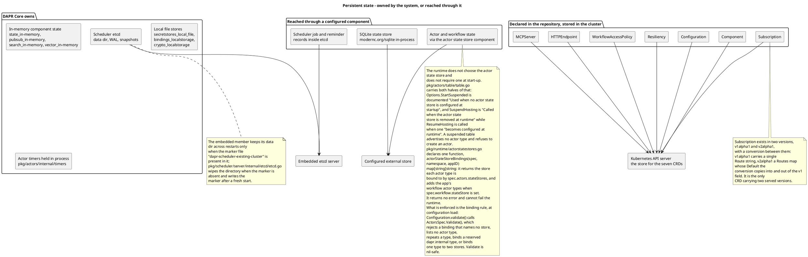
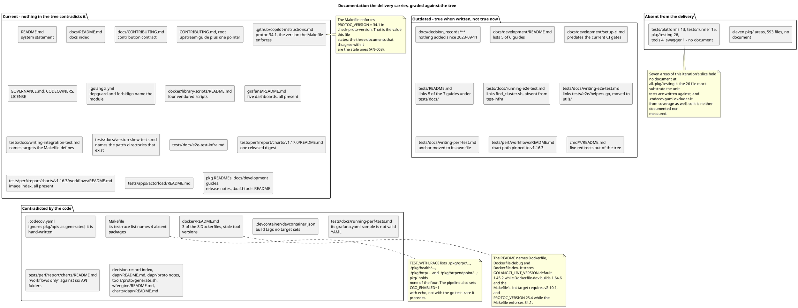

## Document Control
Phase: Survey
Status: Draft — iteration 3. The Perimeter is closed against the code: Components, External actors and systems and Entry points are written, and every anchor either names a file this inventory has opened or states in place that it was not opened and what was read instead. The component plane is stated from the files that hold it — fifteen `Category` constants, thirteen registries, two categories reachable by neither a registry nor a shim (AN-024). Technology and Size covers every top-level area of the tree, with the parent-and-child areas under `cmd`, `dapr`, `docs` and `pkg` listed separately. Persistent Data, Documentation, History, Anomalies and Priorities are carried forward from the reads of all three iterations with iteration 3's slice added. Anomalies states 27, each with its evidence and its likelihood and impact; three sit on an entry point (AN-012, AN-018, AN-023) and the other 24 do not. Coverage states each iteration's read against what it was assigned, every count reproducible from the files enumerated on its own row, and names the never-assigned areas from the foot of its own table rather than asserting a number: 118 distinct files opened of the 6 631 entries the tree holds.
Milestone Target: end-of-Survey (SBC) — not achieved

## Perimeter
The boundary is drawn by what the code reaches for. Six Go executables run from `cmd/` and share one library;
each exposes its own listeners, and the sidecar alone opens seven: the HTTP API port, a separate public port,
a pprof port when profiling is on, the gRPC API port, the internal gRPC port, the `/healthz` port and the
metrics port. `pkg/api/grpc/server.go` builds **two** gRPC servers from one file with different trust. The
three control planes reach the Kubernetes API server and each other over signed gRPC; the scheduler's
`ReportActorTypes` is a one-line forward to a placement subsystem inside the same process. A component a
caller configures goes out through a shim in `cmd/daprd/components/` to a backend; the workflow engine is the
one part of the runtime that does not take that path — it builds its own actor backend and registers its actor
types through `pkg/actors` (AN-024), which is why the component plane below holds thirteen registries for
fifteen declared categories.

The internal surface is the trust boundary's own door. `pkg/api/grpc/daprinternal.go` serves service invocation
to a peer sidecar (`CallLocal`, `CallLocalStream`), actor calls (`CallActor`, `CallActorStream`) and forwarded
reminders (`CallActorReminder`). Each of the five re-derives the caller rather than trusting the request: the
service-invocation pair normalises the method, applies the ACL and rewrites the caller and callee identity
headers from the peer's SPIFFE id, discarding what an older daprd forwarded from its app; the actor pair
applies the workflow access policy; and a forwarded reminder takes its `SourceAppID` from the peer's SPIFFE id
unless the peer is a replica of the same app, and is refused outright from another namespace.

```plantuml
@startuml
title Perimeter of DAPR Core - the components, the boundary, and what the system reaches
skinparam componentStyle rectangle
skinparam wrapWidth 210
skinparam nodesep 16
skinparam ranksep 26

package "DAPR Core - inside the boundary" {
  package "Executables - cmd/" {
    [daprd\nthe sidecar] as DAPRD
    [operator] as OPER
    [injector] as INJ
    [placement] as PLACE
    [scheduler] as SCHED
    [sentry] as SENTRY
    [build-tools] as BT
  }

  package "Request path - pkg/api" {
    [HTTP API] as APIH
    [gRPC API] as APIG
    [internal ServiceInvocation] as APIINT
    [universal handlers] as UNIV
    [public API port] as APIPUB
  }

  package "Runtime core - pkg/runtime" {
    [compstore] as COMPSTORE
    [processor] as PROC
    [hot reload] as HOT
    [workflow engine] as WF
    [scheduler client] as SCHCL
  }

  package "Components plane" {
    [component registries\npkg/components] as REG
    [component shims\ncmd/daprd/components] as SHIM
    [pluggable components] as PLUG
  }

  package "Cross-cutting - pkg" {
    [configuration] as CFG
    [resiliency] as RES
    [middleware] as MW
    [app channel] as CHAN
    [diagnostics] as DIAG
    [metrics] as MET
    [healthz] as HZ
    [security] as SEC
    [ACL] as ACL
  }

  package "Control-plane libraries - pkg" {
    [actors] as ACT
    [scheduler server] as SCHSRV
    [placement server] as PLSRV
    [sentry CA] as SENTRYCA
    [operator API] as OPERAPI
    [injector patcher] as INJPATCH
  }

  package "Declared and generated surface" {
    [resource types\npkg/apis] as APIS
    [typed clients\npkg/client] as CL
    [proto bindings\npkg/proto] as PB
  }
}

actor "Caller / SDK" as CALLER
actor "Application workload" as APP

cloud "Kubernetes API server" as K8S
database "etcd\nembedded or external" as ETCD
cloud "Component backend\nstate, pubsub, secret,\nconfiguration, binding,\ncrypto, lock" as BACKEND
cloud "Name resolution backend" as NR
cloud "OTLP / Zipkin collector" as OTEL
cloud "Prometheus scraper" as PROM
cloud "Peer sidecar" as PEER
cloud "Control-plane peers" as PEERS
cloud "MCP server backend" as MCPB
cloud "AI / LLM provider" as LLM

CALLER --> APIH
CALLER --> APIG
CALLER --> APIPUB
APP <--> CHAN
PEER --> APIINT
DAPRD --> APIG
DAPRD --> APIH
DAPRD --> UNIV
UNIV --> PROC
PROC --> REG
REG --> SHIM
SHIM --> BACKEND
PROC --> COMPSTORE
PROC --> WF
PROC --> ACT
HOT --> COMPSTORE
SCHCL --> SCHED
ACT --> PLACE
ACT --> SCHED
DAPRD --> CFG
DAPRD --> RES
DAPRD --> MW
DAPRD --> DIAG
DAPRD --> MET
DAPRD --> HZ
APIG --> ACL
APIG --> SEC
DIAG --> OTEL
MET --> PROM
PLUG --> BACKEND
OPER --> OPERAPI
OPER --> K8S
OPERAPI --> APIS
OPERAPI --> CL
INJ --> INJPATCH
INJ --> K8S
SENTRY --> SENTRYCA
SENTRY --> K8S
PLACE --> PLSRV
PLSRV --> PEERS
SCHED --> SCHSRV
SCHSRV --> ETCD
SCHED --> K8S
SCHED --> PLACE
CFG --> APIS
APIS --> PB
DAPRD --> PB
WF --> MCPB
WF --> LLM
PLSRV --> NR
OPERAPI --> K8S

note bottom of DAPRD
  The sidecar alone opens seven listeners:
  the HTTP API port, the public API port,
  the pprof port when profiling is on,
  the gRPC API port, the internal gRPC port,
  the /healthz port and the metrics port.
  pkg/api/grpc/server.go builds two gRPC
  servers from one file with different trust.
end note
note bottom of ETCD
  The scheduler owns this store: it starts an
  embedded etcd unless --etcd-embed=false, in
  which case it is an external cluster named by
  --etcd-client-endpoints.
end note
note bottom of WF
  The workflow engine does not arrive through the
  component plane. It builds its own actor backend
  in pkg/runtime/wfengine/backends/actors and
  registers its workflow, activity and retentioner
  actor types through pkg/actors' table (AN-024).
end note
note bottom of PEERS
  The three control planes reach the Kubernetes
  API server and each other over signed gRPC.
  Placement authority is negotiated at runtime
  from what connected peers advertise, not fixed
  by configuration (AN-018).
end note
@enduml
```

The three tables below hold 42 components, 19 external actors and systems, and 16 entry points. Those are
the row counts of the tables themselves and are stated nowhere else in this inventory.

### Components

| Component | Kind | Responsibility | Implemented by |
|---|---|---|---|
| daprd | Subsystem | The sidecar process: builds its component registries, opens its HTTP, gRPC, internal gRPC, public, pprof, healthz and metrics listeners, and runs the component processor for one application | `cmd/daprd/main.go`; `cmd/daprd/app/app.go` |
| operator | Subsystem | Serves Components, Configurations, Resiliencies, Subscriptions, HTTPEndpoints, MCPServers and WorkflowAccessPolicies to sidecars, and reconciles them from the cluster. It is a controller-runtime manager whose scheme registers all seven kinds plus both Subscription versions, and it is the process that patches the Subscription CRD's conversion-webhook namespace and CA bundle from its own trust anchors | `cmd/operator/app/app.go`; `pkg/operator/operator.go` (`NewOperator`, `buildScheme`, `patchConversionWebhooksInCRDs`) |
| injector | Subsystem | The admission webhook that declines or patches a pod so it carries a sidecar | `cmd/injector/app/app.go`; `pkg/injector/service/handler.go` |
| placement | Subsystem | The actor-placement service: Raft leadership composed with the gRPC server, and dissemination of the actor table to every connected host | `pkg/placement/placement.go` (`New`, the `leadership` + `server` composition); `pkg/placement/internal/server/server.go`; `dapr/proto/placement/v1/placement.proto` |
| scheduler | Subsystem | The durable job and actor-reminder service, with its own etcd; also answers actor placement when `--placement-enabled` is set, by forwarding `ReportActorTypes` to its placement subsystem | `cmd/scheduler/options/options.go`; `pkg/scheduler/server/server.go`; `pkg/scheduler/server/api.go`; `pkg/scheduler/server/internal/etcd/etcd.go` |
| sentry | Subsystem | Serves the certificate and trust-bundle contract to every other control plane and every sidecar, with no client auth, authenticating on the validator the request selects | `pkg/sentry/server/server.go`; `dapr/proto/sentry/v1/sentry.proto` |
| dapr-build-tools | Component | The separate `dapr-build-tools` module: the CI helper CLI, not part of the six runtime executables | `.build-tools/README.md`; `.build-tools/cmd/root.go` |
| HTTP API server | Layer | Registers the HTTP routes from the endpoint table and applies max-body, CORS, API-token, tracing, metrics, component-middleware and logging middleware around them | `pkg/api/http/server.go`; `pkg/api/http/endpoints/endpoint.go` |
| gRPC API server | Layer | Builds two gRPC servers from one file with different trust, and serves the `dapr.proto.runtime.v1.Dapr` service over the hand-maintained allowlist | `pkg/api/grpc/server.go`; `pkg/api/grpc/endpoints.go` |
| Internal service-invocation server | Component | The `ServiceInvocation` server sidecars call each other on, separate from the app-facing gRPC API: service invocation, the streaming variant, actor calls, actor streams and forwarded reminders, each re-deriving the caller from the peer's SPIFFE id instead of trusting the request | `pkg/api/grpc/daprinternal.go` (`CallLocal`, `CallLocalStream`, `CallActor`, `CallActorStream`, `CallActorReminder`, `setPeerIdentityMetadata`, `reminderSourceAppID`); `dapr/proto/internals/v1/service_invocation.proto` |
| universal handler layer | Layer | One implementation per API operation, shared by the HTTP and gRPC surfaces rather than written twice. Not opened: no file of the directory has been read in any iteration | `pkg/api/universal/` (29 files, none opened) |
| Public API listener | Component | A second HTTP listener, opened only when a public port is configured, serving the GET-only public endpoint set over a subset of the primary pipeline (AN-023). The flag behind it is `--dapr-public-port` with `--dapr-public-listen-address` | `pkg/api/http/server.go` (§ the `PublicPort` block); `cmd/daprd/options/options.go` (`--dapr-public-port`) |
| gRPC proxy | Component | Relays a gRPC call from the sidecar to the application, with its own director, codec and handler, behind the direct-messaging interface | `pkg/messaging/v1/messaging.go` (the direct-messaging interface); `pkg/api/grpc/proxy/` (11 files, none opened) |
| compstore | Component | The in-process store of loaded components, subscriptions, configurations and resource metadata. Not opened: no file of the directory has been read | `pkg/runtime/compstore/` (25 files, none opened) |
| component processor | Subsystem | Loads, initialises and runs each component category and owns the per-category loops, with one instance loop per named component created on first use; dispatches on twelve of the fifteen categories | `pkg/runtime/processor/manager.go`; `pkg/runtime/processor/components.go`; `pkg/runtime/processor/loops/category/category.go`; `pkg/runtime/processor/loops/` (22 files, of which the category loop was opened) |
| hot reload | Subsystem | Watches the resource sources and reconciles a changed component, configuration, subscription or endpoint into the running sidecar. The disk source watches its directories with one shared file reader and seven resource loaders over the same seven kinds the operator serves, and re-scans after a second when a file is held by another process, because releasing a handle raises no filesystem event | `pkg/runtime/hotreload/loader/disk/disk.go`; `pkg/runtime/hotreload/hotreload.go` and `reconciler/reconciler.go` are named as the other halves but were not opened |
| workflow engine | Subsystem | The durable workflow engine: orchestrators, activities, the actor backend, the in-process backend and the workflow state store. Registers its actor types through `pkg/actors` and builds its own backend rather than arriving as a component category (AN-024) | `pkg/runtime/wfengine/wfengine.go`; `pkg/runtime/wfengine/backends/actors/actors.go`; `pkg/runtime/wfengine/wfregistrar/registrar.go` |
| scheduler client | Layer | The sidecar's client to the scheduler: connection pool, host watch, leadership and pull slots. Not opened: no file of the directory has been read | `pkg/runtime/scheduler/` (26 files, none opened) |
| pub/sub and subscription pipeline | Component | The CloudEvent adapter, bulk publish and subscribe, the outbox, and the per-protocol subscription postmen. Not opened: no file of either directory has been read | `pkg/runtime/pubsub/` (30 files) and `pkg/runtime/subscription/` (23 files), none opened |
| component registries | Subsystem | The component plane: fifteen `Category` constants, thirteen of them with a registry under `pkg/components/<category>/` and all thirteen held together by one `registry.Registry`. The remaining two constants, `workflow` and `workflowbackend`, have no registry in this package and no component shim: the workflow engine builds its actor backend directly and the `WorkflowBackendManager` it is handed is never consulted (AN-024) | `pkg/components/category.go` (the fifteen constants); `pkg/runtime/registry/registry.go` (thirteen registry fields); `pkg/components/` (53 files: 13 category directories each holding a `registry.go`, plus `category.go`, `loader/` 2, `pluggable/` 6, `versioning.go`, `wasm.go`) |
| component shims | Layer | One registration file per component implementation; the package builds only under `allcomponents` or `stablecomponents`, and `zz_notag.go` panics otherwise | `cmd/daprd/components/` (156 files); `cmd/daprd/components/zz_notag.go` |
| pluggable component host | Component | Discovers and dials out-of-process components over a unix socket, and wraps them as in-process components. Not opened: no file of the directory has been read | `pkg/components/pluggable/` (6 files, none opened) |
| configuration model | Component | The `Configuration` resource as the runtime reads it, with the validation that refuses a bad spec | `pkg/config/configuration.go` |
| resiliency provider | Component | Resolves retry, timeout and circuit-breaker policy per app endpoint, per actor type and per component direction | `pkg/resiliency/resiliency.go`; `pkg/resiliency/breaker/` (2 files) |
| middleware pipeline | Component | The component-middleware contract and the HTTP pipeline that composes it | `pkg/middleware/middleware.go`; `pkg/middleware/http/` (4 files) |
| app channel | Component | The sidecar's client to the application workload, over HTTP and over gRPC, with its own TLS floor | `pkg/channel/channel.go`; `pkg/channel/http/http_channel.go` |
| diagnostics | Subsystem | Tracing and monitoring: the OpenTelemetry and Zipkin exporters, the HTTP and gRPC instrumentation, and one monitoring module per building block; seven default meters in `metrics.go` | `pkg/diagnostics/metrics.go`; `pkg/diagnostics/` (35 files); `docs/development/dapr-metrics.md` |
| metrics exporter | Component | The `/metrics` endpoint: a private Prometheus registry gathered together with the default one, plus the caller-supplied extra handlers | `pkg/metrics/exporter.go`; `pkg/metrics/` (6 files) |
| healthz | Component | The readiness registry and its `/healthz` listener; `IsReady` is false when no target is registered. Every executable registers its own named targets — the operator registers four | `pkg/healthz/healthz.go`; `pkg/healthz/server/server.go`; `pkg/operator/operator.go` (`secHealthz`, `apiServerHealthz`, `webhookHealthz`, `cacheHealthz`) |
| app health | Component | The probe loop against the application's health endpoint, with a failure threshold and a change callback | `pkg/apphealth/health.go` |
| security | Subsystem | SPIFFE identities, mTLS options, workload certificates, and JWT and API-token validation, including on-demand JWT SVID minting with a fallback to the startup-issued token. The workload key algorithm is selectable at `--workload-key-algorithm` (`ed25519` default, `ecdsa` for AWS IAM Roles Anywhere), and the operator overrides it to RSA for its own webhook, which some cloud distributions require | `pkg/security/security.go` (the `Handler` and `Provider` interfaces, `MintJWT`); `cmd/daprd/options/options.go` (`--workload-key-algorithm`); `pkg/operator/operator.go` (`KeyAlgorithm: ptr.Of(spiffe.KeyAlgorithmRSA)`); `pkg/security/spiffe/` (3 files) |
| ACL | Component | The access-control rules for service invocation, over a trie of operations and HTTP verbs with deny-wins merging, and the workflow half: a pure allow-list compiled from one or more `WorkflowAccessPolicy` resources, evaluated per caller, operation and glob-matched workflow or activity name. A `requires` block asserts the caller's *propagated* history and can never grant access while signing is off, because the history is then unverifiable; a nil policy set allows all calls, and a same-app call is always exempt (a one-time warning is emitted if the policy lists the local app id). Reserved internal actor types are refused to another app whatever the policy says | `pkg/acl/acl.go` (`ParseAccessControlSpec`, `ApplyAccessControlPolicies`, `canonicalHTTPOperation`); `pkg/acl/workflow/policy.go` (`Compile`, `Evaluate`, `SelfCallExempt`, `decodeHistoryChunks`) |
| actors runtime | Subsystem | The actor-type table and the host's placement, reminder and drain bookkeeping: a factory per registered type, with per-type create and retire locks so an actor id is never live in two factories, a `Types()` list advertised to placement against a `ReminderTypes()` list advertised to the scheduler, and hosting that suspends to an empty type list — and refuses to create — while no actor state store is configured | `pkg/actors/table/table.go` (Interface, `RegisterActorTypes`, `DrainActorTypes`, `CompleteDrains`, `SuspendHosting`); `pkg/actors/internal/placement/connector/connector.go` (the `Connect`/`Address` contract the table's host advertises through); `pkg/actors/internal/placement/` (44 files) |
| scheduler server | Subsystem | The scheduler's own server: etcd-backed job store, host streams, pull dispatch, concurrency gates and placement mode. `api.go` implements `ScheduleJob`, `DeleteJob`, `GetJob`, `ListJobs`, `WatchJobs`, `WatchHosts`, `DeleteByMetadata`, `DeleteByNamePrefix`, and forwards `ReportActorTypes` to the placement subsystem. It validates the priority level and fairness weight, restores etcd's own `ResourceExhausted` code on quota exhaustion because a bare etcd error would cross the wire as `Unknown`, and recovers each listed job's metadata from the stored protobuf rather than re-splitting the key | `pkg/scheduler/server/server.go`; `pkg/scheduler/server/api.go`; `pkg/scheduler/server/internal/etcd/etcd.go` |
| placement server | Subsystem | Raft leadership and actor-table dissemination for the placement service; refuses `ReportDaprStatus` and `StatePlacementTables` from a node that is not the leader | `pkg/placement/placement.go` (`Run`: leadership and server under one runner); `pkg/placement/internal/server/server.go`; `pkg/placement/internal/leadership/` (5 files) |
| sentry CA and validator | Subsystem | The certificate authority and trust bundle, and the JWT, OIDC, JWKS and Kubernetes validators; serves `SignCertificate` and `FetchJWTSVID` with no client auth and authenticates on the request's own validator | `pkg/sentry/server/server.go`; `pkg/sentry/server/ca/` (15 files); `pkg/sentry/server/validator/` (10 files) |
| operator API server | Subsystem | Serves each Dapr resource kind to the sidecars over seven informers and one mTLS gRPC server, and keeps them current. It is fed a separate metadata-only pod cache so it can resolve a connecting sidecar's assigned configuration from its pod annotation without transferring pod specs | `pkg/operator/api/api.go` (`NewAPIServer`, the seven informers); `pkg/operator/operator.go` (`podMetaCache`, `api.NewAPIServer`); `pkg/operator/api/informer/` (6 files) |
| injector patcher | Component | Builds the pod patch: the sidecar container, volumes, component annotations and health probes. The handler declines on a non-JSON body, a kind that is not `Pod` and a service account outside the allowlist, and allows a non-Dapr pod silently | `pkg/injector/service/handler.go` (`handleRequest`, `isAuthorizedUser`, `podHasDaprEnabled`); `pkg/injector/patcher/` (14 files) |
| resource types | Layer | The seven custom resource kinds, each with a `v1alpha1/types.go`, its generated deep-copy code and its accessors; `Subscription` alone carries two served versions, whose conversion copies a single `Route` into and out of a `Routes` map | `pkg/apis/components/v1alpha1/types.go`; `pkg/apis/subscriptions/v1alpha1/types.go`; `pkg/apis/subscriptions/v2alpha1/types.go`; `pkg/apis/subscriptions/v2alpha1/conversion.go` |
| typed clients and informers | Layer | The generated clientset, informers and listers — for three of the seven kinds the operator serves: `Components`, `Configuration` and `MCPServer`, each `v1alpha1`, over a `rest.Config` and a discovery client | `pkg/client/clientset/versioned/clientset.go`; `pkg/client/informers/` (9 files) |
| proto bindings | Layer | The committed generated Go bindings for all nine proto packages, with the hand-written additions committed beside them (AN-017) | `pkg/proto/` (66 files); `dapr/proto/` (37 `.proto`) |
| small contract packages | Component | Two packages that are constants and nothing else: the two runtime modes, and the CORS default and wildcard origins. `pkg/ports` and `pkg/scopes` sit beside them and are unopened | `pkg/modes/modes.go`; `pkg/cors/cors.go` |

### External actors and systems

An anchor that names a file this inventory has not opened says so in place, and states what was read instead.

| External actor or system | Reached through | Anchor |
|---|---|---|
| Caller — an SDK or a plain HTTP or gRPC client | Remote call | `dapr/proto/runtime/v1/dapr.proto`; `pkg/api/grpc/endpoints.go` |
| Application workload — the process the sidecar serves | Remote call | `pkg/channel/channel.go` (§ the app-channel operations); `pkg/channel/http/http_channel.go`; `pkg/api/grpc/daprinternal.go` (`CallLocal`, which invokes the app channel) |
| Peer sidecar — another application's daprd | Remote call | `pkg/api/grpc/daprinternal.go`; `pkg/messaging/v1/messaging.go`; `dapr/proto/internals/v1/service_invocation.proto` |
| Peer control plane — placement, scheduler and sentry as each other's clients | Remote call | `dapr/proto/placement/v1/placement.proto`; `dapr/proto/scheduler/v1/scheduler.proto`; `pkg/security/security.go` |
| Kubernetes API server | Data manager | `pkg/operator/operator.go` (the controller-runtime manager, its scheme of all seven kinds, and the CRD patch of the conversion webhook); `pkg/client/clientset/versioned/clientset.go` (a `rest.Config` and a discovery client); `pkg/injector/service/handler.go` |
| Scheduler etcd — embedded or external cluster | Data manager | `pkg/scheduler/server/internal/etcd/etcd.go`; `cmd/scheduler/options/options.go` (`--etcd-embed`, `--etcd-client-endpoints`) |
| State store component | Data manager | The 36 `state_*.go` shims and the 8-file `pkg/components/state/` are named from the tree listing, not opened; what was read is the binding rule they satisfy — `pkg/config/configuration.go` (`ActorsSpec.Validate`) and `pkg/runtime/actorstatestores.go` (`actorStateStoreBindings`) |
| Pub/sub broker component | Messaging | The `pubsub_*.go` shims and the 4-file `pkg/components/pubsub/` are named from the tree listing, not opened; no file of either was read |
| Secret store component | Service | The `secretstores_*.go` shims and the 4-file `pkg/components/secretstores/` are named from the tree listing, not opened; no file of either was read |
| Binding component — input and output | Service | The `bindings_*.go` shims and the 6-file `pkg/components/bindings/` are named from the tree listing, not opened; no file of either was read |
| Configuration store component | Service | The `configuration_*.go` shims and the 2-file `pkg/components/configuration/` are named from the tree listing, not opened; no file of either was read |
| Crypto provider component | Service | The `crypto_*.go` shims and the 2-file `pkg/components/crypto/` are named from the tree listing, not opened; no file of either was read |
| Lock store component | Service | The `lock_*.go` shims and the 4-file `pkg/components/lock/` are named from the tree listing, not opened; no file of either was read |
| Name-resolution backend — Kubernetes DNS, mDNS, Consul, AWS Cloud Map, SQLite | Service | The `nameresolution_*.go` shims are named from the tree listing, not opened; `pkg/runtime/registry/registry.go` (`NameResolutions()`) is read and is what the sidecar resolves a name through |
| OTLP or Zipkin collector | Remote call | `pkg/diagnostics/tracing.go` and the exporter modules beside it are **not opened** — of the 35 files in the area only `metrics.go` was read; the exporter dependencies are stated in `go.mod` (`go.opentelemetry.io/otel/exporters/otlp/otlptrace{,grpc,http}`, `.../zipkin`) and `docs/development/dapr-metrics.md` names the module per metric group |
| Prometheus scraper — including the scheduler's `/metrics/scaling` | Service | `pkg/metrics/exporter.go` (the endpoint itself); `pkg/scheduler/monitoring/scaling/scaling.go` is **not opened** — the three scaling gauges are named from the tree listing and from the metrics documentation, not from the file |
| MCP server backend — stdio, SSE or HTTP tool servers | Messaging | `dapr/proto/workflows/v1/mcp.proto`; `pkg/runtime/mcpservers.go`; the 11-file `pkg/runtime/wfengine/inprocess/mcp/v1/` is **not opened** and is named from the tree listing |
| AI or model provider — OpenAI, Anthropic, Bedrock, Google AI, Mistral, Ollama, Hugging Face, DeepSeek, echo | Remote call | The nine `conversation_*.go` shims and the one-file `pkg/components/conversation/` are named from the tree listing, not opened; `pkg/runtime/processor/conversation/` is the loop that drives them |
| Application health endpoint — probed for app health | Service | `pkg/apphealth/health.go`; `pkg/channel/http/http_channel.go`; `cmd/daprd/options/options.go` (`--enable-app-health-check`, `--app-health-check-path`) |

### Entry points

| ID | Entry point | Kind | Initiated by | Anchor |
|---|---|---|---|---|
| EP-001 | Sidecar HTTP API — one route per operation, versioned by path | Service operation | A caller: an SDK or any HTTP client | `pkg/api/http/server.go` (`setupRoutes`); `pkg/api/http/endpoints/endpoint.go`; `pkg/api/http/http.go` |
| EP-002 | Sidecar gRPC API — the `dapr.proto.runtime.v1.Dapr` service | Service operation | A caller over gRPC | `dapr/proto/runtime/v1/dapr.proto`; `pkg/api/grpc/server.go`; `pkg/api/grpc/endpoints.go` (the allowlist map, AN-012) |
| EP-003 | Public HTTP API — the GET-only endpoint set on the public port | Service operation | A caller on the public listen address and port | `pkg/api/http/server.go` (§ the `PublicPort` block, `s.api.PublicEndpoints()`); `pkg/api/http/endpoints/endpoint.go`; `cmd/daprd/options/options.go` (`--dapr-public-port`, `--dapr-public-listen-address`) |
| EP-004 | Internal service-invocation gRPC API — `ServiceInvocation`, with its actor and streaming operations | Service operation | A peer sidecar | `dapr/proto/internals/v1/service_invocation.proto`; `pkg/api/grpc/daprinternal.go` (the five handlers and their ACL, identity and reminder-source checks) |
| EP-005 | Application callback API — `AppCallback`, delivered to the application | Service operation | The sidecar, calling out to the application workload | `dapr/proto/runtime/v1/appcallback.proto`; `pkg/channel/channel.go` (the callback operations the channel offers); `pkg/runtime/subscription/postman/http/http.go` and `pkg/channel/grpc/grpc_channel.go` are **not opened** and are named from the tree listing |
| EP-006 | Scheduler gRPC service — job and reminder scheduling, host streams and `ReportActorTypes` | Service operation | Sidecars and peer schedulers | `dapr/proto/scheduler/v1/scheduler.proto` (§ `service Scheduler`); `pkg/scheduler/server/api.go` (all eight operations and the `ReportActorTypes` forward); `pkg/scheduler/server/server.go` |
| EP-007 | Placement gRPC service — actor-type reporting and actor-table dissemination | Service operation | Sidecars with actors enabled, and peer placement hosts | `dapr/proto/placement/v1/placement.proto`; `pkg/placement/internal/server/server.go`; `pkg/actors/internal/placement/connector/connector.go` (the `Connect`/`Address` contract a sidecar reaches placement through) |
| EP-008 | Sidecar-injector admission webhook | Service operation | The Kubernetes API server, on pod admission | `pkg/injector/service/handler.go`; `pkg/injector/patcher/` (14 files, not opened); the chart template that registers the webhook is **not opened** — of the 67 chart files, `README.md` and `crds/subscription.yaml` were read |
| EP-009 | Sentry gRPC service — certificate signing and trust-bundle requests | Service operation | Every other control plane and every sidecar | `dapr/proto/sentry/v1/sentry.proto`; `pkg/sentry/server/server.go` |
| EP-010 | Operator gRPC service — resource lists and subscription streams to sidecars | Service operation | Sidecars asking for Components, Configurations, Resiliencies, Subscriptions, HTTPEndpoints, MCPServers and WorkflowAccessPolicies | `dapr/proto/operator/v1/operator.proto`; `pkg/operator/api/api.go`; `pkg/operator/operator.go` (the manager and the API server it builds) |
| EP-011 | `/healthz` readiness endpoint | Service operation | The orchestrator's probe, or a caller | `pkg/healthz/server/server.go`; `pkg/healthz/healthz.go` (`IsReady`); `pkg/operator/operator.go` (four named targets registered by one executable) |
| EP-012 | `/metrics` Prometheus endpoint | Service operation | A Prometheus scraper | `pkg/metrics/exporter.go`; the scheduler's `/metrics/scaling` and its three gauges are named from the tree listing and `docs/development/dapr-metrics.md`, not from `pkg/scheduler/monitoring/scaling/scaling.go`, which is not opened |
| EP-013 | pprof profiling endpoint — opened only when profiling is enabled | Service operation | An operator with `--enable-profiling` set | `pkg/api/http/server.go` (§ the `EnableProfiling` block); `cmd/daprd/options/options.go` (`--enable-profiling`, `--profile-port`) |
| EP-014 | `dapr-build-tools` CLI | Service operation | A maintainer or a CI workflow | `.build-tools/README.md`; `.build-tools/cmd/root.go` |
| EP-015 | Kubernetes custom resources — the seven Dapr kinds, watched by the operator and, in Kubernetes mode, the sidecar | Platform event | A resource create or update submitted to the cluster | `pkg/apis/` (7 kinds; `components/v1alpha1`, `subscriptions/v1alpha1` and `subscriptions/v2alpha1` opened); `pkg/operator/operator.go` (`buildScheme`, all seven kinds and both Subscription versions); `pkg/runtime/hotreload/loader/disk/disk.go` (the same seven as disk-loaded kinds) |
| EP-016 | Declarative resources on disk — watched for change and re-read on `SIGHUP` in standalone mode | Platform event | A file being written or replaced | `pkg/runtime/hotreload/loader/disk/disk.go` (the file watcher and the seven loaders); `pkg/runtime/hotreload/reconciler/sighup.go` and `pkg/internal/loader/disk/dirdata/dirdata.go` are **not opened** — named from the tree listing and from the `loaderdisk`/`dirdata` imports the disk source declares |

## Technology and Size
| Area | Language | Platform and frameworks, with version | Files | Anchor |
|---|---|---|---|---|
| `.build-tools` | Go | A separate module, `dapr-build-tools`; its own `go.mod` and `go.sum`, and a `cmd/` of five drivers — `root`, `e2e`, `perf`, the lint-version check and the tag-guarded `zz-e2e-perf` — with one test beside the lint-version check and three YAML fixtures under `testdata/` | 14 | `.build-tools/` (14 files: `.gitignore`, `README.md`, `main.go`, `go.mod`, `go.sum`, `cmd/` 6, `testdata/` 3); `.build-tools/cmd/check-lint-version.go` |
| `.codecov.yaml` | YAML | The coverage gate: a project status at `target: auto` with `threshold: 0%` that blocks a pull request, a patch status set `informational`, and four ignore paths — `**/zz_generated*.go`, `pkg/apis`, `pkg/proto`, `pkg/testing` | 1 | `.codecov.yaml` |
| `.devcontainer` | JSON with comments | The dev-container definition: the published `ghcr.io/dapr/dapr-dev:latest` image, three features (sshd, github-cli, azure-cli), a docker-in-docker volume and a bind-mounted docker socket, and the VS Code settings a contributor inherits — among them a `go.buildTags` list | 1 | `.devcontainer/devcontainer.json` |
| `.gitattributes` | Text | One rule: `*.go text eol=lf` | 1 | `.gitattributes` |
| `.gitignore` | Text | What is generated or local rather than committed: `dist/`, `config/crd/bases`, `vendor/`, `go.work`, `.local/`, `test_report*`, `coverage.txt`, and the negation `!tests/perf/report/data/*/test_report_perf.json.gz` that keeps the per-version compressed perf report | 1 | `.gitignore` |
| `.golangci.yml` | YAML | golangci-lint v2 config: `default: all` with 40 linters disabled and four v2 linters noted as pending, run under the `unit`, `allcomponents` and `subtlecrypto` build tags; a 25-entry `depguard` deny list fixing the module to `dapr/kit/logger`, `dapr/kit/ptr`, `sigs.k8s.io/yaml`, `gopkg.in/yaml.v3`, `github.com/lestrrat-go/jwx/v2` and the standard library; a `forbidigo` ban on `fmt.Print*`, `print*` and `backend.DefaultLogger`; three formatters with `local-prefixes: github.com/dapr/` | 1 | `.golangci.yml` |
| `.github` | YAML, Python, JavaScript, Shell | GitHub Actions; `dependabot.yml`; 25 workflow definitions under `workflows/`; 82 helper scripts under `scripts/`, 70 of which are version-skew patch files | 120 | `.github/` |
| `.prettierignore` | Text | Three paths prettier skips: the two .NET `obj/` directories under `tests/apps/*/`, and `grafana/*.json` | 1 | `.prettierignore` |
| `.prettierrc.json` | JSON | The formatting contract for the tree's TypeScript and JavaScript: `trailingComma: es5`, `tabWidth: 4`, `semi: false`, `singleQuote: true` | 1 | `.prettierrc.json` |
| `charts` | YAML, Go | Helm 3 chart `dapr` with 7 subcharts declared as `file://` dependencies (`dapr_config`, `dapr_operator`, `dapr_placement`, `dapr_rbac`, `dapr_scheduler`, `dapr_sentry`, `dapr_sidecar_injector`), 7 CRD manifests under `crds/`, and `embed.go` | 67 | `charts/dapr/`; `charts/dapr/Chart.yaml` (the seven `dependencies`); `charts/dapr/charts/` (7 subcharts); `charts/dapr/crds/` (7 files) |
| `cmd` | Go | Go 1.26.11; the six executables plus five build and test driver files; `dapr/components-contrib v1.19.1-0.20261126140908-2c9078d426b0`, `dapr/kit v0.19.1-0.20261030175054-be979ab98cc4`, `dapr/durabletask-go v0.16.1-0.20261109153237-98658f38d8cb` | 183 | `cmd/`; `go.mod` (the `go` directive and the first `require` block) |
| `cmd/daprd/components` | Go | One registration file per component family, 156 files; builds only under the `allcomponents` or `stablecomponents` tag, and `zz_notag.go` panics at init otherwise | 156 | `cmd/daprd/components/`; `cmd/daprd/components/zz_notag.go` |
| `CODEOWNERS` | Text | — | 1 | `CODEOWNERS` |
| `CONTRIBUTING.md` | Markdown | — | 1 | `CONTRIBUTING.md` |
| `dapr` | Protocol Buffers (proto3) | 37 `.proto` definitions in 9 packages — `common`, `components`, `internals`, `operator`, `placement`, `runtime`, `scheduler`, `sentry`, `workflows`; seven package READMEs (`scheduler/v1` and `workflows/v1` have none, AN-013) and one directory overview, `dapr/README.md`, which is the eighth non-`.proto` file; `protoc` version disputed across four documents (AN-003) and two more in the committed headers (AN-015); consumed by `connectrpc.com/connect v1.19.1` and `google.golang.org/grpc v1.83.2` | 45 | `dapr/` (45 files: `README.md` + `proto/` 44, of which 37 `.proto` and 7 package READMEs); `go.mod` |
| `docker` | Dockerfile, Shell, Text | The image build surface: eight Dockerfiles — the runtime image, a debug image, a dev image, a Mariner image, and four Windows images (a base, a PHP base and a Python base on `windows-base`) — plus `README.md`, `docker.mk`, `first-run-notice.txt`, `custom-scripts/` of five Dapr provisioning scripts, `library-scripts/` of five vendored Debian scripts and their README, and `windows-base-scripts/` of one certificate script | 22 | `docker/` (22 files: 8 Dockerfiles, `README.md`, `docker.mk`, `first-run-notice.txt`, `custom-scripts/` 5, `library-scripts/` 5, `windows-base-scripts/` 1); `docker/Dockerfile-dev` (the build args); `docker/docker.mk` |
| `docs` | Markdown, PNG | 198 files: two at the top of the directory, 24 decision records including their index, 13 development files, 153 release-note files, and the six under `docs/artifacts/` this process wrote | 198 | `docs/`; `docs/artifacts/` (6 files, written by this process and not part of the system) |
| `docs/decision_records` | Markdown | 23 records in five categories (`api` 12, `architecture` 3, `cli` 2, `engineering` 4, `sdk` 2) plus `decision_records.md` | 24 | `docs/decision_records/` |
| `docs/development` | Markdown, PNG | Seven markdown files — `README.md`, `developing-dapr.md`, `dapr-metrics.md`, `preview-features.md`, `setup-ci.md`, `setup-dapr-development-env.md`, `setup-dapr-development-using-vscode.md` — plus `build-and-run-daprd.png` and five images under `img/` | 13 | `docs/development/` (13 files: 7 markdown, 1 PNG, `img/` 5) |
| `docs/release_notes` | Markdown, PNG | One note per release from `v0.1.0` to `v1.19.3`, plus `template.md` and an `assets/` folder of 5 PNGs | 153 | `docs/release_notes/` |
| `GOVERNANCE.md` | Markdown | — | 1 | `GOVERNANCE.md` |
| `go.mod` | Go module manifest | `module github.com/dapr/dapr`; `go 1.26.11`; a large direct `require` block, a large indirect block, and four replacement rules plus a licence-motivated replace block | 1 | `go.mod` |
| `go.sum` | Go checksums | The resolved module graph for every `require` in `go.mod` and its transitive closure; states no version of its own | 1 | `go.sum` |
| `grafana` | JSON, Markdown | Five dashboard definitions — actor, scheduler, sidecar, system-services and workflow — and a README that indexes them | 6 | `grafana/` (6 files: 5 dashboards and `README.md`) |
| `img` | PNG, SVG, JPEG | Banner, conceptual model and overview diagram, the last embedded by `README.md` | 3 | `img/` |
| `LICENSE` | Text | Apache License 2.0 | 1 | `LICENSE` |
| `Makefile` | Make | The build contract: the six binaries and the `allcomponents`/`stablecomponents` flavour, archive and `manifest-gen`/`upload-helmchart` targets, `docker-deploy-k8s`, `test`, `test-race`, the three integration targets, `lint`/`lint-fix`/`format`/`check`, `init-proto`/`gen-proto`/`check-proto-version`/`check-proto-diff`, `compile-build-tools`, the prettier targets, and the three `include` files (`tools/codegen.mk`, `docker/docker.mk`, `tests/dapr_tests.mk`). It pins `PROTOC_VERSION = 34.1`, `PROTOC_GEN_GO_VERSION = v1.32.0`, `PROTOC_GEN_GO_GRPC_VERSION = 1.3.0` and `PROTOC_GEN_CONNECT_GO_VERSION = 1.18.1`, and requires `golangci-lint v2.10.1` | 1 | `Makefile` |
| `pkg/acl` | Go | The service-invocation access-control rules over a trie of operations and HTTP verbs, with deny-wins merging and a canonical HTTP path (`canonicalHTTPOperation`) that both the decoded and the parameter-stripped form must pass; plus a `workflow/` of 8 files holding the other half: a pure allow-list compiled from one or more `WorkflowAccessPolicy` resources into per-caller rules over glob-matched workflow and activity names, evaluated against a `requires` assertion on the caller's propagated history that can never grant while signing is off, with a same-app exemption that warns once if the policy names the local app id, and reserved internal actor types refused to another app whatever the policy says | 10 | `pkg/acl/acl.go`; `pkg/acl/workflow/policy.go` |
| `pkg/actors` | Go | The actor runtime: `api/` 11, `callbackstream/`, `errors/`, `fake/`, `hashing/rendezvous/`, `hostauthz/`, `hostconfig/`, `internal/{apilevel,key,placement,timers}`, `reminders/`, `reserved/`, `router/`, `state/`, `table/`, `targets/{app,workflow}`, `timers/`. The `targets/workflow/` subtree alone holds 124 files. `table/` is the registry of hosted types: a factory per type behind per-type create and retire locks, a type list advertised to placement against a reminder-type list advertised to the scheduler, graceful drains that keep serving until a dissemination round stops placing the type, and hosting that suspends to an empty type list while no actor state store is configured | 243 | `pkg/actors/` (243 files); `pkg/actors/table/table.go`; `pkg/actors/internal/placement/` (44 files, unread) |
| `pkg/api` | Go | The request path: `net/http` with the `chi`-style router of `pkg/api/http`, gRPC servers on `google.golang.org/grpc v1.83.2`, the internal `ServiceInvocation` server whose five handlers each re-derive the caller's SPIFFE identity before dispatch, the 29-file `universal/` handler layer, and the hand-maintained gRPC allowlist map (AN-012) | 124 | `pkg/api/`; `pkg/api/grpc/server.go`; `pkg/api/grpc/daprinternal.go`; `pkg/api/http/server.go` |
| `pkg/apis` | Go | The seven custom resource kinds — `components`, `configuration`, `httpEndpoint`, `mcpserver`, `resiliency`, `subscriptions` (two served versions with a conversion), `workflowaccesspolicy` — each with a `v1alpha1/types.go` and deep-copy code, over `common/` and the three helpers `namevalue.go`, `scoped.go`, `tls.go`. The kinds share one shape: a `TypeMeta`/`ObjectMeta`/`Spec` object carrying the `common.Scoped` mixin, a `Kind()`, an `APIVersion()` and an `EmptyMetaDeepCopy()`. `Subscription` is the only one served twice: `v1alpha1` holds a single `Route` string, `v2alpha1` a `Routes` map, and the conversion copies between them field by field | 46 | `pkg/apis/` (46 files); `pkg/apis/components/v1alpha1/types.go`; `pkg/apis/subscriptions/v1alpha1/types.go`; `pkg/apis/subscriptions/v2alpha1/conversion.go` |
| `pkg/apphealth` | Go | The app-health probe loop: a ticker, a one-slot probe queue, a failure counter with a threshold, and a change callback. Uses `k8s.io/utils/clock` for a testable ticker; imports `pkg/config` for `AppHealthConfig` | 3 | `pkg/apphealth/health.go`; `pkg/apphealth/status.go` |
| `pkg/backoff` | Go | A jitter helper and its test | 2 | `pkg/backoff/jitter.go` |
| `pkg/buildinfo` | Go | Build-time version and enabled-feature values read through `-ldflags` | 2 | `pkg/buildinfo/buildinfo.go` |
| `pkg/channel` | Go | The app channel: an HTTP client for the application workload, a gRPC client for the same, `crypto/tls` with `AppChannelMinTLSVersion = tls.VersionTLS12`, and the fake and testing doubles | 14 | `pkg/channel/channel.go`; `pkg/channel/http/http_channel.go`; `pkg/channel/grpc/grpc_channel.go` |
| `pkg/client` | Go | The generated Kubernetes clientset, informers and listers, and the set it carries is three of the seven kinds the operator serves: `ComponentsV1alpha1`, `ConfigurationV1alpha1` and `MCPServerV1alpha1`, over a `rest.Config` and a discovery client, with the token-bucket rate limiter client-go adds when QPS is set and no limiter is given (AN-026). 28 files of clientset, 9 of informers, 4 of listers | 41 | `pkg/client/`; `pkg/client/clientset/versioned/clientset.go` (the `Interface` and its three group clients) |
| `pkg/components` | Go | The component plane, and the count it holds is thirteen of the fifteen declared kinds. `category.go` declares fifteen `Category` constants. Thirteen have a registry under `pkg/components/<category>/`, and those thirteen are the twelve the processor dispatches on (`pkg/runtime/processor/manager.go`, `category()`) plus `nameresolution`; `pkg/runtime/registry/registry.go` holds all thirteen as fields of one `Registry`. The remaining two, `workflow` and `workflowbackend`, have no registry anywhere in the tree and no shim in `cmd/daprd/components/`: the workflow engine builds its actor backend directly. Also holds the pluggable-component discovery and gRPC clients and the state and lock configuration decoders. Against `dapr/components-contrib v1.19.1-0.20261126140908-2c9078d426b0` | 53 | `pkg/components/` (53 files: 13 category directories each holding a `registry.go`, plus `category.go`, `loader/` 2, `pluggable/` 6, `versioning.go`, `wasm.go`); `pkg/components/category.go` (the fifteen constants); `pkg/runtime/registry/registry.go` (the thirteen registry fields and their accessors) |
| `pkg/config` | Go | The Configuration resource as the runtime reads it: the seven preview features and their defaults, the actor-state binding rules, the workflow and activity limits, the preview ACL and secrets scopes, the metric, tracing, mTLS and pipeline specs. `gopkg.in/yaml.v3`, `k8s.io/apimachinery`, `github.com/spf13/cast` | 30 | `pkg/config/configuration.go`; `pkg/config/testdata/` (19 fixtures) |
| `pkg/cors` | Go | Two constants and nothing else: the empty default origin and the `*` wildcard | 1 | `pkg/cors/cors.go` |
| `pkg/diagnostics` | Go | Tracing and monitoring: OpenTelemetry and Zipkin exporters (`go.opentelemetry.io/otel/exporters/otlp/otlptrace{,grpc,http}`, `.../zipkin`), the `ocgrpc` and OpenCensus views behind every `dapr_*` metric name, and one monitoring module per building block. Thirteen of its 35 files are opened: `metrics.go` (the seven default meters and the two size distributions) plus one module per surface — component, service, gRPC, HTTP, legacy HTTP, resiliency, workflow, error-code, and the four tracing files | 35 | `pkg/diagnostics/` (35 files: 15 `.go` records, 12 `_test.go`, `consts/` 1, `utils/` 4, `testutils_unit.go`, `utils_test.go`); `pkg/diagnostics/metrics.go`; `docs/development/dapr-metrics.md` |
| `pkg/encryption` | Go | State-store envelope encryption: the key and cipher handling, and the state wrapper | 4 | `pkg/encryption/encryption.go`; `pkg/encryption/state.go` |
| `pkg/expr` | Go | One expression helper and its test | 2 | `pkg/expr/expr.go` |
| `pkg/healthz` | Go | The readiness mechanism: a target registry, a per-target healthy/unhealthy flag, a lock, and `target.go`. `IsReady` is false when no target is registered | 8 | `pkg/healthz/healthz.go`; `pkg/healthz/target.go`; `pkg/healthz/server/server.go` |
| `pkg/healthz/server` | Go | The `/healthz` HTTP listener, one per process, honouring `--healthz-listen-address` | 2 | `pkg/healthz/server/server.go` |
| `pkg/injector` | Go | The admission webhook: `service/` 12 files (the handler, the config, the metrics and the service-account matcher), `patcher/` 14 files (container, volumes, components, sidecar), `annotations/` and `consts/`. The handler declines on four grounds — a body that is not JSON, a kind that is not `Pod`, a pod without `dapr.io/enabled=true`, and a service account outside the allowlist — and records a metric on each decline but the non-Dapr one | 29 | `pkg/injector/service/handler.go`; `pkg/injector/patcher/` (14 files) |
| `pkg/internal` | Go | The resource loaders: `disk/` 16 files over `dirdata/` (5), `kubernetes/` 9, and `validate/` 5 for MCP servers and workflow access policies | 32 | `pkg/internal/loader/` (32 files: `disk/` 16, `kubernetes/` 9, `validate/` 5, and the loader interface) |
| `pkg/messages` | Go | The legacy API error set in `predefined.go`, the `api_error.go` type, and `errorcodes/` | 5 | `pkg/messages/predefined.go`; `pkg/messages/api_error.go` |
| `pkg/messaging` | Go | The service-invocation message types and the direct-messaging client: `InvokeMethodRequest`/`InvokeMethodResponse`, the replayable request body, the method-name normaliser, and the gRPC proxy | 16 | `pkg/messaging/v1/messaging.go`; `pkg/messaging/direct_messaging.go`; `pkg/messaging/v1/` (9 files) |
| `pkg/metrics` | Go | The Prometheus exporter: `contrib.go.opencensus.io/exporter/prometheus` on a private `prometheus/client_golang` registry, gathered together with the default registry so third-party collectors are served, plus the caller-supplied extra handlers | 6 | `pkg/metrics/exporter.go`; `pkg/metrics/{meter,options}.go` |
| `pkg/middleware` | Go | The component-middleware contract: a single `HTTP func(http.Handler) http.Handler` type, the `http/` pipeline that composes it, and the `store/` that holds the loaded handlers | 7 | `pkg/middleware/middleware.go`; `pkg/middleware/http/` (4 files) |
| `pkg/modes` | Go | Two constants and nothing else: the `kubernetes` and `standalone` runtime modes | 1 | `pkg/modes/modes.go` |
| `pkg/operator` | Go | The operator: `api/` 21 files serving each resource kind over seven informers and one gRPC server, `informer/` 6, `loops/` 4, `cache/` 4 for pod metadata, plus `handlers/`, `meta/`, `monitoring/`, `watchdog.go`. The API server builds one `informer.Interface` per kind — Components, Subscriptions, HTTPEndpoints, Configurations, Resiliencies, MCPServers and WorkflowAccessPolicies — and serves them over `operatorv1pb.RegisterOperatorServer` with mTLS | 38 | `pkg/operator/operator.go`; `pkg/operator/api/api.go` (`NewAPIServer`, the seven informers, `Run`) |
| `pkg/outbox` | Go | The outbox that makes a publish idempotent across a state transaction, with its fake | 3 | `pkg/outbox/outbox.go` |
| `pkg/placement` | Go | The placement service: `internal/` 21 files over `authorizer/`, `leadership/` (with `fsm/`, `logr/`, `spiffenet/`), `loops/` 14 and `server/`, plus `hashing/`, `monitoring/` and `peers/`. The gRPC server refuses `ReportDaprStatus` and `StatePlacementTables` from any node that is not the leader | 26 | `pkg/placement/placement.go`; `pkg/placement/internal/server/server.go`; `pkg/placement/internal/leadership/` (5 files) |
| `pkg/ports` | Go | The standalone port chooser: a SHA-256 over the app ID, working directory, user ID and hostname, mapped into the port range above the requested start, checked for availability and otherwise left to `phayes/freeport` | 2 | `pkg/ports/ports.go` |
| `pkg/proto` | Go, generated | `protoc-gen-go`, `protoc-gen-go-grpc` and `protoc-gen-connect-go` output, committed rather than built at release time; 66 files including 9 Connect handlers | 66 | `pkg/proto/` |
| `pkg/resiliency` | Go | The policy provider: retry, timeout and circuit breaker resolved per app endpoint, per actor type before and after the lock, and per component direction, over `dapr/kit/retry` and an `lru.Cache` of breaker instances per app and per actor type | 13 | `pkg/resiliency/resiliency.go`; `pkg/resiliency/breaker/` (2 files) |
| `pkg/responsewriter` | Go | A fork of the negroni response writer, carrying its upstream licence | 3 | `pkg/responsewriter/response_writer.go`; `pkg/responsewriter/README.md` |
| `pkg/retry` | Go | One retry helper and its test | 1 | `pkg/retry/retry.go` |
| `pkg/runtime` | Go | The runtime core, 308 files: compstore 25, processor 61, hot reload 44, pub/sub 30, subscription 23, scheduler client 26, wfengine 62, with `authorizer/`, `channels/`, `errors/`, `meta/`, `registry/` and the top-level `runtime.go`, `actorstatestores.go` and `mcpservers.go`. The processor owns a loop per category and an instance loop per named component; the workflow engine reaches the actor plane through `pkg/runtime/wfengine/backends/actors`, not through `pkg/components`; and the disk source of hot reload reads its directories once per filesystem event through one shared reader, then hands the same data to seven resource loaders over the seven kinds the operator serves | 308 | `pkg/runtime/`; `pkg/runtime/registry/registry.go`; `pkg/runtime/processor/manager.go`; `pkg/runtime/processor/loops/category/category.go`; `pkg/runtime/wfengine/wfengine.go`; `pkg/runtime/wfengine/backends/actors/actors.go`; `pkg/runtime/hotreload/loader/disk/disk.go` |
| `pkg/scheduler` | Go | The scheduler process: `server/internal/` 68 files over `etcd/`, `pool/` 33 with its pull dispatch, `placement/` 12, `controller/`, `cron/`, `handoff/`, `authz/`, `serialize/`, plus `monitoring/scaling/` and `client/`. Its gRPC server registers a single `Scheduler` service and forwards `ReportActorTypes` to its placement subsystem, so the placement authority is a component of this process. The operations validate the priority level and fairness weight, restore etcd's own `ResourceExhausted` code on quota exhaustion rather than let it cross the wire as `Unknown`, and recover a listed job's metadata from the stored protobuf rather than re-splitting its key. Its etcd member is embedded unless `--etcd-embed=false`, keeps its data directory across restarts only when a marker file is present, defragments itself when the database is more than twice its in-use size, and bounds its own drain at five seconds | 76 | `pkg/scheduler/server/server.go`; `pkg/scheduler/server/api.go`; `pkg/scheduler/server/internal/etcd/etcd.go` |
| `pkg/scopes` | Go | The resource-scope matcher an operator resource is filtered by | 2 | `pkg/scopes/scopes.go` |
| `pkg/security` | Go | SPIFFE identities, workload certificates, mTLS options, the API token and JWT handling, with `consts/`, `fake/`, `spiffe/` and `token/`. The `Handler` interface is the whole surface the servers attach: TLS and gRPC server and dial options, trust anchors, a SVID context, and JWT minting | 13 | `pkg/security/security.go` (the `Handler` and `Provider` interfaces, `New`, `MintJWT`); `pkg/security/spiffe/` (3 files) |
| `pkg/sentry` | Go | Sentry: `server/ca/` 15 files (the bundle, the JWT, the Kubernetes and self-hosted sources, validation), `server/validator/` 10 (insecure, JWKS, Kubernetes), `server/oidc/`, `server/images/`, plus `config/` and `monitoring/`. The gRPC server registers the `CA` service and serves it with no client auth, authenticating on the request's own validator instead | 36 | `pkg/sentry/sentry.go`; `pkg/sentry/server/server.go`; `pkg/sentry/server/ca/` (15 files) |
| `pkg/sse` | Go | One server-sent-events helper, reached from the internal server's streaming path | 1 | `pkg/sse/sse.go` |
| `pkg/testing` | Go | The mock substrate the unit tests are written against: app channel, app, bindings, component, context, direct messaging, failure, state store, lock, name resolution, pub/sub adapter, querier, resiliency, secrets, subtle crypto and transactional store mocks, plus a gRPC server, a trace helper, a null logger, a network helper, an error reader, an RSA public key fixture and a manager mock. `component.go` is where the fake component properties and metadata items are built, over `k8s.io/apiextensions-apiserver` and `pkg/scopes` | 26 | `pkg/testing/` (26 files: 22 at the root, `grpc/` 1, `logging/` 1, `trace/` 1, `rsa-pub.json`); `pkg/testing/component.go` |
| `pkg/validation` | Go | One validation helper and its test | 2 | `pkg/validation/validation.go` |
| `README.md` | Markdown | — | 1 | `README.md` |
| `RELEASE.md` | Markdown | — | 1 | `RELEASE.md` |
| `SECURITY.md` | Markdown | — | 1 | `SECURITY.md` |
| `swagger` | JSON | The generated OpenAPI description of the HTTP API, one file | 1 | `swagger/swagger.json` |
| `tests` | Go, YAML, C#, Java, Python, PHP, JavaScript, Shell, Bicep | The test substrate, 3 335 files: `integration/` 2 261 (the 2 073-file suite plus its 185-file framework), `apps/` 267 of sample applications in eight languages, `perf/` 631 including 580 committed chart images, `e2e/` 47, `config/` 76 manifests, `runner/` 15, `platforms/` 13, `test-infra/` 12 Bicep and shell files, `docs/` 8, `grafana/` 1, and the four at its root (`README.md`, `dapr_tests.mk`, `setup_tailscale.sh`, `update_testapps_dependencies.sh`) | 3 335 | `tests/`; `tests/README.md`; `tests/dapr_tests.mk`; `tests/integration/suite/` (2 073 files) |
| `tests/platforms` | Go | The Kubernetes test platform an e2e or perf driver deploys through: an app description with its CPU, memory, replica, ingress, metrics, pod-affinity and image fields; a component description; an app manager that creates, waits for and deletes the deployment and its services; a client wrapper, a port-forward helper, a secret reader and a log fetcher | 13 | `tests/platforms/kubernetes/` (13 files); `tests/platforms/kubernetes/app_description.go` |
| `tools` | Go, Shell | The proto generation script, the licence boilerplate template, `codegen.mk` and a `tools.go` that pins the generator dependencies | 4 | `tools/proto/generate.sh`; `tools/boilerplate.go.txt`; `tools/codegen.mk` |
| `utils` | Go | The cross-package helpers: host resolution, HTTP middlewares, the Kubernetes client helper, `resolvconf.go` for DNS configuration | 9 | `utils/utils.go`; `utils/host.go`; `utils/resolvconf.go` |

## Persistent Data
Which stores this system keeps, and which it only reaches. The distinction the code draws: a store whose
lifecycle DAPR Core owns is listed; a store it merely writes through a configured component is listed at the
boundary, with the component named as the data manager.

| Store | Kind | Data manager | Anchor |
|---|---|---|---|
| Scheduler etcd — the durable job and actor-reminder store | Structured document | Embedded etcd server started by the scheduler, `go.etcd.io/etcd/server/v3 v3.5.33`; or an external etcd cluster when `--etcd-embed=false`. The embedded member's data directory is wiped unless the marker file `dapr-scheduler-existing-cluster` is in it, and is defragmented in place once the database exceeds twice its in-use size | `cmd/scheduler/options/options.go` (`--etcd-embed`, `--etcd-data-dir`, `--etcd-initial-cluster`, `--etcd-client-endpoints`); `pkg/scheduler/server/internal/etcd/etcd.go` (`New`, `maybeDeleteDataDir`, `runDefragLoop`, `TransferLeadership`); `go.mod` |
| The seven Dapr custom resources — `Component`, `Configuration`, `Resiliency`, `Subscription`, `HTTPEndpoint`, `MCPServer`, `WorkflowAccessPolicy` | Structured document | Kubernetes API server, through `k8s.io/client-go v0.32.3` informers; `Subscription` is served as both `v1alpha1` and `v2alpha1` with a conversion, and `Component` carries the `common.Scoped` mixin and an optional `Auth.SecretStore` | `pkg/apis/components/v1alpha1/types.go`; `pkg/apis/subscriptions/v1alpha1/types.go`; `pkg/apis/subscriptions/v2alpha1/conversion.go`; `charts/dapr/crds/` (7 files) |
| Actor and workflow state | Relational schema where the configured actor state store component is a SQL store; the store itself is outside the boundary | A state-store component, bound per actor type. `actorStateStoreBindings` reports those bindings and enforces nothing; the binding rules are refused at configuration load by `ActorsSpec.Validate`. With no store configured the actor table starts suspended: no type is advertised to placement and no actor can be created, and the table resumes when a store is hot-reloaded in | `pkg/runtime/actorstatestores.go` (`actorStateStoreBindings`); `pkg/config/configuration.go` (`ActorsSpec.Validate`, `StateStoreByActorType`, `WorkflowSpec.GetStateStore`); `pkg/actors/table/table.go` (`Options.StartSuspended`, `SuspendHosting`, `ResumeHosting`, `GetOrCreate`); `pkg/runtime/wfengine/state/` (9 files) |
| SQLite state store | Relational schema | `modernc.org/sqlite v1.42.2` through the state-store shim, in-process | `cmd/daprd/components/state_sqlite.go`; `go.mod` |
| Local file secret store | Record file | Files read from a configured directory | `cmd/daprd/components/secretstores_local_file.go` |
| Local file crypto store | Record file | Keys read from a configured directory | `cmd/daprd/components/crypto_localstorage.go` |
| Local storage binding | Record file | Files written to a configured directory | `cmd/daprd/components/bindings_localstorage.go` |
| In-memory component stores — state, pub/sub, search and vector | Structured document | Process memory; lost when the sidecar exits | `cmd/daprd/components/state_in-memory.go`, `pubsub_in-memory.go`, `search_in-memory.go`, `vector_in-memory.go` |
| Actor timers held by the host | Structured document | In-process timer table, not durable; actor reminders are durable through the scheduler instead. The table deletes a type's timers before halting its actors, so a timer cannot fire between an actor's halt and its own removal | `pkg/actors/table/table.go` (`deleteTimersFunc`); `pkg/actors/internal/timers/` (4 files); `pkg/actors/timers/timers.go` |

## Documentation
What the delivery says about itself, graded against the tree. The owner's `.iari/README.md` names the stakeholder
and points to no document, so the perimeter documents were found from the tree and from each other. Every
document this iteration's slice holds is graded below, together with the documents the three earlier iterations
read: the chart reference, the five Dockerfiles' companion notes, the eight files under `tests/docs/`, the perf
chart notes, the build and lint configuration, and the editor and formatting configuration.

| Document | Useful for | How up to date | Anchor |
|---|---|---|---|
| `README.md` | What the system is, the twelve APIs it exposes, the platforms it runs on, the SDKs, the repository family | Current — every claim checked against the tree holds: six binaries, the API set, the sidecar model | `README.md`, § The runtime for durable execution / Distributed Application APIs / Run Anywhere |
| `docs/README.md` | The index of in-tree runtime documentation: three pointers — decision records, development, release notes | Current — the three it names all exist | `docs/README.md`, § Runtime docs |
| `docs/CONTRIBUTING.md` | This project's contract: the rules of the owner's guide it replaces, the label vocabulary, the branch rule, the conventions table, what a review checks | Current — every path it cites was checked and exists | `docs/CONTRIBUTING.md`, § 1 Rules of the existing guide this file replaces through § 5 What a review checks |
| `CONTRIBUTING.md` (root, the owner's) | The upstream contribution workflow: DCO sign-off, the four issue types, the pull-request sequence, third-party licensing, slash commands | Current — it is the owner's text, unchanged below the one pointer line added at its top with the stakeholder's approval | `CONTRIBUTING.md`, § Issues / Contributing to Dapr / Developer Certificate of Origin |
| `GOVERNANCE.md` | How the project is governed: maintainer responsibility, the three-month activity rule, the super-majority vote, the CODEOWNERS pull request | Current — the CODEOWNERS file it names exists and holds the two maintainer teams | `GOVERNANCE.md`, § Project Maintainers |
| `CODEOWNERS` | Who owns review of the whole tree | Current | `CODEOWNERS` |
| `LICENSE` | The licence grant: Apache 2.0, with the Dapr Authors copyright form | Current | `LICENSE` |
| `RELEASE.md` | The pointer to the release process | Current as a pointer — the process it names lives in `dapr/community`, outside the delivery | `RELEASE.md` |
| `SECURITY.md` | The pointer to the security-issue policy | Current as a pointer — the policy lives in `docs.dapr.io`, outside the delivery | `SECURITY.md`, § Security Policy |
| `docs/decision_records/decision_records.md` | The decision-record index, the five category prefixes, the naming rule and the required fields of a record | Contradicted by the code — it links `ARC-004-http-server.md`, and `docs/decision_records/architecture/` holds three records; the index counts 24 links against 23 files | `docs/decision_records/decision_records.md`, § Dapr decision record organization and index (Architecture list, fourth entry) against `docs/decision_records/{api,architecture,cli,engineering,sdk}/` (23 records) |
| `docs/decision_records/**` — 23 records in ARC, API, CLI, SDK, ENG | The architecture, API, CLI, SDK and engineering decisions in force | Outdated — the newest record was committed on 2023-09-11 (`c338385`), while features landed through 2026-11 (scheduler placement authority `3d9dbe6`, search and vector blocks `04215fd`, workflow schedules `61914fd`); the only later commit touching the folder is a typo fix (`62d5128`, 2026-11-25) | `docs/decision_records/{architecture,api,cli,sdk,engineering}/`; commit log of the folder |
| `docs/development/README.md` | The index of the development guides | Outdated — it lists five of the six guides and omits `preview-features.md`, the only in-tree statement of how a feature flag is declared, toggled and removed at GA (AN-022) | `docs/development/README.md` (5 links) against `docs/development/` (six guides) |
| `docs/development/developing-dapr.md`, `dapr-metrics.md`, `preview-features.md` | How to build, test and lint the runtime; the metric catalogue per process and per component with the source file of every group; how a preview feature is declared, toggled and removed at GA | Current — the commands `developing-dapr.md` gives (`make build`, `make test`, `make check`, `make docker-deploy-k8s`, golangci-lint v2.10.1) match `.github/copilot-instructions.md` and the `Makefile` targets; every source file `dapr-metrics.md` names exists under `pkg/{operator,injector,placement,sentry}/monitoring/`, `pkg/scheduler/monitoring/` (including `scaling/`) or `pkg/diagnostics/`, it marks the metrics retired in 1.17 as retired, and the seven default meters it describes are the ones `pkg/diagnostics/metrics.go` constructs; the seven feature constants and `IsFeatureEnabled` that `preview-features.md` describes are the ones `pkg/config/configuration.go` declares | `docs/development/developing-dapr.md`, § Build the Dapr binaries / Run unit tests; `docs/development/dapr-metrics.md`, § Dapr Common metrics through § Job metrics; `docs/development/preview-features.md`, § Declaring / Toggling / Using / Release GA; `pkg/diagnostics/metrics.go` (`InitMetrics`, the seven default meters); `pkg/config/configuration.go` (the `Feature` constants and `IsFeatureEnabled`) |
| `docs/development/setup-ci.md` | How to set up GitHub Actions in a fork: the secrets it needs, and what a pull request, a push to the default branch and a release tag each trigger | Outdated — its trigger table still matches `.github/workflows/dapr.yml` for the pull-request, push and tag cases, but it describes a CI of build, docker push and GitHub release and names none of the gates the workflow now runs: the merge-queue `required` job, the five workflow-mode integration jobs, the in-flight workflow upgrade job, the scheduler-placement leg, CodeQL, `govulncheck`, the gen-proto diff check and the helm release chain | `docs/development/setup-ci.md`, § Trigger the build against `.github/workflows/dapr.yml` (the `required`, `integration-tests-workflow-modes`, `integration-tests-workflow-upgrade`, `integration-tests-scheduler-placement`, `helm` and `helmpublish` jobs) |
| `docs/development/setup-dapr-development-env.md`, `setup-dapr-development-using-vscode.md` | Environment setup, on the host and in a dev container | Not read — the two guides this inventory has not opened, so nothing is claimed about them | `docs/development/` |
| `docs/release_notes/` — 147 notes, `v0.1.0` to `v1.19.3`, plus a template and 5 asset images | What changed in each release: the problem, the impact, the root cause and the solution, per fix | Current — the newest notes (`v1.19.3`, `v1.18.12`, `v1.17.21`) accompany commits of 2026-11-26 | `docs/release_notes/` (153 files: 147 notes, `template.md`, `assets/` 5 files); `docs/release_notes/v1.19.3.md` |
| `docs/release_notes/template.md` | The shape of a release note and its substitution variables | Current — its sections are the ones the newest notes fill | `docs/release_notes/template.md`, § New in this release / Upgrading / Breaking Changes / Deprecation Notices |
| `.github/copilot-instructions.md` | Build, test, lint, formatting and convention guidance for a contributor or an agent: package layout, build tags, the licence header, import grouping, test patterns, the PR checklist | Current on the build, test and lint guidance, which matches the `Makefile` targets including `golangci-lint v2.10.1`. It states `protoc` v34.1, and that is the version `check-proto-version` enforces — the three documents that disagree with it are the stale ones, and the committed output names two further versions again (AN-003, AN-015) | `.github/copilot-instructions.md`, § Protobuf / gRPC (required tools); `Makefile` (`PROTOC_VERSION = 34.1`, `check-proto-version`) |
| `.github/pull_request_template.md` | The pull-request checklist a change is asked to satisfy | Current — every item is checkable against the tree (compile, tests, docs and spec issue in `dapr/docs`, sample) | `.github/pull_request_template.md`, § Checklist |
| `.github/ISSUE_TEMPLATE/` — 9 forms | The intake shape of a bug, a discussion, an endgame, a feature request, a minor patch release, a proposal, a question and a release planning item | Current | `.github/ISSUE_TEMPLATE/` |
| `cmd/daprd/README.md`, `cmd/injector/README.md`, `cmd/operator/README.md`, `cmd/placement/README.md`, `cmd/sentry/README.md` | A pointer to the published documentation of each executable | Outdated as documentation — each is a three-line redirect to `docs.dapr.io`, so no in-tree document states how any of the five behaves; `cmd/scheduler/` carries no README at all (AN-011) | `cmd/daprd/README.md`; `cmd/injector/README.md`; `cmd/operator/README.md`; `cmd/placement/README.md`; `cmd/sentry/README.md` |
| `dapr/README.md` | The proto package overview and the client-generation steps | Contradicted by the code — the package table lists `common`, `internals`, `runtime`, `operator`, `placement`, `sentry`, `components`, and the tree also holds `scheduler/` and `workflows/`; it names `protoc` v25.4 | `dapr/README.md`, § Overview and § Proto client generation |
| `dapr/proto/**/README.md` — 7 package notes | Per-package proto notes and the generation prerequisite | Contradicted by the code for `runtime/v1` (protoc v4.25.4); the other six state no version | `dapr/proto/runtime/v1/README.md`, § Proto client generation |
| `pkg/runtime/wfengine/README.md` | How the workflow engine works: internal actors, the workflow state key scheme, the reminder-per-step execution model, how to build and test it | Contradicted by the code in both of the places a reader relies on. It states "there is no automatic purging of state for completed workflows" and "There are no end-to-end tests that directly target the Dapr Workflows engine yet". The code wires the purge in: `pkg/runtime/wfengine/backends/actors/actors.go` builds `retentioner.Options{Actors, WorkflowActorType, ActorType}` into the workflow actor factories and passes `RetentionPolicy` from `config.WorkflowStateRetentionPolicy` into the orchestrator; `wfengine.go` reads that policy off `opts.Spec.StateRetentionPolicy` and hands it to the backend. The tree also holds `pkg/actors/targets/workflow/retentioner/` (2 files), `tests/integration/suite/daprd/workflow/` (836 files) and `tests/e2e/workflows/` (AN-021) | `pkg/runtime/wfengine/README.md`, § State storage ("IMPORTANT") and § Manual testing; `pkg/runtime/wfengine/wfengine.go` (`Options.Spec.StateRetentionPolicy`); `pkg/runtime/wfengine/backends/actors/actors.go` (`factoryOptions`, the `retentioner.Options` block); `pkg/config/configuration.go` (`WorkflowStateRetentionPolicy`) |
| `pkg/api/errors/README.md` | How to add an error to the rich error model: check for an existing file, name it after the building block, build it with the `github.com/dapr/kit/errors` builder and `WithFieldViolation`, and test it where the state API's errors are tested | Current — both files it names as the location of errors exist (`pkg/messages/predefined.go` for the legacy set, `pkg/api/errors/` for the new one), its named reference implementation `pkg/api/errors/state.go` exists, and the two integration files it points at are under `tests/integration/suite/daprd/state/` | `pkg/api/errors/README.md`, § Step 1 and § Step 3; `pkg/api/errors/` (7 files, `state.go` among them); `tests/integration/suite/daprd/state/{grpc,http}/` |
| `pkg/responsewriter/README.md` | The provenance of a forked package: which upstream it came from, at which commit, and the MIT licence it carries | Current — `response_writer.go` sits beside it and the licence text is the upstream's | `pkg/responsewriter/README.md`, § License; `pkg/responsewriter/response_writer.go` |
| `.build-tools/README.md` | What the separate `dapr-build-tools` module is, how to run it from source and from a compiled binary | Current — the directory holds its own `main.go`, `go.mod` and a `cmd/` of subcommands, which is what the note describes; the `check-linter` driver it documents reads `GOLANGCILINT_VER` from the `lint-slow` job of `.github/workflows/dapr.yml` and compares it to the installed linter's major/minor | `.build-tools/README.md`, § Running the CLI; `.build-tools/cmd/check-lint-version.go` (`GHWorkflow`, `compareVersions`); `.build-tools/` (14 files: `main.go`, `go.mod`, `cmd/` 6, `testdata/` 3) |
| `charts/dapr/README.md` | The deployment reference: every chart parameter with its default — registry, tag, HA, mTLS, per-service replicas, resources, the scheduler's etcd tuning, the injector's service-account allowlist | Contradicted by the code in one place — the option tables are current and match the chart's `values.yaml`, but § Chart Details names six of the seven subcharts, omitting `dapr_config`, the one that renders the Configuration resource every sidecar reads (AN-022). `charts/dapr/Chart.yaml` declares all seven as dependencies | `charts/dapr/README.md`, § Chart Details and § Configuration against `charts/dapr/Chart.yaml` (`dependencies`: the seven) and `charts/dapr/charts/dapr_config/templates/dapr_default_config.yaml` |
| `docker/README.md` | The Dockerfiles and the dev-container build args: `GOVERSION`, `INSTALL_ZSH`, the kubectl, Helm and Minikube versions, the protoc and plugin versions, the lint version, and how to set up multi-arch builds | Contradicted by the code — it describes three of the eight Dockerfiles (`Dockerfile`, `Dockerfile-debug`, `Dockerfile-dev`) and none of the four Windows base images or the Mariner image; of the versions it states, `PROTOC_VERSION` 25.4 is the `Dockerfile-dev` build arg but the `Makefile` enforces 34.1, and `GOLANGCI_LINT_VERSION` 1.45.2 is contradicted twice — `Dockerfile-dev` builds 1.64.6 and the `Makefile`'s lint target requires v2.10.1. It also names `/usr/local/share/setup-docker-multiarch.sh`, which `Dockerfile-dev` copies there (AN-029) | `docker/README.md`, § Dev Container build args; `docker/Dockerfile-dev` (`ARG PROTOC_VERSION="25.4"`, `ARG GOLANGCI_LINT_VERSION="1.64.6"`); `Makefile` (`PROTOC_VERSION = 34.1`, § lint) |
| `docker/library-scripts/README.md` | The provenance note for the vendored provisioning scripts: they come from `microsoft/vscode-dev-containers`' script-library and changes belong upstream | Current — the four scripts it covers (`common-debian.sh`, `docker-in-docker-debian.sh`, `go-debian.sh`, `kubectl-helm-debian.sh`) are the ones present beside it, and `Dockerfile-dev` invokes each | `docker/library-scripts/README.md`, § Maintenance Note; `docker/library-scripts/` (5 files); `docker/Dockerfile-dev`, § the `RUN` block |
| `grafana/README.md` | The five dashboard templates and what each shows: system services, sidecar, actor, workflow, scheduler; plus the reference links | Current as an index — the five files it names exist and its reference to `../docs/development/dapr-metrics.md` resolves. Not graded further: the dashboard JSON was not opened, so nothing is claimed about what the panels contain | `grafana/README.md`, § Grafana (items 1–5); `grafana/` (6 files) |
| `tests/README.md` | The layout of the test substrate: what each of the seven directories holds — `apps`, `config`, `docs`, `e2e`, `perf`, `platforms`, `runner`, `test-infra`, `integration` — and a pointer to the how-to guides under `tests/docs/` | Outdated — every directory it names exists, but it links five of the seven guides under `tests/docs/`, omitting `writing-integration-test.md`, the guide to the 2 073-file suite, and `writing-perf-test.md`; it also does not mention `tests/dapr_tests.mk`, which holds every test target the guides call, or `tests/grafana/` (AN-031) | `tests/README.md`, § End-to-end tests (5 links) against `tests/docs/` (7 documents plus `img/`) |
| `tests/docs/writing-integration-test.md` | How an integration test is written and run: the `Case` interface, `suite.Register`, the blank import in `integration.go`, the log-report variables, and the preview-feature modes the suite runs in | Current on what this iteration could check — the targets it tells the reader to use (`make test-integration-dots`, `FOCUS=`, `make test-integration`, `make test-integration-parallel`) are the ones `tests/dapr_tests.mk` defines, and `DAPR_INTEGRATION_WORKFLOW_CLUSTERED`, `_FASTPATH`, `_SIGNING` and `_STAGED` are the four workflow suite modes the same file's matrix job runs. The framework's own environment variables were not opened | `tests/docs/writing-integration-test.md`, § Invoking the test and § Reading the output; `tests/dapr_tests.mk` (`test-integration-dots`, `GOTESTSUM_INTEGRATION_FLAGS`) |
| `tests/docs/running-e2e-test.md` | How to run the e2e suite: the environment variables, the namespace and Helm prerequisites, the build-deploy-run path, AKS deployment from the Bicep templates, and the Tailscale subnet router | Outdated — the four run paths it gives name targets that exist (`e2e-build-deploy-run`, `setup-3rd-party`, `setup-test-components`, `test-e2e-all`), but it links `tests/test-infra/find_cluster.sh` for the AKS cluster selection and that file is not in the tree: `tests/test-infra/` holds twelve files and none is a cluster finder (AN-033) | `tests/docs/running-e2e-test.md`, § Run E2E tests through GitHub Actions (the `find_cluster.sh#L12-L17` link) against `tests/test-infra/` (12 files); `tests/dapr_tests.mk` (`e2e-build-deploy-run`, `setup-3rd-party`, `test-e2e-all`) |
| `tests/docs/writing-e2e-test.md` | How to add an e2e test app and its driver: the app contract, the `E2E_TEST_APPS` entry, the `TestMain` shape, the debug paths | Outdated — its `TestMain` and `AppDescription` guidance still matches `tests/platforms/kubernetes/app_description.go`'s field names, but its debug section links `tests/e2e/helpers.go`, which the tree does not hold: the helpers now sit under `tests/e2e/utils/` (5 files) (AN-033) | `tests/docs/writing-e2e-test.md`, § Debug and validation (the `tests/e2e/helpers.go` link) against `tests/e2e/utils/`; `tests/platforms/kubernetes/app_description.go` |
| `tests/docs/running-perf-tests.md` | How to run the perf suite: the env variables, the app and tester images, the k6 operator, the chart generation path, and the optional Prometheus/Grafana visualisation | Contradicted by the code in two places — the `grafana.yaml` manifest it prints has `labels:grafana` on one line and `app: grafana` mis-indented under `labels:` on the next, so the sample it tells the reader to `kubectl apply` is not valid YAML; and it points the perf-app/tester selection at fixed lines of `tests/dapr_tests.mk` (`#L61`, `#L70`) that no longer hold those lists. Its Make targets and the `K6_PROMETHEUS_*` variables it names do exist (AN-033) | `tests/docs/running-perf-tests.md`, § Setup for Grafana Server (the yaml block) and § Run performance tests (the pinned commit links); `tests/dapr_tests.mk` (`PERF_TEST_APPS`, `PERF_TESTS`) |
| `tests/docs/writing-perf-test.md` | How to write a perf test: Fortio against a target app, k6 with a `test.js`, the `TestMain` deployment shape, disruptions, Prometheus remote-write, exit codes | Outdated — its Fortio and k6 guidance matches `tests/dapr_tests.mk` (`build-perf-app-*`, `k6-custom`, `tester`), but its "Follow the same as described in our e2e-tests docs" link is `./running-e2e-test.md#writing-e2e-test.md`, an anchor that does not exist in that file — the e2e writing guide is a document of its own (AN-033) | `tests/docs/writing-perf-test.md`, § The test target; against `tests/docs/` (the anchor's absence) and `tests/dapr_tests.mk` (`PERF_TEST_APPS`) |
| `tests/docs/e2e-test-infra.md` | The runbook for the E2E Azure infrastructure: the exact `azure/login` failure that means the service-principal secret has expired, and the steps to reissue it into the GitHub secret | Current — the runbook names the workflow step it quotes (`Login to Azure`), the `AZURE_CREDENTIALS` secret, and the Entra ID app registration; nothing in the tree contradicts it | `tests/docs/e2e-test-infra.md`, § Renew Azure Login |
| `tests/docs/version-skew-tests.md` | How a version-skew patch is produced and where it is committed, and how the in-flight workflow upgrade tests are run locally | Current — the two patch directories it tells the reader to create are the ones the tree holds (`integration/` 52 files, `e2e/` 18), and the `DAPR_INTEGRATION_DAPRD_LEGACY_PATH` it sets is the variable the upgrade suite is gated on | `tests/docs/version-skew-tests.md`, § Preparing version skew test patches; `tests/integration/suite/daprd/workflow/upgrade/` (2 files); `.github/scripts/version-skew-test-patches/` (70 files) |
| `tests/perf/workflows/README.md` | The workflow performance scenarios: the five test shapes, their VUs, iterations and payload sizes, and how resource usage is measured | Outdated in one place — the scenario descriptions match `tests/perf/workflows/workflow_test.go`'s names, but it points the generated charts at `tests/perf/report/charts/v1.16.3/workflows/`, while the newest committed set is `v1.17.0/` and the standing policy in `tests/perf/report/charts/README.md` is not to commit chart sets for new versions at all (AN-034) | `tests/perf/workflows/README.md`, § Test plan; against `tests/perf/report/charts/` (`v1.0`, `v1.16.3`, `v1.17.0`, `master`) and `tests/perf/report/charts/README.md`, § Where the data and charts live |
| `tests/perf/report/charts/README.md` | How perf runs are grouped and averaged, every chart type with its axes and metrics, and how reports and charts are stored, published and consumed by the docs site | Contradicted by the code in one statement — it says the charts are "only generated for the Workflows API" and "will be expanded upon in the future", while `v1.17.0/` holds six API folders (actors, configuration, pubsub, service_invocation, state, workflows) and `master/` holds the same six; its per-chart descriptions match the filenames present (AN-034) | `tests/perf/report/charts/README.md`, § Performance charts; against `tests/perf/report/charts/v1.17.0/` (6 API directories) and `master/` (6 API directories) |
| `tests/perf/report/charts/v1.17.0/README.md` | The v1.17 release digest: how to read each percentile, and one paragraph per API with the measured figures | Current as a record of one run — every figure is that run's measurement and none is checkable against the code, so nothing in the tree contradicts it; the chart links it gives resolve to the six API directories beside it | `tests/perf/report/charts/v1.17.0/README.md`, § Service Invocation through § Configuration; `tests/perf/report/charts/v1.17.0/` (6 API directories with per-API READMEs) |
| `tests/perf/report/charts/v1.16.3/workflows/README.md` | The image index for the v1.16.3 workflow charts, grouped by test and scenario | Current as an index — every PNG it embeds is present in the same directory (38 files: 1 README and 37 images) | `tests/perf/report/charts/v1.16.3/workflows/README.md`; `tests/perf/report/charts/v1.16.3/workflows/` (38 files) |
| `tests/apps/actorload/README.md` | How the actor load app is built, run against a sidecar, and driven by its client, with the flag list of both binaries | Current as far as this iteration checked — the directory holds the `cmd/stateactor`, `cmd/testclient`, `deploy/` and `Makefile` structure it describes; its flag lists were not compared against the source, which was not opened | `tests/apps/actorload/README.md`, § Run test locally; `tests/apps/actorload/` (20 files) |
| `Makefile` | The build contract: the six binaries and their tags, the archive and helm targets, the docker deploy path, the unit, race, integration and e2e test targets, the lint and format targets, the proto generation and version gate, and the build-tools driver | Contradicted by the code in one target — `test-race`'s allow-list names four packages the tree does not hold (`./pkg/grpc/...`, `./pkg/health/...`, `./pkg/http/...`, `./pkg/httpendpoint/...`), and its `test-race` recipe sets `CGO_ENABLED=1` on an `echo` rather than on the `go test -race` it pipes into, so the documented race run cannot pass (AN-028). Its `check-proto-version` target enforces protoc 34.1 and golangci-lint naming consistency with the plugins | `Makefile`, § Target: test-race (`TEST_WITH_RACE`, the recipe) against the `pkg/` listing; § Target: lint; § Target: check-proto-version; § Target: gen-proto |
| `.golangci.yml` | The linting contract: 40 disabled linters with the four v2 linters noted as pending, the `depguard` deny list that fixes the module to `dapr/kit`, `sigs.k8s.io/yaml`, `jwx/v2` and the standard library, the `forbidigo` ban on `fmt.Print*` and `backend.DefaultLogger`, and the three formatters | Current — every rule names a package the module graph resolves, its exclusions name `pkg/proto` and the generated clientset, both present, and the `unit`, `allcomponents` and `subtlecrypto` build tags it runs under exist in the tree | `.golangci.yml`, § linters (disable, settings.depguard, settings.forbidigo), § formatters |
| `.codecov.yaml` | The coverage gate: a project status with a 0% threshold that blocks a pull request, a patch status that only reports, and four ignore paths | Contradicted by the code in one justification — it ignores `pkg/apis` as "CRD related files including generated ones", while every kind under `pkg/apis/` holds a hand-written `types.go` and `register.go` beside its generated `zz_generated.deepcopy.go`, so the type surface the operator serves is outside the gate it describes; it also ignores `pkg/testing`, the 26-file mock substrate (AN-030) | `.codecov.yaml`, § ignore against `pkg/apis/*/v1alpha1/` (a `types.go` and `register.go` beside each `zz_generated.deepcopy.go`) and `pkg/testing/` (26 files) |
| `.devcontainer/devcontainer.json` | The dev-container definition: the published image, the three features, the docker-in-docker mounts, the run args that enable ptrace debugging, and the VS Code settings a contributor inherits | Contradicted by the code in one setting — its `go.buildTags` is `e2e,perf,conftests,unit,integration_test,certtests,allcomponents`, and the tree sets neither `integration_test` nor `certtests` anywhere: the test targets use `integration`, `e2e`, `perf` and `unit`. A contributor's editor therefore builds the integration framework under a tag the Makefile never passes (AN-032) | `.devcontainer/devcontainer.json`, § customizations.vscode.settings (`go.buildTags`) against `Makefile` (`-tags="integration..."`, `-tags=e2e`, `-tags=perf`, `--tags=unit,allcomponents`) and `.golangci.yml` (`build-tags`) |
| `.prettierrc.json`, `.prettierignore` | The formatting contract for the TypeScript and JavaScript in the tree: an ES5 trailing comma, a four-space indent, no semicolons, single quotes; and the three paths prettier skips | Current — the two configs agree with each other and with the `Makefile`'s prettier targets (`npx prettier --check "*/**/*.{ts,js,mjs,json}"`), and the ignore list covers the two .NET object directories and `grafana/*.json`, which is why the dashboards are unformatted | `.prettierrc.json`; `.prettierignore`; `Makefile`, § Prettier |
| `.gitignore`, `.gitattributes` | What is generated rather than committed — `dist/`, the auto-generated CRD bases, `go.work`, `test_report*` — with the one explicit negation that keeps the compressed perf reports, and the line-ending rule for Go files | Current — each pattern names a path the tree either produces or is guarded by, and the negation it carries (`!tests/perf/report/data/*/test_report_perf.json.gz`) is exactly the file `tests/perf/report/data/v1.18.0/` holds | `.gitignore` (the `test_report*` and negation lines); `.gitattributes`; `tests/perf/report/data/v1.18.0/test_report_perf.json.gz` |
| `swagger/swagger.json` | The generated OpenAPI description of the HTTP API | Not graded — the file was not opened in any iteration; it is a generated artifact of the route table EP-001 cites, and this inventory claims nothing about whether it matches it | `swagger/swagger.json` (1 file) |
| `.iari/README.md` | Who leads the project | Current — stakeholder input, not part of the delivery | `.iari/README.md` |
| `pkg/scheduler/`, `pkg/placement/`, `pkg/actors/`, `pkg/security/`, `pkg/sentry/`, `pkg/operator/`, `pkg/apis/`, `pkg/client/`, `pkg/injector/`, `pkg/acl/`, `pkg/diagnostics/` — eleven areas | Nothing: no in-tree document states what any of them does | Absent from the delivery — none of the eleven holds a README, a design note or any other document. What each does is stated only on `docs.dapr.io`, outside the tree, and `docs/development/dapr-metrics.md` names the source file of each metric group in `pkg/diagnostics` without describing the area (AN-025) | `pkg/scheduler/` (76 files), `pkg/placement/` (26), `pkg/actors/` (243), `pkg/security/` (13), `pkg/sentry/` (36), `pkg/operator/` (38), `pkg/apis/` (46), `pkg/client/` (41), `pkg/injector/` (29), `pkg/acl/` (10), `pkg/diagnostics/` (35) — no `README.md` or other document in any; `docs/development/dapr-metrics.md` |
| `tests/platforms/`, `tests/runner/`, `tests/integration/`, `tests/e2e/`, `pkg/testing/`, `tools/`, `swagger/` — seven areas of this iteration's slice | Nothing: no in-tree document states how any of them works | Absent from the delivery — `tests/platforms/` (13 files of Kubernetes and load-test plumbing) and `tests/runner/` (15 files) are the substrate every e2e and perf driver runs on and neither has a note; `pkg/testing/` (26 files) is the mock substrate the unit tests are written against; `tools/` (4 files) holds the proto generation script, the boilerplate header and `codegen.mk` with no note; `swagger/` one file; `tests/integration/` (2 261 files) is documented by `tests/docs/writing-integration-test.md` but has no README of its own. `tests/docs/` documents how to write a test in each framework, never how the framework itself works (AN-035) | `tests/platforms/`; `tests/runner/`; `pkg/testing/`; `tools/`; `swagger/`; `tests/integration/` — no `README.md` in any of the five that lack one |

## History
Each row states the commits listed and the period they cover. A reading is drawn only from what those commits
show being added or taken out — never from how the code looks today.

| Area | Commits read and period | What was removed or reworked | Reading | Commits |
|---|---|---|---|---|
| `cmd` | 25 commits, 2026-06-23 → 2026-11-17 | The placement-to-scheduler cutover ran as five numbered steps (add protos, add scheduler placement, helm and flags, daprd takes placement from the scheduler, authority detection with rollback); search and vector building blocks added; binary-store building block added; metrics listen address made configurable on sentry, operator and injector; scheduler made to exit when it cannot bind its port and to retry client creation instead of exiting | Unstable | `2707e0a`, `effad08`, `9000808`, `1275498`, `04215fd`, `ee35baa`, `d221275`, `180905c`, `9abc62a`, `397d859`, `ec2ac5f`, `8608664`, `ece6ec7`, `3d9dbe6`, `9aeab3b`, `0ba3c1b`, `e87872a`, `5e54d0c`, `f2d92bc`, `5aeedcb`, `b8216ba`, `35a729a`, `6365688`, `717d62f`, `b334e5f` |
| `dapr` (proto contracts) | 25 commits, 2026-04-20 → 2026-11-18 | Scheduler placement protos added; actor list/get timers added; the MCP proto types replaced with the upstream Go SDK's types; workflow access policy extended to all operations; global and per-name concurrency limits added; cross-app workflow operations added; pull dispatch of reminders to sidecars added | Unstable | `14c3158`, `f664c59`, `5573c4e`, `2dab9fd`, `effad08`, `04215fd`, `397d859`, `3759a59`, `1d282c9`, `92bbb0e`, `3d9dbe6`, `e2030a5`, `19e9dbd`, `cd72c15`, `8fd31d1`, `df9137c`, `a86c03b`, `d16e4de`, `6d8290e`, `88a04dd`, `1ebb858`, `1b4bef8`, `39c1ef7`, `c581fa8`, `c8463fc` |
| `.github` | 25 commits, 2026-10-13 → 2026-11-26 | CI reworked for duration and reliability rather than for new function: a dedicated integration-test build cache and more parallelism, more packages per KinD run, a required gate because of generated names, DCO fixed for the merge queue, backport auto-merge added, version-skew runs retargeted as the previous minor moved, MacOS runner versions bumped, the perf cluster moved to a new region | Unstable | `acde1d4`, `14eea71`, `c783324`, `79b189f`, `9d1b21a`, `75a49d9`, `41ac782`, `a872136`, `9000808`, `e92225e`, `a8e26cf`, `edff789`, `c5a9d80`, `903a585`, `24f5c3c`, `cbeb475`, `a24a198`, `7f1b470`, `a4b1184`, `66f70d0`, `04215fd`, `aed36f3`, `c2c0842`, `0d489b3`, `10d05f1` |
| `docs/decision_records` | 20 commits, 2020-04-16 → 2026-11-25 | Records added until 2023-09-11 and nothing after it; a mis-titled file corrected in 2023-08; one record renumbered from API-008 to API-009 in 2020 when the numbering collided; the only commit after 2023 is a typo fix in 2026-11 | Consolidating — dormant rather than settling | `62d5128`, `c338385`, `0904549`, `bac6ae6`, `855f09c`, `3ab2591`, `6299e15`, `f4cc6b8`, `47b8651`, `856d8cd`, `8f34ff0`, `71086c4`, `08b630d`, `9f4356c`, `39335d8`, `5f6e428`, `d325087`, `5295e0a`, `50988ac`, `904a928` |
| `docs/release_notes` | 20 commits, 2026-10-30 → 2026-11-26 | A run of security and correctness fixes each took its own patch note across the 1.17, 1.18 and 1.19 lines: SQLite driver update, gRPC header cap and constant-time token compare, forged outbox messages, malformed encrypted state, ACL verb rules without metadata, brotli advisory, Redis pub/sub read timeout | Stable — one note per fix, no rework of older notes | `ffbf163`, `0337c32`, `298d459`, `cd15eb6`, `b7d4231`, `4313e79`, `12c6cbd`, `29f2d37`, `4433e2f`, `7ee17e2`, `f09a418`, `0be3f04`, `55312d1`, `c10b835`, `bd54d83`, `3342040`, `f2baba4`, `ee602ae`, `6eb861d`, `30eeca1` |
| `go.mod` | 20 commits, 2026-10-13 → 2026-11-26 | The Go toolchain moved three times (1.26.9 → 1.26.10 → 1.26.11); `components-contrib`, `kit` and `durabletask-go` were pinned to exact pseudo-versions after periods of tracking HEAD; OpenTelemetry, gorilla/websocket and lz4 bumped together for `govulncheck`; `modernc.org/sqlite` bumped to stop leaking read transactions; brotli bumped for an advisory | Unstable | `ffbf163`, `f1895d6`, `298d459`, `4313e79`, `61914fd`, `24bfe82`, `2dab9fd`, `dc63861`, `effad08`, `c10b835`, `1275498`, `cded45a`, `9dcb298`, `d23b217`, `02f0b3c`, `accd8c8`, `04215fd`, `7f85241`, `397d859`, `05080a2` |
| `go.sum` — i2 | 10 commits, 2026-10-28 → 2026-11-26 | Every entry moves with `go.mod` and none independently: the same dependency bumps, the same three toolchain moves. No commit touches `go.sum` alone | Stable — it is `go.mod`'s shadow; its history is `go.mod`'s history | `ffbf163`, `f1895d6`, `298d459`, `4313e79`, `61914fd`, `2dab9fd`, `dc63861`, `effad08`, `c10b835`, `1275498` |
| `docs` (whole directory) | 25 commits, 2026-11-16 → 2026-11-27 | Before 2026-11-27 the only entries are release notes, typo fixes and the 1.17/1.18/1.19 patch notes; the 2026-11-27 entries are this project's own artifact and guide commits and carry no claim about the system | — not read for the system; the burst is this process writing | `9ebb541`, `5b90dc4`, `b1fe75e`, `84d16e0`, `21da553`, `83002fe`, `131c28c`, `9bdd38e`, `c72f585`, `65471ae`, `ea9c027`, `afb2e0c`, `2a61738`, `79ede0e`, `da96edb`, `0e06a44`, `71bbf5b`, `ffbf163`, `0337c32`, `62d5128`, `298d459`, `cd15eb6`, `b7d4231`, `4313e79`, `12c6cbd` |
| `pkg/config` — i2 | 20 commits, 2026-03-10 → 2026-11-26 | The Configuration spec was extended in almost every recent commit and reworked in two: the workflow actor types became bindable to their own state store (`fcf8200`) three hours after actor types became bindable at all (`44df256`); the `MCPServerResource` and `WorkflowAccessPolicy` feature gates were removed at GA (`53dba81`); `HotReload` was enabled by default (`f8d0f61`). Priority blocks, pull dispatch, staged operations and the fast path each added a spec block | Unstable | `fcf8200`, `44df256`, `958a210`, `a6975cf`, `46c815e`, `ce93de6`, `ea364f3`, `6f3a997`, `c8c52f1`, `35a729a`, `57951e8`, `53dba81`, `39c1ef7`, `f8d0f61`, `163259a`, `d68ce05`, `c581fa8`, `f2d6198`, `60cd667`, `b2d1592` |
| `pkg/api` — i2 | 20 commits, 2026-10-09 → 2026-11-26 | The recent history is corrections to access control and to the app-facing contract rather than new surface: four security fixes landed inside three weeks (percent-encoded path ACL bypass `c39b0ae`, the reserved executor actor `0aa92f4`, the public port narrowed to GET endpoints `4a023d1`, header-size cap and constant-time token compare `ee602ae`), and the trace context was repaired twice (`12c6cbd`, `2e4b02d` in the sibling area). Only two commits add a building block — search and vector (`04215fd`), binary store (`397d859`) | Unstable | `44df256`, `12c6cbd`, `7ee17e2`, `61914fd`, `2dab9fd`, `bd54d83`, `3342040`, `ee602ae`, `4a023d1`, `5d5ae9a`, `e407edc`, `dcb1b1e`, `04215fd`, `2c9b171`, `66eddb5`, `2263bb9`, `397d859`, `0aa92f4`, `c39b0ae`, `3759a59` |
| `pkg/messaging` — i2 | 20 commits, 2025-07-22 → 2026-10-29 | The service-invocation path has been reworked repeatedly for security and for stream correctness: caller-identity and namespace headers were added and then repaired (`649d790`, `d2d4329`), the ACL bypasses were closed twice (`b330104`, `c39b0ae`), hop-by-hop and stale `Content-Length` forwarding were fixed (`e701ac8`, `f7427a1`), and the internal gRPC proxy stopped relaying to other apps (`cfc9ca5`). The only structural change is the replacement of a deep `proto.Clone` with a shallow copy (`0fba2e7`) | Unstable | `cfc9ca5`, `d3858e4`, `8999ca5`, `c39b0ae`, `d2d4329`, `0832cbf`, `9de85fe`, `3be34e3`, `4d43893`, `b330104`, `e701ac8`, `f7427a1`, `4625b1c`, `0fba2e7`, `856e8b2`, `269ef8c`, `70a3c7e`, `1333540`, `649d790`, `84550b5` |
| `pkg/channel` — i2 | 15 commits, 2026-02-04 → 2026-10-09 | Reworked for correctness on the app boundary rather than extended: a shared middleware pipeline handler across concurrent HTTP requests was fixed (`33df9ba`), the singleton connection limit for the local app was removed (`3be34e3`), SSE header copying and response stream buffering were fixed (`b0ac679`, `5199801`), and the reminder-targeting bypass was closed (`3759a59`). One commit added the app-initiated gRPC actor callback stream (`a86c03b`) | Unstable | `33df9ba`, `3759a59`, `2e4b02d`, `ac88108`, `8fd31d1`, `3be34e3`, `a86c03b`, `c8463fc`, `b330104`, `e701ac8`, `f7427a1`, `42bfae5`, `5199801`, `856e8b2`, `b0ac679` |
| `pkg/resiliency` — i2 | 15 commits, 2025-03-12 → 2026-10-20 | Mostly timeout semantics corrected rather than policy shape changed: a policy timeout racing the operation now returns `DeadlineExceeded` (`bf24b90`), and a gRPC `DeadlineExceeded` and a `Canceled` under a timeout are each treated as the timeout (`9f63450`, `ad5770c`); the circuit-breaker gauge was made to follow state transitions (`663fb9c`); the default-policy template expansion was cached after profiling (`c5522ce`). Two building blocks added their component types (`04215fd`, `397d859`) | Consolidating — the policy model is fixed and the corrections are in how a timeout is classified | `04215fd`, `ad5770c`, `397d859`, `9f63450`, `bf24b90`, `45947f6`, `297b0b3`, `f192439`, `c5522ce`, `b334e5f`, `663fb9c`, `f2d6198`, `856e8b2`, `f668523`, `cf9e2ec` |
| `pkg/components` — i2 | 15 commits, 2024-12-16 → 2026-10-20 | Extended twice for new building blocks (search and vector `04215fd`, binary store `397d859`), and otherwise reworked around graceful shutdown: pub/sub messages were stopped from being NACKed during shutdown (`2b2d526`), subscriptions were made to pause and drain (`88a04dd`), and in-flight input binding events were stopped from being cancelled (`7fe7262`). Pluggable components gained a response body limit (`8b14a11`) and had concurrent dispatch restored (`3ca99b7`). No commit in this period adds or removes a `Category` constant, so `workflow` and `workflowbackend` have stood unreachable for longer than the window read (AN-024) | Consolidating — the registries are stable and the churn is in shutdown ordering | `04215fd`, `397d859`, `8b14a11`, `3ca99b7`, `ea364f3`, `88a04dd`, `2b2d526`, `856e8b2`, `02b550f`, `7fe7262`, `94615f5`, `e4b2cd6`, `cf9e2ec`, `3ddf21a`, `f0f6a03` |
| `pkg/diagnostics` — i2, extended i4 | 15 commits, 2026-08-20 → 2026-11-12 | The churn is trace-context correctness and per-workflow metric additions: a duplicated `traceparent` in gRPC metadata (`464764b`), pub/sub tracestate and baggage propagation across both protocols (`2e4b02d`), baggage ordering (`e73f6ba`), and one meter's aggregations leaking into another (`717c3e3`). The workflow engine added five metric families of its own (`e77ac60`, `41ac782`, `f192439`, `b974ab6`). No commit adds a new default meter: the seven in `metrics.go` — service, gRPC, HTTP, component, resiliency, workflow, error-code — are unchanged across the window, and the corrections land inside them. Iteration 4 read thirteen of the 35 files and found the modules themselves carrying no such history claim: each declares its measures in a `new…Metrics()` constructor and registers them in `Init` | Unstable | `e77ac60`, `41ac782`, `04215fd`, `397d859`, `e4b3a66`, `464764b`, `e73f6ba`, `717c3e3`, `2e4b02d`, `f192439`, `54bb0c5`, `2fb4f01`, `b974ab6`, `566665b`, `b6f6236` |
| `pkg/metrics` — i2 | 14 commits, 2023-08-17 → 2026-10-28 | Reworked for the scheduler and for restarts: etcd metrics were restored on the scheduler after a regression (`6ad2e88`), the in-flight and undeliverable job gauges were added on `/metrics/scaling` (`1275498`), duplicate Prometheus samples after a hot-reload restart were fixed (`ece6ec7`), and the endpoint was restricted to `GET` and `HEAD` (`070f52f`) | Consolidating — three of the four recent commits correct a regression rather than add surface | `1275498`, `070f52f`, `ece6ec7`, `6ad2e88`, `f2d6198`, `80e5106`, `78343f1`, `cf9e2ec`, `8864e29`, `19cd93d`, `eb49e56`, `58edd57`, `328da65`, `b6540a1`, `605a7c3` |
| `pkg/healthz` — i2 | 7 commits, 2024-06-27 → 2026-08-21 | Two rewrites and little else. The package was replaced wholesale in 2024-06 (`eb49e56`, "Healthz overhaul") and gained named targets in 2025-06 (`78343f1`); since then only the listen-address flag was honoured (`f2d92bc`) and the Go and lint bumps. The most recent structural change in a neighbouring area — the placement client refactor (`91df244`) — touched its use, not its code | Consolidating | `f2d92bc`, `b4a8b94`, `856e8b2`, `91df244`, `78343f1`, `c900e90`, `eb49e56` |
| `pkg/apphealth` — i2 | 10 commits, 2025-03-10 → 2026-03-02 | Concentrated in one week of 2025-03 when the status handling was settled: the rate limiter was removed (`dc3b73b`), the status became a bool and was reported only on change (`e96251b`, `5d5919d`, `5d7f85f`), and the tests followed. One later functional change — a health transition stops reminders (`7f2b5e0`) — reached it from the workflow engine | Consolidating — no change for eight months except the Go bump | `856e8b2`, `7f2b5e0`, `dc3b73b`, `ec21527`, `5d7f85f`, `cf9e2ec`, `1a7a38c`, `5d5919d`, `e3c0ebf`, `e96251b` |
| `pkg/middleware` — i2 | 10 commits, 2019-12-06 → 2026-10-09 | The contract has not changed since the configurable HTTP pipeline landed in 2019 (`ba49ad5`); the later commits added the component kind (`f0dd0f5`, `e842111`), made the pipeline reloadable (`3eef69f`), and fixed one handler being shared by concurrent requests (`33df9ba`) | Stable | `33df9ba`, `3eef69f`, `e842111`, `9fbdf3a`, `f0dd0f5`, `3fbb932`, `23f2de8`, `1c145e0`, `9341e3f`, `ba49ad5` |
| `pkg/ports` — i2 | 3 commits, 2023-11-03 → 2026-04-20 | Nothing was reworked: the three commits are a `dapr/kit` update and two unrelated test-flake and workflow fixes that touched it in passing | Stable | `58fc395`, `2e4aff6`, `5e9dc0c` |
| `pkg/modes` — i2 | 9 commits, 2019-07-19 → 2021-12-01 | Nothing since 2021-12, and nothing before it but licence headers, a linter pass and the original name change. The two constants have not been added to or removed | Stable | `3fbb932`, `23f2de8`, `9341e3f`, `c10a2c3`, `a3ca79f`, `e1f8000`, `3fbd7d0`, `10406f3`, `90b3b2f` |
| `pkg/cors` — i2 | 5 commits, 2020-10-19 → 2025-10-07 | The package was created when CORS became optional (`4164950`) and changed once functionally since — the default filter was disabled (`42b7d73`). The other three are licence and linter passes | Stable | `42b7d73`, `3fbb932`, `23f2de8`, `9341e3f`, `4164950` |
| `img` — i2 | 10 commits, 2019-10-03 → 2025-03-25 | The diagrams were added and replaced in the repository's first three weeks (`2c4269a`, `6db6e12`, `64b8fc5`, `6cd8463`, `bd37004`) and the logo a month later (`1526f05`). The only change in five years is a README edit that touched the folder (`c3d9f19`, 2025-03) | Consolidating — frozen assets | `c3d9f19`, `dbc3d7f`, `db54b1e`, `9116115`, `1526f05`, `6cd8463`, `64b8fc5`, `6db6e12`, `bd37004`, `2c4269a` |
| `pkg/scheduler` — i3 | 15 commits, 2026-10-01 → 2026-11-26 | Extended continuously through the window and the one area where every recent commit is functional: pull dispatch of actor reminders to sidecars with free slots (`5573c4e`), holding a pull trigger for its sidecar across a stream drop (`f664c59`), ordering parked triggers by priority and fairness weight (`14c3158`), releasing all concurrency gates before draining pending triggers (`0be3f04`), resolving a trigger whose result has an unknown status (`63d0767`), handing off etcd leadership before stopping cron (`10e268f`), and falling back to placement on a cold start (`73d8bf1`). Three of the fifteen are security corrections against this process — the job-prefix delete key delimiter (`616ad7c`), internal actor-type ownership checked on `WatchJobs` (`6829fe9`), and a reminder targeting another app's internal workflow actors (`3759a59`) | Unstable | `44df256`, `1da4fd0`, `14c3158`, `f664c59`, `5573c4e`, `0be3f04`, `63d0767`, `616ad7c`, `6829fe9`, `1275498`, `d221275`, `3e0e436`, `3759a59`, `73d8bf1`, `10e268f` |
| `pkg/placement` — i3 | 12 commits, 2026-03-02 → 2026-11-05 | Consolidating under the cutover rather than growing: the placement-to-scheduler server work landed inside it (`0ba3c1b`, Part 3 of five), and the rest are dissemination-correctness corrections — a stream closure reported exactly once (`f54b9dd`), the coalesce timer always armed after a round (`3ad7604`), a post-round coalesce window and stable scheduler reload (`f06c177`), the hash map reused in `VirtualNodesCache.setHashes` (`618b5d9`), connection and dissemination churn (`48f52bb`), and an ack ignored when it does not belong to the current phase (`55312d1`). No commit adds an authority or an endpoint; one removes unnecessary dissemination to hosts with no actor types (`77f4666`) | Consolidating | `55312d1`, `0ba3c1b`, `f54b9dd`, `3ad7604`, `f06c177`, `05073af`, `618b5d9`, `48f52bb`, `b4a8b94`, `77f4666`, `de59ddc`, `856e8b2` |
| `pkg/runtime` — i3 | 12 commits, 2026-11-09 → 2026-11-26 | Every commit in the window is workflow work, and most of it is rework of where the workflow's state and its activity execution live: the workflow actor types became bindable to their own state store (`fcf8200`) hours after actor types became bindable at all (`44df256`); the sidecar half of pull activity dispatch (`8f98ee0`) with its configuration and slot counting (`46c815e`); a priority block added to the spec (`958a210`); run-activity reminders of purged workflows dropped (`e77ac60`); workflow schedules added (`61914fd`); a staged-operations test matrix (`79b189f`); and a force purge made to evict its actor on its owner (`2a49aa7`). One hot-reload correction sits beside it (`4433e2f`) | Unstable | `fcf8200`, `44df256`, `14eea71`, `958a210`, `cd15eb6`, `8f98ee0`, `4433e2f`, `46c815e`, `e77ac60`, `61914fd`, `79b189f`, `2a49aa7` |
| `pkg/actors` — i3 | 12 commits, 2026-11-05 → 2026-11-26 | The same workflow programme seen from the actor side: every one of the twelve touches the workflow target subtree rather than the actor table itself — state-store binding (`44df256`, `fcf8200`), pull activity dispatch (`8f98ee0`, `46c815e`), a failed-execution metric restricted to `FAILED` completions (`8975868`), run-activity reminders dropped on purge (`e77ac60`), an access policy rejecting cross-app child results (`f09a418`), a purged instance's residency released in one place (`edc8343`), a force purge evicting the owner (`2a49aa7`) and staged operations returning at once (`41ac782`). Nothing in the window changes the actor table, the reminders or the timers | Unstable — for the workflow targets; the actor runtime proper does not appear in the window | `fcf8200`, `44df256`, `958a210`, `8f98ee0`, `8975868`, `46c815e`, `e77ac60`, `79b189f`, `f09a418`, `edc8343`, `2a49aa7`, `41ac782` |
| `pkg/sentry` — i3 | 12 commits, 2026-03-02 → 2026-11-16 | Extended along one line — what a validator may put into the certificate it signs — and corrected twice on the OIDC side: a validator may now add extensions (`8194361`) and set the certificate TTL, which caps the JWT SVID (`11c1ad2`); JWT SVIDs can be minted on demand (`effad08`), with the typed `typ` header added (`1a435c8`) and per-audience tokens supported (`d4c6ba5`); container image references were stamped into SVIDs (`dba9e62`). The corrections are both OIDC `X-Forwarded-Host` handling (`6384f63`, `10aa529`) and the Kubernetes validator's pod cache was scoped to injected pods (`7d38107`). Ed25519 replaced the previous key algorithm (`712a817`) | Unstable | `8194361`, `11c1ad2`, `effad08`, `10aa529`, `7d38107`, `1a435c8`, `dba9e62`, `6384f63`, `f2d6198`, `712a817`, `d4c6ba5`, `856e8b2` |
| `pkg/security` — i3 | 12 commits, 2026-03-02 → 2026-11-12 | Reworked around the JWT SVID rather than growing: minting on demand (`effad08`), then the fallback to the startup-issued token when Sentry cannot mint (`024375e`), then minting when the certificate request is overridden (`fd7fb57`) — three commits in seven days on one path. One correction treats an interrupt during the identity fetch as a shutdown rather than an error (`906228c`); the SVID context was added for all component operations (`b334e5f`); workflow history signing was added for tamper detection (`163259a`); RSA keys were adopted for the webhook serving certificates (`dfd4ab3`) | Unstable | `fd7fb57`, `024375e`, `effad08`, `906228c`, `ea364f3`, `b334e5f`, `d16e4de`, `dfd4ab3`, `163259a`, `712a817`, `d4c6ba5`, `856e8b2` |
| `pkg/operator` — i3 | 12 commits, 2026-04-08 → 2026-10-21 | Extended and then corrected on the same subject — which sidecar a resource belongs to: app scopes and configuration assignment were enforced (`d26af14`), then a sidecar was made to hot-reload only for its assigned Configuration (`db2e2e2`), and a workflow sidecar outage on configuration hot-reload was fixed (`1f7315b`). Missing CRDs in the informers were tolerated (`9515d43`); `appProtocol` was added to every Dapr Service (`25fd263`); the `MCPServerResource` and `WorkflowAccessPolicy` gates were removed at GA (`53dba81`) after the latter was added (`39c1ef7`); RSA keys were adopted for webhook serving (`dfd4ab3`) | Unstable | `d26af14`, `f2d92bc`, `25fd263`, `db2e2e2`, `5b2ea17`, `1f7315b`, `6d8290e`, `dfd4ab3`, `53dba81`, `39c1ef7`, `f2d6198`, `9515d43` |
| `pkg/apis` — i3 | 12 commits, 2026-05-04 → 2026-11-26 | The type surface moved with the workflow programme and the operator's scoping: `WorkflowAccessPolicy` was added, extended to all operations, made a pure allow-list with a self-call exemption, then given `requires` to gate on caller history (`39c1ef7`, `1b4bef8`, `4a11336`, `a22097f`); cross-app operations (`cd72c15`); per-state-store binding for actor and workflow types (`44df256`, `fcf8200`); a workflow priority block (`958a210`) and pull-dispatch configuration (`46c815e`); workflow metric buckets (`57951e8`); a stale `increasedCardinality` default warning fixed (`a6975cf`) | Unstable | `fcf8200`, `44df256`, `958a210`, `a6975cf`, `46c815e`, `d26af14`, `cd72c15`, `57951e8`, `a22097f`, `d16e4de`, `4a11336`, `1b4bef8` |
| `pkg/client` — i3 | 11 commits, 2019-06-20 → 2026-04-10 | Generated code that moves with what it is generated from and almost never otherwise: a CRD clientset for the `mcp` CLI command was the only change in six years (`30d4ffe`, 2026-04). Everything between 2022-11 and that commit is either unrelated (`Fix tracing sampler`, `fixconflict`) or a Kubernetes library bump (`310e670`, to 1.20 in 2020). The clientset covers three of the seven kinds the operator serves | Stable | `30d4ffe`, `9fd599a`, `daec9aa`, `310e670`, `c3776ad`, `e395c40`, `ba49ad5`, `e1f8000`, `90b3b2f`, `0a8b3e3`, `c65691e` |
| `pkg/injector` — i3 | 12 commits, 2026-01-21 → 2026-11-13 | Corrected around the pod patch and the admission decision rather than extended: `dapr.io/enable-metrics: false` now actually closes the metrics endpoint (`3afc53a`), the liveness and readiness probe defaults were widened and tightened respectively (`6fbccad`), glob service accounts were supported (`62336de`), the injector was made to ignore non-Dapr pods before checking service-account authorization (`fa54a60`), native sidecars were supported (`7bf9adb`), binding `OPTIONS` probe timeouts were made configurable (`35a729a`), and the init endpoints gained a disable switch (`e9a79fb`). The placement cutover reached it twice as a flag and env-var change (`9aeab3b`, `cd5e4af`) | Unstable | `3afc53a`, `effad08`, `9aeab3b`, `35a729a`, `f06c177`, `7bf9adb`, `6fbccad`, `62336de`, `fa54a60`, `856e8b2`, `cd5e4af`, `e9a79fb` |
| `pkg/acl` — i3 | 12 commits, 2026-04-09 → 2026-11-26 | The most security-driven history of the twelve: three ACL bypasses were closed inside six months — service-invocation path traversal (`b330104`), HTTP ACL operations matched on the decoded path (`fa18291`), and a forged workflow task result through the reserved executor actor (`0aa92f4`) — and spoofed caller-identity headers were stopped from reaching the target app (`d2d4329`). The workflow half of the package grew in five steps: `WorkflowAccessPolicy` added, extended to all operations, made a pure allow-list, given `requires`, then made to accept cross-app child results (`39c1ef7`, `1b4bef8`, `4a11336`, `a22097f`, `f09a418`) | Unstable — and the churn is bypass corrections, not surface | `44df256`, `f09a418`, `fa18291`, `0aa92f4`, `d2d4329`, `cd72c15`, `a22097f`, `4a11336`, `1b4bef8`, `39c1ef7`, `b330104`, `f2d6198` |
| `charts` — i4 | 20 commits, 2026-07-15 → 2026-11-26 | Not a chart-shaped history but the workflow programme and the cutover arriving through the chart: per-state-store binding for actor and workflow types (`44df256`, `fcf8200`), the workflow priority block (`958a210`), pull-dispatch slot configuration (`46c815e`), workflow metric buckets (`57951e8`), and four commits of the placement-to-scheduler cutover (parts 2, 3 and 5 plus the gate that only passes `--placement-enabled` when enabled: `e87872a`, `0ba3c1b`, `3d9dbe6`, `5be0ce3`). The chart's own concerns are the rest and are all corrections rather than new surface: RBAC scoped to the scheduler's own namespace (`7faabe8`), the scheduler's etcd revision retention cut from a million to ten thousand (`180905c`), the trust-bundle Secret mounted with restrictive permissions (`e170747`), the scheduler `fsGroup` made opt-in and then restored as a default (`4b27c0d`, `f32a1a4`), `appProtocol` added to every Service (`25fd263`) and a nil pointer on `helm upgrade --reuse-values` fixed (`0692a67`) | Unstable — every month of the window carries a functional change | `fcf8200`, `44df256`, `958a210`, `a6975cf`, `46c815e`, `7faabe8`, `c840236`, `180905c`, `5be0ce3`, `e170747`, `0692a67`, `3d9dbe6`, `0ba3c1b`, `e87872a`, `f32a1a4`, `cd72c15`, `25fd263`, `57951e8`, `a22097f`, `4b27c0d` |
| `docker` — i4 | 20 commits, 2026-02-02 → 2026-11-11 | Almost entirely the Go version moving under the images: seven of the twenty are `Go: update` commits from 1.24.12 to 1.26.11 (`6e56284` → `24bfe82`), three of them taken to clear `govulncheck` stdlib advisories. The rest is image plumbing rather than new images: `--amend`/`--purge` flags on the manifest commands for CI retry safety (`3a8a989`), `os.version` restored in the Windows manifests (`c120249`), retries on transient docker push and `crane.Copy` failures (`67a40b7`), the native image pushed as a single manifest on Docker 29 (`81f3aef`), and the dev container moved to `bookworm` (`8fd8d68`). One security fix reached the folder through a build-arg (`3759a59`). No commit in the window adds or removes a Dockerfile — the eight have stood for the whole period | Consolidating — the file set is fixed and the churn is the toolchain and the publish path | `24bfe82`, `81f3aef`, `66f70d0`, `accd8c8`, `3759a59`, `8fd8d68`, `d4269e6`, `368286f`, `75dcb29`, `6505efb`, `a05520c`, `67a40b7`, `4d77c61`, `3a8a989`, `c120249`, `f26900b`, `856e8b2`, `996f752`, `68fee1b`, `6e56284` |
| `tests` — i4 | 20 commits, 2026-11-11 → 2026-11-26 | The sixteen days read are the whole workflow and scheduler programme seen from the test tree, and every entry adds suite rather than reworking it: pull dispatch of actor reminders (`5573c4e`, `f664c59`, `8f98ee0`) with its configuration and slot counting (`46c815e`), priority ordering of parked triggers (`14c3158`), per-state-store binding for actor and workflow types (`44df256`, `fcf8200`), workflow force purge with a missing inbox (`cd15eb6`), run-activity reminders of purged workflows (`e77ac60`), a failed-execution metric restricted to `FAILED` (`8975868`), a conversation-headers integration test (`2707e0a`), a raw-payload trace-propagation test (`12c6cbd`), a hot-reload store check (`4433e2f`), a metrics-endpoint test (`3afc53a`), bulk-publish metadata (`7ee17e2`) and one flake fix (`08a9bc2`). Nothing in the window removes a suite, and nothing in it adds documentation | Unstable — twenty commits in sixteen days, all additive | `fcf8200`, `ffbf163`, `44df256`, `1da4fd0`, `62d5128`, `958a210`, `14c3158`, `cd15eb6`, `2707e0a`, `8f98ee0`, `12c6cbd`, `4433e2f`, `3afc53a`, `8975868`, `7ee17e2`, `46c815e`, `08a9bc2`, `e77ac60`, `f664c59`, `5573c4e` |
| `Makefile` — i4 | 20 commits, 2025-12-05 → 2026-11-11 | Mostly the toolchain and the test entry points rather than the build contract: six Go-version commits from 1.24.12 to 1.26.11, three of them for `govulncheck`, and the lint version and its tags moving with them (`856e8b2`, `68fee1b`). The functional changes are the test surface — readable integration output (`1c8d3a2`) with the integration targets it added, e2e speed-ups (`568407c`), a retry on the test-dependency download (`feb84a3`), and the MCP proto types replaced with the upstream SDK's (`df9137c`) — plus search and vector (`04215fd`), the init-endpoint disable switch (`e9a79fb`) and two fixes that reached it in passing (`b64d4f2`, `3759a59`). No commit in the window touches the `test-race` allow-list, which is why its four absent packages have stood (AN-028) | Unstable | `24bfe82`, `accd8c8`, `04215fd`, `b64d4f2`, `3759a59`, `feb84a3`, `1c8d3a2`, `568407c`, `d4269e6`, `368286f`, `75dcb29`, `df9137c`, `a05520c`, `4d77c61`, `f26900b`, `856e8b2`, `68fee1b`, `6e56284`, `e9a79fb`, `15f48b5` |
| `grafana` — i4 | 11 commits, 2020-08-12 → 2026-09-17 | Six years of near-silence then one commit: the dashboards were created with the release machinery in 2020 (`6bd62d2`, `ca4e437`, `dbc3d7f`), a metrics list was cleaned up (`dbc3d7f`), the gRPC inbound metric fixed (`75a17a7`), a CPU-usage grouping commit made and reverted inside three weeks (`dd091d3`, `270dc52`), and the README's misprints corrected (`715d66d`). The one recent commit is the largest: `d31c4a6` (2026-09-17) added the workflow and scheduler dashboards and extended the system-services one — the two newest control planes arriving as dashboards five years after the first three | Consolidating — five years flat, then a single addition that doubled the set | `d31c4a6`, `c67ab59`, `270dc52`, `dd091d3`, `75a17a7`, `715d66d`, `dbc3d7f`, `ca4e437`, `db54b1e`, `3fbe9cd`, `6bd62d2` |
| `.golangci.yml` — i4 | 15 commits, 2023-06-27 → 2026-09-23 | The config has been rewritten for each linter generation rather than patched: it was created with the Chi router migration (`bac6ae6`), pinned to `gopkg.in/yaml.v3` alone (`958062e`), migrated to revive (`ade2935`), had tag alignment disabled (`812be3a`), was improved and the improvement reverted the same day (`74bf260`, `7ea7016`), fixed for config verification (`eb407ed`) and moved to v2 with 40 linters disabled — four of them noted as "enforce later" — across the Go 1.26 and modernize/prealloc corrections (`856e8b2`, `1c8d3a2`). Nothing in the window removes a rule from the `depguard` deny list | Consolidating — the deny list only grows and the churn is linter generations | `1c8d3a2`, `856e8b2`, `cf9e2ec`, `ce4600d`, `eb407ed`, `c900e90`, `7ea7016`, `74bf260`, `812be3a`, `328da65`, `82cee11`, `c585729`, `7710be4`, `958062e`, `bac6ae6` |
| `pkg/testing` — i4 | 15 commits, 2024-06-25 → 2026-10-19 | Created with the jobs and scheduler control plane (`8425d06`, 2024-06) and grown as the mocks the suites need, never reworked as a whole: JSON/GOB wire encoding removed from the workflow mocks (`eb71b88`), a resource reporter added (`3efd528`), `golang.org/x/exp` replaced with the standard library (`3c884f7`), two mock updates in 2026 for the pub/sub retry contract and a root span on deliveries with no inbound context (`4aac2b7`, `00d57da`), and the Go and linter bumps. No commit in the window adds a test of the mocks themselves — the package that `.codecov.yaml` excludes from measurement (AN-030) is also the one nothing asserts | Consolidating — added to when a suite needs a double, never restructured | `00d57da`, `4aac2b7`, `856e8b2`, `cf84b01`, `b5e20cb`, `3c884f7`, `eb71b88`, `3efd528`, `c900e90`, `050e399`, `9e10691`, `a6f50c4`, `978d665`, `8425d06`, `bde3fdf` |
| `tools` — i4 | 15 commits, 2020-11-24 → 2026-03-11 | Almost dormant, and what did move is the generator pin rather than the proto path: the folder was created when the protos were regenerated "with correct versions" (`08dad65`, `8886942`, 2020), gained the boilerplate and licence headers (`9341e3f`, `3fbb932`), gained `codegen.mk` for the CRD manifests and its `controller-gen` pin (`24a3846`, `2ac4369`), and took the Go and linter bumps. `proto/generate.sh` has not been touched since 2020 — the same period in which the `Makefile` grew its own `gen-proto` target that does not call it (AN-004) | Consolidating — the directory survives on `codegen.mk`; its proto path is abandoned | `2ac4369`, `ce4600d`, `e0afe51`, `24a3846`, `8631612`, `1e26850`, `cc4fb46`, `0844e7a`, `d0ba330`, `ade2935`, `3fbb932`, `a30488d`, `9341e3f`, `8886942`, `08dad65` |
| `tests/platforms`, `tests/runner`, `tests/e2e`, `tests/config` | Commits not read | — | Not read — no commit log was listed for these four, so nothing is claimed about how they changed. What the tree shows is that `tests/platforms/` and `tests/runner/` exist to serve the drivers in `tests/e2e/` and `tests/perf/`, both of which the `tests` row above records as moving with every workflow commit | — |
| `.build-tools`, `.devcontainer`, `swagger`, and the dotfiles `.gitignore`, `.gitattributes`, `.prettierrc.json`, `.prettierignore`, `.codecov.yaml` | Commits not read | — | Not read — no commit log was listed for these. Each was read for what it states, not for how it changed, and nothing in this inventory claims a history for them | — |
| Root documents — `README.md`, `CONTRIBUTING.md`, `GOVERNANCE.md`, `LICENSE`, `CODEOWNERS`, `RELEASE.md`, `SECURITY.md` | Commits not read | — | Not read — their content was read for the Perimeter and the Documentation grading; no commit log was listed for them, so nothing is claimed about how they changed | — |
| `pkg/proto` | Commits not read | — | Not read — generated code; its history is `dapr/proto`'s history | — |

## Anomalies
Thirty-five anomalies, each cited to the file it was read from. Nothing here is a judgement of quality: each row
states what does not hold together, the anchor that shows it, and the risk it carries for whoever reads the system
next.

```plantuml
@startuml
title Anomalies through Survey iteration 4 - 35 recorded, by what they sit on
skinparam componentStyle rectangle
skinparam wrapWidth 235

package "What the system declares about itself" {
  [AN-001 index links an absent record] as A1
  [AN-002 proto overview omits 2 of 9 packages] as A2
  [AN-005 decision records dormant since 2023] as A5
  [AN-006 RELEASE and SECURITY are pointers] as A6
  [AN-011 no document states how any executable behaves] as A11
  [AN-013 2 of 9 proto packages have no README] as A13
  [AN-021 wfengine README describes an older engine] as A21
  [AN-022 two index documents omit entries] as A22
  [AN-025 eleven pkg areas hold no document] as A25
}

package "The proto contracts and the generated path" {
  [AN-003 four documents, four protoc versions] as A3
  [AN-004 generate.sh reads proto inputs the tree lacks] as A4
  [AN-014 three failure-policy families, one sourced] as A14
  [AN-015 committed output names two protoc versions] as A15
  [AN-017 hand-written Go inside the generated tree] as A17
}

package "The declared type surface and the request path" {
  [AN-026 clientset covers 3 of 7 kinds] as A26
  [AN-027 Subscription conversion drops Routes.Rules] as A27
  [AN-012 gRPC allowlist duplicates the contracts] as A12
  [AN-023 public listener gets 3 of 8 middlewares] as A23
}

package "The component plane and the control planes" {
  [AN-008 two workflow suites disabled by renaming] as A8
  [AN-009 one component shim disabled by renaming] as A9
  [AN-018 one scheduler process, two authorities] as A18
  [AN-019 one test file for 156 registrations] as A19
  [AN-024 15 category constants, 13 registries] as A24
}

package "The delivery surface and the pipeline" {
  [AN-007 70 version-skew patches keep old lines green] as A7
  [AN-010 tests is 2.5x pkg] as A10
  [AN-016 the licence scan can report, not fail] as A16
  [AN-020 test setup reads cluster CIDRs from an error] as A20
}

package "This iteration's slice" {
  [AN-028 Makefile test-race lists 4 absent packages] as A28
  [AN-029 docker README covers 3 of 8 images,\nstates two superseded tool versions] as A29
  [AN-030 codecov ignores pkg/apis as generated;\nit is hand-written] as A30
  [AN-031 tests README links 5 of its 7 guides] as A31
  [AN-032 devcontainer build tags no target sets] as A32
  [AN-033 three test guides link moved files,\none prints an invalid manifest] as A33
  [AN-034 perf chart notes contradict the tree twice] as A34
  [AN-035 seven areas of the slice hold no document] as A35
}

note right of A23
  Three anomalies sit on an entry point:
  AN-012 on EP-002, AN-018 on EP-006,
  AN-023 on EP-003. The other 32 sit on a
  document, a generated file, a test artefact
  or the delivery's own gate.
end note
note bottom of A28
  ./pkg/grpc, ./pkg/health, ./pkg/http and
  ./pkg/httpendpoint do not exist. The recipe
  also sets CGO_ENABLED=1 with echo, not with
  the go test -race it pipes into.
end note
note bottom of A35
  tests/platforms 13, tests/runner 15,
  pkg/testing 26, tools 4, swagger 1,
  tests/integration 2261, tests/e2e 47.
  The first four are the substrate every suite
  runs on.
end note
@enduml
```

| ID | Anomaly | Kind | Evidence | Likelihood | Impact |
|---|---|---|---|---|---|
| AN-001 | The decision-record index links a record the delivery does not hold: `ARC-004-http-server.md` is listed under Architecture, and `docs/decision_records/architecture/` holds three records. The index offers 24 links; the folder holds 23 records. A reader following the index reaches a 404. | Missing from the delivery | `docs/decision_records/decision_records.md`, § Dapr decision record organization and index (Architecture list, fourth entry) against `docs/decision_records/architecture/` (3 files: ARC-001, ARC-002, ARC-003) | likely | moderate |
| AN-002 | The proto package overview in `dapr/README.md` describes seven packages while the tree holds nine: `scheduler/` and `workflows/` are absent from the table. The two omitted packages carry the scheduler contract the actor-reminder cutover depends on and the MCP server contract, and both are declared in this inventory's entry points (EP-006, and the MCP server external system). | Document contradicted by the code | `dapr/README.md`, § Overview (a 7-row table) against `dapr/proto/scheduler/v1/{scheduler,placement}.proto` and `dapr/proto/workflows/v1/mcp.proto` | likely | low |
| AN-003 | Four documents each claim to be the proto generation path and each states a different `protoc` version: `tools/proto/generate.sh` pins 3.10.0, `dapr/README.md` names v25.4, `dapr/proto/runtime/v1/README.md` names v4.25.4, and `.github/copilot-instructions.md` names v34.1 — which is the version the `Makefile`'s `check-proto-version` target actually enforces. The one document that agrees with the build is therefore the one written for agents, and regenerating the committed bindings from either of the other two paths does not reproduce the gate. The committed headers state two further versions again (AN-015). | Document contradicted by the code | `tools/proto/generate.sh`, § the `VERSION=` assignment; `dapr/README.md`, § Proto client generation; `dapr/proto/runtime/v1/README.md`, § Proto client generation; `.github/copilot-instructions.md`, § Protobuf / gRPC (Required tools); `Makefile` (`PROTOC_VERSION = 34.1`, § check-proto-version) | likely | moderate |
| AN-004 | The documented client-generation script reads proto inputs the tree does not hold and writes into sibling repositories: its `generate()` loop reads `pkg/proto/dapr/dapr.proto` and `pkg/proto/daprclient/daprclient.proto`, while `pkg/proto/` holds generated `.pb.go` files and no `.proto`, and the definitions live under `dapr/proto/`. The `Makefile`'s `gen-proto` target does not call it and generates from `dapr/proto/<package>/v1/*.proto` instead, so the script and the build are two different generation paths, of which only one is run. The script also generates the JS, Java, Python and .NET SDKs into `../<language>-sdk/`, which are not part of this delivery. | Document contradicted by the code | `tools/proto/generate.sh`, § generate() (the `for proto_file in ...` loop) and § Download and install tools; `Makefile`, § Target: gen-proto (`GRPC_PROTOS:=$(shell ls dapr/proto)`, `genProtoc`); against `pkg/proto/` and `dapr/proto/` | likely | moderate |
| AN-005 | No decision record has been added since 2023-09-11 (`c338385`) although decisions of the first rank landed after it: scheduler-hosted actor placement with a cutover and rollback (`3d9dbe6`, 2026-09-21), the search and vector building blocks (`04215fd`, 2026-10-20), MCP server resources, and workflow schedules (`61914fd`, 2026-11-11). The system's own statement of its architecture stops three years before its architecture did. | Missing from the delivery | Commit log of `docs/decision_records/` (last substantive commit `c338385`, 2023-09-11; last commit `62d5128`, 2026-11-25, a typo fix) against the `cmd` and `dapr` commit logs | likely | moderate |
| AN-006 | The release process and the security-issue policy are not in the delivery. `RELEASE.md` is a single link into `dapr/community` and `SECURITY.md` is a single link into `docs.dapr.io`, so how a release is cut and how a vulnerability is reported, triaged and disclosed cannot be read from the tree that produces the release. | Missing from the delivery | `RELEASE.md` (one line); `SECURITY.md`, § Security Policy (one link) | likely | moderate |
| AN-007 | Compatibility with older releases is kept by patching the old release's test tree rather than by adapting the current one: `.github/scripts/version-skew-test-patches/` holds 70 patch files across `release-1.12` to `release-1.18`, split between `dapr-sidecar-master` and `control-plane-master`. Each new release line adds a folder of patches that must keep applying. | Exceptional entity | `.github/scripts/version-skew-test-patches/e2e/` (18 files in 5 release folders) and `.../integration/` (52 files in 6 release folders) | likely | moderate |
| AN-008 | Two test files are disabled by renaming rather than deleted or fixed: `actors_test.go-TODO` and `wfengine_test.go-TODO` sit beside the suites they belong to, in the two `pkg/runtime/wfengine/` locations this inventory records. The rename removes them from the build silently and leaves no record of what they assert or why they stopped passing. | Suspicious coding style | `pkg/runtime/wfengine/backends/actors/actors_test.go-TODO`; `pkg/runtime/wfengine/wfengine_test.go-TODO` — tree evidence, in the area iteration 3 read | likely | moderate |
| AN-009 | One component shim is disabled by renaming: `bindings_kitex.go_disabled` sits among the 156 component registrations, so the Kitex binding is neither registered nor removed. A reader counting components from the directory counts one that does not build. | Suspicious coding style | `cmd/daprd/components/bindings_kitex.go_disabled` | possible | low |
| AN-010 | The test substrate is larger than the code it tests and is the delivery's weight centre: `tests/` holds 3 335 files against `pkg/`'s 1 330 and `cmd/`'s 183, and the integration suite alone is 2 073 files. Iteration 4 opened the nine documents of `tests/docs/`, `tests/README.md` and `tests/dapr_tests.mk`, and so reached the suite's own description of itself but not the suite: 2 261 files under `tests/integration/` and 47 under `tests/e2e/` remain unread, and no iteration of the cut after this one carries them. | Exceptional entity | Repository tree: `tests/` (3 335 files), `tests/integration/` (2 261 files), `pkg/` (1 330 files), `cmd/` (183 files) | likely | high |
| AN-011 | No in-tree document says how any of the six executables behaves. Five of them carry a three-line README that redirects to `docs.dapr.io`; `cmd/scheduler/` carries none. Behaviour a reader of this repository needs — what the scheduler's placement mode does, when the injector declines to inject, what placement's leadership does — is only on a documentation site outside the delivery, and had to be read out of the handlers instead: `pkg/injector/service/handler.go` holds the four grounds on which a pod is declined or patched, `pkg/placement/internal/server/server.go` the leader gate, `pkg/scheduler/server/server.go` the service it registers. | Missing from the delivery | `cmd/daprd/README.md`, `cmd/injector/README.md`, `cmd/operator/README.md`, `cmd/placement/README.md`, `cmd/sentry/README.md` (each a redirect); `cmd/scheduler/` (no README: the directory holds `main.go`, `app/` and `options/` only) | likely | moderate |
| AN-012 | The gRPC API allowlist is a hand-maintained duplicate of the proto contracts. `pkg/api/grpc/endpoints.go` holds a literal map of some 120 fully-qualified method strings, grouped by API name and version, and nothing generates it from `dapr/proto/`. An RPC added to a `.proto` but not to this map cannot be named in a Configuration's `api` allowlist or denylist, so it silently escapes the access control the operator set; an RPC removed from a `.proto` leaves a dead entry that matches nothing. | Suspicious coding style | `pkg/api/grpc/endpoints.go` (`var endpoints = map[string][]string{…}`) against `dapr/proto/runtime/v1/dapr.proto`; consumed by `apiAccessRuleToMap` in the same file and by `getMiddlewareOptions` in `pkg/api/grpc/server.go` | likely | moderate |
| AN-013 | Two of the nine proto packages carry no README while the other seven do: `dapr/proto/scheduler/v1/` and `dapr/proto/workflows/v1/`. They are the two newest packages — the placement cutover and the MCP server contract — so the notes exist for exactly the packages whose semantics are settled and are missing for the ones a reader most needs explained. | Missing from the delivery | `dapr/proto/{common,components,internals,operator,placement,runtime,sentry}/v1/README.md` (7 files) against `dapr/proto/scheduler/v1/` (`scheduler.proto`, `placement.proto`) and `dapr/proto/workflows/v1/` (`mcp.proto`) | likely | low |
| AN-014 | A scheduler failure-policy type family in the committed bindings has no definition in the delivery, giving three families for one field. `pkg/proto/scheduler/v1/failurepolicy.pb.go` declares `dapr.proto.scheduler.v1.FailurePolicy`, `FailurePolicyDrop` and `FailurePolicyConstant`, generated from `dapr/proto/scheduler/v1/failurepolicy.proto` — a file the tree does not hold. The scheduler contract in use does not reference them: `scheduler.proto` types `Job.failure_policy` as `common.v1.JobFailurePolicy`, and `pkg/scheduler/server/api.go` converts only between that type and the cron library's own `api.FailurePolicy` (`schedFPToCron`, `cronFPToSched`). Two parallel failure-policy families exist in one package and only one has a source; the third is generated, source-less and read by no handler this inventory opened. | Missing from the delivery | `pkg/proto/scheduler/v1/failurepolicy.pb.go` (header `source: dapr/proto/scheduler/v1/failurepolicy.proto`, and the `FailurePolicy`/`FailurePolicyDrop`/`FailurePolicyConstant` declarations) against `dapr/proto/scheduler/v1/` (2 files: `scheduler.proto`, `placement.proto`); `dapr/proto/scheduler/v1/scheduler.proto`, § `message Job`; `dapr/proto/common/v1/common.proto`, § `JobFailurePolicy`; `pkg/scheduler/server/api.go` (`schedFPToCron`) | likely | moderate |
| AN-015 | The committed generated tree records two different `protoc` versions in its own headers, so it cannot have been produced by one run of one toolchain. `pkg/proto/scheduler/v1/failurepolicy.pb.go` names `protoc v5.29.3`; `pkg/proto/common/v1/common.pb.go` and `pkg/proto/workflows/v1/mcp.pb.go` name `protoc v7.34.1`, all three sharing `protoc-gen-go v1.32.0`. Neither version appears in any of the four documents that state a version (AN-003) — and neither is the 34.1 the `Makefile` enforces. | Document contradicted by the code | `pkg/proto/scheduler/v1/failurepolicy.pb.go`, header `// protoc v5.29.3`; `pkg/proto/common/v1/common.pb.go` and `pkg/proto/workflows/v1/mcp.pb.go`, header `// protoc v7.34.1`; against the four version statements listed in AN-003 and `Makefile` (`PROTOC_VERSION = 34.1`) | likely | moderate |
| AN-016 | The licence-compliance scan can report but cannot fail the pipeline. `.github/workflows/fossa.yml` runs `fossas/fossa-action` to upload a scan, and the step that would act on the result — `run-tests: true` — is commented out with the note that it had been failing on FOSSA server issues, with the comment left in place: "VIEW RESULTS IN FOSSA PORTAL INSTEAD". The API key the job uses is written into the workflow file in plain text, annotated as a push-only token that is safe to expose. A dependency-licence failure therefore reaches no gate and no reviewer. | Inferior quality | `.github/workflows/fossa.yml`, § the `fossa-scan` job — the `FOSSA_API_KEY` env assignment and the commented-out "Run FOSSA Test" step | likely | moderate |
| AN-017 | Hand-written Go is committed inside the generated tree. Alongside the 66 `*.pb.go` files, `pkg/proto/` holds `proto.go`, `runtime/v1/dapr_additional.go`, `runtime/v1/dapr_tracing.go`, `runtime/v1/dapr_tracing_test.go`, `internals/v1/service_invocation_additional.go` and `internals/v1/service_invocation_additional_test.go` — files no protoc invocation produces and that a regeneration of the directory would overwrite. Their names state they are additions to generated types; nothing in the tree states which generation step preserves them. | Suspicious coding style | `pkg/proto/proto.go`, `pkg/proto/runtime/v1/{dapr_additional.go,dapr_tracing.go,dapr_tracing_test.go}`, `pkg/proto/internals/v1/{service_invocation_additional.go,service_invocation_additional_test.go}` — tree evidence; the six files were not opened in any iteration | possible | moderate |
| AN-018 | One scheduler process serves two authorities, and the split between them is negotiated at runtime rather than fixed by deployment. With `--placement-enabled` it answers `ReportActorTypes` as the actor-placement leader in addition to holding the durable job and reminder store; every host advertises `supports_pull_slots`, `scheduler_placement_enabled`, `leader` and `supports_scheduler_placement` on the stream, and a mixed-version cluster is kept on a single placement authority by withholding the advertisement while any connected sidecar or any probed placement service lacks the capability. The delegation is in the code, not only in the flags: `pkg/scheduler/server/api.go` implements `ReportActorTypes` as a one-line forward to `s.placement`, so the placement authority is a subsystem of the scheduler process rather than a mode of it. Two behaviour sets, one process, one etcd store, and the authority in force is a property of what the connected peers report. | Exceptional entity | `dapr/proto/scheduler/v1/scheduler.proto`, § `service Scheduler` (`ReportActorTypes`), § `message Host` (`leader`, `scheduler_placement_enabled`, `supports_pull_slots`), § `message WatchJobsRequestInitial`; `pkg/scheduler/server/server.go` (`New`, the `cron.Options.Host` literal and the placement-detection comment); `pkg/scheduler/server/api.go` (`ReportActorTypes`); `cmd/scheduler/options/options.go` | likely | moderate |
| AN-019 | One test file covers 156 component registrations. `cmd/daprd/components/` holds 156 files that register every in-tree component implementation, and exactly one of them is a test: `pubsub_pulsar_test.go`. No unit test in the directory states that a registration compiles into the registry, so the build tags the package depends on (`allcomponents`, `stablecomponents`, `zz_notag.go` panicking otherwise) are exercised only when a whole binary is built. Whether the behaviour of a component is covered at all is stated in `tests/integration/`, whose framework this iteration read about but whose 2 261 files remain unopened (AN-010). | Missing from the delivery | `cmd/daprd/components/` (156 files; `pubsub_pulsar_test.go` the only `_test.go`); `cmd/daprd/components/zz_notag.go`; `cmd/daprd/app/app.go` (registry chaining) | likely | moderate |
| AN-020 | Test harness setup derives the cluster's service CIDR by reading an error message. `tests/setup_tailscale.sh` applies a Service with `clusterIP: 1.1.1.1` and extracts the real CIDR by `sed 's/.*valid IPs is //'` from whatever `kubectl` prints back, and derives the pod CIDR by grepping `kubectl cluster-info dump` for `cluster-cidr`. Both are free-text parses of another tool's output: a change in either message breaks the setup silently or with an unreadable failure. | Suspicious coding style | `tests/setup_tailscale.sh`, § the `POD_CIDR` and `SERVICE_CIDR` assignments | likely | low |
| AN-021 | The workflow engine's README describes an engine that no longer exists, in the two places a reader would rely on most. It states that "there is no automatic purging of state for completed workflows", and that "there are no end-to-end tests that directly target the Dapr Workflows engine yet". The code read at iteration 3 wires the purge in: `pkg/runtime/wfengine/backends/actors/actors.go` passes `RetentionPolicy` into the orchestrator options and builds `retentioner.Options{Actors, WorkflowActorType, ActorType}` into the workflow actor factories it registers; `pkg/runtime/wfengine/wfengine.go` reads the policy off `config.WorkflowSpec.StateRetentionPolicy` and hands it to that backend. The tree also holds `pkg/actors/targets/workflow/retentioner/` (2 files), 836 integration files under `tests/integration/suite/daprd/workflow/` and `tests/e2e/workflows/`. A maintainer following this README purges state by hand and concludes the engine has no test coverage. | Document contradicted by the code | `pkg/runtime/wfengine/README.md`, § State storage ("IMPORTANT") and § Manual testing; `pkg/runtime/wfengine/wfengine.go` (`Options.Spec.StateRetentionPolicy`, `backendactors.Options.RetentionPolicy`); `pkg/runtime/wfengine/backends/actors/actors.go` (`factoryOptions`, the `retentioner.Options` block in the returned `workflow.Options`); `pkg/config/configuration.go` (`WorkflowStateRetentionPolicy`); `tests/integration/suite/daprd/workflow/` (836 files); `tests/e2e/workflows/` (8 files) | likely | moderate |
| AN-022 | Two index documents omit the entries they exist to index. `docs/development/README.md` links five guides while its own directory holds six — `preview-features.md`, the only in-tree statement of how a feature flag is declared, toggled and removed at GA, is absent. `charts/dapr/README.md` introduces the chart as installing the CRDs, the operator, the sidecar injector, Sentry, Placement and the Scheduler — six items — while `charts/dapr/Chart.yaml` declares seven `file://` dependencies and `charts/dapr/charts/` holds seven subcharts, the seventh being `dapr_config`, whose single template renders the default Configuration resource the sidecar reads. In both cases the missing entry is the one a reader would not otherwise know to look for. | Document contradicted by the code | `docs/development/README.md` (5 links) against `docs/development/` (seven markdown files); `charts/dapr/README.md`, § Chart Details against `charts/dapr/Chart.yaml` (`dependencies`, the seven) and `charts/dapr/charts/dapr_config/templates/dapr_default_config.yaml` | likely | low |
| AN-023 | The public API listener is a second HTTP router over the same handler functions, and it is wired with a strict subset of the pipeline the primary listener gets. `StartNonBlocking` builds the primary router and applies to it `useMaxBodySize`, `useContextSetup`, `useTracing`, `useMetrics`, `useCors`, `useAPIAuthentication`, `useComponents` and `useAPILogging`; for the public port it builds a fresh router and applies only `useContextSetup`, `useTracing`, `useMetrics` and the routes. The endpoint list is narrowed to `PublicEndpoints()`, so the surface is smaller — but a request on the public port reaches those handlers with no request-body ceiling, no CORS policy, no API-token check and no component middleware. A deployment that sets a public port to expose the GET surface therefore exposes it without the body limit and the token check the operator configured for the main port. | Suspicious coding style | `pkg/api/http/server.go`, § `StartNonBlocking` — the primary block applying all eight middlewares against the `if s.config.PublicPort != nil` block applying three; `pkg/api/http/endpoints/endpoint.go` (`PublicEndpoints`) | possible | high |
| AN-024 | Two of the fifteen component categories the code declares are reachable by no registry and no shim. `pkg/components/category.go` declares `CategoryWorkflow` and `CategoryWorkflowBackend`; there is no `pkg/components/workflow/` or `pkg/components/workflowbackend/` in the tree, no field for either in `pkg/runtime/registry/registry.go`'s thirteen-registry collection, no entry for either in the processor's twelve-category dispatch loop (`pkg/runtime/processor/manager.go`, `category()`), and no `workflow_*` or `workflowbackend_*` file among the 156 shims in `cmd/daprd/components/`. The workflow engine reaches the actor plane another way: `pkg/runtime/wfengine/wfengine.go` builds `backendactors.New(...)` itself and the backend registers the workflow, activity and retentioner actor types through `pkg/actors`' table. So the two constants are declared and never looked up, and the `WorkflowBackendManager` the processor exposes to the engine is never read by the engine. A reader who counts fifteen categories and looks for fifteen registries finds thirteen, and a reader who assumes the workflow engine is plugged in as a component will not find where. | Exceptional entity | `pkg/components/category.go` (`CategoryWorkflow`, `CategoryWorkflowBackend`); `pkg/runtime/registry/registry.go` (thirteen fields, none of them workflow); `pkg/runtime/processor/manager.go` (`category()`, twelve categories); `cmd/daprd/components/` (no workflow shim); `pkg/runtime/wfengine/wfengine.go` (`New`: `backendactors.New(bopts)`); `pkg/runtime/wfengine/backends/actors/actors.go` (`RegisterActors`, `atable.RegisterActorTypes`) | likely | moderate |
| AN-025 | Eleven of the twelve areas iteration 3's slice reached hold no in-tree document at all. `pkg/scheduler/`, `pkg/placement/`, `pkg/actors/`, `pkg/security/`, `pkg/sentry/`, `pkg/operator/`, `pkg/apis/`, `pkg/client/`, `pkg/injector/`, `pkg/acl/` and `pkg/diagnostics/` — 593 files between them — carry no README, no design note and no document of any kind. What each does is stated only on `docs.dapr.io`, outside the delivery; the sole in-tree text that touches any of them is `docs/development/dapr-metrics.md`, which names the source file of each metric group for `pkg/diagnostics` without describing the area. Iteration 4 read thirteen of `pkg/diagnostics`'s 35 files and found the same: the modules state what they measure and nothing states what the area is for. | Missing from the delivery | `pkg/scheduler/` (76 files), `pkg/placement/` (26), `pkg/actors/` (243, whose only document is a README inside `pkg/runtime/wfengine/`), `pkg/security/` (13), `pkg/sentry/` (36), `pkg/operator/` (38), `pkg/apis/` (46), `pkg/client/` (41), `pkg/injector/` (29), `pkg/acl/` (10), `pkg/diagnostics/` (35) — no `README.md` or other document in any of the eleven; `docs/development/dapr-metrics.md` | likely | moderate |
| AN-026 | The generated clientset covers three of the seven resource kinds the operator serves, and its informers and listers cover two. `pkg/client/clientset/versioned/clientset.go` declares `ComponentsV1alpha1`, `ConfigurationV1alpha1` and `MCPServerV1alpha1` and nothing else, so `Resiliency`, `Subscription`, `HTTPEndpoint` and `WorkflowAccessPolicy` have no group in it; `pkg/client/informers/externalversions/` carries `components/` and `configuration/` only, and `pkg/client/listers/` the same two. `pkg/apis/` declares all seven kinds and the operator's API server builds an informer for each, so a caller reaching the operator's resource set through this clientset reaches three of them and must use a different path for the other four. This is not a removed kind: the clientset was generated for the three a specific consumer needed — the `mcp` command's client was the only functional change to the area in six years. | Missing from the delivery | `pkg/client/clientset/versioned/clientset.go` (the `Interface` and its three group clients); `pkg/client/informers/externalversions/` (`components/`, `configuration/`, `factory.go`); `pkg/client/listers/` (`components/`, `configuration/`) against `pkg/apis/` (7 kinds); `pkg/operator/api/api.go` (`NewAPIServer`, the seven informers) | likely | moderate |
| AN-027 | The only resource kind served as two versions loses its routing rules in conversion, and the version its own code calls the hub is not the version the CRD stores. `charts/dapr/crds/subscription.yaml` serves `v1alpha1` and `v2alpha1`, marks `v2alpha1` `storage: true` and `v1alpha1` `storage: false`, and converts between them by a webhook (`strategy: Webhook`, `conversionReviewVersions: [v1, v2alpha1]`). `pkg/apis/subscriptions/v2alpha1/conversion.go` implements `ConvertTo` by writing `dst.Spec.Route = s.Spec.Routes.Default` and never reading `s.Spec.Routes.Rules`, and `ConvertFrom` by writing `s.Spec.Routes.Default = src.Spec.Route` and leaving `Rules` nil — while calling `*v1alpha1.Subscription` the "Hub version". `v2alpha1/types.go` carries `+kubebuilder:storageversion` and declares `Routes{Rules []Rule, Default string}`, `Rule.Match` being a CEL expression and `Rule.Path` its route; `v1alpha1/types.go` has one required `route` string. So the two files agree on the storage version and disagree on the hub, and a subscription that routes by match expression round-trips through the hub as a default route with no rules. | Inferior quality | `charts/dapr/crds/subscription.yaml` (the `versions:` entries for `v1alpha1` and `v2alpha1`, and `spec.conversion.strategy: Webhook`); `pkg/apis/subscriptions/v2alpha1/conversion.go` (`ConvertTo`, `ConvertFrom`, the "Hub version" comment); `pkg/apis/subscriptions/v2alpha1/types.go` (`+kubebuilder:storageversion`, `Routes`, `Rule`); `pkg/apis/subscriptions/v1alpha1/types.go` (`SubscriptionSpec.Route`) | possible | moderate |
| AN-028 | The `test-race` target cannot run and names packages the tree does not hold. Its allow-list `TEST_WITH_RACE` includes `./pkg/grpc/...`, `./pkg/health/...`, `./pkg/http/...` and `./pkg/httpendpoint/...`, and `pkg/` holds none of the four — the packages are `pkg/api/`, `pkg/healthz/`. The recipe is `CGO_ENABLED=1 echo "$(TEST_WITH_RACE)" \| xargs go test -tags="allcomponents unit" -race`, which sets `CGO_ENABLED` on the `echo` rather than on the `go test -race`, so the race build runs with CGO disabled — the one setting the target's own comment says race tests need. The list is also the only place the intent to grow race coverage is written down, and it has drifted from the tree by at least four entries. | Inferior quality | `Makefile`, § Target: test-race (`TEST_WITH_RACE`, the `test-race:` recipe and its `CGO_ENABLED=1 echo … \| xargs` line) against the `pkg/` tree listing (no `pkg/grpc`, `pkg/health`, `pkg/http`, `pkg/httpendpoint`; `pkg/api`, `pkg/healthz`) | likely | moderate |
| AN-029 | The Docker README documents three of the eight images and states two tool versions the build has since moved past. `docker/README.md` describes `Dockerfile`, `Dockerfile-debug` and `Dockerfile-dev`, and says nothing of `Dockerfile-mariner`, `Dockerfile-windows`, `Dockerfile-windows-base`, `Dockerfile-windows-php-base` or `Dockerfile-windows-python-base` — five of the eight images the deployment surface ships. Its build-arg table states `GOLANGCI_LINT_VERSION` default `1.45.2`, which `docker/Dockerfile-dev` contradicts twice (`ARG GOLANGCI_LINT_VERSION="1.64.6"`) and the `Makefile`'s lint target contradicts a third time (v2.10.1), and `PROTOC_VERSION` default `25.4`, which the `Makefile`'s `check-proto-version` contradicts (34.1). A reader sizing the deployment from this document counts three images, and one setting up the dev container gets a linter three majors behind the one the lint target requires. | Document contradicted by the code | `docker/README.md`, § Dockerfiles and § Container build args against `docker/` (8 `Dockerfile*` files); `docker/Dockerfile-dev` (`ARG PROTOC_VERSION="25.4"`, `ARG GOLANGCI_LINT_VERSION="1.64.6"`); `Makefile` (`PROTOC_VERSION = 34.1`, § Target: lint) | likely | moderate |
| AN-030 | The coverage gate excludes the hand-written half of the custom-resource type surface. `.codecov.yaml` ignores `pkg/apis` with the comment "CRD related files including generated ones", and `pkg/apis/` is 46 files of which the majority are hand-written: every kind holds a `types.go`, a `register.go` and a `doc.go` beside its `zz_generated.deepcopy.go`, and `subscriptions/` adds two hand-written `conversion.go` files — the pair whose dropped `Routes.Rules` is AN-027. The generated half is already covered by the `**/zz_generated*.go` pattern on the line above, so the `pkg/apis` entry excludes the tested-by-nobody type surface rather than the generated code. It also ignores `pkg/testing`, the 26-file mock substrate, so the mocks the unit tests are written against are neither documented (AN-035) nor measured. | Inferior quality | `.codecov.yaml`, § ignore (`- "pkg/apis"  # - CRD related files including generated ones`, `- "pkg/testing"  # - Testing mock.`) against `pkg/apis/` (7 kinds, each with `types.go`, `register.go`, `doc.go` and `zz_generated.deepcopy.go`; `subscriptions/v1alpha1/conversion.go`, `subscriptions/v2alpha1/conversion.go`) and `pkg/testing/` (26 files) | likely | moderate |
| AN-031 | The test substrate's own README omits the two guides a reader most needs. `tests/README.md` links five documents under `tests/docs/` — running perf, running e2e, writing e2e, version skew, the e2e infrastructure runbook — while `tests/docs/` holds seven: `writing-integration-test.md` and `writing-perf-test.md` are absent from the list. The integration suite is 2 073 files of the directory's 3 335 — the largest part of what the README introduces — and the only guide to how a test in it is written is one the index does not name. The index also omits `tests/dapr_tests.mk`, which holds every target the guides it does list tell the reader to run, and `tests/grafana/`, which holds the perf dashboard the perf guide imports. | Document contradicted by the code | `tests/README.md`, § End-to-end tests (5 links) against `tests/docs/` (7 markdown files plus `img/`); `tests/integration/` (2 261 files); `tests/dapr_tests.mk`; `tests/grafana/grafana-perf-test-dashboard.json` | likely | low |
| AN-032 | The dev container configures Go build tags no target in the tree sets. `.devcontainer/devcontainer.json` sets `"go.buildTags": "e2e,perf,conftests,unit,integration_test,certtests,allcomponents"`, and the tree uses `integration` where it uses anything: `tests/dapr_tests.mk` passes `-tags="integration$(TEST_ADDITIONAL_TAGS)"`, `.golangci.yml` lists `unit`, `allcomponents` and `subtlecrypto`, and `Makefile`'s `test-race` passes `-tags="allcomponents unit"`. `integration_test` and `certtests` appear in no build command, and `subtlecrypto` — the tag `.golangci.yml` and the `Makefile`'s `GOLANGCI_LINT_TAGS` both need — is absent from the list. A contributor's editor therefore type-checks the integration framework under a tag Make never passes and does not see the subtle-crypto code the lint target builds against. | Document contradicted by the code | `.devcontainer/devcontainer.json`, § customizations.vscode.settings (`go.buildTags`) against `tests/dapr_tests.mk` (`-tags="integration…"`), `.golangci.yml` (`run.build-tags`), `Makefile` (`GOLANGCI_LINT_TAGS=allcomponents,subtlecrypto`, § test-race) | likely | low |
| AN-033 | Three of the seven test guides point at material that has moved, never existed, or is not what it claims to be. `tests/docs/running-e2e-test.md` links `tests/test-infra/find_cluster.sh` for the AKS cluster the CI picks, and `tests/test-infra/` holds twelve files of which none is a cluster finder. `tests/docs/writing-e2e-test.md` sends a debugger to `tests/e2e/helpers.go`, which the tree does not hold — the helpers are now `tests/e2e/utils/` (5 files). `tests/docs/writing-perf-test.md` links `./running-e2e-test.md#writing-e2e-test.md`, an anchor that file does not carry, because the e2e writing guide became a document of its own. `tests/docs/running-perf-tests.md` prints a `grafana.yaml` whose Deployment template has `labels:grafana` on one line and `app: grafana` mis-indented beneath it, so the manifest it tells the reader to `kubectl apply` is not valid YAML; the same file also pins its app lists to fixed line numbers of `tests/dapr_tests.mk` (`#L61`, `#L70`) that no longer hold those lists. | Inferior quality | `tests/docs/running-e2e-test.md`, § Run E2E tests through GitHub Actions (the `find_cluster.sh#L12-L17` link) against `tests/test-infra/` (12 files); `tests/docs/writing-e2e-test.md`, § Debug and validation against `tests/e2e/utils/` (5 files); `tests/docs/writing-perf-test.md`, § The test target against `tests/docs/`; `tests/docs/running-perf-tests.md`, § Setup for Grafana Server (the `labels:grafana` line) and the two pinned `dapr_tests.mk` links | likely | low |
| AN-034 | The perf chart documentation and the perf scenario documentation each contradict the tree on the scope of what has been published. `tests/perf/report/charts/README.md` opens by stating the charts are "only generated for the Workflows API … but will be expanded upon in the future", while `tests/perf/report/charts/v1.17.0/` holds six API directories — actors, configuration, pubsub, service_invocation, state, workflows — and `master/` the same six. `tests/perf/workflows/README.md` sends a reader to the generated charts at `tests/perf/report/charts/v1.16.3/workflows/`, while the newest committed set is `v1.17.0/`, and the same directory's README states the standing policy is not to commit a chart set for a new version at all — the v1.16.3 and v1.17.0 folders are the exception the policy names as historical. A reader either looks for five APIs that were never published or for a version's charts in the wrong folder. | Document contradicted by the code | `tests/perf/report/charts/README.md`, § Performance charts and § Where the data and charts live; `tests/perf/workflows/README.md`, § Test plan; against `tests/perf/report/charts/` (`master/`, `v1.16.3/`, `v1.17.0/`, `v1.0/` — the last three API folders with six, six and one API directories) | likely | low |
| AN-035 | Seven areas of this iteration's slice hold no document of any kind, five of them the substrate every suite runs on. `tests/platforms/` (13 files) is the Kubernetes deployment plumbing — the app description with its resource, replica and affinity fields, the manager that creates and deletes a deployment, the port-forward and secret helpers — and `tests/runner/` (15 files) is the Fortio and k6 load-test drivers and the test registry; every e2e and perf driver in the tree is written against these two and nothing describes them. `pkg/testing/` (26 files) is the mock substrate the unit tests are written against, and `.codecov.yaml` excludes it from coverage as well (AN-030). `tests/integration/` (2 261 files, of which the framework is 185) is described only by a guide on how to write a test in it, never by a statement of how it works. `tests/e2e/` (47 files) likewise. `tools/` (4 files) holds the proto generation script, the licence boilerplate and `codegen.mk` with no note, and `tools/proto/generate.sh` is by AN-004 actively misleading. `swagger/` is one generated file with nothing saying what generates it. | Missing from the delivery | `tests/platforms/`; `tests/runner/`; `pkg/testing/`; `tests/integration/` (framework `tests/integration/framework/`, 185 files); `tests/e2e/`; `tools/`; `swagger/` — no `README.md` in any of the seven beyond the `tests/README.md` that introduces the whole directory | likely | moderate |

## Priorities
Ordered by two things only: what the code concentrates its weight in, and what the reading itself needs before the next area can be stated. A rank is a reading order, not a value judgement — an area ranked twelfth is unread for that reason alone. Every file count and read count on these rows is the one Technology and Size and Coverage state for the same area.

```plantuml
@startuml
title Reading order - thirteen ranks, and what each one is for
skinparam componentStyle rectangle
skinparam wrapWidth 240

package "The contracts everything else is read against" {
  [1  dapr/proto/\n9 services read, message shape remains] as P1
}

package "The request path and the code it runs through" {
  [2  cmd/daprd/\nthe registry and the runtime config] as P2
  [3  pkg/runtime/\n308 files, 12 read: registry, processor, wfengine, disk loader] as P3
  [4  pkg/api/ and pkg/diagnostics/\nthe operations and what instruments them] as P4
}

package "The stateful and control-plane machinery" {
  [5  pkg/actors/\nthe table read, reminders and placement client remain] as P5
  [6  pkg/scheduler/\nserver, api and etcd read, the pull pool remains] as P6
  [7  pkg/placement/\nthe one it supersedes] as P7
  [8  pkg/sentry/ and pkg/security/\nthe CA and the JWT path] as P8
  [9  pkg/operator/, pkg/injector/, pkg/apis/, pkg/client/] as P9
}

package "The delivery surface" {
  [10 .github/workflows/\nthe gates the delivery is held to] as P10
  [11 charts/ and docker/\nwhat ships] as P11
  [12 tests/\n3 335 files, the overrun risk] as P12
}

package "Legible only through their callers" {
  [13 the helper layer\ninternal/, utils/, the small pkg/ packages] as P13
}

note bottom of P3
  Iteration 3 read twelve of the 308. What is
  still open there is the hot reload's reconciler, the
  pub/sub and subscription pipelines and the processor's
  instance loops; the registry collection, the workflow
  engine's own path to the actor plane, and the disk
  loader's seven watched kinds are closed.
end note
note bottom of P6
  The server, the eight operations and the embedded etcd
  member are read. What is not is the 33-file pull pool,
  which is where the scheduler's own dispatch behaviour
  lives.
end note
note bottom of P9
  The type surface is read for two of the seven kinds -
  Component, and Subscription in both of its served
  versions - and the clientset for the three it carries.
  What remains is the other five kinds and the operator's
  informer loops and reconcile handlers.
end note
note bottom of P11
  charts/dapr/README.md is read and its option tables
  match values.yaml, but its chart-details list omits
  dapr_config (AN-022). The templates and the eight
  Dockerfiles are unread.
end note
@enduml
```

| Order | Area | Why it comes first | Anchor |
|---|---|---|---|
| 1 | `dapr/proto/` | The contracts declare every operation the system offers, and every other area is read against them. Iteration 1 read all nine service definitions and closed the Perimeter on them; what remains is message shape — the `common/v1` types every request reuses, which the Use-Case Model needs to state a flow — and the two packages whose README is missing (AN-013). The package is also where the delivery is least coherent: three failure-policy families for one scheduler field (AN-014) and two `protoc` versions in the committed output (AN-015). | `dapr/` (45 files, 13 read: `README.md` and 12 files under `proto/`); `dapr/proto/` (44 files); `dapr/proto/common/v1/common.proto` and `dapr/proto/scheduler/v1/scheduler.proto` read in full |
| 2 | `cmd/daprd/` | The primary executable: `app.go` fixes the registry the 156 shims register into and the `runtime.Config` every knob arrives through. The shims answer which components exist at all, 155 of them are unread, and the directory carries one test file for the whole registration surface (AN-019). It is also now the only place a component is wired in at all: iteration 3 established that the workflow engine does not arrive through the component plane (AN-024), so the registry `app.go` builds is the whole component surface. | `cmd/daprd/app/app.go`; `cmd/daprd/components/` (156 files, 1 `_test.go`, `zz_notag.go` read) |
| 3 | `pkg/runtime/` | The largest library subtree (308 files) and the one the others bind together: hot reload, compstore, the component processor, the scheduler client and `wfengine/`. Iteration 3 read twelve of its files and closed the component-plane, workflow-engine and disk-loader questions there; what is still open is the hot-reload reconciler, the pub/sub and subscription pipelines and the processor's remaining category loops, which is where a changed resource becomes a running component. Two of its suites are still disabled by renaming (AN-008), and its README is the one document in the tree that describes a `pkg/` area and has gone stale (AN-021). | `pkg/runtime/` (308 files; 12 read); `pkg/runtime/hotreload/` (44 files); `pkg/runtime/processor/loops/` (22 files); `pkg/runtime/wfengine/` (62 files) |
| 4 | `pkg/api/` and `pkg/diagnostics/` | The request path itself, with the instrumentation that measures it. Three iterations read the two servers, the route construction, the internal server's five handlers, the allowlist map and the errors package — enough to name the entry points and to see that the public listener receives a subset of the middleware pipeline (AN-023), but not to state what an operation does. `pkg/api/universal/` (29 files) is where each operation is actually implemented, and the allowlist map read here is the anomaly that reaches EP-002 (AN-012). `pkg/diagnostics/` (35 files) holds the OpenTelemetry and Zipkin exporters and one monitoring module per building block; `metrics.go` is read — the seven default meters and the two size distributions — and the remaining 34 files are read against the operation they instrument. | `pkg/api/` (124 files; 7 read); `pkg/api/universal/` (29 files, unread); `pkg/diagnostics/` (35 files; 1 read); `docs/development/dapr-metrics.md` |
| 5 | `pkg/actors/` | The stateful abstraction with its own table, placement client, reminders and workflow targets (243 files); the placement and scheduler cutover is argued over the semantics of this package, and its workflow target subtree is where the whole recent commit programme lands. Iteration 3 read the table — the factory per type, the create and retire locks, the type and reminder-type lists, the drains and the suspension — plus the placement connector that EP-007 is reached through, and none of the package's own drivers, so the placement client, the 32-file dissemination loops and the reminders are the next open question: the three things every actor call depends on. | `pkg/actors/` (243 files; 3 read); `pkg/actors/internal/placement/` (44 files); `pkg/actors/internal/placement/loops/` (32 files); `pkg/actors/reminders/` (3 files) |
| 6 | `pkg/scheduler/` | A separate process with its own etcd, leadership, placement authority and concurrency gates (76 files), and the newest control plane: it took the reminder and job authority from the sidecar and then placement from the placement service. Its server, its eight operations and its embedded etcd member are read; what remains is the behaviour behind them — the 33-file pull pool, the concurrency gates and the handoff. It is the one process whose behaviour depends on what its peers report rather than on its configuration alone (AN-018), so it is read before the placement service it supersedes. | `pkg/scheduler/` (76 files; 2 read); `pkg/scheduler/server/internal/pool/` (33 files); `pkg/scheduler/server/internal/handoff/` (2 files); `dapr/proto/scheduler/v1/scheduler.proto` |
| 7 | `pkg/placement/` | The older control plane it replaced, still carrying Raft leadership and dissemination (26 files); the cutover cannot be read without it. Its server is read and its leadership gate is recorded, and so is the composition `New` and `Run` build; the dissemination loops, the consistent-hash table and the peer set remain, and they are what the scheduler's placement mode reuses. Its history is consolidating, not growing — no commit in the window adds an authority or an endpoint. | `pkg/placement/` (26 files; 2 read); `pkg/placement/internal/leadership/` (5 files); `pkg/placement/internal/loops/` (14 files); `pkg/placement/hashing/consistent_hash.go` |
| 8 | `pkg/sentry/` and `pkg/security/` | The trust domain every other component depends on to talk at all: SVID issuance, trust bundles, JWT and OIDC validation, and the mTLS options the gRPC servers attach. Both areas' contracts are read — the whole `Handler` and `Provider` surface, the on-demand JWT mint and its fallback, and the certificate authority's request path per validator. What remains is the CA's own key and bundle handling, the ten validators and the OIDC handler — the code behind the three decisions recorded. | `pkg/sentry/` (36 files; 1 read), `pkg/security/` (13 files; 1 read); `pkg/sentry/server/ca/` (15 files); `pkg/sentry/server/validator/` (10 files) |
| 9 | `pkg/operator/`, `pkg/injector/`, `pkg/apis/`, `pkg/client/` | How a Dapr resource becomes a running sidecar: the reconcile loop, the admission patch and the CRD type surface. The operator's API server and the operator process itself are read, and so now are the `Component` type surface, both `Subscription` versions with the conversion between them, and the generated clientset — enough to see the shapes and to find that the clientset carries three kinds with informers and listers over two (AN-026) and that the Subscription conversion drops its routing rules (AN-027). Still unread: the informer loops, the 14-file patcher and the other five kinds. | `pkg/operator/` (38 files; 2 read), `pkg/injector/` (29 files; 1 read), `pkg/apis/` (46 files; 4 read), `pkg/client/` (41 files; 1 read) |
| 10 | `.github/workflows/` | The gates the delivery is held to — 25 workflows naming the build, test, version-skew, e2e and release steps, and the 70 version-skew patches the current test tree depends on (AN-007). Unread, and it is where the tree's own quality claims are either kept or not: the one workflow read shows a compliance gate that reports and cannot fail (AN-016). | `.github/` (120 files; 4 read), `.github/workflows/` (25 files), `.github/scripts/` (82 files) |
| 11 | `charts/` and `docker/` | The delivery surface: seven subcharts and eight Dockerfiles are what actually ships, and the Deployment Model's trigger has fired on them. The chart's README is read and its option tables match `values.yaml`, but its chart-details list names six of the seven subcharts (AN-022); the templates — including the seven CRDs under `crds/`, of which the Subscription manifest is read — and the Dockerfiles are unread. | `charts/` (67 files; 2 read), `docker/` (22 files) |
| 12 | `tests/` | The only empirical statement of behaviour in the tree, and its largest area (3 335 files). Read last because it is read against the systems under test. Its layout README is read; the suites are not. | `tests/` (3 335 files; 2 read), `tests/integration/suite/` (2 073 files) |
| 13 | The helper layer — `internal/`, `utils/`, the eleven small `pkg/` packages | These expose no entry point of their own; they are legible only once their callers are known. Three iterations read `pkg/{config,modes,ports,cors,apphealth,healthz,metrics}` in full or in substance, and the contract of `pkg/{components,resiliency,middleware,messaging,channel}` — which is why this rank stays last: each is a contract the callers explain. `pkg/internal` is reached only through the disk and Kubernetes loaders that call it, and both are unread. | `pkg/internal` (32 files), `utils` (9 files); `pkg/modes` (1 file), `pkg/cors` (1), `pkg/ports` (2), `pkg/middleware` (7), `pkg/apphealth` (3), `pkg/healthz` (8), `pkg/metrics` (6), `pkg/resiliency` (13), `pkg/components` (53), `pkg/messaging` (16), `pkg/channel` (14), `pkg/config` (30) |
## Coverage
Files opened against files in the tree, per area. An area at zero is declared unread, not skimmed. Each read count is the number of files enumerated after it on the same row, so every count here reproduces from its own enumeration. A row marked *outside a slice* holds a file opened because a perimeter fact, an anomaly's evidence or a comparison could not be closed without it; the reason is in its last column rather than counted against any slice area. `i1`, `i2` and `i3` name the iteration that opened the row; a row marked *extended* began earlier and gained a file later.

Iteration 1 was assigned 13 areas holding 620 files and opened 48 distinct files in them, which is the sum of the thirteen i1 rows below as they stood at i1 (3 + 1 + 1 + 1 + 1 + 1 + 1 + 1 + 12 + 13 + 9 + 1 + 3). It also opened 12 files outside its slice, in 7 areas: `tools` 2, `.build-tools` 1, `pkg/api` 5, `pkg/channel` 1, `pkg/healthz` 1, `pkg/injector` 1, `tests` 1. Iteration 1 therefore opened 60 distinct files.

Iteration 2 was assigned 16 areas holding 317 files. It opened 20 files that were not open before: 18 across the fifteen of its 16 assigned areas that yielded a file (1 + 3 + 1 + 2 + 1 + 1 + 1 + 1 + 1 + 0 + 1 + 1 + 1 + 1 + 1 + 1, in slice order — the `pkg/api`, `pkg/channel` and `pkg/healthz` rows contributing only the one file each that iteration 1 had not already opened, and `pkg/diagnostics` none), plus 1 in `docs` and 1 in `.github`, both iteration-1 areas it extended (`setup-ci.md`, `workflows/dapr.yml`). It also re-opened 3 files iteration 1 had first opened, and opened 8 further files outside its slice: `.build-tools` 1, `pkg/runtime` 3, `pkg/actors` 1, `pkg/responsewriter` 1, `charts` 1, `tests` 1. Iteration 2 therefore opened 28 distinct files it had not opened before. Fifteen of its 16 assigned areas yielded a file; `pkg/diagnostics` was declared unread.

Iteration 3 was assigned 12 areas holding 901 files and opened 27 that were not open before: 2 + 2 + 9 + 2 + 1 + 1 + 2 + 4 + 1 + 0 + 2 + 1, in slice order — `pkg/scheduler`, `pkg/placement`, `pkg/runtime`, `pkg/actors`, `pkg/sentry`, `pkg/security`, `pkg/operator`, `pkg/apis`, `pkg/client`, `pkg/injector`, `pkg/acl`, `pkg/diagnostics`. `pkg/injector` yielded no file of its own: the one it holds was first opened at iteration 1 and was re-opened here. It re-opened three files earlier iterations had already opened: `pkg/injector/service/handler.go` (i1, in its slice, to read the grounds on which the webhook declines rather than claim them), `pkg/runtime/wfengine/README.md` (i2, in its slice, to grade it against the code now read), and `pkg/components/category.go` (i2, outside its slice, for `System Inventory#F4`). It opened three further files outside its slice: `pkg/api/grpc/daprinternal.go`, because EP-004's contract is the internal server and the Perimeter states what each of its five handlers enforces; `cmd/daprd/options/options.go`, because four entry points rest on flags only that file declares (`--dapr-public-port`, `--enable-profiling`, `--workload-key-algorithm`, `--enable-app-health-check`); and `charts/dapr/crds/subscription.yaml`, because `AN-027` turns on which version the CRD marks served and storage, which no other file states. Iteration 3 therefore opened 30 distinct files it had not opened before.

Thirteen of the 27 in-slice files close `System Inventory#F4`. The row that states the component plane anchors `pkg/components/category.go`, `pkg/runtime/registry/registry.go` and the `pkg/components/` directory listing, and all three are open; the anchors that named unopened files — the `pkg/apis` type surfaces and conversion, `pkg/client/clientset/versioned/clientset.go`, `pkg/scheduler/server/api.go`, `pkg/acl/workflow/policy.go`, `pkg/operator/operator.go`, `pkg/placement/placement.go`, `pkg/actors/internal/placement/connector/connector.go`, `cmd/daprd/options/options.go` — were opened rather than re-worded. Where a Perimeter anchor still names a file this inventory has not opened, the row says so in place and states what was read instead, so no anchor presents an unopened file as evidence for a claim.

Across the Survey reading so far: **118 distinct files opened of the 6 631 entries the tree holds** — 60 from iteration 1, 28 from iteration 2 and 30 from iteration 3, three of which lie outside its slice. Every gRPC service the delivery declares is read from its definition; the message bodies, the component shims, the test substrate and most of the request-path implementations are not. The areas at the foot of this table, none of them assigned to a slice, are declared unread there.

| Area | Files | Read | Unread and why |
|---|---|---|---|
| `.github` — i1, extended i2 | 120 | 4 — `copilot-instructions.md`, `pull_request_template.md`, `workflows/fossa.yml` (i1), `workflows/dapr.yml` (i2) | 116 unread: 23 of the 25 workflow definitions and all 82 helper scripts state behaviour in code rather than about it; they are priority 10 and belong to a later iteration. `fossa.yml` was opened because it is the one workflow whose contents bear on a gate the delivery claims to hold (AN-016). `dapr.yml` was opened at i2 to grade `docs/development/setup-ci.md` against the workflow it describes, which is where that guide's staleness becomes checkable. The 9 issue templates were read only as a directory listing. |
| `CODEOWNERS` — i1 | 1 | 1 — `CODEOWNERS` | — |
| `CONTRIBUTING.md` — i1 | 1 | 1 — `CONTRIBUTING.md` | — |
| `GOVERNANCE.md` — i1 | 1 | 1 — `GOVERNANCE.md` | — |
| `LICENSE` — i1 | 1 | 1 — `LICENSE` | — |
| `README.md` — i1 | 1 | 1 — `README.md` | — |
| `RELEASE.md` — i1 | 1 | 1 — `RELEASE.md` | — |
| `SECURITY.md` — i1 | 1 | 1 — `SECURITY.md` | — |
| `cmd` — i1, outside a slice at i3 | 183 | 13 — `daprd/README.md`, `injector/README.md`, `operator/README.md`, `placement/README.md`, `sentry/README.md`, `daprd/main.go`, `daprd/app/app.go`, `daprd/components/zz_notag.go`, `operator/app/app.go`, `scheduler/app/app.go`, `scheduler/options/options.go`, `injector/app/app.go`, plus `daprd/options/options.go` at i3 | 170 unread: 155 of the 156 component shims, every `options.go` except the scheduler's and daprd's, `placement/app/app.go`, `sentry/app/app.go`, and the three tool drivers. A shim is read where a component's behaviour is in question, not as a sweep. `daprd/options/options.go` was opened at i3, outside its slice, because four entry points and one component row rest on flags only it declares: `--dapr-public-port` and `--dapr-public-listen-address` for EP-003, `--enable-profiling` and `--profile-port` for EP-013, `--workload-key-algorithm` for the security row, and `--enable-app-health-check` with its path, interval, timeout and threshold for the app-health external system. It also shows the three flags declared deprecated in favour of resource-quantity forms (`--dapr-http-max-request-size`, `--dapr-http-read-buffer-size`, `--app-ssl`) and the two marked as having no further effect (`--actors-service`, `--reminders-service`). |
| `dapr` — i1 | 45 | 13 — `README.md`, `proto/runtime/v1/dapr.proto`, `proto/runtime/v1/appcallback.proto`, `proto/operator/v1/operator.proto`, `proto/sentry/v1/sentry.proto`, `proto/placement/v1/placement.proto`, `proto/scheduler/v1/scheduler.proto`, `proto/scheduler/v1/placement.proto`, `proto/internals/v1/service_invocation.proto`, `proto/components/v1/state.proto`, `proto/common/v1/common.proto`, `proto/components/v1/README.md`, `proto/internals/v1/README.md` | 32 unread: the message bodies of `runtime/v1` outside `dapr.proto` and `appcallback.proto` (`actors`, `ai`, `state`, `pubsub`, `workflow`, `jobs`, `search`, `vector`, `binarystore`, `crypto`, `lock`, `metadata`, `configuration`, `secret`, `binding`, `invoke`), the four remaining component contracts, and the five remaining package READMEs. Every service the tree declares is read from its definition; what remains is message shape, which the Use-Case Model needs and the Perimeter does not. |
| `docs` — i1, extended i2 | 198 | 10 — `README.md`, `CONTRIBUTING.md`, `decision_records/decision_records.md`, `development/README.md`, `development/developing-dapr.md`, `development/dapr-metrics.md`, `development/preview-features.md`, `development/setup-ci.md`, `release_notes/template.md`, `release_notes/v1.19.3.md` | 188 unread: the 23 decision-record bodies, 151 further release notes, the 8 remaining development files (the two setup guides, 5 screenshots and the debug-flow image), and `artifacts/` (six files this process wrote, not part of the system). The decision-record bodies are architecture evidence for Excavation. |
| `go.mod` — i1 | 1 | 1 — `go.mod` | — |
| `pkg/proto` — i1 | 66 | 3 — `scheduler/v1/failurepolicy.pb.go`, `common/v1/common.pb.go`, `workflows/v1/mcp.pb.go` | 63 unread: committed generated code. Three were opened for the generation header every file carries and for the failure-policy family that has no `.proto` (AN-014, AN-015, AN-017); the other 63 are read only where a handler's behaviour is in question. |
| `tools` — outside a slice, i1 | 4 | 2 — `proto/generate.sh`, `boilerplate.go.txt` | The reason these were opened, and it is not a slice: `generate.sh` is cited by `dapr/README.md` and `docs/CONTRIBUTING.md` as the proto-generation path (AN-003, AN-004), and the boilerplate file was opened to check the licence-header claim in `.github/copilot-instructions.md`. `codegen.mk` and `tools.go` unread. |
| `.build-tools` — outside a slice, i1 and i2 | 14 | 2 — `cmd/root.go` (i1), `README.md` (i2) | The reason, and it is not a slice: it is the seventh Go entry point (EP-014) and a separate module (`dapr-build-tools`), which is why the component table lists it apart from the six in `cmd/`. Its README was opened at i2 to grade it as documentation. Twelve unread: the four drivers and their three test fixtures. |
| `pkg/api` — assigned at i2, outside a slice at i3 | 124 | 7 — `http/http.go`, `http/server.go`, `http/endpoints/endpoint.go`, `grpc/server.go`, `grpc/endpoints.go`, `errors/README.md`, plus `grpc/daprinternal.go` at i3 | 117 unread, including all of `universal/` (29 files), which is priority 4. At i1 the five files were opened for the listener count, the route families, the two gRPC servers and the hand-maintained allowlist (AN-012); at i2 the errors README was opened as documentation of the slice and `server.go` was re-opened for the public-port and profiling listeners EP-003 and EP-013 rest on, and for the middleware each of them receives (AN-023). `daprinternal.go` was opened at i3 because EP-004's contract is that server, and the Perimeter states what each of its five handlers enforces — the ACL and identity rewrite on the service-invocation pair, the workflow policy on the actor pair, and the namespace rule on a forwarded reminder. |
| `pkg/channel` — assigned at i2, outside a slice at i1 | 14 | 2 — `http/http_channel.go`, `channel.go` | 12 unread: the gRPC channel, the fake and the testing doubles. The app channel is the boundary to the application workload; the interface carries the operations it offers, which is what the external-actors row and EP-005 state. |
| `pkg/healthz` — assigned at i2, outside a slice at i1 | 8 | 2 — `server/server.go`, `healthz.go` | 6 unread: the target lifecycle, `target.go`, the fake and the tests. The server is the anchor for EP-011 and the interface is what a target registers against. |
| `pkg/messaging` — i2 | 16 | 2 — `v1/messaging.go`, `direct_messaging.go` | 14 unread: `v1/`'s request, response and replay types, and the gRPC proxy. The interface and the direct-messaging entry point were read to fix the shape of the service-invocation path the allowlist duplicates (AN-012). |
| `pkg/components` — assigned at i2, outside a slice at i3 | 53 | 1 — `category.go` (re-opened at i3) | The reason at i3, and it is not a slice: `System Inventory#F4` names this row and asks for the fifteen constants to be stated against the registries that hold them, so `category.go` was re-opened to count the constants from the file rather than from the earlier row's paraphrase. 52 unread: the thirteen category registries and their tests. The plane's shape is closed without opening one here — `pkg/runtime/registry/registry.go` carries all thirteen as fields of a single `Registry` and `pkg/runtime/processor/manager.go` dispatches on twelve of them — so no registry file itself has yet been opened by this inventory. A registry is read with the processor that calls it, at priority 3. |
| `pkg/resiliency` — i2 | 13 | 1 — `resiliency.go` | 12 unread: the breaker, retry and policy implementations and their tests. The provider interface, the built-in policy names and the target types are what the component row states. |
| `pkg/middleware` — i2 | 7 | 1 — `middleware.go` | 6 unread: the HTTP pipeline, the component store and their tests. The `HTTP` type is the whole contract the `middleware.http` component kind implements. |
| `pkg/config` — i2 | 30 | 1 — `configuration.go` | 29 unread: the ACL trie, the mode and protocol helpers, and the 19 testdata fixtures. This file is where the actor-state binding rules are enforced and where the preview features are declared. |
| `pkg/metrics` — i2 | 6 | 1 — `exporter.go` | 5 unread: the meter, the options and their tests. The exporter is the `/metrics` endpoint, so it is the anchor for EP-012. |
| `pkg/ports` — i2 | 2 | 1 — `ports.go` | 1 unread — `ports_test.go`. The stable-port derivation is how a standalone sidecar's ports are chosen; the package exposes no entry point of its own. |
| `pkg/modes` — i2 | 1 | 1 — `modes.go` | — Two constants, `kubernetes` and `standalone`. This is the whole package. |
| `pkg/apphealth` — i2 | 3 | 1 — `health.go` | 2 unread — `status.go` and `health_test.go`. The probe loop is what makes the app-health signal an input to the sidecar's readiness. |
| `pkg/cors` — i2 | 1 | 1 — `cors.go` | — Two constants, the empty default origin and `*`. This is the whole package. |
| `go.sum` — i2 | 1 | 1 — `go.sum` | — Read to check the one claim `go.mod` cannot settle: that the resolved module graph is closed. It is a checksum list and states no behaviour. |
| `img` — i2 | 3 | 3 — `dapr_logo.svg`, `overview.png`, `dapr_conceptual_model.jpg` | — Read to settle whether any of the three states a fact about the perimeter. None does: the banner is a logo and the two diagrams restate `README.md`. |
| `pkg/responsewriter` — outside a slice, i2 | 3 | 1 — `README.md` | The reason, and it is not a slice: it was the only `pkg/` README not yet graded, and it is where a forked third-party library is recorded. 2 unread: `response_writer.go` and its test. |
| `charts` — outside a slice, i2 and i3 | 67 | 2 — `dapr/README.md` (i2), `dapr/crds/subscription.yaml` (i3) | The reason at i2, and it is not a slice: the README is the document for the area priority 11 carries, and the only in-tree statement of what the chart deploys; its option tables match `values.yaml` and its chart-details list omits the seventh subchart (AN-022). The reason at i3 is also not a slice: `AN-027` turns on which Subscription version the cluster serves and stores, and the manifest is the only file that states it — it serves both `v1alpha1` and `v2alpha1`, marks `v2alpha1` storage, and converts by webhook. 65 unread: the 7 subcharts, the other 6 CRDs and the templates. |
| `tests` — outside a slice, i1 and i2 | 3 335 | 2 — `setup_tailscale.sh` (i1), `README.md` (i2) | The reason, and it is not a slice: the first is the pipeline's evidence of how the test cluster is provisioned, which is where AN-020 comes from; the second was opened at i2 to grade it as documentation. 3 333 unread — the phase's overrun risk (AN-010) and priority 12. |
| `pkg/scheduler` — assigned at i3 | 76 | 2 — `server/server.go`, `server/api.go` | 74 unread: the etcd store's neighbours, the 33-file pull pool, the placement subset, the cron and controller, handoff and serialisation. The server was opened for the listeners and the service it registers (EP-006), for the placement capability it advertises on its own host record (AN-018) and for the five-second bound on its own drain. `api.go` was opened at i3 for the eight operations EP-006 names: it validates the priority level and fairness weight, maps the job failure policy onto and off the cron library's own type, restores etcd's `ResourceExhausted` code on quota exhaustion, recovers each listed job's metadata from the stored protobuf rather than re-splitting the key, and forwards `ReportActorTypes` to its placement subsystem. The pull dispatch is read at priority 6, against the workloads it schedules. |
| `pkg/placement` — assigned at i3 | 26 | 2 — `internal/server/server.go`, `placement.go` | 24 unread: Raft leadership and its fsm, the 14-file loops with the disseminator, the authorizer, the consistent-hash table and the peer set. The server was opened for the leadership gate that refuses `ReportDaprStatus` and `StatePlacementTables` from a non-leader (EP-007); `placement.go` was opened for the composition the component row states — `New` builds `leadership.New` and `server.New` and `Run` starts both under one runner, so leadership and service are one process with two halves. The dissemination itself is read at priority 7, beside the scheduler it now shares authority with. |
| `pkg/runtime` — assigned at i3, outside a slice at i2 | 308 | 12 — `registry/registry.go`, `components.go`, `processor/manager.go`, `processor/components.go`, `processor/loops/category/category.go`, `wfengine/wfengine.go`, `wfengine/wfregistrar/registrar.go`, `wfengine/backends/actors/actors.go`, `hotreload/loader/disk/disk.go`, plus `actorstatestores.go`, `wfengine/README.md` and `mcpservers.go` opened at i2 | 296 unread: the 25-file component store, the 43 remaining files of hot reload, the 30-file pub/sub and 23-file subscription pipelines, the 26-file scheduler client, the remaining 54 files of `wfengine/` and the rest of the processor. What was read at i3 closes four questions and opens the next: the thirteen-registry collection (F4), the category loop that dispatches to an instance loop per named component, the workflow engine's own path to the actor plane — it builds `backendactors` and registers actor types through `pkg/actors` directly, never consulting the `WorkflowBackendManager` the processor hands it (AN-024) — and the disk source of hot reload, which watches its directories with one shared reader and seven resource loaders over the same seven kinds the operator serves, and re-scans after a second when a file is held by another process because releasing a handle raises no filesystem event. |
| `pkg/actors` — assigned at i3, outside a slice at i2 | 243 | 3 — `targets/workflow/retentioner/retentioner.go` (i2), `table/table.go` and `internal/placement/connector/connector.go` (i3) | 240 unread: the 43 further files of the placement subsystem, its 32-file dissemination loops, the timers, reminders and the 124-file workflow target subtree. The table was opened at i3 for the contract the workflow backend registers into: a factory per actor type, per-type create and retire locks so an actor id is never live in two factories, a `Types()` list advertised to placement against a `ReminderTypes()` list advertised to the scheduler, graceful drains that keep serving until a dissemination round no longer places the type, and hosting that suspends to an empty type list while no actor state store is configured. `connector.go` was opened because EP-007 is reached through it: the connector contract is `Connect(ctx) (*grpc.ClientConn, error)` and `Address()`, which is all a sidecar needs to reach placement. Priority 5, read next. |
| `pkg/sentry` — assigned at i3 | 36 | 1 — `server/server.go` | 35 unread: the 15-file certificate authority with its bundle, JWT and both identity sources, the 10-file validator set, the OIDC handler and the images handler. The server was opened for the service it registers, the client-auth mode it deliberately does not use and the validator it selects per request (EP-009). The CA is read at priority 8 with the trust domain it serves. |
| `pkg/security` — assigned at i3 | 13 | 1 — `security.go` | 12 unread: the SPIFFE identity source, the token and JWT handling with `usergroup.go`, and the fakes. The file read holds the whole `Handler` and `Provider` surface the servers attach and the on-demand JWT mint with its fallback to a startup-issued token; the rest implements behind it. |
| `pkg/operator` — assigned at i3 | 38 | 2 — `api/api.go`, `operator.go` | 36 unread: the 21-file API surface with one handler per resource kind, the informer loops, the four-file pod-metadata cache and the watchdog. `api.go` was opened because the operator is EP-010 and the seven informers it builds are the resource set EP-015 is watched through; `operator.go` was opened for the process itself — the controller-runtime manager, a scheme that registers all seven kinds and both Subscription versions, the metadata-only pod cache the API server resolves a sidecar's assigned configuration from, four healthz targets, and the CRD patch that writes the conversion webhook's namespace and CA bundle from the process's own trust anchors. |
| `pkg/apis` — assigned at i3 | 46 | 4 — `components/v1alpha1/types.go`, `subscriptions/v1alpha1/types.go`, `subscriptions/v2alpha1/types.go`, `subscriptions/v2alpha1/conversion.go` | 42 unread: the six other kinds, their generated deep-copy code and their accessors. The four files were opened because the Perimeter, the Documentation and the Anomalies sections all anchor them: `Component` shows the shape every kind shares — a `TypeMeta`/`ObjectMeta`/`Spec` object with the `common.Scoped` mixin, a `Kind()`, an `APIVersion()` and an `EmptyMetaDeepCopy`; `Subscription` is the one kind served as two versions, and its two `types.go` plus the conversion between them are what `AN-027` rests on. The remaining kinds are priority 9. |
| `pkg/client` — assigned at i3 | 41 | 1 — `clientset/versioned/clientset.go` | 40 unread: the typed clients, informers and listers behind the clientset. The clientset itself was opened because the Perimeter names it as what reaches the Kubernetes API server, and it shows the set: `ComponentsV1alpha1`, `ConfigurationV1alpha1` and `MCPServerV1alpha1` over a `rest.Config` and a discovery client — three of the seven kinds the operator serves, which is the whole of that row's claim and the substance of AN-026. |
| `pkg/injector` — assigned at i3, outside a slice at i1 | 29 | 1 — `service/handler.go` (re-opened at i3) | 28 unread: the 14-file patcher and the remaining `service/` files. The handler was re-opened because the area holds no document and the entry point's contract had to be read rather than claimed: it declines on a body that is not JSON, a kind that is not `Pod` and a service account outside the allowlist, allows a pod without `dapr.io/enabled=true` silently, and records a metric on each decline but that one. |
| `pkg/acl` — assigned at i3 | 10 | 2 — `acl.go`, `workflow/policy.go` | 8 unread: the remainder of the `workflow/` package — the operation and required-event types, the caller-identity helpers and the tests. The service-invocation rules were the slice's documentation question — this is the file an area with no README states its contract in — and they are read in full: the trie, the deny-wins merge, the canonical path both forms must pass, and the SPIFFE identity the decision is keyed on. `policy.go` was opened at i3 because the Perimeter's ACL row states the workflow half: a pure allow-list compiled from one or more resources, a `requires` block that asserts the caller's propagated history and cannot grant while signing is off, a nil policy set that allows all calls, and a same-app exemption that warns once if the policy names the local app id. |
| `pkg/diagnostics` — assigned at i3 | 35 | 1 — `metrics.go` | 34 unread: the thirteen monitoring and tracing modules, their helpers and their tests. `metrics.go` was opened because the slice's documentation question needed the one in-tree document that describes this area held against the code — `docs/development/dapr-metrics.md` names a source file for every metric group, and `metrics.go` is where the seven default meters it names are constructed. The modules themselves are read with the request path they instrument (priority 4). |
| `docker` — never assigned | 22 | 0 | Unread in full: eight Dockerfiles, `docker.mk`, the five custom scripts and the five library scripts. No slice has reached it; it is priority 11 with `charts/`. |
| `grafana` — never assigned | 6 | 0 | Unread in full: five dashboard definitions and a README. They restate the metric names `docs/development/dapr-metrics.md` already carries, so nothing in them could change the Perimeter. |
| `pkg/backoff` — never assigned | 2 | 0 | Unread in full: a jitter helper and its test. Nothing in the Perimeter rests on it. |
| `pkg/buildinfo` — never assigned | 2 | 0 | Unread in full: the build-time version and feature values. Reached only through `LoadFeatures`, which `pkg/config` calls. |
| `pkg/encryption` — never assigned | 4 | 0 | Unread in full: state-store envelope encryption. It sits under the state component path, which is priority 4 and 5. |
| `pkg/expr` — never assigned | 2 | 0 | Unread in full: one expression helper and its test. |
| `pkg/internal` — never assigned | 32 | 0 | Unread in full: the disk and Kubernetes resource loaders and the two validators. Named as an anchor for EP-015 and EP-016 from the imports the disk loader that calls them declares; the loaders themselves are priority 9. |
| `pkg/messages` — never assigned | 5 | 0 | Unread in full: the legacy error set and the error-code table. `pkg/api/errors/README.md` describes how the newer model sits beside it. |
| `pkg/outbox` — never assigned | 3 | 0 | Unread in full: the outbox that makes a publish idempotent across a state transaction. Read with the pub/sub pipeline, priority 3. |
| `pkg/retry` — never assigned | 1 | 0 | Unread in full: one retry helper and its test. |
| `pkg/scopes` — never assigned | 2 | 0 | Unread in full: the resource-scope matcher. Its behaviour is visible only through the operator resource it filters, priority 9. |
| `pkg/sse` — never assigned | 1 | 0 | Unread in full: one server-sent-events helper, reached from the internal server's streaming path (`sse.IsSSEGrpcRequest`), which `daprinternal.go` calls. |
| `pkg/testing` — never assigned | 26 | 0 | Unread in full: the mock substrate. It states what the tests expect, not what the system does, so it is read with `tests/` at priority 12. |
| `pkg/validation` — never assigned | 2 | 0 | Unread in full: one validation helper and its test. |
| `swagger` — never assigned | 1 | 0 | Unread in full: the generated OpenAPI description of the HTTP API. Generated from the route table EP-001 already cites. |
| `utils` — never assigned | 9 | 0 | Unread in full: the cross-package helpers for host, HTTP middleware, Kubernetes and DNS. Legible only through their callers, priority 13. |

## Counts
 
## Traceability
| Element | Traces From | Link Type | Traces To |
|---|---|---|---|
| EP-001 | — | — | — |
| EP-002 | — | — | — |
| EP-003 | — | — | — |
| EP-004 | — | — | — |
| EP-005 | — | — | — |
| EP-006 | — | — | — |
| EP-007 | — | — | — |
| EP-008 | — | — | — |
| EP-009 | — | — | — |
| EP-010 | — | — | — |
| EP-011 | — | — | — |
| EP-012 | — | — | — |
| EP-013 | — | — | — |
| EP-014 | — | — | — |
| EP-015 | — | — | — |
| EP-016 | — | — | — |
| AN-001 | — | — | — |
| AN-002 | — | — | — |
| AN-003 | — | — | — |
| AN-004 | — | — | — |
| AN-005 | — | — | — |
| AN-006 | — | — | — |
| AN-007 | — | — | — |
| AN-008 | — | — | — |
| AN-009 | — | — | — |
| AN-010 | — | — | — |
| AN-011 | — | — | — |
| AN-012 | — | DependsOn | EP-002 |
| AN-013 | — | — | — |
| AN-014 | — | — | — |
| AN-015 | — | — | — |
| AN-016 | — | — | — |
| AN-017 | — | — | — |
| AN-018 | — | DependsOn | EP-006 |
| AN-019 | — | — | — |
| AN-020 | — | — | — |
| AN-021 | — | — | — |
| AN-022 | — | — | — |
| AN-023 | — | DependsOn | EP-003 |
| AN-024 | — | — | — |
| AN-025 | — | — | — |
| AN-026 | — | — | — |
| AN-027 | — | — | — |

An entry point has no upstream: it is the first element the reading produces, and every use case recovered from it will cite it. An anomaly has no upstream either — its source is the evidence cited in its own row — except where it sits on an entry point, and the three that do carry `DependsOn` the entry point whose reading exposed them: AN-012 on EP-002, the gRPC surface whose allowlist the map duplicates; AN-018 on EP-006, the scheduler contract whose capability flags negotiate the two authorities; AN-023 on EP-003, the public listener whose middleware pipeline is the subset. AN-024, AN-025, AN-026 and AN-027 are anomalies of the component plane, of what the delivery documents and of the declared type surface, not of an entry point, so none carries a link; the same holds for AN-021 and AN-022, which are anomalies of documents.

