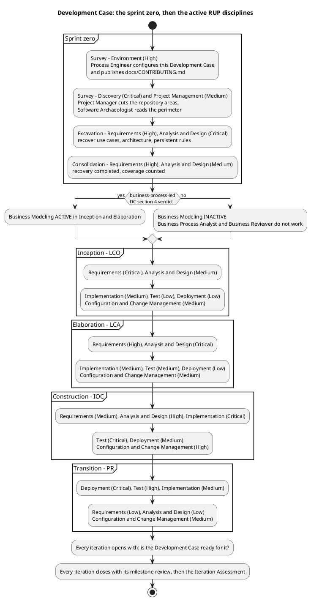
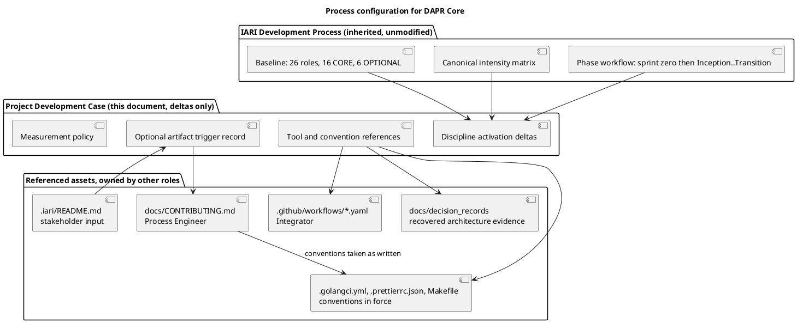

## Document Control

Phase: Survey
Status: Draft — governs the sprint zero, then the RUP phases
Milestone Target: end-of-Survey milestone (not yet achieved)

## Tailoring Overview

DAPR Core is a large existing Go system — a runtime plus sidecar, operator, placement, scheduler, sentry, injector
and a workflow engine — carried by a repository of roughly 6,600 files under `pkg/`, `cmd/`, `dapr/proto/`, `charts/`
and `tests/`. The project therefore runs the sprint zero first: Survey, Excavation and Consolidation read the system
as it is, before Inception begins to work the declared scope.

This document is a **delta over the IARI Development Case baseline**. It never restates the 26-role roster, the 16
CORE artifacts or CORE ownership; those are the baseline and hold unchanged. What follows records only the decisions
this project makes on top of it: which discipline is inactive, which OPTIONAL artifact trigger fires, which files the
team treats as conventions in force, and what this project measures.

### The organization this process is configured for

| Facet | Finding | Consequence for the process |
|---|---|---|
| Work unit | AI agent roles, invoked one stage per turn, with a fresh tool budget per stage | Artifacts carry the handoff; a stage that finds its inputs absent blocks rather than invents them |
| Role count active now | 1 (Process Engineer). The roster activates discipline by discipline as the phases open | Incremental rollout: Environment first, then Discovery, then Requirements and Analysis and Design |
| Existing system maturity | High: versioned releases to v1.19.x, decision records, unit, integration, e2e and perf suites in-tree | The sprint zero is an excavation, not a greenfield design; recovered elements cite their source anchor |
| Process maturity of the organisation | Managed-to-Defined: strong engineering automation exists in the repository, but no RUP artifact baseline exists yet | The Development Case introduces artifacts incrementally; it does not impose ceremony the repository does not already carry |
| Stakeholder | Named in `.iari/README.md`; leads the project | Scope questions escalate to that stakeholder; the sprint zero opens no ledger entry for them |
| Delivery surface | Multi-node, multi-environment: Kubernetes charts, standalone mode, mTLS, multi-namespace | Deployment discipline carries real weight in Transition; the Deployment Model trigger is evaluated on that fact |

### Tailoring rationale, decision by decision

1. **Sprint zero runs before Inception.** The repository is not a specification waiting to be written — it is a
   working system whose behaviour is the authoritative statement of what the system does. Excavation recovers the
   architecture, data and use cases into the CORE artifacts they belong to; Inception then works only the declared
   scope on top of that baseline.
2. **Business Modeling is inactive.** DAPR Core is a platform runtime: it exposes state, pub/sub, bindings, actors,
   workflows, crypto and service invocation to applications. No business process of the organisation is modelled or
   re-engineered by it. The DC §4 criteria are recorded as a verdict in this section and mirrored to the process
   service so the trigger-conditional roles read one source of truth. Business Process Analyst and Business Reviewer
   do not work in any phase; Business Modeling intensity remains "per canonical matrix" and is simply not exercised.
3. **The Capsule Designer does not work.** No hard real-time deadline or concurrent event-driven protocol contract
   defines this system's requirements in the capsule sense; the runtime's concurrency is engineered in Go and read as
   code in the Design Model. `real-time-system` is recorded as false alongside the business-process verdict.
4. **OPTIONAL artifacts are decided by their §5.2 condition, not by preference.** Each decision and its evidence is
   in "Optional Artifact Triggers"; the record is re-evaluated every iteration, so the survey's verdict is not a
   lifetime sentence.
5. **The tree's conventions are taken as written, never restated.** `.golangci.yml`, `.prettierrc.json` and the
   `Makefile` targets are what the kept code follows. The Development Case references them by path; it does not
   paraphrase a linter setting, because a paraphrase drifts and the file does not.
6. **The owner's `CONTRIBUTING.md` is evidence, not a rule.** The repository carries a contribution guide the
   stakeholder delivered. It describes how the open-source upstream takes contributions — DCO sign-off, issue types,
   PR workflow, slash commands. Those are facts about how the system was worked on. The rules the roles of this
   project follow are in `docs/CONTRIBUTING.md`, published by the Process Engineer; see "Guidelines and Procedures".

## Disciplines and Intensity

All ten baseline disciplines apply **per the canonical matrix**. This project assigns no intensity level of its own
and requests no deviation.

| Discipline | Project activation | Note |
|---|---|---|
| Discovery | Active — sprint zero only (Survey, Excavation, Consolidation) | Intensity per canonical matrix |
| Business Modeling | **INACTIVE** in every phase | Platform runtime; no organisational business process is modelled. See Tailoring Overview §2 |
| Requirements | Active | Per canonical matrix |
| Analysis & Design | Active | Per canonical matrix. The Capsule Designer does not work; the remaining design roles do |
| Implementation | Active | Per canonical matrix |
| Test | Active | Per canonical matrix |
| Deployment | Active | Per canonical matrix |
| Configuration & Change Management | Active | Per canonical matrix |
| Project Management | Active | Per canonical matrix |
| Environment | Active | Per canonical matrix |

Roles that do not work in this project, and why: **Business Process Analyst** and **Business Reviewer** (Business
Modeling inactive); **Capsule Designer** (`real-time-system` = false). No other role is removed, merged or
reassigned — the baseline roster is intact.

## Artifacts and Templates

The CORE catalog and its ownership are the baseline's and are unchanged. This section records only what this project
adds to them: where a template or convention already exists in the tree, and which artifact carries the recovered
material in the sprint zero.

```plantuml
@startuml
title Roles and the artifacts they produce in this project
hide empty members

package "Sprint zero (Survey, Excavation, Consolidation)" {
  class "Software Archaeologist" as SA
  class "System Inventory" as SI <<Discovery artifact>>
  class "Use-Case Model" as UCM
  class "Software Architecture Document" as SAD
  class "Design Model" as DM
  class "Data Model" as DATAM <<OPTIONAL>>
}

package "Requirements" {
  class "System Analyst" as SYSA
  class "Requirements Specifier" as RS
  class "Vision" as VIS
  class "Supplementary Specification" as SUPP
  class "Glossary" as GLO <<OPTIONAL>>
}

package "Analysis and Design" {
  class "Software Architect" as ARCH
  class "Designer" as DES
  class "Database Designer" as DBD
  class "User Interface Designer" as UID
  class "Architectural Proof-of-Concept" as POC <<OPTIONAL>>
  class "Deployment Model" as DEPM <<OPTIONAL>>
  class "User-Interface Prototype" as UIP <<OPTIONAL>>
}

package "Project and environment" {
  class "Project Manager" as PM
  class "Process Engineer" as PE
  class "Iteration Plan" as IP
  class "Risk List" as RL
  class "Iteration Assessment" as IA
  class "Development Case" as DC
  class "docs/CONTRIBUTING.md" as CG <<repository file>>
}

package "Test, implementation, delivery" {
  class "Test Manager" as TM
  class "Test Designer" as TD
  class "Tester" as TE
  class "Test Plan" as TP <<OPTIONAL>>
  class "Test Case" as TC
  class "Test Evaluation Summary" as TES
  class "Implementer" as IMP
  class "Implementation Model" as IM
  class "Integrator" as INT
  class "Technical Writer" as TW
  class "User Documentation" as UDOC
  class "Deployment Manager" as DEPL
  class "Release Notes" as RN
}

package "Configuration and change control" {
  class "Configuration Manager" as CM
  class "Change Control Manager" as CCM
  class "Change Request" as CR
  class "Review Record" as RR
}

SA --> SI : produces
SI --> UCM : recovers entry points
SI --> SAD : recovers components
SI --> DM : recovers classes
SI --> DATAM : recovers persistence rules
SYSA --> VIS : produces
SYSA --> UCM : produces
SYSA --> SUPP : produces
SYSA --> GLO : produces when fired
RS --> SUPP : refines thresholds
ARCH --> SAD : produces
ARCH --> POC : produces when fired
ARCH --> DEPM : produces when fired
DES --> DM : produces
DBD --> DM : persistent data sections
DBD --> DATAM : produces when fired
UID --> UIP : produces when fired
UID --> DM : boundary and navigation sections
PM --> IP : produces
PM --> RL : produces
PM --> IA : produces
PE --> DC : produces
PE --> CG : publishes
TM --> TP : produces when fired
TM --> TES : produces
TD --> TC : produces
TE --> TC : executes
IMP --> IM : produces
INT --> IM : integrates and merges
TW --> UDOC : produces
DEPL --> RN : produces
CM --> RR : baseline and gate evidence
CCM --> CR : produces from Inception on

note bottom of SI
  The System Inventory is the sprint zero artifact:
  every recovered use case cites EP-NNN, every
  recovered anomaly AN-NNN.
end note
note bottom of DC
  This Development Case is a delta over the IARI
  baseline; it never restates the roster or CORE catalog.
end note
@enduml
```

### Which artifact carries recovered material

| Recovered material | Artifact that carries it | Phase | Anchor the element cites |
|---|---|---|---|
| Entry points (HTTP, gRPC, CLI, operator control loops) | System Inventory, then Use-Case Model | Survey → Excavation | `Source: EP-NNN` |
| Anomalies found while reading | System Inventory | Survey, deepened in Excavation | `Source: AN-NNN` |
| Component and connector structure | Software Architecture Document | Excavation | `Source: <path>:<lines>` |
| Classes, packages, workflow and actor internals | Design Model | Excavation | `Source: <path>:<lines>` |
| Persistent entities and enforced rules | Design Model's data sections, or Data Model if its trigger fires | Excavation | `Source: <path>:<lines>` |
| Non-functional behaviour | Supplementary Specification | Consolidation | `Source: <path>:<lines>` |
| Architectural decisions already taken | Software Architecture Document, citing the decision record | Excavation | `Source: docs/decision_records/...` |

`docs/decision_records/` holds 23 accepted decision records (`API-*`, `ARC-*`, `CLI-*`, `ENG-*`, `SDK-*`). They are
the system's own architectural record. The Software Architect reads them as evidence of decisions in force; they are
not RUP artifacts and are never renumbered into the project's identifier families.

### Templates in force

| Template | Path | Applies to |
|---|---|---|
| Issue forms | `.github/ISSUE_TEMPLATE/` (9 forms) | How a change is requested upstream — the owner's; `docs/CONTRIBUTING.md` states the project's own rule |
| Pull request template | `.github/pull_request_template.md` | PR descriptions on the upstream line |
| Release notes | `docs/release_notes/template.md` | Release Notes artifact in Transition, taken as written |
| Development setup | `docs/development/setup-dapr-development-env.md` | Onboarding for anyone working the repository |
| Decision record format | `docs/decision_records/decision_records.md` | Recovered architecture evidence, not a project artifact |

No RUP artifact template is created by this project: the canonical section skeletons carried by the artifact service
are the templates.

## Optional Artifact Triggers

Six OPTIONAL artifacts exist in the baseline. Each is decided below on its §5.2 condition against this project's
real facts. The record is re-evaluated every iteration — a trigger that does not fire now may fire when declared
scope changes.

| Optional artifact | §5.2 condition | Verdict for this project | Evidence |
|---|---|---|---|
| Glossary | Domain uses specialist vocabulary needing stakeholder-validated definitions | **FIRED** | The codebase's own vocabulary is specialist and load-bearing: actor, reminder, timer, placement table, dissimination round, sidecar, sentry, trust domain, SVID, SPIFFE, resiliency policy, component, subscription, workflow, activity, orchestration, state store, binding, pub/sub, bulk subscribe, outbox, hot reload, workflow access policy, MCP server, conversation. `pkg/acl/`, `pkg/actors/`, `pkg/runtime/`, `dapr/proto/` establish these terms. A reader cannot follow a recovered use case without agreed definitions, and the definitions must be the stakeholder's, not the reader's. |
| Architectural Proof-of-Concept | Elaboration phase + at least one technical risk requiring empirical validation | **NOT FIRED at Survey** | The condition includes the Elaboration phase; Survey has not reached it. No risk has been scored yet — the Risk List does not exist until the Project Manager produces it. Re-evaluated in Elaboration against the scored Risk List. |
| Data Model | Data-centric system, OR >10 entities, OR data migration in scope | **NOT FIRED at Survey** | The runtime is not data-centric: it is a stateless data plane that persists through externally configured state stores and an actor state store (`pkg/runtime/compstore/`, `pkg/actors/state/`). The persistent entity count and any migration scope are counted in Excavation from the recovered anchors; the trigger is re-evaluated then, not on an uncounted guess. |
| Deployment Model | Distributed / multi-node topology, OR multi-environment non-trivial | **FIRED** | The system is distributed by construction and ships multi-environment. `charts/dapr/` carries seven subcharts (operator, placement, scheduler, sentry, sidecar injector, RBAC, config) each with a StatefulSet or Deployment, PDB and Service; `docker/` carries five Dockerfiles for Linux, Windows and dev; `cmd/` carries six binaries (`daprd`, operator, placement, scheduler, sentry, injector) plus the CLI in `.build-tools/`. mTLS via Sentry, placement and scheduler are separate control planes with leadership. Standalone and Kubernetes modes are both first-class (`pkg/config/modes/`). |
| User-Interface Prototype | UX-critical, OR UI complexity requiring stakeholder validation before implementation | **NOT FIRED** | No end-user graphical interface exists or is declared. The interfaces are an HTTP/gRPC API surface (`pkg/api/http/`, `pkg/api/grpc/`, `swagger/swagger.json`) and a command-line tool. API shape is validated by the API decision records, not by a UI prototype. |
| Test Plan | Formal delivery, regulatory audit, or contractual test reporting | **NOT FIRED** | No regulatory or contractual test-reporting obligation is declared. Testing scope per iteration is defined by the Iteration Plan, and the repository's own layered suites (unit `unit` build tag, `tests/integration/suite/` with 2,073 files, `tests/e2e/`, `tests/perf/`) are the execution substrate. If a delivery obligation is declared later, the trigger is re-evaluated. |

The two FIRED artifacts are recorded with the process service so the optional-generator roles read the same decision.

## Roles and Ownership

CORE artifact primary ownership is the baseline's and is not restated or changed here. This section records the
project-specific facts that affect how roles work.

### Roles active by phase

| Phase | Roles that work | Roles that do not |
|---|---|---|
| Survey | Process Engineer, Project Manager, Software Archaeologist, then the milestone reviewers | All others |
| Excavation | Process Engineer, Project Manager, System Analyst, Software Architect, Designer, Database Designer, Software Archaeologist, then the reviewers | Business Process Analyst, Business Reviewer, Capsule Designer |
| Consolidation | As Excavation, without the Software Architect's proof-of-concept decision | Business Process Analyst, Business Reviewer, Capsule Designer |
| Inception | Requirements, Analysis & Design (architect only), Project Management, Implementation (Integrator), Test (Test Manager), Deployment, Configuration & Change Management | Business Process Analyst, Business Reviewer, Capsule Designer |
| Elaboration | Requirements, Analysis & Design (all design roles), Implementation, Test, Deployment, Project Management, Environment, Configuration & Change Management | Business Process Analyst, Business Reviewer, Capsule Designer |
| Construction | Requirements, Analysis & Design, Implementation, Test, Deployment, Project Management, Configuration & Change Management | Business Process Analyst, Business Reviewer, Capsule Designer |
| Transition | Deployment, Test, Implementation, Requirements, Analysis & Design, Configuration & Change Management, Project Management | Business Process Analyst, Business Reviewer, Capsule Designer |

### Ownership boundaries this project relies on

- The **Process Engineer** owns this Development Case and `docs/CONTRIBUTING.md`. It owns no other repository file.
- The **Integrator** owns the CI configuration under `.github/workflows/`. This Development Case references that path
  and never states whether a workflow exists, what it runs, or whether it passes — that is the Integrator's state to
  report, and it changes inside the same iteration.
- The **Configuration Manager** owns branch, baseline and gate decisions; the **Change Control Manager** owns the
  change-request ledger. The labels the whole process reads are published in `docs/CONTRIBUTING.md`.
- The **Software Architect** anchors the version policy in the Software Architecture Document. The Process Engineer
  formalises the policy from what the stakeholder declared; it does not resolve or verify versions.
- The **Database Designer** owns persistent-data sections when they live inside the Design Model, and the Data Model
  if its trigger fires.

## Guidelines and Procedures

### The contribution guide

`docs/CONTRIBUTING.md` is the project's contract for whoever contributes — a person or an agent role: how a change is
requested and with which labels, where branching and deployment rules live, which conventions the code follows, and
what a review checks. The Process Engineer publishes it and keeps it.

The repository also carries the owner's `CONTRIBUTING.md` at its root, describing the upstream open-source workflow
(DCO sign-off, issue types, proposal process, slash commands, Prettier and `make lint`). That file is kept as the
owner wrote it. Where a rule of it differs from how this project works — issue labelling, review handoff, the
`ready-for-review` and `cr:*` states — `docs/CONTRIBUTING.md` holds.

### Conventions in force

The code and test conventions are those the kept code already follows. They are taken as written from these files,
which the roles read directly:

| Convention area | File | What the roles take from it |
|---|---|---|
| Go lint and formatting | `.golangci.yml` | Linter set and formatter set (gofmt, gofumpt, goimports with `github.com/dapr/` local prefix); banned imports (for example `github.com/Sirupsen/logrus` → `github.com/dapr/kit/logger`, `github.com/pkg/errors` → standard `errors`, `gopkg.in/yaml.v2` → `gopkg.in/yaml.v3`); generated-code exclusions |
| JS/JSON formatting | `.prettierrc.json` | Trailing comma `es5`, tab width 4, no semicolons, single quotes |
| Build, test and codegen targets | `Makefile`, `tests/dapr_tests.mk`, `docker/docker.mk`, `tools/codegen.mk` | The targets a change is verified with before handoff |
| Proto generation | `tools/proto/generate.sh`, `dapr/proto/**/*.proto` | How the 44 proto definitions produce `pkg/proto/**` |
| Development environment | `docs/development/setup-dapr-development-env.md`, `.devcontainer/devcontainer.json`, `docker/Dockerfile-dev` | How a contributor gets a working build |
| Test layout and writing | `tests/docs/writing-integration-test.md`, `tests/docs/writing-e2e-test.md`, `tests/docs/writing-perf-test.md` | Where a test belongs and how it is structured |
| Preview features | `docs/development/preview-features.md` | How a feature is gated |

### Branching, deployment and release

Branch and release procedure is the owner's and sits in `RELEASE.md`, `.github/workflows/create-release.yaml`,
`.github/workflows/backport.yaml` and `.github/scripts/create-release.sh`. The roles read those files for the
procedure; the Development Case does not restate it. The branching rules the roles themselves follow — including the
branch names the Configuration Manager validates — are stated in `docs/CONTRIBUTING.md`.

### Measurement policy

IARI measures two quantities, and this project states what it does with each — a metric whose decision cannot be
named here does not get tracked.

| Quantity | Decision it enables | Who reads it |
|---|---|---|
| Tokens consumed per iteration | Whether an iteration's cost is proportionate to the artifact surface it touched. A rise across iterations that touches the same surface means the process is re-reading what it already knows — the Development Case then narrows scope or references an existing artifact instead of re-deriving it. | Process Engineer, Project Manager |
| Elapsed time, split into agent time and time waiting for a human | Where work actually waits. Agent time rising with no artifact growth points at a discipline whose stages are retried; human queue time rising points at a gate that needs a decision. The two clocks are read apart and never summed. | Process Engineer, Project Manager, Review Coordinator |

Human gates are bounded as a risk, not forecast as a schedule: a gate ceiling is 14 days, after which the process
suspends rather than filling the gap. The Project Manager owns that bound in the Risk List.

### Version policy

The stakeholder's declared framework target and any pinned library or LTS rule are formalised by the Process Engineer
into the process service's version policy, from the Vision and Constraints as declared. The Software Architect
anchors the policy in the Software Architecture Document, and it governs over a registry's "latest". The Process
Engineer neither resolves nor verifies a version against a registry.

The tree already fixes the toolchain in `go.mod` (`go 1.26.11`) and pins its `dapr/*` module dependencies to exact
pseudo-versions. That is the system as it stands, and it is read as evidence; the declared policy, once formalised,
governs for anything new.

### Process support

Environment is a continuous discipline, not a one-time configuration. Each iteration opens with the same checkpoint
— is this Development Case current for the iteration about to run? — and each closes with the Iteration Assessment,
whose findings feed the next revision. A process question that blocks a role is escalated in the round it arises; it
does not wait for the milestone.

### What this project does not do

- No Architecture Review Board, no Change Control Board beyond the Change Control Manager's ledger, no formal
  training programme: the roster and the CR ledger are the mechanism.
- No Glossary entry without a definition taken from the system's own vocabulary and confirmed by the stakeholder.
- No process artifact outside the CORE catalog, the six OPTIONAL artifacts and the sprint zero's System Inventory.
