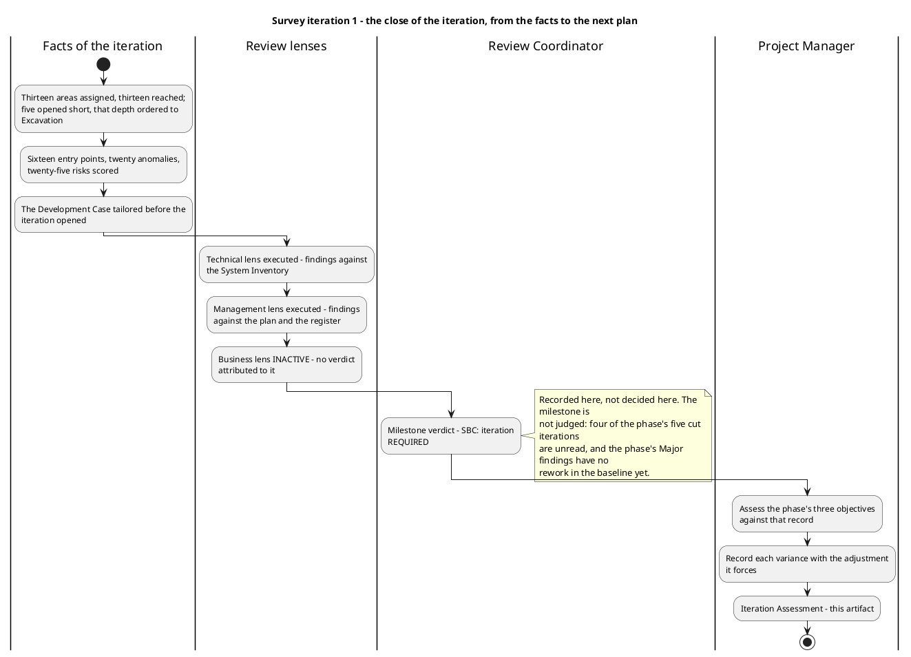
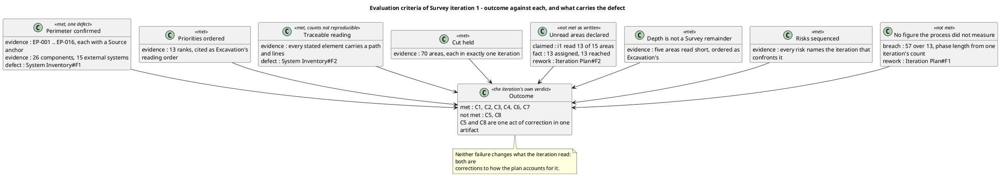
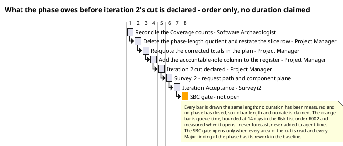

## Document Control
Phase: Survey
Status: Draft — iteration 1 assessment, recorded after the Review Coordinator's verdict. The iteration is accepted and the phase iterates; the SBC milestone is not judged and no phase is closed
Milestone Target: end-of-Survey milestone (SBC) — not achieved

## Iteration Objectives Reached

Survey iteration 1 is assessed against the four objectives its Iteration Plan committed to and the phase's three intended objectives. The Review Coordinator's verdict is recorded here as given: **SBC — iteration REQUIRED**. This document records that verdict; it does not issue a milestone.

| # | Objective committed in the Iteration Plan | Owner | Outcome | Evidence, and what qualifies it |
|---|---|---|---|---|
| O1 | The perimeter of the existing system is fixed: every executable, API surface, protocol contract and control plane enumerated with the path it was read from | Software Archaeologist | **Met** | System Inventory — Perimeter: `EP-001` to `EP-016`, each anchored; 26 components and 15 external systems named entry by entry. Qualified by `System Inventory#F1`: one Persistent Data anchor names a symbol its cited file does not declare, and the file sits in the artifact's own unread set |
| O2 | What the system declares about itself is recorded — decision records, release history, contribution and release procedure, toolchain | Software Archaeologist | **Met** | 23 decision records graded against the tree, 147 release notes, the template and the newest note, `go.mod` (`go 1.26.11`, `dapr/*` on exact pseudo-versions). Both lenses accepted this content; nothing is recorded against it |
| O3 | What does not hold together in the reading is written down and ordered | Software Archaeologist | **Met** | 20 anomalies `AN-001` to `AN-020`, each with its anchor; 13 ranked priorities, cited as Excavation's reading order rather than as a Survey work item. Qualified by `System Inventory#F2`: the read-counts printed beside the enumeration are not reproducible from it |
| O4 | The work left in the phase is cut into iterations, each area in exactly one iteration | Project Manager | **Met, two corrections owed** | 70 areas, each in exactly one iteration, nothing read twice; all 25 risks name the iteration that confronts them. Qualified by `Iteration Plan#F1` (a phase-length quotient no measurement produced) and `Iteration Plan#F2` (the slice booked as 13 of 15 against an assignment of 13) |

| Phase objective this iteration serves | Served? | Where it stands after the verdict |
|---|---|---|
| Confirm the System Boundary | Partly — one of the phase's five cut iterations is read | The boundary is enumerated and anchored over 13 of 70 areas; four iterations of the cut are unread, so it is not yet confirmed |
| Tailor Development Process | Yes, and closed for this iteration | Development Case delivered before the iteration opened, no finding from either lens: Business Modeling INACTIVE, Capsule Designer withheld, Glossary and Deployment Model triggered, four optionals not fired with reasons, the stakeholder's pointer line applied |
| Identify Critical Risks | Yes, for what was read | 25 risks, every one of the 20 anomalies carried, three High and thirteen Significant all on `avoid`. None is retired and none is due to be: iteration 1 is the register's first measurement |

Four committed objectives, four met. Two of the four carry a defect in the artifact's account of its own work; neither defect touches what the iteration read.

## Adherence to Plan
The fine plan committed eight work items. All eight ran, in the order written.

| # | Work item | Owner | Committed exit condition | Outcome |
|---|---|---|---|---|
| W0 | Tailor the process for the phase | Process Engineer | The Environment stage is satisfied before the reading opens; every §5.2 optional recorded fired or not fired with its reason | Met — Development Case delivered before the iteration opened, clean from both lenses |
| W1 | Declare the cut of the phase | Project Manager | The cut is recorded and no other role of the iteration works before it | Met |
| W2 | Read what the system says it is | Software Archaeologist | Every claim carries `Source:`; records reported as evidence, never renumbered | Met |
| W3 | Fix the perimeter and enumerate the entry points | Software Archaeologist | Every executable, API surface and protocol contract enumerated and labelled `EP-NNN` with an anchor | Met, with `System Inventory#F1` on one anchor |
| W4 | Record the anomalies and order what remains | Software Archaeologist | Each anomaly labelled `AN-NNN` with its anchor; the remaining areas ordered | Met, with `System Inventory#F2` on the counts beside the enumeration |
| W5 | Score the risks the reading exposed and evolve the plan | Project Manager | Every risk scored with strategy and accountable role; every anomaly carrying at least one; the cut matching the recorded cut | Met, with `Risk List#F1` on the owner column and `Iteration Plan#F1`, `#F2` on what the plan says it did |
| W6 | Review the iteration against the SBC criteria | Reviewer, Management Reviewer, Review Coordinator | The verdict is issued; a Critical finding escalates to the stakeholder and the milestone does not close | Met — verdict issued: **SBC — iteration REQUIRED**; zero Critical findings, nothing escalated |
| W7 | Record the Iteration Assessment given the verdict | Project Manager | Every objective stated met or missed, with the adjustment the next iteration takes | Met — this document, recorded without a milestone verdict of its own |

### Variance

Six variances separate what the plan said from what the iteration did. Each is recorded with the root cause and the adjustment it forces in iteration 2. A variance recorded without its correction would be left open for the next iteration's reviewers to find.

**V1 — `Iteration Plan#F1`, Major.** The plan derives a phase length from one iteration's area count ("57 ÷ 13 = 4.4 further iterations; the five iterations of Survey hold"), in the same document whose measurement table states that no rate is derived from those counts. Root cause: the plan needed to close an open question — whether five iterations suffice — and reached for the only quotient available rather than stating the absence. The quotient is not even transferable: iteration 1's areas are small documents and manifests, while the iterations it is applied to hold `tests/` at 3 335 entries and `pkg/runtime/` at 308 files. *Adjustment:* the quotient and the conclusion drawn from it are deleted from the Iteration Plan this turn; the remainder is stated as the counts the cut holds, with `R001` standing as the risk and one more iteration as the remedy. Whether the cut suffices is asked at each iteration close from what that iteration read, not projected.

**V2 — `Iteration Plan#F2`, Major.** The plan books iteration 1 as a 15-area slice with two unread, while the assignment named 13 and every one was reached; `go.sum` and `img` appear both in i1's "not reached" line and in i2's "carried" line, so the plan puts two areas in two iterations at once. Root cause: the plan was written against the cut's original 15-area i1 draft and was not reconciled with the 13-area assignment the Work Order actually issued. *Adjustment:* i1's row is restated as 13 assigned and 13 reached, `go.sum` and `img` appear once, in i2's row; the "Unread areas declared" evaluation criterion is restated on a true fact. Applied to the Iteration Plan this turn.

**V3 — `System Inventory#F2`, Major.** The Coverage read-counts are not reproducible from the enumerations printed beside them. Root cause: the counts were carried forward from an earlier draft of the table while the enumerations beside them grew. *Adjustment (owner: Software Archaeologist, owed):* reconcile each row's stated count with the files it enumerates; correct the outside-slice total and the `docs` categories. The consuming end is this role's: the Iteration Plan's measurement table quotes those totals, and it is re-quoted from the corrected figures the moment they land — not before. Iteration 2's slice is not sized from an unreconciled count.

**V4 — An artifact of the increment was absent from the plan.** The Development Case was not a work item of this iteration when the plan was written; the Environment discipline runs it at the head of every phase iteration and it was in the increment, reviewed and clean from both lenses. Root cause: the fine plan covered the Discovery and Project Management stretches and omitted the Environment stage the inherited process runs before them. *Adjustment:* W0 is added to this iteration's fine plan retroactively stated — the work ran, the plan now reports it — and iteration 2's plan carries the Development Case stage explicitly, with its owner, so an artifact of the increment is never absent from the plan that reports on it.

**V5 — `Risk List#F1`, Minor.** All 25 rows named the Project Manager as Owner, including the sixteen whose retirement is another role's reading. Root cause: the register treated the custodian of the register as the owner of every entry. *Adjustment:* an "Accountable role" column is added distinct from the custodian, lifting the names the mitigation rows already give — Software Archaeologist for the reading risks, Integrator for `R021`, Test Manager for `R025`, Project Manager for `R001` and `R002`. Applied to the Risk List this turn.

**V6 — `R006`'s trigger as first written would have fired on a measured fact.** The trigger read "any token figure, elapsed-time forecast … appears in a sprint-zero artifact", which a measured iteration spend reported with both clocks apart does not satisfy. Uncorrected, the register would have called its own iteration's measured facts a breach. Root cause: the trigger was written to exclude forecasts but worded to exclude the measurement itself. *Adjustment:* the trigger is restated in the Risk List to fire on a figure the process did not measure, and to say explicitly that a measured iteration spend is that iteration's actual, reported with both clocks apart and with no rate derived from it. Applied to the Risk List this turn.

| Variance | Finding it answers | Owner | Correction's state after this turn |
|---|---|---|---|
| V1 | `Iteration Plan#F1` | Project Manager | Applied to the Iteration Plan; closure is the Management Reviewer's |
| V2 | `Iteration Plan#F2` | Project Manager | Applied to the Iteration Plan; closure is the Management Reviewer's |
| V3 | `System Inventory#F2` | Software Archaeologist | Owed; the plan's re-quote follows the correction |
| V4 | none recorded — a gap both lenses passed over | Project Manager | Applied to this plan, W0; iteration 2's plan carries it |
| V5 | `Risk List#F1` | Project Manager | Applied to the Risk List; closure is the Management Reviewer's |
| V6 | none recorded — a latent defect in this role's own register | Project Manager | Applied to the Risk List |

## Use Cases and Scenarios Implemented

None, and this is the phase working as designed rather than an omission. No use case enters a Survey plan: the scope unit of the sprint zero is the area of the repository, and this iteration's unit was the thirteen areas the cut assigned it. No Test discipline runs in Survey, so no scenario was executed and no executable was produced.

What the iteration returned instead is the raw material a use case will be recovered from in Excavation: sixteen entry points, `EP-001` to `EP-016`, each anchored to the path it was read from. Excavation recovers one use case per entry point and the Use-Case Model traces each recovered use case to it.

| Phase | Scope unit | This iteration |
|---|---|---|
| Survey | Repository area | 13 of 70 areas of the cut read |
| Excavation | Entry point `EP-NNN`, recovered use case | Not started — 16 entry points available as its input |
| Consolidation and later | Declared use case, risk-driven selection | Not started |

## Results Relative to Evaluation Criteria
Each criterion the Iteration Plan carried, answered against the evidence that exists after the review. Six met, two not met; both failures sit in one artifact and are corrected by one act.

| Criterion | Threshold | Outcome | Evidence |
|---|---|---|---|
| Perimeter confirmed | Every executable, API surface and protocol contract enumerated with a `Source:` anchor | Met | System Inventory — Perimeter: 16 entry points, 26 components, 15 external systems, all anchored. One anchor fails `System Inventory#F1` |
| Priorities ordered | The areas still to read are ordered and the ordering cited as Excavation's | Met | System Inventory — Priorities: 13 ranks, each with why it comes first |
| Traceable reading | No element stated without the path and lines it was read from | Met, with its counts unreconciled | Every element carries an anchor; `System Inventory#F2` — the totals printed beside the enumerations do not reproduce from them |
| Cut held | Every area in exactly one iteration, in the order recorded, none left uncut | Met | 70 areas; 13 read here, 4 iterations of the cut carrying the other 57 |
| Unread areas declared | An area the iteration did not reach is named, not skipped, and the remainder counted | **Not met as written** | The criterion claims it as met by a two-area shortfall against a 13-area assignment. Corrected to: this iteration had no unreached area; the declared remainder is the 57 areas the cut assigns to iterations 2 to 5 |
| Depth left in a read area is not a Survey remainder | An area opened short of its file count is scheduled by the Priorities for Excavation, never re-opened inside the Survey cut | Met | Five areas opened short — `.github` 3 of 120, `cmd` 12 of 183, `dapr` 13 of 45, `docs` 9 of 196, `pkg/proto` 3 of 66 — each ordered by Priorities as Excavation's reading |
| Risks sequenced, not only scored | Every risk names the iteration that confronts it, or the row the whole reading carries | Met | 25 risks, 25 rows: 11 in i1, 2 in i2, 2 in i3, 5 in i4, none in i5, 5 on the whole reading |
| No figure the process did not measure | No work-item size, no rate, no calendar date and no forecast in any phase artifact. A measured figure is not a breach: an iteration's token spend and elapsed agent time, and a gate's queue time, are reported as that iteration's actuals, each clock apart and never summed | **Not met** | `Iteration Plan#F1`: "57 ÷ 13 = 4.4 further iterations … the five iterations of Survey hold" — a phase length forecasted from one iteration's count, which no measurement produced. Corrected in the plan this turn. The measured figures in the table below are this iteration's facts, not the defect |

**What this iteration measured, and the decision each measurement enables.** The figures below are the iteration's recorded facts, not a velocity and not a baseline. No rate is derived from any of them, and none is projected onto iteration 2.

| Measurement | Value | Decision it enables |
|---|---|---|
| Agent work — token spend | 19 480 197 tokens over 11 agent invocations | The first actual this project has, and the only figure a later phase's forecast may be built from. Read beside the artifact surface below, it shows what the spend bought: reasoning over five artifacts, not emission. It is one iteration of a sprint zero — not a per-iteration rate, and not a phase spend, because no phase has closed |
| Agent work — measured elapsed time | 0:36:59.0766494 | Read with the token figure, it shows the sprint zero's work is dominated by re-reading the accumulated artifact surface rather than by writing it. It sets the shape a later phase's cost will take, and it is quoted apart from queue time — never added to it |
| Human gate — queue time, iteration 1 | 0:00:00 measured; the end-of-iteration approval gate is excluded from the measurement | The gate cost nothing in queue time here. It does not lower R002's 14-day ceiling: that ceiling is a bound on a gate, and the next one's queue is measured when it opens |
| Artifacts in the increment | 5 | 5 of the artifacts the Development Case sanctions this phase. It does not cover the two optionals triggered for later phases — Glossary and Deployment Model — whose absence here is correct |
| Artifact sizes, in characters | Development Case 28 911; Iteration Plan 27 143; Risk List 31 413; System Inventory 78 385; Review Record 76 201 | Names where the iteration's spend and the next phase's re-reading cost sit: the two largest artifacts are the two a recovery phase and a gate will re-read most. Excavation's cost is set by this surface, not by the lines it emits |
| Stakeholder interactions | 9 | Confirms the sprint zero resolved its tailoring questions in one round rather than by attrition — the `CONTRIBUTING.md` pointer being the one answer applied. A rising count in a later iteration means a scope question is being deferred, not answered |
| Areas of the slice reached | 13 of 13 assigned; five opened short of their file count | Whether an area is read at the depth its priority needs, and where short, whether that depth belongs to Excavation. This iteration's answer: it does, by the Priorities order |

## Test Results

No test was designed, executed or reported in Survey iteration 1. No Test discipline runs in this phase: the Test Manager's first stage is the Inception Test Plan, and the Test Designer, Tester and Test Analyst first work in Elaboration.

No test figure is available and none is asserted — no pass rate, no coverage percentage, no build status. The test substrate was named, not run: `tests/` holds 3 335 entries and is Survey iteration 4's slice, and the anomalies touching it — `AN-008` (two suites disabled by renaming), `AN-019` (156 registration files against one test), `AN-020` (harness parsing free text) — are recorded as what the tree shows, not as results of any execution.

## External Changes

One external change is in force: the stakeholder answered the Process Engineer's question on the root `CONTRIBUTING.md`, granting one pointer line at its top to `docs/CONTRIBUTING.md` for how a change is requested, labelled and reviewed. The answer is applied and both review lenses verified it — the pointer line present, the owner's text below it unchanged.

No change request was opened or decided: the Change Control Manager does not work in the sprint zero, so the stakeholder's order reached its owner through the work order instead of a ledger entry. No pull request exists to dispose of — no role of Survey produces code, and the SCM holds no PR in any state.

The stakeholder is asked nothing by this assessment. The verdict escalates only an unresolved Critical finding, and both executing lenses recorded zero.

## Rework Required

Four Major findings and two Minor stand open. Rework of the two Minor items and the two Major items on this role's own artifacts is applied in this turn; the rest is owed by the Software Archaeologist.

| # | Rework | Owner | Closes | Holds the SBC gate | State |
|---|---|---|---|---|---|
| 1 | Delete the 57 ÷ 13 quotient and its conclusion; state the remainder as the counts the cut holds, with `R001` as the risk and one more iteration as the remedy | Project Manager | `Iteration Plan#F1` | Yes | Applied to the Iteration Plan this turn; closure is the Management Reviewer's |
| 2 | Restate iteration 1's row as 13 assigned and 13 reached; list `go.sum` and `img` in iteration 2's row only; restate the "Unread areas declared" criterion | Project Manager | `Iteration Plan#F2` | Yes | Applied to the Iteration Plan this turn; closure is the Management Reviewer's |
| 3 | Add an accountable-role column distinct from the register's custodian, naming the role that performs the retiring act | Project Manager | `Risk List#F1` | No | Applied to the Risk List this turn; closure is the Management Reviewer's |
| 4 | Reconcile every Coverage row's stated count with the files it enumerates; correct the outside-slice total and the `docs` categories | Software Archaeologist | `System Inventory#F2` | Yes | Owed — iteration 2 |
| 5 | Anchor the actor-state start-up requirement on code that enforces it, or restate the claim as what `actorStateStoreBindings` does; move the anchor out of the declared unread set | Software Archaeologist | `System Inventory#F1` | Yes | Owed — the iteration that reads `pkg/runtime/`, Survey i3 by the cut |
| 6 | Derive the component and external-system counts from the tables; restate the proto file breakdown consistent with `AN-002` and `AN-013` | Software Archaeologist | `System Inventory#F3` | No | Owed — owner's next turn |

Items 4 and 5 are why the SBC review's entry criterion is unmet and why the phase iterates. Item 5's remedy is placed in the iteration the cut already assigns `pkg/runtime/` to — Survey i3 — so the claim is anchored where the code that enforces it is read, not re-opened inside iteration 2's slice.

**What iteration 2 takes.** The cut's next slice, unchanged: `go.sum` and `img` as its own areas, then `pkg/api/` read whole, `pkg/messaging/`, `pkg/channel/`, `pkg/components/`, `pkg/resiliency/`, `pkg/middleware/`, `pkg/config/`, `pkg/diagnostics/`, `pkg/metrics/`, `pkg/healthz/`, `pkg/ports/`, `pkg/modes/`, `pkg/apphealth/`, `pkg/cors/`. No finding of this review adds an area to it or removes one: the four Major findings are corrections to how iteration 1 is accounted for, not reasons to re-read an area. It inherits all sixteen Significant and High risks, unretired and not yet due, and it carries the Development Case stage explicitly (V4). Its two Minor findings are fixed in their owner's next turn; any defect that persists is re-recorded under its existing key, never as a new one.
