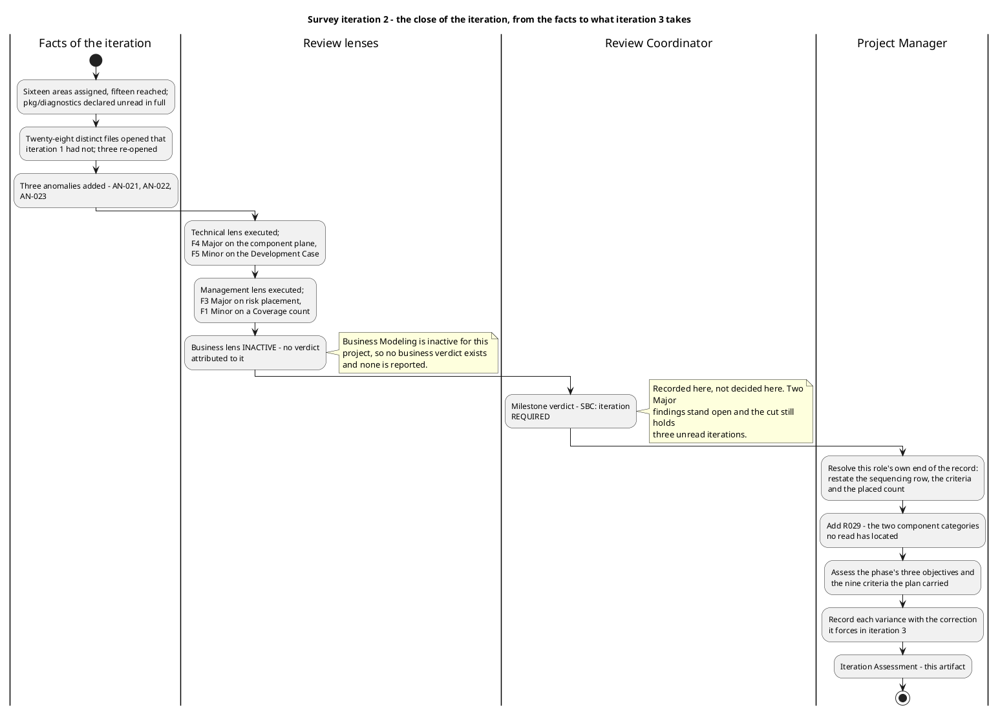
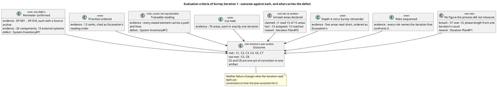
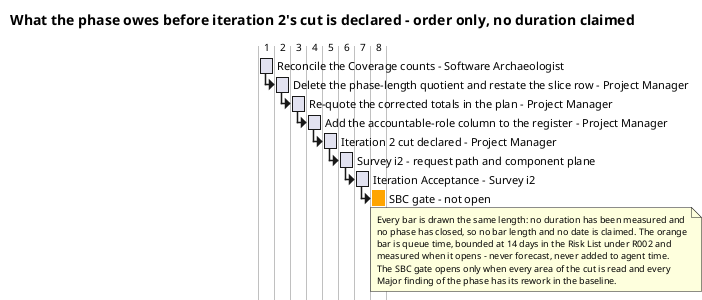

## Document Control
Phase: Survey
Status: Draft — iteration 2 assessment, recorded after the Review Coordinator's verdict. The iteration is accepted and the phase iterates; the SBC milestone is not judged and no phase is closed
Milestone Target: end-of-Survey milestone (SBC) — not achieved

## Iteration Objectives Reached
Survey iteration 2 is assessed against the five objectives its Iteration Plan committed to and against the phase's three intended objectives. The Review Coordinator's verdict is recorded here as given: **SBC — iteration REQUIRED**. This document records that verdict; it does not issue a milestone.

| # | Objective committed in the Iteration Plan | Owner | Outcome | Evidence, and what qualifies it |
|---|---|---|---|---|
| O1 | The request path is fixed: how an application's call becomes a call into a component, read from the code that does the dispatch | Software Archaeologist | **Met** | System Inventory — Perimeter and Coverage: `go.sum` and `img` recorded for what they are, `EP-003` and `EP-013` anchored on `pkg/api/http/server.go`, the allowlist read from `pkg/api/grpc/endpoints.go`, `pkg/messaging/v1/messaging.go` and `pkg/channel/channel.go` read. `pkg/diagnostics/` declared unread in full with its reason, not counted as reached. No finding is recorded against this content by either executing lens |
| O2 | The component plane is recorded: what the request path dispatches into and under what policy | Software Archaeologist | **Met, with rework owed** | `pkg/components/`, `pkg/resiliency/`, `pkg/middleware/` and `pkg/config/` were read and each anchor holds — the Technical lens opened `state/`, `lock/` and `conversation/registry.go` and all three follow the pattern the row describes. Qualified by `System Inventory#F4`, Major: fifteen `Category` constants against thirteen anchored registry paths, with `workflow` and `workflowbackend` resolving to nothing. The Review Coordinator's C1 resolved the cross-lens question — the management lens passed O2 on the artifact's statement, the technical lens opened the tree, and the opened file governs. The registry set is therefore recorded as thirteen located and two unlocated, carried as `R029` |
| O3 | The cross-cutting surfaces the request path carries are anchored | Software Archaeologist | **Met** | `pkg/metrics/exporter.go` (`EP-012`), `pkg/healthz/healthz.go` (`EP-011`), `pkg/ports/ports.go`, `pkg/modes/modes.go`, `pkg/apphealth/health.go`, `pkg/cors/cors.go` — each read and each stated with its anchor. The Technical lens opened `healthz.go`, `modes.go` and `cors.go` and all three hold. `pkg/diagnostics/` (35 files) declared unread in full and not counted as reached |
| O4 | The phase's own account of itself is reconciled, so its figures can be reproduced from what it prints | Software Archaeologist, and this role for the re-quote | **Met, one count open** | `System Inventory#F2` and `#F3` closed this review by their recording lens on verified evidence — every Coverage row re-added by hand, 60 + 28 = 88 for the phase, 42 / 19 / 16 derived from the tables. This plan re-quotes only those reconciled figures. Qualified by `System Inventory#F1` under the Management Reviewer's lens, Minor: "twenty-four areas never assigned" against twenty-three rows at the foot of the Coverage table. No objective fails on it and no quoted total changes |
| O5 | The remainder of the phase is cut and declared before any other role of the iteration reads | Project Manager | **Met** | The cut is recorded with the process service: 16 areas of this iteration, 41 across the three that follow (11 + 17 + 13), 70 areas each in exactly one iteration. No area is in two iterations, and `go.sum` and `img` appear in this iteration's row only |

| Phase objective this iteration serves | Served? | Where it stands after the verdict |
|---|---|---|
| Confirm the System Boundary | Partly — two of the phase's five cut iterations are read | The boundary is enumerated and anchored over 29 of 70 areas; three iterations of the cut are unread, so it is not yet confirmed. `pkg/api/universal/` — the 29 files where each operation is implemented — is deliberately outside this read and is ranked fourth for Excavation |
| Tailor Development Process | Not an objective of this iteration; stands as delivered | The Development Case was carried as W0 and delivered before the reading opened. It carries `Development Case#F5` (Minor) from the Technical lens — one evidence path, `pkg/config/modes/` against the actual `pkg/modes/modes.go` — which does not touch the Deployment Model verdict: FIRED rests on seven subcharts, eight Dockerfiles, six executables, two runtime modes, placement and scheduler as separate control planes, and mTLS through Sentry |
| Identify Critical Risks | Yes, for what was read | 29 risks, every one of the 23 anomalies carried, three High and fifteen Significant all on `avoid`, three accepted at Moderate. Four entries were added this iteration: `R026`, `R027`, `R028` from this slice's anomalies and `R029` as this role's consuming end of `System Inventory#F4`. None is retired and none is due to: the phase has no closed iteration behind it that produced a second reading |

Five committed objectives: three met, two met with rework owed inside an artifact. No objective was missed, and no defect touches what the iteration read.

## Adherence to Plan
The fine plan committed ten work items, W0 to W9. All ten ran, in the order written, and the tenth — this document — records the outcome.

## Use Cases and Scenarios Implemented
None, and this is the phase working as designed rather than an omission. No use case enters a Survey plan: the scope unit of the sprint zero is the area of the repository, and this iteration's unit was the sixteen areas the cut assigned it. No Test discipline runs in Survey, so no scenario was executed and no executable was produced.

What the iteration returned instead is the raw material a use case will be recovered from in Excavation. This slice fixed the request-path entry points — `EP-003` and `EP-013` on `pkg/api/http/server.go` across its two listeners, `EP-011` on `pkg/healthz/healthz.go`, `EP-012` on `pkg/metrics/exporter.go` — and recorded the operations the app-channel boundary offers in `pkg/channel/channel.go`. `pkg/api/universal/`, where each operation is implemented, is deliberately outside this read: what an operation does is Excavation's, and it is ranked fourth in the System Inventory's Priorities.

| Phase | Scope unit | This iteration |
|---|---|---|
| Survey | Repository area | 29 of 70 areas of the cut read over two iterations; 15 of this iteration's 16 areas reached |
| Excavation | Entry point `EP-NNN`, recovered use case | Not started — the request-path entry points and the app-channel boundary are its input |
| Consolidation and later | Declared use case, risk-driven selection | Not started |

## Results Relative to Evaluation Criteria
Each criterion the Iteration Plan carried, answered against the evidence that exists after the review. Six met, two not met; both failures sit in one artifact and are corrected by one act.

| Criterion | Threshold | Outcome | Evidence |
|---|---|---|---|
| Perimeter confirmed | Every executable, API surface and protocol contract enumerated with a `Source:` anchor | Met | System Inventory — Perimeter: 16 entry points, 26 components, 15 external systems, all anchored. One anchor fails `System Inventory#F1` |
| Priorities ordered | The areas still to read are ordered and the ordering cited as Excavation's | Met | System Inventory — Priorities: 13 ranks, each with why it comes first |
| Traceable reading | No element stated without the path and lines it was read from | Met, with its counts unreconciled | Every element carries an anchor; `System Inventory#F2` — the totals printed beside the enumerations do not reproduce from them |
| Cut held | Every area in exactly one iteration, in the order recorded, none left uncut | Met | 70 areas; 13 read here, 4 iterations of the cut carrying the other 57 |
| Unread areas declared | An area the iteration did not reach is named, not skipped, and the remainder counted | **Not met as written** | The criterion claims it as met by a two-area shortfall against a 13-area assignment. Corrected to: this iteration had no unreached area; the declared remainder is the 57 areas the cut assigns to iterations 2 to 5 |
| Depth left in a read area is not a Survey remainder | An area opened short of its file count is scheduled by the Priorities for Excavation, never re-opened inside the Survey cut | Met | Five areas opened short — `.github` 3 of 120, `cmd` 12 of 183, `dapr` 13 of 45, `docs` 9 of 196, `pkg/proto` 3 of 66 — each ordered by Priorities as Excavation's reading |
| Risks sequenced, not only scored | Every risk names the iteration that confronts it, or the row the whole reading carries | Met | 25 risks, 25 rows: 11 in i1, 2 in i2, 2 in i3, 5 in i4, none in i5, 5 on the whole reading |
| No figure the process did not measure | No work-item size, no rate, no calendar date and no forecast in any phase artifact. A measured figure is not a breach: an iteration's token spend and elapsed agent time, and a gate's queue time, are reported as that iteration's actuals, each clock apart and never summed | **Not met** | `Iteration Plan#F1`: "57 ÷ 13 = 4.4 further iterations … the five iterations of Survey hold" — a phase length forecasted from one iteration's count, which no measurement produced. Corrected in the plan this turn. The measured figures in the table below are this iteration's facts, not the defect |

**What this iteration measured, and the decision each measurement enables.** The figures below are the iteration's recorded facts, not a velocity and not a baseline. No rate is derived from any of them, and none is projected onto iteration 2.

| Measurement | Value | Decision it enables |
|---|---|---|
| Agent work — token spend | 19 480 197 tokens over 11 agent invocations | The first actual this project has, and the only figure a later phase's forecast may be built from. Read beside the artifact surface below, it shows what the spend bought: reasoning over five artifacts, not emission. It is one iteration of a sprint zero — not a per-iteration rate, and not a phase spend, because no phase has closed |
| Agent work — measured elapsed time | 0:36:59.0766494 | Read with the token figure, it shows the sprint zero's work is dominated by re-reading the accumulated artifact surface rather than by writing it. It sets the shape a later phase's cost will take, and it is quoted apart from queue time — never added to it |
| Human gate — queue time, iteration 1 | 0:00:00 measured; the end-of-iteration approval gate is excluded from the measurement | The gate cost nothing in queue time here. It does not lower R002's 14-day ceiling: that ceiling is a bound on a gate, and the next one's queue is measured when it opens |
| Artifacts in the increment | 5 | 5 of the artifacts the Development Case sanctions this phase. It does not cover the two optionals triggered for later phases — Glossary and Deployment Model — whose absence here is correct |
| Artifact sizes, in characters | Development Case 28 911; Iteration Plan 27 143; Risk List 31 413; System Inventory 78 385; Review Record 76 201 | Names where the iteration's spend and the next phase's re-reading cost sit: the two largest artifacts are the two a recovery phase and a gate will re-read most. Excavation's cost is set by this surface, not by the lines it emits |
| Stakeholder interactions | 9 | Confirms the sprint zero resolved its tailoring questions in one round rather than by attrition — the `CONTRIBUTING.md` pointer being the one answer applied. A rising count in a later iteration means a scope question is being deferred, not answered |
| Areas of the slice reached | 13 of 13 assigned; five opened short of their file count | Whether an area is read at the depth its priority needs, and where short, whether that depth belongs to Excavation. This iteration's answer: it does, by the Priorities order |

## Test Results

No test was designed, executed or reported in Survey iteration 1. No Test discipline runs in this phase: the Test Manager's first stage is the Inception Test Plan, and the Test Designer, Tester and Test Analyst first work in Elaboration.

No test figure is available and none is asserted — no pass rate, no coverage percentage, no build status. The test substrate was named, not run: `tests/` holds 3 335 entries and is Survey iteration 4's slice, and the anomalies touching it — `AN-008` (two suites disabled by renaming), `AN-019` (156 registration files against one test), `AN-020` (harness parsing free text) — are recorded as what the tree shows, not as results of any execution.

## External Changes

One external change is in force: the stakeholder answered the Process Engineer's question on the root `CONTRIBUTING.md`, granting one pointer line at its top to `docs/CONTRIBUTING.md` for how a change is requested, labelled and reviewed. The answer is applied and both review lenses verified it — the pointer line present, the owner's text below it unchanged.

No change request was opened or decided: the Change Control Manager does not work in the sprint zero, so the stakeholder's order reached its owner through the work order instead of a ledger entry. No pull request exists to dispose of — no role of Survey produces code, and the SCM holds no PR in any state.

The stakeholder is asked nothing by this assessment. The verdict escalates only an unresolved Critical finding, and both executing lenses recorded zero.

## Rework Required
Four Major findings and two Minor stand open at the close of the review. All findings against this role's own artifacts — `Iteration Plan#F1`, `Iteration Plan#F2` and `Risk List#F1` — have their rework applied this turn; the three against the System Inventory are the Software Archaeologist's and are owed.

| # | Rework | Owner | Closes | Holds the SBC gate | State |
|---|---|---|---|---|---|
| 1 | Delete the 57 ÷ 13 quotient and its conclusion; state the remainder as the counts the cut holds, with `R001` as the risk and one more iteration as the remedy | Project Manager | `Iteration Plan#F1` | Yes | Applied to the Iteration Plan this turn; closure is the Management Reviewer's |
| 2 | Restate iteration 1's row as 13 assigned and 13 reached; list `go.sum` and `img` in iteration 2's row only; restate the "Unread areas declared" criterion | Project Manager | `Iteration Plan#F2` | Yes | Applied to the Iteration Plan this turn; closure is the Management Reviewer's |
| 3 | Add an accountable-role column distinct from the register's custodian, naming the role that performs the retiring act | Project Manager | `Risk List#F1` | No | Applied to the Risk List this turn; closure is the Management Reviewer's |
| 4 | Reconcile every Coverage row's stated count with the files it enumerates; correct the outside-slice total and the `docs` categories | Software Archaeologist | `System Inventory#F2` | Yes | Owed — before the next cut sizes itself from these counts |
| 5 | Anchor the actor-state start-up requirement on code that enforces it, or restate the claim as what `actorStateStoreBindings` does; move the anchor out of the declared unread set | Software Archaeologist | `System Inventory#F1` | Yes | Owed — the iteration that reads `pkg/runtime/`, Survey i3 by the cut |
| 6 | Derive the component and external-system counts from the tables; restate the proto file breakdown consistent with `AN-002` and `AN-013` | Software Archaeologist | `System Inventory#F3` | No | Owed — owner's next turn |

Items 4 and 5 are why the SBC review's entry criterion is unmet and why the phase iterates. Item 5's remedy is placed in the iteration the cut already assigns `pkg/runtime/` to — Survey i3 — so the claim is anchored where the code that enforces it is read, not re-opened inside iteration 2's slice.

### What iteration 2 takes

The cut's next slice, unchanged: `go.sum` and `img` as its own areas, then `pkg/api/` read whole, `pkg/messaging/`, `pkg/channel/`, `pkg/components/`, `pkg/resiliency/`, `pkg/middleware/`, `pkg/config/`, `pkg/diagnostics/`, `pkg/metrics/`, `pkg/healthz/`, `pkg/ports/`, `pkg/modes/`, `pkg/apphealth/`, `pkg/cors/`. No finding of this review adds an area to it or removes one: the four Major findings are corrections to how iteration 1 is accounted for, not reasons to re-read an area. It inherits all sixteen Significant and High risks, unretired and not yet due, and it carries the Environment stage as its first work item. Its two Minor findings are fixed in their owner's next turn; any defect that persists is re-recorded under its existing key, never as a new one.

The re-quote of the corrected Coverage totals — in the Iteration Plan's measurement table, its Evaluation Criteria and its cut tables — cannot be applied before item 4 lands. Until then the plan states no such figure, which is the correct state and not a gap: a count that cannot be reproduced from its own enumeration is corrected at source first, then quoted.

