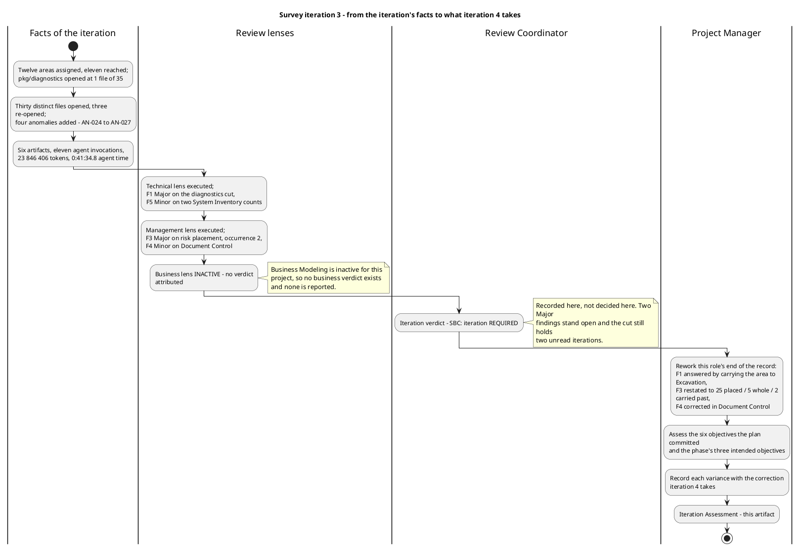
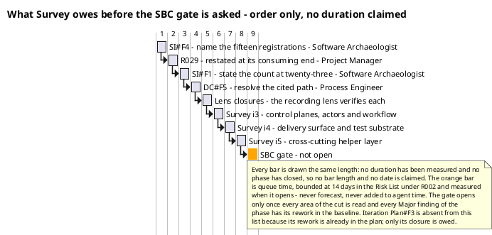

## Document Control
Phase: Survey

Status: Draft — iteration 3 assessment, recorded after the Review Coordinator's verdict. The iteration is accepted and the phase iterates; the SBC milestone is not judged and no phase is closed. Two Major findings (`Iteration Plan#F1`, `Iteration Plan#F3`) stand open against this role's plan and hold the SBC gate; this role's end of both was reworked in the same turn this assessment was recorded, and closure is each recording lens' act, not this one's.

Milestone Target: end-of-Survey milestone (SBC) — not achieved

## Iteration Objectives Reached
Survey iteration 3 is assessed against the six objectives its Iteration Plan committed to and against the phase's three intended objectives. The Review Coordinator's verdict is recorded here as given: **SBC — iteration REQUIRED**. This document records that verdict; it does not issue a milestone.

| # | Objective committed in the Iteration Plan | Owner | Outcome | Evidence, and what qualifies it |
|---|---|---|---|---|
| O1 | The scheduler's authority is recorded from the code that enforces it, not from its configuration | Software Archaeologist | **Met** | The Technical lens opened `pkg/runtime/registry/registry.go` and `pkg/runtime/processor/manager.go` directly and counted thirteen typed registry fields and twelve dispatched categories, and its compliance row records the scheduler's authority as stated from `api.go`, not from a flag's name. `ReportActorTypes` is stated as the one-line forward to `s.placement`, and `R019` is settled against the conversions the server performs (`schedFPToCron`, `cronFPToSched`) with the sourceless family named rather than adopted. No finding is recorded against this content by either executing lens |
| O2 | The component plane is completed: the two categories iteration 2 could not account for are located or stated unlocated | Software Archaeologist | **Met** | `R029` answers it and the Risk List's Retirement record states the answer: fifteen constants declared, thirteen registries in `registry.go`'s collection, twelve categories dispatched by the processor, and `workflow` and `workflowbackend` registered by the engine's own backend in `pkg/runtime/wfengine/backends/actors/actors.go` and the actor table, not by a component registry. `System Inventory#F4`, the Major that produced `R029`, is closed by its recording lens on files it opened |
| O3 | The stateful abstractions are stated as the mechanisms in force | Software Archaeologist | **Met** | The Technical lens opened `pkg/actors/table/table.go` and records `Types()` advertised to placement against `ReminderTypes()` to the scheduler, suspension without a state store (`Options.StartSuspended`, `SuspendHosting`, `ResumeHosting`, `GetOrCreate` refusing while suspended) — all holding. `R014`, `R024` and `R026` sit on this reading: the two renamed suites are read as packages, the 156 registration files against one test are counted, and `pkg/runtime/wfengine/README.md` is cited only as the document the code contradicts, which the Technical lens verified verbatim |
| O4 | The trust domain and the resource plane are anchored | Software Archaeologist | **Met** | `pkg/client/clientset/versioned/clientset.go` opened and counted: three group clients — `ComponentsV1alpha1`, `ConfigurationV1alpha1`, `MCPServerV1alpha1` — against the seven kinds `pkg/apis/` declares, recorded as `R031`. `pkg/apis/subscriptions/v2alpha1/conversion.go` opened and `ConvertTo` found writing `dst.Spec.Route = s.Spec.Routes.Default` with no read of `Routes.Rules`, recorded as `R032` against `charts/dapr/crds/subscription.yaml` opening beside it. Both hold as the artifact states them |
| O5 | The monitoring area's disposition is stated, and no part of it is counted as reached that was not read | Software Archaeologist | **Not met as committed; reworked and declared** | `pkg/diagnostics/` opened at one file of thirty-five — `metrics.go`, the seven default meters — and the thirteen monitoring and tracing modules, their helpers and their suites were deferred to "priority 4", the System Inventory's reading order for Excavation and not an iteration of this cut. Neither the row nor any other named an iteration carrying the remainder, so the area was counted as reached while thirty-four files left the phase. No module was stated against an operation this phase read, and none was declared as instrumenting an operation no iteration read — the alternative O5 admits and would have been satisfied by. This role's rework, applied in the same turn this assessment was recorded, took O5's second admissible outcome: the area is declared carried to Excavation beside the cut and dropped from the reached count, 11 of 12. `Iteration Plan#F1` (Reviewer, Major) is open until that lens closes it |
| O6 | The remainder of the phase is cut and declared before any other role of the iteration reads | Project Manager | **Met** | The cut was recorded with the process service before any role of the iteration read: 12 areas this iteration and 3 iterations in the cut, in the Work Order's order. The arithmetic that carried it was wrong in two places and is corrected — the 70 areas are 69 cut into Survey plus `pkg/diagnostics` carried to Excavation (13 + 15 + 11 + 17 + 13 = 69), and the placed-risk count is 25 placed, 5 carried by the reading as a whole and 2 carried past the phase. The cut's declaration itself was timely and is not in question; what failed is the two counts stated over it |

| Phase objective this iteration serves | Served? | Where it stands after the verdict |
|---|---|---|
| Confirm the System Boundary | Partly — three of the phase's five cut iterations are read | The boundary is enumerated and anchored over 39 of the 69 areas the Survey cut holds (13 + 15 + 11); `pkg/diagnostics/` is carried to Excavation and its thirty-four unread files are in no Survey iteration. Two iterations remain (30 areas), so the boundary is not yet confirmed. `pkg/api/universal/` — the 29 files where each operation is implemented — remains deliberately outside this read and ranked fourth for Excavation |
| Tailor Development Process | Yes, and this iteration closed its one defect | The Development Case was carried as W0 and delivered before the reading opened. `Development Case#F1` — the Deployment Model evidence path — is closed by its recording lens on all three cited files opened; the Deployment Model trigger stands on the seven subcharts, the eight Dockerfiles, the six executables, the two runtime modes, placement and scheduler as separate control planes, and mTLS through Sentry |
| Identify Critical Risks | Yes, for what was read | 32 risks, every one of the 27 anomalies carried. Three High (`R011`, `R016`, `R023`) and seventeen Significant, all twenty on `avoid`, so no consequence is handed to the stakeholder and no grant is outstanding. The three accepted risks — `R002`, `R003`, `R025` — are Moderate, where acceptance with a written mitigation and contingency is this role's decision. This iteration added `R030`, `R031`, `R032` from its own anomalies and restated `R029` to what the reading found |

Six committed objectives: four met, one not met as committed and reworked to its second admissible outcome, one met with the counts it carried corrected. The two Major findings sit on the plan that stated the claims — not on what the iteration read, which the Technical lens anchored nine times and found holding nine times.

### What this iteration measured, and what each measurement decided

| Measurement goal | Metric | This iteration's primitive measure | Decision it drove |
|---|---|---|---|
| Know whether an area was read to the depth its priority needs, or skimmed | Areas reached of areas assigned, and at what depth | 12 assigned, 11 read to a stated depth, 1 opened at 1 file of 35 and carried | Moved `pkg/diagnostics/` out of the Survey cut into Excavation and took it out of the reached count. The same check found `pkg/runtime/` and `pkg/actors/` short of their file counts at a depth Excavation owns — recorded in Coverage, not reclassified |
| Know whether facts keep resolving outside the slice, which would mean the cut is drawn in the wrong place | Files opened inside the slice against files opened outside it | 27 in-slice, 3 outside, 30 distinct, 3 re-opened; the twelve assigned areas hold 901 files | No re-cut of the remaining two iterations: three outside files against twenty-seven inside is the same shape iterations 1 and 2 produced, so the perimeter of the slice holds |
| Know whether the reading finds the system's incoherences or only describes it | Anomalies recorded, and the new ones this slice added | 4 new — `AN-024` to `AN-027` — against 23 carried forward | Each became a scored risk (`R029` restated, `R030` to `R032`) rather than a note. A slice yielding no anomaly would have meant the reading was describing |
| Know whether the cut is ordered by risk at all, or only by convenience of location | Risks placed on an iteration whose area that iteration opens | 9 placed on this iteration, every one naming an area it opened; the aggregate check found 2 of 27 placed on iterations that read nothing of them | Moved `R013` and `R021` to carried past the phase, restated the count as 25 / 5 / 2, and took `.github` out of iteration 4's justification |
| Report the iteration's cost in the currency this system measures | Token spend and measured elapsed time, the human gate apart | 23 846 406 tokens; 0:41:34.844933 of agent time; 0:00:00 measured queue time at the gate; 11 agent invocations across 6 artifacts | None yet. No phase has closed, so there is no phase-level actual and no rate; the figure is reported as this iteration's own fact and is projected onto nothing |

The gate's queue time above excludes the end-of-iteration approval gate, which is not measured — the figure is reported as measured, not as complete.

## Adherence to Plan
The fine plan committed ten work items, W0 to W9. All ten ran, in the order written, and the tenth — this document — records the outcome.

| # | Work item | Owner | Committed exit condition | Outcome |
|---|---|---|---|---|
| W0 | Tailor the process for the phase: Development Case and the Contribution Guide | Process Engineer | The Environment stage is satisfied before the reading opens; every §5.2 optional recorded fired or not fired with its reason | Met — the iteration-2 Minor on one evidence path is closed by its lens on all three cited files opened; the Deployment Model verdict stands |
| W1 | Declare the cut of this iteration and of the remainder | Project Manager | The cut is recorded and no other role of the iteration works before it | Met as a declaration, not as an account: 12 areas were recorded before any role read, in the Work Order's order. The two counts stated over that cut were wrong — see V1 and V2 |
| W2 | Read the scheduler as the single authority it has become, and record what it honours | Software Archaeologist | The authority is recovered from the code that enforces it; the sourceless failure-policy family settled or recorded open with the reason; `R023` names the code it was read from | Met — `pkg/scheduler/server/api.go` read, `ReportActorTypes` recorded as the one-line forward to `s.placement`, and the two conversions `schedFPToCron` / `cronFPToSched` recorded against the sourceless `dapr.proto.scheduler.v1` family, so `R019` is settled rather than left open |
| W3 | Read the placement service it supersedes, and the trust domain both bind | Software Archaeologist | Placement's leadership, table and dissemination stated as the mechanism still in force, with the cutover contract read from code; the trust domain anchored on the files that enforce it | Met — the cutover contract and the trust domain are anchored, and the Technical lens found no defect in either |
| W4 | Read the actor runtime and the workflow engine, and locate the two component categories | Software Archaeologist | The registration of `workflow` and `workflowbackend` located and anchored, or both stated unlocated with the reading that failed to find them; the renamed suites read as packages; the registration-file count stated with its build tags; retention and coverage recovered from code and suites | Met — and the first of the two admissible outcomes was reached: the two categories are registered by the engine's own backend in `pkg/runtime/wfengine/backends/actors/actors.go` and the actor table, not by a component registry. `R029` is restated on `AN-024` to the fifteen/thirteen/two split. The Technical lens opened `table.go` and found `Types()` against `ReminderTypes()` and the suspension contract as the artifact states them |
| W5 | Read the resource plane the control planes serve, and state the monitoring area's disposition | Software Archaeologist | The seven resource kinds stated with the operator's informer and watchdog behaviour and the generated clientset named as generated; the webhook decision anchored; the ACL extractor anchored; `pkg/diagnostics/` read against the operations W2–W4 recovered, or declared carried | Partly met — the resource plane is fully met: `clientset.go` opened and its three groups counted against the seven kinds (`R031`), the Subscription conversion opened and its rule loss recorded (`R032`), the webhook and ACL anchors in place. The monitoring half is the iteration's one failure — see V1 |
| W6 | Score the risks this slice exposed, and name the role accountable for retiring each entry | Project Manager | Every risk carries probability, impact, magnitude, strategy and an accountable role distinct from the custodian; every anomaly newly recorded carries at least one risk; no Significant or High risk on `accept` without a stakeholder grant | Met — 32 risks, all 27 anomalies carried, `R030` to `R032` added from this slice and `R029` restated, custody separated from accountability on every row, three accepted risks all Moderate. The Management Reviewer re-scored the register and recorded nothing |
| W7 | Re-quote the reconciled figures and restate the cut against what was read | Project Manager | The slice table carries this iteration's reconciled counts; the cut matches the recorded cut area for area; the reached count and the Coverage rows agree; whether the cut still holds is answered from this iteration's reading | Not met as committed — the reached count of 12 did not agree with the Coverage rows, which recorded one file of thirty-five opened, and the placed-risk count of 27 named two iterations that read nothing of the risks on them. See V1 and V2. Both are corrected in the plan this turn |
| W8 | Review the iteration against the SBC criteria | Reviewer, Management Reviewer, Review Coordinator | The verdict is issued; a Critical finding escalates and the milestone does not close | Met — verdict issued: **SBC — iteration REQUIRED**; zero Critical findings, nothing escalated to the stakeholder; four findings recorded, two Major and two Minor |
| W9 | Record the Iteration Assessment given the verdict | Project Manager | Every objective is stated met or missed, with the scope or plan adjustment the next iteration takes | Met — this document, recorded without a milestone verdict of its own |

### Variance

Four variances separate what the plan said from what the iteration did. Each carries its root cause and the adjustment it forces, and each adjustment is in the baseline as this document is recorded.

**V1 — an area counted as reached left the phase with thirty-four of its thirty-five files unread.** `pkg/diagnostics/` was assigned twelve areas and one was opened at one file. Root cause: the plan re-cut the area into this iteration on the reasoning that a monitoring module is legible only against the operation it instruments, then accepted the reading's deferral of the thirteen modules to "priority 4" — the System Inventory's reading order for Excavation, which is not an iteration of the cut. The deferral therefore had no iteration to land in, and the reached count of 12 answered the SBC condition "the cut holds no unread area" while thirty-four files sat outside every iteration. This is the defect class `Iteration Plan#F3` recorded in iteration 2 — a placement resting on an area whose reading does not actually happen — recurring at the cut's arithmetic. *Adjustment, applied to the plan this turn:* the second of the two admissible outcomes is taken. The area is declared **carried to Excavation** beside the cut, in the plan's own text and in the objectives' O5, and dropped from this iteration's reached count — 11 of 12. The arithmetic is restated where 34 unread files cannot be counted as Survey coverage: 70 areas the reading holds, **69 cut into the five Survey iterations, 1 carried to Excavation**, 13 + 15 + 11 + 17 + 13 = 69. `Iteration Plan#F1` (Reviewer, Major) is open until that lens closes it.

**V2 — the placed-risk count was true as arithmetic and false as evidence.** `R013` and `R021` were placed on iteration 4, supported by the sentence that their readings are "in `tests/` and `charts/`". Neither anomaly was read from either area: `AN-007`'s anchor is `.github/scripts/version-skew-test-patches/` and `AN-016`'s is `.github/workflows/fossa.yml`, both `.github`, which this plan assigns to iteration 1. `R021`'s retirement is not a reading at all — its own mitigation is a Change Request against `.github/workflows/` owned by the Integrator, a role the plan's Resources section places outside Survey. Root cause: the count was corrected last iteration at the two rows its finding named, and the rule those corrections were required to satisfy — that a placement names an area its iteration opens — was never applied to the remaining twenty-five. *Adjustment, applied to the plan this turn:* both risks are carried past the phase in a row of their own, `R013` retired on iteration 1's `.github` read and `R021` named as the Integrator's Change Request in Construction; the count is restated as **25 placed, 5 carried by the reading as a whole, 2 carried past the phase**; Document Control, the sequencing table's closing paragraph, the Evaluation Criteria row and the measurement row all carry that one figure; and no row cites `tests/` or `charts/` as the place a `.github` fact is read. `Iteration Plan#F3` (Management Reviewer, Major, occurrence 2) is open until that lens closes it.

**V3 — Document Control stated a milestone verdict at an iteration close and denied it in the same section.** Root cause: the section reported the prior iteration's outcome using the gate's identifier, when what an iteration boundary yields is a decision on the iteration and the SBC gate is issued once, by the Review Coordinator, at the end of Survey. *Adjustment, applied to the plan this turn:* the opening sentence states what the iteration close decided — iteration 3 was reviewed and the phase iterates — and the closing sentence carries the only statement about the milestone. `Iteration Plan#F4` (Management Reviewer, Minor) is open until that lens closes it.

**V4 — the iteration cost more than the two before it and produced fewer reached areas than it was assigned.** Root cause: the slice was the largest per-area surface of the phase (901 files across twelve areas, with `pkg/runtime/` at 308 and `pkg/actors/` at 243), and the reading resolved facts by re-opening areas it had already read rather than by opening new ones — 3 re-opened, and 3 outside the slice. *Adjustment:* no rate is derived and none is projected. The figure is reported as this iteration's own measured fact. What the next plan takes from it is a cut decision, not a size: iteration 4 takes 17 areas holding 3 496 files, which is the largest slice the cut holds and the reason `R001` exists. If it overruns, the remedy is `R001`'s — one more iteration, never less scope and never more agent roles in parallel.

| Variance | Finding it answers | Owner | Correction's state after this turn |
|---|---|---|---|
| V1 | `Iteration Plan#F1` — Reviewer, Major | Project Manager for the cut; Software Archaeologist for the reading | Applied to the Iteration Plan this turn — the area is declared carried, the reached count is 11 of 12, and the 69 + 1 arithmetic is stated. Closure is the Reviewer's |
| V2 | `Iteration Plan#F3` — Management Reviewer, Major, occurrence 2 | Project Manager | Applied to the Iteration Plan this turn — 25 / 5 / 2 in Document Control, the sequencing table, the Evaluation Criteria and the measurement row. Closure is the Management Reviewer's |
| V3 | `Iteration Plan#F4` — Management Reviewer, Minor | Project Manager | Applied to the Iteration Plan this turn. Closure is the Management Reviewer's |
| V4 | none recorded — a cost observation, not a defect | Project Manager | Recorded here; no artifact changes as a result |

`System Inventory#F5` (Reviewer, Minor) sits in another role's artifact and is not re-recorded here: it is two stated counts that do not reproduce from their own enumerations, no role builds on either, and it holds no gate.

### What iteration 4 takes

The cut's next slice, as corrected by this close: `charts/`, `docker/`, `tests/`, `grafana/`, `swagger/`, `platforms/`, `tools/`, `pkg/testing/`, `Makefile`, `.golangci.yml`, `.prettierrc.json`, `.codecov.yaml`, `.devcontainer/`, `.build-tools/`, `.gitattributes`, `.gitignore`, `.prettierignore` — 17 areas, 3 496 files.

It inherits three adjustments from this close:

- **`pkg/diagnostics/` is not in it and not in any Survey iteration.** The area is carried to Excavation, where the operations it instruments are read at the depth a module's effect on them can be stated from. No later iteration of this phase may count it as reached.
- **`R013` and `R021` are not in it.** Both are carried past the phase: `R013` is retired on iteration 1's `.github` read, `R021` as the Integrator's Change Request in Construction. Iteration 4 carries three risks only — `R001` on the size of its own slice, `R025` on the harness parsing in `tests/`, and `R027`'s chart half in `charts/`.
- **The rework this role owes is in the plan and the register, not in iteration 4.** `Iteration Plan#F1`, `#F3` and `#F4` have their remedies applied; what remains is each recording lens' closure.

The phase iterates because the cut holds two unread iterations and because two Major findings stand open. It does not iterate because a calendar says so, and no iteration is added on account of this review: nothing here displaces an area or cuts declared scope.

## Use Cases and Scenarios Implemented
None, and this is the phase working as designed rather than an omission. No use case enters a Survey plan: the scope unit of the sprint zero is the area of the repository, and this iteration's unit was the twelve areas the cut assigned it. No Test discipline runs in Survey, so no scenario was executed and no executable was produced.

What the iteration returned instead is the raw material a use case will be recovered from in Excavation. The twelve areas of this slice are the processes and stores behind the entry points iteration 2 fixed: a use case is recovered from an entry point with `Source: EP-NNN`, and the System Inventory holds sixteen such rows after this reading. The slice adds no entry point of its own — a scheduler process, a placement service, a trust domain and a resource reconciler are what the entry points of the request path dispatch into, not further doors into the system.

What the slice adds is four anomalies — `AN-024` to `AN-027` — and each became a scored risk rather than a note. The component plane's fifteen/thirteen/two split (`R029`), the eleven document-less areas (`R030`), the three-of-seven clientset (`R031`) and the Subscription conversion's rule loss (`R032`) are contracts Excavation recovers use cases from; none of them is a use case, and none is treated as one here.

| Phase | Scope unit | This iteration |
|---|---|---|
| Survey | Repository area | 39 of the 69 areas the Survey cut holds, read over three iterations; 11 of this iteration's 12 areas reached, `pkg/diagnostics/` carried to Excavation |
| Excavation | Entry point `EP-NNN`, recovered use case | Not started — the sixteen entry points the phase has anchored and the request path's operations are its input; `pkg/diagnostics/` is carried into its Priorities order at priority 4 |
| Consolidation and later | Declared use case, risk-driven selection | Not started |

`pkg/api/universal/`, where each operation of the request path is implemented, remains deliberately outside the Survey read: what an operation does is Excavation's, and it is ranked fourth in the System Inventory's Priorities. Until it is read, no recovered use case can state its main flow.

## Results Relative to Evaluation Criteria
Each of the nine criteria the Iteration Plan carried, answered against the evidence that exists after the review. Five met, three met with the defect the review recorded against the artifact that evidences them, and one not met as committed and answered by its own second admissible outcome.

```plantuml
@startuml
title Evaluation criteria of Survey iteration 3 - outcome against each
hide empty members
skinparam classAttributeIconSize 0
skinparam wrapWidth 330
skinparam nodesep 24
skinparam ranksep 30

class "Scheduler authority from code" as C1 <<met>> {
  evidence : ReportActorTypes as the forward to s.placement
  evidence : schedFPToCron and cronFPToSched read for R019
}

class "Component plane completed" as C2 <<met>> {
  evidence : 13 registries, 12 dispatched categories
  evidence : workflow and workflowbackend by the engine's backend
  closed : System Inventory#F4, by its lens
}

class "Stateful abstractions in force" as C3 <<met>> {
  evidence : Types vs ReminderTypes, suspension contract
  evidence : retention and coverage against the README
}

class "Trust domain and resource plane" as C4 <<met>> {
  evidence : 3 group clients against 7 kinds - R031
  evidence : ConvertTo drops Routes.Rules - R032
}

class "Monitoring disposition stated" as C5 <<not met as committed>> {
  was : 1 file of 35, remainder to priority 4,
        counted among 12 reached
  now : carried to Excavation, 11 of 12 reached
  rework : Iteration Plan#F1
}

class "Cut held and declared" as C6 <<met with defect recorded>> {
  evidence : 12 areas recorded before any role read
  defect : the two counts stated over it
  now : 69 cut + 1 carried = 70; 11 of 12 reached
}

class "Risks sequenced and accountable" as C7 <<not met as committed>> {
  was : 27 placed; R013 and R021 on areas that read nothing of them
  now : 25 placed / 5 whole / 2 carried past the phase
  rework : Iteration Plan#F3
}

class "Rework carried, not restated" as C8 <<met with defect recorded>> {
  was : an SBC verdict at an iteration close
  now : the iteration decision only
  rework : Iteration Plan#F4
}

class "No figure the process did not measure" as C9 <<met>> {
  evidence : 23 846 406 tokens, 0:41:34.8, gate apart
  evidence : no size, no rate, no projected date
}

class "Outcome" as O <<the iteration's own verdict>> {
  met : C1, C2, C3, C4, C9
  met, defect recorded : C6, C8
  not met as committed : C5, C7 - both corrected this turn
}

C1 -down-> O
C2 -down-> O
C3 -down-> O
C4 -down-> O
C5 -down-> O
C6 -down-> O
C7 -down-> O
C8 -down-> O
C9 -down-> O

note bottom of O
  No failure changes what the iteration read: the Technical
  lens opened nine anchors and all nine held. C5, C7 and C8
  are corrections to how the plan accounts for the read, and
  all three are applied in the plan this turn.
end note
@enduml
```

| Criterion | Threshold | Outcome | Evidence |
|---|---|---|---|
| Scheduler authority recorded from code | `pkg/scheduler/` read; `ReportActorTypes` answered as placement leader under `--placement-enabled` and the capability advertisement gating a mixed-version cluster each stated with file and lines; the sourceless failure-policy family settled against what the server honours or recorded open with the reason | Met | `pkg/scheduler/server/api.go` read: `ReportActorTypes` a one-line forward to `s.placement`, and `schedFPToCron` / `cronFPToSched` converting between the contract type and the cron library's own family and touching neither of the other two. `R019` settled — the family the server honours is the one `scheduler.proto` types, and the sourceless `dapr.proto.scheduler.v1` family is named as read by nothing. `R023` names the code |
| Component plane completed | The registration of `workflow` and `workflowbackend` anchored with file and lines, or both stated unlocated with the reading that failed to find them; `R029` restated to what the reading found | **Met** | `pkg/runtime/wfengine/backends/actors/actors.go` builds the backend itself and registers its actor types through `pkg/actors`' table; `pkg/runtime/registry/registry.go` holds thirteen typed fields with no workflow field and `pkg/runtime/processor/manager.go` dispatches twelve categories. The Technical lens counted thirteen fields and twelve categories in the files and found both holding. `R029` restated on `AN-024` to the fifteen/thirteen/two split; `System Inventory#F4`, the Major that produced it, closed by its recording lens |
| Stateful abstractions stated as mechanisms in force | Placement's leadership, actor table and dissemination stated as what serves a cluster without the scheduler, with the cutover contract read from code; the actor runtime's host, table and reminders anchored; the engine's retention and coverage recovered from code and suites, with `wfengine/README.md` cited only as the document it contradicts | Met | `pkg/actors/table/table.go` opened: `Types()` advertised to placement against `ReminderTypes()` to the scheduler, and suspension without a state store — `Options.StartSuspended`, `SuspendHosting`, `ResumeHosting`, `GetOrCreate` refusing while suspended — all as the artifact states them. `pkg/runtime/wfengine/README.md` verified verbatim as claiming no automatic purge and no end-to-end workflow tests, both contradicted by `actors.go`, `wfengine.go`, the retentioner and the workflow suites: `R026` is a live contradiction, not a stale note |
| Trust domain and resource plane anchored | `pkg/sentry/`, `pkg/security/`, `pkg/operator/`, `pkg/apis/`, `pkg/client/`, `pkg/injector/`, `pkg/acl/` each stated with the files read; the generated clientset named as generated; `EP-008`'s decline-or-patch decision anchored | Met | `pkg/client/clientset/versioned/clientset.go` opened and counted: `ComponentsV1alpha1`, `ConfigurationV1alpha1` and `MCPServerV1alpha1` only, three group clients against the seven kinds `pkg/apis/` declares — recorded as `R031`, not silently corrected. `pkg/apis/subscriptions/v2alpha1/conversion.go` opened: `ConvertTo` writes `dst.Spec.Route = s.Spec.Routes.Default` and never reads `Routes.Rules`, `ConvertFrom` leaves `Rules` nil, both call `v1alpha1` the Hub against a CRD storing `v2alpha1` — recorded as `R032`. Both hold as the artifact states them |
| Monitoring area's disposition stated | `pkg/diagnostics/` opened and its outcome stated: the thirteen modules read against operations this phase read, or the area declared carried to Excavation with its unread files out of the reached count | **Not met as committed** — answered by the second outcome and corrected this turn | One file of thirty-five opened — `metrics.go`, the seven default meters — and the remainder deferred to "priority 4", an order no iteration of the cut runs. No module was stated against an operation this phase read and none was declared as instrumenting an operation no iteration read, so neither branch of the committed criterion was met as the plan wrote it. Corrected in the plan this turn: the area is declared carried to Excavation and dropped from the reached count, 11 of 12. `Iteration Plan#F1` (Reviewer, Major) — rework applied, closure the Reviewer's |
| Cut held, declared, and arithmetically closed | 12 areas this iteration (11 read, 1 carried), 30 across the two that follow, 69 cut into Survey and 1 carried to Excavation from the 70 the reading holds; each area in exactly one iteration and in the recorded order | **Met with defect recorded** | The declaration met: 12 areas recorded with the process service in the Work Order's order before any role read, and the cut matches it area for area. The arithmetic over it did not: the reached count of 12 was short one area, and the 70-area sum counted the carried area once as though it had been read. Both restated this turn — 13 + 15 + 11 + 17 + 13 = 69, plus the carried area = 70. `Iteration Plan#F1` carries the correction |
| Risks sequenced and accountable | Every risk accounted for: **25 placed on an iteration, 5 carried by the reading as a whole, 2 carried past the phase**. A placement names an area the iteration it sits on opens; a whole-reading entry is one no area retires; a carried-past entry is placed on no Survey iteration. Each names the role accountable, distinct from the custodian | **Not met as committed** — corrected this turn | `R013` and `R021` sat on iteration 4, supported by "read in `tests/` and `charts/`"; their anomalies anchor under `.github`, iteration 1's area, and `R021`'s retirement is an Integrator's Change Request in a phase Survey does not run. So two of twenty-seven placements named iterations that read nothing of them, and the count was arithmetic rather than evidence. Corrected this turn: both carried past the phase in their own row, the count restated as 25 / 5 / 2 in every place it appears, and `.github` removed from iteration 4's justification. `Iteration Plan#F3` (Management Reviewer, Major, occurrence 2) — rework applied, closure that lens' |
| Rework carried, not restated as done | Each open finding names the iteration and work item that closes it, and no finding closed by its recording lens is re-listed as open | **Met with defect recorded** | The rework table names a work item per open finding, and the three findings closed at this review — `System Inventory#F4`, `System Inventory#F1` and `Development Case#F1` — are not listed as open. The defect: Document Control opened by reporting an SBC verdict at an iteration close while the same section denied the milestone was judged. Corrected this turn — the section states the iteration decision, and the closing sentence carries the only statement about the milestone. `Iteration Plan#F4` (Management Reviewer, Minor) — rework applied, closure that lens' |
| No figure the process did not measure | No work-item size, no rate, no phase-length forecast, no calendar date; measured figures reported with both clocks apart and never summed | Met | No size, rate or date anywhere in the plan or this document; two iteration actuals reported as each iteration's own facts and never as a rate. Both executing lenses checked for an invented figure and found none |

**What this iteration measured, and the decision each measurement enables.** The figures below are the iteration's recorded facts, not a velocity and not a baseline. No rate is derived from any of them, and none is projected onto iteration 4.

| Measurement goal | Metric | This iteration's value | Decision it enables |
|---|---|---|---|
| Report the iteration's cost in the currency this system measures | Agent work — token spend | 23 846 406 tokens | This iteration's actual, read against iteration 1's 19 480 197 and iteration 2's 30 715 328. It is the lowest of the three while assigning the largest per-area surface, because the three figures are not comparable: iteration 2 carried a 236 000-character artifact surface into every role and this one carried 290 000, and the count of areas and files read differs in each. What the figure enables is where the next phase's cost sits — re-reading, not emission — and that is why no phase spend is declared before one closes |
| Report the iteration's cost in the currency this system measures | Agent work — measured elapsed time | 0:41:34.844933, eleven agent invocations | Read beside the token figure, both clocks on agent work and apart from the gate. It sits between the two earlier iterations, and the difference is what each read, not a velocity. The decision: whether a slice this wide should be read as one slice or cut further — asked at each iteration close from what that iteration read, never projected |
| Report the human dependency apart from agent work, and never combine them | Human gate — queue time | 0:00:00 measured; the end-of-iteration approval gate is excluded from the measurement | The gate cost nothing in measured queue time here — the reviewers ran inside the iteration. It does not lower `R002`'s 14-day ceiling: that ceiling bounds a gate, and the next gate's queue is measured when it opens. This figure is never added to either agent clock |
| Know whether the increment is the set the Development Case sanctions | Artifacts in the increment | 6 — Development Case, System Inventory, Iteration Plan, Risk List, Review Record, Iteration Assessment | The six this phase iteration sanctions. The Glossary and Deployment Model are FIRED for later phases and their absence here is correct; the four optional artifacts NOT FIRED are recorded with their reasons in the Development Case, not here |
| Know where the next phase's re-reading cost will sit | Artifact sizes, in characters | Development Case 32 223; Iteration Plan 41 750; Risk List 58 004; System Inventory 171 901; Review Record 99 315; Iteration Assessment 34 885 | The System Inventory at 171 901 is the largest by a factor, and it is the artifact every later phase and both lenses re-read in full. Excavation's cost is set by that surface, not by the code it will emit. The decision it enables: the inventory's growth per slice is what a further iteration is read against when `R001` is invoked |
| Know whether scope questions are being answered or deferred to attrition | Stakeholder interactions | 11, and none was a scope question left open | The iteration resolved its questions in one round. The one decision in force is iteration 1's pointer line in the root `CONTRIBUTING.md`, unchanged. A rising count in a later iteration would mean a scope question is being deferred, not answered |
| Know whether an area was read at the depth its priority needs, or skimmed | Areas reached of areas assigned | 12 assigned, 11 read to a stated depth, 1 opened at 1 file of 35 and carried to Excavation | This is the measurement that moved an area out of the phase. `pkg/runtime/` and `pkg/actors/` also sit short of their file counts at a depth Excavation owns — recorded in Coverage, not reclassified, because the depth those areas need is the depth Excavation reads at |
| Know whether facts keep resolving outside the slice, which would mean the cut is drawn in the wrong place | Files opened inside the slice against files outside it | 27 in-slice, 3 outside, 30 distinct, 3 re-opened; the twelve assigned areas hold 901 files | Three outside files against twenty-seven inside is the same shape iterations 1 and 2 produced, so no re-cut of the remaining iterations follows. A rising outside count would have said the cut was drawn in the wrong place |
| Know whether the component view can be taken from `pkg/components/` alone | Component categories accounted for | 15 declared, 13 with a registry, 12 dispatched by the processor, 2 registered by the engine's own backend | It cannot. `R029` carries the consequence until every artifact states the fifteen/thirteen/two split, which is why the entry is not retired on one reading's evidence |
| Know whether the cut is ordered by risk at all, or only by convenience of location | Risks placed on an iteration whose area that iteration opens | 9 placed on this iteration, each naming an area it opened; the aggregate check found 2 of 27 placed on iterations that read nothing of them | The aggregate check drove the correction: both moved to carried past the phase and the count restated. A placement the cut has not confronted is a risk placed nowhere, and this is the measurement that finds it |

The first two rows are quoted from the system's own measurement of this iteration. The remaining rows are counts of files, areas, artifacts and interactions read from the increment itself. Neither group is a rate, and the gate's queue time is reported apart from both and never added to either.

## Test Results
No test was designed, executed or reported in Survey iteration 3. No Test discipline runs in this phase: the Test Manager's first stage is the Inception Test Plan, and the Test Designer, Tester and Test Analyst first work in Elaboration.

No test figure is available and none is asserted — no pass rate, no coverage percentage, no build status. Nothing was pushed to the repository this phase, so no build was triggered and no CI result exists to report.

What this iteration did establish about the test substrate is a set of facts about the tree, not results of any execution:

- `pkg/runtime/wfengine/backends/actors/actors_test.go-TODO` and `pkg/runtime/wfengine/wfengine_test.go-TODO` — two workflow suites disabled by renaming, removing them from the build silently and leaving no record of what they assert. Recorded as `AN-008` / `R014`, and read as packages this iteration because both sit in areas the slice opened.
- `cmd/daprd/components/` — 156 registration files and exactly one test, so the `allcomponents` / `stablecomponents` build tags are exercised only when a whole binary is built. Recorded as `AN-019` / `R024`.
- `tests/` — 3 335 entries, the integration and perf suites that are the only empirical statement of this system's behaviour, and Survey iteration 4's slice. `tests/setup_tailscale.sh` derives the cluster's CIDRs by parsing free-text `kubectl` output: recorded as `AN-020` / `R025`, a claim about the harness's fragility and not a test outcome.
- `pkg/runtime/wfengine/README.md` states that no end-to-end test targets the engine, and the workflow suites under `tests/integration/suite/daprd/workflow/` contradict it. The README is the document contradicted; the suites are the fact. Recorded as `AN-021` / `R026`.

`R024` and `R025` rest on the distinction between what the tree shows and what an execution would show, and both state it. No test conclusion in this document is drawn from a run that did not happen.

## External Changes
No external change entered the project this iteration. The one decision in force remains the stakeholder's answer on the root `CONTRIBUTING.md` — one pointer line at its top to `docs/CONTRIBUTING.md` for how a change is requested, labelled and reviewed — applied by the Process Engineer in iteration 1 and verified by both lenses. Nothing this iteration reopened it or needed a further answer.

No change request was opened or decided: the Change Control Manager does not work in the sprint zero, so a stakeholder's order reaches its owner through the work order instead of a ledger entry. No pull request exists to dispose of — no role of Survey produces code, and the SCM holds no pull request in any state.

The stakeholder is asked nothing by this assessment. The verdict escalates only an unresolved Critical finding, and both executing lenses recorded zero. No risk of the register is on `accept` at Significant or High magnitude, so no grant is outstanding and none is requested.

## Rework Required
Two Major and two Minor findings stand open at the close of the review, and none of the four is Critical. This role's own end of the record — `Iteration Plan#F3` and the consuming end of `System Inventory#F4` — has its rework applied this turn. What remains is the Software Archaeologist's `F4` and `F1`, the Process Engineer's `F5`, and the four closures, each of which belongs to the lens that recorded it.

| # | Rework | Owner | Closes | Holds the SBC gate | State |
|---|---|---|---|---|---|
| 1 | Restate the sequencing row: R028 on `pkg/api/http/server.go`, R017 on the allowlist map itself with no claim about `universal/`, R019 moved to i3 where `pkg/scheduler/` is read; restate the placed count and the criterion it evidences | Project Manager | `Iteration Plan#F3` | Yes | Applied this turn; closure is the Management Reviewer's |
| 2 | Carry the two unlocated component categories as a scored risk, naming the accountable role whose reading locates them | Project Manager | `System Inventory#F4` at its consuming end | Yes | Applied this turn — `R029`, 4 × 3, Significant, avoided, confronted in Survey i3 |
| 3 | Name the file that registers each of the fifteen categories; locate `workflow` and `workflowbackend` in `pkg/runtime/wfengine/` and `pkg/actors/`, or state them unlocated; move the unopened `registry.go` paths into a not-yet-opened column; restate the Components table row to match | Software Archaeologist | `System Inventory#F4` | Yes | Owed — before Excavation's component recovery consumes the registry set |
| 4 | State the never-assigned count as twenty-three, or derive it from the rows at the foot of the Coverage table | Software Archaeologist | `System Inventory#F1` (Management Reviewer) | No | Owed — owner's next turn |
| 5 | Correct the Deployment Model evidence path to `pkg/modes/modes.go`; check the other rows of that table for paths that do not resolve | Process Engineer | `Development Case#F5` | No | Owed — owner's next turn |

Items 1 and 2 are this role's and are closed for this iteration; items 3 and 4 are the Software Archaeologist's at the same consuming end as item 2, and item 3 is why the SBC review's entry criterion is still unmet. Item 3's remedy sits inside the phase the cut already plans — `pkg/runtime/wfengine/` and `pkg/actors/` are Survey i3's areas — so it is worked where the registration is, not re-opened inside a slice the cut has closed.

### What iteration 3 takes

The cut's next slice, unchanged by this review: `pkg/actors/`, `pkg/runtime/`, `pkg/placement/`, `pkg/scheduler/`, `pkg/sentry/`, `pkg/security/`, `pkg/operator/`, `pkg/injector/`, `pkg/acl/`, `pkg/apis/`, `pkg/client/` — 11 areas, 866 entries of the tree. It inherits three additions from this iteration's close and one placement moved onto it:

- `R029` and `System Inventory#F4`'s remedy, both answered by `pkg/runtime/wfengine/` and `pkg/actors/`: the two categories are either located or recorded as unlocated, and no artifact of the phase states the plane as fifteen registries in the meantime.
- `R019`, moved from this iteration's row to i3's, where `pkg/scheduler/` — the area its mitigation names — is read.
- `System Inventory#F1`, worked in `pkg/runtime/` where the code enforcing the actor-state requirement is read.

It carries all eighteen Significant and High risks, unretired and not yet due, and it carries the Environment stage as its first work item. Its High risk is `R023`, which is why `pkg/scheduler/` is read before the placement service it supersedes. `pkg/diagnostics/` is not in the slice: it is carried to Excavation's Priorities order at priority 4, and re-opening it inside the Survey cut would put one area in two iterations.

The phase iterates because the cut holds three unread iterations and because two Major findings stand open. It does not iterate because a calendar says so, and no further iteration is added to it on account of this review: nothing here displaces an area or cuts declared scope.

