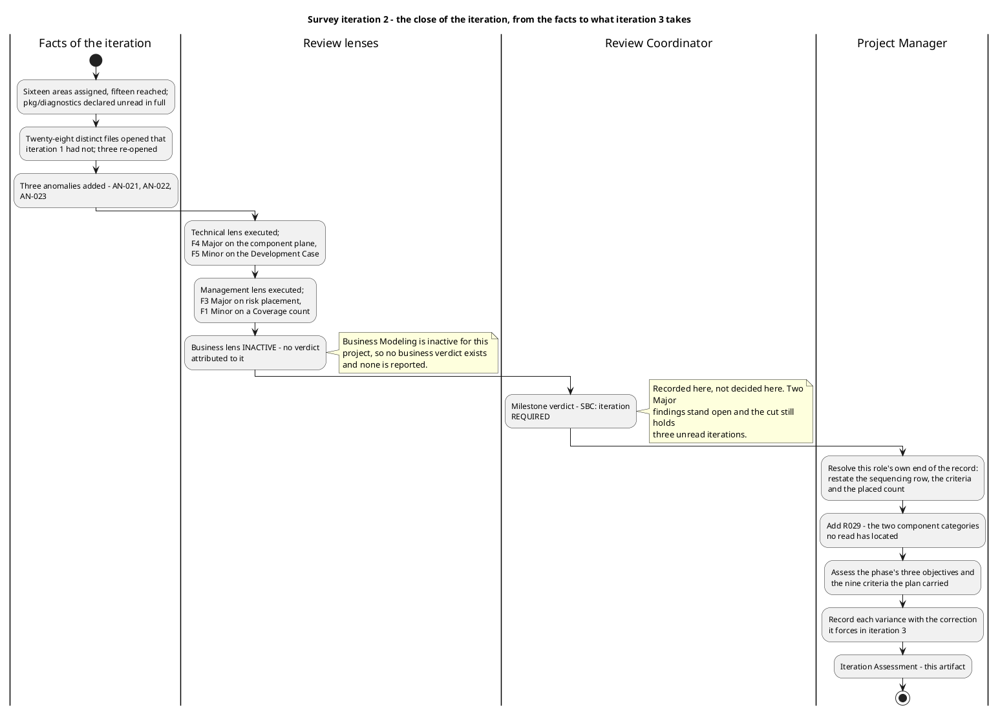
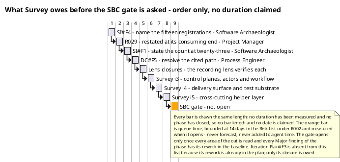

## Document Control
Phase: Survey

Status: Draft — iteration 3 assessment, recorded after the Review Coordinator's verdict. The iteration is accepted and the phase iterates; the SBC milestone is not judged and no phase is closed. Two Major findings (`Iteration Plan#F1`, `Iteration Plan#F3`) stand open against this role's plan and hold the SBC gate; this role's end of both was reworked in the same turn this assessment was recorded, and closure is each recording lens' act, not this one's.

Milestone Target: end-of-Survey milestone (SBC) — not achieved

## Iteration Objectives Reached
Survey iteration 2 is assessed against the five objectives its Iteration Plan committed to and against the phase's three intended objectives. The Review Coordinator's verdict is recorded here as given: **SBC — iteration REQUIRED**. This document records that verdict; it does not issue a milestone.

| # | Objective committed in the Iteration Plan | Owner | Outcome | Evidence, and what qualifies it |
|---|---|---|---|---|
| O1 | The request path is fixed: how an application's call becomes a call into a component, read from the code that does the dispatch | Software Archaeologist | **Met** | System Inventory — Perimeter and Coverage: `go.sum` and `img` recorded for what they are, `EP-003` and `EP-013` anchored on `pkg/api/http/server.go`, the allowlist read from `pkg/api/grpc/endpoints.go`, `pkg/messaging/v1/messaging.go` and `pkg/channel/channel.go` read. `pkg/diagnostics/` declared unread in full with its reason, not counted as reached. No finding is recorded against this content by either executing lens |
| O2 | The component plane is recorded: what the request path dispatches into and under what policy | Software Archaeologist | **Met, with rework owed** | `pkg/components/`, `pkg/resiliency/`, `pkg/middleware/` and `pkg/config/` were read and each anchor holds — the Technical lens opened `state/`, `lock/` and `conversation/registry.go` and all three follow the pattern the row describes. Qualified by `System Inventory#F4`, Major: fifteen `Category` constants against thirteen anchored registry paths, with `workflow` and `workflowbackend` resolving to nothing. The Review Coordinator's C1 resolved the cross-lens question — the management lens passed O2 on the artifact's statement, the technical lens opened the tree, and the opened file governs. The registry set is therefore recorded as thirteen located and two unlocated, carried as `R029` |
| O3 | The cross-cutting surfaces the request path carries are anchored | Software Archaeologist | **Met** | `pkg/metrics/exporter.go` (`EP-012`), `pkg/healthz/healthz.go` (`EP-011`), `pkg/ports/ports.go`, `pkg/modes/modes.go`, `pkg/apphealth/health.go`, `pkg/cors/cors.go` — each read and each stated with its anchor. The Technical lens opened `healthz.go`, `modes.go` and `cors.go` and all three hold. `pkg/diagnostics/` (35 files) declared unread in full and not counted as reached |
| O4 | The phase's own account of itself is reconciled, so its figures can be reproduced from what it prints | Software Archaeologist, and this role for the re-quote | **Met, one count open** | `System Inventory#F2` and `#F3` closed this review by their recording lens on verified evidence — every Coverage row re-added by hand, 60 + 28 = 88 for the phase, 42 / 19 / 16 derived from the tables. This plan re-quotes only those reconciled figures. Qualified by `System Inventory#F1` under the Management Reviewer's lens, Minor: "twenty-four areas never assigned" against twenty-three rows at the foot of the Coverage table. No objective fails on it and no quoted total changes |
| O5 | The remainder of the phase is cut and declared before any other role of the iteration reads | Project Manager | **Met** | The cut is recorded with the process service: 16 areas of this iteration, 41 across the three that follow (11 + 17 + 13), 70 areas each in exactly one iteration. No area is in two iterations, and `go.sum` and `img` appear in this iteration's row only |

| Phase objective this iteration serves | Served? | Where it stands after the verdict |
|---|---|---|
| Confirm the System Boundary | Partly — two of the phase's five cut iterations are read | The boundary is enumerated and anchored over 29 of 70 areas; three iterations of the cut are unread, so it is not yet confirmed. `pkg/api/universal/` — the 29 files where each operation is implemented — is deliberately outside this read and is ranked fourth for Excavation |
| Tailor Development Process | Not an objective of this iteration; stands as delivered | The Development Case was carried as W0 and delivered before the reading opened. It carries `Development Case#F5` (Minor) from the Technical lens — one evidence path, `pkg/config/modes/` against the actual `pkg/modes/modes.go` — which does not touch the Deployment Model verdict: FIRED rests on seven subcharts, eight Dockerfiles, six executables, two runtime modes, placement and scheduler as separate control planes, and mTLS through Sentry |
| Identify Critical Risks | Yes, for what was read | 29 risks, every one of the 23 anomalies carried, three High and fifteen Significant all on `avoid`, three accepted at Moderate. Four entries were added this iteration: `R026`, `R027`, `R028` from this slice's anomalies and `R029` as this role's consuming end of `System Inventory#F4`. None is retired and none is due to: the phase has no closed iteration behind it that produced a second reading |

Five committed objectives: three met, two met with rework owed inside an artifact. No objective was missed, and no defect touches what the iteration read.

## Adherence to Plan
The fine plan committed ten work items, W0 to W9. All ten ran, in the order written, and the tenth — this document — records the outcome.

| # | Work item | Owner | Committed exit condition | Outcome |
|---|---|---|---|---|
| W0 | Tailor the process for the phase: Development Case and the Contribution Guide | Process Engineer | The Environment stage is satisfied before the reading opens; every §5.2 optional recorded fired or not fired with its reason | Met — `Development Case#F5` (Minor) on one evidence path; the Deployment Model verdict stands on the other evidence cited |
| W1 | Declare the cut of this iteration and of the remainder | Project Manager | The cut is recorded and no other role of the iteration works before it | Met — 16 areas this iteration, 41 across the three that follow, 70 in the cut |
| W2 | Reconcile the Coverage counts and derive the stated counts from the tables | Software Archaeologist | Every Coverage row's stated count equals the files enumerated on it, the outside-the-slice total equals the rows listed, the `docs` categories reconcile; each stated count derived from its table and stated once | Met — `System Inventory#F2` and `#F3` closed by their lens on re-added figures: 60 + 28 = 88 for the phase, 42 / 19 / 16 derived from the tables |
| W3 | Read what the system says it is: the component registries as declarations | Software Archaeologist | Each registry is stated as the set of component kinds it admits, with the `Source:` anchor that declares the kind list | Met for thirteen of fifteen categories; `System Inventory#F4` (Major) on the two that register nowhere this read reached |
| W4 | Fix the perimeter of the request path and enumerate the entry points it adds | Software Archaeologist | Every entry point the slice adds is enumerated and labelled `EP-NNN` with its `Source:` anchor; `pkg/api/universal/` not part of this read | Met — `EP-003`, `EP-011`, `EP-012`, `EP-013` anchored; `universal/` unread as the exit condition states |
| W5 | Record what the request path and the plane do not hold together, and re-order what remains | Software Archaeologist | Each new anomaly is labelled `AN-NNN` with its anchor; the areas still to read are re-ordered against what this slice exposed | Met — `AN-021`, `AN-022`, `AN-023` anchored; the Priorities order restated against them |
| W6 | Score the risks this slice exposed, and name the role accountable for retiring each entry | Project Manager | Every risk carries probability, impact, magnitude, strategy and an accountable role distinct from the custodian; every anomaly newly recorded carries at least one risk | Met — 29 risks, all 23 anomalies carried, four entries added, `R029` scored as the consuming end of `F4` |
| W7 | Re-quote the reconciled figures and restate the cut against what was read | Project Manager | The measurement table carries the reconciled totals and nothing earlier; the cut matches the recorded cut area for area and in order; whether the cut still holds is answered from this iteration's reading | Met — 28 files this iteration, 88 for the phase, quoted from W2's reconciled rows. Qualified by `Iteration Plan#F3` (Major): two risk placements named areas the plan declares unread |
| W8 | Review the iteration against the SBC criteria | Reviewer, Management Reviewer, Review Coordinator | The verdict is issued; a Critical finding escalates and the milestone does not close | Met — verdict issued: **SBC — iteration REQUIRED**; zero Critical findings, nothing escalated to the stakeholder |
| W9 | Record the Iteration Assessment given the verdict | Project Manager | Every objective is stated met or missed, with the scope or plan adjustment the next iteration takes | Met — this document, recorded without a milestone verdict of its own |

### Variance

Four variances separate what the plan said from what the iteration did. Each carries the root cause and the adjustment it forces in iteration 3. A variance recorded without its correction is left open for the next iteration's reviewers to find.

**V1 — one area of the slice was not reached at all.** Sixteen areas were assigned; fifteen yielded a file and `pkg/diagnostics/` was opened zero times. Root cause: a monitoring module is legible only against the operation it instruments, and `docs/development/dapr-metrics.md` names the source file of every metric group, so the area reads as a map of files already read. *Adjustment:* `pkg/diagnostics/` is carried to Excavation's Priorities order at priority 4 — the same order `pkg/api/`'s remaining 118 files sit at — and is not re-opened inside the Survey cut, because re-opening an area an iteration already read would put one area in two iterations of a cut that forbids it. The coverage claim for the phase is stated as it is: 15 of this iteration's 16 areas opened, one declared unread in full with its reason, and the SBC boundary is asserted over the areas the cut reads and the depth each was read at — never over a count of areas that includes one nobody opened.

**V2 — `Iteration Plan#F3`, Major, Management Reviewer.** The risk-driven sequencing placed R017 and R019 on this iteration for retirements that name areas the plan's own W4 excludes, and R019's mitigation names `pkg/scheduler/`, which iteration 3 reads while its row omitted the risk. Root cause: the sequencing row was written from where a risk's anchor is *named* rather than from the area the named iteration *opens*, so a pointer to `pkg/api/universal/` and a pointer to `pkg/scheduler/` were both read as placements when neither area was this slice's. *Adjustment, applied to the plan this turn:* the i2 row now carries R017 and R028 only — R028 on `pkg/api/http/server.go`, which this slice re-opened, and R017 on `pkg/api/grpc/endpoints.go`, the allowlist map itself, with no claim about `universal/`; R019 moves to the i3 row beside R023, R014, R024 and R026, where `pkg/scheduler/` is read and where its mitigation already pointed. The placed count is restated at 29 with each placement naming an area that iteration opens, and the rule is written into the row: a risk carried past Survey says so in the row rather than resting on an area the plan declares unread. Closure is the Management Reviewer's.

**V3 — `System Inventory#F4`, Major, Reviewer, at its consuming end.** The component plane was stated as fifteen categories each with a registry, on the strength of `category.go`'s fifteen `Category` constants; thirteen of the fifteen have a registry at the path the pattern implies and `workflow` and `workflowbackend` resolve to nothing. The consuming end of that finding is this role's: a component view and Excavation's component recovery both build on the registry set, and this plan's Evaluation Criteria asserted the plane recorded. Root cause: the count was taken from the file that declares the constants and never tested against the tree that would have to hold the registries — the same defect class `System Inventory#F2` and `#F3` closed, in a row those corrections did not reach. *Adjustment, applied this turn:* `R029` is entered in the Risk List — fifteen categories declared, thirteen with a registry file, two unlocated — scored 4 × 3, Significant, avoided, accountable to the Software Archaeologist and confronted in Survey i3 where `pkg/runtime/wfengine/` and `pkg/actors/` are read. The plan's component-plane criterion no longer reads as evidenced: it states that the plane is complete only if the count holds, names `F4` as the open defect, and cites `R029`. The mitigation rule now runs across artifacts: no artifact of the phase states the plane as fifteen registries.

**V4 — the placed-risk count moved from 28 to 29 and three other figures followed it.** The plan's Evaluation Criteria, its measurement table and the sequencing table all carried 28. Root cause: `V3`'s correction adds a register entry after the plan was written, and a plan that quotes the register must be re-quoted when the register changes — the same rule W7 applies to Coverage counts. *Adjustment, applied this turn:* the sequencing table, the "Risks sequenced and accountable" criterion and the measurement row all read 29, and the measurement row states the decision that count serves rather than only the count.

`Development Case#F5` and `System Inventory#F1` are the two Minor findings of this review that sit in other roles' artifacts; neither is this role's and neither is re-recorded here. Both are a single stated path or figure and neither holds the gate.

| Variance | Finding it answers | Owner | Correction's state after this turn |
|---|---|---|---|
| V1 | none recorded — the unread area is declared, and the gate must read the declaration | Project Manager | Recorded here and in the plan's cut row; carried to Excavation's Priorities order |
| V2 | `Iteration Plan#F3` | Project Manager | Applied to the Iteration Plan this turn; closure is the Management Reviewer's |
| V3 | `System Inventory#F4` at its consuming end | Project Manager | Applied to the Risk List this turn — `R029`, scored; the source correction is the Software Archaeologist's |
| V4 | none recorded — a consequence of `V3`'s correction | Project Manager | Applied to the Iteration Plan this turn |

## Use Cases and Scenarios Implemented
None, and this is the phase working as designed rather than an omission. No use case enters a Survey plan: the scope unit of the sprint zero is the area of the repository, and this iteration's unit was the sixteen areas the cut assigned it. No Test discipline runs in Survey, so no scenario was executed and no executable was produced.

What the iteration returned instead is the raw material a use case will be recovered from in Excavation. This slice fixed the request-path entry points — `EP-003` and `EP-013` on `pkg/api/http/server.go` across its two listeners, `EP-011` on `pkg/healthz/healthz.go`, `EP-012` on `pkg/metrics/exporter.go` — and recorded the operations the app-channel boundary offers in `pkg/channel/channel.go`. `pkg/api/universal/`, where each operation is implemented, is deliberately outside this read: what an operation does is Excavation's, and it is ranked fourth in the System Inventory's Priorities.

| Phase | Scope unit | This iteration |
|---|---|---|
| Survey | Repository area | 29 of 70 areas of the cut read over two iterations; 15 of this iteration's 16 areas reached |
| Excavation | Entry point `EP-NNN`, recovered use case | Not started — the request-path entry points and the app-channel boundary are its input |
| Consolidation and later | Declared use case, risk-driven selection | Not started |

## Results Relative to Evaluation Criteria
Each of the nine criteria the Iteration Plan carried, answered against the evidence that exists after the review. Six met, two met with a defect recorded against the artifact that evidences them, and one not met as written and corrected in the plan this turn.

```plantuml
@startuml
title Evaluation criteria of Survey iteration 2 - outcome against each
hide empty members
skinparam classAttributeIconSize 0
skinparam wrapWidth 320
skinparam nodesep 20
skinparam ranksep 34

class "Request path fixed" as C1 <<met>> {
  evidence : EP-003 and EP-013 anchored
  evidence : pkg/messaging, pkg/channel read
  evidence : go.sum and img recorded for what they are
}

class "Component plane recorded" as C2 <<met, defect recorded>> {
  evidence : thirteen registries stated with anchors
  defect : System Inventory#F4 - fifteen constants
  defect : System Inventory#F4 - two unlocated
  carried : R029
}

class "Cross-cutting surfaces anchored" as C3 <<met>> {
  evidence : metrics, healthz, ports, modes,
             apphealth, cors each anchored
  evidence : pkg/diagnostics declared unread in full
}

class "Counts reproduce" as C4 <<met, defect recorded>> {
  evidence : F2 and F3 closed by their lens
  defect : System Inventory#F1 - 24 against 23
}

class "Plan re-quotes only reproduced figures" as C5 <<met>> {
  evidence : 28 files this iteration, 88 for the phase
}

class "Cut held" as C6 <<met>> {
  evidence : 70 areas, each in exactly one iteration
}

class "Unread areas declared" as C7 <<met>> {
  evidence : 16 assigned, 15 reached
  evidence : pkg/diagnostics named and carried
}

class "Risks sequenced and accountable" as C8 <<not met as written>> {
  was : R017 and R019 on areas the plan declares unread
  now : R019 moved to i3; R017 claims no unopened area
  rework : Iteration Plan#F3
}

class "No figure the process did not measure" as C9 <<met>> {
  evidence : no size, no rate, no date in the plan
  evidence : one iteration's spend, both clocks apart
}

class "Outcome" as O <<the iteration's own verdict>> {
  met : C1, C3, C5, C6, C7, C9
  met, defect recorded : C2, C4
  not met as written : C8, corrected this turn
}

C1 -down-> O
C2 -down-> O
C3 -down-> O
C4 -down-> O
C5 -down-> O
C6 -down-> O
C7 -down-> O
C8 -down-> O
C9 -down-> O

note bottom of O
  No failure changes what the iteration read: C2, C4 and C8
  are corrections to how an artifact accounts for it, and
  C8's correction is applied in the plan this turn.
end note
@enduml
```

| Criterion | Threshold | Outcome | Evidence |
|---|---|---|---|
| Request path fixed | `go.sum` and `img` recorded for what they are; the request path read at the depth its priority needs; every entry point the slice adds labelled `EP-NNN` with its `Source:` anchor | Met | System Inventory — Perimeter and Coverage: `EP-003` and `EP-013` on `pkg/api/http/server.go`, the allowlist on `pkg/api/grpc/endpoints.go`, `pkg/messaging/v1/messaging.go`, `pkg/channel/channel.go`. `go.sum` recorded as a closed module graph, `img` as three files stating no fact about the perimeter |
| Component plane recorded | Each registry stated as the set of component kinds it admits, with the anchor that declares the kind list; `pkg/resiliency/`, `pkg/middleware/` and `pkg/config/` anchored | **Met, defect recorded** | Thirteen registries anchored and stated; `state/`, `lock/` and `conversation/` opened for the review and all three follow the pattern. `System Inventory#F4`: fifteen `Category` constants, and `pkg/components/workflow/registry.go` and `workflowbackend/registry.go` resolve to nothing. Carried as `R029` |
| Cross-cutting surfaces anchored | `pkg/metrics/`, `pkg/healthz/`, `pkg/ports/`, `pkg/modes/`, `pkg/apphealth/`, `pkg/cors/` each stated with file and lines; `pkg/diagnostics/` declared unread in full with its reason | Met | All six read and anchored; `healthz.go`, `modes.go` and `cors.go` opened for the review and each holds. `pkg/diagnostics/` (35 files) declared unread, not counted as reached |
| Counts reproduce from their enumeration | Every Coverage row's stated count equals the files enumerated on it; the outside-slice total equals the rows listed; the `docs` categories reconcile; each stated count derived from its table and stated once | **Met, defect recorded** | `System Inventory#F2` and `#F3` closed by their recording lens on hand re-addition: 60 + 28 = 88 for the phase, 42 / 19 / 16 derived from the tables, proto at 37 + 7 + 1 = 45. `System Inventory#F1` (Minor, Management Reviewer) on the never-assigned sentence: twenty-four asserted, twenty-three rows |
| Plan re-quotes only reproduced figures | Every figure taken from a Coverage row that reproduces from its own enumeration, quoted with the iteration that opened it | Met | 28 distinct files this iteration, 88 for the phase, quoted from the reconciled rows with iteration 1's 60 named beside them. No count is stated that its own row does not reproduce |
| Cut held | Every area in exactly one iteration, in the order recorded, none left uncut | Met | 70 areas — `.iari/` excluded as not part of the system — each in exactly one iteration; 16 here, 41 across the three that follow, 13 read at i1 |
| Unread areas declared | An area the iteration does not reach is named in the next iteration's row, not counted as reached; the remainder stated as the counts the cut holds | Met | 16 assigned, 15 reached; `pkg/diagnostics/` named with its reason and carried to Excavation's Priorities order at priority 4 |
| Risks sequenced and accountable | Every risk names the iteration that confronts it and the role accountable for retiring it; a placement names an area that iteration opens | **Not met as written** — corrected this turn | `Iteration Plan#F3`: R017 rested on `pkg/api/universal/` and R019 on `pkg/components/`, both declared unread here, and R019's mitigation names `pkg/scheduler/`, which i3 reads while omitting the risk. Corrected in the plan this turn to R017 and R028 on `pkg/api/` and R019 on i3; 29 risks placed, none on an unopened area |
| No figure the process did not measure | No work-item size, no rate, no phase-length forecast, no calendar date; measured figures reported with both clocks apart and never summed | Met | No size, rate or date anywhere in the plan or this document; the one measured actual is iteration 1's, and this iteration's own figures are in the table below, each clock apart |

**What this iteration measured, and the decision each measurement enables.** The figures below are the iteration's recorded facts, not a velocity and not a baseline. No rate is derived from any of them, and none is projected onto iteration 3.

| Measurement | Value | Decision it enables |
|---|---|---|
| Agent work — token spend | 30 715 328 tokens | This iteration's actual. Read against iteration 1's 19 480 197 it shows what a slice costs when it re-reads the accumulated surface: this iteration carried a 236 000-character artifact surface into every role, where iteration 1 carried 128 000. The decision it enables is where the next phase's cost sits — re-reading, not emission — and that is why no phase spend is declared before one closes |
| Agent work — measured elapsed time | 0:48:19.7330924 | Read beside the token figure, both clocks on agent work and apart from the gate. It is about 11 minutes longer than iteration 1's 0:36:59.0766494, and the difference is the surface the roles re-read. The decision: whether the cut should take fewer, larger areas per iteration or more, smaller ones — asked at each iteration close, never projected |
| Human gate — queue time | 0:00:00 measured; the end-of-iteration approval gate is excluded from the measurement | The gate cost nothing in queue time here. It does not lower `R002`'s 14-day ceiling: that ceiling is a bound on a gate, and the next one's queue is measured when it opens |
| Artifacts in the increment | 6 | The six the Development Case sanctions this phase iteration: Development Case, System Inventory, Iteration Plan, Risk List, Review Record, Iteration Assessment. The Glossary and Deployment Model are FIRED for later phases and their absence here is correct |
| Artifact sizes, in characters | Development Case 28 911; Iteration Plan 39 760; Risk List 44 072; System Inventory 121 936; Review Record 88 547; Iteration Assessment 26 636 | Names where this iteration's spend and the next phase's re-reading cost sit. The System Inventory at 121 936 is the largest: it is the artifact every later phase and both lenses re-read in full, so Excavation's cost is set by this surface, not by the code it will emit. The decision it enables: the inventory's growth per slice is what the cut's remaining three iterations are read against when a further iteration is asked of `R001` |
| Stakeholder interactions | 11 | Confirms the iteration resolved its questions in one round rather than by attrition; no question was asked here that the Development Case had already settled. A rising count in a later iteration means a scope question is being deferred, not answered |
| Areas of the slice reached | 16 assigned, 15 reached; `pkg/diagnostics/` unread in full | Whether an area is read at the depth its priority needs, or skimmed — and where short, whether that depth belongs to Excavation. This iteration's answer: it does, by the Priorities order |
| Component categories the plane accounts for | 13 of 15 located; `workflow` and `workflowbackend` unlocated | Whether the component view can be taken from `pkg/components/` alone. It cannot, and `R029` carries the consequence until Survey i3 reads the two subtrees that hold the registration |

Two figures in the table are quoted from the system's own measurement of this iteration — token spend and elapsed agent time. The remaining rows are counts of files, areas, artifacts and interactions read from the increment itself. Neither group is a rate, and the gate's queue time is reported apart from both and never added to either.

## Test Results
No test was designed, executed or reported in Survey iteration 2. No Test discipline runs in this phase: the Test Manager's first stage is the Inception Test Plan, and the Test Designer, Tester and Test Analyst first work in Elaboration.

No test figure is available and none is asserted — no pass rate, no coverage percentage, no build status. The test substrate was named, not run: `tests/` holds 3 335 entries and is Survey iteration 4's slice, and the anomalies touching it — `AN-008` (two workflow suites disabled by renaming), `AN-019` (156 registration files against one test), `AN-020` (harness deriving CIDRs by parsing free text) — are recorded as what the tree shows, not as results of any execution. `R025` and `R024` rest on that distinction, and both state it.

## External Changes
No external change entered the project this iteration. The one decision in force remains the stakeholder's answer on the root `CONTRIBUTING.md` — one pointer line at its top to `docs/CONTRIBUTING.md` for how a change is requested, labelled and reviewed — applied by the Process Engineer in iteration 1 and verified by both lenses. Nothing this iteration reopened it or needed a further answer.

No change request was opened or decided: the Change Control Manager does not work in the sprint zero, so a stakeholder's order reaches its owner through the work order instead of a ledger entry. No pull request exists to dispose of — no role of Survey produces code, and the SCM holds no pull request in any state.

The stakeholder is asked nothing by this assessment. The verdict escalates only an unresolved Critical finding, and both executing lenses recorded zero. No risk of the register is on `accept` at Significant or High magnitude, so no grant is outstanding and none is requested.

## Rework Required
Two Major and two Minor findings stand open at the close of the review, and none of the four is Critical. This role's own end of the record — `Iteration Plan#F3` and the consuming end of `System Inventory#F4` — has its rework applied this turn. What remains is the Software Archaeologist's `F4` and `F1`, the Process Engineer's `F5`, and the four closures, each of which belongs to the lens that recorded it.

| # | Rework | Owner | Closes | Holds the SBC gate | State |
|---|---|---|---|---|---|
| 1 | Restate the sequencing row: R028 on `pkg/api/http/server.go`, R017 on the allowlist map itself with no claim about `universal/`, R019 moved to i3 where `pkg/scheduler/` is read; restate the placed count and the criterion it evidences | Project Manager | `Iteration Plan#F3` | Yes | Applied this turn; closure is the Management Reviewer's |
| 2 | Carry the two unlocated component categories as a scored risk, naming the accountable role whose reading locates them | Project Manager | `System Inventory#F4` at its consuming end | Yes | Applied this turn — `R029`, 4 × 3, Significant, avoided, confronted in Survey i3 |
| 3 | Name the file that registers each of the fifteen categories; locate `workflow` and `workflowbackend` in `pkg/runtime/wfengine/` and `pkg/actors/`, or state them unlocated; move the unopened `registry.go` paths into a not-yet-opened column; restate the Components table row to match | Software Archaeologist | `System Inventory#F4` | Yes | Owed — before Excavation's component recovery consumes the registry set |
| 4 | State the never-assigned count as twenty-three, or derive it from the rows at the foot of the Coverage table | Software Archaeologist | `System Inventory#F1` (Management Reviewer) | No | Owed — owner's next turn |
| 5 | Correct the Deployment Model evidence path to `pkg/modes/modes.go`; check the other rows of that table for paths that do not resolve | Process Engineer | `Development Case#F5` | No | Owed — owner's next turn |

Items 1 and 2 are this role's and are closed for this iteration; items 3 and 4 are the Software Archaeologist's at the same consuming end as item 2, and item 3 is why the SBC review's entry criterion is still unmet. Item 3's remedy sits inside the phase the cut already plans — `pkg/runtime/wfengine/` and `pkg/actors/` are Survey i3's areas — so it is worked where the registration is, not re-opened inside a slice the cut has closed.

### What iteration 3 takes

The cut's next slice, unchanged by this review: `pkg/actors/`, `pkg/runtime/`, `pkg/placement/`, `pkg/scheduler/`, `pkg/sentry/`, `pkg/security/`, `pkg/operator/`, `pkg/injector/`, `pkg/acl/`, `pkg/apis/`, `pkg/client/` — 11 areas, 866 entries of the tree. It inherits three additions from this iteration's close and one placement moved onto it:

- `R029` and `System Inventory#F4`'s remedy, both answered by `pkg/runtime/wfengine/` and `pkg/actors/`: the two categories are either located or recorded as unlocated, and no artifact of the phase states the plane as fifteen registries in the meantime.
- `R019`, moved from this iteration's row to i3's, where `pkg/scheduler/` — the area its mitigation names — is read.
- `System Inventory#F1`, worked in `pkg/runtime/` where the code enforcing the actor-state requirement is read.

It carries all eighteen Significant and High risks, unretired and not yet due, and it carries the Environment stage as its first work item. Its High risk is `R023`, which is why `pkg/scheduler/` is read before the placement service it supersedes. `pkg/diagnostics/` is not in the slice: it is carried to Excavation's Priorities order at priority 4, and re-opening it inside the Survey cut would put one area in two iterations.

The phase iterates because the cut holds three unread iterations and because two Major findings stand open. It does not iterate because a calendar says so, and no further iteration is added to it on account of this review: nothing here displaces an area or cuts declared scope.

