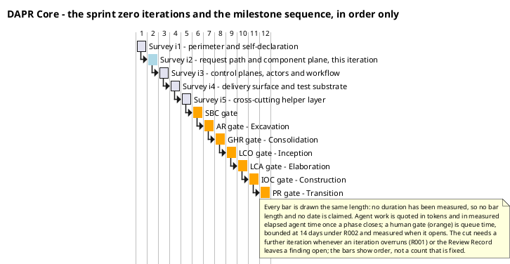
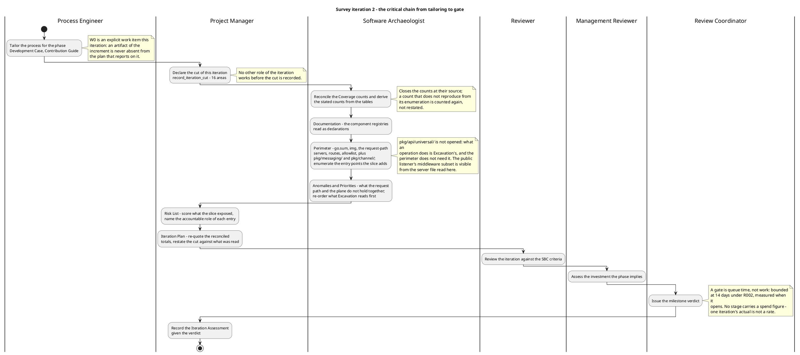

## Document Control
Phase: Survey
Status: Draft — iteration 2 of the phase, initiated 2026-11-27. The cut assigns this iteration 16 areas; 41 areas remain across the three iterations that follow it (11 + 17 + 13, out of the 70 the cut holds and the 13 iteration 1 read). This plan carries the read figures the System Inventory's Coverage states, each reproduced from the files enumerated on its own row: iteration 1 opened 60 distinct files of the 620 its 13 areas hold, iteration 2 opened 28 it had not opened before, and the phase stands at 88 distinct files of the tree's 6 631 entries. No work-item size anywhere, because no phase has closed and there is no measured actual to size against; one iteration has closed and its measured spend is reported as that iteration's own fact, never as a rate. The SBC milestone is not judged.
Milestone Target: end-of-Survey milestone (SBC) — not yet achieved
## Iteration Objectives
Survey iteration 2 reads the sidecar's request path and the component plane it dispatches into. The unit of scope in the sprint zero is the **area of the repository**, not a use case: no use case enters this plan.

| # | Objective | Exit criterion |
|---|---|---|
| O1 | The request path is fixed: how an application's call becomes a call into a component, read from the code that does the dispatch | `go.sum` and `img` are recorded for what they are or are not; the request path is read at the depth its priority needs — `pkg/api/`'s two servers, its route families, the internal invocation server and the hand-maintained allowlist, plus `pkg/messaging/` and `pkg/channel/` — and every entry point the slice adds is labelled `EP-NNN` with its `Source:` anchor. An area opened short of its file count says so in Coverage, and that depth is Excavation's |
| O2 | The component plane is recorded: what the request path dispatches into and under what policy | `pkg/components/`, `pkg/resiliency/`, `pkg/middleware/` and `pkg/config/` are read; each registry is stated as the set of component kinds it admits, with the `Source:` anchor that declares the kind list |
| O3 | The cross-cutting surfaces the request path carries are anchored: observability, health, ports, modes, application health, CORS | `pkg/metrics/`, `pkg/healthz/`, `pkg/ports/`, `pkg/modes/`, `pkg/apphealth/` and `pkg/cors/` are read; each surface is stated with the anchor it was read from. `pkg/diagnostics/` is declared unread in full with its reason, and is not counted as reached |
| O4 | The phase's own account of itself is reconciled, so its figures can be reproduced from what it prints | Every Coverage row's stated count equals the files enumerated on that row; the outside-the-slice total equals the rows listed; the `docs` categories reconcile; the component and external-system counts are derived from the tables; the proto breakdown is consistent with `AN-002` and `AN-013`. This plan re-quotes the reconciled totals and nothing earlier |
| O5 | The remainder of the phase is cut and declared before any other role of the iteration reads | The cut is in this document and recorded with the process service, each area in exactly one iteration |

O1–O4 are the Software Archaeologist's reading and reconciliation, excepting the re-quote of reconciled figures, which is this role's. O5 is this iteration's act of initiation and is complete when the cut is recorded.

`pkg/api/` was named "read whole" in this objective when the iteration opened and was not read whole: Coverage records 6 of its 124 files, and `universal/` — the 29 files where each operation is implemented — is unread. The objective is restated on that fact rather than the fact on the objective. What the six files close is the perimeter: the entry points, the two gRPC servers, the public listener and the allowlist map. What they do not close is what an operation does, which is why the System Inventory ranks `pkg/api/` fourth for Excavation and the cut does not re-open the area.
## Plan and Milestones
The coarse roadmap below is cross-iteration: the milestone sequence of the project, and the cut that assigns every repository area to exactly one iteration of the sprint zero. The fine plan that follows it is bounded to this iteration.

### Coarse roadmap — the milestone sequence of the project

| Milestone | Closes | What the milestone asserts | Reviewers, in order |
|---|---|---|---|
| SBC | Survey | The perimeter of the existing system is confirmed and its priorities are ordered | Reviewer, Management Reviewer, Review Coordinator |
| AR | Excavation | The existing system's architecture, data and use cases are recovered into the CORE artifacts they belong to | Reviewer, Management Reviewer, Review Coordinator |
| GHR | Consolidation | Every use case is recovered, coverage is counted, the Supplementary Specification is complete | Reviewer, Management Reviewer, Review Coordinator |
| LCO | Inception | The declared scope is bounded, the candidate architecture is agreed and the business case is made | Reviewer, Business Reviewer, Management Reviewer, Review Coordinator |
| LCA | Elaboration | The architecture baseline is executable and the highest-magnitude risks are retired | Reviewer, Business Reviewer, Management Reviewer, Review Coordinator |
| IOC | Construction | The declared scope is implemented and the iteration baseline holds | Reviewer, Management Reviewer, Review Coordinator |
| PR | Transition | The release is deployed and accepted | Reviewer, Management Reviewer, Review Coordinator |

The sprint zero runs SBC, AR and GHR before Inception opens. The Business Reviewer does not work in the sprint zero: Business Modeling is inactive for this project (Development Case §2).

### Coarse roadmap — the cut of the sprint zero

The cut orders the repository by what the reading itself needs first, and once an iteration has read, by what its Coverage records. The system's own statement of itself was read in iteration 1, because every later area is read against it. This iteration takes the request path, because it is the system's primary entry surface and the component plane is illegible without it.

**The slice iteration 1 was assigned, restated once.** Thirteen areas; thirteen reached. `go.sum` and `img` were not among them and are not counted here — they are iteration 2's, and they appear in iteration 2's row only.

| Iteration | Areas assigned | Areas reached |
|---|---|---|
| Survey i1 | 13 — `.github`, `CODEOWNERS`, `CONTRIBUTING.md`, `GOVERNANCE.md`, `LICENSE`, `README.md`, `RELEASE.md`, `SECURITY.md`, `cmd`, `dapr`, `docs`, `go.mod`, `pkg/proto` | 13. Five of them were opened short of their file count — `.github`, `cmd`, `dapr`, `docs`, `pkg/proto` — and that depth is not a Survey remainder: it is the System Inventory's Priorities order, and it is Excavation's. Re-opening an area an iteration already read would put one area in two iterations of the cut |
| Survey i2 — this iteration | 16 — `go.sum`, `img`, `pkg/api`, `pkg/messaging`, `pkg/channel`, `pkg/components`, `pkg/resiliency`, `pkg/middleware`, `pkg/config`, `pkg/diagnostics`, `pkg/metrics`, `pkg/healthz`, `pkg/ports`, `pkg/modes`, `pkg/apphealth`, `pkg/cors` | 16 assigned; 15 yielded a file and `pkg/diagnostics/` is declared unread in full, with its reason in the System Inventory's Coverage. That area is not reached, and it carries to the iteration that reads the request path in depth (priority 4) rather than being counted as read |

**The remainder, counted.** Of the 70 areas the cut holds, 13 were read in iteration 1 and 16 are this iteration's, so **41 remain across the three iterations that follow**: 11 in iteration 3, 17 in iteration 4, 13 in iteration 5. These are counts of areas, not of files read and not a rate: whether the cut still holds is asked and answered at the close of each iteration from what that iteration read, and it is not projected from any earlier iteration. Should an iteration overrun, the remedy is R001's — one more iteration, never less scope, and never more agent roles in parallel.

The entry counts in the table below are the repository tree's, reproducible from the tree call, and they say how large each area is. They are **not** a measurement of this phase. What this phase has read is the System Inventory's Coverage, and its rows reproduce from the files enumerated on each: iteration 1 opened 60 distinct files of the 620 its 13 areas hold, iteration 2 opened 28 it had not opened before, and the phase stands at 88 distinct files of the tree's 6 631 entries. This plan quotes those totals and derives nothing from them.

| Iteration | Areas the iteration takes, in the order to take them | Entries the tree reports | What the iteration establishes | Basis of the split |
|---|---|---|---|---|
| **Survey i2** — this iteration — 16 areas | `go.sum`, `img`, `pkg/api/`, `pkg/messaging/`, `pkg/channel/`, `pkg/components/`, `pkg/resiliency/`, `pkg/middleware/`, `pkg/config/`, `pkg/diagnostics/`, `pkg/metrics/`, `pkg/healthz/`, `pkg/ports/`, `pkg/modes/`, `pkg/apphealth/`, `pkg/cors/` | 317 | The sidecar's request path and component plane: how an application's call becomes a component operation, and what it dispatches into | The request path is the primary entry surface and the component registries are what it dispatches into; the two are read together or neither is legible. `go.sum` takes its turn at the head of the slice because it is read against `go.mod`'s pins; `img` because it is what `README.md` embeds |
| **Survey i3** — 11 areas | `pkg/actors/`, `pkg/runtime/`, `pkg/placement/`, `pkg/scheduler/`, `pkg/sentry/`, `pkg/security/`, `pkg/operator/`, `pkg/injector/`, `pkg/acl/`, `apis/`, `client/` | 866 | The control planes and the stateful abstractions: actor placement and reminders, job scheduling, the trust domain, resource reconciliation, the workflow engine and the access-control layer | Each is a separate process with its own leadership, contracts and failure modes, so they are read as one slice. `pkg/runtime/` lands here rather than in this iteration because its hot-reload, compstore, authorizer, scheduler and wfengine subtrees are what these control planes bind together — the request path in this iteration reaches only its processor subtree |
| **Survey i4** — 17 areas | `charts/`, `docker/`, `tests/`, `grafana/`, `swagger/`, `platforms/`, `tools/`, `pkg/testing/`, `Makefile`, `.golangci.yml`, `.prettierrc.json`, `.codecov.yaml`, `.devcontainer/`, `.build-tools/`, `.gitattributes`, `.gitignore`, `.prettierignore` | 3 496 | The delivery surface and the test substrate: how the six binaries are deployed, how the layered suites execute, and which conventions the kept code follows | Deployment is a first-class concern of this system and the suites are the only empirical statement of its behaviour; both are read once the systems under test are known. This is the largest slice — 2 073 integration suite files and 631 perf files under `tests/` — and its overrun is R001 |
| **Survey i5** — 13 areas | `internal/`, `utils/`, `pkg/backoff/`, `pkg/buildinfo/`, `pkg/encryption/`, `pkg/expr/`, `pkg/messages/`, `pkg/outbox/`, `pkg/responsewriter/`, `pkg/retry/`, `pkg/scopes/`, `pkg/sse/`, `pkg/validation/` | 68 | The shared helper layer the request path and the control planes both draw on | These packages expose no entry point of their own; they are read last, once the callers that justify them are known |

Counted once, the areas sum to 70 — the count the cut declared, with nothing dropped and nothing read twice: 13 read in iteration 1, 16 assigned to iteration 2, and the 11, 17 and 13 the three remaining iterations hold. A further iteration takes exactly what the SBC review leaves open — the Review Record's findings and the actions it sets — and nothing else. The phase iterates while the cut holds an area or the record holds a finding open; it does not iterate because a calendar says so.

The iteration count of the sprint zero is set by the cut of the existing system, not by the rubber profile: that profile distributes the iterations of the RUP phases and is not applied to the reading of a 6 631-entry repository.

### What this iteration inherits as rework, and where each item is worked

| Item | Finding | Worked in | Why here and not elsewhere |
|---|---|---|---|
| Reconcile every Coverage row's stated count with the files it enumerates; correct the outside-the-slice total and the `docs` categories | `System Inventory#F2` | This iteration, W2 | The finding's consuming end is this plan's own figures: no count can be re-quoted before it reproduces from its enumeration. Its source is the artifact's account of the reading, which is closed reading, not new reading |
| Derive the component and external-system counts from the tables; restate the proto breakdown against `AN-002` and `AN-013` | `System Inventory#F3` | This iteration, W2 | Two numbers that disagree with the tables they are printed beside; corrected by reading nothing new |
| Re-quote the reconciled figures in the measurement table, the cut tables and the Evaluation Criteria | `System Inventory#F2` at its consuming end | This iteration, W7 | This role's own end of the finding; it cannot be worked before the source lands |
| Add an accountable-role column distinct from the register's custodian | `Risk List#F1` | This iteration, W6 | A correction inside the register; it holds no gate but it is the owner's next turn |
| Anchor the actor-state start-up requirement on code that enforces it, or restate it as what `actorStateStoreBindings` does; move the anchor out of the declared unread set | `System Inventory#F1` | Survey i3, W3 there | The remedy is to cite code that enforces the requirement. That code is in `pkg/runtime/`, which the cut assigns to iteration 3. Placing the fix here would put one area in two iterations of the cut, which the cut forbids |
| Restate iteration 1's row as 13 assigned and 13 reached; list `go.sum` and `img` in iteration 2's row only; restate the "Unread areas declared" criterion | `Iteration Plan#F2` | Done, and carried in this document | The corrected content is in the tables above and in the Evaluation Criteria below; its closure is the Management Reviewer's |
| Delete the phase-length quotient and state the remainder as the counts the cut holds | `Iteration Plan#F1` | Done, and carried in this document | The quotient appears nowhere; "The remainder, counted" states counts and R001's remedy, and states that the cut's sufficiency is asked at each iteration close |

### Fine plan — Survey iteration 2

| # | Work item | Owner | Input | Output | Exit condition |
|---|---|---|---|---|---|
| W0 | Tailor the process for the phase: Development Case, and the Contribution Guide the owner carries in-tree | Process Engineer | The IARI baseline; the project's declared facts; the owner's `CONTRIBUTING.md` | Development Case | The Environment stage of the inherited process is satisfied before the reading opens; every §5.2 optional is recorded fired or not fired with its reason |
| W1 | Declare the cut of this iteration and of the remainder | Project Manager | This plan; the repository tree | Cut recorded with the process service | The cut is recorded and no other role of the iteration works before it |
| W2 | Reconcile the Coverage counts and derive the stated counts from the tables | Software Archaeologist | System Inventory — its Coverage table, its Components and External actors tables, `AN-002`, `AN-013` | System Inventory — corrected Coverage, Document Control status line, Proto contracts row | Every Coverage row's stated count equals the files enumerated on it, the outside-the-slice total equals the rows listed, the `docs` categories reconcile; each stated count is derived from its table and stated once; the proto breakdown matches `AN-002` and `AN-013` |
| W3 | Read what the system says it is: the component registries as declarations | Software Archaeologist | `pkg/components/` | System Inventory — Documentation | Each registry is stated as the set of component kinds it admits, with the `Source:` anchor that declares the kind list; the category constants, the versioning and WASM gates and the pluggable host are recorded as declarations, not as behaviour |
| W4 | Fix the perimeter of the request path and enumerate the entry points it adds | Software Archaeologist | `go.sum`, `img`, `pkg/api/`'s servers, routes, internal invocation server and allowlist, `pkg/messaging/`, `pkg/channel/` | System Inventory — Perimeter | Every entry point the slice adds is enumerated and labelled `EP-NNN` with its `Source:` anchor; the hand-maintained gRPC allowlist map, the HTTP route families, the two gRPC servers, the public listener and the app-channel boundary are each stated with file and lines. `pkg/api/universal/` is not part of this read — it states what an operation does, which the perimeter does not need and Excavation does |
| W5 | Record what the request path and the plane do not hold together, and re-order what remains | Software Archaeologist | W2, W3, W4 outputs | System Inventory — Anomalies and Priorities | Each new anomaly is labelled `AN-NNN` with its anchor; the areas still to read are re-ordered against what this slice exposed |
| W6 | Score the risks this slice exposed, and name the role accountable for retiring each entry | Project Manager | System Inventory, the Risk List | Risk List | Every risk carries probability, impact, magnitude, strategy and an accountable role distinct from the register's custodian; every anomaly newly recorded here carries at least one risk; no risk is on `accept` at Significant or High magnitude without the stakeholder's granting answer |
| W7 | Re-quote the reconciled figures and restate the cut against what was read | Project Manager | W2's corrected counts; W4, W5 outputs; this plan | Iteration Plan | The measurement table carries the reconciled totals and nothing earlier; the cut matches the recorded cut area for area and in order; whether the cut still holds is answered from this iteration's reading |
| W8 | Review the iteration against the SBC criteria | Reviewer, Management Reviewer, Review Coordinator | Iteration increments | Review Record; milestone verdict | The verdict is issued; a Critical finding escalates to the stakeholder and the milestone does not close |
| W9 | Record the Iteration Assessment given the verdict | Project Manager | Review Record; this iteration's objectives and evaluation criteria | Iteration Assessment | Every objective is stated met or missed, with the scope or plan adjustment the next iteration takes |

No work item is given a size. One phase iteration has closed and its spend is recorded as that iteration's own measured fact — 19 480 197 tokens and 0:36:59.0766494 of agent time, with 0:00:00 of measured gate queue time — and it is not a rate: it is one iteration of a sprint zero whose reading is dominated by documents and manifests, so nothing is projected from it onto a slice that holds `pkg/api/` and the component plane. W2 exists because the phase's evidence that its reading happened must reproduce from the enumeration printed beside it.

### The critical chain of this iteration

The chain above is the whole of Survey iteration 2's work: eight agent stretches in sequence, with the gate at the end. The three review and verdict states are a human gate, not agent work — bounded in the Risk List and measured when they open, never forecast here.

### Risk-driven sequencing — what each iteration is ordered to confront

The cut places work by where the risk sits, not by where the code sits. Each risk of the Risk List belongs to exactly one row below, or to the last row, which is the whole reading: none is left without an iteration, and five are carried by the whole reading because no area retires them. Risk ids and magnitudes are the Risk List's.

| Iteration | The risks it is sequenced to confront | Why at this point in the cut |
|---|---|---|
| i1 — read | R011 (High), R016 (High), R009, R010, R020, R007, R008, R012, R018, R022, R015 | Two of the phase's three High risks and the five-document generation divergence are reachable from `docs/`, `dapr/`, `pkg/proto/` and `cmd/` and from nowhere else in the cut. Eleven risks, and they sit on areas no later iteration re-opens |
| i2 — this iteration | R017, R019, R028 | The gRPC allowlist duplicate (R017) sits on `EP-002`, whose operations are implemented in `pkg/api/universal/` — named in iteration 1 and readable only here. The failure-policy divergence (R019) begins to be settled from `pkg/components/`, where the registries are declared, before `pkg/scheduler/` is reached in iteration 3. R028 is this iteration's own find: the public listener's middleware subset is in `pkg/api/http/server.go`, an area read here, and it is recorded now because the entry point it sits on (`EP-003`) is fixed here |
| i3 | R023 (High), R014, R024, R026 | R023 is the phase's third High risk — one scheduler process, two authorities, negotiated from what peers report — and is the reason `pkg/scheduler/` is read before the placement service it supersedes. The two suites disabled by renaming (R014) and the registration-file count (R024) are read in `pkg/runtime/wfengine/` and `pkg/actors/`, both in this slice. R026 sits where its remedy is: the engine's retention and coverage are recovered from `pkg/runtime/wfengine/` and `pkg/actors/targets/workflow/retentioner/`, and the README is graded against the code in the same read. `System Inventory#F1`'s remedy is placed here because the code that enforces the actor-state requirement is `pkg/runtime/` |
| i4 | R001, R013, R021, R025, R027 | Every risk whose exposure is in the delivery surface and the test substrate. R001 is the one that can turn this iteration into two, and its slice is the largest the cut holds. R025's harness parsing and R021's release action are both read in `tests/` and `charts/`. R027's chart half is settled here: `charts/dapr/charts/` is enumerated for its seven subcharts rather than taken from the README's six |
| i5 | none | The helper layer carries no anomaly and exposes no entry point. It is read for the callers already known and adds no risk to the register |
| the whole reading, no area | R005, R006, R004, R003, R002, and R027's documentation half | R005 (repository files obeyed rather than recorded), R006 (an empty size filled with a unit nothing measures), R004 (decision records renumbered into project families) and R003 (the tree's toolchain stated as project policy) are avoided by the shape of every role's work order, not by any area's position in the cut. R027's documentation half is the same kind of rule: every guide is read from its directory, so `docs/development/` is counted for its six guides wherever it is read. R002 is the gate itself, bounded at 14 days and measured when it opens |

This table is checked against the Risk List whenever either changes; a risk with no iteration against it is a risk the cut has not confronted. All 28 risks are placed. The rework this iteration carries is a separate matter and is scheduled in "What this iteration inherits as rework": the Review Record's findings are corrections to artifacts, not risks of the register, and none of them displaces a risk from its row above.

## Resources
| Role | Discipline | Stages this iteration | What it produces |
|---|---|---|---|
| Process Engineer | Environment | The Environment stage the inherited process runs at the head of the iteration — Development Case and Contribution Guide | Development Case — W0, an explicit work item so that an artifact of the increment is never absent from the plan that reports on it |
| Project Manager | Discovery, Project Management | Cut; then Risk List and Iteration Plan; then the Iteration Assessment after the verdict | Iteration Plan, Risk List, Iteration Assessment |
| Software Archaeologist | Discovery | Reconcile the counts; Documentation; Perimeter; Anomalies and Priorities | System Inventory |
| Reviewer | — | Milestone review | Review Record findings against the SBC criteria |
| Management Reviewer | — | Milestone review | Investment assessment of the phase |
| Review Coordinator | — | Milestone review | The milestone verdict |

Roles that do **not** work in Survey: System Analyst, Requirements Specifier, Software Architect, Designer, Database Designer, User Interface Designer, Capsule Designer, Implementer, Integrator, Test Manager, Test Analyst, Test Designer, Tester, Deployment Manager, Technical Writer, Configuration Manager, Change Control Manager, Business Process Analyst, Business Reviewer, Code Reviewer. Their first phase is Excavation or later, per the inherited process. The Business Process Analyst and the Business Reviewer do not work in any phase (Development Case §2); the Capsule Designer does not either (§3).

No role is added to the phase to shorten it. Parallelism across the reading would put two roles on the same area, and the second would be re-reading what the first already wrote. The one role at work on the reading this iteration is the Software Archaeologist, because the slice is one connected surface — the request path and the plane it dispatches into — and splitting it would split a fact between two accounts.

## Use Cases and Scenarios Addressed

None. No use case enters the plan in Survey: the phase's scope unit is the area of the repository listed in the cut above. Use cases are recovered in Excavation from the entry points this phase labels `EP-NNN` — the Use-Case Model traces each recovered use case to the entry point that performs it.

| Phase | Scope unit | Where it is planned |
|---|---|---|
| Survey | Repository area | This plan, "Coarse roadmap — the cut of the sprint zero" |
| Excavation | Entry point `EP-NNN`, recovered use case | The Excavation Iteration Plan |
| Consolidation and later | Declared use case, risk-driven selection | Each phase's Iteration Plan, chosen by risk and coverage |

## Evaluation Criteria
| Criterion | Threshold | Evidence |
|---|---|---|
| Request path fixed | `go.sum` and `img` recorded for what they are or are not; the request path read at the depth its priority needs — `pkg/api/`'s servers, routes, internal invocation server and allowlist, plus `pkg/messaging/` and `pkg/channel/` — and every entry point the slice adds labelled `EP-NNN` with its `Source:` anchor. An area opened short of its file count says so | System Inventory — Perimeter and Coverage, this iteration's rows |
| Component plane recorded | Each registry under `pkg/components/` is stated as the set of component kinds it admits, with the anchor that declares the kind list; `pkg/resiliency/`, `pkg/middleware/` and `pkg/config/` are stated with their anchors | System Inventory — Documentation and Perimeter |
| Cross-cutting surfaces anchored | `pkg/metrics/`, `pkg/healthz/`, `pkg/ports/`, `pkg/modes/`, `pkg/apphealth/` and `pkg/cors/` each stated with the file and lines read; `pkg/diagnostics/` declared unread in full with its reason and not counted as reached | System Inventory — Perimeter and Coverage |
| Counts reproduce from their enumeration | Every Coverage row's stated count equals the files enumerated on that row, the outside-the-slice total equals the rows listed, and the `docs` categories reconcile. The component and external-system counts are derived from their tables and stated once, and the proto breakdown matches `AN-002` and `AN-013` | System Inventory — Coverage, Document Control, Components and External actors tables, Proto contracts row |
| Plan re-quotes only reproduced figures | Every figure this plan carries is taken from a Coverage row that reproduces from its own enumeration, and is quoted with the iteration that opened it. A count that cannot be reproduced from its enumeration is counted again, not restated | This plan's measurement table, cut tables and "The remainder, counted" |
| Cut held | Every area listed in the cut belongs to exactly one iteration, in the order the cut records, and no area of the tree is left uncut | This plan's cut tables and the recorded cut — 70 areas, each in exactly one iteration |
| Unread areas declared | An area the iteration does not reach is named in the next iteration's row, not counted as reached; the remainder is stated as the counts the cut holds | This plan's cut tables: 41 areas across the three remaining iterations, `go.sum` and `img` among this iteration's, `pkg/diagnostics/` declared unread within it |
| Risks sequenced and accountable | Every risk of the Risk List names the iteration of the cut that confronts it, and the role accountable for retiring it, distinct from the register's custodian | This plan's "Risk-driven sequencing" — 28 risks, all placed; Risk List — every anomaly carried, every High and Significant risk on `avoid` |
| No figure the process did not measure | No work-item size, no rate, no phase-length forecast and no calendar date appears in this plan. What this system measures is reported as measured: an iteration's token spend, its elapsed agent time and its measured gate queue time, with the clocks apart and never summed. One iteration has closed and its actual is reported as that iteration's fact; it is not projected onto this iteration's slice, and no phase has closed, so the risk list carries no phase-level spend | This plan; the Risk List's R006; the Iteration Assessment's measurement table |

Each criterion is checkable against an artifact in the increment.

**What this iteration measures, and the decision each measurement serves.**

| Measurement | Value | Decision it enables |
|---|---|---|
| Areas of the slice reached | 16 assigned, 15 of them yielding a file; `pkg/diagnostics/` declared unread in full | Whether an area is read at the depth its priority needs, or skimmed — and, where short, whether that depth belongs to Excavation instead |
| Files opened against the files the slice areas hold | Iteration 2 opened 20 files it had not opened before across its own slice, plus 2 it re-opened and 8 outside the slice; 28 distinct files it had not opened before. Across the phase: 88 distinct files of the 6 631 entries the tree holds — 60 from iteration 1, 28 from iteration 2 | Whether the perimeter can be closed from the slice alone; a rising count of files opened outside the slice means the cut is drawn in the wrong place |
| Anomalies recorded, and the new ones this slice added | 23 at the close, of which 3 are this iteration's: `AN-021`, `AN-022`, `AN-023` | Whether the reading is finding the system's incoherences or only describing it, and whether a slice is large enough to expose any |
| Risks carrying no iteration against them | 0, checked when the Risk List is scored at W6 — 28 risks, each placed on an iteration or on the whole reading | Whether the cut is ordered by risk at all, or only by convenience of location |

No rate is derived from any of these. They are counts of what an iteration read — not a velocity, and not a basis for projecting the length of the phase. Whether the cut suffices is asked at each iteration close from what that iteration read.
