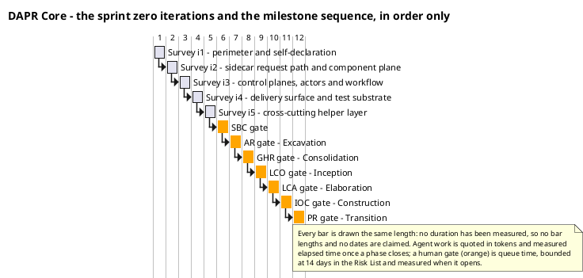
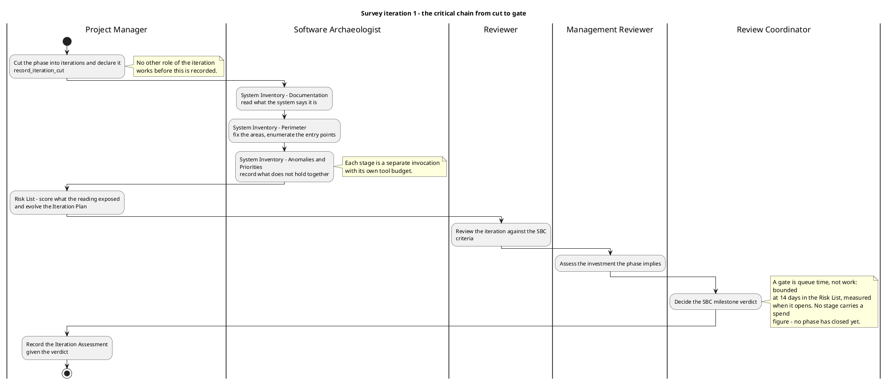

## Document Control
Phase: Survey
Status: Draft — iteration 1 of the phase. W1 to W5 complete: the cut is recorded and corrected against what was read, the risk sequencing is written, and 13 areas of the slice were read of the 70 the cut holds; `go.sum` and `img` were not reached and are carried by iteration 2. W6, the SBC gate, is open. No spend figure and no work-item size anywhere, because no phase has closed
Milestone Target: end-of-Survey milestone (SBC) — not yet achieved

## Iteration Objectives

Survey iteration 1 establishes the perimeter of the existing system and records what the system declares itself to be. The unit of scope in the sprint zero is the **area of the repository**, not a use case: no use case enters this plan.

| # | Objective | Exit criterion |
|---|---|---|
| O1 | The perimeter of the existing system is fixed: every executable, every API surface, every protocol contract and every control plane is enumerated with the path it was read from | The System Inventory "Perimeter" stage names each area it read and each entry point it found, with `Source:` anchors |
| O2 | What the system declares about itself is recorded: its architectural decision record set, its versioned release history, its stated contribution and release procedure | The System Inventory "Documentation" stage reports the 23 decision records under `docs/decision_records/`, the release history under `docs/release_notes/` and the toolchain fixed in `go.mod` as evidence, each with its path |
| O3 | What does not hold together in the reading is written down and ordered | The System Inventory "Anomalies and Priorities" stage records each anomaly under an `AN-NNN` label and orders the remaining areas |
| O4 | The work left in the phase is cut into iterations, each area in exactly one iteration | The cut below is in this document and recorded with the process service before any other role of the iteration reads |

O1–O3 are the Software Archaeologist's; O4 is this iteration's act of initiation and is complete when the cut is declared.

## Plan and Milestones
The coarse roadmap below is cross-iteration: the milestone sequence of the project, and the cut that assigns every repository area to exactly one iteration of the sprint zero. The fine plan that follows it is bounded to this iteration.

### Coarse roadmap — the milestone sequence of the project

| Milestone | Closes | What the milestone asserts | Reviewers, in order |
|---|---|---|---|
| SBC | Survey | The perimeter of the existing system is confirmed and its priorities are ordered | Reviewer, Management Reviewer, Review Coordinator |
| AR | Excavation | The existing system's architecture, data and use cases are recovered into the CORE artifacts they belong to | Reviewer, Management Reviewer, Review Coordinator |
| GHR | Consolidation | Every use case is recovered, coverage is counted, the Supplementary Specification is complete | Reviewer, Management Reviewer, Review Coordinator |
| LCO | Inception | The declared scope is bounded, the candidate architecture is agreed and the business case is made | Reviewer, Business Reviewer, Management Reviewer, Review Coordinator |
| LCA | Elaboration | The architecture baseline is executable and the highest-magnitude risks are retired | Reviewer, Business Reviewer, Management Reviewer, Review Coordinator |
| IOC | Construction | The declared scope is implemented and the iteration baseline holds | Reviewer, Management Reviewer, Review Coordinator |
| PR | Transition | The release is deployed and accepted | Reviewer, Management Reviewer, Review Coordinator |

The sprint zero runs SBC, AR and GHR before Inception opens. The Business Reviewer does not work in the sprint zero: Business Modeling is inactive for this project (Development Case §2).

### Coarse roadmap — the cut of the sprint zero

The cut orders the repository by what the reading itself needs first, and once an iteration has read, by what its Coverage records. The system's own statement of itself — its decision records, its protocol contracts, its release history, its toolchain — is read before any code, because every later area is read against it.

**The slice this iteration was assigned, in the order it was assigned.** Thirteen areas; all thirteen were reached. The files-held and files-opened counts are the System Inventory's Coverage count, not a re-measurement.

| Order | Area | Files it holds | Files opened | What the reading took from it |
|---|---|---|---|---|
| 1 | `.github` | 120 | 3 | The gate the delivery claims and does not hold: `workflows/fossa.yml`; the conventions `copilot-instructions.md` states; the PR checklist |
| 2 | `CODEOWNERS` | 1 | 1 | Whole file — the two maintainer teams `GOVERNANCE.md` names |
| 3 | `CONTRIBUTING.md` | 1 | 1 | Whole file — the owner's upstream workflow, kept as the owner's, with the stakeholder's approved pointer line at its top |
| 4 | `GOVERNANCE.md` | 1 | 1 | Whole file — maintainer responsibility, activity rule, super-majority vote |
| 5 | `LICENSE` | 1 | 1 | Whole file — Apache-2.0 |
| 6 | `README.md` | 1 | 1 | Whole file — what the system declares itself to be and the twelve APIs it exposes |
| 7 | `RELEASE.md` | 1 | 1 | Whole file — a one-line pointer out of the tree |
| 8 | `SECURITY.md` | 1 | 1 | Whole file — a one-line pointer out of the tree |
| 9 | `cmd` | 183 | 12 | The six executables' wiring, the scheduler's options, the component registry and its build-tag guard |
| 10 | `dapr` | 45 | 13 | Every gRPC service the tree declares, read from its definition |
| 11 | `docs` | 196 | 9 | The decision-record index and its category rule, the development guides, the release-note template and the newest note |
| 12 | `go.mod` | 1 | 1 | Whole file — the toolchain the tree fixes and the module pins |
| 13 | `pkg/proto` | 66 | 3 | The generation header every committed binding carries, and the failure-policy family with no source |

**What an area's remaining depth is not.** Five areas were opened well short of their file count — `.github` 3 of 120, `cmd` 12 of 183, `dapr` 13 of 45, `docs` 9 of 196, `pkg/proto` 3 of 66 — because the perimeter closed without it. That depth is **not** a Survey remainder: it is what the System Inventory's Priorities section orders, and it is Excavation's. Re-opening an area this iteration already read would put one area in two iterations of the cut.

**The remainder, counted.** This iteration was assigned thirteen areas and reached every one: it has no unreached area. The Survey remainder is the areas the cut assigns to iterations 2 through 5, and `go.sum` and `img` are among them, listed once, in iteration 2's row. Whether the cut still holds is asked at the close of each iteration from what that iteration read; it is not projected from this one's count. No phase of this project has closed, so there is no measured rate and none is stated. Should an iteration overrun, the remedy is R001's — one more iteration, never less scope, and never more agent roles in parallel.

| Iteration | Areas the iteration takes, in the order to take them | What the iteration establishes | Basis of the split |
|---|---|---|---|
| **Survey i1** — 13 areas, 13 read | `.github`, `CODEOWNERS`, `CONTRIBUTING.md`, `GOVERNANCE.md`, `LICENSE`, `README.md`, `RELEASE.md`, `SECURITY.md`, `cmd`, `dapr`, `docs`, `go.mod`, `pkg/proto` | The perimeter and the system's self-declaration: the 23 decision records under `docs/decision_records/`, the protocol contracts under `dapr/proto/`, the six executables under `cmd/`, the 25 CI workflows under `.github/workflows/`, the release history under `docs/release_notes/` and the toolchain the tree fixes | The documents and the contracts are the smallest surface that defines the system's boundary, and every later area is read against them |
| **Survey i2** — 16 areas | `go.sum`, `img`, `pkg/api/`, `pkg/messaging/`, `pkg/channel/`, `pkg/components/`, `pkg/resiliency/`, `pkg/middleware/`, `pkg/config/`, `pkg/diagnostics/`, `pkg/metrics/`, `pkg/healthz/`, `pkg/ports/`, `pkg/modes/`, `pkg/apphealth/`, `pkg/cors/` | The sidecar's request path and component plane: how an application's call becomes a component operation, and what it dispatches into. `pkg/api/` is read whole: iteration 1 opened 5 of its 124 files, enough to name the entry points and not enough to state what an operation does | The request path is the system's primary entry surface and the component registries are what it dispatches into; the two are read together or neither is legible. `go.sum` and `img` take their turn at the head of the slice: the first is read against `go.mod`'s pins, the second holds the images the six executables ship as |
| **Survey i3** — 11 areas | `pkg/actors/`, `pkg/runtime/`, `pkg/placement/`, `pkg/scheduler/`, `pkg/sentry/`, `pkg/security/`, `pkg/operator/`, `pkg/injector/`, `pkg/acl/`, `apis/`, `client/` | The control planes and the stateful abstractions: actor placement and reminders, job scheduling, the trust domain, resource reconciliation, the workflow engine and the access-control layer | Each is a separate process with its own leadership, contracts and failure modes, so they are read as one slice. `pkg/runtime/` lands here rather than in i2 because its hot-reload, compstore, authorizer, scheduler and wfengine subtrees are what these control planes bind together — the request path in i2 reaches only its processor subtree |
| **Survey i4** — 17 areas | `charts/`, `docker/`, `tests/`, `grafana/`, `swagger/`, `platforms/`, `tools/`, `pkg/testing/`, `Makefile`, `.golangci.yml`, `.prettierrc.json`, `.codecov.yaml`, `.devcontainer/`, `.build-tools/`, `.gitattributes`, `.gitignore`, `.prettierignore` | The delivery surface and the test substrate: how the six binaries are deployed, how the layered suites execute, and which conventions the kept code follows | Deployment is a first-class concern of this system and the suites are the only empirical statement of its behaviour; both are read once the systems under test are known. This is the largest slice — 2 073 integration suite files and 631 perf files under `tests/` — and its overrun is R001 |
| **Survey i5** — 13 areas | `internal/`, `utils/`, `pkg/backoff/`, `pkg/buildinfo/`, `pkg/encryption/`, `pkg/expr/`, `pkg/messages/`, `pkg/outbox/`, `pkg/responsewriter/`, `pkg/retry/`, `pkg/scopes/`, `pkg/sse/`, `pkg/validation/` | The shared helper layer the request path and the control planes both draw on | These packages expose no entry point of their own; they are read last, once the callers that justify them are known |

Counted once, the areas sum to 70 — the count the cut declared, with nothing dropped and nothing read twice: 13 read in i1, plus the 16 i2 holds, plus 11, 17 and 13. A further iteration takes exactly what the SBC review leaves open — the Review Record's findings and the actions it sets — and nothing else. The phase iterates while the cut holds an area or the record holds a finding open; it does not iterate because a calendar says so.

The iteration count of the sprint zero is set by the cut of the existing system, not by the rubber profile: that profile distributes the iterations of the RUP phases and is not applied to the reading of a 6 629-entry repository.

### Fine plan — Survey iteration 1

| # | Work item | Owner | Input | Output | Exit condition |
|---|---|---|---|---|---|
| W1 | Declare the cut of the phase | Project Manager | This plan; the repository tree | Cut recorded with the process service | The cut is recorded and no other role of the iteration works before it |
| W2 | Read what the system says it is | Software Archaeologist | `README.md`, `docs/decision_records/`, `docs/release_notes/`, `docs/development/`, `docs/CONTRIBUTING.md`, `go.mod`, `RELEASE.md`, `SECURITY.md`, `GOVERNANCE.md`, `CONTRIBUTING.md`, `CODEOWNERS` | System Inventory — Documentation | Every claim carries `Source: <path>`; the 23 decision records are reported as evidence and are not renumbered into the project's identifier families |
| W3 | Fix the perimeter and enumerate the entry points | Software Archaeologist | `cmd/`, `dapr/proto/`, `.github/` | System Inventory — Perimeter | Every executable, every API surface and every protocol contract is enumerated and labelled `EP-NNN`, each with its `Source:` anchor |
| W4 | Record the anomalies and order what remains | Software Archaeologist | W2, W3 outputs | System Inventory — Anomalies and Priorities | Each anomaly is labelled `AN-NNN` with its anchor; the areas still to read are ordered |
| W5 | Score the risks the reading exposed and evolve this plan | Project Manager | System Inventory, this plan | Risk List; the cut corrected against Coverage and the sequencing recorded | Every risk carries probability, impact, magnitude, strategy and owner; every anomaly carries at least one; the cut matches the recorded cut area for area and in order |
| W6 | Review the iteration against the SBC criteria | Reviewer, Management Reviewer, Review Coordinator | Iteration increments | Review Record; milestone verdict | The verdict is issued; a Critical finding escalates to the stakeholder and the milestone does not close |
| W7 | Record the Iteration Assessment given the verdict | Project Manager | Review Record; the iteration's objectives and evaluation criteria | Iteration Assessment | Every objective is stated met or missed, with the scope or plan adjustment the next iteration takes |

No work item is given a size. Nothing in this project has been measured — no phase has closed — so there is no actual to size against, and no unit of person-duration exists in this system to express one in. What iteration 1 read is counted above in files and areas: that is what this phase measures, it is not a rate to project, and no iteration forecast is derived from it.

W1 to W5 are complete. W6 is the gate, and it is queue time: bounded at 14 days in the Risk List, measured when it opens, never forecast here. W7 follows the verdict and is not gated by it — the Assessment records what the verdict says about the iteration's objectives.

The chain above is the whole of Survey iteration 1's work: five agent stretches in sequence, with the gate at the end. The three review and verdict states are a human gate, not agent work — they are bounded in the Risk List and measured when they open, never forecast here.

### Risk-driven sequencing — what each iteration is ordered to confront

The cut places work by where the risk sits, not by where the code sits. Each risk of the Risk List belongs to exactly one row below: eleven to this iteration, the rest to the iteration whose slice can retire them, and five to the whole reading because no area retires them. Risk ids and magnitudes are the Risk List's.

| Iteration | The risks it is sequenced to confront | Why at this point in the cut |
|---|---|---|
| i1 — this iteration | R011 (High), R016 (High), R009, R010, R020 — the contract-and-generation cluster; R007, R008, R012, R018, R022 — the self-declaration cluster; R015 | R011 and R016 are two of the phase's three High risks, and both are only confrontable here: R011 is the architecture statement stopping in 2023, read from `docs/decision_records/`; R016 is no in-tree account of any executable's behaviour, read from `cmd/` and the redirect READMEs. The five-document generation divergence (R009, R010, R020) is reachable from `dapr/`, `pkg/proto/` and `docs/` and from nowhere else in the cut. The self-declaration cluster sits on the eight files read whole or on the two READMEs — the index that links an absent record (R007), the overview that omits two packages (R008), the two pointers out of the tree (R012), the seven package notes and the two that are missing (R018), the hand-written Go inside the generated tree (R022). R015 is a directory listing in `cmd/daprd/components/`. All eleven sit on areas no later iteration re-opens |
| i2 | R017, R019 | The gRPC allowlist duplicate (R017) sits on EP-002, whose operations are implemented in `pkg/api/universal/` — named in iteration 1 and readable only here. The failure-policy divergence (R019) is settled from `pkg/scheduler/`, whose contract i2 has by then shown what dispatches into it |
| i3 | R023 (High), R014 | R023 is the phase's third High risk — one scheduler process, two authorities, negotiated from what peers report — and is the reason `pkg/scheduler/` is read before the placement service it supersedes. The two suites disabled by renaming (R014) are read in `pkg/runtime/wfengine/`, which sits in this slice and not in i2 |
| i4 | R001, R013, R021, R025, R024 | Every risk whose exposure is in the delivery surface and the test substrate. R001 is the one that can turn this iteration into two, and its slice is the largest the cut holds. R024's count is iteration 1's — 156 registration files against one test — but whether component behaviour is covered at all is stated in `tests/integration/`, which is i4's |
| i5 | none | The helper layer carries no anomaly and exposes no entry point. It is read for the callers already known and adds no risk to the register |
| the whole reading, no area | R005, R006, R004, R003, R002 | R005 (repository files obeyed rather than recorded), R006 (an empty size filled with a unit nothing measures), R004 (decision records renumbered into project families) and R003 (the tree's toolchain stated as project policy) are avoided by the shape of every role's work order, not by any area's position in the cut. R002 is the gate itself, bounded at 14 days and measured when it opens |

Twenty-five risks, twenty-five rows: eleven in i1, two in i2, two in i3, five in i4, none in i5, five on the whole reading. A risk with no iteration against it is a risk the cut has not confronted, so this table is checked against the Risk List whenever either changes.

### Priorities — what Excavation reads first

The System Inventory's **Priorities** section ranks the thirteen areas the reading still needs, and that ranking is Excavation's reading order — this plan cites it and schedules nothing from it. It is not a second Survey pass: ranks 1 to 5 (`dapr/proto/` message shape, `cmd/daprd/`, `pkg/runtime/`, `pkg/api/`, `pkg/actors/`) name depth inside areas iteration 1 opened or iterations 2 and 3 will open, which is why that depth is Excavation's remainder and not a Survey one.

## Resources

| Role | Discipline | Stages this iteration | What it produces |
|---|---|---|---|
| Process Engineer | Environment | Already ran before this iteration opened | Development Case — ready; the Environment checkpoint for the iteration is satisfied |
| Project Manager | Discovery, Project Management | Cut; then Risk List and Iteration Plan; then the Iteration Assessment after the verdict | Iteration Plan, Risk List, Iteration Assessment |
| Software Archaeologist | Discovery | Documentation; Perimeter; Anomalies and Priorities | System Inventory |
| Reviewer | — | Milestone review | Review Record findings against the SBC criteria |
| Management Reviewer | — | Milestone review | Investment assessment of the phase |
| Review Coordinator | — | Milestone review | The SBC verdict |

Roles that do **not** work in Survey: System Analyst, Requirements Specifier, Software Architect, Designer, Database Designer, User Interface Designer, Capsule Designer, Implementer, Integrator, Test Manager, Test Analyst, Test Designer, Tester, Deployment Manager, Technical Writer, Configuration Manager, Change Control Manager, Business Process Analyst, Business Reviewer, Code Reviewer. Their first phase is Excavation or later, per the inherited process. The Business Process Analyst and the Business Reviewer do not work in any phase (Development Case §2); the Capsule Designer does not either (§3).

No role is added to the phase to shorten it. Parallelism across the reading would put two roles on the same area, and the second would be re-reading what the first already wrote.

## Use Cases and Scenarios Addressed

None. No use case enters the plan in Survey: the phase's scope unit is the area of the repository listed in the cut above. Use cases are recovered in Excavation from the entry points this iteration labels `EP-NNN` — the Use-Case Model traces each recovered use case to the entry point that performs it.

| Phase | Scope unit | Where it is planned |
|---|---|---|
| Survey | Repository area | This plan, "Coarse roadmap — the cut of the sprint zero" |
| Excavation | Entry point `EP-NNN`, recovered use case | The Excavation Iteration Plan |
| Consolidation and later | Declared use case, risk-driven selection | Each phase's Iteration Plan, chosen by risk and coverage |

## Evaluation Criteria
| Criterion | Threshold | Evidence |
|---|---|---|
| Perimeter confirmed | Every executable under `cmd/`, every API surface and every protocol contract under `dapr/proto/` is enumerated, each with a `Source:` anchor | System Inventory — Perimeter: 16 entry points, `EP-001` to `EP-016`, each with its anchor; its component table and its external-actor table are the same stage's, entry by entry |
| Priorities ordered | The areas still to read are ordered, with the ordering stated and cited as Excavation's reading order rather than as a Survey work item | System Inventory — Priorities: 13 ranks, each with why it comes first; cited in "Priorities — what Excavation reads first" |
| Traceable reading | No element of the System Inventory is stated without the path and lines it was read from | System Inventory, all stages; the Coverage table accounts for every area of the slice |
| Cut held | Every area listed in the cut belongs to exactly one iteration, in the order the cut records, and no area of the tree is left uncut | This plan's cut tables and the recorded cut — 70 areas, 13 read this iteration, matched area for area and in order |
| Unread areas declared | An area the iteration did not reach is named, not skipped, and the remainder is counted | This plan: `go.sum` and `img`, carried by iteration 2; the remainder 57 areas against 4 iterations of the cut |
| Depth left in a read area is not a Survey remainder | An area opened short of its file count is scheduled by the System Inventory's Priorities for Excavation, never re-opened inside the Survey cut | This plan: the five areas opened short — `.github`, `cmd`, `dapr`, `docs`, `pkg/proto` — and the Priorities citation |
| Risks sequenced, not only scored | Every risk of the Risk List names the iteration of the cut that confronts it, or the row of risks the whole reading carries | This plan: "Risk-driven sequencing"; Risk List — 25 risks, all 20 anomalies refined, three High and thirteen Significant all on `avoid` |
| No invented figures | No token spend, elapsed time, work-item size or forecast appears anywhere in the phase's artifacts, because no phase has closed | This plan; the Risk List |

Each criterion is checkable against an artifact in the increment. The one that was not met when the cut was declared — the unread areas — is met in the plan as delivered: iteration 1 read 13 of its 15 areas, and the two it did not reach are moved to iteration 2's slice rather than left assumed read.

**What this iteration measures, and the decision each measurement serves.**

| Measurement | Value | Decision it enables |
|---|---|---|
| Areas of the slice reached | 13 of 15 | Whether the cut still holds at five iterations of Survey, or a sixth is needed |
| Files opened against files the slice areas hold | 48 of 622 | Whether an area is being read at the depth its priority needs, or skimmed — and, where it is short, whether that depth belongs to Excavation instead |
| Files opened outside the slice, with the reason | 10 | Whether the perimeter can be closed from the slice alone; a rising count means the cut is drawn in the wrong place |
| Anomalies recorded | 20 | Whether the reading has found the system's incoherences, or only described it |
| Risks carrying no iteration against them | 0 | Whether the cut is ordered by risk at all, or only by convenience of location |

No rate is derived from any of these. They are counts of what one iteration read, not a velocity, and the next iteration's slice is set by the cut and the remainder — never by a per-iteration figure.

