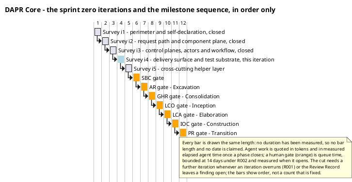
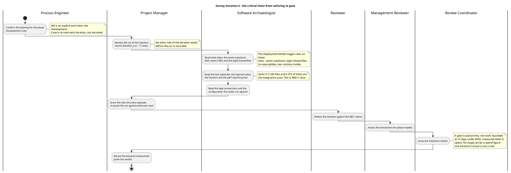
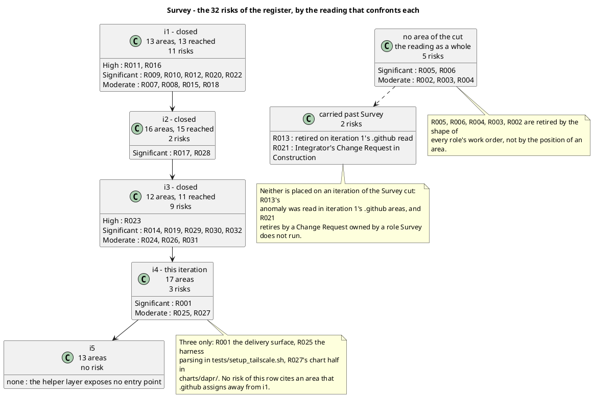

## Document Control
Phase: Survey

Status: Draft — iteration 4 of the phase, issued 2026-11-27. Iteration 3 was reviewed and the phase iterates; its findings are carried in "What this iteration carries as rework", and this plan claims no closure of them. The cut assigns this iteration 17 areas and 30 remain across the two iterations this plan holds (17 here + 13 in iteration 5). Of the 70 areas the reading holds, **69 are cut into the five Survey iterations and one — `pkg/diagnostics/` — is carried to Excavation**: the area opened at one file of thirty-five in iteration 3 and its remainder is stated beside the cut rather than answered by a reached count. Thirteen areas were read at i1, 15 of iteration 2's 16 at i2, 11 of iteration 3's 12 at i3; every area of the 69 sits in exactly one iteration and the carried area in none. This iteration's reached count is recorded at its close, from what it reads.

Read figures are quoted from the System Inventory's Coverage, each reproducing from the files enumerated on its own row: iteration 1 opened 48 of the files its 13 assigned areas hold and 12 more outside its slice, 60 distinct; iteration 2 opened 20 files it had not opened before — 18 across the fifteen of its 16 assigned areas that yielded a file, and 2 in iteration-1 areas it extended — plus 8 outside its slice, 28 distinct, and re-opened 3; iteration 3 opened 27 files in 11 of its 12 areas and 3 outside its slice, 30 distinct, and re-opened 3. The phase stands at 118 distinct files of the tree's 6 631 entries. This iteration's 17 areas hold 3 496 files.

The Risk List holds 32 risks: **25 placed each on the iteration that confronts them, 5 on the reading as a whole where no area retires them, and 2 — `R013` and `R021` — carried past the phase**, each retired where its retirement actually happens rather than placed on an iteration that reads nothing of it. No work-item size anywhere, because no phase has closed and there is no measured actual to size against; three iterations of this phase have closed and each one's measured spend is reported as that iteration's own fact, never as a rate. The SBC milestone is not judged: the SBC gate is issued once, by the Review Coordinator, when the cut holds no unread area.

Milestone Target: end-of-Survey milestone (SBC) — not yet achieved

## Iteration Objectives
Survey iteration 4 reads the delivery surface and the test substrate — what ships, and the suites that are the only empirical statement of how it behaves. The unit of scope in the sprint zero is the **area of the repository**, not a use case: no use case enters this plan.

| # | Objective | Exit criterion |
|---|---|---|
| O1 | The delivery surface is stated from the files that build it, not from the index that describes it | `charts/dapr/charts/` is enumerated and its **seven** subcharts are named; `charts/dapr/crds/` is enumerated and its seven CRDs are named; `docker/` is enumerated and its eight Dockerfiles are named with what each builds. `charts/dapr/README.md`'s six-subchart list is cited only as the document the directory contradicts — that is `R027`'s chart half, and it is settled here or recorded open with the reason |
| O2 | The test substrate is stated as the layers it actually holds | `tests/` is read and each layer is stated with what it asserts and how it is driven — the integration suite, the e2e suite, the perf suite, the framework that carries them. The perf reporting tree is recorded as generated chart output and not as evidence of behaviour. The coverage the substrate gives each area the phase has read is stated, or its absence stated |
| O3 | The harness's cluster provisioning is recorded as the mechanism in force | `tests/setup_tailscale.sh` and the Kubernetes platform code under `tests/platforms/` are read; the service and pod CIDR derivation from free-text `kubectl` output is anchored with file and lines, and `R025` names what was read. Whether no test conclusion of this phase rests on provisioning it did not observe is stated explicitly |
| O4 | The kept conventions and the committed generated output are stated as what they are | `.golangci.yml`, `.prettierrc.json`, `.prettierignore`, `.gitattributes`, `.gitignore`, `.codecov.yaml`, `.devcontainer/`, `.build-tools/`, `Makefile`, `tools/` are each recorded as what the kept code follows — never as policy this project has taken (`R003`). `swagger/swagger.json` is stated as committed output against the `.proto` contracts read in iteration 1, and `grafana/`'s dashboards against the meters iteration 3 recorded |
| O5 | The slice is reconciled against the files it was assigned, with every remainder declared into the cut | The seventeen areas' 3 496 files are reconciled in Coverage against what was opened. An area opened short of its file count says so on its own row and its depth is Excavation's. No area is counted as reached on the strength of its file count or its placement alone — the rule iteration 3 applied to eleven areas and declared for the twelfth |
| O6 | The remainder of the phase is cut and declared before any other role of the iteration reads | The cut is in this document and recorded with the process service — 17 areas this iteration, 13 across the iteration that follows, 69 cut into Survey with `pkg/diagnostics/` carried to Excavation; each area in exactly one iteration, and the carried area in none |

O1–O5 are the Software Archaeologist's reading; O6 is this role's act of initiation and is complete — the cut is recorded with the process service, 17 areas of this iteration and the iterations the remainder takes.

The depth these objectives ask for is the depth a priority needs, not the whole area. `tests/` alone holds 3 335 files and `charts/` 67; what closes O1 and O2 is the enumeration of what ships and the shape of each suite, not every generated chart under `tests/perf/report/charts/`, which is recorded as output rather than read as evidence. An area opened short of its file count says so in Coverage, and that depth belongs to Excavation.

O1 carries the directory-over-index clause deliberately. Both of the phase's index documents that omit an entry have now been recorded as anomalies (`AN-022`), and the remedy is a reading rule rather than a correction: an area is enumerated from its directory, and an index is cited as the document it contradicts.

## Plan and Milestones
The coarse roadmap below is cross-iteration: the milestone sequence of the project, and the cut that assigns every repository area to exactly one iteration of the sprint zero. The fine plan that follows it is bounded to this iteration.

### Coarse roadmap — the milestone sequence of the project

| Milestone | Closes | What the milestone asserts | Reviewers, in order |
|---|---|---|---|
| SBC | Survey | The perimeter of the existing system is confirmed and its priorities are ordered | Reviewer, Management Reviewer, Review Coordinator |
| AR | Excavation | The existing system's architecture, data and use cases are recovered into the CORE artifacts they belong to | Reviewer, Management Reviewer, Review Coordinator |
| GHR | Consolidation | Every use case is recovered, coverage is counted, the Supplementary Specification is complete | Reviewer, Management Reviewer, Review Coordinator |
| LCO | Inception | The declared scope is bounded, the candidate architecture is agreed and the business case is made | Reviewer, Business Reviewer, Management Reviewer, Review Coordinator |
| LCA | Elaboration | The architecture baseline is executable and the highest-magnitude risks are retired | Reviewer, Business Reviewer, Management Reviewer, Review Coordinator |
| IOC | Construction | The declared scope is implemented and the iteration baseline holds | Reviewer, Management Reviewer, Review Coordinator |
| PR | Transition | The release is deployed and accepted | Reviewer, Management Reviewer, Review Coordinator |

The sprint zero runs SBC, AR and GHR before Inception opens. The Business Reviewer does not work in the sprint zero: Business Modeling is inactive for this project (Development Case §2).

### Coarse roadmap — the cut of the sprint zero

The cut orders the repository by what the reading itself needs first, and once an iteration has read, by what its Coverage records. The system's own statement of itself was read in iteration 1, because every later area is read against it. Iteration 2 took the request path, iteration 3 the control planes and stateful abstractions that path dispatches into. This iteration takes the delivery surface and the test substrate, because what ships and what empirically exercises it can only be read once the systems under test are known.

**The cut is what each closed iteration actually read.** Areas are restated at the count the iteration reached, not the count it was assigned.

| Iteration | Areas assigned | Areas reached | What that means for the cut |
|---|---|---|---|
| Survey i1 — closed | 13 — `.github`, `CODEOWNERS`, `CONTRIBUTING.md`, `GOVERNANCE.md`, `LICENSE`, `README.md`, `RELEASE.md`, `SECURITY.md`, `cmd`, `dapr`, `docs`, `go.mod`, `pkg/proto` | 13 | Five were opened short of their file count — `.github`, `cmd`, `dapr`, `docs`, `pkg/proto`. That depth is not a Survey remainder: it is the System Inventory's Priorities order and it is Excavation's. Re-opening an area an iteration already read would put one area in two iterations. The `.github` read is where `AN-007`'s patch corpus and `AN-016`'s workflow gate were read, and `R013` and `R021` are retired from that read — see "Risk-driven sequencing" |
| Survey i2 — closed | 16 — `go.sum`, `img`, `pkg/api`, `pkg/messaging`, `pkg/channel`, `pkg/components`, `pkg/resiliency`, `pkg/middleware`, `pkg/config`, `pkg/diagnostics`, `pkg/metrics`, `pkg/healthz`, `pkg/ports`, `pkg/modes`, `pkg/apphealth`, `pkg/cors` | 15 | Fifteen yielded a file; `pkg/diagnostics/` was declared unread in full — a monitoring module is legible only against the operation it instruments. It was re-cut to iteration 3, where the code it instruments is read, rather than counted as reached |
| Survey i3 — closed | 12 — `pkg/scheduler`, `pkg/placement`, `pkg/runtime`, `pkg/actors`, `pkg/sentry`, `pkg/security`, `pkg/operator`, `pkg/apis`, `pkg/client`, `pkg/injector`, `pkg/acl`, `pkg/diagnostics` | 11 | The eleven control-plane and stateful areas read to a stated depth. `pkg/diagnostics/` opened at one file of thirty-five and stopped; the area is **carried to Excavation**, not counted as reached — declared below and dropped from that iteration's reached count |
| **Survey i4 — this iteration** | **17** — `charts/`, `docker/`, `tests/`, `grafana/`, `swagger/`, `platforms/`, `tools/`, `pkg/testing/`, `Makefile`, `.golangci.yml`, `.prettierrc.json`, `.codecov.yaml`, `.devcontainer/`, `.build-tools/`, `.gitattributes`, `.gitignore`, `.prettierignore` | **to be recorded at this iteration's close** | The delivery surface and the test substrate. This is the cut's largest slice and its overrun is `R001` |
| Survey i5 | 13 — `pkg/internal/`, `utils/`, `pkg/backoff/`, `pkg/buildinfo/`, `pkg/encryption/`, `pkg/expr/`, `pkg/messages/`, `pkg/outbox/`, `pkg/responsewriter/`, `pkg/retry/`, `pkg/scopes/`, `pkg/sse/`, `pkg/validation/` | — | The shared helper layer, read last because it exposes no entry point of its own |

**Carried past the cut — `pkg/diagnostics/`.** The area was assigned to iteration 2 and declared unread in full there, re-cut to iteration 3 on the reasoning that a monitoring module is legible only against the operation it instruments. It opened there at one file of thirty-five — `pkg/diagnostics/metrics.go`, the seven default meters — and stopped: the thirteen monitoring and tracing modules instrument operations this phase's read states at the depth of a signature, not at the depth a module's effect on an operation can be stated from. The area is carried to **Excavation**, where the System Inventory's priority-4 reading order places it beside the operation paths recovered there, and it is counted in Excavation's plan. It is not counted as reached in this phase, and its 34 unread files are not covered by the 69 areas the Survey cut reads. No iteration of this cut carries it.

**The remainder, counted.** The repository's reading holds 70 areas: **69 are cut into the five Survey iterations and one — `pkg/diagnostics/` — is carried to Excavation** as declared above. Of the 69, thirteen were read in iteration 1, 15 of iteration 2's 16 in iteration 2, and 11 of iteration 3's 12 in iteration 3, so **30 remain across the two iterations that follow**: 17 in this iteration and 13 in iteration 5. The arithmetic closes: 13 + 15 + 11 + 17 + 13 = 69, plus the carried area = 70, with nothing dropped and nothing read twice. These are counts of areas, not of files read and not a rate: whether the cut still holds is asked and answered at the close of each iteration from what that iteration read, and it is not projected from any earlier iteration. Should an iteration overrun, the remedy is `R001`'s — one more iteration, never less scope, and never more agent roles in parallel. No phase of this project has closed, so there is no measured actual to forecast a phase length from, and this plan states none.

| Iteration | Areas the iteration takes, in the order to take them | Files the areas hold | What the iteration establishes | Basis of the split |
|---|---|---|---|---|
| **Survey i4** — this iteration — 17 areas | `charts/`, `docker/`, `tests/`, `grafana/`, `swagger/`, `platforms/`, `tools/`, `pkg/testing/`, `Makefile`, `.golangci.yml`, `.prettierrc.json`, `.codecov.yaml`, `.devcontainer/`, `.build-tools/`, `.gitattributes`, `.gitignore`, `.prettierignore` | 3 496 | The delivery surface and the test substrate: how the six executables are packaged and deployed, how the layered suites execute, what the empirical record of the system's behaviour is, and which conventions the kept code follows | `charts/` and `docker/` come first: what ships is the Deployment Model's factual basis — seven subcharts, seven CRDs, eight Dockerfiles, six executables — and nothing later in the cut restates it. `tests/` follows as the largest area in the tree (3 335 files, of which 2 073 are the integration suite) and is read against the systems under test that iterations 2 and 3 recovered. The conventions and the two build-tool directories close the slice: they are stated as what the kept code follows, never as project policy (`R003`). This is the cut's largest slice and its overrun is `R001` |
| **Survey i5** — 13 areas | `pkg/internal/`, `utils/`, `pkg/backoff/`, `pkg/buildinfo/`, `pkg/encryption/`, `pkg/expr/`, `pkg/messages/`, `pkg/outbox/`, `pkg/responsewriter/`, `pkg/retry/`, `pkg/scopes/`, `pkg/sse/`, `pkg/validation/` | 68 | The shared helper layer the request path and the control planes both draw on | These packages expose no entry point of their own; they are read last, once the callers that justify them are known |

Every area is a path the tree shows; `.iari/` is not one of them, because it is what the owner tells this process and not part of the system. A further iteration takes exactly what the SBC review leaves open — the Review Record's findings and the actions it sets — and nothing else. The phase iterates while the cut holds an area or the record holds a finding open; it does not iterate because a calendar says so.

The iteration count of the sprint zero is set by the cut of the existing system, not by the rubber profile: that profile distributes the iterations of the RUP phases and is not applied to the reading of a 6 631-entry repository.

### The critical chain of this iteration

The chain above is the whole of Survey iteration 4's work: eight agent stretches in sequence, with the gate at the end. The three review and verdict states are a human gate, not agent work — bounded in the Risk List and measured when they open, never forecast here.

### Risk-driven sequencing — what each iteration is ordered to confront

The cut places work by where the risk sits, not by where the code sits. Each risk of the Risk List belongs to exactly one row below: **25 are placed on an iteration, 5 are carried by the reading as a whole, and 2 are carried past the phase** — the split Document Control states, and the only place this figure is written. A placement names an area the iteration it sits on opens — an area this document declares unread is never cited as the reading that settles a risk. Risk ids and magnitudes are the Risk List's.

| Iteration | The risks it is sequenced to confront | Why at this point in the cut |
|---|---|---|
| i1 — closed | R011 (High), R016 (High), R009, R010, R012, R020, R007, R008, R015, R018, R022 | Two of the phase's three High risks and the five-document generation divergence are reachable from `docs/`, `dapr/`, `pkg/proto/` and `cmd/` and from nowhere else in the cut. Eleven risks, and they sit on areas no later iteration re-opens |
| i2 — closed | R017, R028 | The gRPC allowlist (R017) sits on `EP-002`, and `pkg/api/grpc/endpoints.go` — opened in iteration 2 — is the map recorded as the access-control surface of the operations the request path fixes. R028 is that iteration's own find: the public listener's middleware subset is in `pkg/api/http/server.go`, an area it read |
| i3 — closed | R023 (High), R019, R014, R024, R026, R029, R030, R031, R032 | R023 — one scheduler process, two authorities, negotiated from what peers report — is why `pkg/scheduler/` was taken first. R019 sits there because its mitigation names `pkg/scheduler/`; R014, R024, R026 and R029 are read in `pkg/runtime/wfengine/` and `pkg/actors/`; R030, R031 and R032 are the anomalies that slice recorded, read in its own areas |
| **i4 — this iteration** | **R001 (Significant), R025, R027** | R001 is the overrun risk and this is the slice it names: `tests/` alone holds 3 335 of the tree's 6 631 entries and the seventeen areas hold 3 496 files. It is placed here because this is the iteration that can turn into two, and the plan's answer is fixed in advance — a further iteration, never less scope (`R001`'s strategy is `avoid`, and the avoidance is that the cut is stated in areas so an overrun adds an iteration rather than dropping one). R025 is the harness parsing in `tests/setup_tailscale.sh`, the cluster's service and pod CIDRs derived from free-text `kubectl` output; `tests/` is this iteration's third area and the only area of the cut that holds it. R027's chart half is settled here: `charts/dapr/README.md` introduces six of the seven subcharts and `charts/dapr/charts/dapr_config/` is enumerated from the directory rather than taken from the index. R027's documentation half needs no iteration below — the guide the index omits, `docs/development/preview-features.md`, was opened from its directory in iteration 1, so only the chart half is still owed |
| i5 | none | The helper layer carries no anomaly and exposes no entry point. It is read for the callers already known and adds no risk to the register |
| the whole reading, no area | R005, R006, R004, R003, R002 | R005 (repository files obeyed rather than recorded), R006 (an empty size filled with a unit nothing measures), R004 (decision records renumbered into project families) and R003 (the tree's toolchain stated as project policy) are avoided by the shape of every role's work order, not by any area's position in the cut. R002 is the gate itself, bounded at 14 days and measured when it opens |
| **carried past the phase** | **R013, R021** | R013's anomaly `AN-007` is the version-skew patch corpus at `.github/scripts/version-skew-test-patches/`, read in iteration 1's `.github` areas, which is where the risk is retired; no area of iterations 4 or 5 holds it and neither `tests/` nor `charts/` was ever its reading. R021's anomaly `AN-016` is the licence scan at `.github/workflows/fossa.yml` — also iteration 1's — and its retirement is not a reading at all: its own mitigation is a Change Request against `.github/workflows/` owned by the Integrator, a role Survey does not run. It is carried to Construction, where the Integrator works. Neither is placed on an iteration whose row would be arithmetic without evidence |

This table is checked against the Risk List whenever either changes; a risk with no iteration against it is a risk the cut has not confronted. The rework this iteration carries is a separate matter and is scheduled in "What this iteration carries as rework": the Review Record's findings are corrections to artifacts, not risks of the register, and none of them displaces a risk from its row above.

### What this iteration carries as rework, and where each item is worked

Only items the Review Record holds open enter this table. A finding its recording lens has closed is not restated here — closure is that lens' act, and the plan claims none. `System Inventory#F4`, `System Inventory#F1` and `Development Case#F1` were closed by their recording lenses at the iteration-3 review and are not listed.

| Item | Finding, and the lens that holds it | Worked in | What this plan does about it |
|---|---|---|---|
| Keep `pkg/diagnostics/` declared as carried to Excavation, with its 34 unread files out of every reached count, and answer the SBC condition "the cut holds no unread area" over the 69 areas the cut reads and never over a number that includes it | `Iteration Plan#F1` — Reviewer | This iteration, in "Coarse roadmap — the cut of the sprint zero" and "Document Control" | Applied: the area sits in no iteration, is named in a carried-to-Excavation line beside the cut, and the 69+1 arithmetic is the one every figure in this plan restates. No iteration of this cut opens it — that is the declared outcome, not an omission. Holds the SBC gate until the Reviewer closes it |
| Keep the placed count truthful and `.github` out of the i4 justification | `Iteration Plan#F3` — Management Reviewer, occurrence 2 | This iteration, in "Risk-driven sequencing" and "Evaluation Criteria" | Applied: R013 and R021 sit in a carried-past row, R021 named as the Integrator's Change Request in Construction; no row of the cut cites `tests/` or `charts/` as the place a `.github` fact is read; and `R013`/`R021` are named nowhere in this iteration's slice. The figure is written once, in Document Control, and cited from here and from the Evaluation Criteria rather than repeated, so the four places that once drifted now cannot. Whether that closes the finding is the Management Reviewer's to judge |
| State the iteration decision only, and leave the milestone's status to one sentence | `Iteration Plan#F4` — Management Reviewer | This iteration, in Document Control | Applied: the section reports what the iteration-3 close decided and what this iteration was issued to do; a single closing line carries the only statement about the milestone. Holds no gate |
| Reconcile the `docs/development` and `docker` rows of Technology and Size with their enumerations | `System Inventory#F5` — Reviewer | The System Inventory's owner, next turn | No plan figure is derived from either row; the cut is stated in areas and the Deployment Model's factual basis is enumerated from `charts/` and `docker/` in this iteration's own reading. Holds no gate |

### Fine plan — Survey iteration 4

| # | Work item | Owner | Input | Output | Exit condition |
|---|---|---|---|---|---|
| W0 | Confirm the tailoring for the phase: Development Case, and the Contribution Guide the owner carries in-tree | Process Engineer | The IARI baseline; the project's declared facts; the owner's `CONTRIBUTING.md` | Development Case | The Environment stage of the inherited process is satisfied before the reading opens; every §5.2 optional is recorded fired or not fired with its reason |
| W1 | Declare the cut of this iteration and of the remainder | Project Manager | This plan; the repository tree | Cut recorded with the process service | The cut is recorded and no other role of the iteration works before it |
| W2 | Read what ships, and state the delivery surface from the files that build it | Software Archaeologist | `charts/` — `dapr/Chart.yaml`, `dapr/values.yaml`, `dapr/charts/` (seven subcharts), `dapr/crds/` (seven CRDs), `dapr/templates/`; `docker/` — the eight Dockerfiles, `docker.mk`, `library-scripts/` | System Inventory — Documentation and Perimeter; Anomalies | The seven subcharts, the seven CRDs and the eight Dockerfiles are enumerated from their directories and not from `charts/dapr/README.md`, which introduces six — `R027`'s chart half is settled here. Each executable's image and the two Windows base images are anchored on the Dockerfile that builds them. The Deployment Model's trigger facts are restated at what this reading finds |
| W3 | Read the test substrate: the layered suites, the harness and the empirical record | Software Archaeologist | `tests/` — `integration/suite/` (2 073 files), `integration/framework/` (185), `e2e/` (47), `perf/` (631, of which `report/charts/` is 580), `config/` (76), `apps/` (267), `runner/`, `platforms/` | System Inventory — Documentation; Anomalies | The four layers — integration, e2e, perf, and the unit suites inside `pkg/` — are stated with what each asserts and how it is driven. The harness's cluster provisioning is read and `R025`'s `setup_tailscale.sh` CIDR parsing is recorded as the mechanism in force. The perf reporting tree is recorded as generated chart output, not as evidence of behaviour. Whether the substrate is one area or four is stated on the row, not assumed |
| W4 | Read the kept conventions and the configuration the suites run against | Software Archaeologist | `tests/config/` and `tests/dapr_tests.mk`; `.golangci.yml`, `.prettierrc.json`, `.prettierignore`, `.gitattributes`, `.gitignore`, `.codecov.yaml`, `.devcontainer/`, `.build-tools/`, `Makefile`, `swagger/swagger.json`, `grafana/`, `pkg/testing/`, `tools/` | System Inventory — Documentation; Anomalies | Each convention is recorded as what the kept code follows, never as the project's policy — `R003` is the risk that a lint or formatting setting is read as a decision this project has taken. `swagger/swagger.json` is stated as committed output against the `.proto` contracts read in iteration 1. `grafana/` is stated as dashboards over the meters iteration 3 recorded. `pkg/testing/` is stated as the in-tree mock layer the suites and the unit tests both draw on |
| W5 | Reconcile this iteration's slice against the file counts it was assigned | Software Archaeologist | W2–W4 outputs; this plan's slice table | System Inventory — Coverage | Every Coverage row of the slice states a read depth and declares its remainder into the cut; the seventeen areas' 3 496 files are reconciled against what was opened. An area opened short of its file count says so, and its depth is Excavation's — the rule iteration 3 followed for eleven areas and declared for the twelfth |
| W6 | Score the risks this slice exposed, and name the role accountable for retiring each entry | Project Manager | System Inventory, the Risk List | Risk List | Every risk carries probability, impact, magnitude, strategy and an accountable role distinct from the register's custodian; every anomaly newly recorded here carries at least one risk; no risk is on `accept` at Significant or High magnitude without the stakeholder's granting answer. `R001`, `R025` and `R027` are re-quoted against what this slice actually read |
| W7 | Re-quote the reconciled figures and restate the cut against what was read | Project Manager | W2–W5 outputs; this plan | Iteration Plan | The slice table carries this iteration's reconciled counts and nothing earlier; the cut matches the recorded cut area for area and in order; the reached count and the Coverage rows agree, with the carried area out of it; whether the cut still holds is answered from this iteration's reading |
| W8 | Review the iteration against the SBC criteria | Reviewer, Management Reviewer, Review Coordinator | Iteration increments | Review Record; iteration verdict | The verdict is issued; a Critical finding escalates to the stakeholder and the milestone does not close |
| W9 | Record the Iteration Assessment given the verdict | Project Manager | Review Record; this iteration's objectives and evaluation criteria | Iteration Assessment | Every objective is stated met or missed, with the scope or plan adjustment the next iteration takes |

No work item is given a size. Three iterations of this phase have closed and each spend is recorded as that iteration's own measured fact — iteration 1 at 19 480 197 tokens and 0:36:59.0766494 of agent time, iteration 2 at 30 715 328 tokens and 0:48:19.7330924 — each with its gate queue time measured apart. Neither is a rate: iterations of a sprint zero whose reading is dominated by documents, manifests and now a 3 335-file suite tree are not a velocity, and nothing is projected from them onto the slices that follow.

## Resources
| Role | Discipline | Stages this iteration | What it produces |
|---|---|---|---|
| Process Engineer | Environment | The Environment stage the inherited process runs at the head of the iteration — Development Case and Contribution Guide | Development Case — W0, an explicit work item so that an artifact of the increment is never absent from the plan that reports on it |
| Project Manager | Discovery, Project Management | Cut; then Risk List and Iteration Plan; then the Iteration Assessment after the verdict | Iteration Plan, Risk List, Iteration Assessment |
| Software Archaeologist | Discovery | Read the delivery surface and the test substrate; the harness provisioning; the kept conventions and committed output; Anomalies and Priorities | System Inventory |
| Reviewer | — | Milestone review | Review Record findings against the SBC criteria |
| Management Reviewer | — | Milestone review | Investment assessment of the phase |
| Review Coordinator | — | Milestone review | The milestone verdict |

Roles that do **not** work in Survey: System Analyst, Requirements Specifier, Software Architect, Designer, Database Designer, User Interface Designer, Capsule Designer, Implementer, Integrator, Test Manager, Test Analyst, Test Designer, Tester, Deployment Manager, Technical Writer, Configuration Manager, Change Control Manager, Business Process Analyst, Business Reviewer, Code Reviewer. Their first phase is Excavation or later, per the inherited process. The Business Process Analyst and the Business Reviewer do not work in any phase (Development Case §2); the Capsule Designer does not either (§3).

`R021`'s retirement is the Integrator's Change Request against `.github/workflows/` — the Integrator is listed above as a role Survey does not run, which is why that risk is carried past this phase rather than placed on an iteration of it.

No role is added to the phase to shorten it. Parallelism across the reading would put two roles on the same area, and the second would be re-reading what the first already wrote. The one role at work on the reading this iteration is the Software Archaeologist. `tests/` and `charts/` are read by one reader because the substrate is read against the systems under test that iterations 2 and 3 recovered — a second reader would have to re-establish that context before opening a file, which is the cost `R001` already bounds by iteration count rather than by parallelism.

This iteration is the phase's largest slice: 3 496 files across seventeen areas, of which `tests/` alone is 3 335 and `tests/integration/suite/` 2 073. That is a reason to read to a stated depth — the shape of each suite, the harness, and the enumeration of what ships — and declare the rest, not a reason to add a second reader. Its overrun is `R001`, whose remedy is fixed in advance: a further iteration, never less scope.

## Use Cases and Scenarios Addressed

None. No use case enters the plan in Survey: the phase's scope unit is the area of the repository listed in the cut above. Use cases are recovered in Excavation from the entry points this phase labels `EP-NNN` — the Use-Case Model traces each recovered use case to the entry point that performs it.

| Phase | Scope unit | Where it is planned |
|---|---|---|
| Survey | Repository area | This plan, "Coarse roadmap — the cut of the sprint zero" |
| Excavation | Entry point `EP-NNN`, recovered use case | The Excavation Iteration Plan |
| Consolidation and later | Declared use case, risk-driven selection | Each phase's Iteration Plan, chosen by risk and coverage |

## Evaluation Criteria
| Criterion | Threshold | Evidence |
|---|---|---|
| Scheduler authority recorded from code | `pkg/scheduler/` read; `ReportActorTypes` answered as placement leader under `--placement-enabled` and the capability advertisement gating a mixed-version cluster each stated with file and lines; the sourceless failure-policy family settled against what the server honours or recorded open with the reason | System Inventory — Documentation and Anomalies |
| Component plane completed | The registration of `workflow` and `workflowbackend` anchored with file and lines, or both stated unlocated with the reading that failed to find them. `R029` restated to what the reading found, on `AN-024` | System Inventory — Documentation; Risk List — `R029` |
| Stateful abstractions stated as mechanisms in force | Placement's leadership, actor table and dissemination stated as what serves a cluster without the scheduler, and the cutover contract read from code; the actor runtime's host, table and reminders anchored; the engine's retention and coverage recovered from code and suites, with `wfengine/README.md` cited only as the document it contradicts (`R026`) | System Inventory — Documentation and Anomalies |
| Trust domain and resource plane anchored | `pkg/sentry/`, `pkg/security/`, `pkg/operator/`, `pkg/apis/`, `pkg/client/`, `pkg/injector/`, `pkg/acl/` each stated with the files read; the generated clientset named as generated; `EP-008`'s decline-or-patch decision anchored | System Inventory — Documentation and Perimeter |
| Monitoring area's disposition stated | `pkg/diagnostics/` opened and its outcome stated: the thirteen modules read against operations this phase read, **or the area declared carried to Excavation with its unread files out of the reached count**. Not counted as reached on the strength of its file count or its placement alone | System Inventory — Documentation and Coverage; this plan's cut |
| Cut held, declared, and arithmetically closed | 12 areas this iteration (11 read, 1 carried), 30 across the two that follow, **69 cut into Survey and 1 carried to Excavation from the 70 the reading holds** — 13 + 15 + 11 + 17 + 13 = 69, plus the carried area = 70; each area in exactly one iteration and in the recorded order; the carried area in no iteration of this cut | This plan's cut tables and the recorded cut |
| Risks sequenced and accountable | Every risk of the Risk List is accounted for: **25 are placed on an iteration, 5 are carried by the reading as a whole, and 2 are carried past the phase**. A placement names an area the iteration it sits on opens; a whole-reading entry is one no area retires; a carried-past entry names where its retirement happens and is placed on no Survey iteration. Each risk names the role accountable for retiring it, distinct from the register's custodian. `R013` and `R021` are the two carried past, both read in iteration 1's `.github` areas and neither in an area iterations 4 or 5 hold; `R021` retires as an Integrator's Change Request in Construction | This plan's "Risk-driven sequencing"; Risk List — every anomaly carried, every High and Significant risk on `avoid` |
| Rework carried, not restated as done | Each open finding against an artifact of this phase names the iteration and work item that closes it, and no finding closed by its recording lens is re-listed as open | This plan's "What this iteration carries as rework" against the Review Record |
| No figure the process did not measure | No work-item size, no rate, no phase-length forecast and no calendar date appears in this plan. An iteration's token spend, its elapsed agent time and its measured gate queue time are reported with the clocks apart and never summed; no phase has closed, so no forecast is derived from the two iteration actuals the phase holds | This plan; the Risk List's `R006` |

Each criterion is checkable against an artifact in the increment.

**What this iteration measures, and the decision each measurement serves.**

| Measurement | Decision it enables |
|---|---|
| Areas of the slice reached, and at what depth | Whether an area is read to the depth its priority needs or skimmed — and where it is short, whether that depth belongs to Excavation or whether the area leaves the cut. `pkg/runtime/` and `pkg/actors/` are the two areas where this iteration's depth is most likely to fall short of the whole area, and `pkg/diagnostics/` is the one where the shortfall moved the area out of the phase |
| Files opened against the files the twelve assigned areas hold (901) | Whether the control-plane slice can be closed from twelve areas or whether facts keep resolving outside it; a rising count outside the slice means the cut is drawn in the wrong place. This iteration opened 27 in-slice and 3 outside it |
| The `workflow` and `workflowbackend` question: located, or unlocated | Whether `R029` is restated to a located registration or the component plane stays open into Excavation. This is the single measurement this iteration exists to settle, and it has two admissible answers |
| Anomalies recorded, and the new ones this slice adds | Whether the reading is finding the system's incoherences or only describing it |
| Risks placed on an iteration whose area that iteration opens, read together with the risks carried by the reading as a whole and those carried past the phase | Whether the cut is ordered by risk at all, or only by convenience of location. A placement that names an area its iteration does not open is a risk the cut has not confronted; a whole-reading entry an area could retire is a risk placed nowhere; a carried-past entry placed on an iteration that reads nothing of it is the same defect in a third form. Checked when the Risk List is scored at W6 |

No value in the second column is filled before the read produces it. Two iterations of this phase have closed and each spend is recorded as that iteration's own measured fact — iteration 1 at 19 480 197 tokens and 0:36:59.0766494 of agent time, iteration 2 at 30 715 328 tokens and 0:48:19.7330924, each with gate queue time measured apart at 0:00:00. Neither is a rate and neither is projected onto this iteration's slice.

No rate is derived from any of these. They are counts of what an iteration read — not a velocity, and not a basis for projecting the length of the phase. Whether the cut suffices is asked at each iteration close from what that iteration read.

