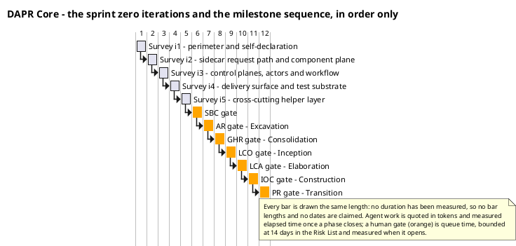
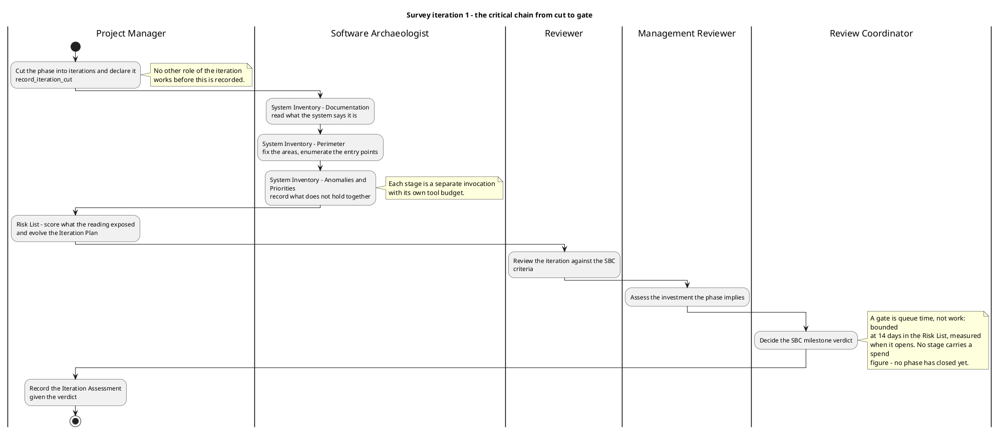

## Document Control

Phase: Survey
Status: Draft — iteration 1 of the phase, cut declared
Milestone Target: end-of-Survey milestone (SBC) — not yet achieved

## Iteration Objectives

Survey iteration 1 establishes the perimeter of the existing system and records what the system declares itself to be. The unit of scope in the sprint zero is the **area of the repository**, not a use case: no use case enters this plan.

| # | Objective | Exit criterion |
|---|---|---|
| O1 | The perimeter of the existing system is fixed: every executable, every API surface, every protocol contract and every control plane is enumerated with the path it was read from | The System Inventory "Perimeter" stage names each area it read and each entry point it found, with `Source:` anchors |
| O2 | What the system declares about itself is recorded: its architectural decision record set, its versioned release history, its stated contribution and release procedure | The System Inventory "Documentation" stage reports the 23 decision records under `docs/decision_records/`, the release history under `docs/release_notes/` and the toolchain fixed in `go.mod` as evidence, each with its path |
| O3 | What does not hold together in the reading is written down and ordered | The System Inventory "Anomalies and Priorities" stage records each anomaly under an `AN-NNN` label and orders the remaining areas |
| O4 | The work left in the phase is cut into iterations, each area in exactly one iteration | The cut below is in this document and recorded with the process service before any other role of the iteration reads |

O1–O3 are the Software Archaeologist's; O4 is this iteration's act of initiation and is complete when the cut is declared.

## Plan and Milestones
The coarse roadmap below is cross-iteration: the milestone sequence of the project, and the cut that assigns every repository area to exactly one iteration of the sprint zero. The fine plan that follows it is bounded to this iteration.

### Coarse roadmap — the milestone sequence of the project

| Milestone | Closes | What the milestone asserts | Reviewers, in order |
|---|---|---|---|
| SBC | Survey | The perimeter of the existing system is confirmed and its priorities are ordered | Reviewer, Management Reviewer, Review Coordinator |
| AR | Excavation | The existing system's architecture, data and use cases are recovered into the CORE artifacts they belong to | Reviewer, Management Reviewer, Review Coordinator |
| GHR | Consolidation | Every use case is recovered, coverage is counted, the Supplementary Specification is complete | Reviewer, Management Reviewer, Review Coordinator |
| LCO | Inception | The declared scope is bounded, the candidate architecture is agreed and the business case is made | Reviewer, Business Reviewer, Management Reviewer, Review Coordinator |
| LCA | Elaboration | The architecture baseline is executable and the highest-magnitude risks are retired | Reviewer, Business Reviewer, Management Reviewer, Review Coordinator |
| IOC | Construction | The declared scope is implemented and the iteration baseline holds | Reviewer, Management Reviewer, Review Coordinator |
| PR | Transition | The release is deployed and accepted | Reviewer, Management Reviewer, Review Coordinator |

The sprint zero runs SBC, AR and GHR before Inception opens. The Business Reviewer does not work in the sprint zero: Business Modeling is inactive for this project (Development Case §2).

### Coarse roadmap — the cut of the sprint zero

The cut orders the repository by what the reading itself needs first, and once an iteration has read, by what its Coverage records. The system's own statement of itself — its decision records, its protocol contracts, its release history — is read before any code, because every later area is read against it.

**What Survey iteration 1 read.** Forty-eight files opened of the 622 the fifteen slice areas hold, plus ten files outside the slice opened to close a perimeter fact, an anomaly's evidence or a comparison. Thirteen of the fifteen areas were reached; `go.sum` and `img` were not.

| Measure of iteration 1 | Count | Basis |
|---|---|---|
| Areas of the slice | 15 | The declared cut |
| Areas reached | 13 | System Inventory, Coverage — every area at one file or more |
| Areas not reached | 2 — `go.sum`, `img` | System Inventory, Coverage: zero files opened in each |
| Files opened of the files those areas hold | 48 of 622 | System Inventory, Coverage count |
| Files opened outside the slice | 10 | System Inventory, Coverage, the rows after the slice |
| Files in the repository | 6 629 | the tree call recorded in the System Inventory |

**The remainder, counted.** The two areas not reached return to the remainder and are carried by Survey iteration 2's slice. Areas in the remainder: 57 — the 55 the cut assigns to i2 through i5, plus `go.sum` and `img`. Areas this iteration read: 13. At the area size this iteration ran, 57 ÷ 13 = 4.4 further iterations; the cut already holds 4, and the 0.4 is two areas of four files between them, absorbed into i2's slice. The five iterations of Survey therefore hold, and the [ASSUMPTION] marks on the area counts are dropped: the counts in the table below are what the reading measured, not what was assumed when the cut was declared. If i2's enlarged slice overruns, the remedy is R001's — one more iteration, never less scope — and never more agent roles in parallel.

| Iteration | Areas the iteration takes, in the order to take them | What the iteration establishes | Basis of the split |
|---|---|---|---|
| **Survey i1** — read 13 of its 15 | `README.md`, `RELEASE.md`, `SECURITY.md`, `GOVERNANCE.md`, `CONTRIBUTING.md`, `CODEOWNERS`, `LICENSE`, `go.mod`, `docs/`, `dapr/`, `pkg/proto/`, `cmd/`, `.github/`; not reached: `go.sum`, `img` | The perimeter and the system's self-declaration: the 23 decision records under `docs/decision_records/`, the protocol contracts under `dapr/proto/`, the 6 executables under `cmd/`, the 25 CI workflows under `.github/workflows/`, the release history under `docs/release_notes/` and the toolchain the tree fixes | The documents and the contracts are the smallest surface that defines the system's boundary, and every later area is read against them |
| **Survey i2** — 16 areas | `go.sum`, `img` — carried from i1 — then `pkg/api/`, `pkg/messaging/`, `pkg/channel/`, `pkg/components/`, `pkg/resiliency/`, `pkg/middleware/`, `pkg/config/`, `pkg/diagnostics/`, `pkg/metrics/`, `pkg/healthz/`, `pkg/ports/`, `pkg/modes/`, `pkg/apphealth/`, `pkg/cors/` | The sidecar's request path and component plane: how an application's call becomes a component operation, and what it dispatches into. `pkg/api/` is read whole: iteration 1 opened 5 of its 124 files, enough to name the entry points and not enough to state what an operation does | The request path is the system's primary entry surface and the component registries are what it dispatches into; the two are read together or neither is legible |
| **Survey i3** — 11 areas | `pkg/actors/`, `pkg/runtime/`, `pkg/placement/`, `pkg/scheduler/`, `pkg/sentry/`, `pkg/security/`, `pkg/operator/`, `pkg/injector/`, `pkg/acl/`, `apis/`, `client/` | The control planes and the stateful abstractions: actor placement and reminders, job scheduling, the trust domain, resource reconciliation, the workflow engine and the access-control layer | Each is a separate process with its own leadership, contracts and failure modes, so they are read as one slice. `pkg/runtime/` lands here rather than in i2 because its hot-reload, compstore, authorizer, scheduler and wfengine subtrees are what these control planes bind together — the request path in i2 reaches only its processor subtree |
| **Survey i4** — 17 areas | `charts/`, `docker/`, `tests/`, `grafana/`, `swagger/`, `platforms/`, `tools/`, `pkg/testing/`, `Makefile`, `.golangci.yml`, `.prettierrc.json`, `.codecov.yaml`, `.devcontainer/`, `.build-tools/`, `.gitattributes`, `.gitignore`, `.prettierignore` | The delivery surface and the test substrate: how the six binaries are deployed, how the layered suites execute, and which conventions the kept code follows | Deployment is a first-class concern of this system and the suites are the only empirical statement of its behaviour; both are read once the systems under test are known. This is the largest slice — 2 261 integration suite files and 631 perf files under `tests/` — and its overrun is R001 |
| **Survey i5** — 13 areas | `internal/`, `utils/`, `pkg/backoff/`, `pkg/buildinfo/`, `pkg/encryption/`, `pkg/expr/`, `pkg/messages/`, `pkg/outbox/`, `pkg/responsewriter/`, `pkg/retry/`, `pkg/scopes/`, `pkg/sse/`, `pkg/validation/` | The shared helper layer the request path and the control planes both draw on | These packages expose no entry point of their own; they are read last, once the callers that justify them are known |

Counted once, the areas sum to 70 — the count the cut declared, with nothing dropped and nothing read twice: 13 read in i1, plus the 14 i2 held and the 2 i1 did not reach, plus 11, 17 and 13. A further iteration takes exactly what the SBC review leaves open — the Review Record's findings and the actions it sets — and nothing else. The phase iterates while the cut holds an area or the record holds a finding open; it does not iterate because a calendar says so.

The iteration count of the sprint zero is set by the cut of the existing system, not by the rubber profile: that profile distributes the iterations of the RUP phases and is not applied to the reading of a 6 629-entry repository.

### Fine plan — Survey iteration 1

| # | Work item | Owner | Input | Output | Exit condition |
|---|---|---|---|---|---|
| W1 | Declare the cut of the phase | Project Manager | This plan; the repository tree | Cut recorded with the process service | The cut is recorded and no other role of the iteration works before it |
| W2 | Read what the system says it is | Software Archaeologist | `README.md`, `docs/decision_records/`, `docs/release_notes/`, `docs/development/`, `docs/CONTRIBUTING.md`, `go.mod`, `RELEASE.md`, `SECURITY.md`, `GOVERNANCE.md`, `CONTRIBUTING.md`, `CODEOWNERS` | System Inventory — Documentation | Every claim carries `Source: <path>`; the 23 decision records are reported as evidence and are not renumbered into the project's identifier families |
| W3 | Fix the perimeter and enumerate the entry points | Software Archaeologist | `cmd/`, `dapr/proto/`, `.github/` | System Inventory — Perimeter | Every executable, every API surface and every protocol contract is enumerated and labelled `EP-NNN`, each with its `Source:` anchor |
| W4 | Record the anomalies and order what remains | Software Archaeologist | W2, W3 outputs | System Inventory — Anomalies and Priorities | Each anomaly is labelled `AN-NNN` with its anchor; the areas still to read are ordered |
| W5 | Score the risks the reading exposed and evolve this plan | Project Manager | System Inventory, this plan | Risk List; evolved Iteration Plan | Every risk carries probability, impact, magnitude, strategy and owner; every anomaly carries at least one |
| W6 | Review the iteration against the SBC criteria | Reviewer, Management Reviewer, Review Coordinator | Iteration increments | Review Record; milestone verdict | The verdict is issued; a Critical finding escalates to the stakeholder and the milestone does not close |

No work item is given a size. Nothing in this project has been measured — no phase has closed — so there is no actual to size against, and no unit of person-duration exists in this system to express one in. What iteration 1 read is counted above in files and areas: that is what this phase measures, it is not a rate to project, and no iteration forecast is derived from it.

The chain above is the whole of Survey iteration 1's work: five agent stretches in sequence, with the gate at the end. The three review and verdict states are a human gate, not agent work — they are bounded in the Risk List and measured when they open, never forecast here.

## Resources

| Role | Discipline | Stages this iteration | What it produces |
|---|---|---|---|
| Process Engineer | Environment | Already ran before this iteration opened | Development Case — ready; the Environment checkpoint for the iteration is satisfied |
| Project Manager | Discovery, Project Management | Cut; then Risk List and Iteration Plan; then the Iteration Assessment after the verdict | Iteration Plan, Risk List, Iteration Assessment |
| Software Archaeologist | Discovery | Documentation; Perimeter; Anomalies and Priorities | System Inventory |
| Reviewer | — | Milestone review | Review Record findings against the SBC criteria |
| Management Reviewer | — | Milestone review | Investment assessment of the phase |
| Review Coordinator | — | Milestone review | The SBC verdict |

Roles that do **not** work in Survey: System Analyst, Requirements Specifier, Software Architect, Designer, Database Designer, User Interface Designer, Capsule Designer, Implementer, Integrator, Test Manager, Test Analyst, Test Designer, Tester, Deployment Manager, Technical Writer, Configuration Manager, Change Control Manager, Business Process Analyst, Business Reviewer, Code Reviewer. Their first phase is Excavation or later, per the inherited process. The Business Process Analyst and the Business Reviewer do not work in any phase (Development Case §2); the Capsule Designer does not either (§3).

No role is added to the phase to shorten it. Parallelism across the reading would put two roles on the same area, and the second would be re-reading what the first already wrote.

## Use Cases and Scenarios Addressed

None. No use case enters the plan in Survey: the phase's scope unit is the area of the repository listed in the cut above. Use cases are recovered in Excavation from the entry points this iteration labels `EP-NNN` — the Use-Case Model traces each recovered use case to the entry point that performs it.

| Phase | Scope unit | Where it is planned |
|---|---|---|
| Survey | Repository area | This plan, "Coarse roadmap — the cut of the sprint zero" |
| Excavation | Entry point `EP-NNN`, recovered use case | The Excavation Iteration Plan |
| Consolidation and later | Declared use case, risk-driven selection | Each phase's Iteration Plan, chosen by risk and coverage |

## Evaluation Criteria

| Criterion | Threshold | Evidence |
|---|---|---|
| Perimeter confirmed | Every executable under `cmd/`, every API surface and every protocol contract under `dapr/proto/` is enumerated, each with a `Source:` anchor | System Inventory — Perimeter |
| Priorities ordered | The areas still to read are ordered, with the ordering stated | System Inventory — Anomalies and Priorities |
| Traceable reading | No element of the System Inventory is stated without the path and lines it was read from | System Inventory, all three stages |
| Cut held | Every area listed in the cut belongs to exactly one iteration; no area of the tree is left uncut | This plan's cut table; the recorded cut |
| No invented figures | No token spend, elapsed time or forecast appears anywhere in the phase's artifacts, because no phase has closed | This plan; the Risk List |
