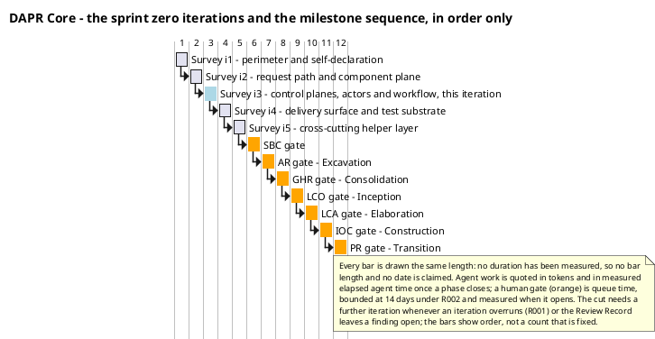
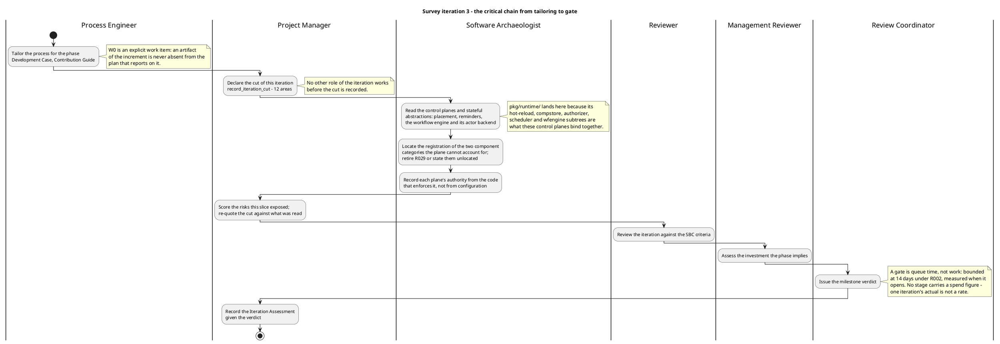

## Document Control
Phase: Survey

Status: Draft — iteration 3 of the phase, issued 2026-11-27. The verdict on iteration 2 was SBC: iteration REQUIRED, and `Iteration Plan#F3` is reworked in "Risk-driven sequencing": R017 rests on the allowlist map as the access-control surface with no claim about `pkg/api/universal/`, R019 sits on this iteration where `pkg/scheduler/` — the area its own mitigation names — is read, R028 rests on `pkg/api/http/server.go`, and every placement names an area the iteration it sits on opens. The cut assigns this iteration 12 areas and 30 remain across the two iterations that follow (17 + 13), the 12 being 11 control-plane areas plus `pkg/diagnostics/`, re-cut here from iteration 2 where it was assigned and declared unread in full. Of the 70 areas the cut holds, 13 were read at i1, 15 of iteration 2's 16 at i2 with `pkg/diagnostics/` counted here instead, and 12 in this iteration; every area sits in exactly one iteration. Read figures are quoted from the System Inventory's Coverage, each reproducing from the files enumerated on its own row: iteration 1 opened 48 of the files its 13 assigned areas hold and 12 more outside its slice, 60 distinct; iteration 2 opened 20 files it had not opened before — 18 across the fifteen of its 16 assigned areas that yielded a file, and 2 in iteration-1 areas it extended — plus 8 outside its slice, 28 distinct, and re-opened 3; iteration 3 opened 27 files in its 12 areas and 3 outside its slice, 30 distinct, and re-opened 3. The phase stands at 118 distinct files of the tree's 6 631 entries. The Risk List holds 32 risks: 27 placed each on the iteration that confronts them, 5 on the reading as a whole where no area retires them. No work-item size anywhere, because no phase has closed and there is no measured actual to size against; two iterations of this phase have closed and each one's measured spend is reported as that iteration's own fact, never as a rate. The SBC milestone is not judged.

Milestone Target: end-of-Survey milestone (SBC) — not yet achieved

## Iteration Objectives
Survey iteration 3 reads the control planes, the stateful abstractions and the workflow engine — the processes and stores the request path of iteration 2 dispatches into. The unit of scope in the sprint zero is the **area of the repository**, not a use case: no use case enters this plan.

| # | Objective | Exit criterion |
|---|---|---|
| O1 | The scheduler's authority is recorded from the code that enforces it, not from its configuration | `pkg/scheduler/` is read; `ReportActorTypes` answered as placement leader under `--placement-enabled` and the capability advertisement a mixed-version cluster is kept on one authority by are each stated with file and lines. The sourceless `dapr.proto.scheduler.v1` failure-policy family is settled against what the server honours, or recorded as still open with the reason it could not be settled here — `R019` names which. No statement of the scheduler's authority rests on a flag's name |
| O2 | The component plane is completed: the two categories iteration 2 could not account for are located or stated unlocated | The registration of `workflow` and `workflowbackend` is anchored with file and lines in `pkg/runtime/wfengine/` and `pkg/actors/`, or the two are stated as unlocated with the reading that failed to find them. `R029` and `System Inventory#F4` both turn on this statement, and either outcome closes them |
| O3 | The stateful abstractions are stated as the mechanisms in force | The placement service's Raft leadership, actor table and dissemination are stated as what serves a cluster without the scheduler, with the cutover contract between them read from code; the actor runtime's host, table, reminders and reentrancy are anchored; the workflow engine's retention and coverage are recovered from the code and the suites that contradict `pkg/runtime/wfengine/README.md` — `R014`, `R024`, `R026` |
| O4 | The trust domain and the resource plane are anchored | `pkg/sentry/` and `pkg/security/` are stated with the files that enforce the CA, trust bundle, SPIFFE identities and token validation; `pkg/operator/`, `pkg/apis/` and `pkg/client/` are stated for the seven resource kinds, with the generated clientset named as generated; `pkg/injector/`'s decline-or-patch decision and `pkg/acl/`'s policy extractor are anchored |
| O5 | The monitoring modules are read against the operations they instrument | `pkg/diagnostics/` is read — the area iteration 2 assigned and declared unread in full — and each module is stated against the operation this phase has read. A module that instruments an operation no iteration of this phase read is declared so rather than counted as reached |
| O6 | The remainder of the phase is cut and declared before any other role of the iteration reads | The cut is in this document and recorded with the process service — 12 areas this iteration, 30 across the two that follow; each area in exactly one iteration, and `pkg/diagnostics/` re-cut here rather than counted as reached at i2 |

O1–O5 are the Software Archaeologist's reading; O6 is this role's act of initiation and is complete — the cut is recorded with the process service, 12 areas of this iteration and 3 iterations in the cut.

The depth these objectives ask for is the depth a priority needs, not the whole area. `pkg/runtime/` holds 308 files and `pkg/actors/` 243; what closes O2 and O3 is the wfengine and workflow-target subtrees and the registration they perform, not every guard and fake in the tree. An area opened short of its file count says so in Coverage, and that depth belongs to Excavation.

O1 carries the "settled or recorded open" clause deliberately. `R019` asks a question the code may not answer — a family of committed bindings with no `.proto` behind it — and an objective that demanded a settled answer would push the reading to state one the tree does not support. The exit criterion accepts an honest "still open, and here is why"; what it forbids is a silent one.
## Plan and Milestones
The coarse roadmap below is cross-iteration: the milestone sequence of the project, and the cut that assigns every repository area to exactly one iteration of the sprint zero. The fine plan that follows it is bounded to this iteration.

### Coarse roadmap — the milestone sequence of the project

| Milestone | Closes | What the milestone asserts | Reviewers, in order |
|---|---|---|---|
| SBC | Survey | The perimeter of the existing system is confirmed and its priorities are ordered | Reviewer, Management Reviewer, Review Coordinator |
| AR | Excavation | The existing system's architecture, data and use cases are recovered into the CORE artifacts they belong to | Reviewer, Management Reviewer, Review Coordinator |
| GHR | Consolidation | Every use case is recovered, coverage is counted, the Supplementary Specification is complete | Reviewer, Management Reviewer, Review Coordinator |
| LCO | Inception | The declared scope is bounded, the candidate architecture is agreed and the business case is made | Reviewer, Business Reviewer, Management Reviewer, Review Coordinator |
| LCA | Elaboration | The architecture baseline is executable and the highest-magnitude risks are retired | Reviewer, Business Reviewer, Management Reviewer, Review Coordinator |
| IOC | Construction | The declared scope is implemented and the iteration baseline holds | Reviewer, Management Reviewer, Review Coordinator |
| PR | Transition | The release is deployed and accepted | Reviewer, Management Reviewer, Review Coordinator |

The sprint zero runs SBC, AR and GHR before Inception opens. The Business Reviewer does not work in the sprint zero: Business Modeling is inactive for this project (Development Case §2).

### Coarse roadmap — the cut of the sprint zero

The cut orders the repository by what the reading itself needs first, and once an iteration has read, by what its Coverage records. The system's own statement of itself was read in iteration 1, because every later area is read against it. This iteration takes the control planes, the stateful abstractions and the workflow engine, because the request path read in iteration 2 dispatches into components whose lifecycles, leadership and state these planes own — and because the two component categories the plane could not account for are registered in their code.

**The cut is what each closed iteration actually read.** Areas are restated at the count the iteration reached, not the count it was assigned.

| Iteration | Areas assigned | Areas reached | What that means for the cut |
|---|---|---|---|
| Survey i1 — closed | 13 — `.github`, `CODEOWNERS`, `CONTRIBUTING.md`, `GOVERNANCE.md`, `LICENSE`, `README.md`, `RELEASE.md`, `SECURITY.md`, `cmd`, `dapr`, `docs`, `go.mod`, `pkg/proto` | 13 | Five were opened short of their file count — `.github`, `cmd`, `dapr`, `docs`, `pkg/proto`. That depth is not a Survey remainder: it is the System Inventory's Priorities order and it is Excavation's. Re-opening an area an iteration already read would put one area in two iterations |
| Survey i2 — closed | 16 — `go.sum`, `img`, `pkg/api`, `pkg/messaging`, `pkg/channel`, `pkg/components`, `pkg/resiliency`, `pkg/middleware`, `pkg/config`, `pkg/diagnostics`, `pkg/metrics`, `pkg/healthz`, `pkg/ports`, `pkg/modes`, `pkg/apphealth`, `pkg/cors` | 15 | Fifteen yielded a file; `pkg/diagnostics/` was declared unread in full — a monitoring module is legible only against the operation it instruments. It is re-cut to this iteration, where the code it instruments is read, rather than counted as reached |
| **Survey i3 — this iteration** | **12** — `pkg/scheduler`, `pkg/placement`, `pkg/runtime`, `pkg/actors`, `pkg/sentry`, `pkg/security`, `pkg/operator`, `pkg/apis`, `pkg/client`, `pkg/injector`, `pkg/acl`, `pkg/diagnostics` | — | The control planes and the stateful abstractions, plus the monitoring modules that instrument them |

**The remainder, counted.** The cut holds 70 areas. Thirteen were read in iteration 1 and 15 of iteration 2's 16, and the twelfth of iteration 2's unreached row — `pkg/diagnostics/` — is assigned to this iteration rather than counted at i2, so **30 remain across the two iterations that follow**: 17 in iteration 4 and 13 in iteration 5. These are counts of areas, not of files read and not a rate: whether the cut still holds is asked and answered at the close of each iteration from what that iteration read, and it is not projected from any earlier iteration. Should an iteration overrun, the remedy is `R001`'s — one more iteration, never less scope, and never more agent roles in parallel. No phase of this project has closed, so there is no measured actual to forecast a phase length from, and this plan states none.

| Iteration | Areas the iteration takes, in the order to take them | Files the areas hold | What the iteration establishes | Basis of the split |
|---|---|---|---|---|
| **Survey i3** — this iteration — 12 areas | `pkg/scheduler/`, `pkg/placement/`, `pkg/runtime/`, `pkg/actors/`, `pkg/sentry/`, `pkg/security/`, `pkg/operator/`, `pkg/apis/`, `pkg/client/`, `pkg/injector/`, `pkg/acl/`, `pkg/diagnostics/` | 901 | The control planes and the stateful abstractions: actor placement and reminders, job scheduling, the trust domain, resource reconciliation, the workflow engine and its actor backend, the access-control layer, and the monitoring that instruments them | Each is a separate process or a stateful abstraction with its own leadership, contracts and failure modes, so they are read as one slice. `pkg/scheduler/` is taken first because `R023` is the phase's third High risk and the placement service is read after the scheduler that took its authority. `pkg/runtime/` lands here because its hot-reload, compstore, authorizer, scheduler and wfengine subtrees are what these planes bind together — the request path of iteration 2 reached only its processor subtree. `pkg/diagnostics/` is re-cut here from iteration 2: it instruments the operations this slice's code performs |
| **Survey i4** — 17 areas | `charts/`, `docker/`, `tests/`, `grafana/`, `swagger/`, `platforms/`, `tools/`, `pkg/testing/`, `Makefile`, `.golangci.yml`, `.prettierrc.json`, `.codecov.yaml`, `.devcontainer/`, `.build-tools/`, `.gitattributes`, `.gitignore`, `.prettierignore` | 3 496 | The delivery surface and the test substrate: how the six binaries are deployed, how the layered suites execute, and which conventions the kept code follows | Deployment is a first-class concern of this system and the suites are the only empirical statement of its behaviour; both are read once the systems under test are known. This is the largest slice — 2 073 integration suite files and 631 perf files under `tests/`'s 3 335 — and its overrun is `R001` |
| **Survey i5** — 13 areas | `pkg/internal/`, `utils/`, `pkg/backoff/`, `pkg/buildinfo/`, `pkg/encryption/`, `pkg/expr/`, `pkg/messages/`, `pkg/outbox/`, `pkg/responsewriter/`, `pkg/retry/`, `pkg/scopes/`, `pkg/sse/`, `pkg/validation/` | 68 | The shared helper layer the request path and the control planes both draw on | These packages expose no entry point of their own; they are read last, once the callers that justify them are known |

Counted once, the areas sum to 70 — the count the cut declared, with nothing dropped and nothing read twice: 13 read in iteration 1, 15 of iteration 2's 16, 12 in this iteration, and the 17 and 13 the two remaining iterations hold. Every area is a path the tree shows; `.iari/` is not one of them, because it is what the owner tells this process and not part of the system. A further iteration takes exactly what the SBC review leaves open — the Review Record's findings and the actions it sets — and nothing else. The phase iterates while the cut holds an area or the record holds a finding open; it does not iterate because a calendar says so.

The iteration count of the sprint zero is set by the cut of the existing system, not by the rubber profile: that profile distributes the iterations of the RUP phases and is not applied to the reading of a 6 631-entry repository.

### The critical chain of this iteration

The chain above is the whole of Survey iteration 3's work: eight agent stretches in sequence, with the gate at the end. The three review and verdict states are a human gate, not agent work — bounded in the Risk List and measured when they open, never forecast here.

### Risk-driven sequencing — what each iteration is ordered to confront

The cut places work by where the risk sits, not by where the code sits. Each risk of the Risk List belongs to exactly one row below: **27 are placed on an iteration and 5 are carried by the reading as a whole**, because no area retires them. A placement names an area the iteration it sits on opens — an area this document declares unread is never cited as the reading that settles a risk. Risk ids and magnitudes are the Risk List's.

| Iteration | The risks it is sequenced to confront | Why at this point in the cut |
|---|---|---|
| i1 — closed | R011 (High), R016 (High), R009, R010, R020, R007, R008, R012, R018, R022, R015 | Two of the phase's three High risks and the five-document generation divergence are reachable from `docs/`, `dapr/`, `pkg/proto/` and `cmd/` and from nowhere else in the cut. Eleven risks, and they sit on areas no later iteration re-opens |
| i2 — closed | R017, R028 | The gRPC allowlist (R017) sits on `EP-002`, and `pkg/api/grpc/endpoints.go` — opened in iteration 1 and re-opened at i2 — is the map recorded as the access-control surface of the operations the request path fixes. Whether those operations are implemented in `pkg/api/universal/` is not a fact that iteration established, and the row claims nothing about that area. R028 is that iteration's own find: the public listener's middleware subset is in `pkg/api/http/server.go`, an area it read |
| **i3 — this iteration** | **R023 (High), R019, R014, R024, R026, R029, R030, R031, R032** | R023 is the phase's third High risk — one scheduler process, two authorities, negotiated from what peers report — and is the reason `pkg/scheduler/` is taken first, before the placement service it supersedes. R019 sits here because its mitigation names `pkg/scheduler/`: the failure-policy families are settled by reading what the scheduler converts and honours, and no other area of the cut states it. The two suites disabled by renaming (R014) and the registration-file count (R024) are read in `pkg/runtime/wfengine/` and `pkg/actors/`, both in this slice. R026 sits where its remedy is — the engine's retention and coverage, in `pkg/runtime/wfengine/` and `pkg/actors/targets/workflow/retentioner/`. R029 is confronted by the same two subtrees: the registration of the two component categories iteration 2 could not locate is in the code the workflow engine and its actor backend are built from. R030, R031 and R032 are the anomalies this slice recorded — the eleven document-less areas include `pkg/scheduler/`, `pkg/placement/`, `pkg/sentry/` and `pkg/acl/`, the seven resource kinds and the four missing client groups are read in `pkg/apis/` and `pkg/client/`, and the Subscription conversion is read in `pkg/apis/subscriptions/`. Their mitigation is a rule this reading already follows, which is why they are placed where it is applied rather than on a later area |
| i4 | R001, R013, R021, R025, R027 | Every risk whose exposure is in the delivery surface and the test substrate. R001 is the one that can turn that iteration into two, and its slice is the largest the cut holds. R025's harness parsing and R021's release action are both read in `tests/` and `charts/`. R027's chart half is settled here: `charts/` is this iteration's first area and `charts/dapr/charts/` is enumerated there for its seven subcharts rather than taken from the README's six. R027's documentation half needs no iteration below — the guide the index omits, `docs/development/preview-features.md`, was opened from its directory in iteration 1, and `.github/workflows/dapr.yml` was opened at i2 for the same reason, so both halves of `AN-022` are settled by a directory read and only its chart half is still owed |
| i5 | none | The helper layer carries no anomaly and exposes no entry point. It is read for the callers already known and adds no risk to the register |
| the whole reading, no area | R005, R006, R004, R003, R002 | R005 (repository files obeyed rather than recorded), R006 (an empty size filled with a unit nothing measures), R004 (decision records renumbered into project families) and R003 (the tree's toolchain stated as project policy) are avoided by the shape of every role's work order, not by any area's position in the cut. R002 is the gate itself, bounded at 14 days and measured when it opens |

This table is checked against the Risk List whenever either changes; a risk with no iteration against it is a risk the cut has not confronted. All 32 risks are accounted for — 27 placed on an iteration, 5 carried by the reading as a whole — and every placement names an area the iteration it sits on opens. The count is an arithmetic fact and an evidentiary one at the same time. A risk that genuinely cannot be confronted before Excavation is stated in its row as carried to that phase, not placed on an area this document declares unread; none of the 32 is in that state. The rework this iteration carries is a separate matter and is scheduled in "What this iteration carries as rework": the Review Record's findings are corrections to artifacts, not risks of the register, and none of them displaces a risk from its row above.

### What this iteration carries as rework, and where each item is worked

Only items still open enter this table. A finding its recording lens has closed is history and is not restated here.

| Item | Finding, and the lens that holds it | Worked in | State |
|---|---|---|---|
| Name the file that registers each of the fifteen component categories, state `workflow` and `workflowbackend` as registered by the engine's own actor backend, and move the paths not opened out of the anchor column | `System Inventory#F4` — Reviewer | This iteration, at its owner's end: `pkg/runtime/registry/registry.go`, `pkg/runtime/wfengine/backends/actors/actors.go` and `pkg/runtime/processor/manager.go` are all in this slice and were opened. The consuming end is applied as `R029`, on `AN-024` | Open; the reading that closes it is in this slice. Holds the SBC gate |
| Restate the risk-driven sequencing row to the risks this slice's reading actually confronts, and state the placed count truthfully | `Iteration Plan#F3` — Management Reviewer | This iteration, in this section | Reworked in place: R017 rests on the allowlist map with no claim about `universal/`, R019 sits here beside `pkg/scheduler/`, R028 rests on `pkg/api/http/server.go`, and 27 placed plus 5 whole-reading is stated in place of "all placed" |
| State the never-assigned count as twenty-three, or derive it from the rows at the foot of the Coverage table | `System Inventory#F1` — Management Reviewer | Owner's own next turn | Owed; Minor, holds no gate |
| Correct the Deployment Model evidence path to `pkg/modes/modes.go` and check the other rows of the same table | `Development Case#F1` — Reviewer | Owner's own next turn | Owed; Minor, holds no gate |

### Fine plan — Survey iteration 3

| # | Work item | Owner | Input | Output | Exit condition |
|---|---|---|---|---|---|
| W0 | Tailor the process for the phase: Development Case, and the Contribution Guide the owner carries in-tree | Process Engineer | The IARI baseline; the project's declared facts; the owner's `CONTRIBUTING.md` | Development Case | The Environment stage of the inherited process is satisfied before the reading opens; every §5.2 optional is recorded fired or not fired with its reason |
| W1 | Declare the cut of this iteration and of the remainder | Project Manager | This plan; the repository tree | Cut recorded with the process service | The cut is recorded and no other role of the iteration works before it |
| W2 | Read the scheduler as the single authority it has become, and record what it honours | Software Archaeologist | `pkg/scheduler/` — `server/`, `internal/placement/`, `internal/pool/`, `internal/cron/`, `internal/etcd/`, `api/failurepolicy.go`; `dapr/proto/scheduler/v1/scheduler.proto` | System Inventory — Documentation and Perimeter; Anomalies | The scheduler's authority is recovered from the code that enforces it, not from configuration: `ReportActorTypes` answered as placement leader under `--placement-enabled`, and the capability advertisement a mixed-version cluster is kept on one authority by. The sourceless failure-policy family is settled against what the server honours (`R019`), or recorded as still open with the reason. `R023` names the code it was read from |
| W3 | Read the placement service it supersedes, and the trust domain both bind | Software Archaeologist | `pkg/placement/`, `pkg/sentry/`, `pkg/security/` | System Inventory — Documentation; Anomalies | Placement's Raft leadership, actor table and dissemination are stated as the mechanism still in force for a cluster without the scheduler, and the cutover contract between them is stated from code. The trust domain — `pkg/sentry`'s CA, trust bundle, JWT and OIDC validators, and `pkg/security`'s SPIFFE and workload certificates — is anchored on the files that enforce it |
| W4 | Read the actor runtime and the workflow engine, and locate the two categories the plane cannot account for | Software Archaeologist | `pkg/runtime/` — `wfengine/`, `processor/`, `compstore/`, `hotreload/`, `scheduler/`, `registry/`, `actorstatestores.go`; `pkg/actors/` — `targets/workflow/`, `internal/placement/`, `table/` | System Inventory — Documentation; Anomalies | The registration of `workflow` and `workflowbackend` is located and anchored with file and lines, or the two are stated as unlocated with the reading that failed to find them — `R029` and `System Inventory#F4` turn on this statement either way. The two test suites disabled by renaming are read as packages (`R014`), the registration-file count is stated with its build tags (`R024`), and the engine's retention and coverage are recovered from the code and the suites that contradict its README (`R026`) |
| W5 | Read the resource plane the control planes serve, and the monitoring that instruments them | Software Archaeologist | `pkg/operator/`, `pkg/apis/`, `pkg/client/`, `pkg/injector/`, `pkg/acl/`, `pkg/diagnostics/` | System Inventory — Documentation; Perimeter; Anomalies | The seven resource kinds are stated with the operator's informer and watchdog behaviour and the generated clientset named as generated. The admission webhook's decline-or-patch decision is anchored (`EP-008`). The workflow policy extractor is anchored in `pkg/acl`. `pkg/diagnostics/` is read against the operations W2–W4 recovered, which is the reason iteration 2 deferred it; a module that instruments nothing this phase read is declared so |
| W6 | Score the risks this slice exposed, and name the role accountable for retiring each entry | Project Manager | System Inventory, the Risk List | Risk List | Every risk carries probability, impact, magnitude, strategy and an accountable role distinct from the register's custodian; every anomaly newly recorded here carries at least one risk; no risk is on `accept` at Significant or High magnitude without the stakeholder's granting answer. `R029` records what the reading found the two categories to be |
| W7 | Re-quote the reconciled figures and restate the cut against what was read | Project Manager | W2–W5 outputs; this plan | Iteration Plan | The slice table carries this iteration's reconciled counts and nothing earlier; the cut matches the recorded cut area for area and in order; whether the cut still holds is answered from this iteration's reading |
| W8 | Review the iteration against the SBC criteria | Reviewer, Management Reviewer, Review Coordinator | Iteration increments | Review Record; milestone verdict | The verdict is issued; a Critical finding escalates to the stakeholder and the milestone does not close |
| W9 | Record the Iteration Assessment given the verdict | Project Manager | Review Record; this iteration's objectives and evaluation criteria | Iteration Assessment | Every objective is stated met or missed, with the scope or plan adjustment the next iteration takes |

No work item is given a size. Two iterations of this phase have closed and each spend is recorded as that iteration's own measured fact — iteration 1 at 19 480 197 tokens and 0:36:59.0766494 of agent time, iteration 2 at 30 715 328 tokens and 0:48:19.7330924 — each with its gate queue time measured apart at 0:00:00. Neither is a rate: two iterations of a sprint zero whose reading is dominated by documents and manifests are not a velocity, and nothing is projected from them onto the slices that follow.

## Resources
| Role | Discipline | Stages this iteration | What it produces |
|---|---|---|---|
| Process Engineer | Environment | The Environment stage the inherited process runs at the head of the iteration — Development Case and Contribution Guide | Development Case — W0, an explicit work item so that an artifact of the increment is never absent from the plan that reports on it |
| Project Manager | Discovery, Project Management | Cut; then Risk List and Iteration Plan; then the Iteration Assessment after the verdict | Iteration Plan, Risk List, Iteration Assessment |
| Software Archaeologist | Discovery | Read the control planes and the stateful abstractions; locate the two unaccounted component categories; read the resource plane and the monitoring that instruments it; Anomalies and Priorities | System Inventory |
| Reviewer | — | Milestone review | Review Record findings against the SBC criteria |
| Management Reviewer | — | Milestone review | Investment assessment of the phase |
| Review Coordinator | — | Milestone review | The milestone verdict |

Roles that do **not** work in Survey: System Analyst, Requirements Specifier, Software Architect, Designer, Database Designer, User Interface Designer, Capsule Designer, Implementer, Integrator, Test Manager, Test Analyst, Test Designer, Tester, Deployment Manager, Technical Writer, Configuration Manager, Change Control Manager, Business Process Analyst, Business Reviewer, Code Reviewer. Their first phase is Excavation or later, per the inherited process. The Business Process Analyst and the Business Reviewer do not work in any phase (Development Case §2); the Capsule Designer does not either (§3).

No role is added to the phase to shorten it. Parallelism across the reading would put two roles on the same area, and the second would be re-reading what the first already wrote. The one role at work on the reading this iteration is the Software Archaeologist, because the slice is one connected surface — the control planes, the actor runtime that binds them and the workflow engine both depend on — and splitting it would split a fact between two accounts, which is the state `R029` exists to prevent.

This iteration is the phase's largest reading after the test substrate: 901 files across twelve areas, of which `pkg/runtime/` alone is 308 and `pkg/actors/` 243. That is a reason to read to a stated depth and declare the rest, not a reason to add a second reader.
## Use Cases and Scenarios Addressed

None. No use case enters the plan in Survey: the phase's scope unit is the area of the repository listed in the cut above. Use cases are recovered in Excavation from the entry points this phase labels `EP-NNN` — the Use-Case Model traces each recovered use case to the entry point that performs it.

| Phase | Scope unit | Where it is planned |
|---|---|---|
| Survey | Repository area | This plan, "Coarse roadmap — the cut of the sprint zero" |
| Excavation | Entry point `EP-NNN`, recovered use case | The Excavation Iteration Plan |
| Consolidation and later | Declared use case, risk-driven selection | Each phase's Iteration Plan, chosen by risk and coverage |

## Evaluation Criteria
| Criterion | Threshold | Evidence |
|---|---|---|
| Scheduler authority recorded from code | `pkg/scheduler/` read; `ReportActorTypes` answered as placement leader under `--placement-enabled` and the capability advertisement gating a mixed-version cluster each stated with file and lines; the sourceless failure-policy family settled against what the server honours or recorded open with the reason | System Inventory — Documentation and Anomalies |
| Component plane completed | The registration of `workflow` and `workflowbackend` anchored with file and lines, or both stated unlocated with the reading that failed to find them. `R029` restated to what the reading found, on `AN-024` | System Inventory — Documentation; Risk List — `R029` |
| Stateful abstractions stated as mechanisms in force | Placement's leadership, actor table and dissemination stated as what serves a cluster without the scheduler, and the cutover contract read from code; the actor runtime's host, table and reminders anchored; the engine's retention and coverage recovered from code and suites, with `wfengine/README.md` cited only as the document it contradicts (`R026`) | System Inventory — Documentation and Anomalies |
| Trust domain and resource plane anchored | `pkg/sentry/`, `pkg/security/`, `pkg/operator/`, `pkg/apis/`, `pkg/client/`, `pkg/injector/`, `pkg/acl/` each stated with the files read; the generated clientset named as generated; `EP-008`'s decline-or-patch decision anchored | System Inventory — Documentation and Perimeter |
| Monitoring read against what it instruments | `pkg/diagnostics/` read; each module stated against the operation this phase read, or declared as instrumenting an operation no iteration read. Not counted as reached on the strength of its file count | System Inventory — Documentation and Coverage |
| Cut held and declared | 12 areas this iteration, 30 across the two that follow, 70 distinct in the cut; each area in exactly one iteration and in the recorded order; `pkg/diagnostics/` in this iteration's row only, re-cut from iteration 2 where it was assigned and declared unread | This plan's cut tables and the recorded cut |
| Risks sequenced and accountable | Every risk of the Risk List is accounted for: **27 are placed on an iteration and 5 are carried by the reading as a whole**. A placement names an area the iteration it sits on opens; a whole-reading entry is one no area retires. Each risk names the role accountable for retiring it, distinct from the register's custodian. A risk carried past Survey says so in its row rather than resting on an area this document declares unread | This plan's "Risk-driven sequencing"; Risk List — every anomaly carried, every High and Significant risk on `avoid` |
| Rework carried, not restated as done | Each open finding against an artifact of this phase names the iteration and work item that closes it, and no finding closed by its recording lens is re-listed as open | This plan's "What this iteration carries as rework" against the Review Record |
| No figure the process did not measure | No work-item size, no rate, no phase-length forecast and no calendar date appears in this plan. An iteration's token spend, its elapsed agent time and its measured gate queue time are reported with the clocks apart and never summed; no phase has closed, so no forecast is derived from the two iteration actuals the phase holds | This plan; the Risk List's `R006` |

Each criterion is checkable against an artifact in the increment.

**What this iteration measures, and the decision each measurement serves.**

| Measurement | Decision it enables |
|---|---|
| Areas of the slice reached, and at what depth | Whether an area is read to the depth its priority needs or skimmed — and where it is short, whether that depth belongs to Excavation. `pkg/runtime/` and `pkg/actors/` are the two areas where this iteration's depth is most likely to fall short of the whole area |
| Files opened against the files the twelve areas hold (901) | Whether the control-plane slice can be closed from twelve areas or whether facts keep resolving outside it; a rising count outside the slice means the cut is drawn in the wrong place. This iteration opened 27 in-slice and 3 outside it |
| The `workflow` and `workflowbackend` question: located, or unlocated | Whether `R029` is restated to a located registration or the component plane stays open into Excavation. This is the single measurement this iteration exists to settle, and it has two admissible answers |
| Anomalies recorded, and the new ones this slice adds | Whether the reading is finding the system's incoherences or only describing it |
| Risks placed on an iteration whose area that iteration opens, read together with the risks carried by the reading as a whole | Whether the cut is ordered by risk at all, or only by convenience of location. A placement that names an area its iteration does not open is a risk the cut has not confronted; a whole-reading entry an area could retire is a risk placed nowhere. Checked when the Risk List is scored at W6 |

No value in the second column is filled before the read produces it. Two iterations of this phase have closed and each spend is recorded as that iteration's own measured fact — iteration 1 at 19 480 197 tokens and 0:36:59.0766494 of agent time, iteration 2 at 30 715 328 tokens and 0:48:19.7330924, each with gate queue time measured apart at 0:00:00. Neither is a rate and neither is projected onto this iteration's slice.

No rate is derived from any of these. They are counts of what an iteration read — not a velocity, and not a basis for projecting the length of the phase. Whether the cut suffices is asked at each iteration close from what that iteration read.

