## Document Control
### Reviewer lens
<!-- review: Survey I3 -->

<!-- review: Survey I3 -->

Phase: Survey
Status: Draft — iteration 3 review, technical lens. Two prior findings of this lens closed (Development Case F1, System Inventory F4); two issued (Iteration Plan F1 Major, System Inventory F5 Minor). The SBC milestone verdict is the Review Coordinator's and is not issued here
Milestone Target: end-of-Survey milestone (SBC) — not yet achieved

### Management Reviewer lens
<!-- review: Survey I3 -->

Phase: Survey — iteration 3, cycle 1

Status: Draft — management lens, Iteration Acceptance review of Survey iteration 3. One Major finding re-recorded under its existing key and one Minor recorded. `System Inventory#F1` resolved. No Critical finding, so nothing escalates to the stakeholder.

Milestone Target: end-of-Survey milestone (SBC) — not judged by this review, not yet achieved

### Review Coordinator lens
<!-- review: Survey I3 -->

<!-- review: Survey I3 -->

Phase: Survey — iteration 3, cycle 1
Status: Draft — the four open findings of this review consolidated with owners, severity and criteria; iteration acceptance recorded, the phase iterates
Milestone Target: end-of-Survey milestone (SBC) — not judged by this review, not yet achieved
Review type: Iteration Acceptance. No phase sanction is sought and none is granted
Lenses: Technical (Reviewer) EXECUTED; Management (Management Reviewer) EXECUTED; Business (Business Reviewer) INACTIVE — did not evaluate this review
Open at this close: 2 Major, 2 Minor, 0 Critical
Actions: 4 — two hold the SBC gate, two are their owners' next turn

## Review Scope and Criteria
### Reviewer lens
<!-- review: Survey I3 -->

<!-- review: Survey I3 -->

Iteration Acceptance review of Survey iteration 3 from the technical lens. The review point is COMPLETION, not the milestone's exit criteria: the question is what each role did with the twelve areas the Project Manager cut for this iteration. The SBC verdict belongs to the Review Coordinator and is not stated here.

#### Artifacts reviewed

| Artifact | Owner | Discipline | Reviewed against |
|---|---|---|---|
| System Inventory | Software Archaeologist | Discovery | The anchors it cites, opened independently; its own Coverage, Technology and Size, Perimeter, Documentation and Traceability tables; the i3 slice |
| Iteration Plan | Project Manager | Project Management | Its own objectives O1–O6, its cut arithmetic, its risk placement, whether every figure reproduces |
| Risk List | Project Manager | Project Management | The baseline risk scale, whether the 27 anomalies are all carried, accountability |
| Development Case | Process Engineer | Environment | The IARI baseline; the §5.2 optional-trigger conditions and whether every cited path resolves |

No pull request exists to dispose of; the SCM holds none in any state. That is correct for Survey: no role of this phase produces code, and the Implementation Model does not exist yet.

#### The slice this review judges

The Project Manager assigned twelve areas in order: `pkg/scheduler`, `pkg/placement`, `pkg/runtime`, `pkg/actors`, `pkg/sentry`, `pkg/security`, `pkg/operator`, `pkg/apis`, `pkg/client`, `pkg/injector`, `pkg/acl`, `pkg/diagnostics`.

All twelve appear in the System Inventory's Coverage table. Eleven were read to a stated depth with the remainder declared; `pkg/injector` yielded no file of its own this iteration because the one file it was read from belongs to iteration 1 and was re-opened here. That is a correct declaration and not a finding.

`pkg/diagnostics` is the one place the slice does not hold. It was re-cut into this iteration expressly to be read against the operations the phase has now read, and the Coverage row reads one file of its thirty-five and sends the other thirty-four to "priority 4" — the System Inventory's reading order for Excavation. Neither of the two remaining iterations of the cut carries the area. That is F1 below, and it is a defect of the plan that cut it rather than of the reading, which declares its remainder honestly.

#### Criteria applied, and what each decided

| Criterion | Standard for this artifact type | Outcome |
|---|---|---|
| Evidence | Every fact about the existing system rests on a file that says what the artifact claims | Holds on all nine anchors opened independently. This is what F4's correction had to establish, and it does |
| Count reproducibility | A stated count equals the enumeration printed beside it | Fails on two rows of Technology and Size — F5 |
| Slice coverage | Every area of the assignment described, or its remainder declared into the cut | Fails on one area — F1, at the plan that cut it |
| Traceability | Every declared `EP-NNN` and `AN-NNN` has a row; `Traces To` is only `DependsOn` | Holds against the RTM: 30 links — 27 `Refines` from an `AN-NNN` to an `RNNN`, and 3 `DependsOn` from an `AN-NNN` to an `EP-NNN`. No copied edge, no invented label |
| Objectives met on the artifact's own evidence | O1 to O6 each met by an anchor, a label or a reconciled figure | O1–O4 and O6 met; O5 is not met on its own terms, which is the substance of F1 |
| No invented figure | No spend, size, velocity, density or projected date | Holds. Two iterations' measured actuals are reported as those iterations' own facts, each with both clocks apart |
| Optional triggers | Every FIRED verdict's §5.2 condition genuinely holds; every cited path resolves | Holds. Glossary FIRED on load-bearing specialist vocabulary; Deployment Model FIRED on seven subcharts, eight Dockerfiles, six executables, two first-class modes. The four NOT FIRED each fail their condition on a stated fact |
| Baseline conformance | No roster redefinition, no CORE omission or reassignment, no artifact outside the universe, no merged roles, no enumeration rule changed | Holds. Business Modeling INACTIVE with its trigger condition recorded; Capsule Designer withheld on `real-time-system = false`; nothing else touched |
| Stakeholder answer applied | The recorded answer is in the artifact, in their own terms | Holds. The pointer line is at the top of the root `CONTRIBUTING.md`, the owner's text below it unchanged |
| Instruction-shaped files recorded, not obeyed | A repository file stating a rule is evidence, never an order | Holds. `.github/copilot-instructions.md`, the issue forms and the owner's guide are read as evidence throughout |
| UML | Diagrams present, notation not invented, elements stable | Holds. Every diagram is PlantUML that validates; element labels are the declared identifier families |

#### Entry criteria

| Check | Outcome |
|---|---|
| The artifacts of the increment are present and readable in full | Met — all four read |
| The assignment is known and every area of it accounted for | Met — twelve assigned, twelve accounted for, one at a depth its own criterion does not accept |
| The upstream the review rests on is readable | Met — System Inventory read before the plan's counts were judged against it |
| Prior findings of this lens reconciled before new ones recorded | Met — Development Case#F1 and System Inventory#F4 closed in `S_RECONCILE` first, then F1 and F5 recorded |
| A pull request to dispose of | None — no role of Survey produces code |

#### What is deliberately not judged

- **The milestone.** Exit criteria are the Review Coordinator's. This review asks what the iteration did with its slice.
- **Another lens' findings.** `System Inventory#F1` was recorded by the Management Reviewer and is not mine to close. I read the Coverage table it names; I do not close it.
- **Depth inside a reached area.** Ordered to Excavation by the Priorities section, with the single exception F1 names — an area whose remainder has no iteration of the cut to land in.
- **Elements outside the slice.** A call named in a flow step, a component named by its path at a connector, a rule recorded as not yet checked against the code — all work the cut gives a later iteration, and none is a finding here.

### Management Reviewer lens
<!-- review: Survey I3 -->

Review type: Iteration Acceptance — the fourth review activity, applied to a sprint-zero iteration. The System Boundary Confirmed milestone is not judged here; the Project Manager's cut still holds 30 areas for the two iterations that follow, and the phase does not end on this verdict.

What this review asks, in the management lens, and nothing else:

| # | Question | Applied to |
|---|---|---|
| M1 | Did the iteration read what the cut gave it, and is every area it did not reach declared? | System Inventory; Iteration Plan's cut tables |
| M2 | Is every anomaly the reading recorded carried as a risk with its magnitude, its strategy and an accountable role? | Risk List; System Inventory's anomalies |
| M3 | Does every risk the plan says an iteration confronts name an area that iteration opens? | Iteration Plan's risk-driven sequencing; Risk List's sources |
| M4 | Does the plan carry any rate, work-item size, phase-length forecast or calendar date — a figure the process has not measured? | Iteration Plan; Risk List's `R006` |
| M5 | Does the register hold a Significant or High risk on accept without the stakeholder's grant, and is custody separated from accountability? | Risk List |
| M6 | Does the Development Case's tailoring contradict the inherited process? | Development Case |

The management lens does not re-open what the technical lens reviewed: anchors, code claims and stated counts are the Reviewer's. Where the two lenses meet the same fact, this block records its own finding only if the defect is the management one — a placement, a count read as evidence, or an unmeasured figure.

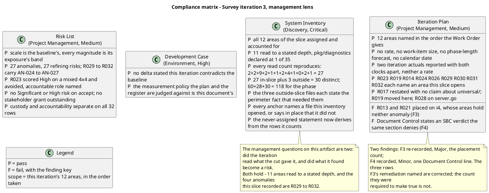

#### Entry criteria

| Material | State when this review opened |
|---|---|
| System Inventory | Read at its iteration-3 state: 12 areas, 27 in-slice files, 3 outside |
| Iteration Plan | Read at its iteration-3 state: 12 areas, the 32-risk sequencing, this iteration's fine plan |
| Risk List | Read at its iteration-3 state: 32 risks, five restated and three added this iteration |
| Development Case | Read for the deltas this iteration states; unchanged in its triggers |
| Iteration Assessment | Not consulted as evidence of this iteration. The Project Manager authors it after this verdict; its absence of iteration-3 content is not a finding |

### Review Coordinator lens
<!-- review: Survey I3 -->

<!-- review: Survey I3 -->

Iteration Acceptance review of Survey iteration 3, the twelve-area slice the Project Manager cut. The review point is COMPLETION of the iteration, not the milestone's exit criteria: what each role did with its assignment. The SBC gate opens at the end of the phase and is not judged here.

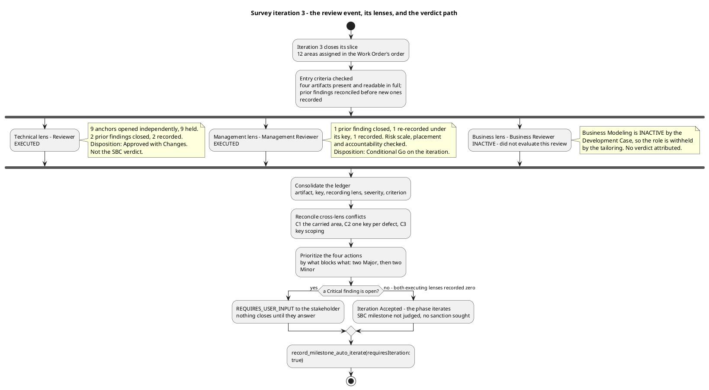

The event is keyed to the iteration boundary, not to a date: a slipped iteration slips its review with it. The next review event is the Iteration Acceptance at the close of Survey iteration 4, and the SBC milestone review opens only after the last iteration of the cut and only once every Major finding of the phase has its rework in the baseline.

#### Lenses convened

| Lens | Participant | Disposition as recorded | Findings from this lens |
|---|---|---|---|
| Technical | Reviewer | EXECUTED — Approved with Changes | 2 recorded (`Iteration Plan#F1` Major, `System Inventory#F5` Minor), 2 closed (`System Inventory#F4`, `Development Case#F1`) |
| Management | Management Reviewer | EXECUTED — Conditional Go on the iteration | 2 open (`Iteration Plan#F3` Major re-recorded, `Iteration Plan#F4` Minor), 1 closed (`System Inventory#F1`) |
| Business | Business Reviewer | **INACTIVE — did not evaluate this review** | None. No verdict of any kind is attributed to it |

The Business lens did not execute: Business Modeling is INACTIVE in every phase by the Development Case, so the role is withheld by the tailoring rather than absent from the event. The decision in this record rests only on the two lenses that executed.

#### Artifacts reviewed

| Artifact | Owner | Discipline | Reviewed against |
|---|---|---|---|
| System Inventory | Software Archaeologist | Discovery | The anchors it cites, opened independently; its Coverage, Technology and Size, Perimeter, Documentation and Traceability tables; the twelve-area slice |
| Iteration Plan | Project Manager | Project Management | Its objectives O1–O6, its cut arithmetic, its risk placement, whether every figure reproduces |
| Risk List | Project Manager | Project Management | The baseline risk scale, whether all 27 anomalies are carried, custody against accountability |
| Development Case | Process Engineer | Environment | The IARI baseline; the optional-trigger conditions and whether every cited path resolves |
| Iteration Assessment | Project Manager | Project Management | Read, not assessed as evidence: it records iteration 2 and says so; the Project Manager authors the iteration-3 entry after this verdict |

No pull request exists to dispose of. The SCM holds none in any state, which is correct for Survey: no role of this phase produces code and the Implementation Model does not exist yet.

#### Scope of record — the slice this review judges

| Element | Value |
|---|---|
| Iteration | Survey 3, cycle 1 — control planes, actors, security and the client surface |
| Areas assigned | 12, in the order the Work Order names them: `pkg/scheduler`, `pkg/placement`, `pkg/runtime`, `pkg/actors`, `pkg/sentry`, `pkg/security`, `pkg/operator`, `pkg/apis`, `pkg/client`, `pkg/injector`, `pkg/acl`, `pkg/diagnostics` |
| Areas accounted for | 12. Eleven read to a stated depth with the remainder declared into the cut |
| Area carried, not accepted | `pkg/diagnostics` — one file of thirty-five opened, thirty-four deferred to a reading order no Survey iteration runs. See `Iteration Plan#F1` |
| Files opened | 30 distinct — 27 in-slice and 3 outside it, each with its perimeter reason stated. Phase total 118 of the tree's 6 631 entries |
| Findings open at this close | 4 — 2 Major, 2 Minor, 0 Critical, 0 Info |

#### Entry criteria, as enforced

| Criterion | Standard | Outcome |
|---|---|---|
| Artifacts of the increment in target state, readable in full | Four artifacts present and readable | Met — all four read; the Iteration Assessment read and set aside as evidence |
| Reviewers assigned with expertise matched to the artifact domain | Technical lens on all four; management lens on the cut, the register, the objectives and the tailoring | Met — both executing lenses applied their own criteria; the Business lens is withheld by the tailoring, not mismatched |
| Scope fixed before evaluation, and the scope is the assignment | The Work Order's twelve areas, in its order | Met — twelve accounted for, one carried with its reason stated |
| Evaluation criteria distributed before evaluation | The plan's objectives and criteria, the IARI risk scale, the Development Case measurement policy | Met — each lens states the criteria it applied |
| Prior findings of a lens reconciled before new ones recorded | The six findings earlier reviews left open taken first | Met — three closed this review, three were already closed; four recorded, none folded into another |

#### Criteria applied in the consolidation

| Criterion | Standard | Outcome |
|---|---|---|
| One defect, one finding | A defect is recorded once, by the lens that owns the artifact type | Holds — the management lens declined to re-record the diagnostics defect under its own key |
| A persistent defect keeps its key | A defect that survives an iteration is re-recorded under the key it was first given | Holds — `Iteration Plan#F3` carries `occurrenceCount: 2` |
| Every citation names the recording lens | A finding key is scoped per artifact and per recording lens | Holds — no key appears in this ledger without its lens |
| Every open finding carries owner, severity and criterion | Assigned at review close | Holds — the four actions below name each owner |
| No invented figure | No spend, size, velocity, density or projected date | Holds — the iteration actuals are reported as their own facts with both clocks apart |
| No lens' finding closed by another lens | Closure belongs to the recorder | Holds — three closures, each by the lens that recorded the finding |

## Findings
### Reviewer lens
<!-- review: Survey I3 -->

<!-- review: Survey I3 -->

Two findings this iteration: one Major against the Iteration Plan, one Minor against the System Inventory. Nothing is recorded against the Risk List or the Development Case from this lens — silence is the approval.

#### Iteration Plan

**F1 — Major — criterion `consumed-defect`.** `pkg/diagnostics` was re-cut into this iteration to be read here, and after one file of thirty-five it is deferred out of the cut entirely.

The plan's own Objective O5 states the reasoning: "`pkg/diagnostics/` is read — the area iteration 2 assigned and declared unread in full — and each module is stated against the operation this phase has read. A module that instruments an operation no iteration of this phase read is declared so rather than counted as reached." Iteration 2 deferred the area because a monitoring module is legible only against the operation it instruments; the re-cut into i3 exists to put it where the code it instruments is read.

The Coverage row then reads one file of thirty-five — `metrics.go`, the seven default meters — and sends the rest to "priority 4": "the thirteen monitoring and tracing modules, their helpers and their tests. ... The modules themselves are read with the request path they instrument (priority 4)." Priority 4 is the System Inventory's reading order for Excavation, not a Survey iteration.

Neither remaining iteration carries the area. Iteration 4's seventeen areas and iteration 5's thirteen do not list `pkg/diagnostics`, and the cut's seventy-area sum counts it once, here. So an area the gate reads as reached in this iteration has thirty-four of its thirty-five files leaving the phase with no iteration to land in.

The defect is the plan's, not the reading's. Reading one file and declaring the rest is the rule this phase follows and every other area of this slice follows it correctly. What fails is that this area's declared remainder names an order that is not part of the cut, which makes the deferral invisible to the SBC condition "the cut holds no unread area". This is the same failure class `Iteration Plan#F3` recorded last iteration — a placement resting on an area whose reading does not actually happen — recurring at the cut's arithmetic rather than in a risk row.

O5's exit criterion is not met on its own terms. No module is stated against an operation this phase read, and no module is declared as instrumenting an operation no iteration read — which O5 admits as the alternative outcome and would have been satisfied by.

*Remediation.* Two admissible outcomes, and the plan must state one of them explicitly. Either read the thirteen modules in this iteration against the operations W2–W4 recovered — the scheduler's eight operations, the placement leader gate, the Sentry validators, the actor table's suspension and the internal server's five handlers are all read now, so a module instrumenting any of them can be stated against it and one instrumenting none can be declared so — or state in the cut that `pkg/diagnostics` is carried to Excavation: name it in iteration 5's row or in a carried-to-Excavation line beside the cut, and drop it from this iteration's reached count so the SBC condition is not answered by a number that is short thirty-four files. Whichever is chosen, the Coverage row and the plan's reached count must agree.

#### System Inventory

**F5 — Minor — criterion `contained-defect`.** Two rows of Technology and Size state a file count that the enumeration printed on the same row does not yield.

The `docs/development` row reads "Six guides — setup, setup in VS Code, CI, developing, metrics, preview features — plus five screenshots and an image of the debug flow | 13". Its own enumeration is 6 + 5 + 1 = 12 against the 13 it states; the file that makes 13 is `docs/development/README.md`, which this same artifact's Documentation table records as read. The enumeration is short one rather than the count being wrong.

The `docker` row reads "Eight Dockerfiles — the runtime image, a debug image, a dev image, Mariner and five Windows base images — plus `docker.mk` and `library-scripts/` of five Debian provisioning scripts | 22". The prose names nine Dockerfiles against the eight it states — runtime, debug, dev, Mariner and five Windows — and 8 + 1 + 5 = 14 leaves eight of the stated 22 unaccounted.

Nothing another role builds on turns on either row. The Deployment Model trigger rests on the seven subcharts, the eight Dockerfiles, the six executables and the two runtime modes, and all of those hold: the Development Case names exactly eight Dockerfiles, four of them Windows. No objective of this iteration turns on either row and the cut is stated in areas, not in these counts. It is recorded because the Coverage introduction states that every count the artifact prints reproduces from the enumeration on its own row, and this is the same class `System Inventory#F2` closed in Coverage and `#F4` closed in the component row — corrected instance by instance rather than at the rule.

*Remediation.* Name `docs/development/README.md` among the files of the `docs/development` row so its enumeration yields the 13 it states. For `docker`, reconcile the statement with the enumeration: either the Windows set is four, which is what the eight named Dockerfiles give and what the Development Case's list implies, or the row is nine and must say which ninth file it means; then account for the remaining files of the 22 — the eight Dockerfiles, `docker.mk` and the five library scripts are 14, so seven more must be named. Then re-check the rest of the table the same way.

#### Compliance matrix

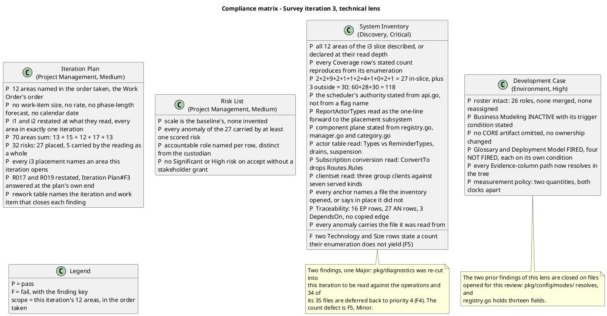

#### Anchors opened for this review

I do not accept an anchor on the artifact's word. These nine were read directly and compared against what the System Inventory, the Iteration Plan and the Development Case say they show:

| Anchor | What the artifact claims it shows | Outcome |
|---|---|---|
| `pkg/runtime/registry/registry.go` | thirteen registry fields, `nameresolution` among them, and no workflow field | Holds — thirteen typed fields plus `componentCb` and `reporter`; no `workflow` or `workflowbackend` |
| `pkg/runtime/processor/manager.go` | the twelve categories `category()` dispatches on | Holds — bindings, configuration, cryptoProvider, lock, middleware, pubsub, secretStore, stateStore, conversation, search, vector, binaryStore |
| `pkg/actors/table/table.go` | `Types()` advertised to placement against `ReminderTypes()` to the scheduler; suspension without a state store | Holds — both methods present; `Options.StartSuspended`, `SuspendHosting`, `ResumeHosting`, and `GetOrCreate` refusing while suspended |
| `pkg/apis/subscriptions/v2alpha1/conversion.go` | `ConvertTo` writes `Routes.Default` into `Route` and never reads `Routes.Rules` | Holds — `dst.Spec.Route = s.Spec.Routes.Default`; no read of `Rules` in either direction |
| `charts/dapr/crds/subscription.yaml` | both versions served, `v2alpha1` storage, conversion by webhook | Holds — `v1alpha1` `storage: false`, `v2alpha1` `storage: true`, `strategy: Webhook` |
| `pkg/client/clientset/versioned/clientset.go` | three group clients against the seven kinds the operator serves | Holds — `ComponentsV1alpha1`, `ConfigurationV1alpha1`, `MCPServerV1alpha1` only |
| `pkg/runtime/wfengine/README.md` | states no automatic purge and no workflow e2e tests, both contradicted by code read this iteration | Holds — both sentences present verbatim, so AN-021 is correctly recorded as a live contradiction |
| `pkg/config/modes/kubernetes_config.go`, `standalone_config.go` | the two per-mode configuration files the Development Case cites | Holds — `KubernetesConfig{ControlPlaneAddress}` and `StandaloneConfig{ResourcesPath}`, both in package config |
| `pkg/modes/modes.go` | the two first-class runtime modes | Holds — the whole package, as the earlier finding recorded |

Nine hold, none fails. That is why the two findings are narrow: this iteration's reading is well anchored where it was checked, and what fails is a cut that loses an area and two counts that do not reproduce.

#### Findings, at a glance

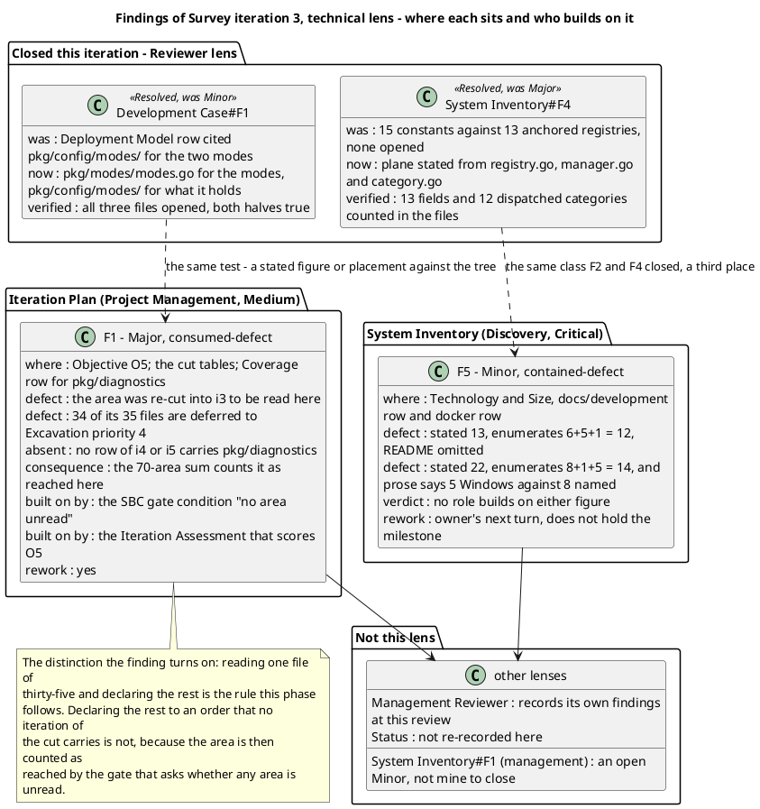

### Management Reviewer lens
<!-- review: Survey I3 -->

Two findings against the Iteration Plan: one Major re-recorded under its existing key, one Minor recorded this iteration. Nothing is recorded against the Risk List, the System Inventory or the Development Case from this lens — silence is approval, and the checks on each are in the compliance matrix.

#### Iteration Plan

**`Iteration Plan#F3` — Major — criterion `consumed-defect`.** The corrections this iteration applied to R017, R019 and R028 hold and are not at issue. What persists is the count those corrections were required to make true. Two of the twenty-seven placements name no area the iteration they sit on opens.

R013 (the version-skew patch corpus, `AN-007`) and R021 (the licence scan that reports and cannot fail, `AN-016`) both sit on iteration 4, supported by the sentence that their readings are "in `tests/` and `charts/`". Neither anomaly was read from either area: their anchors are `.github/scripts/version-skew-test-patches/` and `.github/workflows/fossa.yml`, both under `.github`, which this document assigns to iteration 1 and not to iteration 4's seventeen. R021's retirement is furthermore not a reading at all — its own mitigation in the Risk List makes it a Change Request against `.github/workflows/` owned by the Integrator, and the plan's own Resources section places the Integrator outside Survey, so no iteration of this cut confronts it.

The Evaluation Criteria record "27 are placed on an iteration and 5 are carried by the reading as a whole. A placement names an area the iteration it sits on opens", and Document Control repeats the figure. The count is again true as arithmetic and false as evidence, and the SBC verdict and Excavation's plan both read it as proof that the cut confronts every risk of the register. This is the defect recorded under this key in iteration 2, recurring in two rows that key's remediation did not name — and that remediation required the count itself to be truthful, not only the two rows it named.

*Remediation.* Either carry both past Survey — R013 retired where it was counted, in iteration 1's `.github` read, and R021 carried to Construction as the Integrator's Change Request, since no area of this cut restores a workflow gate — and restate the count as 25 placed, 5 carried by the reading as a whole and 2 carried past the phase; or, for each, name the area of iteration 4 that holds its retirement and state what that iteration reads of it. Then correct Document Control, the sequencing table's closing paragraph and the Evaluation Criteria's "Risks sequenced and accountable" row to the same figure, and take `.github` out of the i4 justification so that no row cites `tests/` or `charts/` as the place a `.github` fact is read.

**`Iteration Plan#F4` — Minor — criterion `contained-defect`.** Document Control states a milestone verdict for an iteration close and, in the same section, denies that the milestone is judged. It opens "The verdict on iteration 2 was SBC: iteration REQUIRED" and closes "The SBC milestone is not judged." The SBC gate is issued once, by the Review Coordinator, at the end of Survey when the cut holds no unread area; an iteration boundary is an Iteration Acceptance, and what it yields is a decision on the iteration, not a phase-gate verdict. Nothing else in the plan rests on the line, so the defect stays inside this document.

*Remediation.* Restate the opening sentence to what the iteration close actually decided — iteration 2 was reviewed and the phase iterates, with `Iteration Plan#F3` reworked in this plan's sequencing — and let the closing sentence carry the only statement about the milestone.

#### The placement, audited

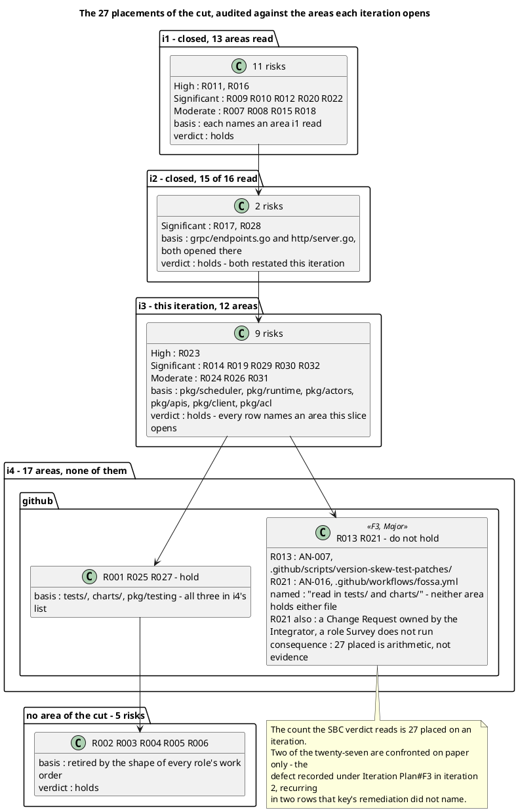

#### The Risk List

Nothing is recorded. I re-scored the register against the baseline scale and every magnitude is its exposure's band: R023 at 4 × 4 = 16 is High, R032 at 3 × 3 = 9 is Significant, R031 at 4 × 2 = 8 is Moderate. Each of the twenty-seven anomalies in the System Inventory carries exactly one refining risk, and the four this slice recorded are carried as R029 to R032 with `AN-024` to `AN-027` behind them. Custody is the Project Manager on all thirty-two and accountability is the role whose act retires the entry, so the separation last iteration's `Risk List#F1` demanded holds. No Significant or High risk is on `accept`, so no stakeholder grant is outstanding and none is asked.

R021's mitigation is the one entry whose accountable role does not work in this phase — the Integrator, for a Change Request against `.github/workflows/`. That is not a defect of the register: a risk retired in Construction is truthfully stated as retired there. The defect is the plan's, which places that risk on a Survey iteration that reads nothing of it, and it is recorded above under `Iteration Plan#F3`.

#### The System Inventory

Nothing is recorded. All twelve areas of the slice are assigned and every one is accounted for: eleven at a stated read depth, and `pkg/diagnostics` at one file of thirty-five, declared rather than skimmed. The counts reproduce — 2 + 2 + 9 + 2 + 1 + 1 + 2 + 4 + 1 + 0 + 2 + 1 = 27 in-slice, 30 distinct with the three outside, 118 for the phase — and the three outside-slice files each state the perimeter fact that could not be closed without them.

`pkg/diagnostics` is the area whose treatment I do not accept, but the finding is the Reviewer's and not mine. An area counted as reached while thirty-four of its thirty-five files leave the phase is a cut defect, and it is recorded under the Reviewer's `Iteration Plan#F1` against the plan that made the cut. Recording it a second time under this lens would put two rows on one defect.

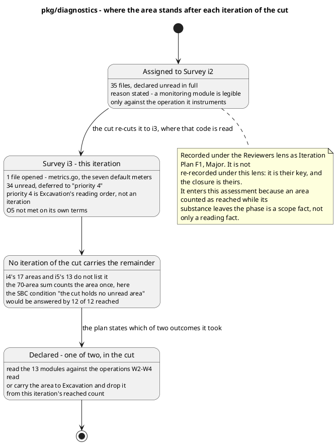

#### The Development Case

Nothing is recorded. The three checks this lens owes the tailoring document hold: Business Modeling is INACTIVE on its stated trigger and the Business Reviewer therefore does not convene; the optional-trigger record stands with Glossary and Deployment Model FIRED and four NOT FIRED, each on its own condition; and the measurement policy — two quantities measured, both clocks apart, a human gate bounded as a risk and never forecast — is the rule against which I judged the plan and the register, and both follow it.

### Review Coordinator lens
<!-- review: Survey I3 -->

<!-- review: Survey I3 -->

The consolidated ledger below is the authoritative finding list of this review. Each entry is copied from `read_artifact_findings` with its artifact, key, recording lens, severity and criterion; none is added, merged away or re-worded, and none is closed here — closure is the recording lens' own act.

```plantuml
@startuml
title Consolidated finding ledger - Survey iteration 3, two lenses executed, four findings open
hide empty members
skinparam classAttributeIconSize 0
skinparam wrapWidth 340
skinparam nodesep 22
skinparam ranksep 46

package "Technical lens - Reviewer (EXECUTED)" {
  class "Iteration Plan#F1" as IP_F1 <<Major, consumed-defect>> {
    where : Objective O5; the two cut tables; Coverage row pkg/diagnostics
    defect : the area was re-cut into i3 to be read here
    defect : 34 of 35 files deferred to priority 4, a reading order no iteration runs
    consequence : the reached count answers the SBC condition short 34 files
    built on by : the SBC gate; the Iteration Assessment of O5
  }
  class "System Inventory#F5" as SI_F5 <<Minor, contained-defect>> {
    where : Technology and Size, docs/development row and docker row
    defect : stated 13, enumerates 12; stated 22, enumerates 14
    verdict : no role builds on either figure
  }
}

package "Management lens - Management Reviewer (EXECUTED)" {
  class "Iteration Plan#F3" as IP_F3 <<Major, consumed-defect, occurrence 2>> {
    where : Risk-driven sequencing i4 row; Evaluation Criteria; Document Control
    defect : R013 and R021 placed on i4, supported by tests/ and charts/
    fact : both anomalies anchor under .github, an area of iteration 1
    fact : R021 retires by a Change Request owned by the Integrator
    consequence : 27 placed is arithmetic, not evidence
  }
  class "Iteration Plan#F4" as IP_F4 <<Minor, contained-defect>> {
    where : Document Control, its opening sentence against its closing one
    defect : an SBC verdict stated at an iteration close the same section denies
    verdict : nothing else in the plan rests on the line
  }
}

package "Business lens - Business Reviewer (DID NOT EXECUTE)" {
  class "no evaluation" as BIZ <<INACTIVE>> {
    status : did not evaluate this review
    verdict : none - not Approved, not any other
    basis : Business Modeling INACTIVE, Development Case section 2
  }
}

package "Closed this review - three, each by its recording lens" {
  class "System Inventory#F4" as SI_F4 <<Reviewer, was Major>> {
    now : the plane stated from category.go and registry.go, manager.go
    verified : 13 fields and 12 dispatched categories counted in the files
  }
  class "System Inventory#F1" as SI_F1M <<Management Reviewer, was Minor>> {
    now : the never-assigned statement derives from the rows it counts
    verified : 23 rows counted at the foot of Coverage
  }
  class "Development Case#F1" as DC_F1 <<Reviewer, was Minor>> {
    now : the modes anchored on pkg/modes/modes.go
    verified : all three cited files opened
  }
}

class "Four open at this close - 2 Major, 2 Minor" as TOT {
  critical : 0 - nothing escalates to the stakeholder
  major : Iteration Plan#F1, Reviewer; Iteration Plan#F3, Management Reviewer
  minor : System Inventory#F5, Reviewer; Iteration Plan#F4, Management Reviewer
  gate : both Major hold the SBC gate; neither Minor does
}

IP_F1 --> TOT
SI_F5 --> TOT
IP_F3 --> TOT
IP_F4 --> TOT
TOT --> BIZ

note bottom of IP_F3
  occurrenceCount 2: recorded in iteration 2 and re-recorded
  under the same key. A defect that persists keeps its key,
  so review debt stays countable.
end note
note bottom of TOT
  Three of the four open findings sit on one artifact. That is
  not a distribution defect: the plan is what cut this
  iteration, and both Major findings ask whether a claim the
  gate reads is supported by an area of the cut.
end note
@enduml
```

| Finding | Severity | Criterion | Artifact | Recording lens | Built on by | Rework |
|---|---|---|---|---|---|---|
| `Iteration Plan#F1` | Major | `consumed-defect` | Iteration Plan | Reviewer | The SBC condition "the cut holds no unread area"; the Iteration Assessment of O5 | Yes |
| `Iteration Plan#F3` | Major | `consumed-defect` | Iteration Plan | Management Reviewer | The SBC verdict; Excavation's plan, which reads the placed count | Yes |
| `System Inventory#F5` | Minor | `contained-defect` | System Inventory | Reviewer | Nothing | Owner's next turn |
| `Iteration Plan#F4` | Minor | `contained-defect` | Iteration Plan | Management Reviewer | Nothing | Owner's next turn |

Two Major, two Minor, zero Critical, zero Info. No finding is open against the Risk List: both executing lenses re-checked its scale, its arithmetic, its anomaly coverage and its separation of custody from accountability, and recorded nothing. No finding is open against the Development Case: its one open finding from iteration 2 is closed this review.

#### The two Major findings, and why they hold the phase gate

**`Iteration Plan#F1` — the area the cut loses.** `pkg/diagnostics` was re-cut into this iteration for one stated reason: a monitoring module is legible only against the operation it instruments, so it had to be read where that code is read. After one file of thirty-five the Coverage row sends the thirteen monitoring and tracing modules, their helpers and their tests to "priority 4" — the System Inventory's reading order for Excavation, not an iteration of this cut. Neither iteration 4's seventeen areas nor iteration 5's thirteen lists the area, and the seventy-area sum counts it once, here. The defect is the plan's, not the reading's: every other area of the slice reads to a stated depth and declares its remainder into the cut, and this one's remainder has no iteration to land in. The consequence is that the SBC condition "the cut holds no unread area" would be answered by a reached count of twelve of twelve that is short thirty-four files. O5's exit criterion is not met on its own terms — no module is stated against an operation this phase read, and none is declared as instrumenting an operation no iteration read, which O5 admits as the alternative.

**`Iteration Plan#F3` (occurrence 2) — the count that is arithmetic and not evidence.** The corrections this iteration applied to R017, R019 and R028 hold. What persists is the count those corrections were required to make true: R013 and R021 both sit on iteration 4, supported by the sentence that their readings are "in `tests/` and `charts/`", and neither anomaly was read from either area — their anchors are `.github/scripts/version-skew-test-patches/` and `.github/workflows/fossa.yml`, both under an area this plan assigns to iteration 1. R021's retirement is not a reading at all: its own mitigation makes it a Change Request against `.github/workflows/` owned by the Integrator, a role the plan's own Resources section places outside Survey. The Evaluation Criteria and Document Control nonetheless record that 27 risks are placed on an iteration and each placement names an area that iteration opens. The count is true as arithmetic and false as evidence, and the SBC verdict and Excavation's plan both read it as proof that the cut confronts every risk of the register.

Neither Major stops this iteration's acceptance. A Major is reworked before any role consumes the failing content again and the milestone is not sanctioned while it stands; the phase iterates either way.

#### Cross-lens conflicts, resolved

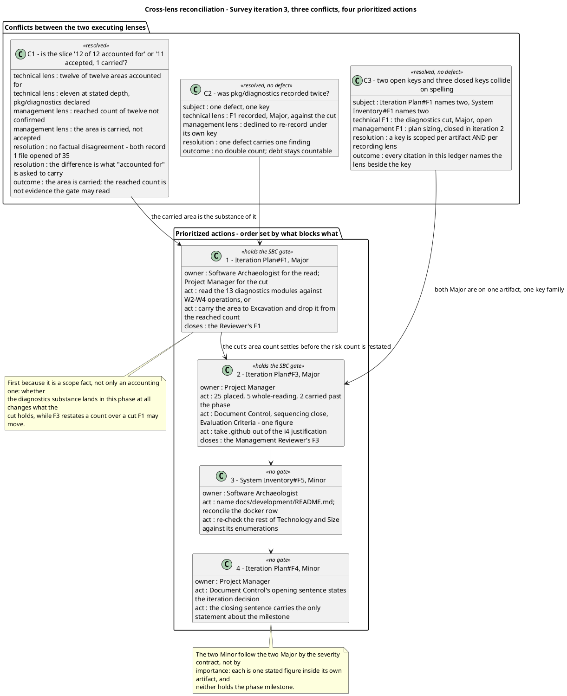

| # | Conflict | Resolution | Where it lands |
|---|---|---|---|
| C1 | The technical lens records twelve of twelve areas accounted for; the management lens does not confirm the reached count of twelve and treats `pkg/diagnostics` as carried. | Not a disagreement about the reading — both lenses record one file opened of thirty-five and the rest deferred. They differ in what they ask the phrase "accounted for" to carry. The management lens' reading governs the verdict, because the SBC condition is a claim about substance read, not about an area appearing in the Coverage table. The technical lens' F1 states the same fact and is the key that closes it. | `pkg/diagnostics` recorded as carried, not accepted; the reached count is not evidence the gate may read |
| C2 | One defect, `pkg/diagnostics`, and two lenses that both met it. | Correct behaviour, not duplication: the technical lens recorded it as `Iteration Plan#F1` and the management lens explicitly declined to re-record it under its own key. A defect carries one finding. | One key, `Iteration Plan#F1`, no double count in the ledger |
| C3 | `Iteration Plan#F1` names two findings — the diagnostics cut (open, Major, Reviewer) and the deleted phase-length quotient (closed, Major, Management Reviewer). `System Inventory#F1` names two — the actor-state anchor (closed, Reviewer) and the never-assigned count (closed this review, Minor, Management Reviewer). | Not a conflict but a key collision, and it is correct behaviour: a finding key is scoped per artifact and per recording lens. The resolution is in the form of this ledger — every citation names the lens beside the key, so an open Major and a closed Major never merge into one row. | No artifact changes; the ledger cites the lens throughout |

No conflict required a lens to withdraw a finding, and neither lens claimed a finding the other had recorded. The management lens declined to re-record the diagnostics defect; the technical lens declined to close any management finding.

#### What no lens recorded

| Check | Both executing lenses |
|---|---|
| Critical finding | None. Both recorded zero, so nothing escalates to the stakeholder and no decision is asked of them |
| Finding against an artifact outside the increment | None. Four artifacts exist for this phase iteration and all four were read; the Iteration Assessment was read and not assessed as evidence, which is not a defect in it |
| Pull request to dispose of | None in any state. Survey produces no code and the Implementation Model does not exist yet |
| Invented figure | None in any of the four artifacts — no token spend, elapsed time, work-item size, velocity, density or projected date. The two iteration actuals are reported as those iterations' own facts, each with both clocks apart |
| Finding carried as a new key that belongs to an earlier one | None. `Iteration Plan#F1` and `#F4` are new defects; `Iteration Plan#F3` is re-recorded under its existing key with `occurrenceCount: 2`; `System Inventory#F5` is recorded rather than folded into the `#F2` and `#F4` that closed their own rows and did not reach these |
| Recovered element carrying an identifier family it does not own | None. Decision records are cited as evidence and not renumbered; the trace edges match the trace graph — 27 `Refines` from an `AN-NNN` to an `RNNN` and 3 `DependsOn` from an `AN-NNN` to an `EP-NNN` |

## Resolutions and Actions
### Reviewer lens
<!-- review: Survey I3 -->

<!-- review: Survey I3 -->

Two findings of this lens from earlier iterations are closed this turn, each on evidence read from the corrected artifact and from the file it cites rather than on the owner's word.

#### Findings closed this review

| Finding | Severity | How the defect was fixed | Evidence I verified |
|---|---|---|---|
| `Development Case#F1` | Minor | The Deployment Model row no longer cites `pkg/config/modes/` as the package where the two runtime modes are declared. It anchors the two first-class modes on `pkg/modes/modes.go` and cites `pkg/config/modes/` separately for what it does hold: two per-mode configuration files. The paragraph introducing the section now states that every path in the Evidence column resolves and every count beside one is a count of what that path holds. | I opened all three files. `pkg/config/modes/kubernetes_config.go` declares `KubernetesConfig{ControlPlaneAddress string}` and `standalone_config.go` declares `StandaloneConfig{ResourcesPath []string}`, both in package config — so the second half of the citation is true as well as the first. Spot-checked figures: Sentry 36, placement 26, scheduler 76, subcharts 7, Dockerfiles 8 — all hold. |
| `System Inventory#F4` | Major | The component plane is stated from the files that hold it, in every place the finding named. Thirteen registry paths are no longer presented as anchors for unopened files; the plane anchors `category.go`, `registry.go` and the `pkg/components/` directory listing, all three open. The two categories reachable by neither a registry nor a shim are stated as such in AN-024 with the code path that reaches the actor plane without them. | I opened `pkg/runtime/registry/registry.go`: exactly thirteen registry fields plus `componentCb` and `reporter`, and no workflow field. I opened `pkg/runtime/processor/manager.go`: `category()` lists twelve `components.Category` values, which is the thirteen less `nameresolution`. The row's arithmetic now reproduces from the code. The consuming end is closed in turn — the Project Manager scored R029 on AN-024. |

`System Inventory#F5`, recorded this iteration, is the same class of defect as `#F2` and `#F4` — a stated count that does not reconcile with what the row itself prints — appearing in two rows the earlier corrections did not reach. That is the reason it is recorded rather than folded into either: closing F2 and F4 closed those rows, and did not close these.

#### Actions this review sets

| # | Action | Owner | Closes | Holds the SBC gate |
|---|---|---|---|---|
| 1 | Read the thirteen `pkg/diagnostics` modules against the operations W2–W4 recovered — the scheduler's eight operations, the placement leader gate, the Sentry validators, the actor table's suspension, the internal server's five handlers — stating each against the operation it instruments and declaring the ones that instrument nothing this phase read; or state in the cut that the area is carried to Excavation and drop it from this iteration's reached count | Software Archaeologist for the read; Project Manager for the cut | `Iteration Plan#F1` | Yes — the SBC condition "the cut holds no unread area" is answered by this count |
| 2 | Name `docs/development/README.md` among the files of the `docs/development` row; reconcile the `docker` row's Dockerfile count and account for the remaining files of its 22; then re-check the rest of Technology and Size the same way | Software Archaeologist | `System Inventory#F5` | No — owner's next turn |

Action 1 is one act worked as a whole: the Coverage row, the plan's cut tables and the reached count must move together, or a reader is left with an area declared reached by a count that no longer matches its reading.

#### What this lens does not close

`System Inventory#F1` — the Management Reviewer's Minor on the never-assigned count in Coverage — is open under that lens and is not mine to close. I read the Coverage table it names and observe that the introduction now derives its statement from the rows at the foot of the table rather than asserting a number, which is what that finding's remediation asked for. That observation is recorded; the closure is the recording lens' act.

The Risk List carries no open finding from any lens and nothing is recorded against it here.

#### Pull requests

`scm_list_pull_requests` returns no pull request in any state, so there is nothing to approve, request changes on, or defer. That is correct for Survey: no role of this phase produces code, and the Implementation Model does not exist yet.

#### Defect distribution

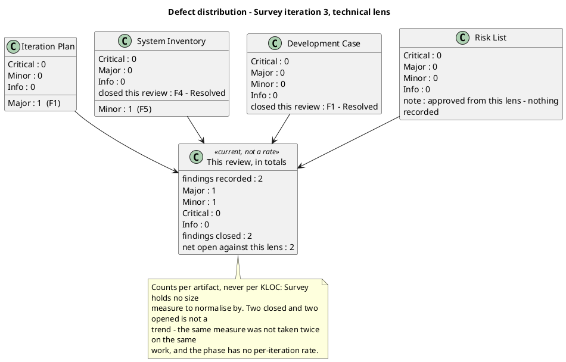

### Management Reviewer lens
<!-- review: Survey I3 -->

One finding of this lens is closed this turn and one persists under its key. `System Inventory#F1` is closed on evidence read from the corrected artifact; `Iteration Plan#F3` is re-recorded because two of its placements still name no area.

#### Findings closed this review

| Finding | Severity | How the defect was fixed | Evidence I verified |
|---|---|---|---|
| `System Inventory#F1` | Minor | The sentence closing the Coverage introduction no longer asserts a number. It now reads "The areas at the foot of this table, none of them assigned to a slice, are declared unread there" — the second outcome the remediation admitted, in which the statement cannot drift from the rows when a later slice leaves one fewer. | I counted the never-assigned rows myself: twenty-three, `docker` through `utils`, against the twenty-four the earlier sentence claimed. The three counts beside the sentence still reproduce: iteration 3's per-area reads 2 + 2 + 9 + 2 + 1 + 1 + 2 + 4 + 1 + 0 + 2 + 1 = 27, its 30 distinct with the three outside the slice, and 60 + 28 + 30 = 118 for the phase. |

#### Findings re-recorded under their key

| Finding | Severity | Why it stays open | What closes it |
|---|---|---|---|
| `Iteration Plan#F3` | Major — `consumed-defect` | The three rows its remediation named are corrected: R017 now rests on the allowlist map with no claim about `pkg/api/universal/`, R019 sits on this iteration beside `pkg/scheduler/`, and R028 on `pkg/api/http/server.go`. The count those corrections were required to make true is not. R013 and R021 remain on iteration 4, supported by "read in `tests/` and `charts/`", and neither anomaly was read from either area — both anchor under `.github`, an area of iteration 1. R021's retirement is a Change Request owned by the Integrator, a role this phase does not run. | The count stated in Document Control, in the sequencing table's closing paragraph and in the Evaluation Criteria's "Risks sequenced and accountable" row moves to 25 placed, 5 whole-reading and 2 carried past the phase; or each of the two names the area of iteration 4 that reads its retirement. |

#### Findings recorded this review

| Finding | Severity | Criterion | Location | Rework |
|---|---|---|---|---|
| `Iteration Plan#F4` | Minor | `contained-defect` | Document Control — "The verdict on iteration 2 was SBC: iteration REQUIRED" against "The SBC milestone is not judged" | Owner's next turn; holds no gate |

#### Actions this review sets

| # | Action | Owner | Closes | Holds the SBC gate |
|---|---|---|---|---|
| 1 | State R013 and R021 at what the cut actually does with them, or name the area of iteration 4 that reads each; then move Document Control, the sequencing table's closing paragraph and the Evaluation Criteria's "Risks sequenced and accountable" row to the same figure, and take `.github` out of the i4 justification | Project Manager | `Iteration Plan#F3` | Yes — the SBC verdict reads the placed count as evidence that the cut confronts every risk of the register |
| 2 | Restate Document Control's opening sentence to the decision the iteration close produced, leaving the milestone's status to the closing sentence | Project Manager | `Iteration Plan#F4` | No |

Action 1 spans four places that quote one figure — Document Control, the sequencing table, its closing paragraph and the Evaluation Criteria row — and they are written together. A corrected count in one and the old figure in another reproduces the defect the finding records.

Neither action is assigned to a role that does not work in this phase. Neither carries a size, an effort figure or a calendar date: none has been measured, and a date projected from an estimate would read downstream as an observation.

#### What this lens does not close

The Reviewer's `Iteration Plan#F1` — `pkg/diagnostics` re-cut into this iteration and thirty-four of its thirty-five files deferred to an order no iteration of the cut runs — is open under that lens and is not mine to close. It is a scope fact this assessment records rather than a second finding: an area counted as reached while its substance leaves the phase understates what the phase has left to read, and the SBC condition "the cut holds no unread area" would be answered by a count that is short thirty-four files. I read the Coverage row and the two cut tables it names and observe the deferral is real; the disposition below treats the area as carried, not accepted.

### Review Coordinator lens
<!-- review: Survey I3 -->

<!-- review: Survey I3 -->

Three findings were closed this review, each by the lens that recorded it, each on evidence read from the corrected content rather than from a note saying it was done. Four remain open and each carries an action below. No closure is performed or claimed in this section: the closure column is an obligation assigned to the recording lens.

#### Finding lifecycle at this gate

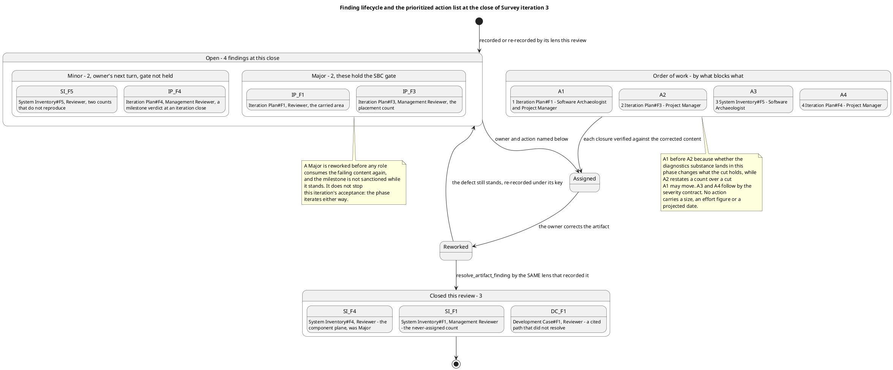

#### Prioritized actions

Priority is set by what blocks what, not by severity alone.

| # | Action | Owner | Closes | Deadline | Holds the SBC gate |
|---|---|---|---|---|---|
| 1 | Read the thirteen `pkg/diagnostics` modules against the operations W2–W4 recovered — the scheduler's eight operations, the placement leader gate, the Sentry validators, the actor table's suspension and the internal server's five handlers — stating each against the operation it instruments and declaring the ones that instrument nothing this phase read; or state in the cut that the area is carried to Excavation, name it in iteration 5's row or in a carried-to-Excavation line beside the cut, and drop it from this iteration's reached count. The Coverage row, the cut tables and the reached count move together | Software Archaeologist for the read; Project Manager for the cut | `Iteration Plan#F1` (Reviewer) | Before the SBC gate reads the reached count | Yes |
| 2 | State R013 and R021 at what the cut actually does with them — either carry both past Survey (R013 retired in iteration 1's `.github` read, R021 carried to Construction as the Integrator's Change Request) and restate the count as 25 placed, 5 carried by the reading as a whole and 2 carried past the phase, or name the area of iteration 4 that holds each retirement and what that iteration reads of it. Then move Document Control, the sequencing table's closing paragraph and the Evaluation Criteria's "Risks sequenced and accountable" row to the same figure, and take `.github` out of the i4 justification | Project Manager | `Iteration Plan#F3` (Management Reviewer) | Before the SBC gate is asked | Yes |
| 3 | Name `docs/development/README.md` among the files of the `docs/development` row so its enumeration yields the 13 it states; reconcile the `docker` row's Dockerfile count and account for the remaining files of its 22; then re-check the rest of Technology and Size the same way, since the rule is that every count reproduces from the enumeration printed beside it | Software Archaeologist | `System Inventory#F5` (Reviewer) | Owner's next turn | No |
| 4 | Restate Document Control's opening sentence to the decision the iteration close actually produced — that iteration 2 was reviewed and the phase iterates with `Iteration Plan#F3` reworked in the plan's sequencing — and let the closing sentence carry the only statement about the milestone. Then check the plan's other places describing the phase's gates for the same substitution | Project Manager | `Iteration Plan#F4` (Management Reviewer) | Owner's next turn | No |

Action 1 is one act worked as a whole: reading one module and declaring the rest is the rule this phase follows, and it holds only if the declared remainder has an iteration of the cut to land in. Action 2 spans four places that quote one figure and they are written together; a corrected count in one and the old figure in another reproduces the defect.

Neither action carries a size, an effort figure or a calendar date: no such figure has been measured, and a date projected from an estimate would read downstream as an observation.

#### Which lens closes what

| Finding | Severity | Closed only by | Verification the lens applies |
|---|---|---|---|
| `Iteration Plan#F1` | Major | Reviewer | The area is read to a stated depth against the operations the phase has read, or is carried with an iteration of the cut or a phase named for it; the reached count the SBC condition reads moves with the Coverage row |
| `Iteration Plan#F3` | Major | Management Reviewer | Every placement names an area the named iteration opens; the placed count is true on that reading; a risk carried past Survey is stated as carried, not placed on an unopened area; the four places that quote the figure agree |
| `System Inventory#F5` | Minor | Reviewer | Each row's stated count equals the enumeration printed beside it, and the rest of the table is re-checked against the same rule |
| `Iteration Plan#F4` | Minor | Management Reviewer | The section states the iteration decision it produced and one statement only about the milestone |

A closure by a lens other than the recorder is rejected. A defect that persists into the next iteration keeps its key and is re-recorded under it, never as a new finding, so review debt stays countable.

#### What carries into the next iteration

| Item | State at this close |
|---|---|
| Findings open | 4 — two Major, two Minor. None is past its deadline; the phase's first overdue finding has not occurred |
| Escalation to the Project Manager | None required. A finding escalates on a missed deadline, and no deadline has passed |
| Escalation to the stakeholder | None. Both executing lenses recorded zero Critical findings, so nothing is a decision only the stakeholder can make |
| Areas carried | `pkg/diagnostics`, thirty-four of its thirty-five files, pending action 1 |
| Iteration 4's slice | The seventeen areas the plan assigns, unchanged by this review. No action here adds or removes an area from the cut |
| Optional artifacts | Glossary and Deployment Model are FIRED by the Development Case and both are produced in later phases. Neither is due in Survey, neither was reviewed here, and nothing is recorded against them |

## Disposition
### Reviewer lens
<!-- review: Survey I3 -->

<!-- review: Survey I3 -->

**Approved with Changes.** No Critical finding: nothing in this iteration needs a decision only the stakeholder can make, and no `REQUIRES_USER_INPUT` is raised.

One Major finding (`Iteration Plan#F1`) and one Minor (`System Inventory#F5`). Under the severity contract the artifact is reworked before any role consumes the failing content again, though the plan does not hold this iteration's acceptance: a Major holds the SBC milestone, and the phase iterates either way. Two prior findings of this lens — `Development Case#F1` and `System Inventory#F4` — are closed, each verified against the files its correction cites.

The iteration met its reading. Twelve of twelve assigned areas were accounted for, eleven of them read to a stated depth with the remainder declared into the cut. Thirty distinct files were opened — twenty-seven in-slice and three outside it with the reason stated for each — bringing the phase to 118 of the tree's 6 631 entries. All nine anchors I opened independently say what the artifacts claim. That proportion is why the findings are narrow: this reading is well anchored where it was checked, and what fails is a cut that loses an area and two counts that do not reproduce.

This disposition is the technical lens' judgment of the iteration's completion. It is not the SBC verdict — that is the Review Coordinator's, taken after the Management Reviewer.

#### What this lens hands to the next two

| Recipient | What it inherits | What it must not do |
|---|---|---|
| Management Reviewer | `Iteration Plan#F1` and `System Inventory#F5` open from this lens; its own `System Inventory#F1` still open. I read the Coverage introduction and observed that it now derives its statement from the rows rather than asserting a number — recorded, not closed, because closure is that lens' act | Re-record F1 or F5 under its own key. Both are technical defects and this lens owns them |
| Review Coordinator | Zero open Critical from this lens; one open Major from this lens; its own `System Inventory#F1` if it remains open. The SBC gate is not sanctioned while a Major stands | Issue the SBC verdict on this review. This is an Iteration Acceptance and the milestone's exit criteria are not judged here |

The Minor finding does not hold the gate. Under the severity contract its owner fixes it in its next turn, after the Critical and Major work.

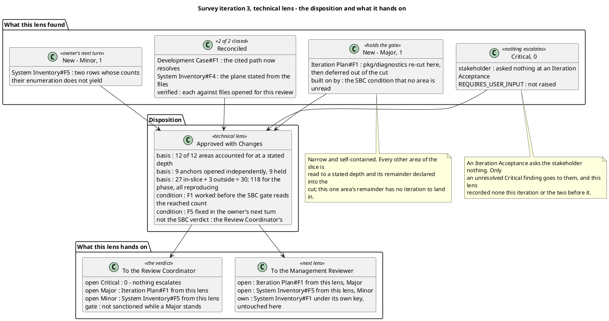

### Management Reviewer lens
<!-- review: Survey I3 -->

**Verdict on Survey iteration 3, management lens: Conditional Go on the iteration.** The eleven areas of the slice other than `pkg/diagnostics` are accepted at the depth Coverage declares; `pkg/diagnostics` is carried, not accepted, and the iteration's reached count of twelve is not confirmed by this lens. Two conditions attach, one of which holds the SBC gate.

The System Boundary Confirmed milestone is **not judged**. No milestone, iteration or phase is recorded as complete by this review.

| Axis | State | What it rests on |
|---|---|---|
| Scope | Holds, with one area carried | Twelve areas assigned in the Work Order's order, eleven read to a stated depth. `pkg/diagnostics` opened one file of thirty-five and deferred the rest to a reading order no Survey iteration runs — carried, not accepted |
| Schedule | Holds, and is unmeasured | Thirty areas remain across the two iterations that follow, stated as counts of areas. No phase has closed, nothing is projected, and `R001` stands as the overrun risk with one more iteration as the remedy and never less scope |
| Cost | Reported, never forecast | Iteration 1 at 19 480 197 tokens and 0:36:59.0766494 of agent time, iteration 2 at 30 715 328 tokens and 0:48:19.7330924, each gate's queue time measured apart at 0:00:00. Two actuals are not a velocity; no rate and no forecast is derived from them, and the plan states none |
| Quality | Holds, with rework outstanding | Four anomalies recorded in this slice, each carried as a scored risk, and `R023` — the third High risk — read from the code rather than from configuration. Two Major findings stand on the plan's account of itself: the Reviewer's `Iteration Plan#F1` on the carried area and this lens' `Iteration Plan#F3` on the placement count |

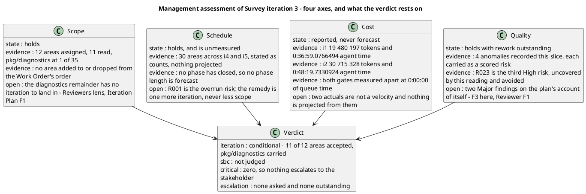

**The two conditions.**

1. **`Iteration Plan#F3` — holds the SBC gate.** The placed count must be true on the reading the plan declares: 25 placed on an iteration, 5 carried by the reading as a whole, 2 carried past the phase; or each of R013 and R021 must name the area of iteration 4 that reads its retirement. Until it moves, the SBC verdict would be answered by a count two of whose twenty-seven placements are paper.
2. **`Iteration Plan#F4` — holds no gate.** Document Control's opening sentence states an SBC verdict for an iteration close and the same section denies the milestone is judged. The owner corrects it in its next turn.

**What this lens found no defect in.** The Risk List: every magnitude is its exposure's band on the baseline scale, all twenty-seven anomalies are carried by a refining risk, custody is separated from accountability on every row, and no Significant or High risk is on accept with a grant outstanding. The Development Case: the tailoring contradicts no part of the inherited process — nine disciplines active at the canonical matrix's intensity with no deviation claimed, Business Modeling the one INACTIVE delta on its stated trigger, the roster intact with no role merged or reassigned, and two optionals FIRED and four NOT FIRED each against its own §5.2 condition. Its measurement policy is the rule the plan and the register were judged against, and both follow it.

**Escalation.** Zero Critical findings. Nothing in this review needs a decision only the stakeholder can take, so no question is asked of them and none is outstanding. Both findings are the plan's owner's to correct.

**On the phase.** The SBC gate opens when the cut holds no unread area and every Major finding of the phase has its rework in the baseline. It does not open on this review's reading: two Major findings stand open, the Reviewer's `Iteration Plan#F1` and this lens' `Iteration Plan#F3`, and one area, `pkg/diagnostics`, has a declared remainder with no iteration of the cut to land in. The phase iterates; it does not advance here.

### Review Coordinator lens
<!-- review: Survey I3 -->

<!-- review: Survey I3 -->

**Iteration Accepted — the phase iterates. The SBC milestone is not judged and no phase is closed.**

No Critical finding is open. Both executing lenses recorded zero, so nothing escalates to the stakeholder, `REQUIRES_USER_INPUT` is not raised, and this record asks them nothing. An Iteration Acceptance seeks no phase sanction; only an unresolved Critical finding goes to them.

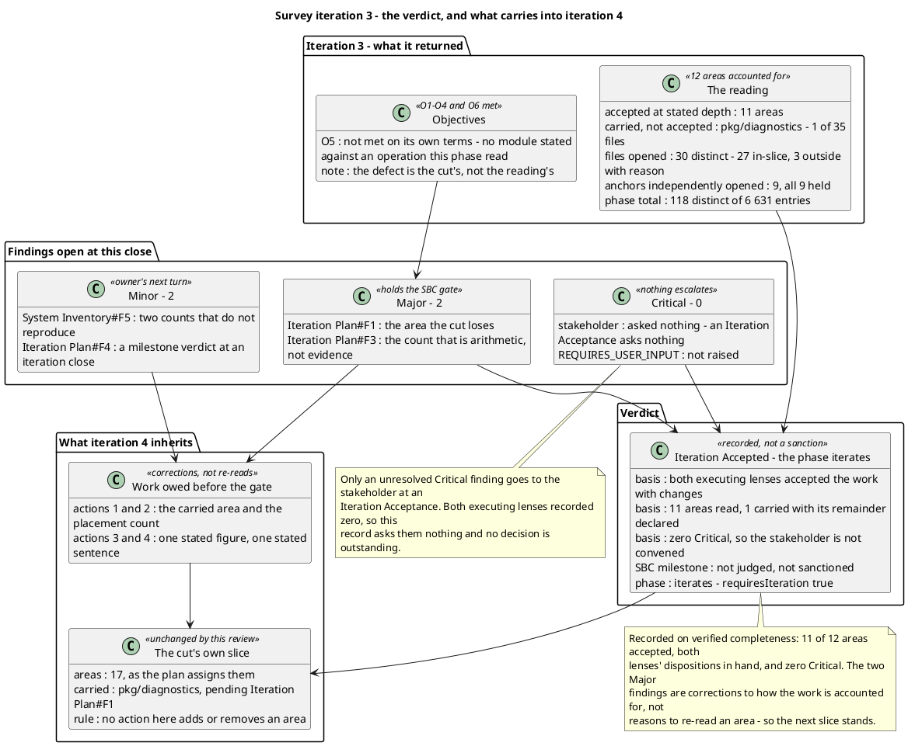

#### Review effectiveness — current metrics, and the three events the phase holds

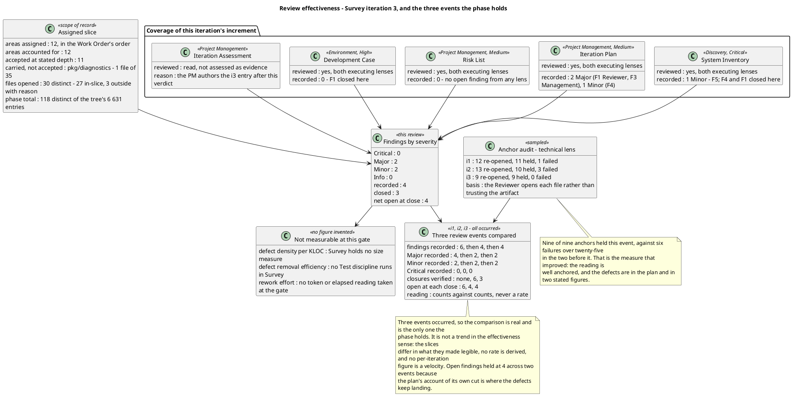

| Effectiveness indicator | Value at this review | What it means here |
|---|---|---|
| Review coverage of planned artifacts | 5 of 5 — every artifact this phase iteration holds was read by both executing lenses | The Development Case, Iteration Plan, Risk List and System Inventory were reviewed; the Iteration Assessment was read and set aside as evidence |
| Review coverage of the assigned slice | 12 of 12 areas accounted for; 11 accepted at stated depth, 1 carried with its remainder in the open | No area went unjudged or silently dropped. `pkg/diagnostics` is carried, not closed, and action 1 names it |
| Findings recorded | 4 | 2 Major, 2 Minor, 0 Critical, 0 Info |
| Findings closed | 3 | Each by its recording lens, each verified against the corrected content: `System Inventory#F4` was a Major on the component plane, `System Inventory#F1` and `Development Case#F1` were Minor |
| Findings per artifact | System Inventory 1, Iteration Plan 3, Risk List 0, Development Case 0 | A bare count, not a density: the artifacts differ in type and size and Survey holds no measure to normalise by. That three of four open findings sit on the plan is the signal — the plan's account of its own cut is where the defects land |
| Defect density per size | Not measurable | Survey holds no size measure. A per-KLOC figure would be `[ASSUMPTION — requires validation]` and is not stated |
| Defect removal efficiency | Not measurable | No Test discipline runs in Survey, so there is no test-found population to compare review-found defects against. It becomes measurable in Construction |
| Rework effort | Not measurable at this gate | No token or elapsed-time reading is taken when a review closes. Both clocks are the Development Case's measurement policy and the gate is not instrumented |
| Anchor audit hit rate | 9 of 9 independently re-opened anchors held | Up from 11 of 12 and 10 of 13 at the two earlier events. The reading is well anchored; the defects are in the cut's arithmetic and in two stated counts |
| Open Major findings | 2 | Both hold the SBC milestone; neither holds this iteration's acceptance |
| Findings past their deadline | 0 | No deadline has passed since this review closed. The phase holds three review events and no finding is past its action |
| Comparison across review events | 6, then 4, then 4 findings; 0 Critical at all three; open at 6, then 4, then 4 | Three events occurred, so this comparison is real. It is a count against a count, not a rate, and it says nothing about phase length |

The three "not measurable" entries are the correct reading, not missing data. Each names the measurement the phase cannot produce and why; filling one with a figure is the failure the Development Case's measurement policy and `R006` exist to prevent. No trend is drawn beyond the three events that occurred, and no prior iteration or cycle is invented to manufacture one.

#### Verdict

**Iteration Accepted — the phase iterates.** The iteration accounted for all twelve assigned areas, accepted eleven at a stated depth, carried `pkg/diagnostics` with its remainder declared rather than assumed read, and met its objectives on the increment's own evidence with O5 outstanding on the terms the Reviewer recorded. Both executing lenses accepted the work with changes: the technical lens Approved with Changes, the management lens a Conditional Go on the iteration. The four open findings are corrections to how the work is accounted for, not reasons to re-read an area, so the cut's next slice — the seventeen areas of Survey iteration 4 — stands unchanged.

The SBC milestone is not judged here and is not sanctioned. Its review opens once Survey's cut holds no unread area and every Major finding of the phase has its rework in the baseline. Neither condition is met: two Major findings are open from this review and one area's remainder has no iteration of the cut to land in.

#### What the next review must show this office

| Check at the close of Survey iteration 4 | Standard |
|---|---|
| The four actions | Each closed by its recording lens, verified against the corrected content, not against a note saying it was done |
| The two Major findings | Reworked before a role consumes the failing content: the carried area before the SBC gate reads the reached count, the placement count before the gate reads the risk placement |
| The two Minor findings | Fixed in their owners' next turn, or re-recorded under their existing keys with a reason |
| Any finding that persists | Re-recorded under its existing key with its occurrence count advanced — never as a new finding, so review debt stays countable |
| Review debt | No finding past its deadline without a written escalation to the Project Manager |
| `pkg/diagnostics` | Read against the operations, or carried with an iteration or a phase named for it. It is carried, not closed |
| The Business lens | Recorded as INACTIVE again unless the Development Case changes Business Modeling's status. No verdict is attributed to it |
| The next review event | The Iteration Acceptance at the close of Survey iteration 4, on the same boundary rule: the iteration's close triggers it, no date does |
