## Document Control
### Reviewer lens
<!-- review: Survey I2 -->

Phase: Survey
Status: Draft — iteration 2 review, technical lens. Three prior findings closed (System Inventory F1, F2, F3); two issued (System Inventory F4 Major, Development Case F5 Minor). The SBC milestone verdict is the Review Coordinator's and is not issued here
Milestone Target: end-of-Survey milestone (SBC) — not yet achieved

### Management Reviewer lens
<!-- review: Survey I1 -->

<!-- review: Survey I1, management lens -->

Phase: Survey
Status: Draft — iteration 1 review, management lens. Two Major findings on the Iteration Plan and one Minor on the Risk List. The SBC verdict is the Review Coordinator's and is not issued here
Milestone Target: end-of-Survey milestone (SBC) — not yet achieved

### Review Coordinator lens
<!-- review: Survey I1 -->

<!-- review: Survey I1 -->

Phase: Survey
Status: Draft — iteration 1 review consolidated. Iteration Acceptance recorded; the phase iterates. No milestone is judged and no phase is closed
Milestone Target: end-of-Survey milestone (SBC) — not achieved, not judged by this review

## Review Scope and Criteria
### Reviewer lens
<!-- review: Survey I2 -->

Iteration Acceptance review of Survey iteration 2 from the technical lens. The review point is COMPLETION, not the milestone's exit criteria: the question is what each role did with the sixteen areas the Project Manager cut for this iteration. The SBC verdict belongs to the Review Coordinator and is not stated here.

#### Artifacts reviewed

| Artifact | Owner | Discipline | Reviewed against |
|---|---|---|---|
| System Inventory | Software Archaeologist | Discovery | The anchors it cites, opened independently; its own Coverage, Components and External actors tables; the i2 slice |
| Development Case | Process Engineer | Environment | The IARI baseline; the §5.2 optional-trigger conditions against the project's real facts |
| Iteration Plan | Project Manager | Project Management | Its own cut, its measurement claims, whether every figure reproduces |
| Risk List | Project Manager | Project Management | The baseline risk scale, arithmetic on all rows, whether the 23 anomalies are all carried |

No pull request exists to dispose of; the SCM holds none in any state.

#### The slice this review judges

The Project Manager assigned sixteen areas in order: `go.sum`, `img`, `pkg/api`, `pkg/messaging`, `pkg/channel`, `pkg/components`, `pkg/resiliency`, `pkg/middleware`, `pkg/config`, `pkg/diagnostics`, `pkg/metrics`, `pkg/healthz`, `pkg/ports`, `pkg/modes`, `pkg/apphealth`, `pkg/cors`.

Fifteen yielded a file. `pkg/diagnostics` is declared unread in full, with its reason — a monitoring module is legible only against the operation it instruments — and is not counted as reached. That declaration is correct and is not a finding: an area not reached is declared, and the next iteration's slice carries it.

Every area of the slice appears in the System Inventory's Coverage table, either with files opened and a reason or with an explicit unread statement. Depth left inside a read area — `pkg/api` 6 of 124, `pkg/resiliency` 1 of 13, `pkg/components` 1 of 53 — is ordered by the Priorities section as Excavation's reading, and is not a Survey remainder. `pkg/components` is the one place that ordering fails: O2 of this iteration's plan asks the registry set to be closed here, not deferred, which is why F4 is a finding and not a declared remainder.

#### Criteria applied, and what each decided

| Criterion | Standard for this artifact type | Outcome |
|---|---|---|
| Evidence | Every fact about the existing system rests on a file that says what the artifact claims | One row fails — F4. Thirteen sampled anchors hold. |
| Count reproducibility | A stated count equals the enumeration printed beside it | Holds. Every Coverage row and the `docs` row of Technology and Size reconcile; this is what F2 closed. |
| Row counts derived from tables | A summary count is derived from the table and stated once | Holds. 42 / 19 / 16, stated once; this is what F3 closed. |
| Slice coverage | Every area of the assignment described, or declared not reached in Coverage | Holds. Fifteen reached, one declared unread with its reason. |
| Traceability | Every declared `EP-NNN` and `AN-NNN` has a row; `Traces To` is only `DependsOn` | Holds against the RTM: 26 links — 23 `Refines` from an `AN-NNN` to an `RNNN`, and 3 `DependsOn` from an `AN-NNN` to an `EP-NNN`. No copied edge, no invented label. |
| No invented figure | No spend, size, velocity, density or projected date | Holds. One iteration's measured actual is reported as that iteration's own fact and expressly not as a rate. |
| Optional triggers | Every FIRED verdict's §5.2 condition genuinely holds; every NOT FIRED verdict genuinely fails | Holds on all six. Glossary FIRED on load-bearing specialist vocabulary; Deployment Model FIRED on seven subcharts, eight Dockerfiles, six executables, two first-class modes. The four NOT FIRED each fail their condition on a stated fact. |
| Baseline conformance | No roster redefinition, no CORE omission or reassignment, no artifact outside the universe, no merged roles, no enumeration rule changed | Holds. Business Modeling INACTIVE with its trigger condition recorded; Capsule Designer withheld on `real-time-system = false`; nothing else touched. |
| Stakeholder answer applied | The recorded answer is in the artifact, in their own terms | Holds. The pointer line is at the top of the root `CONTRIBUTING.md`, the owner's text below it unchanged. |
| Instruction-shaped files recorded, not obeyed | A repository file stating a rule is evidence, never an order | Holds. `copilot-instructions.md`, the issue forms and the owner's guide are read as evidence throughout. |
| UML | Diagrams present, notation not invented, elements stable | Holds. Every diagram is PlantUML that validates; element labels are the declared identifier families. |

#### Entry criteria

| Check | Outcome |
|---|---|
| The artifacts of the increment are present and readable in full | Met — all four read |
| The assignment is known and every area of it accounted for | Met — sixteen assigned, fifteen reached, one declared unread |
| The upstream the review rests on is readable | Met — System Inventory read before the plan's counts were judged against it |
| Prior findings of this lens reconciled before new ones recorded | Met — F1, F2 and F3 closed in `S_RECONCILE` first, then F4 and F5 recorded |
| A pull request to dispose of | None — no role of Survey produces code |

#### What is deliberately not judged

- **The milestone.** Exit criteria are the Review Coordinator's. This review asks what the iteration did with its slice.
- **Another lens' findings.** `Iteration Plan#F1`, `Iteration Plan#F2` and `Risk List#F1` are the Management Reviewer's. I read the plan to test its figures against the Coverage they quote; I do not close its findings.
- **Depth inside a reached area.** Ordered to Excavation by the Priorities section, with the single exception named above.
- **Elements outside the slice.** A call named in a flow step, a component named by its path at a connector, a rule recorded as not yet checked against the code — all work the cut gives a later iteration, and none is a finding here.

### Management Reviewer lens
<!-- review: Survey I1 -->

<!-- review: Survey I1, management lens -->

Iteration Acceptance review of Survey iteration 1 from the management lens. The question is whether the iteration is acceptable as an investment: were its own objectives met, is each area of the assigned slice either read or declared, and is the state it leaves the phase in sound enough to carry into the next iteration. It is not the SBC gate: the exit criteria of the milestone are the Review Coordinator's to judge, and no sanction is granted here.

#### The slice this review judges, and how it stands

The Project Manager assigned thirteen areas in order, `.github` through `pkg/proto`. All thirteen were reached. Five were opened short of their file count — `.github` 3 of 120, `cmd` 12 of 183, `dapr` 13 of 45, `docs` 9 of 196, `pkg/proto` 3 of 66 — and that depth is ordered by the System Inventory's Priorities as Excavation's reading, not as a Survey remainder. Judging it a Survey shortfall would put one area in two iterations of the cut.

#### What the management lens reads, and what it does not duplicate

| Artifact | Owner | Read for | From this lens |
|---|---|---|---|
| Iteration Plan | Project Manager | Its four objectives and whether each was met; the cut's account of the slice; whether any figure in it is forecast rather than measured | `Iteration Plan#F1`, `Iteration Plan#F2` |
| Risk List | Project Manager | Whether the register records a magnitude for every anomaly, whether any Significant or High risk is accepted without a grant, whether each risk names who retires it | `Risk List#F1` |
| System Inventory | Software Archaeologist | Whether the reading returned the perimeter, the anomalies and the priorities its objectives demand — content, not anchor correctness | Approved from this lens; the Reviewer's findings stand and are not re-recorded |
| Development Case | Process Engineer | The measurement policy the plan must obey; the optional-trigger record | Approved — no delta from this lens |

The System Inventory's defects are the Reviewer's findings, under that lens' own keys. A second lens does not re-record another lens' defect; it judges a different question. Where the two lenses touch the same figures — the Reviewer's finding on the Coverage read-counts and this lens' finding on the plan that quotes them — the defect is recorded twice because the two artifacts each carry it, and closure of one does not close the other.

#### Entry criteria and evidence

| Check | Outcome |
|---|---|
| The four artifacts of the iteration are present and stable | Met — all four read in full |
| The assignment is known and every area of it accounted for | Met — thirteen assigned, thirteen reached |
| The upstream the plan rests on is readable | Met — System Inventory read before the plan's claims were judged |
| A prior finding of this lens to reconcile | None — this is the phase's first review; nothing to close and nothing closed |
| Pull requests to dispose of | None — no role of Survey produces code, and the SCM holds no PR in any state |

### Review Coordinator lens
<!-- review: Survey I1 -->

<!-- review: Survey I1 -->

Iteration Acceptance review of Survey iteration 1. The event reviewed is COMPLETION of the iteration, not the SBC milestone: the question is what each role did with the thirteen areas the Project Manager cut, not whether Survey may close. No sanction is sought from the stakeholder and none is granted here.

#### Lenses convened, and the one that did not evaluate

| Lens | Participant | Outcome |
|---|---|---|
| Technical | Reviewer | EXECUTED — 3 findings, disposition Approved with Changes |
| Management | Management Reviewer | EXECUTED — 3 findings, disposition Approved with Changes |
| Business | Business Reviewer | **INACTIVE — did not evaluate this review** |

The Business Reviewer recorded no verdict of any kind, and none is inferred. It does not work in this project: Business Modeling is INACTIVE in every phase (Development Case §2), so the role is withheld by the tailoring rather than absent from this event. The decision below rests on the two lenses that executed.

#### Review calendar — the sprint zero's review events and what triggers each

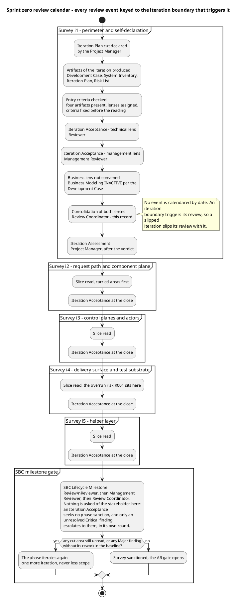

Every review event in the sprint zero sits on an iteration boundary. The SBC milestone review is calendared once, at the close of the last Survey iteration, and its own entry criterion is that every area of the cut is read and every Major finding of the phase has its rework in the baseline — a criterion the phase cannot meet while iteration 1's four Major findings stand.

#### Entry criteria as enforced at this event

| Criterion | Standard | Outcome |
|---|---|---|
| The artifacts to be reviewed are in their target state, not draft fragments | Four artifacts present and readable in full | Met — Development Case, System Inventory, Iteration Plan, Risk List all read |
| Reviewers assigned with expertise matched to the artifact domain | Technical lens on all four; management lens on the plan, the register and the iteration's objectives | Met — both lenses executed, none mismatched |
| Scope fixed before the reading, and the scope is the assignment | The Work Order's thirteen areas, in its order | Met — all thirteen reached; none outside the list judged except where a finding names it |
| Evaluation criteria distributed before evaluation | The SBC criteria, the IARI risk scale, the Development Case measurement policy | Met — each lens states the criteria it applied |
| Findings carry owner, severity and deadline | Every finding closed or scheduled | Met — six findings, each with a named owner and an action |

#### The slice, and what "not reached" would have meant

Thirteen areas were assigned and thirteen were reached. Depth left inside a reached area — `.github` 3 of 120, `cmd` 12 of 183, `dapr` 13 of 45, `docs` 9 of 196, `pkg/proto` 3 of 66 — is ordered by the System Inventory's Priorities as Excavation's reading, not counted as a Survey remainder: re-opening a read area would put one area in two iterations of the cut.

`go.sum` and `img` are not in the assignment, so they are not areas this iteration failed to reach. They belong to iteration 2's slice, where the cut places them. This is the subject of `Iteration Plan#F2` and is resolved under "Resolutions and Actions".

## Findings
### Reviewer lens
<!-- review: Survey I2 -->

Two findings this iteration: one Major on the System Inventory, one Minor on the Development Case. Nothing is recorded against the Iteration Plan or the Risk List from this lens — silence is the approval — and their two open Major findings remain the Management Reviewer's to close, not mine.

#### System Inventory

**F4 — Major — criterion `consumed-defect`.** The component plane is stated as the category list alone can support, and the count it draws does not hold.

`pkg/components/category.go` declares fifteen `Category` constants: `bindings`, `pubsub`, `secretstores`, `state`, `workflow`, `workflowbackend`, `middleware`, `configuration`, `crypto`, `lock`, `nameresolution`, `conversation`, `search`, `vector`, `binarystore`. The Technology and Size row and the Components table both derive "one registry per category" from that file and anchor thirteen `registry.go` paths. Two of the fifteen have no registry at the path the pattern implies: `pkg/components/workflow/registry.go` and `pkg/components/workflowbackend/registry.go` both resolve to nothing in the tree.

Thirteen of the fifteen do hold. `state/registry.go`, `lock/registry.go` and `conversation/registry.go` were opened for this review and each declares `Registry`, `RegisterComponent`, `Create`, `getStore` and `wrapFn` — the pattern the row describes. So the row is true for thirteen and silent about two, and the two it is silent about are the ones the workflow engine and its actor backend depend on.

The same row declares 52 of the area's 53 files unread and states "a registry is read with the processor that calls it", so all thirteen registry paths are cited as anchors for files the artifact says it never opened. That is the failure mode `System Inventory#F1` recorded, in a new place — and `#F1` was closed this same review, so the pattern is being corrected one instance at a time rather than at its rule.

This is what O2 of this iteration's plan asks the read to close: "each registry is stated as the set of component kinds it admits, with the `Source:` anchor that declares the kind list". Excavation's component recovery and the Software Architect's component view both build on the registry set being complete.

*Remediation.* State the plane from the files that hold it. For each of the fifteen constants name the file that registers it — the thirteen the row already names, and for `workflow` and `workflowbackend` the file that actually holds them, which is not a `registry.go` in a category directory and must be located in the iteration that reads `pkg/runtime/wfengine/` or `pkg/actors/`. Until those two are located, state the count as it is: fifteen categories, thirteen with a registry file under `pkg/components/<category>/`, two whose registration this inventory has not found. Take the thirteen unopened paths out of the anchor column into a "not yet opened" column, or open them. Restate the Components table row the same way, and have the Project Manager carry the two unlocated categories as a risk.

#### Development Case

**F5 — Minor — criterion `contained-defect`.** The Deployment Model trigger's evidence cites a path the tree does not hold.

The row anchors part of its FIRED verdict on "`pkg/config/modes/`" as the package where standalone and Kubernetes modes are both first-class. No such directory exists. The package is `pkg/modes/modes.go`, declaring `type DaprMode string` with `KubernetesMode = "kubernetes"` and `StandaloneMode = "standalone"` — one of this iteration's own sixteen areas, and read as such.

The verdict is unaffected: FIRED rests on seven subcharts, eight Dockerfiles, six executables, placement and scheduler as separate control planes, and mTLS through Sentry, all correctly cited. It stays inside the artifact, which is why it is Minor. It is recorded because a reader checking the verdict follows that path, finds nothing, and cannot tell whether the package moved or the citation was written from its name.

*Remediation.* Correct the path to `pkg/modes/modes.go` and cite the file. Check the other rows of the same table for the same failure — a path cited as evidence must resolve in the tree.

#### Compliance matrix

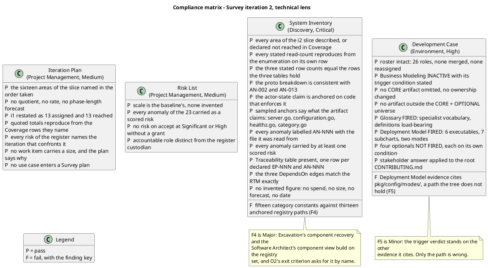

#### Anchors opened for this review

I do not accept an anchor on the artifact's word. These were read directly and compared against what the System Inventory and the Development Case say they show:

| Anchor | What the artifact claims it shows | Outcome |
|---|---|---|
| `pkg/config/configuration.go` | `Configuration.validate()` calls `ActorsSpec.Validate()`, which rejects five binding faults and is nil-safe | Holds — both functions present, the five faults are the ones named, `a == nil` returns nil |
| `pkg/runtime/actorstatestores.go` | one function, `actorStateStoreBindings`, returns a per-type map, returns no error | Holds — a 22-line file, no other declaration |
| `pkg/api/http/server.go` | the primary router gets eight middlewares, the public port three | Holds — `useMaxBodySize` through `useAPILogging` against `useContextSetup`, `useTracing`, `useMetrics` only |
| `pkg/healthz/healthz.go` | `IsReady` is false when no target is registered | Holds — `h.targets > 0 && len(h.unhealthy) == 0` |
| `pkg/cors/cors.go` | two constants and nothing else | Holds — `DefaultAllowedOrigins` and `AllowAllOrigins` |
| `pkg/modes/modes.go` | two constants, `kubernetes` and `standalone` | Holds — the whole package |
| `pkg/middleware/middleware.go` | the `HTTP` type is the whole contract | Holds — `HTTP func(http.Handler) http.Handler` and a one-method interface |
| `pkg/components/state/registry.go` | a registry with `RegisterComponent`, versions and `Create` | Holds — and confirms the pattern `category.go`'s fifteen constants imply |
| `pkg/components/lock/registry.go` | the same pattern for the lock category | Holds |
| `pkg/components/conversation/registry.go` | the same pattern for the conversation category | Holds |
| `pkg/messaging/v1/messaging.go` | the direct-messaging interface | Holds — one `Invoke` method |
| `pkg/components/workflow/registry.go` | one of the fifteen category registries | **Fails — F4**: the path does not resolve |
| `pkg/components/workflowbackend/registry.go` | one of the fifteen category registries | **Fails — F4**: the path does not resolve |
| `pkg/config/modes/modes.go` | the two first-class runtime modes | **Fails — F5**: the path does not resolve |

Ten hold, three do not, and two of the three are the substance of F4. The reading is well anchored where it was checked; what fails is a count in one row and a path in another, which is why the findings are narrow.

#### Findings, at a glance

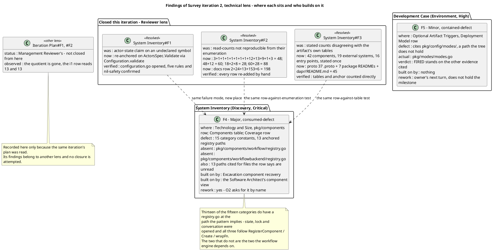

### Management Reviewer lens
<!-- review: Survey I1 -->

<!-- review: Survey I1, management lens -->

Three findings: two Major against the Iteration Plan (`Iteration Plan#F1`, `Iteration Plan#F2`), one Minor against the Risk List (`Risk List#F1`). Nothing is recorded against the System Inventory or the Development Case from this lens — silence is approval.

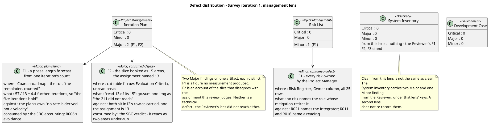

#### Iteration Plan

**`Iteration Plan#F1` — Major — criterion `plan-sizing`.** The plan forecasts the length of the phase from a rate taken out of a single iteration's area count, in the same document that forbids such a rate. Under "the remainder, counted": "At the area size this iteration ran, 57 ÷ 13 = 4.4 further iterations; the cut already holds 4 … The five iterations of Survey hold". The Evaluation Criteria repeat it, and that paragraph is what carries the claim that the cut needs no sixth iteration. The plan's own measurement table states the opposite rule — "No rate is derived from any of these. They are counts of what one iteration read, not a velocity" — and the Development Case's measurement policy and the Risk List's R006 exist to keep a figure no measurement produced out of a sprint-zero artifact. The quotient is not transferable even on its own terms: iteration 1's areas are documents, manifests and contracts, read whole because they are small, while the iterations the rate is applied to hold `tests/` at 3 335 entries, `pkg/runtime/` at 308 files and `pkg/api/` at 124. R001 says the overrun will be answered with one more iteration and never with less scope; this figure would pre-empt that remedy by declaring the cut sufficient before the largest slice is opened.

*Remediation.* Delete the quotient and the conclusion drawn from it. State the remainder as the counts it is — 57 areas across the four iterations the cut holds — with R001 standing as the risk that an iteration overruns and one more iteration as the remedy. Whether the cut still holds is asked and answered at the end of each iteration from what that iteration read. Where a statement about phase length is wanted, state the absence the Development Case names: no phase has closed, so there is no actual to forecast from.

**`Iteration Plan#F2` — Major — criterion `consumed-defect`.** The plan books iteration 1 as a 15-area slice of which two went unread, when the iteration was assigned 13 areas and reached every one. The cut row is headed "Survey i1 — read 13 of its 15" and appends "not reached: `go.sum`, `img`" to the list of the thirteen assigned areas; the Evaluation Criteria then claim the "declared areas not skipped" test as met by that shortfall. Both areas appear in iteration 2's own row as "carried from i1", so the plan puts them in two iterations at once. The assignment names thirteen areas and states that an area outside the list is not this iteration's work. The artifact that consumes the error is the SBC verdict: the Review Coordinator, and anyone auditing the phase later, reads an iteration that under-ran its slice by two areas, when it reached all thirteen and met all four objectives. The plan's own Document Control line states it correctly — "13 areas of the slice were read of the 70 the cut holds" — so the document contradicts itself, with the wrong version sitting in the table the gate reads.

*Remediation.* State iteration 1's row as 13 assigned and 13 reached; list `go.sum` and `img` once, in iteration 2's row, where the cut already places them. Restate the "Unread areas declared" criterion on a true fact: this iteration had no unreached area, and the declared remainder is the areas the cut assigns to iterations 2 to 5. The 70-area arithmetic with nothing read twice is unaffected.

#### Risk List

**`Risk List#F1` — Minor — criterion `contained-defect`.** All 25 rows name the Project Manager as Owner, including the 16 Significant and High risks whose avoidance is another role's act of reading and whose retirement the AR gate will ask about. The mitigation and contingency columns contradict the Owner column on several rows: R021's contingency is a Change Request "owned by the Integrator", R014's is "for the owner of that code", R011, R016 and R023 are retired only by the Software Archaeologist reading code in Excavation. Custody of the register and accountability for the act that retires an entry are different things; a register naming one role 25 times cannot show who must answer at the AR gate that the three High risks moved. This stays inside the artifact — no role builds on the Owner column as it stands, and no exit criterion depends on it.

*Remediation.* Add an "Accountable role" column distinct from the register's custodian and lift the names the mitigation rows already give into it: Software Archaeologist for the reading risks as their anchors are reached, Project Manager for R001 and R002, Integrator for R021.

#### System Inventory

Nothing is recorded from this lens. The iteration's four objectives are met on this artifact's own evidence: sixteen entry points anchored, twenty anomalies each with an anchor, thirteen ordered priorities, and no recovered element carrying a project identifier family it does not own. The two Major and one Minor finding the Reviewer recorded — the actor-state anchor, the unreproducible read-counts, the stated counts that disagree with the tables — are defects of the artifact's account of itself, and they stand open under that lens. They do not change the answer to the management question: what the reading returned is there to be built on.

#### Development Case

Nothing is recorded. The measurement policy the plan is judged against is this document's, and it is stated clearly enough to judge by: two quantities measured, both clocks read apart, a human gate bounded as a risk and never forecast. The optional-trigger record and the discipline deltas were reviewed by the Reviewer's lens and hold.

### Review Coordinator lens
<!-- review: Survey I1 -->

<!-- review: Survey I1 -->

The consolidated ledger below is the authoritative record of this review. Each finding is copied from `read_artifact_findings` with its artifact, key, severity and criterion; no finding is added, merged away or re-worded, and no finding is closed here. Closure is the recording lens' own act via `resolve_artifact_finding` and belongs to the lens that emitted it.

#### Consolidated finding ledger

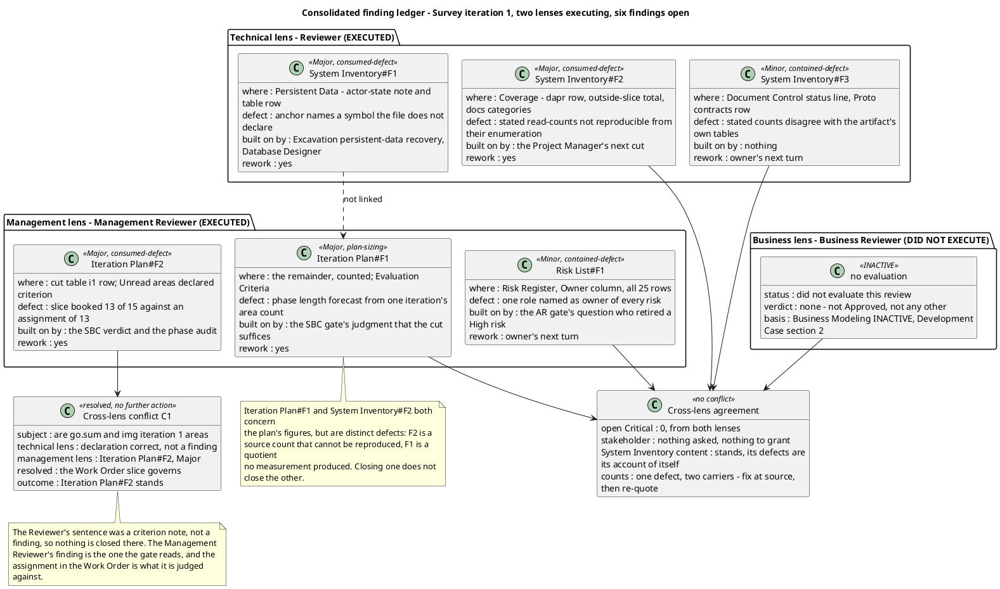

| Finding | Severity | Criterion | Artifact | Recording lens | Built on by | Rework |
|---|---|---|---|---|---|---|
| `System Inventory#F1` | Major | `consumed-defect` | System Inventory | Reviewer | Excavation persistent-data recovery; the Database Designer's persistent-data sections | Yes |
| `System Inventory#F2` | Major | `consumed-defect` | System Inventory | Reviewer | The Project Manager's next cut, which sizes itself from these counts | Yes |
| `System Inventory#F3` | Minor | `contained-defect` | System Inventory | Reviewer | Nothing | Owner's next turn |
| `Iteration Plan#F1` | Major | `plan-sizing` | Iteration Plan | Management Reviewer | The SBC gate's judgment that five iterations suffice | Yes |
| `Iteration Plan#F2` | Major | `consumed-defect` | Iteration Plan | Management Reviewer | The SBC verdict and the phase audit | Yes |
| `Risk List#F1` | Minor | `contained-defect` | Risk List | Management Reviewer | The AR gate's question of who retired a High risk | Owner's next turn |

Four Major, two Minor, zero Critical. No Info finding was recorded by either lens.

#### Software Architect document — not in this review's increment

The Software Architecture Document is named in the milestone's review targets at LCA, not here. No SAD exists and none is due: its first phase is Excavation (Development Case, "Roles active by phase"). Nothing is recorded against it.

#### System Inventory

Three findings from the technical lens, none from the management lens.

The technical lens re-opened twelve anchors independently rather than accepting them on the artifact's word; eleven held and one failed. That proportion is why the findings are narrow rather than general — this reading is well anchored where it was checked. The three defects are defects of the artifact's account of itself, not of what the reading found: the perimeter, the sixteen entry points, the twenty anomalies and the thirteen ordered priorities stand, and the management lens accepted them as content on its own question.

`System Inventory#F1` is the serious one for downstream. A Persistent Data claim cites `pkg/runtime/actorstatestores.go` for a symbol the file does not declare, and the file is one of the 1,322 under `pkg/` the artifact's own Coverage table declares unread — so the citation rests on an anchor the artifact states it never opened. Excavation's persistent-data recovery and the Database Designer build on that statement.

`System Inventory#F2` matters to the *process* rather than to the reading: the phase's evidence that the reading happened cannot be reproduced from its own enumeration, and the Iteration Plan quotes those figures as the iteration's measurement.

#### Iteration Plan

Two findings from the management lens, none from the technical lens. The technical lens recorded the plan's fail only as a consequence of `System Inventory#F2` — the plan quotes the counts faithfully and says so — and did not raise an independent finding against it.

`Iteration Plan#F1` and `System Inventory#F2` both touch the plan's figures and are not the same defect. F2 is a source count that cannot be reproduced from its enumeration; F1 is a quotient no measurement produced, sitting in a document whose own measurement policy forbids it. Fixing the counts does not delete the quotient, and deleting the quotient does not reconcile the counts. The two are worked together but closed separately, each by its own lens.

`Iteration Plan#F2` is the finding closest to the verdict this record issues. The plan books iteration 1 as a fifteen-area slice of which two went unread, whereas the Work Order assigned thirteen and every one was reached. The plan's own Document Control states the fact correctly, so the artifact contradicts itself, with the wrong version in the table the gate reads. Left standing, an auditor reads an iteration that under-ran its slice by two areas.

#### Risk List

One Minor finding from the management lens. All twenty-five rows name the Project Manager as Owner, including the sixteen Significant and High risks whose retirement is another role's reading and which the AR gate will ask about. Custody of the register and accountability for the act that retires an entry are different things.

This is Minor because nothing is blocked on it: no role builds on the Owner column as it stands and no exit criterion depends on it. It does not hold the SBC gate.

#### Development Case

No finding from either lens. The measurement policy the plan is judged against is this document's, and it is stated clearly enough to judge by: two quantities measured, both clocks read apart, a human gate bounded as a risk and never forecast. The optional-trigger record — Glossary and Deployment Model fired, four not fired — and the discipline deltas were checked against the baseline's conditions by both lenses and hold. The stakeholder's answer on the root `CONTRIBUTING.md` pointer line is applied, with the owner's text below it unchanged.

#### Cross-lens conflicts, resolved

| # | Conflict | Resolution | Where it lands |
|---|---|---|---|
| C1 | The technical lens treated `go.sum` and `img` as correctly declared and not a finding; the management lens recorded them as a Major mis-accounting of the slice. | The Work Order's slice governs. Those two areas are outside the thirteen assigned, and the iteration reached all thirteen. The management lens' reading of the assignment is upheld — not because a lens outranks another, but because the assignment is the scope of record. | `Iteration Plan#F2` stands as Major; no finding is created or closed by the resolution |
| C2 | Both lenses observed the plan's figures failing, at different ends — the source counts (technical) and the quotient drawn from them (management). | Not a conflict but a shared observation with two distinct defects. Neither lens' finding absorbs the other, and closure of one does not close the other. | `System Inventory#F2` and `Iteration Plan#F1`, both open |

No conflict required a lens to withdraw a finding. Neither lens claimed a finding the other had recorded, which is the failure this consolidation looks for first.

#### What no lens recorded

| Check | Both lenses |
|---|---|
| Critical finding | None recorded. Nothing in this iteration needs a decision only the stakeholder can make |
| Finding against an artifact outside the four reviewed | None — no artifact beyond the Development Case, System Inventory, Iteration Plan and Risk List was reviewed, and none exists to review at this phase |
| Pull request to dispose of | None. No role of Survey produces code; the SCM holds no PR in any state. Nothing is approved, changes-requested or deferred |
| Invented figure | None found in any of the four artifacts — no token spend, elapsed time, work-item size, velocity or projected date. `Iteration Plan#F1` records a forecast, which is not a fabricated observation but a forbidden derivation, and it is scored as Major on that criterion, not as fabrication |
| Recovered element carrying a project identifier family it does not own | None. The decision records are cited as evidence and not renumbered; the two `DependsOn` edges match the trace graph exactly |

## Resolutions and Actions
### Reviewer lens
<!-- review: Survey I2 -->

<!-- review: Survey I2 -->

#### Findings closed this review

Each was closed by `resolve_artifact_finding` from this lens, after I verified the corrected content against the file it cites — not against a note saying it was done.

| Finding | Severity | How the defect was fixed | Evidence I verified |
|---|---|---|---|
| `System Inventory#F1` | Major | The actor-state claim is re-anchored on code that enforces the rule. The note and the table row now state that the runtime neither chooses nor requires an actor state store at start-up, name `actorStateStoreBindings` as the reporting function, and cite `Configuration.validate()` → `ActorsSpec.Validate()` for the five binding faults it rejects. Both files are in the read set. | I opened `pkg/config/configuration.go`: `validate()` ends `return c.Spec.ActorsSpec.Validate()`, and the function's `if a == nil { return nil }` makes it nil-safe exactly as the note now says. `pkg/runtime/actorstatestores.go` is 22 lines with one function and no error return. |
| `System Inventory#F2` | Major | Every Coverage row's stated count now reconciles with the files enumerated on the same row, and the Iteration Plan re-quotes only the reconciled totals. | I re-added every enumeration. i1: 3+1+1+1+1+1+1+1+12+13+9+1+3 = 48; outside the slice 2+1+5+1+1+1+1 = 12; 48+12 = 60. i2: 1+3+1+2+1+1+1+1+1+0+1+1+1+1+1+1 = 18, plus the 2 extended areas = 20, plus 8 outside = 28. Phase 60+28 = 88. `docs` row in Technology and Size: 2+24+13+153+6 = 198. |
| `System Inventory#F3` | Minor | The three row counts are derived from the tables and stated once, with the status line pointing at that single statement; the proto breakdown is restated consistently with AN-002 and AN-013. | I counted the tables: 42 components, 19 external actors and systems, 16 entry points — which is what the introducing paragraph states. Proto: 37 `.proto` + 7 package READMEs + `dapr/README.md` = 45. |

`System Inventory#F4` is the same class of defect as F2 and F3 — a stated count that does not reconcile with what the row itself prints — appearing in a row the earlier corrections did not reach. That is the reason the finding is recorded rather than folded into one of them: closing F2 and F3 did close those rows, and did not close this one.

#### Actions this review sets

| # | Action | Owner | Closes | Holds the SBC gate |
|---|---|---|---|---|
| 1 | For each of the fifteen category constants, name the file that registers it; locate the registration of `workflow` and `workflowbackend`, or state that it is not located; take the unopened `registry.go` paths out of the anchor column, or open them; restate the Components table row to match | Software Archaeologist | `System Inventory#F4` | Yes — O2's exit criterion asks for the registry set by name, and Excavation's component recovery builds on it |
| 2 | Carry the two unlocated categories as a risk, scored on the register's own scale | Project Manager | `System Inventory#F4` at its consuming end | Yes |
| 3 | Correct the Deployment Model evidence path to `pkg/modes/modes.go`; check the other rows of the same table for paths that do not resolve | Process Engineer | `Development Case#F5` | No — owner's next turn |

Action 1 is one act of correction in one artifact and is worked as a whole: a row that names thirteen of fifteen categories and anchors thirteen paths must be fixed in the count and in the anchors together, or the reader is left with a corrected number over uncorrected evidence.

#### What this lens does not close

`Iteration Plan#F1` and `Iteration Plan#F2` are open under the Management Reviewer's lens and are not mine to close. I read the plan to judge whether its figures reproduce, and they do: the quotient the earlier finding named is absent, "The remainder, counted" states 41 areas across three iterations with R001's remedy and no rate, and the i1 row reads 13 assigned and 13 reached. That observation is recorded; the closure is the recording lens' act.

`Risk List#F1`, also the Management Reviewer's, is outside this lens' judgment.

#### Pull requests

`scm_list_pull_requests` returns no pull request in any state, so there is nothing to approve, request changes on, or defer. That is correct for Survey: no role of this phase produces code, and the Implementation Model does not exist yet.

#### Defect distribution

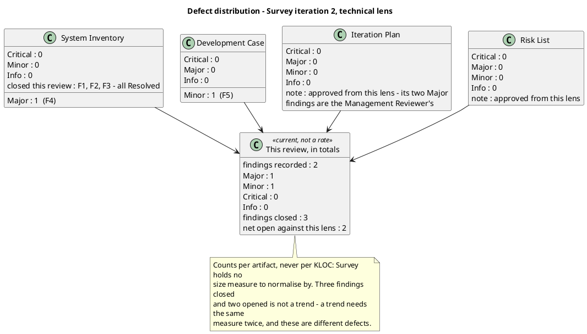

### Management Reviewer lens
<!-- review: Survey I1 -->

<!-- review: Survey I1, management lens -->

No prior finding of this lens exists: this is the phase's first review, so the reconciliation step had nothing to close and closed nothing. Each of the three findings below is closed by a `resolve_artifact_finding` call from this lens once the corrected content is in the artifact — never by a markdown note alone. A defect that persists into iteration 2 is re-recorded under its existing key, not as a new one.

| # | Action | Owner | Closes | Holds the SBC gate |
|---|---|---|---|---|
| 1 | Delete the 57 ÷ 13 quotient and the conclusion drawn from it; state the remainder as the counts the cut holds, with R001 as the remedy | Project Manager | `Iteration Plan#F1` | Yes — the gate would otherwise decide the cut is sufficient on an invented forecast |
| 2 | Restate iteration 1's row as 13 assigned and 13 reached; list `go.sum` and `img` in iteration 2's row only; correct the "Unread areas declared" criterion | Project Manager | `Iteration Plan#F2` | Yes — the gate reads the slice's account as its evidence |
| 3 | Add an accountable-role column to the register and name the role that retires each risk | Project Manager | `Risk List#F1` | No — the owner's next turn |

Actions 1 and 2 are one act of correction in one artifact and should be done together; they are separate findings because one is a figure no measurement produced and the other is a false account of the slice, and a correction of either alone leaves the other standing.

The Reviewer's actions on the System Inventory (`System Inventory#F1`, `#F2`, `#F3`) are owed independently. This lens adds no action to them and does not close them.

### Review Coordinator lens
<!-- review: Survey I1 -->

<!-- review: Survey I1 -->

No prior finding of this lens exists: this is the first review event of the phase, so there was nothing to reconcile and nothing was closed. The closure column below is an obligation assigned to the recording lens, not a closure performed here.

#### Finding lifecycle at this gate

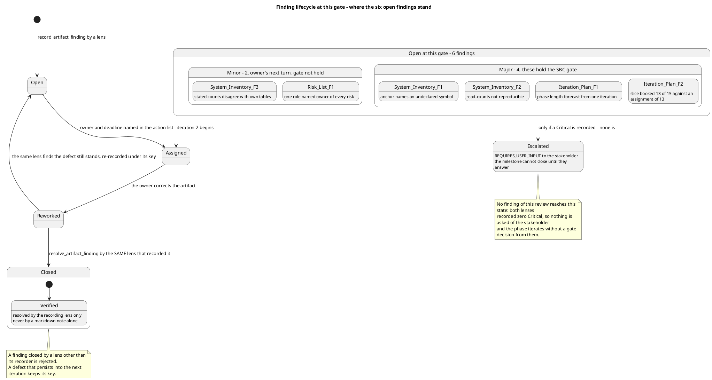

#### Prioritized actions

Priority is set by what blocks what, not by severity alone: `Iteration Plan#F2` comes first because the SBC verdict reads it as evidence, and `System Inventory#F2` comes second because the next cut sizes itself from it. Both are Major and both are owed before the next iteration's slice is fixed.

| # | Action | Owner | Closes | Deadline | Holds the SBC gate |
|---|---|---|---|---|---|
| 1 | Restate iteration 1's cut row as 13 assigned and 13 reached; list `go.sum` and `img` in iteration 2's row only; restate the "Unread areas declared" criterion on a true fact | Project Manager | `Iteration Plan#F2` | Before the next cut is declared | Yes |
| 2 | Reconcile every Coverage row's stated count with the files it enumerates; correct the outside-slice total and the `docs` categories; move the anchor out of the unread set it claims | Software Archaeologist | `System Inventory#F2` | Before the next cut sizes itself from these counts | Yes |
| 3 | Re-quote the corrected in-slice and outside-slice totals in the measurement table, Evaluation Criteria and cut tables | Project Manager | `System Inventory#F2` at its consuming end | Immediately after action 2 | Yes |
| 4 | Delete the 57 ÷ 13 quotient and the conclusion drawn from it; state the remainder as the counts the cut holds, with R001 as the remedy and one more iteration as the mechanism | Project Manager | `Iteration Plan#F1` | Before the SBC gate is asked | Yes |
| 5 | Anchor the actor-state start-up requirement on code that enforces it, or restate the claim as what `actorStateStoreBindings` does and what it does not enforce | Software Archaeologist | `System Inventory#F1` | In the iteration that reads `pkg/runtime/` — Survey i3 by the cut | Yes |
| 6 | Derive the component and external-system counts from the tables and state them once; restate the proto file breakdown consistent with the README and overview anomalies | Software Archaeologist | `System Inventory#F3` | Owner's next turn | No |
| 7 | Add an accountable-role column distinct from the register's custodian and lift into it the names the mitigation rows already give | Project Manager | `Risk List#F1` | Owner's next turn | No |

Actions 1 and 4 are one act of correction in one artifact and are worked together; they remain two findings because one is a false account of the slice and the other a figure no measurement produced. Actions 2 and 3 are one correction seen from its source and its consuming end.

#### Which lens closes what

| Finding | Closed only by | Verification the lens applies |
|---|---|---|
| `System Inventory#F1` | Reviewer | The corrected paragraph cites a symbol the file declares, and the file is in the read set |
| `System Inventory#F2` | Reviewer | Each count reproduces from the enumeration on its own row |
| `System Inventory#F3` | Reviewer | The status line and both tables state one number each |
| `Iteration Plan#F1` | Management Reviewer | The quotient is absent and the remainder is stated as counts |
| `Iteration Plan#F2` | Management Reviewer | The i1 row reads 13 and 13, and `go.sum` and `img` appear once |
| `Risk List#F1` | Management Reviewer | Every row names a role that performs the retiring act |

No action is assigned to a role that does not work in this phase. No action carries a size, an effort figure or a calendar date: none has been measured, and a date projected from an estimate would read downstream as an observation.

#### What this review does not add to the increment

Two optional artifacts are FIRED by the Development Case and produced in later phases — the Glossary and the Deployment Model. Neither is due in Survey and neither was reviewed here; nothing is recorded against them. The remaining four optionals are NOT FIRED and none is produced. The `System Inventory#F3` proto-breakdown and `#F1` actor-state items require the artifact's author to correct its own account of a file; they are corrections, not new reading.

## Disposition
### Reviewer lens
<!-- review: Survey I2 -->

**Approved with Changes.** No Critical finding: nothing in this iteration needs a decision only the stakeholder can make, and no `REQUIRES_USER_INPUT` is raised.

One Major finding (`System Inventory#F4`) and one Minor (`Development Case#F5`). Under the severity contract the artifact is reworked before any role consumes the failing content again, and the SBC milestone is not sanctioned while a Major stands. Three prior findings of this lens — `System Inventory#F1`, `#F2`, `#F3` — are closed, each verified against the file its correction cites.

The iteration met its slice. Fifteen of sixteen assigned areas were reached and `pkg/diagnostics` was declared unread with its reason, which is a declaration and not a skip. Ten of the thirteen anchors I opened independently say what the artifact claims; the three that do not produced F4 and F5. That proportion is why the findings are narrow: this reading is well anchored where it was checked, and what fails is a count in one row and a path in another.

This disposition is the technical lens' judgment of the iteration's completion. It is not the SBC verdict — that is the Review Coordinator's, taken after the Management Reviewer.

#### What this lens hands to the next two

| Recipient | What it inherits | What it must not do |
|---|---|---|
| Management Reviewer | `System Inventory#F4` open from this lens; its own `Iteration Plan#F1`, `Iteration Plan#F2` and `Risk List#F1` still open. I read the plan and observed that the quotient is gone and that its figures reproduce from the Coverage rows they name — recorded, not closed, because closure is that lens' act | Re-record F4 under its own key. It is a technical defect and this lens owns it |
| Review Coordinator | Zero open Critical from this lens; one open Major from this lens, two from the management lens; two Minor. The SBC gate is not sanctioned while a Major stands | Issue the SBC verdict on this review. This is an Iteration Acceptance and the milestone's exit criteria are not judged here |

The two Minor findings — `Development Case#F5` and `Risk List#F1` — do not hold the gate. Under the severity contract their owners fix them in their next turn, after the Critical and Major work.

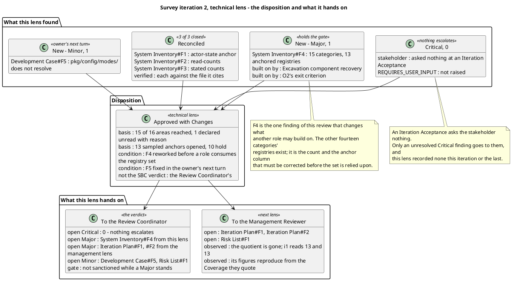

### Management Reviewer lens
<!-- review: Survey I1 -->

<!-- review: Survey I1, management lens -->

**Approved with Changes.** The iteration is accepted: thirteen of thirteen assigned areas reached, four of four objectives met, twenty anomalies recorded and twenty-five risks scored against a scale the register did not invent. The changes are `Iteration Plan#F1`, `Iteration Plan#F2` and `Risk List#F1`; under the severity contract the two Major findings keep the SBC gate unsanctioned until they are reworked. No Critical finding is issued and no `REQUIRES_USER_INPUT` is raised: nothing in this iteration needs a decision only the stakeholder can make, and at an Iteration Acceptance there is no phase sanction for them to grant.

This is the management lens' acceptance of the iteration's work. It is not the SBC verdict, which the Review Coordinator takes after this review and which judges the milestone's exit criteria — a question this review does not reach.

```plantuml
@startuml
title Survey iteration 1 - the acceptance question and the management question, side by side
hide empty members
skinparam classAttributeIconSize 0
skinparam wrapWidth 330
skinparam nodesep 35
skinparam ranksep 45

package "Iteration objectives - were the iteration's own objectives met" {
  class "O1  Perimeter of the existing system fixed" as O1 <<objective>> {
    Status : Met
    Evidence : 16 entry points EP-001 .. EP-016, each anchored to a path
    Evidence : 26 components and 15 external systems named and anchored
    Open : one anchor does not say what the artifact claims
  }

  class "O2  Self-declaration recorded" as O2 <<objective>> {
    Status : Met
    Evidence : 23 decision records graded against the tree
    Evidence : 147 release notes, the template and the newest note
    Evidence : go.mod - Go 1.26.11, dapr/* pinned to pseudo-versions
    Open : nothing from this lens
  }

  class "O3  Anomalies recorded and ordered" as O3 <<objective>> {
    Status : Met
    Evidence : 20 anomalies AN-001 .. AN-020, each with an anchor
    Evidence : 13 ranked priorities, cited as Excavation's reading order
    Open : the read-counts beside them are not reproducible
  }

  class "O4  Phase cut into iterations" as O4 <<objective>> {
    Status : Met, one correction owed
    Evidence : 70 areas, each in exactly one iteration, nothing read twice
    Evidence : all 25 risks name the iteration that confronts them
    Open : the plan sizes its own slice at 15, the assignment named 13
  }
}

package "Four-axis health - is the investment the phase implies still sound" {
  class "Scope" as S <<axis>> {
    Rating : Green
    Basis : 13 of 13 assigned areas reached, 4 of 4 objectives met
  }

  class "Schedule" as T <<axis>> {
    Rating : Not measurable
    Basis : no elapsed agent time recorded, no phase has closed
    Basis : the SBC gate has not opened, so no queue time is measured
  }

  class "Cost" as C <<axis>> {
    Rating : Not measurable
    Basis : the project declared no token budget, so there is no box to fit
    Basis : area and file counts are counts, never a velocity
  }

  class "Quality" as Q <<axis>> {
    Rating : Amber
    Basis : 2 Major and 1 Minor open on the System Inventory
    Basis : 2 Major and 1 Minor open on the Project Manager's artifacts
  }
}

class "Verdict on the iteration" as V <<disposition>> {
  O1 to O4 : met
  Conditions : the two Major findings closed before the SBC gate is asked
  Not judged here : the SBC exit criteria - the Review Coordinator's
}

O1 ..> V
O2 ..> V
O3 ..> V
O4 ..> V
S ..> V
T ..> V
C ..> V
Q ..> V

note bottom of Q
  Amber, not Red: the defects are in the account of the
  reading, not in what the reading found. The perimeter,
  the anomalies and the register stand as content.
end note

note bottom of C
  A rating of "not measurable" is the correct rating,
  not a missing one. No phase of this project has closed,
  so neither clock has a reading to report.
end note
@enduml
```

```plantuml
@startuml
title Risk posture at the end of Survey iteration 1 - the management lens
hide empty members
skinparam classAttributeIconSize 0
skinparam wrapWidth 300
skinparam nodesep 25
skinparam ranksep 35

package "High - 3 risks, exposure 16, all on avoid" {
  class "R011" as R011 <<AN-005>> {
    what : architecture statement stops at 2023-09-11
    avoid : Excavation reads the code the records do not cover
    retires in : Excavation
    trend : no second measurement
  }
  class "R016" as R016 <<AN-011>> {
    what : no in-tree account of any executable's behaviour
    avoid : behaviour recovered from cmd/*/app and each options.go
    retires in : Excavation
    trend : no second measurement
  }
  class "R023" as R023 <<AN-018>> {
    what : one scheduler process, two authorities, negotiated per peer
    avoid : recovered from pkg/scheduler/server and the two protos
    retires in : Excavation
    trend : no second measurement
  }
}

package "Significant - 13 risks, exposure 9 to 12" {
  class "contract and generation cluster" as SIG1 <<6 risks>> {
    R009 four protoc versions
    R010 generator reads absent inputs
    R019 failure-policy family with no proto
    R020 committed headers name two versions
    R022 hand-written Go in the generated tree
    R017 allowlist duplicated by hand
  }
  class "self-declaration cluster" as SIG2 <<3 risks>> {
    R012 release and security procedure outside the tree
    R013 seventy version-skew patches must keep applying
    R014 two workflow suites disabled by renaming
  }
  class "phase-shape cluster" as SIG3 <<3 risks>> {
    R001 iteration 4 slice holds 3 335 test files
    R005 repository files read as orders
    R006 an empty size filled with a unit nothing measures
  }
}

package "Moderate - 9 risks, exposure 5 to 8" {
  class "3 on accept" as MOD1 <<this role's decision>> {
    R002 SBC gate at the 14-day ceiling
    R003 versions read as policy rather than evidence
    R025 harness parses an error message for CIDRs
  }
  class "6 on avoid" as MOD2 <<this role's decision>> {
    R004 records renumbered into project families
    R007 index links an absent record
    R008 proto overview omits two packages
    R015 one shim disabled by renaming
    R018 two proto packages carry no README
    R024 one test file for 156 registrations
  }
}

class "Retirement evidence at this review" as EV <<assessment>> {
  retired : none
  measured twice : none
  reason : iteration 1 is the register's first measurement
  carried into Excavation : all 16 Significant and High
  whose grant is needed : nobody's - all 16 are on avoid
  accountable role named : Project Manager on all 25 rows - Risk List#F1
}

R011 --> EV
R016 --> EV
R023 --> EV
SIG1 --> EV
SIG2 --> EV
SIG3 --> EV
MOD1 --> EV
MOD2 --> EV

note bottom of EV
  No trend line can be drawn: a trend needs two readings and
  this is the first. That is not a failure of the register, and
  it is not evidence of retirement either. The AR gate is the
  first point at which the three High risks must show they
  moved - and their avoidance is the phase it will judge.
end note

note right of SIG3
  R006 is the risk this review itself is held to:
  no figure enters a sprint-zero artifact that no
  measurement produced. Iteration Plan#F1 is where
  that avoidance was breached.
end note
@enduml
```

**Health, as four ratings and not one.** Scope is Green: the assignment was reached in full. Quality is Amber: six findings are open across two lenses, and the reading also returned twenty anomalies and twenty-five scored risks, which is a reading doing its work. Schedule and cost are not measurable, and that is the correct rating — no phase of this project has closed, no token budget was declared, and the SBC gate has not opened. Neither clock has a number to report, and inventing one for either is the failure `Iteration Plan#F1` records.

**What the next iteration inherits.** The cut's own assignment: the request path and the component plane, `pkg/api/` read whole, plus `go.sum` and `img`. It inherits no finding of this lens that changes that slice; the two Major findings are corrections to how the plan states what iteration 1 did, not a reason to re-read an area. It does inherit all sixteen Significant and High risks, unchanged and unretired, which is what a first measurement looks like.

**For the Review Coordinator.** The SBC gate is not sanctioned while `Iteration Plan#F1` and `Iteration Plan#F2` stand open, and `System Inventory#F1` and `#F2` stand open under the Reviewer's lens. `Risk List#F1`, `System Inventory#F3` and nothing else of this review's is Minor and does not hold the gate. No Critical finding is open, so no stakeholder decision blocks the gate; if the Coordinator finds one, it escalates as `stakeholder-decision` in its own round, not from this review.

### Review Coordinator lens
<!-- review: Survey I1 -->

<!-- review: Survey I1 -->

**Iteration Acceptance — the phase iterates. The SBC milestone is not judged and no phase is closed.**

No Critical finding is open: both executing lenses recorded zero, so nothing escalates to the stakeholder and `REQUIRES_USER_INPUT` is not raised. The verdict below asks them nothing and seeks no sanction.

Four Major findings stand open — `System Inventory#F1`, `System Inventory#F2`, `Iteration Plan#F1`, `Iteration Plan#F2` — and two Minor. The Major set is why the milestone is not judged in this record: the SBC review's entry criterion requires every Major of the phase to have its rework in the baseline, and none of the four does yet.

#### Review effectiveness — current metrics only

This is the project's first review event. No prior iteration and no prior cycle exists to compare against, so no trend is computed and none is inferred; the trend column of the effectiveness report stays empty until a second review has actually occurred.

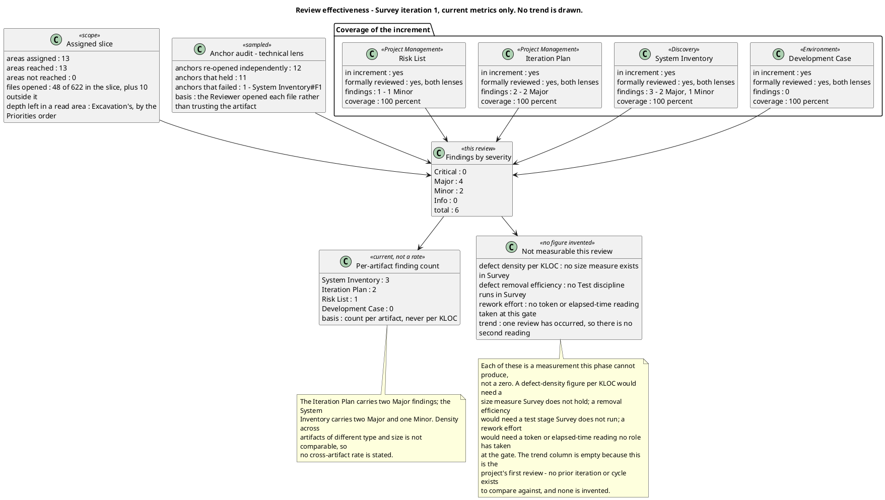

| Effectiveness indicator | Value at this review | What it means here |
|---|---|---|
| Review coverage of planned artifacts | 4 of 4 — 100 percent | Every artifact the Development Case sanctions for Survey iteration 1 was reviewed by both executing lenses |
| Review coverage of the assigned slice | 13 of 13 areas reached, 100 percent | No area of the assignment went unjudged; depth inside a reached area is Excavation's by the Priorities order |
| Findings recorded | 6 | 4 Major, 2 Minor, 0 Critical, 0 Info |
| Findings per artifact | System Inventory 3, Iteration Plan 2, Risk List 1, Development Case 0 | A bare count, not a density: the artifacts differ in type and size, and no size measure exists to normalise by |
| Defect density per size | Not measurable | Survey holds no size measure. A per-KLOC figure would be `[ASSUMPTION — requires validation]` and is not stated |
| Defect removal efficiency | Not measurable | No Test discipline runs in Survey, so there is no test-found defect population to compare review-found defects against |
| Rework effort | Not measurable | No token or elapsed-time reading was taken at this gate. Both clocks are the Development Case's measurement policy and neither has a value for this review |
| Anchor audit hit rate | 11 of 12 independently re-opened anchors held | The technical lens verified anchors rather than accepting them; one failed, which is the origin of `System Inventory#F1` |
| Overdue findings | 0 | This is the first review; no deadline has yet passed and nothing is escalated |
| Trend across iterations or cycles | None drawn | One review has occurred. Comparison begins when a second has |

The four "not measurable" entries are the correct reading, not missing data. Each names the measurement the phase cannot produce and why; filling one with a figure would be the failure `Iteration Plan#F1` records.

#### Verdict

**Iteration Accepted — the phase iterates.** The iteration's four objectives were met on the increment's own evidence, thirteen of thirteen assigned areas were reached, and both executing lenses accepted the work with changes. The four Major findings are corrections to how the work is accounted for, not reasons to re-read an area, so the cut's own next slice — the request path and the component plane, `pkg/api/` read whole, with `go.sum` and `img` carried — stands unchanged.

The SBC milestone is not judged here and is not sanctioned. Its review opens once Survey's cut holds no unread area and every Major finding of the phase has its rework in the baseline. Neither condition is met: four Major findings are open and four of the cut's five iterations are unread.

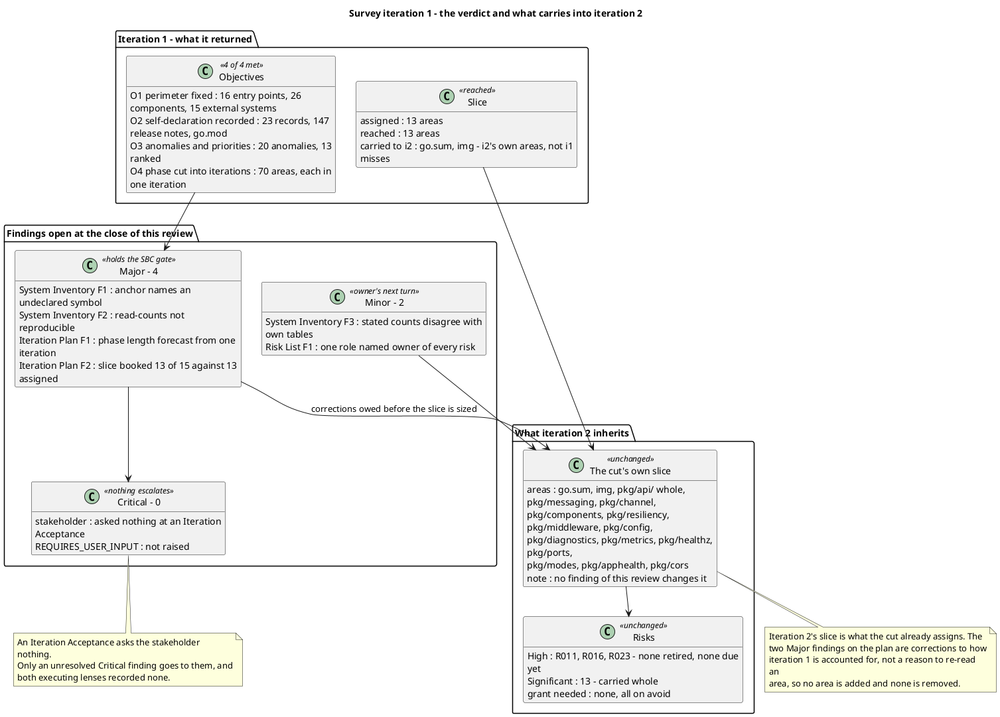

#### Lenses that did not execute

The Business Reviewer is recorded as **INACTIVE — did not evaluate this review**. No verdict is attributed to that lens in this record or anywhere in it, and the decision above rests only on the technical and management lenses, which both executed. Business Modeling is INACTIVE in every phase by the Development Case, so this is the tailoring working as configured, not a review event that failed to convene.

#### What the next iteration must show this office

| Check at the close of Survey i2 | Standard |
|---|---|
| Actions 1 to 5 of the prioritized list | Each closed by its recording lens, verified against the corrected content, not against a note saying it was done |
| The two Minor findings | Fixed in their owner's next turn, or re-recorded under their existing keys with a reason |
| Any finding that persists into i2 | Re-recorded under its existing key — never as a new finding, so review debt stays countable |
| Review debt | No finding past its deadline without a written escalation to the Project Manager |
| New findings against i2's artifacts | Recorded with owner, severity and deadline before the iteration closes |
