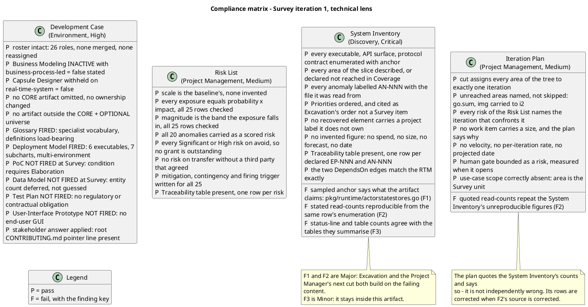
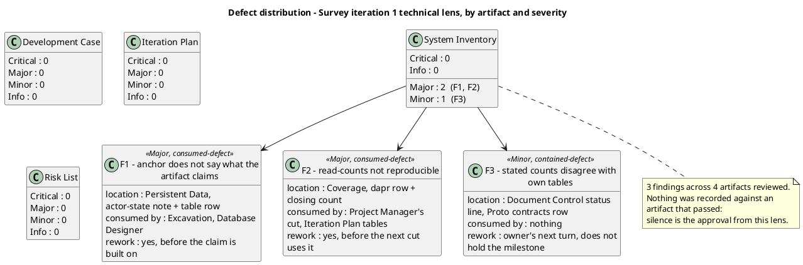

## Document Control
### Reviewer lens
<!-- review: Survey I1 -->

Phase: Survey
Status: Draft — iteration 1 review, technical lens. Findings issued; the SBC milestone verdict is the Review Coordinator's and is not issued here
Milestone Target: end-of-Survey milestone (SBC) — not yet achieved

## Review Scope and Criteria
### Reviewer lens
<!-- review: Survey I1 -->

Iteration Acceptance review of Survey iteration 1 from the technical lens. The review point is COMPLETION, not the milestone's exit criteria: the question is what each role did with the areas the Project Manager cut for this iteration, not whether Survey may close. The SBC verdict belongs to the Review Coordinator and is not stated here.

#### Artifacts reviewed

| Artifact | Owner | Discipline | Reviewed against |
|---|---|---|---|
| System Inventory | Software Archaeologist | Discovery | The anchors it cites, opened independently; its own Coverage table; the slice |
| Development Case | Process Engineer | Environment | The IARI baseline and the §5.2 optional-trigger conditions |
| Iteration Plan | Project Manager | Project Management | Its own cut, its risk-sequencing table, the Risk List, its measurement claims |
| Risk List | Project Manager | Project Management | The IARI risk scale, arithmetic on all 25 rows, the System Inventory's 20 anomalies |

#### The slice this review judges

The Project Manager assigned thirteen areas in order: `.github`, `CODEOWNERS`, `CONTRIBUTING.md`, `GOVERNANCE.md`, `LICENSE`, `README.md`, `RELEASE.md`, `SECURITY.md`, `cmd`, `dapr`, `docs`, `go.mod`, `pkg/proto`. The Iteration Plan declares `go.sum` and `img` not reached and carries them into iteration 2. That declaration is correct and is not a finding: an area not reached is declared, not skipped, and the next cut carries it.

Every area of the slice appears in the System Inventory's Coverage table, either with files opened and a reason, or with an explicit unread statement. That check passes. Depth left inside a read area — `.github` 3 of 120, `cmd` 12 of 183 — is ordered by the Priorities section as Excavation's reading, and is not a Survey remainder.

#### Anchors opened for this review

I do not accept an anchor on the artifact's word. These files were read directly and compared against what the System Inventory says they show:

| Anchor | What the inventory claims it shows | Outcome |
|---|---|---|
| `.github/workflows/fossa.yml` | licence scan whose acting step is commented out, key in plain text | Holds — `run-tests: true` is commented out with the quoted note; the key is inline |
| `dapr/README.md` | 7-row package table against 9 packages; protoc v25.4 | Holds |
| `tools/proto/generate.sh` | pins 3.10.0; reads `pkg/proto/dapr/dapr.proto` and `daprclient/daprclient.proto` | Holds |
| `dapr/proto/runtime/v1/README.md` | protoc v4.25.4 | Holds |
| `.github/copilot-instructions.md` | protoc v34.1 | Holds — and its build, test and lint guidance matches the tree |
| `go.mod` | `go 1.26.11`, exact pseudo-versions for the `dapr/*` modules | Holds |
| `pkg/proto/scheduler/v1/failurepolicy.pb.go` | protoc v5.29.3, source `dapr/proto/scheduler/v1/failurepolicy.proto` | Holds — the `.proto` is absent from the tree; the file is orphaned |
| `cmd/scheduler/options/options.go` | `--placement-enabled`, embedded etcd by default, `--override-broadcast-host-port` for the CLI | Holds |
| `docs/decision_records/decision_records.md` | 24 links against 23 files; `ARC-004-http-server.md` listed, absent from the tree | Holds |
| `README.md` | the twelve APIs it lists; the repository family | Holds |
| `CONTRIBUTING.md` (root) | the owner's text carried, one pointer line added at its top | Holds — the stakeholder's "Yes" is applied, the owner's text below is unchanged |
| `pkg/runtime/actorstatestores.go` | resolves the actor state store at start-up and fails the runtime if none is declared | **Fails — F1** |

That last row is the only anchor of the sampled set that does not say what the artifact claims. Eleven of twelve hold, which is why the findings below are narrow rather than general: this reading is well anchored where it was checked.

#### Disposition of pull requests

`scm_list_pull_requests` returns no pull requests in any state. There is nothing to approve, nothing to request changes on, and nothing to defer. No production code exists to dispose of, which is correct for Survey: no role of this phase produces code, and no branch is expected from it.

#### Compliance matrix

The Iteration Plan's single fail is not a second defect: the plan states that its counts "are the System Inventory's Coverage count, not a re-measurement", and quotes them faithfully. It is marked fail because the figures it carries are wrong at source and its own measurement table, Evaluation Criteria and cut tables rest on them. Correcting F2 corrects it.

## Findings
### Reviewer lens
<!-- review: Survey I1 -->

Three findings, all against the System Inventory. No finding is recorded against the Development Case, the Iteration Plan as an independent defect, or the Risk List: from this lens those three are approved, and silence is the approval.

#### System Inventory

**F1 — Major — criterion `consumed-defect`.** The Persistent Data section anchors the actor-state claim on a symbol the file does not declare.

The prose note states the store "is whichever configured state store is marked actorStateStore. `pkg/runtime/actorstatestores.go` resolves it at start-up and fails the runtime if none is declared", and the table row repeats "resolved at start-up by `actorStateStores`, which the runtime requires". The file declares no `actorStateStores`. Its only function is:

`func actorStateStoreBindings(spec config.ConfigurationSpec, namespace, appID string) map[string]string`

It returns a per-actor-type map of store names, adding the app's workflow actor types when `spec.workflow.stateStore` is set. It has no error return and cannot fail the runtime.

The file is also one of the 1,322 under `pkg/` that this artifact's own Coverage table declares unread, so the citation rests on an anchor the artifact states it never opened. Excavation's persistent-data recovery and the Database Designer's persistent-data sections build on this statement.

*Remediation.* In the iteration that reads `pkg/runtime/`, anchor the start-up requirement on the code that actually enforces it — the configuration validation that refuses to start when no actor state store is declared — with file and lines; or restate the sentence as what `actorStateStoreBindings` does and enforces nothing. Correct the function name and move the anchor out of the unread set. Until then, mark the claim not yet anchored rather than citing the path.

**F2 — Major — criterion `consumed-defect`.** The stated read-counts are not reproducible from the enumerations that support them.

The `dapr` Coverage row states 13 files opened and "eleven service or type definitions", then enumerates `dapr/README.md` plus ten definitions — eleven files. The outside-the-slice rows enumerate twelve files (`tools` 2, `.build-tools` 1, `pkg/api` 5, `pkg/channel` 1, `pkg/healthz`/`pkg/injector` 2, `tests` 1) against a closing line stating "plus ten outside the slice". The `docs` row in Technology and Size sums to 193 against the 195 it states.

The Iteration Plan consumes both figures as the iteration's measurement, expressly "not a re-measurement", in its measurement table ("48 of 622", "Files opened outside the slice, with the reason | 10"), its Evaluation Criteria and its cut tables. The phase's evidence that the reading happened is therefore not reproducible from the enumeration meant to support it — the failure mode the Risk List's R006 names.

*Remediation.* Reconcile each Coverage row's stated count with the files enumerated on the same row, and correct the outside-the-slice total to the rows listed or enumerate the files accounting for the stated ten. Re-check the `docs` categories the same way. Then have the Project Manager re-quote the corrected totals in the Iteration Plan. A count that cannot be reproduced from its own enumeration is counted again, not restated.

**F3 — Minor — criterion `contained-defect`.** Two stated counts disagree with the artifact's own tables.

Document Control reports "16 entry points, 28 components, 16 external systems"; the Components table holds 26 rows and the External actors table 15, the entry-point count being the one that matches. The Proto contracts row describes `dapr/proto/` as "45 files: 37 `.proto`, 8 package READMEs", while AN-013 evidences seven package READMEs across seven named packages and two without — making the eighth file `dapr/README.md`, the overview AN-002 records as listing seven of nine packages.

*Remediation.* Derive the component and external-system counts from the tables and state them once. State the proto file count as 37 `.proto` definitions, seven package READMEs and `dapr/README.md`, consistent with AN-002 and AN-013.

#### Checked and found sound

Recorded so that the review's coverage is auditable, not to praise the artifacts:

- **Cut completeness.** The cut's areas sum to 70 with nothing read twice: 13 in i1, 14 plus the 2 carried in i2, then 11, 17 and 13. Every risk of the Risk List except the five of the phase's own shape names the iteration that confronts it.
- **Risk arithmetic.** All 25 rows: exposure is probability × impact, and the magnitude is the band that exposure falls in on the baseline scale. All 20 anomalies are carried. No Significant or High risk sits on accept, so no stakeholder grant is claimed.
- **Optional triggers.** Both FIRED verdicts hold against §5.2 — the Glossary on the load-bearing specialist vocabulary the code establishes, the Deployment Model on six executables, seven subcharts and two first-class modes. All four NOT FIRED verdicts hold: the PoC condition requires Elaboration, the Data Model count is deferred to Excavation rather than guessed, no regulatory test obligation is declared, and no end-user GUI exists.
- **Baseline conformance.** No role merged or reassigned, no CORE artifact omitted, no artifact outside the CORE + OPTIONAL universe, the use-case enumeration rules untouched.
- **No invented figures.** No token spend, elapsed time, work-item size, velocity or projected date appears in any of the four artifacts. The 14-day gate is bounded as a risk, measured when it opens, and forecast nowhere.
- **Stakeholder answer applied.** The pointer line the Process Engineer asked for is present at the top of the root `CONTRIBUTING.md`, the owner's text below it unchanged.
- **Instruction-shaped files recorded, not obeyed.** The Phase-1 lessons hold: `copilot-instructions.md`, the issue forms and the owner's guide are read as evidence throughout.

## Resolutions and Actions
### Reviewer lens
<!-- review: Survey I1 -->

No prior finding of this lens exists: this is iteration 1 of the phase and the first review. The reconciliation state therefore had nothing to close, and nothing was closed.

Open actions, in the order they should be worked:

| # | Action | Owner | Closes | Gate |
|---|---|---|---|---|
| 1 | Reconcile every Coverage row's stated count with the files it enumerates; correct the outside-the-slice total and the `docs` categories | Software Archaeologist | F2 | Before the next cut uses the figures |
| 2 | Re-quote the corrected in-slice and outside-slice totals in the measurement table, Evaluation Criteria and cut tables | Project Manager | F2 (consuming end) | After action 1 |
| 3 | Anchor the actor-state start-up requirement on code that enforces it, or restate the claim as what `actorStateStoreBindings` does; move the anchor out of the unread set | Software Archaeologist | F1 | In the iteration that reads `pkg/runtime/` |
| 4 | Derive the component and external-system counts from the tables; restate the proto file breakdown | Software Archaeologist | F3 | Owner's next turn; does not hold the milestone |

Finding closure is this lens' act alone: each of F1, F2 and F3 is closed by a `resolve_artifact_finding` call from the Reviewer once the corrected content is in the artifact. A defect that persists into the next iteration is re-recorded under its existing key, not as a new one.

## Disposition
### Reviewer lens
<!-- review: Survey I1 -->

**Approved with Changes.** No Critical finding: nothing in this iteration needs a decision only the stakeholder can make, and no `REQUIRES_USER_INPUT` is raised.

Two Major findings (F1, F2) and one Minor (F3), all on the System Inventory. Under the severity contract the artifact is reworked before any role consumes the failing content again, and the SBC milestone is not sanctioned while a Major stands. The Project Manager's cut for iteration 2 does not depend on F1, which concerns a file iteration 3 reads; it does depend on F2, whose corrected counts set the next slice's size.

This disposition is the technical lens' judgment of the iteration's completion. It is not the SBC verdict — that is the Review Coordinator's, taken after the Management Reviewer, and it is not issued here.

