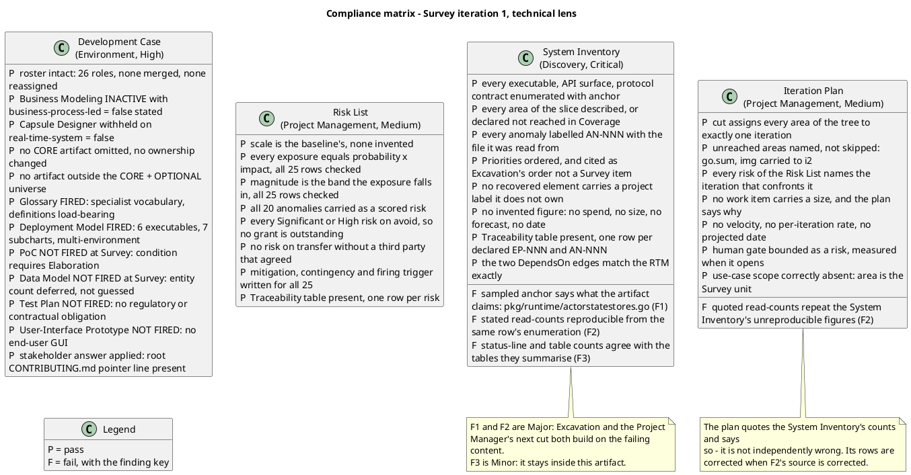
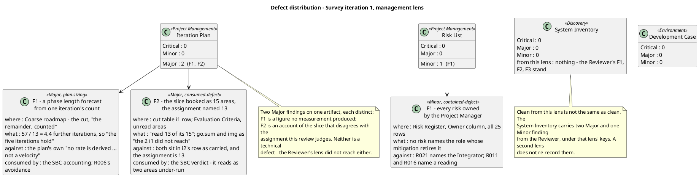
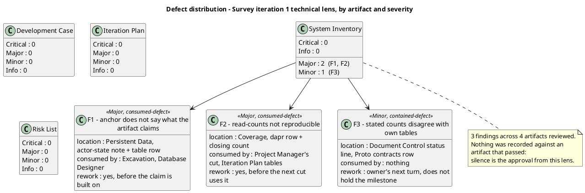

## Document Control
### Reviewer lens
<!-- review: Survey I1 -->

Phase: Survey
Status: Draft — iteration 1 review, technical lens. Findings issued; the SBC milestone verdict is the Review Coordinator's and is not issued here
Milestone Target: end-of-Survey milestone (SBC) — not yet achieved

### Management Reviewer lens
<!-- review: Survey I1 -->

<!-- review: Survey I1, management lens -->

Phase: Survey
Status: Draft — iteration 1 review, management lens. Two Major and one Minor finding issued. The SBC verdict is the Review Coordinator's and is not issued here
Milestone Target: end-of-Survey milestone (SBC) — not yet achieved

## Review Scope and Criteria
### Reviewer lens
<!-- review: Survey I1 -->

Iteration Acceptance review of Survey iteration 1 from the technical lens. The review point is COMPLETION, not the milestone's exit criteria: the question is what each role did with the areas the Project Manager cut for this iteration, not whether Survey may close. The SBC verdict belongs to the Review Coordinator and is not stated here.

#### Artifacts reviewed

| Artifact | Owner | Discipline | Reviewed against |
|---|---|---|---|
| System Inventory | Software Archaeologist | Discovery | The anchors it cites, opened independently; its own Coverage table; the slice |
| Development Case | Process Engineer | Environment | The IARI baseline and the §5.2 optional-trigger conditions |
| Iteration Plan | Project Manager | Project Management | Its own cut, its risk-sequencing table, the Risk List, its measurement claims |
| Risk List | Project Manager | Project Management | The IARI risk scale, arithmetic on all 25 rows, the System Inventory's 20 anomalies |

#### The slice this review judges

The Project Manager assigned thirteen areas in order: `.github`, `CODEOWNERS`, `CONTRIBUTING.md`, `GOVERNANCE.md`, `LICENSE`, `README.md`, `RELEASE.md`, `SECURITY.md`, `cmd`, `dapr`, `docs`, `go.mod`, `pkg/proto`. The Iteration Plan declares `go.sum` and `img` not reached and carries them into iteration 2. That declaration is correct and is not a finding: an area not reached is declared, not skipped, and the next cut carries it.

Every area of the slice appears in the System Inventory's Coverage table, either with files opened and a reason, or with an explicit unread statement. That check passes. Depth left inside a read area — `.github` 3 of 120, `cmd` 12 of 183 — is ordered by the Priorities section as Excavation's reading, and is not a Survey remainder.

#### Anchors opened for this review

I do not accept an anchor on the artifact's word. These files were read directly and compared against what the System Inventory says they show:

| Anchor | What the inventory claims it shows | Outcome |
|---|---|---|
| `.github/workflows/fossa.yml` | licence scan whose acting step is commented out, key in plain text | Holds — `run-tests: true` is commented out with the quoted note; the key is inline |
| `dapr/README.md` | 7-row package table against 9 packages; protoc v25.4 | Holds |
| `tools/proto/generate.sh` | pins 3.10.0; reads `pkg/proto/dapr/dapr.proto` and `daprclient/daprclient.proto` | Holds |
| `dapr/proto/runtime/v1/README.md` | protoc v4.25.4 | Holds |
| `.github/copilot-instructions.md` | protoc v34.1 | Holds — and its build, test and lint guidance matches the tree |
| `go.mod` | `go 1.26.11`, exact pseudo-versions for the `dapr/*` modules | Holds |
| `pkg/proto/scheduler/v1/failurepolicy.pb.go` | protoc v5.29.3, source `dapr/proto/scheduler/v1/failurepolicy.proto` | Holds — the `.proto` is absent from the tree; the file is orphaned |
| `cmd/scheduler/options/options.go` | `--placement-enabled`, embedded etcd by default, `--override-broadcast-host-port` for the CLI | Holds |
| `docs/decision_records/decision_records.md` | 24 links against 23 files; `ARC-004-http-server.md` listed, absent from the tree | Holds |
| `README.md` | the twelve APIs it lists; the repository family | Holds |
| `CONTRIBUTING.md` (root) | the owner's text carried, one pointer line added at its top | Holds — the stakeholder's "Yes" is applied, the owner's text below is unchanged |
| `pkg/runtime/actorstatestores.go` | resolves the actor state store at start-up and fails the runtime if none is declared | **Fails — F1** |

That last row is the only anchor of the sampled set that does not say what the artifact claims. Eleven of twelve hold, which is why the findings below are narrow rather than general: this reading is well anchored where it was checked.

#### Disposition of pull requests

`scm_list_pull_requests` returns no pull requests in any state. There is nothing to approve, nothing to request changes on, and nothing to defer. No production code exists to dispose of, which is correct for Survey: no role of this phase produces code, and no branch is expected from it.

#### Compliance matrix

The Iteration Plan's single fail is not a second defect: the plan states that its counts "are the System Inventory's Coverage count, not a re-measurement", and quotes them faithfully. It is marked fail because the figures it carries are wrong at source and its own measurement table, Evaluation Criteria and cut tables rest on them. Correcting F2 corrects it.

### Management Reviewer lens
<!-- review: Survey I1 -->

<!-- review: Survey I1, management lens -->

Iteration Acceptance review of Survey iteration 1 from the management lens. The question is whether the iteration is acceptable as an investment: were its own objectives met, is each area of the assigned slice either read or declared, and is the state it leaves the phase in sound enough to carry into the next iteration. It is not the SBC gate: the exit criteria of the milestone are the Review Coordinator's to judge, and no sanction is granted here.

#### The slice this review judges, and how it stands

The Project Manager assigned thirteen areas in order, `.github` through `pkg/proto`. All thirteen were reached. Five were opened short of their file count — `.github` 3 of 120, `cmd` 12 of 183, `dapr` 13 of 45, `docs` 9 of 196, `pkg/proto` 3 of 66 — and that depth is ordered by the System Inventory's Priorities as Excavation's reading, not as a Survey remainder. Judging it a Survey shortfall would put one area in two iterations of the cut.

```plantuml
@startuml
title Iteration acceptance table - the thirteen assigned areas as Survey iteration 1 left them
hide empty members
skinparam classAttributeIconSize 0
skinparam wrapWidth 250
skinparam nodesep 18
skinparam ranksep 28

package "Read whole - every file the area holds" {
  class "CODEOWNERS" as A2 <<reached>> {
    files : 1 of 1
    evidence : the two maintainer teams GOVERNANCE names
  }
  class "CONTRIBUTING.md (root)" as A3 <<reached>> {
    files : 1 of 1
    evidence : owner's text; one approved pointer line on top
  }
  class "GOVERNANCE.md" as A4 <<reached>> {
    files : 1 of 1
    evidence : activity rule, super-majority vote, CODEOWNERS PR
  }
  class "LICENSE" as A5 <<reached>> {
    files : 1 of 1
    evidence : Apache-2.0 grant
  }
  class "README.md" as A6 <<reached>> {
    files : 1 of 1
    evidence : twelve APIs, each checked against the tree
  }
  class "RELEASE.md" as A7 <<reached>> {
    files : 1 of 1
    evidence : one-line pointer out of the tree - AN-006
  }
  class "SECURITY.md" as A8 <<reached>> {
    files : 1 of 1
    evidence : one-line pointer out of the tree - AN-006
  }
  class "go.mod" as A12 <<reached>> {
    files : 1 of 1
    evidence : Go 1.26.11; dapr modules pinned to pseudo-versions
  }
}

package "Read short of its file count - depth left is ordered to Excavation" {
  class ".github" as A1 <<reached>> {
    files : 3 of 120
    evidence : fossa.yml - AN-016; conventions; PR checklist
  }
  class "cmd" as A9 <<reached>> {
    files : 12 of 183
    evidence : six executables' wiring, scheduler options, registry guard
  }
  class "dapr" as A10 <<reached>> {
    files : 13 of 45
    evidence : every declared gRPC service, from its definition
  }
  class "docs" as A11 <<reached>> {
    files : 9 of 196
    evidence : record index, dev guides, note template, newest note
  }
  class "pkg/proto" as A13 <<reached>> {
    files : 3 of 66
    evidence : generation headers - AN-014, AN-015, AN-017
  }
}

package "Not in this iteration's assignment" {
  class "go.sum" as N1 <<outside>> {
    status : not assigned
    plan books it as an i1 area not reached - M-F2
  }
  class "img" as N2 <<outside>> {
    status : not assigned
    plan books it as an i1 area not reached - M-F2
  }
}

class "Iteration acceptance" as ACC <<management lens>> {
  O1 perimeter fixed : met
  O2 self-declaration recorded : met
  O3 anomalies recorded and ordered : met
  O4 phase cut into iterations : met
  scope reached : 13 of 13 assigned areas
  depth inside a read area : Excavation's, by the Priorities order
}

A1 -up-> ACC
A9 -up-> ACC
A10 -up-> ACC
A11 -up-> ACC
A13 -up-> ACC
ACC -down-> N1
ACC -down-> N2

note bottom of ACC
  Four objectives, four met. The two areas the plan
  books as read short of are one row of its cut table,
  not part of the assignment this review judges.
end note
@enduml
```

#### What the management lens reads, and what it does not duplicate

| Artifact | Owner | Read for | From this lens |
|---|---|---|---|
| Iteration Plan | Project Manager | Its four objectives and whether each was met; the cut's account of the slice; whether any figure in it is forecast rather than measured | Two Major findings |
| Risk List | Project Manager | Whether the register records a magnitude for every anomaly, whether any Significant or High risk is accepted without a grant, whether each risk names who retires it | One Minor finding |
| System Inventory | Software Archaeologist | Whether the reading returned the perimeter, the anomalies and the priorities its objectives demand — content, not anchor correctness | Approved from this lens; the Reviewer's two Major and one Minor stand and are not re-recorded |
| Development Case | Process Engineer | The measurement policy the plan must obey; the optional-trigger record | Approved — no delta from this lens |

The System Inventory's defects are the Reviewer's findings (F1, F2, F3 under its lens). A second lens does not re-record another lens' defect; it judges a different question. Where the two lenses touch the same figures — the Reviewer's F2 on the Coverage counts and this lens' finding on the plan that quotes them — the defect is recorded twice because the two artifacts each carry it, and the closure of one does not close the other.

#### Entry criteria and evidence

| Check | Outcome |
|---|---|
| The four artifacts of the iteration are present and stable | Met — all four read in full |
| The assignment is known and every area of it accounted for | Met — thirteen assigned, thirteen reached |
| The upstream the plan rests on is readable | Met — System Inventory read before the plan's claims were judged |
| A prior finding of this lens to reconcile | None — this is the phase's first review; nothing to close and nothing closed |
| Pull requests to dispose of | None — no role of Survey produces code, and the SCM holds no PR in any state |

## Findings
### Reviewer lens
<!-- review: Survey I1 -->

Three findings, all against the System Inventory. No finding is recorded against the Development Case, the Iteration Plan as an independent defect, or the Risk List: from this lens those three are approved, and silence is the approval.

#### System Inventory

**F1 — Major — criterion `consumed-defect`.** The Persistent Data section anchors the actor-state claim on a symbol the file does not declare.

The prose note states the store "is whichever configured state store is marked actorStateStore. `pkg/runtime/actorstatestores.go` resolves it at start-up and fails the runtime if none is declared", and the table row repeats "resolved at start-up by `actorStateStores`, which the runtime requires". The file declares no `actorStateStores`. Its only function is:

`func actorStateStoreBindings(spec config.ConfigurationSpec, namespace, appID string) map[string]string`

It returns a per-actor-type map of store names, adding the app's workflow actor types when `spec.workflow.stateStore` is set. It has no error return and cannot fail the runtime.

The file is also one of the 1,322 under `pkg/` that this artifact's own Coverage table declares unread, so the citation rests on an anchor the artifact states it never opened. Excavation's persistent-data recovery and the Database Designer's persistent-data sections build on this statement.

*Remediation.* In the iteration that reads `pkg/runtime/`, anchor the start-up requirement on the code that actually enforces it — the configuration validation that refuses to start when no actor state store is declared — with file and lines; or restate the sentence as what `actorStateStoreBindings` does and enforces nothing. Correct the function name and move the anchor out of the unread set. Until then, mark the claim not yet anchored rather than citing the path.

**F2 — Major — criterion `consumed-defect`.** The stated read-counts are not reproducible from the enumerations that support them.

The `dapr` Coverage row states 13 files opened and "eleven service or type definitions", then enumerates `dapr/README.md` plus ten definitions — eleven files. The outside-the-slice rows enumerate twelve files (`tools` 2, `.build-tools` 1, `pkg/api` 5, `pkg/channel` 1, `pkg/healthz`/`pkg/injector` 2, `tests` 1) against a closing line stating "plus ten outside the slice". The `docs` row in Technology and Size sums to 193 against the 195 it states.

The Iteration Plan consumes both figures as the iteration's measurement, expressly "not a re-measurement", in its measurement table ("48 of 622", "Files opened outside the slice, with the reason | 10"), its Evaluation Criteria and its cut tables. The phase's evidence that the reading happened is therefore not reproducible from the enumeration meant to support it — the failure mode the Risk List's R006 names.

*Remediation.* Reconcile each Coverage row's stated count with the files enumerated on the same row, and correct the outside-the-slice total to the rows listed or enumerate the files accounting for the stated ten. Re-check the `docs` categories the same way. Then have the Project Manager re-quote the corrected totals in the Iteration Plan. A count that cannot be reproduced from its own enumeration is counted again, not restated.

**F3 — Minor — criterion `contained-defect`.** Two stated counts disagree with the artifact's own tables.

Document Control reports "16 entry points, 28 components, 16 external systems"; the Components table holds 26 rows and the External actors table 15, the entry-point count being the one that matches. The Proto contracts row describes `dapr/proto/` as "45 files: 37 `.proto`, 8 package READMEs", while AN-013 evidences seven package READMEs across seven named packages and two without — making the eighth file `dapr/README.md`, the overview AN-002 records as listing seven of nine packages.

*Remediation.* Derive the component and external-system counts from the tables and state them once. State the proto file count as 37 `.proto` definitions, seven package READMEs and `dapr/README.md`, consistent with AN-002 and AN-013.

#### Checked and found sound

Recorded so that the review's coverage is auditable, not to praise the artifacts:

- **Cut completeness.** The cut's areas sum to 70 with nothing read twice: 13 in i1, 14 plus the 2 carried in i2, then 11, 17 and 13. Every risk of the Risk List except the five of the phase's own shape names the iteration that confronts it.
- **Risk arithmetic.** All 25 rows: exposure is probability × impact, and the magnitude is the band that exposure falls in on the baseline scale. All 20 anomalies are carried. No Significant or High risk sits on accept, so no stakeholder grant is claimed.
- **Optional triggers.** Both FIRED verdicts hold against §5.2 — the Glossary on the load-bearing specialist vocabulary the code establishes, the Deployment Model on six executables, seven subcharts and two first-class modes. All four NOT FIRED verdicts hold: the PoC condition requires Elaboration, the Data Model count is deferred to Excavation rather than guessed, no regulatory test obligation is declared, and no end-user GUI exists.
- **Baseline conformance.** No role merged or reassigned, no CORE artifact omitted, no artifact outside the CORE + OPTIONAL universe, the use-case enumeration rules untouched.
- **No invented figures.** No token spend, elapsed time, work-item size, velocity or projected date appears in any of the four artifacts. The 14-day gate is bounded as a risk, measured when it opens, and forecast nowhere.
- **Stakeholder answer applied.** The pointer line the Process Engineer asked for is present at the top of the root `CONTRIBUTING.md`, the owner's text below it unchanged.
- **Instruction-shaped files recorded, not obeyed.** The Phase-1 lessons hold: `copilot-instructions.md`, the issue forms and the owner's guide are read as evidence throughout.

### Management Reviewer lens
<!-- review: Survey I1 -->

<!-- review: Survey I1, management lens -->

Three findings: two Major against the Iteration Plan (`Iteration Plan#F1`, `Iteration Plan#F2`), one Minor against the Risk List (`Risk List#F1`). Nothing is recorded against the System Inventory or the Development Case from this lens — silence is approval.

#### Iteration Plan

**`Iteration Plan#F1` — Major — criterion `plan-sizing`.** The plan forecasts the length of the phase from a rate taken out of a single iteration's area count, in the same document that forbids such a rate. Under "the remainder, counted": "At the area size this iteration ran, 57 ÷ 13 = 4.4 further iterations; the cut already holds 4 … The five iterations of Survey hold". The Evaluation Criteria repeat it, and that paragraph is what carries the claim that the cut needs no sixth iteration. The plan's own measurement table states the opposite rule — "No rate is derived from any of these. They are counts of what one iteration read, not a velocity" — and the Development Case's measurement policy and the Risk List's R006 exist to keep a figure no measurement produced out of a sprint-zero artifact. The quotient is not transferable even on its own terms: iteration 1's areas are documents, manifests and contracts, read whole because they are small, while the iterations the rate is applied to hold `tests/` at 3 335 entries, `pkg/runtime/` at 308 files and `pkg/api/` at 124. R001 says the overrun will be answered with one more iteration and never with less scope; this figure would pre-empt that remedy by declaring the cut sufficient before the largest slice is opened.

*Remediation.* Delete the quotient and the conclusion drawn from it. State the remainder as the counts it is — 57 areas across the four iterations the cut holds — with R001 standing as the risk that an iteration overruns and one more iteration as the remedy. Whether the cut still holds is asked and answered at the end of each iteration from what that iteration read. Where a statement about phase length is wanted, state the absence the Development Case names: no phase has closed, so there is no actual to forecast from.

**`Iteration Plan#F2` — Major — criterion `consumed-defect`.** The plan books iteration 1 as a 15-area slice of which two went unread, when the iteration was assigned 13 areas and reached every one. The cut row is headed "Survey i1 — read 13 of its 15" and appends "not reached: `go.sum`, `img`" to the list of the thirteen assigned areas; the Evaluation Criteria then claim the "declared areas not skipped" test as met by that shortfall. Both areas appear in iteration 2's own row as "carried from i1", so the plan puts them in two iterations at once. The assignment names thirteen areas and states that an area outside the list is not this iteration's work. The artifact that consumes the error is the SBC verdict: the Review Coordinator, and anyone auditing the phase later, reads an iteration that under-ran its slice by two areas, when it reached all thirteen and met all four objectives. The plan's own Document Control line states it correctly — "13 areas of the slice were read of the 70 the cut holds" — so the document contradicts itself, with the wrong version sitting in the table the gate reads.

*Remediation.* State iteration 1's row as 13 assigned and 13 reached; list `go.sum` and `img` once, in iteration 2's row, where the cut already places them. Restate the "Unread areas declared" criterion on a true fact: this iteration had no unreached area, and the declared remainder is the areas the cut assigns to iterations 2 to 5. The 70-area arithmetic with nothing read twice is unaffected.

#### Risk List

**`Risk List#F1` — Minor — criterion `contained-defect`.** All 25 rows name the Project Manager as Owner, including the 16 Significant and High risks whose avoidance is another role's act of reading and whose retirement the AR gate will ask about. The mitigation and contingency columns contradict the Owner column on several rows: R021's contingency is a Change Request "owned by the Integrator", R014's is "for the owner of that code", R011, R016 and R023 are retired only by the Software Archaeologist reading code in Excavation. Custody of the register and accountability for the act that retires an entry are different things; a register naming one role 25 times cannot show who must answer at the AR gate that the three High risks moved. This stays inside the artifact — no role builds on the Owner column as it stands, and no exit criterion depends on it.

*Remediation.* Add an "Accountable role" column distinct from the register's custodian and lift the names the mitigation rows already give into it: Software Archaeologist for the reading risks as their anchors are reached, Project Manager for R001 and R002, Integrator for R021.

#### System Inventory

Nothing is recorded from this lens. The iteration's four objectives are met on this artifact's own evidence: sixteen entry points anchored, twenty anomalies each with an anchor, thirteen ordered priorities, and no recovered element carrying a project identifier family it does not own. The two Major and one Minor finding the Reviewer recorded — the actor-state anchor, the unreproducible read-counts, the stated counts that disagree with the tables — are defects of the artifact's account of itself, and they stand open under that lens. They do not change the answer to the management question: what the reading returned is there to be built on.

#### Development Case

Nothing is recorded. The measurement policy the plan is judged against is this document's, and it is stated clearly enough to judge by: two quantities measured, both clocks read apart, a human gate bounded as a risk and never forecast. The optional-trigger record and the discipline deltas were reviewed by the Reviewer's lens and hold.

## Resolutions and Actions
### Reviewer lens
<!-- review: Survey I1 -->

No prior finding of this lens exists: this is iteration 1 of the phase and the first review. The reconciliation state therefore had nothing to close, and nothing was closed.

Open actions, in the order they should be worked:

| # | Action | Owner | Closes | Gate |
|---|---|---|---|---|
| 1 | Reconcile every Coverage row's stated count with the files it enumerates; correct the outside-the-slice total and the `docs` categories | Software Archaeologist | F2 | Before the next cut uses the figures |
| 2 | Re-quote the corrected in-slice and outside-slice totals in the measurement table, Evaluation Criteria and cut tables | Project Manager | F2 (consuming end) | After action 1 |
| 3 | Anchor the actor-state start-up requirement on code that enforces it, or restate the claim as what `actorStateStoreBindings` does; move the anchor out of the unread set | Software Archaeologist | F1 | In the iteration that reads `pkg/runtime/` |
| 4 | Derive the component and external-system counts from the tables; restate the proto file breakdown | Software Archaeologist | F3 | Owner's next turn; does not hold the milestone |

Finding closure is this lens' act alone: each of F1, F2 and F3 is closed by a `resolve_artifact_finding` call from the Reviewer once the corrected content is in the artifact. A defect that persists into the next iteration is re-recorded under its existing key, not as a new one.

### Management Reviewer lens
<!-- review: Survey I1 -->

<!-- review: Survey I1, management lens -->

No prior finding of this lens exists: this is the phase's first review, so the reconciliation step had nothing to close and closed nothing. Each of the three findings below is closed by a `resolve_artifact_finding` call from this lens once the corrected content is in the artifact — never by a markdown note alone. A defect that persists into iteration 2 is re-recorded under its existing key, not as a new one.

| # | Action | Owner | Closes | Holds the SBC gate |
|---|---|---|---|---|
| 1 | Delete the 57 ÷ 13 quotient and the conclusion drawn from it; state the remainder as the counts the cut holds, with R001 as the remedy | Project Manager | `Iteration Plan#F1` | Yes — the gate would otherwise decide the cut is sufficient on an invented forecast |
| 2 | Restate iteration 1's row as 13 assigned and 13 reached; list `go.sum` and `img` in iteration 2's row only; correct the "Unread areas declared" criterion | Project Manager | `Iteration Plan#F2` | Yes — the gate reads the slice's account as its evidence |
| 3 | Add an accountable-role column to the register and name the role that retires each risk | Project Manager | `Risk List#F1` | No — the owner's next turn |

Actions 1 and 2 are one act of correction in one artifact and should be done together; they are separate findings because one is a figure no measurement produced and the other is a false account of the slice, and a correction of either alone leaves the other standing.

The Reviewer's actions on the System Inventory (`System Inventory#F1`, `#F2`, `#F3`) are owed independently. This lens adds no action to them and does not close them.

## Disposition
### Reviewer lens
<!-- review: Survey I1 -->

**Approved with Changes.** No Critical finding: nothing in this iteration needs a decision only the stakeholder can make, and no `REQUIRES_USER_INPUT` is raised.

Two Major findings (F1, F2) and one Minor (F3), all on the System Inventory. Under the severity contract the artifact is reworked before any role consumes the failing content again, and the SBC milestone is not sanctioned while a Major stands. The Project Manager's cut for iteration 2 does not depend on F1, which concerns a file iteration 3 reads; it does depend on F2, whose corrected counts set the next slice's size.

This disposition is the technical lens' judgment of the iteration's completion. It is not the SBC verdict — that is the Review Coordinator's, taken after the Management Reviewer, and it is not issued here.

### Management Reviewer lens
<!-- review: Survey I1 -->

<!-- review: Survey I1, management lens -->

**Approved with Changes.** The iteration is accepted: thirteen of thirteen assigned areas reached, four of four objectives met, twenty anomalies recorded and twenty-five risks scored against a scale the register did not invent. The changes are two on the Iteration Plan and one on the Risk List, and under the severity contract the two Major findings keep the SBC gate unsanctioned until they are reworked. No Critical finding is issued and no `REQUIRES_USER_INPUT` is raised: nothing in this iteration needs a decision only the stakeholder can make, and at an Iteration Acceptance there is no phase sanction for them to grant.

This is the technical acceptance of the iteration's work by the management lens. It is not the SBC verdict, which the Review Coordinator takes after this review and which judges the milestone's exit criteria — a question this review does not reach.

```plantuml
@startuml
title Survey iteration 1 - the acceptance question and the management question, side by side
hide empty members
skinparam classAttributeIconSize 0
skinparam wrapWidth 330
skinparam nodesep 35
skinparam ranksep 45

package "Iteration objectives - were the iteration's own objectives met" {
  class "O1  Perimeter of the existing system fixed" as O1 <<objective>> {
    Status : Met
    Evidence : 16 entry points EP-001 .. EP-016, each anchored to a path
    Evidence : 26 components and 15 external systems named and anchored
    Open : one anchor does not say what the artifact claims
  }

  class "O2  Self-declaration recorded" as O2 <<objective>> {
    Status : Met
    Evidence : 23 decision records graded against the tree
    Evidence : 147 release notes, the template and the newest note
    Evidence : go.mod - Go 1.26.11, dapr/* pinned to pseudo-versions
    Open : nothing from this lens
  }

  class "O3  Anomalies recorded and ordered" as O3 <<objective>> {
    Status : Met
    Evidence : 20 anomalies AN-001 .. AN-020, each with an anchor
    Evidence : 13 ranked priorities, cited as Excavation's reading order
    Open : the read-counts beside them are not reproducible
  }

  class "O4  Phase cut into iterations" as O4 <<objective>> {
    Status : Met, one correction owed
    Evidence : 70 areas, each in exactly one iteration, nothing read twice
    Evidence : all 25 risks name the iteration that confronts them
    Open : the plan sizes its own slice at 15, the assignment named 13
  }
}

package "Four-axis health - is the investment the phase implies still sound" {
  class "Scope" as S <<axis>> {
    Rating : Green
    Basis : 13 of 13 assigned areas reached, 4 of 4 objectives met
  }

  class "Schedule" as T <<axis>> {
    Rating : Not measurable
    Basis : no elapsed agent time recorded, no phase has closed
    Basis : the SBC gate has not opened, so no queue time is measured
  }

  class "Cost" as C <<axis>> {
    Rating : Not measurable
    Basis : the project declared no token budget, so there is no box to fit
    Basis : area and file counts are counts, never a velocity
  }

  class "Quality" as Q <<axis>> {
    Rating : Amber
    Basis : 2 Major and 1 Minor open on the System Inventory
    Basis : 2 Major and 1 Minor open on the Project Manager's artifacts
    Basis : 20 anomalies and 25 scored risks - the reading found incoherence
  }
}

class "Verdict on the iteration" as V <<disposition>> {
  O1 to O4 : met
  Conditions : the two Major findings closed before the SBC gate is asked
  Not judged here : the SBC exit criteria - the Review Coordinator's
}

O1 ..> V
O2 ..> V
O3 ..> V
O4 ..> V
S ..> V
T ..> V
C ..> V
Q ..> V

note bottom of Q
  Amber, not Red: the defects are in the account of the
  reading, not in what the reading found. The perimeter,
  the anomalies and the register stand as content.
end note

note bottom of C
  A rating of "not measurable" is the correct rating,
  not a missing one. No phase of this project has closed,
  so neither clock has a reading to report.
end note
@enduml
```

```plantuml
@startuml
title Risk posture at the end of Survey iteration 1 - the management lens
hide empty members
skinparam classAttributeIconSize 0
skinparam wrapWidth 300
skinparam nodesep 25
skinparam ranksep 35

package "High - 3 risks, exposure 16, all on avoid" {
  class "R011" as R011 <<AN-005>> {
    what : architecture statement stops at 2023-09-11
    avoid : Excavation reads the code the records do not cover
    retires in : Excavation
    trend : no second measurement
  }
  class "R016" as R016 <<AN-011>> {
    what : no in-tree account of any executable's behaviour
    avoid : behaviour recovered from cmd/*/app and each options.go
    retires in : Excavation
    trend : no second measurement
  }
  class "R023" as R023 <<AN-018>> {
    what : one scheduler process, two authorities, negotiated per peer
    avoid : recovered from pkg/scheduler/server and the two protos
    retires in : Excavation
    trend : no second measurement
  }
}

package "Significant - 13 risks, exposure 9 to 12" {
  class "contract and generation cluster" as SIG1 <<6 risks>> {
    R009 four protoc versions
    R010 generator reads absent inputs
    R019 failure-policy family with no proto
    R020 committed headers name two versions
    R022 hand-written Go in the generated tree
    R017 allowlist duplicated by hand
  }
  class "self-declaration cluster" as SIG2 <<3 risks>> {
    R012 release and security procedure outside the tree
    R013 seventy version-skew patches must keep applying
    R014 two workflow suites disabled by renaming
  }
  class "phase-shape cluster" as SIG3 <<3 risks>> {
    R001 iteration 4 slice holds 3 335 test files
    R005 repository files read as orders
    R006 an empty size filled with a unit nothing measures
  }
}

package "Moderate - 9 risks, exposure 5 to 8" {
  class "3 on accept" as MOD1 <<this role's decision>> {
    R002 SBC gate at the 14-day ceiling
    R003 versions read as policy rather than evidence
    R025 harness parses an error message for CIDRs
  }
  class "6 on avoid" as MOD2 <<this role's decision>> {
    R004 records renumbered into project families
    R007 index links an absent record
    R008 proto overview omits two packages
    R015 one shim disabled by renaming
    R018 two proto packages carry no README
    R024 one test file for 156 registrations
  }
}

class "Retirement evidence at this review" as EV <<assessment>> {
  retired : none
  measured twice : none
  reason : iteration 1 is the register's first measurement
  carried into Excavation : all 16 Significant and High
  whose grant is needed : nobody's - all 16 are on avoid
  accountable role named : Project Manager on all 25 rows - M-F3
}

R011 --> EV
R016 --> EV
R023 --> EV
SIG1 --> EV
SIG2 --> EV
SIG3 --> EV
MOD1 --> EV
MOD2 --> EV

note bottom of EV
  No trend line can be drawn: a trend needs two readings and
  this is the first. That is not a failure of the register, and
  it is not evidence of retirement either. The AR gate is the
  first point at which the three High risks must show they
  moved - and their avoidance is the phase it will judge.
end note

note right of SIG3
  R006 is the risk this review itself is held to:
  no figure enters a sprint-zero artifact that no
  measurement produced. M-F1 is where it was breached.
end note
@enduml
```

**Health, as four ratings and not one.** Scope is Green: the assignment was reached in full. Quality is Amber: six findings are open across two lenses, and the reading also returned twenty anomalies and twenty-five scored risks, which is a reading doing its work. Schedule and cost are not measurable, and that is the correct rating — no phase of this project has closed, no token budget was declared, and the SBC gate has not opened. Neither clock has a number to report, and inventing one for either is the failure M-F1 records.

**What the next iteration inherits.** The cut's own assignment: the request path and the component plane, `pkg/api/` read whole, plus `go.sum` and `img`. It inherits no finding of this lens that changes that slice; the two Major findings are corrections to how the plan states what iteration 1 did, not a reason to re-read an area. It does inherit all sixteen Significant and High risks, unchanged and unretired, which is what a first measurement looks like.
