## Document Control
### Reviewer lens
<!-- review: Survey I2 -->

Phase: Survey
Status: Draft — iteration 2 review, technical lens. Three prior findings closed (System Inventory F1, F2, F3); two issued (System Inventory F4 Major, Development Case F5 Minor). The SBC milestone verdict is the Review Coordinator's and is not issued here
Milestone Target: end-of-Survey milestone (SBC) — not yet achieved

### Management Reviewer lens
<!-- review: Survey I2 -->

<!-- review: Survey I2 -->

Phase: Survey — iteration 2 of the phase, cycle 1
Review type: Iteration Acceptance, management lens. The System Boundary Confirmed milestone is not judged and no phase is closed
Date: 2026-11-27
Reviewer: Management Reviewer
Disposition: Conditional Go on the iteration — see Disposition

### Review Coordinator lens
<!-- review: Survey I2 -->

<!-- review: Survey I2 -->

Phase: Survey
Status: Draft — iteration 2 review consolidated. Iteration Acceptance recorded; the phase iterates. No milestone is judged and no phase is closed
Milestone Target: end-of-Survey milestone (SBC) — not achieved, not judged by this review
Review type: Iteration Acceptance, not a milestone review. No sanction is sought and none is granted
Lenses: Technical (Reviewer) EXECUTED, Management (Management Reviewer) EXECUTED, Business (Business Reviewer) INACTIVE — did not evaluate this review

## Review Scope and Criteria
### Reviewer lens
<!-- review: Survey I2 -->

Iteration Acceptance review of Survey iteration 2 from the technical lens. The review point is COMPLETION, not the milestone's exit criteria: the question is what each role did with the sixteen areas the Project Manager cut for this iteration. The SBC verdict belongs to the Review Coordinator and is not stated here.

#### Artifacts reviewed

| Artifact | Owner | Discipline | Reviewed against |
|---|---|---|---|
| System Inventory | Software Archaeologist | Discovery | The anchors it cites, opened independently; its own Coverage, Components and External actors tables; the i2 slice |
| Development Case | Process Engineer | Environment | The IARI baseline; the §5.2 optional-trigger conditions against the project's real facts |
| Iteration Plan | Project Manager | Project Management | Its own cut, its measurement claims, whether every figure reproduces |
| Risk List | Project Manager | Project Management | The baseline risk scale, arithmetic on all rows, whether the 23 anomalies are all carried |

No pull request exists to dispose of; the SCM holds none in any state.

#### The slice this review judges

The Project Manager assigned sixteen areas in order: `go.sum`, `img`, `pkg/api`, `pkg/messaging`, `pkg/channel`, `pkg/components`, `pkg/resiliency`, `pkg/middleware`, `pkg/config`, `pkg/diagnostics`, `pkg/metrics`, `pkg/healthz`, `pkg/ports`, `pkg/modes`, `pkg/apphealth`, `pkg/cors`.

Fifteen yielded a file. `pkg/diagnostics` is declared unread in full, with its reason — a monitoring module is legible only against the operation it instruments — and is not counted as reached. That declaration is correct and is not a finding: an area not reached is declared, and the next iteration's slice carries it.

Every area of the slice appears in the System Inventory's Coverage table, either with files opened and a reason or with an explicit unread statement. Depth left inside a read area — `pkg/api` 6 of 124, `pkg/resiliency` 1 of 13, `pkg/components` 1 of 53 — is ordered by the Priorities section as Excavation's reading, and is not a Survey remainder. `pkg/components` is the one place that ordering fails: O2 of this iteration's plan asks the registry set to be closed here, not deferred, which is why F4 is a finding and not a declared remainder.

#### Criteria applied, and what each decided

| Criterion | Standard for this artifact type | Outcome |
|---|---|---|
| Evidence | Every fact about the existing system rests on a file that says what the artifact claims | One row fails — F4. Thirteen sampled anchors hold. |
| Count reproducibility | A stated count equals the enumeration printed beside it | Holds. Every Coverage row and the `docs` row of Technology and Size reconcile; this is what F2 closed. |
| Row counts derived from tables | A summary count is derived from the table and stated once | Holds. 42 / 19 / 16, stated once; this is what F3 closed. |
| Slice coverage | Every area of the assignment described, or declared not reached in Coverage | Holds. Fifteen reached, one declared unread with its reason. |
| Traceability | Every declared `EP-NNN` and `AN-NNN` has a row; `Traces To` is only `DependsOn` | Holds against the RTM: 26 links — 23 `Refines` from an `AN-NNN` to an `RNNN`, and 3 `DependsOn` from an `AN-NNN` to an `EP-NNN`. No copied edge, no invented label. |
| No invented figure | No spend, size, velocity, density or projected date | Holds. One iteration's measured actual is reported as that iteration's own fact and expressly not as a rate. |
| Optional triggers | Every FIRED verdict's §5.2 condition genuinely holds; every NOT FIRED verdict genuinely fails | Holds on all six. Glossary FIRED on load-bearing specialist vocabulary; Deployment Model FIRED on seven subcharts, eight Dockerfiles, six executables, two first-class modes. The four NOT FIRED each fail their condition on a stated fact. |
| Baseline conformance | No roster redefinition, no CORE omission or reassignment, no artifact outside the universe, no merged roles, no enumeration rule changed | Holds. Business Modeling INACTIVE with its trigger condition recorded; Capsule Designer withheld on `real-time-system = false`; nothing else touched. |
| Stakeholder answer applied | The recorded answer is in the artifact, in their own terms | Holds. The pointer line is at the top of the root `CONTRIBUTING.md`, the owner's text below it unchanged. |
| Instruction-shaped files recorded, not obeyed | A repository file stating a rule is evidence, never an order | Holds. `copilot-instructions.md`, the issue forms and the owner's guide are read as evidence throughout. |
| UML | Diagrams present, notation not invented, elements stable | Holds. Every diagram is PlantUML that validates; element labels are the declared identifier families. |

#### Entry criteria

| Check | Outcome |
|---|---|
| The artifacts of the increment are present and readable in full | Met — all four read |
| The assignment is known and every area of it accounted for | Met — sixteen assigned, fifteen reached, one declared unread |
| The upstream the review rests on is readable | Met — System Inventory read before the plan's counts were judged against it |
| Prior findings of this lens reconciled before new ones recorded | Met — F1, F2 and F3 closed in `S_RECONCILE` first, then F4 and F5 recorded |
| A pull request to dispose of | None — no role of Survey produces code |

#### What is deliberately not judged

- **The milestone.** Exit criteria are the Review Coordinator's. This review asks what the iteration did with its slice.
- **Another lens' findings.** `Iteration Plan#F1`, `Iteration Plan#F2` and `Risk List#F1` are the Management Reviewer's. I read the plan to test its figures against the Coverage they quote; I do not close its findings.
- **Depth inside a reached area.** Ordered to Excavation by the Priorities section, with the single exception named above.
- **Elements outside the slice.** A call named in a flow step, a component named by its path at a connector, a rule recorded as not yet checked against the code — all work the cut gives a later iteration, and none is a finding here.

### Management Reviewer lens
<!-- review: Survey I2 -->

<!-- review: Survey I2 -->

This is an Iteration Acceptance on the management question: did iteration 2 read the sixteen areas the cut gave it, and is what it returned fit for the roles that consume it? The milestone's exit criteria are not judged here — the cut still holds 41 areas for three further iterations, and the SBC gate opens when those are read and every Major finding of the phase has its rework in the baseline.

What was reviewed, and by what standard:

| Artifact | Reviewed for | Owner | Result from this lens |
|---|---|---|---|
| System Inventory | The sixteen areas of the slice described or declared not reached; every count reproducible from the enumeration beside it; every entry point and anomaly anchored | Software Archaeologist | One Minor finding (below). The reading's content is accepted |
| Iteration Plan | The slice stated in the order taken; the remainder counted, not forecast; every risk placed on an iteration that reads its area | Project Manager | One Major finding (below) |
| Risk List | Every anomaly carried by a scored risk; magnitude its exposure's band; accountability distinct from custody; no Significant or High risk accepted without the stakeholder | Project Manager | No finding. The register is accepted |
| Development Case | The tailoring the phase runs under: measurement policy, optional triggers, discipline deltas | Process Engineer | No finding from this lens. The Reviewer's F5 sits under its own key |
| Iteration Assessment | Read as the phase's running account; it still describes iteration 1 and states so in its own Document Control. Its absence of iteration 2 is not a defect: the Project Manager records it after the verdict | Project Manager | Not assessed as evidence of this iteration |

The management checklist applied, against the eight evaluation criteria the Iteration Plan sets for itself and the four objectives of the slice:

| Check | Standard | Outcome |
|---|---|---|
| Slice reached, or declared | Every one of the sixteen areas is described in the System Inventory or named unread with its reason | Pass — fifteen yielded a file; `pkg/diagnostics/` is declared unread in full with its reason, is not counted as reached, and is carried to priority 4 |
| Objectives met on the artifact's own evidence | O1 to O5 of the plan each met by an anchor, a label or a reconciled figure | Pass — sixteen entry points labelled, three anomalies added, every Coverage row reproducing, the cut recorded |
| Counts reproduce | Every figure an artifact prints can be re-derived from the enumeration or table printed beside it | Fail, narrowly — the Coverage sentence closing its introduction states twenty-four never-assigned areas against twenty-three rows (`System Inventory#F1`, Minor) |
| No figure the process did not measure | No work-item size, no rate, no phase-length forecast, no calendar date; a measured actual reported with both clocks apart | Pass — the quotient is gone, the remainder is counts, the one iteration's spend is quoted as that iteration's fact |
| Risks placed on the iteration that confronts them | Each of the 28 risks names an iteration, and that iteration opens the area its retirement needs | Fail — `Iteration Plan#F3`, Major |
| Risk magnitude and accountability | Each magnitude is its exposure's band on the IARI scale; each row names the role whose act retires it | Pass — 3 High, 14 Significant, 11 Moderate; no Significant or High on accept; 28 rows carry an accountable role |
| Stakeholder decision outstanding | No Critical finding is open that only the stakeholder can answer | Pass — nothing is asked this review; the register holds no grant to seek |
| Artifacts of the increment present | Every artifact the Development Case sanctions for this phase iteration is in the increment | Pass — Development Case, System Inventory, Iteration Plan, Risk List, Review Record |

Review type and lens chosen deliberately: this is a completion review of an iteration, not a feasibility review of a plan and not the phase gate. What the cut assigns beyond this iteration's sixteen areas, and leaves unread, is later work and is not a finding here.

### Review Coordinator lens
<!-- review: Survey I2 -->

<!-- review: Survey I2 -->

Iteration Acceptance review of Survey iteration 2, at the close of the sixteen-area slice the Project Manager cut. The event reviewed is COMPLETION of the iteration, not the SBC milestone: the question is what each role did with its assignment, not whether Survey may close.

#### The review event and its trigger

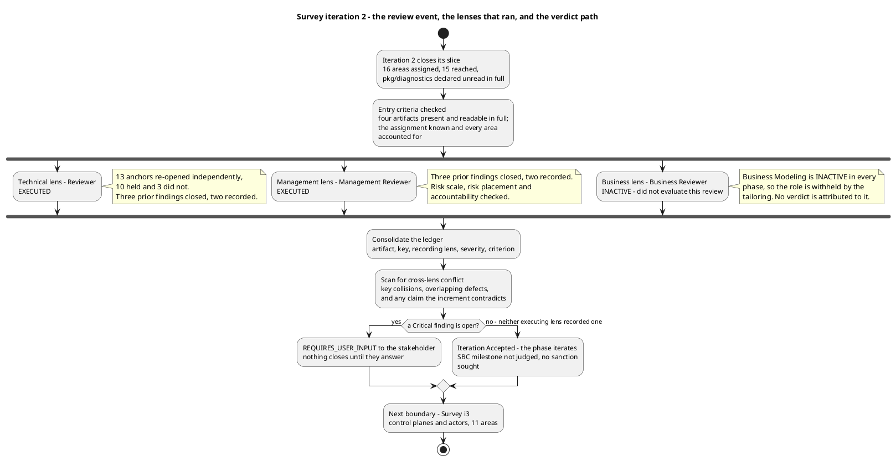

The event is keyed to the iteration boundary, not to a date: a slipped iteration slips its review with it. The next review event on the calendar is the Iteration Acceptance at the close of Survey i3, and the SBC milestone review opens only after the last iteration of the cut and only when every Major finding of the phase has its rework in the baseline.

#### Scope of record

| Element | Value |
|---|---|
| Iteration | Survey 2, cycle 1 — request path and component plane |
| Areas assigned | 16, in the order the Work Order names them |
| Areas reached | 15. `pkg/diagnostics` is declared unread in full with its reason and is not counted as reached |
| Files opened | 28 distinct this iteration; 88 across the phase |
| Artifacts reviewed | System Inventory, Development Case, Iteration Plan, Risk List |
| Artifact read, not assessed | Iteration Assessment — it records iteration 1 and says so; the Project Manager authors this iteration's after the verdict |
| Pull requests to dispose of | None. No role of Survey produces code and the SCM holds no PR in any state, so nothing is approved, changes-requested or deferred |
| Artifact outside this increment | None recorded. The Software Architecture Document is an LCA review target whose first phase is Excavation; nothing is recorded against it |

#### Entry criteria, as enforced

| Criterion | Standard | Outcome |
|---|---|---|
| Artifacts in target state, not draft fragments | Four artifacts present and readable in full | Met |
| Reviewers assigned with expertise matched to the artifact domain | Technical lens on all four; management lens on the plan, the register, the iteration's objectives and the tailoring | Met — both lenses executed on their own criteria; the Business lens is withheld by the Development Case, not mismatched |
| Scope fixed before evaluation, and the scope is the assignment | The Work Order's sixteen areas, in its order | Met — fifteen reached, one declared unread with its reason |
| Evaluation criteria distributed before evaluation | The plan's six objectives and eight criteria, the IARI risk scale, the Development Case measurement policy | Met — each lens states the criteria it applied |
| Prior findings of a lens reconciled before new ones recorded | The six findings earlier reviews left open taken first | Met — six closed, four recorded, none folded into another |
| Findings carry owner, severity and criterion at close | Every finding either closed or scheduled with an owner | Met — the four open findings each carry an action and an owner below |

## Findings
### Reviewer lens
<!-- review: Survey I2 -->

Two findings this iteration: one Major on the System Inventory, one Minor on the Development Case. Nothing is recorded against the Iteration Plan or the Risk List from this lens — silence is the approval — and their two open Major findings remain the Management Reviewer's to close, not mine.

#### System Inventory

**F4 — Major — criterion `consumed-defect`.** The component plane is stated as the category list alone can support, and the count it draws does not hold.

`pkg/components/category.go` declares fifteen `Category` constants: `bindings`, `pubsub`, `secretstores`, `state`, `workflow`, `workflowbackend`, `middleware`, `configuration`, `crypto`, `lock`, `nameresolution`, `conversation`, `search`, `vector`, `binarystore`. The Technology and Size row and the Components table both derive "one registry per category" from that file and anchor thirteen `registry.go` paths. Two of the fifteen have no registry at the path the pattern implies: `pkg/components/workflow/registry.go` and `pkg/components/workflowbackend/registry.go` both resolve to nothing in the tree.

Thirteen of the fifteen do hold. `state/registry.go`, `lock/registry.go` and `conversation/registry.go` were opened for this review and each declares `Registry`, `RegisterComponent`, `Create`, `getStore` and `wrapFn` — the pattern the row describes. So the row is true for thirteen and silent about two, and the two it is silent about are the ones the workflow engine and its actor backend depend on.

The same row declares 52 of the area's 53 files unread and states "a registry is read with the processor that calls it", so all thirteen registry paths are cited as anchors for files the artifact says it never opened. That is the failure mode `System Inventory#F1` recorded, in a new place — and `#F1` was closed this same review, so the pattern is being corrected one instance at a time rather than at its rule.

This is what O2 of this iteration's plan asks the read to close: "each registry is stated as the set of component kinds it admits, with the `Source:` anchor that declares the kind list". Excavation's component recovery and the Software Architect's component view both build on the registry set being complete.

*Remediation.* State the plane from the files that hold it. For each of the fifteen constants name the file that registers it — the thirteen the row already names, and for `workflow` and `workflowbackend` the file that actually holds them, which is not a `registry.go` in a category directory and must be located in the iteration that reads `pkg/runtime/wfengine/` or `pkg/actors/`. Until those two are located, state the count as it is: fifteen categories, thirteen with a registry file under `pkg/components/<category>/`, two whose registration this inventory has not found. Take the thirteen unopened paths out of the anchor column into a "not yet opened" column, or open them. Restate the Components table row the same way, and have the Project Manager carry the two unlocated categories as a risk.

#### Development Case

**F5 — Minor — criterion `contained-defect`.** The Deployment Model trigger's evidence cites a path the tree does not hold.

The row anchors part of its FIRED verdict on "`pkg/config/modes/`" as the package where standalone and Kubernetes modes are both first-class. No such directory exists. The package is `pkg/modes/modes.go`, declaring `type DaprMode string` with `KubernetesMode = "kubernetes"` and `StandaloneMode = "standalone"` — one of this iteration's own sixteen areas, and read as such.

The verdict is unaffected: FIRED rests on seven subcharts, eight Dockerfiles, six executables, placement and scheduler as separate control planes, and mTLS through Sentry, all correctly cited. It stays inside the artifact, which is why it is Minor. It is recorded because a reader checking the verdict follows that path, finds nothing, and cannot tell whether the package moved or the citation was written from its name.

*Remediation.* Correct the path to `pkg/modes/modes.go` and cite the file. Check the other rows of the same table for the same failure — a path cited as evidence must resolve in the tree.

#### Compliance matrix

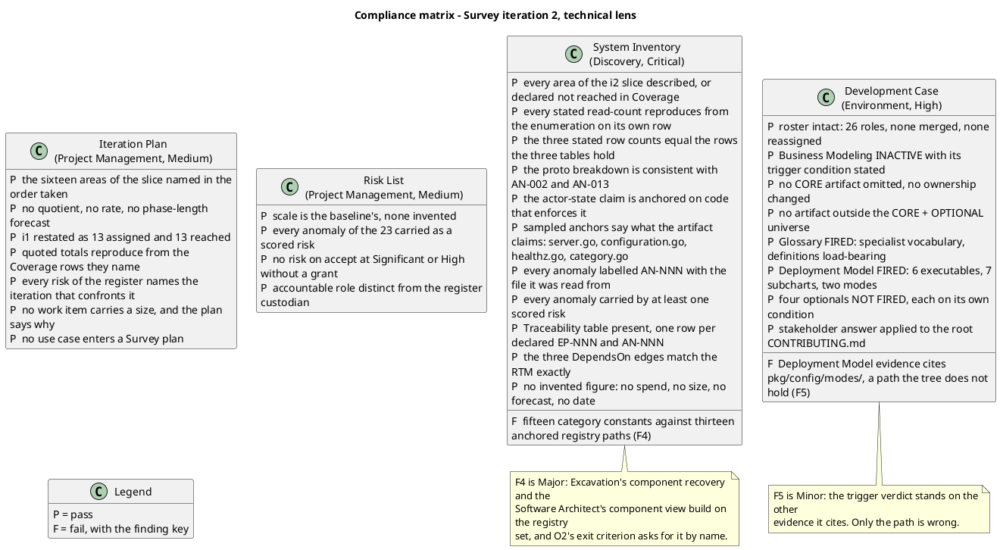

#### Anchors opened for this review

I do not accept an anchor on the artifact's word. These were read directly and compared against what the System Inventory and the Development Case say they show:

| Anchor | What the artifact claims it shows | Outcome |
|---|---|---|
| `pkg/config/configuration.go` | `Configuration.validate()` calls `ActorsSpec.Validate()`, which rejects five binding faults and is nil-safe | Holds — both functions present, the five faults are the ones named, `a == nil` returns nil |
| `pkg/runtime/actorstatestores.go` | one function, `actorStateStoreBindings`, returns a per-type map, returns no error | Holds — a 22-line file, no other declaration |
| `pkg/api/http/server.go` | the primary router gets eight middlewares, the public port three | Holds — `useMaxBodySize` through `useAPILogging` against `useContextSetup`, `useTracing`, `useMetrics` only |
| `pkg/healthz/healthz.go` | `IsReady` is false when no target is registered | Holds — `h.targets > 0 && len(h.unhealthy) == 0` |
| `pkg/cors/cors.go` | two constants and nothing else | Holds — `DefaultAllowedOrigins` and `AllowAllOrigins` |
| `pkg/modes/modes.go` | two constants, `kubernetes` and `standalone` | Holds — the whole package |
| `pkg/middleware/middleware.go` | the `HTTP` type is the whole contract | Holds — `HTTP func(http.Handler) http.Handler` and a one-method interface |
| `pkg/components/state/registry.go` | a registry with `RegisterComponent`, versions and `Create` | Holds — and confirms the pattern `category.go`'s fifteen constants imply |
| `pkg/components/lock/registry.go` | the same pattern for the lock category | Holds |
| `pkg/components/conversation/registry.go` | the same pattern for the conversation category | Holds |
| `pkg/messaging/v1/messaging.go` | the direct-messaging interface | Holds — one `Invoke` method |
| `pkg/components/workflow/registry.go` | one of the fifteen category registries | **Fails — F4**: the path does not resolve |
| `pkg/components/workflowbackend/registry.go` | one of the fifteen category registries | **Fails — F4**: the path does not resolve |
| `pkg/config/modes/modes.go` | the two first-class runtime modes | **Fails — F5**: the path does not resolve |

Ten hold, three do not, and two of the three are the substance of F4. The reading is well anchored where it was checked; what fails is a count in one row and a path in another, which is why the findings are narrow.

#### Findings, at a glance

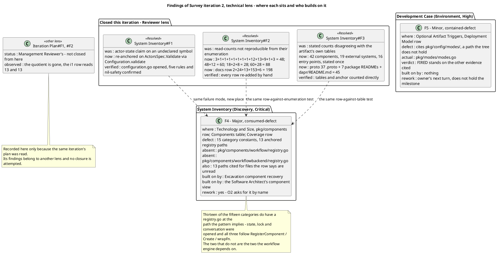

### Management Reviewer lens
<!-- review: Survey I2 -->

<!-- review: Survey I2 -->

Two findings: one Major against the Iteration Plan, one Minor against the System Inventory. Nothing is recorded against the Risk List or the Development Case from this lens — silence is approval.

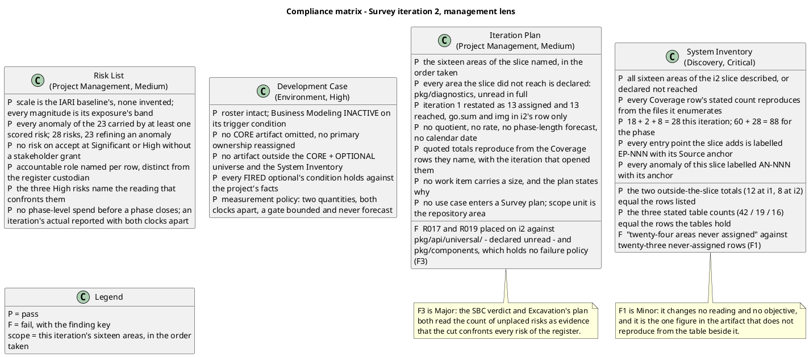

#### Iteration Plan

**`Iteration Plan#F3` — Major — criterion `consumed-defect`.** The risk-driven sequencing places two of the twenty-eight risks on this iteration with retirements the plan's own slice excludes, and one of the two is left with no iteration that reads the area its mitigation names.

The i2 row says R017 is confronted here because the allowlist's operations are "implemented in `pkg/api/universal/` — named in iteration 1 and readable only here". The same plan's W4 exit condition states "`pkg/api/universal/` is not part of this read", and the slice table records `pkg/api/` as one new file of 124 with 118 unread, `universal/` entire among them. The row's second entry says R019 "begins to be settled from `pkg/components/`, where the registries are declared"; that read closed the fifteen component categories, and `pkg/components/` holds nothing about the scheduler's failure-policy families, while R019's own mitigation in the Risk List states the question is settled by reading `pkg/scheduler/`. The i3 row does read `pkg/scheduler/` beside R023, R014, R024 and R026 — and does not carry R019.

The Evaluation Criteria then claim "Every risk of the Risk List names the iteration of the cut that confronts it" on "28 risks, all placed", and the measurement table records "Risks carrying no iteration against them | 0". Two of the twenty-eight are counted as placed against areas this iteration declares unread. The count is real as arithmetic and false as evidence: the SBC verdict and Excavation's plan both read it as proof that the cut confronts every risk of the register. A risk carried to a later phase is a truthful placement; an area the artifact says it did not open, named as the reading that settles a risk, is not.

R028, this iteration's third placement, is correct and is not at issue: its anomaly `AN-023` sits in `pkg/api/http/server.go`, a file this slice re-opened.

*Remediation.* Restate the i2 row to what this slice's reading actually confronts. R028 stays on `pkg/api/http/server.go`. R017 goes to the reading that records the allowlist map as the access-control surface, with no claim about `universal/` — the map was opened in iteration 1 and re-opened in `pkg/api/grpc/` here, and whether its operations are implemented in `universal/` is not a fact this iteration established. R019 moves to the i3 row beside the four risks already there, where `pkg/scheduler/` — the area its mitigation names — is read, and the row says so. Then state the count at 28 placed with each placement naming an area that iteration opens. If either risk genuinely cannot be confronted before Excavation, say that in the row rather than placing it on an unopened area.

#### Risk List

Nothing is recorded. The three High risks are on `avoid` with the reading that confronts each named; the seventeen Significant and High risks are all avoided, so no stakeholder grant is outstanding and none is asked; the three accepted entries are Moderate, where acceptance with a written mitigation and contingency is this role's decision. Accountability is separate from custody on all twenty-eight rows, which is the substance of last iteration's `Risk List#F1`. No phase has closed, so there is no second reading and no trend to invent, and the register invents none.

#### System Inventory

**`System Inventory#F1` — Minor — criterion `contained-defect`.** The sentence closing the Coverage introduction states a count one higher than the rows it counts: "Twenty-four of the areas Technology and Size lists were never assigned to a slice and are declared unread at the foot of this table." The table's never-assigned rows number twenty-three — `docker`, `grafana`, `pkg/acl`, `pkg/apis`, `pkg/backoff`, `pkg/buildinfo`, `pkg/client`, `pkg/encryption`, `pkg/expr`, `pkg/internal`, `pkg/messages`, `pkg/operator`, `pkg/outbox`, `pkg/placement`, `pkg/retry`, `pkg/scopes`, `pkg/security`, `pkg/sentry`, `pkg/sse`, `pkg/testing`, `pkg/validation`, `swagger`, `utils`.

It sits outside the checks the iteration's O4 enumerates, so no objective fails on it. The row sums reproduce, both outside-the-slice totals (12 at i1, 8 at i2) equal their rows, 18 + 2 + 8 = 28 this iteration and 60 + 28 = 88 for the phase. What it costs is the artifact's claim that every figure it prints reproduces from the enumeration beside it: a reader who counts the foot of the table gets twenty-three. It stays inside the artifact — no role builds on this sentence and no exit criterion depends on it — so it does not hold the milestone.

*Remediation.* State twenty-three, or derive the number instead of asserting it — "the areas at the foot of this table, none of them assigned to a slice" — so the sentence cannot drift when the next slice leaves one fewer. Nothing else in Coverage changes.

#### Development Case

Nothing is recorded from this lens. The measurement policy the plan and the register are judged against is this document's, and it is stated clearly enough to judge by: two quantities measured, both clocks read apart, a human gate bounded as a risk under `R002` and never forecast. The optional-trigger record — Glossary and Deployment Model fired, four not fired with reasons — and the discipline deltas hold against the baseline. The Reviewer's Minor finding on the Deployment Model row's cited path is under that lens' key and is not re-recorded here.

#### Iteration Assessment

Not assessed as evidence of this iteration, and its state is not a finding. It records iteration 01 and says so in its own Document Control; the Project Manager authors it after this verdict, so at review time it cannot describe the iteration being reviewed. Its iteration-1 measurement table is the source of the one measured actual this phase holds — 19 480 197 tokens and 0:36:59.0766494 of agent time, with gate queue time measured separately — and that actual is quoted nowhere here as a rate.

### Review Coordinator lens
<!-- review: Survey I2 -->

<!-- review: Survey I2 -->

The consolidated ledger is the authoritative finding list of this review. Each entry is copied from `read_artifact_findings` with its artifact, key, recording lens, severity and criterion; none is added, merged away or re-worded, and none is closed here — closure is the recording lens' own act.

#### Consolidated finding ledger

```plantuml
@startuml
title Consolidated finding ledger - Survey iteration 2, two lenses executed, four findings open
hide empty members
skinparam classAttributeIconSize 0
skinparam wrapWidth 340
skinparam nodesep 20
skinparam ranksep 44

package "Technical lens - Reviewer (EXECUTED)" {
  class "System Inventory#F4" as SIF4 <<Major, consumed-defect>> {
    where : Technology and Size pkg/components row;
            Components table; Coverage row
    defect : 15 Category constants, 13 anchored registry.go paths
    absent : pkg/components/workflow/registry.go
    absent : pkg/components/workflowbackend/registry.go
    also : 13 paths cited for files the row declares unread
    built on by : Excavation component recovery;
                  the Software Architect's component view
    rework : yes
  }
  class "Development Case#F1" as DCF1 <<Minor, contained-defect>> {
    where : Optional Artifact Triggers, Deployment Model row
    defect : cites pkg/config/modes/, a path the tree does not hold
    actual : pkg/modes/modes.go
    verdict : FIRED stands on the other evidence cited
    rework : owner's next turn
  }
}

package "Management lens - Management Reviewer (EXECUTED)" {
  class "Iteration Plan#F3" as IPF3 <<Major, consumed-defect>> {
    where : Risk-driven sequencing i2 row;
            Evaluation Criteria; measurement table
    defect : R017 and R019 placed on areas the same plan declares unread
    defect : R019's mitigation names pkg/scheduler/, carried by i3, which omits it
    built on by : the SBC verdict; Excavation's plan
    rework : yes
  }
  class "System Inventory#F1" as SIF1M <<Minor, contained-defect>> {
    where : Coverage, the sentence closing its introduction
    defect : twenty-four never-assigned areas against twenty-three rows
    built on by : nothing
    rework : owner's next turn
  }
}

package "Business lens - Business Reviewer (DID NOT EXECUTE)" {
  class "no evaluation" as BIZ <<INACTIVE>> {
    status : did not evaluate this review
    verdict : none - not Approved, not any other
    basis : Business Modeling INACTIVE, Development Case section 2
  }
}

package "Closed this review - six, each by its recording lens" {
  class "System Inventory#F1, F2, F3" as SICL <<Reviewer>> {
    F1 : actor-state claim re-anchored on Configuration.validate
    F2 : every Coverage row reproduces from its enumeration
    F3 : 42 / 19 / 16 and the proto breakdown derived from the tables
  }
  class "Iteration Plan#F1, F2" as IPCL <<Management Reviewer>> {
    F1 : the phase-length quotient deleted, the remainder stated as counts
    F2 : i1 reads 13 assigned and 13 reached; go.sum and img in i2's row only
  }
  class "Risk List#F1" as RLCL <<Management Reviewer>> {
    now : custody and accountability separate on all 28 rows
  }
}

class "Cross-lens conflict C1" as C1 <<resolved>> {
  subject : is O2 met - the component plane recorded
  management lens : O2 met, fifteen kinds anchored
  technical lens : the count does not hold, F4 Major
  resolved : the technical lens governs the evidentiary question
  outcome : O2 is met with rework - F4 stands, no finding created or closed
}

class "Key collision C2" as C2 <<resolved, no defect>> {
  subject : System Inventory#F1 names two findings
  Reviewer F1 : actor-state anchor, resolved this review
  Management F1 : the never-assigned count, open, Minor
  resolved : keys are scoped per artifact and per lens
  outcome : this ledger always cites the lens beside the key
}

SIF4 ..> C1 : the substance of it
IPF3 ..> C1 : the management lens' own pass
SIF1M ..> C2 : the second F1 on this artifact
SICL ..> C2 : the first F1 on this artifact
SIF4 --> BIZ
DCF1 --> BIZ
IPF3 --> BIZ
SIF1M --> BIZ

note bottom of C1
  The management lens passed O2 on the artifact's own statement; the
  technical lens opened the tree. Where they differ on what an anchor
  holds, the opened file decides. No lens withdraws a finding here.
end note
note bottom of C2
  The finding key is scoped per artifact and per reviewer lens. A ledger
  that cites "System Inventory#F1" without the lens would record a closed
  Major and an open Minor as the same entry.
end note
@enduml
```

| Finding | Severity | Criterion | Artifact | Recording lens | Built on by | Rework |
|---|---|---|---|---|---|---|
| `System Inventory#F4` | Major | `consumed-defect` | System Inventory | Reviewer | Excavation's component recovery; the Software Architect's component view; O2's exit criterion | Yes |
| `Iteration Plan#F3` | Major | `consumed-defect` | Iteration Plan | Management Reviewer | The SBC verdict; Excavation's plan, which reads the placement count | Yes |
| `System Inventory#F1` | Minor | `contained-defect` | System Inventory | Management Reviewer | Nothing | Owner's next turn |
| `Development Case#F1` | Minor | `contained-defect` | Development Case | Reviewer | Nothing | Owner's next turn |

Two Major, two Minor, zero Critical, zero Info. No finding is open against the Risk List: its one finding from iteration 1 is closed this review, and the register's scale, arithmetic, anomaly coverage and accountability were re-checked by both lenses and hold.

#### The two Major findings, and why they hold the milestone

`System Inventory#F4` is the only finding of this review that changes what another role may build on. `pkg/components/category.go` declares fifteen `Category` constants and the artifact derives "one registry per category" from that file, anchoring thirteen `registry.go` paths — two of the fifteen, `workflow` and `workflowbackend`, resolve to nothing in the tree. The thirteen that do exist were opened for this review and all follow the pattern the row describes, so the row is true for thirteen and silent about the two the workflow engine and its actor backend depend on. The same row declares fifty-two of the area's fifty-three files unread, so every one of the thirteen cited paths is an anchor for a file the artifact states it never opened. Excavation's component recovery and the Software Architect's component view both build on the registry set being complete; O2 of this iteration's plan asks for that set by name.

`Iteration Plan#F3` places two of the twenty-eight risks on iterations whose reading the same plan excludes. R017 is placed on this iteration because the allowlist's operations are "implemented in `pkg/api/universal/`", which W4 of the same plan states is not part of the read; R019 is placed on this iteration against `pkg/components/`, which holds nothing about the scheduler's failure-policy families, while its own mitigation names `pkg/scheduler/` — an area iteration 3 reads and whose row omits it. The Evaluation Criteria and the measurement table then read "28 risks, all placed" as evidence that the cut confronts every risk of the register. The count is true as arithmetic and false as evidence, and the SBC verdict and Excavation's plan both read it.

Neither Major stops this iteration's acceptance. A Major is reworked before any role consumes the failing content again, and the milestone is not sanctioned while it stands; the phase iterates either way.

#### Cross-lens conflicts, resolved

| # | Conflict | Resolution | Where it lands |
|---|---|---|---|
| C1 | The management lens passed O2 — "the component plane recorded, fifteen kinds anchored" — while the technical lens recorded the registry count failing as a Major. | Not a disagreement to arbitrate between lenses: it is a question of fact, and an anchor opened against the tree settles it. The opened file governs, so the technical lens' F4 stands and O2 is read as met with rework. Neither lens withdraws a finding; no finding is created or closed by this resolution. | `System Inventory#F4` open; the plan's O2 outcome restated in the Disposition |
| C2 | Two open-and-closed findings carry the key `System Inventory#F1` — the Reviewer's actor-state Major, resolved this review, and the Management Reviewer's never-assigned-count Minor, open. | Not a conflict but a key collision, and it is correct behaviour: a finding key is scoped per artifact and per reviewer lens. The resolution is in this ledger's form — every citation names the recording lens beside the key, so a closed Major and an open Minor never merge into one row. | No artifact changes; the ledger cites the lens throughout |

No conflict required a lens to withdraw a finding. Neither lens claimed a finding the other had recorded, which is the failure mode a consolidation looks for first: the management lens explicitly declined to re-record F4 under its own key and the technical lens explicitly declined to close the management lens' findings.

#### What no lens recorded

| Check | Both executing lenses |
|---|---|
| Critical finding | None. Both recorded zero, so nothing escalates to the stakeholder and no decision is asked of them |
| Finding against an artifact outside the four reviewed | None. Four artifacts exist for this phase iteration and all four were read; the Iteration Assessment was read and not assessed as evidence, which is not a defect in it |
| Pull request to dispose of | None in any state. Survey produces no code and the Implementation Model does not exist yet |
| Invented figure | None found in any of the four artifacts — no token spend, elapsed time, work-item size, velocity, density or projected date. The one measured actual the phase holds is iteration 1's, quoted as that iteration's own fact with both clocks apart |
| Finding carried as a new key that belongs to an earlier one | None. All four open findings are new defects; the six earlier ones were closed under their existing keys and the technical lens states why F4 is not a re-record of F2 and F3 — those closed their own rows and did not reach this one |
| Recovered element carrying an identifier family it does not own | None. Decision records are cited as evidence and not renumbered; the three `DependsOn` edges match the trace graph exactly |

## Resolutions and Actions
### Reviewer lens
<!-- review: Survey I2 -->

<!-- review: Survey I2 -->

#### Findings closed this review

Each was closed by `resolve_artifact_finding` from this lens, after I verified the corrected content against the file it cites — not against a note saying it was done.

| Finding | Severity | How the defect was fixed | Evidence I verified |
|---|---|---|---|
| `System Inventory#F1` | Major | The actor-state claim is re-anchored on code that enforces the rule. The note and the table row now state that the runtime neither chooses nor requires an actor state store at start-up, name `actorStateStoreBindings` as the reporting function, and cite `Configuration.validate()` → `ActorsSpec.Validate()` for the five binding faults it rejects. Both files are in the read set. | I opened `pkg/config/configuration.go`: `validate()` ends `return c.Spec.ActorsSpec.Validate()`, and the function's `if a == nil { return nil }` makes it nil-safe exactly as the note now says. `pkg/runtime/actorstatestores.go` is 22 lines with one function and no error return. |
| `System Inventory#F2` | Major | Every Coverage row's stated count now reconciles with the files enumerated on the same row, and the Iteration Plan re-quotes only the reconciled totals. | I re-added every enumeration. i1: 3+1+1+1+1+1+1+1+12+13+9+1+3 = 48; outside the slice 2+1+5+1+1+1+1 = 12; 48+12 = 60. i2: 1+3+1+2+1+1+1+1+1+0+1+1+1+1+1+1 = 18, plus the 2 extended areas = 20, plus 8 outside = 28. Phase 60+28 = 88. `docs` row in Technology and Size: 2+24+13+153+6 = 198. |
| `System Inventory#F3` | Minor | The three row counts are derived from the tables and stated once, with the status line pointing at that single statement; the proto breakdown is restated consistently with AN-002 and AN-013. | I counted the tables: 42 components, 19 external actors and systems, 16 entry points — which is what the introducing paragraph states. Proto: 37 `.proto` + 7 package READMEs + `dapr/README.md` = 45. |

`System Inventory#F4` is the same class of defect as F2 and F3 — a stated count that does not reconcile with what the row itself prints — appearing in a row the earlier corrections did not reach. That is the reason the finding is recorded rather than folded into one of them: closing F2 and F3 did close those rows, and did not close this one.

#### Actions this review sets

| # | Action | Owner | Closes | Holds the SBC gate |
|---|---|---|---|---|
| 1 | For each of the fifteen category constants, name the file that registers it; locate the registration of `workflow` and `workflowbackend`, or state that it is not located; take the unopened `registry.go` paths out of the anchor column, or open them; restate the Components table row to match | Software Archaeologist | `System Inventory#F4` | Yes — O2's exit criterion asks for the registry set by name, and Excavation's component recovery builds on it |
| 2 | Carry the two unlocated categories as a risk, scored on the register's own scale | Project Manager | `System Inventory#F4` at its consuming end | Yes |
| 3 | Correct the Deployment Model evidence path to `pkg/modes/modes.go`; check the other rows of the same table for paths that do not resolve | Process Engineer | `Development Case#F5` | No — owner's next turn |

Action 1 is one act of correction in one artifact and is worked as a whole: a row that names thirteen of fifteen categories and anchors thirteen paths must be fixed in the count and in the anchors together, or the reader is left with a corrected number over uncorrected evidence.

#### What this lens does not close

`Iteration Plan#F1` and `Iteration Plan#F2` are open under the Management Reviewer's lens and are not mine to close. I read the plan to judge whether its figures reproduce, and they do: the quotient the earlier finding named is absent, "The remainder, counted" states 41 areas across three iterations with R001's remedy and no rate, and the i1 row reads 13 assigned and 13 reached. That observation is recorded; the closure is the recording lens' act.

`Risk List#F1`, also the Management Reviewer's, is outside this lens' judgment.

#### Pull requests

`scm_list_pull_requests` returns no pull request in any state, so there is nothing to approve, request changes on, or defer. That is correct for Survey: no role of this phase produces code, and the Implementation Model does not exist yet.

#### Defect distribution

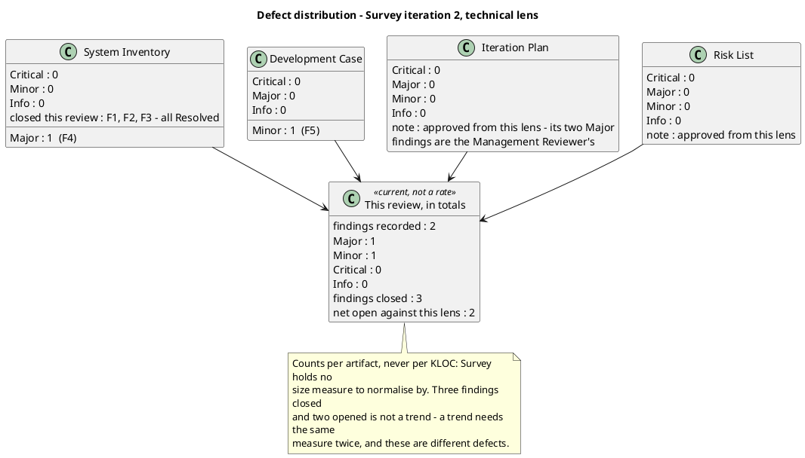

### Management Reviewer lens
<!-- review: Survey I2 -->

<!-- review: Survey I2 -->

Three findings of this lens from iteration 1 are closed this turn, each on evidence read from the corrected artifact rather than on the owner's word. Two findings of this iteration are open.

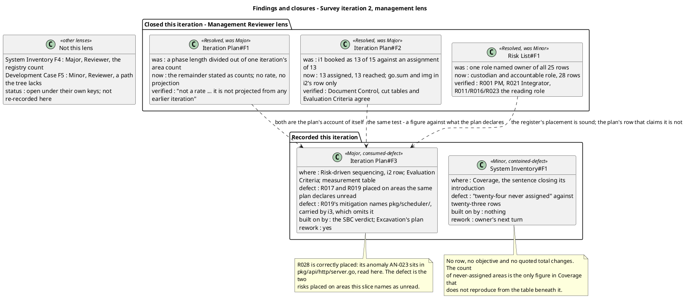

| Finding | Severity | Criterion | Artifact | State | Closes by |
|---|---|---|---|---|---|
| `Iteration Plan#F1` | Major | `plan-sizing` | Iteration Plan | Resolved this turn | — |
| `Iteration Plan#F2` | Major | `consumed-defect` | Iteration Plan | Resolved this turn | — |
| `Risk List#F1` | Minor | `contained-defect` | Risk List | Resolved this turn | — |
| `Iteration Plan#F3` | Major | `consumed-defect` | Iteration Plan | Open | The risk-driven sequencing row and its count, restated |
| `System Inventory#F1` | Minor | `contained-defect` | System Inventory | Open | The never-assigned count, stated at twenty-three |

#### What each closure rests on

`Iteration Plan#F1` — the quotient is gone and so is the conclusion drawn from it. "The remainder, counted" states 13 read, 16 assigned, 41 across the three iterations that follow, then in terms: "These are counts of areas, not of files read and not a rate: whether the cut still holds is asked and answered at the close of each iteration from what that iteration read, and it is not projected from any earlier iteration." The Evaluation Criteria carry the same sentence. `R001` stands as the overrun risk with one more iteration as the remedy, never less scope, and the plan states that no phase has closed so there is no measured actual to forecast from.

`Iteration Plan#F2` — iteration 1's row reads 13 areas and 13 reached; the paragraph above the cut table states the fact once ("`go.sum` and `img` were not among them and are not counted here — they are iteration 2's, and they appear in iteration 2's row only"); the five areas opened short of their file count are restated as Excavation's Priorities order rather than as a Survey remainder, so no area sits in two iterations; and the "Unread areas declared" criterion now reads "Iteration 1 had no unreached area: 13 assigned, 13 reached". Document Control, the cut tables and the Evaluation Criteria now agree.

`Risk List#F1` — the register's role column is "Accountable role", and the paragraph introducing the register states the distinction: the custodian is the Project Manager on all twenty-eight, while the accountable role is the one whose act retires the entry. The names the mitigation rows already gave are in the column — Software Archaeologist for the twenty-two reading risks, Project Manager for `R001` and `R002`, Integrator for `R021`. The structure diagram carries `custodian` and `accountableRole` as separate attributes, and the plan's Evaluation Criteria now asks for both, so the AR gate has a name to ask of each High risk.

#### Open findings, and what closes each

`Iteration Plan#F3` closes when the risk-driven sequencing places R017 and R019 on iterations that open the area each retirement needs, or states plainly that the risk is carried to Excavation, and the "28 risks, all placed" count is true on that reading. `System Inventory#F1` closes when the Coverage sentence states twenty-three, or derives the count from the rows at the foot of the table.

Both sit above the phase's gate condition: the SBC milestone does not close while a Major of this lens is open. This is an Iteration Acceptance and the phase iterates regardless — the milestone is not judged here.

#### Reconciliation with the other lenses

| Lens | Recorded this iteration | Overlap with this lens | Resolution |
|---|---|---|---|
| Reviewer | `System Inventory#F4` (Major, the fifteen category constants against thirteen anchored registry paths), `Development Case#F5` (Minor, a path the tree lacks) | None on the same defect — F4 is the component plane's count, F3 is the plan's risk placement | Both stand under their own keys; neither absorbs the other |
| Business Reviewer | Did not execute — Business Modeling is INACTIVE on its trigger condition | None | No verdict attributed to it |
| This lens | `Iteration Plan#F3`, `System Inventory#F1` | `System Inventory#F1` sits against the same Coverage table as the Reviewer's closed `System Inventory#F2`, but on a figure that check did not reach | Recorded here; not a re-record of `#F2` |

### Review Coordinator lens
<!-- review: Survey I1 -->

<!-- review: Survey I1 -->

No prior finding of this lens exists: this is the first review event of the phase, so there was nothing to reconcile and nothing was closed. The closure column below is an obligation assigned to the recording lens, not a closure performed here.

#### Finding lifecycle at this gate

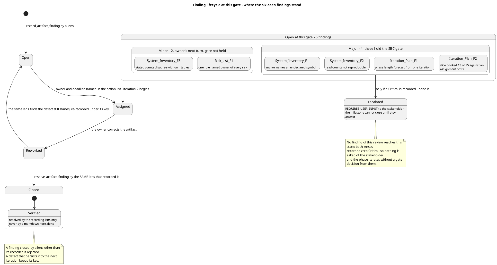

#### Prioritized actions

Priority is set by what blocks what, not by severity alone: `Iteration Plan#F2` comes first because the SBC verdict reads it as evidence, and `System Inventory#F2` comes second because the next cut sizes itself from it. Both are Major and both are owed before the next iteration's slice is fixed.

| # | Action | Owner | Closes | Deadline | Holds the SBC gate |
|---|---|---|---|---|---|
| 1 | Restate iteration 1's cut row as 13 assigned and 13 reached; list `go.sum` and `img` in iteration 2's row only; restate the "Unread areas declared" criterion on a true fact | Project Manager | `Iteration Plan#F2` | Before the next cut is declared | Yes |
| 2 | Reconcile every Coverage row's stated count with the files it enumerates; correct the outside-slice total and the `docs` categories; move the anchor out of the unread set it claims | Software Archaeologist | `System Inventory#F2` | Before the next cut sizes itself from these counts | Yes |
| 3 | Re-quote the corrected in-slice and outside-slice totals in the measurement table, Evaluation Criteria and cut tables | Project Manager | `System Inventory#F2` at its consuming end | Immediately after action 2 | Yes |
| 4 | Delete the 57 ÷ 13 quotient and the conclusion drawn from it; state the remainder as the counts the cut holds, with R001 as the remedy and one more iteration as the mechanism | Project Manager | `Iteration Plan#F1` | Before the SBC gate is asked | Yes |
| 5 | Anchor the actor-state start-up requirement on code that enforces it, or restate the claim as what `actorStateStoreBindings` does and what it does not enforce | Software Archaeologist | `System Inventory#F1` | In the iteration that reads `pkg/runtime/` — Survey i3 by the cut | Yes |
| 6 | Derive the component and external-system counts from the tables and state them once; restate the proto file breakdown consistent with the README and overview anomalies | Software Archaeologist | `System Inventory#F3` | Owner's next turn | No |
| 7 | Add an accountable-role column distinct from the register's custodian and lift into it the names the mitigation rows already give | Project Manager | `Risk List#F1` | Owner's next turn | No |

Actions 1 and 4 are one act of correction in one artifact and are worked together; they remain two findings because one is a false account of the slice and the other a figure no measurement produced. Actions 2 and 3 are one correction seen from its source and its consuming end.

#### Which lens closes what

| Finding | Closed only by | Verification the lens applies |
|---|---|---|
| `System Inventory#F1` | Reviewer | The corrected paragraph cites a symbol the file declares, and the file is in the read set |
| `System Inventory#F2` | Reviewer | Each count reproduces from the enumeration on its own row |
| `System Inventory#F3` | Reviewer | The status line and both tables state one number each |
| `Iteration Plan#F1` | Management Reviewer | The quotient is absent and the remainder is stated as counts |
| `Iteration Plan#F2` | Management Reviewer | The i1 row reads 13 and 13, and `go.sum` and `img` appear once |
| `Risk List#F1` | Management Reviewer | Every row names a role that performs the retiring act |

No action is assigned to a role that does not work in this phase. No action carries a size, an effort figure or a calendar date: none has been measured, and a date projected from an estimate would read downstream as an observation.

#### What this review does not add to the increment

Two optional artifacts are FIRED by the Development Case and produced in later phases — the Glossary and the Deployment Model. Neither is due in Survey and neither was reviewed here; nothing is recorded against them. The remaining four optionals are NOT FIRED and none is produced. The `System Inventory#F3` proto-breakdown and `#F1` actor-state items require the artifact's author to correct its own account of a file; they are corrections, not new reading.

## Disposition
### Reviewer lens
<!-- review: Survey I2 -->

**Approved with Changes.** No Critical finding: nothing in this iteration needs a decision only the stakeholder can make, and no `REQUIRES_USER_INPUT` is raised.

One Major finding (`System Inventory#F4`) and one Minor (`Development Case#F5`). Under the severity contract the artifact is reworked before any role consumes the failing content again, and the SBC milestone is not sanctioned while a Major stands. Three prior findings of this lens — `System Inventory#F1`, `#F2`, `#F3` — are closed, each verified against the file its correction cites.

The iteration met its slice. Fifteen of sixteen assigned areas were reached and `pkg/diagnostics` was declared unread with its reason, which is a declaration and not a skip. Ten of the thirteen anchors I opened independently say what the artifact claims; the three that do not produced F4 and F5. That proportion is why the findings are narrow: this reading is well anchored where it was checked, and what fails is a count in one row and a path in another.

This disposition is the technical lens' judgment of the iteration's completion. It is not the SBC verdict — that is the Review Coordinator's, taken after the Management Reviewer.

#### What this lens hands to the next two

| Recipient | What it inherits | What it must not do |
|---|---|---|
| Management Reviewer | `System Inventory#F4` open from this lens; its own `Iteration Plan#F1`, `Iteration Plan#F2` and `Risk List#F1` still open. I read the plan and observed that the quotient is gone and that its figures reproduce from the Coverage rows they name — recorded, not closed, because closure is that lens' act | Re-record F4 under its own key. It is a technical defect and this lens owns it |
| Review Coordinator | Zero open Critical from this lens; one open Major from this lens, two from the management lens; two Minor. The SBC gate is not sanctioned while a Major stands | Issue the SBC verdict on this review. This is an Iteration Acceptance and the milestone's exit criteria are not judged here |

The two Minor findings — `Development Case#F5` and `Risk List#F1` — do not hold the gate. Under the severity contract their owners fix them in their next turn, after the Critical and Major work.

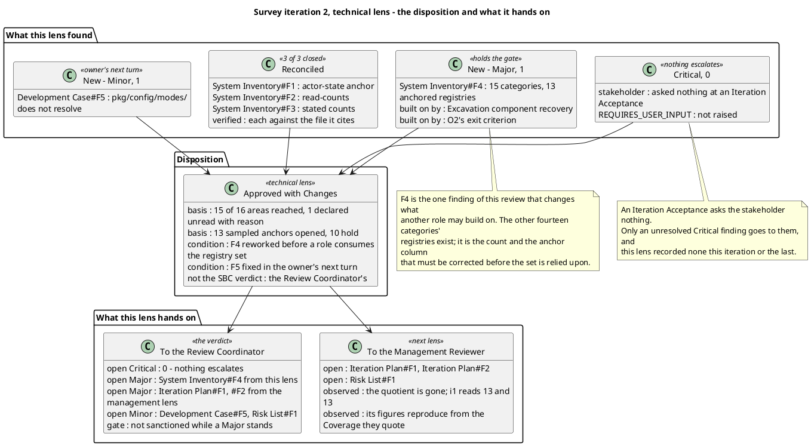

### Management Reviewer lens
<!-- review: Survey I2 -->

<!-- review: Survey I2 -->

**Conditional Go on the iteration, from the management lens.** Iteration 2 read the sixteen areas the cut assigned it in the order taken, declared the one it did not reach, met five of its six objectives on the artifact's own evidence, and returned a perimeter and a component plane a recovery phase can build on. One Major finding and one Minor stand.

The condition is narrow and is not a re-read:

| Condition | Owner | Why it does not need a new area read |
|---|---|---|
| The risk-driven sequencing places R017 and R019 on iterations that open the area each retirement needs, or states that the risk is carried to Excavation; the "28 risks, all placed" count is restated truthfully | Project Manager | Both the allowlist map and `pkg/scheduler/` are already in the cut. The defect is which row claims them |
| The never-assigned count in Coverage is stated at twenty-three or derived from its rows | Software Archaeologist | A figure in a sentence; no row, no objective and no quoted total changes |

Nothing is asked of the stakeholder by this review. No Critical finding is open — the register holds no Significant or High risk on `accept`, so it carries no grant to seek — and a decision only the stakeholder can take has not arisen in this iteration.

What this verdict does not decide, and must not be read as deciding:

| Not decided here | Where it is decided |
|---|---|
| Whether the phase may advance | The SBC milestone review, which opens when the cut holds no unread area and every Major finding of the phase has its rework in the baseline. This iteration leaves 41 areas for three further iterations |
| Whether the component plane is complete | `System Inventory#F4`, under the Reviewer's lens. That finding is Major and holds the milestone; it does not hold this iteration's acceptance, and the plan carries the two unlocated categories as a risk |
| How long the phase will take | Nothing. No phase has closed; one iteration's measured spend is that iteration's fact, quoted with both clocks apart and projected onto nothing |
| Who retires each High risk | The Risk List's accountable-role column, which the AR gate reads |

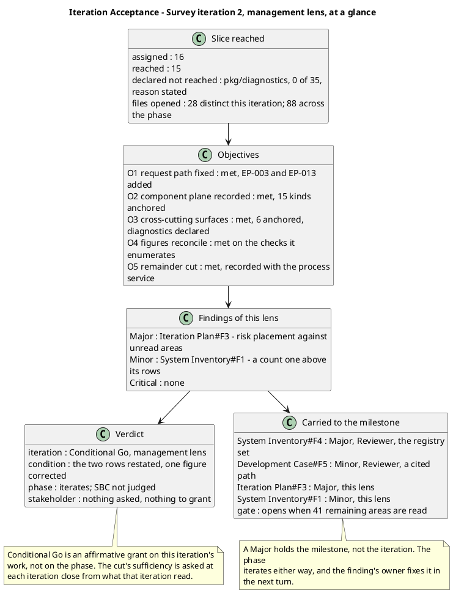

### Review Coordinator lens
<!-- review: Survey I1 -->

<!-- review: Survey I1 -->

**Iteration Acceptance — the phase iterates. The SBC milestone is not judged and no phase is closed.**

No Critical finding is open: both executing lenses recorded zero, so nothing escalates to the stakeholder and `REQUIRES_USER_INPUT` is not raised. The verdict below asks them nothing and seeks no sanction.

Four Major findings stand open — `System Inventory#F1`, `System Inventory#F2`, `Iteration Plan#F1`, `Iteration Plan#F2` — and two Minor. The Major set is why the milestone is not judged in this record: the SBC review's entry criterion requires every Major of the phase to have its rework in the baseline, and none of the four does yet.

#### Review effectiveness — current metrics only

This is the project's first review event. No prior iteration and no prior cycle exists to compare against, so no trend is computed and none is inferred; the trend column of the effectiveness report stays empty until a second review has actually occurred.

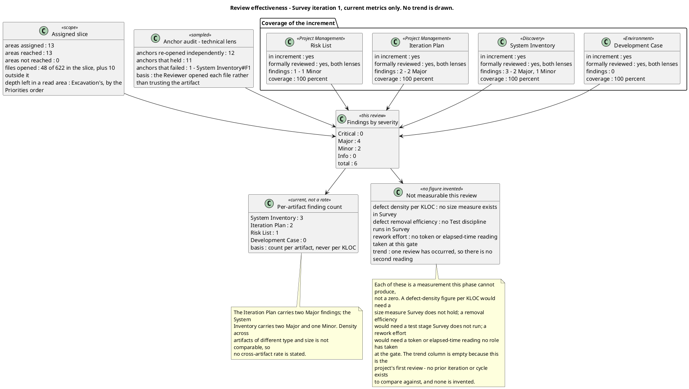

| Effectiveness indicator | Value at this review | What it means here |
|---|---|---|
| Review coverage of planned artifacts | 4 of 4 — 100 percent | Every artifact the Development Case sanctions for Survey iteration 1 was reviewed by both executing lenses |
| Review coverage of the assigned slice | 13 of 13 areas reached, 100 percent | No area of the assignment went unjudged; depth inside a reached area is Excavation's by the Priorities order |
| Findings recorded | 6 | 4 Major, 2 Minor, 0 Critical, 0 Info |
| Findings per artifact | System Inventory 3, Iteration Plan 2, Risk List 1, Development Case 0 | A bare count, not a density: the artifacts differ in type and size, and no size measure exists to normalise by |
| Defect density per size | Not measurable | Survey holds no size measure. A per-KLOC figure would be `[ASSUMPTION — requires validation]` and is not stated |
| Defect removal efficiency | Not measurable | No Test discipline runs in Survey, so there is no test-found defect population to compare review-found defects against |
| Rework effort | Not measurable | No token or elapsed-time reading was taken at this gate. Both clocks are the Development Case's measurement policy and neither has a value for this review |
| Anchor audit hit rate | 11 of 12 independently re-opened anchors held | The technical lens verified anchors rather than accepting them; one failed, which is the origin of `System Inventory#F1` |
| Overdue findings | 0 | This is the first review; no deadline has yet passed and nothing is escalated |
| Trend across iterations or cycles | None drawn | One review has occurred. Comparison begins when a second has |

The four "not measurable" entries are the correct reading, not missing data. Each names the measurement the phase cannot produce and why; filling one with a figure would be the failure `Iteration Plan#F1` records.

#### Verdict

**Iteration Accepted — the phase iterates.** The iteration's four objectives were met on the increment's own evidence, thirteen of thirteen assigned areas were reached, and both executing lenses accepted the work with changes. The four Major findings are corrections to how the work is accounted for, not reasons to re-read an area, so the cut's own next slice — the request path and the component plane, `pkg/api/` read whole, with `go.sum` and `img` carried — stands unchanged.

The SBC milestone is not judged here and is not sanctioned. Its review opens once Survey's cut holds no unread area and every Major finding of the phase has its rework in the baseline. Neither condition is met: four Major findings are open and four of the cut's five iterations are unread.

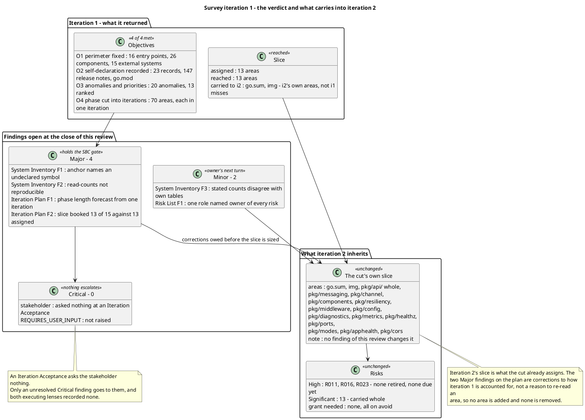

#### Lenses that did not execute

The Business Reviewer is recorded as **INACTIVE — did not evaluate this review**. No verdict is attributed to that lens in this record or anywhere in it, and the decision above rests only on the technical and management lenses, which both executed. Business Modeling is INACTIVE in every phase by the Development Case, so this is the tailoring working as configured, not a review event that failed to convene.

#### What the next iteration must show this office

| Check at the close of Survey i2 | Standard |
|---|---|
| Actions 1 to 5 of the prioritized list | Each closed by its recording lens, verified against the corrected content, not against a note saying it was done |
| The two Minor findings | Fixed in their owner's next turn, or re-recorded under their existing keys with a reason |
| Any finding that persists into i2 | Re-recorded under its existing key — never as a new finding, so review debt stays countable |
| Review debt | No finding past its deadline without a written escalation to the Project Manager |
| New findings against i2's artifacts | Recorded with owner, severity and deadline before the iteration closes |
