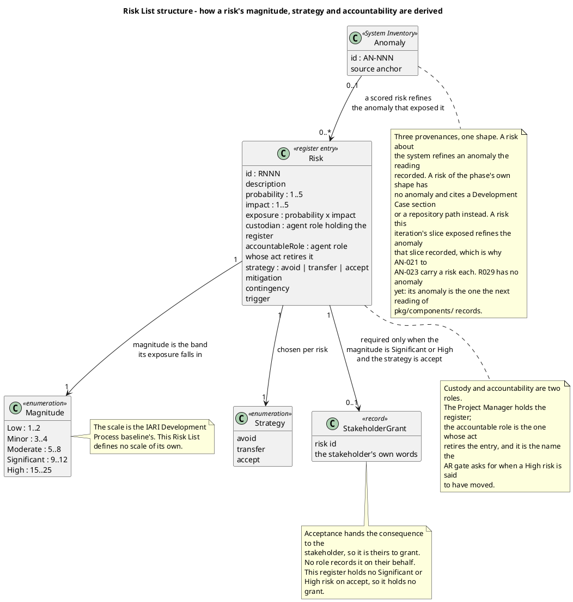
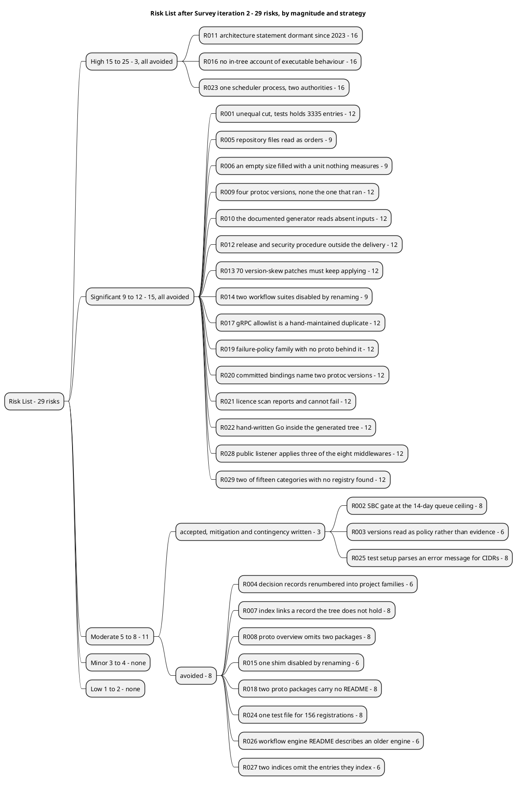

## Document Control
Phase: Survey
Status: Draft — iteration 3. Thirty-two risks: every one of the System Inventory's twenty-seven anomalies carried as a scored risk, beside five risks of the phase's own shape. Three High, seventeen Significant, twelve Moderate — all twenty Significant and High on avoid, and the three Moderate accepted with a written mitigation and contingency. Seven entries restated this iteration to the code the reading reached — R014, R019, R023, R026 and R029 among them — three new anomalies carried as R030 to R032, and R029 moved off the register's one unanchored row onto AN-024. Every row names the custodian of the register and, separately, the role whose act retires it. No stakeholder grant is outstanding and none is asked.
Milestone Target: end-of-Survey milestone (SBC) — not yet achieved
## Risk Classification
Every risk is scored on the IARI risk scale carried by the IARI Development Process baseline. This Risk List defines no scale of its own: probability is 1–5, impact is 1–5, exposure is their product, and the magnitude is the band that exposure falls in — never a band chosen for it. The project Development Case tailors the process by deltas and adds nothing to this scale; what it adds is the 14-day bound on the human gate, carried under R002.

| Probability | Level | Means |
|---|---|---|
| 1 | Very low | 10 % or less |
| 2 | Low | 11 % to 30 % |
| 3 | Medium | 31 % to 50 % |
| 4 | High | 51 % to 70 % |
| 5 | Very high | More than 70 % |

| Impact | Level | Means |
|---|---|---|
| 1 | Very low | No deviation from the plan worth recording |
| 2 | Low | Extra work inside the current iteration; its objectives are still met |
| 3 | Medium | An iteration objective slips to a later iteration the phase already plans |
| 4 | High | The milestone slips: the phase needs an iteration it did not plan |
| 5 | Very high | Success is endangered: a declared requirement or constraint can no longer be met as declared |

| Magnitude | Exposure | Whose grant to accept it |
|---|---|---|
| High | 15–25 | The stakeholder's |
| Significant | 9–12 | The stakeholder's |
| Moderate | 5–8 | Ours — avoidance, transfer or acceptance with mitigation and contingency |
| Minor | 3–4 | Ours |
| Low | 1–2 | Ours |

### Distribution after this iteration

The three High risks are about one thing: the delivery states less about itself than its code does. R011 is its architecture statement stopping in 2023; R016 is its behaviour living on a site outside the tree; R023 is its newest control plane taking its authority from what its peers report. Excavation reads the code and cites the anchors — that is the avoidance for all three, and for the fifteen Significant risks beside them: each is avoided by the shape of the reading the next phase is given, not by a promise made to the stakeholder.

No risk in this register is Accepted at Significant or High magnitude, so no stakeholder grant is outstanding and none is requested. The three accepted entries — R002, R003, R025 — are Moderate, where acceptance with a written mitigation and contingency is this role's decision and no one else's to approve.

### How a probability is fixed

Probability is the chance the consequence happens **to the reading this project is doing**, not the chance the defect exists. A defect the tree shows plainly has already happened; what is uncertain is whether it misleads a later role. That is why R015 and R026 — a disabled shim, a stale README — sit at probability 3 even though the anomalies they rest on are certain: neither is likely to be reached before the code it misstates is read.

R029 is scored on the same rule and lands differently. The defect is certain — the two categories have no registry file at the path the other thirteen follow — and probability 4, not 3, because the consequence is not about reaching an anchor but about a count: a reader taking the fifteen constants as fifteen registries is reading the artifact as it is written, which one review lens did before the files were opened, and every later component view starts from that count. Impact is 3: the retirement lies inside the phase the cut already plans, in `pkg/runtime/wfengine/` and `pkg/actors/`, so an objective slips to a later iteration the phase plans rather than the milestone slipping. Exposure 12, Significant. Avoided by locating the registration in Survey i3 and by every artifact stating fifteen categories of which thirteen have a registry file and two are unlocated.

R028 keeps the probability band the certainty of its code would raise. The public listener's narrower middleware set is in the code and is not in doubt; whether it is a defect depends on a deployment decision this project has not seen made. A public port is opt-in, no Configuration in the tree sets one, and the repository holds no deployment that turns it on. So the probability that the consequence reaches a declared constraint is 3 — medium, 31 % to 50 % — and not 4. Its impact is 4, and that is the band that matters: if a deployment does set a public port, an access-control constraint the operator configured is no longer met as declared, and the failure is silent — the surface is served, so nothing announces that the body ceiling, the CORS policy, the API-token check and the component middleware are absent.

No risk in this register is scored on a scale of its own, and no magnitude is chosen: each is the band its exposure falls in.

## Risk Register
Thirty-two risks. Twenty-seven refine an anomaly the Software Archaeologist recorded; five have no anomaly behind them and are risks of the phase's own shape. The `Source` cell cites the anomaly id and the anchor it was read from; the trace edge is in `## Traceability`.

Two roles are named per row, and they are different roles. The **custodian** is the Project Manager on all thirty-two: it holds the register, scores the entry and checks the sequencing. The **accountable role** is the role whose act retires the entry — the reading that reaches the anchor, the build that carries the patch, the gate that opens. At the AR gate the question asked of a High risk is who performed the act that moved it, and the accountable column is the answer that question reads. Where a row's mitigation names a second role's decision, the cell says so: the act that retires the risk is the reading, and the decision that follows it is someone else's.

| ID | Risk | Source | P | I | Exposure | Magnitude | Strategy | Accountable role |
|---|---|---|---|---|---|---|---|---|
| R001 | The cut is unequal. `tests/` holds 3 335 of the tree's 6 631 entries and sits with `charts/`, `docker/`, `swagger/` and `platforms/` in Survey iteration 4's slice; a slice that overruns turns one iteration into two, and the phase then needs an iteration the cut did not plan. | AN-010; repository tree | 4 | 3 | 12 | Significant | Avoid | Project Manager — it owns the cut and re-cuts the slice |
| R002 | The SBC gate is the phase's only human dependency: three reviewer verdicts with no role working between them. Beyond the 14-day ceiling the process suspends rather than filling the gap, and the milestone waits for however long the queue is. | Development Case § Measurement policy | 2 | 4 | 8 | Moderate | Accept | Project Manager — it opens the gate and reports its queue time |
| R003 | The tree fixes its toolchain (`go 1.26.11`, exact pseudo-versions for the `dapr/*` modules). A reading that states those as the project's policy pre-empts a decision recorded in Inception, and the statement must then be re-read. | Development Case § Version policy | 3 | 2 | 6 | Moderate | Accept | Software Archaeologist — every version statement in the reading is its anchor |
| R004 | The 23 records under `docs/decision_records/` are the system's own architectural evidence. A role may renumber them into the project's `API-*`/`ARC-*` families, or treat a record as an instruction to this process. | Development Case § Which artifact carries recovered material | 3 | 2 | 6 | Moderate | Avoid | Software Archaeologist — it cites the records as evidence and renumbers none |
| R005 | The repository carries instruction-shaped files — `.github/copilot-instructions.md`, the nine issue forms, `CONTRIBUTING.md`, the release procedure. Read as orders rather than as evidence of how the system is worked, they take a role outside the declared scope. | Scope guard, sprint zero | 3 | 3 | 9 | Significant | Avoid | Project Manager — the scope guard sits in every role's work order |
| R006 | No phase of this project has closed, so no token spend and no elapsed time is measured at phase level and every work item's size is empty. Filled with a person-week or an invented token forecast, the plan reads as measured and is not. | Development Case § Measurement policy | 3 | 3 | 9 | Significant | Avoid | Project Manager — it writes the plan and the assessment |
| R007 | The decision-record index offers 24 links against the 23 files the folder holds: a reader following it reaches a 404, and a recovery that counts architecture records from the index counts one that does not exist. | AN-001; `docs/decision_records/decision_records.md` | 4 | 2 | 8 | Moderate | Avoid | Software Archaeologist — the record count comes from the folder |
| R008 | `dapr/README.md` lists seven proto packages while the tree holds nine: the two it omits carry the scheduler placement contract and the MCP server contract, both of them entry points of this inventory. | AN-002; `dapr/README.md` | 4 | 2 | 8 | Moderate | Avoid | Software Archaeologist — the package list is read from the tree |
| R009 | Four documents each claim to be the proto generation path and each states a different `protoc` version — 3.10.0, v25.4, v4.25.4, v34.1 — and none of them produced the committed bindings. A regeneration from any one is not reproducible from the others. | AN-003; `tools/proto/generate.sh`, `dapr/README.md`, `dapr/proto/runtime/v1/README.md`, `.github/copilot-instructions.md` | 4 | 3 | 12 | Significant | Avoid | Software Archaeologist — it records all four and adopts none |
| R010 | The documented client-generation script reads `pkg/proto/dapr/dapr.proto` and `pkg/proto/daprclient/daprclient.proto`, files the tree does not hold, so the generation path Excavation would cite cannot run at all. | AN-004; `tools/proto/generate.sh` | 4 | 3 | 12 | Significant | Avoid | Software Archaeologist — it records the script as unusable |
| R011 | No decision record has been added since 2023-09-11 while decisions of the first rank landed — scheduler-hosted actor placement with cutover and rollback, search and vector, MCP server resources, workflow schedules. A recovery that takes the record set as its authority recovers a system three years older than the code. | AN-005; commit log of `docs/decision_records/` | 4 | 4 | 16 | High | Avoid | Software Archaeologist — it reads the code the records do not cover, in Excavation |
| R012 | The release process and the vulnerability-disclosure policy are not in the delivery: `RELEASE.md` is one link into `dapr/community` and `SECURITY.md` one link into `docs.dapr.io`, so how a release is cut and how a defect is disclosed cannot be read from the tree that produces the release. | AN-006; `RELEASE.md`, `SECURITY.md` | 4 | 3 | 12 | Significant | Avoid | Software Archaeologist — it names the external boundary |
| R013 | Compatibility with older releases is kept by patching the old release's test tree: 70 patch files across `release-1.12` to `release-1.18`, and each new release line adds a folder that must keep applying. | AN-007; `.github/scripts/version-skew-test-patches/` | 4 | 3 | 12 | Significant | Avoid | Software Archaeologist — it records the corpus as the mechanism in force |
| R014 | Two workflow test suites are disabled by renaming — `actors_test.go-TODO`, `wfengine_test.go-TODO` — which removes them from the build silently and leaves no record of what they assert or why they stopped passing. One sits in `pkg/runtime/wfengine/backends/actors/`, the other in `pkg/runtime/wfengine/`, so both are now read by the phase's own slice rather than sitting at its edge. | AN-008; `pkg/runtime/wfengine/backends/actors/actors_test.go-TODO`, `pkg/runtime/wfengine/wfengine_test.go-TODO` | 3 | 3 | 9 | Significant | Avoid | Software Archaeologist — it reads the package's behaviour from the code |
| R015 | One component shim is disabled by renaming: `bindings_kitex.go_disabled` neither registers nor disappears, so a component count taken from the directory counts one that does not build. | AN-009; `cmd/daprd/components/bindings_kitex.go_disabled` | 3 | 2 | 6 | Moderate | Avoid | Software Archaeologist — every component count states both numbers |
| R016 | No in-tree document states how any of the six executables behaves. Five carry a three-line redirect out of the tree, `cmd/scheduler/` carries none, and that is the process which took both the reminder and the actor-placement authority. | AN-011; `cmd/*/README.md` | 4 | 4 | 16 | High | Avoid | Software Archaeologist — it recovers each executable's behaviour from its code |
| R017 | The gRPC API allowlist is a hand-maintained map of some 120 fully-qualified method strings in `pkg/api/grpc/endpoints.go`, generated from nothing. An RPC added to a `.proto` but not to the map silently escapes the access control a Configuration declares over it. | AN-012; `pkg/api/grpc/endpoints.go` | 4 | 3 | 12 | Significant | Avoid | Software Archaeologist — it records the map as a hand-kept duplicate; whether it is generated is the Software Architect's Elaboration decision |
| R018 | Two of the nine proto packages carry no README, and they are the two newest — the placement cutover and the MCP contract: the notes exist for the packages whose semantics are settled and are missing for the ones a reader most needs explained. | AN-013 | 4 | 2 | 8 | Moderate | Avoid | Software Archaeologist — it reads those two from their `.proto` files |
| R019 | Three failure-policy type families exist for one scheduler field and only one has a source: `scheduler.proto` types `Job.failure_policy` as `common.v1.JobFailurePolicy`, the committed `failurepolicy.pb.go` declares a `dapr.proto.scheduler.v1.FailurePolicy` family generated from a `.proto` the tree does not hold, and `pkg/scheduler/server/api.go` converts between the contract type and the cron library's own `api.FailurePolicy` (`schedFPToCron`, `cronFPToSched`) and touches neither of the others. A reader cannot tell which family the scheduler honours. | AN-014; `pkg/proto/scheduler/v1/failurepolicy.pb.go`, `pkg/scheduler/server/api.go`, `dapr/proto/common/v1/common.proto` | 4 | 3 | 12 | Significant | Avoid | Software Archaeologist — it records the conversions the scheduler actually performs and leaves the sourceless family named as unread |
| R020 | The committed generated tree names `protoc v5.29.3` in one file and `protoc v7.34.1` in others. No single toolchain run produced it, and neither version appears in any of the four documents that state one. | AN-015; `pkg/proto/scheduler/v1/failurepolicy.pb.go`, `pkg/proto/common/v1/common.pb.go` | 4 | 3 | 12 | Significant | Avoid | Software Archaeologist — it cites the headers verbatim and adopts no version |
| R021 | The licence-compliance workflow runs a scan whose acting step is commented out, with the key written in plain text beside it: a dependency-licence failure reaches no gate and no reviewer, and the delivery appears covered by a check it does not have. | AN-016; `.github/workflows/fossa.yml` | 4 | 3 | 12 | Significant | Avoid | Integrator — restoring the gate is its Change Request against `.github/workflows/` |
| R022 | Hand-written Go is committed inside the generated tree — `proto.go`, `runtime/v1/dapr_additional.go`, `dapr_tracing.go` and its test, two files under `internals/v1` — and nothing states which generation step preserves them; a regeneration overwrites them. | AN-017; `pkg/proto/` | 4 | 3 | 12 | Significant | Avoid | Software Archaeologist — it names the six files and claims nothing about regeneration |
| R023 | One scheduler process serves two authorities, and the split is negotiated at runtime rather than fixed by deployment: with `--placement-enabled` it answers `ReportActorTypes` as placement leader as well as holding the job and reminder store, and a mixed-version cluster is kept on one authority by withholding a capability advertisement. The delegation is a component of the process, not a flag reading it: `pkg/scheduler/server/api.go` implements `ReportActorTypes` as a one-line forward to `s.placement`. A reader who takes the authority from configuration misdescribes the process. | AN-018; `dapr/proto/scheduler/v1/scheduler.proto`, `pkg/scheduler/server/api.go` (§ `ReportActorTypes`), `pkg/scheduler/server/server.go`, `cmd/scheduler/options/options.go` | 4 | 4 | 16 | High | Avoid | Software Archaeologist — it recovers the authority from the code, not from configuration |
| R024 | `cmd/daprd/components/` holds 156 registration files and exactly one test, so the build tags the package depends on (`allcomponents`, `stablecomponents`, `zz_notag.go` panicking otherwise) are exercised only when a whole binary is built. | AN-019; `cmd/daprd/components/` | 4 | 2 | 8 | Moderate | Avoid | Software Archaeologist — it claims no unit coverage of component registration |
| R025 | Test harness setup derives the cluster's service and pod CIDRs by parsing free-text `kubectl` output; a change in either message breaks the setup silently or with an unreadable failure. | AN-020; `tests/setup_tailscale.sh` | 4 | 2 | 8 | Moderate | Accept | Test Manager — no test conclusion rests on provisioning this process did not observe |
| R026 | The one in-tree document describing a `pkg/` area describes an engine that no longer exists. `pkg/runtime/wfengine/README.md` states that completed workflow state is never purged and that no end-to-end test targets the engine; the retentioner, the `stateRetentionPolicy` spec and the workflow suites contradict both claims, and the `Source` row beside this one holds the anchors. | AN-021; `pkg/runtime/wfengine/README.md` against `pkg/runtime/wfengine/backends/actors/actors.go`, `pkg/runtime/wfengine/wfengine.go`, `pkg/actors/targets/workflow/retentioner/`, `tests/integration/suite/daprd/workflow/` | 3 | 2 | 6 | Moderate | Avoid | Software Archaeologist — it recovers the engine's retention and coverage from the code and the suites, and cites the README only as the document contradicted |
| R027 | Two index documents omit the entry they exist to index. `docs/development/README.md` links five guides while its directory holds six, and the missing one — `preview-features.md` — is the only in-tree statement of how a feature flag is declared, toggled and removed at GA. `charts/dapr/README.md` introduces six of the seven subcharts, omitting `dapr_config`, which renders the Configuration resource every sidecar reads. In both cases the absence is the entry a reader would not otherwise know to look for. | AN-022; `docs/development/README.md` against `docs/development/`, `charts/dapr/README.md` against `charts/dapr/charts/dapr_config/` | 3 | 2 | 6 | Moderate | Avoid | Software Archaeologist — it reads the guides and the chart from their directories, never from the index |
| R028 | The public API listener is a second HTTP router over the same handler functions, wired with a strict subset of the pipeline the primary listener gets: `useContextSetup`, `useTracing`, `useMetrics` and the routes, against the primary's eight middlewares. A deployment that sets a public port therefore serves the GET surface with no request-body ceiling, no CORS policy, no API-token check and no component middleware — the operator's own configuration reaches the main port and not the public one. | AN-023; `pkg/api/http/server.go` (§ `StartNonBlocking`), `pkg/api/http/endpoints/endpoint.go` (`PublicEndpoints`) | 3 | 4 | 12 | Significant | Avoid | Software Archaeologist — it records the middleware set each listener receives, in Excavation's request-path read; whether the subset is corrected, or the public port withdrawn, is the Software Architect's decision in the Software Architecture Document |
| R029 | The fifteen component constants read as fifteen registries, and two of them register nothing. `pkg/components/category.go` declares `CategoryWorkflow` and `CategoryWorkflowBackend`; the tree has no `pkg/components/workflow/` or `pkg/components/workflowbackend/`, no field for either in `pkg/runtime/registry/registry.go`'s thirteen-registry collection, no entry in the processor's twelve-category dispatch, and no shim among the 156 in `cmd/daprd/components/`. The engine builds its backend itself in `pkg/runtime/wfengine/backends/actors/actors.go` and registers its actor types through `pkg/actors`' table, so the two constants are declared and never looked up. A reader who counts fifteen categories and looks for fifteen registries finds thirteen and cannot tell whether the pair is unregistered or registered elsewhere. | AN-024; `pkg/components/category.go`, `pkg/runtime/registry/registry.go`, `pkg/runtime/processor/manager.go`, `pkg/runtime/wfengine/backends/actors/actors.go` | 4 | 3 | 12 | Significant | Avoid | Software Archaeologist — it states the plane as fifteen declared, thirteen registries, two registered by the engine's own backend |
| R030 | Eleven of the twelve areas this iteration read hold no in-tree document of any kind — 593 files between them, and the three areas carrying the most authority, `pkg/scheduler/`, the trust domain under `pkg/sentry/` and the access-control decisions under `pkg/acl/`, carry the least. What each does is stated only on `docs.dapr.io`, outside the delivery, so every contract this phase recorded — the injector's four grounds for declining, placement's leader gate, the scheduler's capability advertisement, the ACL's deny-wins trie and its canonical-path rule, the actor table's refusal to suspend without a state store — had to be read out of the code. The consequence is not unclear code; it is that nothing in the delivery tells a later role where to look, and each of those contracts is recovered again by whoever needs it. | AN-025; `pkg/scheduler/` (76 files), `pkg/placement/` (26), `pkg/actors/` (243), `pkg/security/` (13), `pkg/sentry/` (36), `pkg/operator/` (38), `pkg/apis/` (46), `pkg/client/` (41), `pkg/injector/` (29), `pkg/acl/` (10), `pkg/diagnostics/` (35) | 4 | 3 | 12 | Significant | Avoid | Software Archaeologist — every contract it states carries the file and line it was read from, and it cites no external page as the description of an area |
| R031 | The generated clientset covers three of the seven resource kinds the operator serves, and its informers and listers cover two. `pkg/client/clientset/versioned/clientset.go` declares `ComponentsV1alpha1`, `ConfigurationV1alpha1` and `MCPServerV1alpha1` only, so `Resiliency`, `Subscription`, `HTTPEndpoint` and `WorkflowAccessPolicy` have no group in it. A reader who takes the operator's resource set from this clientset describes three kinds where the API declares seven. | AN-026; `pkg/client/clientset/versioned/clientset.go`, `pkg/client/informers/externalversions/`, `pkg/apis/` (7 kinds), `pkg/operator/api/api.go` | 4 | 2 | 8 | Moderate | Avoid | Software Archaeologist — it counts the kinds from `pkg/apis/`, never from the clientset |
| R032 | The one resource kind served as two versions loses its routing rules in conversion, and the version its own code calls the hub is not the version the CRD stores. `charts/dapr/crds/subscription.yaml` marks `v2alpha1` storage and converts by webhook; `ConvertTo` writes `dst.Spec.Route = s.Spec.Routes.Default` and never reads `Routes.Rules`, `ConvertFrom` leaves `Rules` nil, and both call `v1alpha1` the Hub. A subscription that routes by match expression round-trips as a default route with no rules. | AN-027; `charts/dapr/crds/subscription.yaml`, `pkg/apis/subscriptions/v2alpha1/conversion.go`, `pkg/apis/subscriptions/v2alpha1/types.go`, `pkg/apis/subscriptions/v1alpha1/types.go` | 3 | 3 | 9 | Significant | Avoid | Software Archaeologist — it records the conversion as the code performs it; whether the version pair is corrected is the Database Designer's Excavation decision |

### What the register's aggregate says

Three risks are High (R011, R016, R023) and seventeen Significant, making twenty Significant or High. All twenty are on `avoid`: the consequence is designed out of the work, so nothing is handed to the stakeholder. The three accepted risks — R002, R003, R025 — are Moderate, where acceptance with a written mitigation and contingency is this role's decision. **No risk is on `transfer`** — no third party has agreed to carry a consequence of this project — and **no stakeholder grant is outstanding.** This register records none, and asks for none.

### Retirement

No risk is retired, and none is due to be: Survey has no closed phase behind it, so there is no second reading and no trend exists. The three High risks are confronted at the AR gate by the Software Archaeologist's reading — R011 by reading the code the records do not cover, R016 by recovering each executable's behaviour from `cmd/*/app` and its `options.go`, R023 by reading `pkg/scheduler/server` beside the two scheduler protos. R029's question is answered: this iteration read `pkg/runtime/wfengine/` and `pkg/actors/` and the two categories are registered by the engine's own actor backend, not by a component registry, which is what `AN-024` now states. The entry stays on the register because its consequence — a reader taking fifteen constants for fifteen registries — is retired only by every artifact stating the fifteen/thirteen/two split, and that is not a claim one reading can make.

### The four risks iteration 2 added

R026 and R027 are Moderate because a reader who takes a stale document over the code loses one statement and re-reads it; the impact is extra work inside the iteration, not a slipped objective. They are avoided by a rule the reading already follows — read the directory, not the index that lists it.

R028 is Significant and is the only new entry whose consequence reaches a deployment. Its probability is 3 because no Configuration in the tree sets a public port and the repository holds no deployment that turns one on; its impact is 4 because if one does, an access-control constraint the operator configured is no longer met as declared, and the failure is silent — the surface is served, so nothing announces that the body ceiling, the CORS policy, the API-token check and the component middleware are absent.

R029 is the register's consuming end of `System Inventory#F4`, scored once the plan's objective O2 asked for the registry set by name and the reading found thirteen of fifteen. Its probability is 4 because the fifteen constants read as fifteen registries is the reading the artifact invited before the files were opened, and every later component view starts from that count. Its impact is 3 because the retirement is inside the phase the cut already plans.

### The three risks iteration 3 adds

Each names the act that retires it, and each is scored on the IARI scale of `## Risk Classification`.

R030 is Significant on probability 4: the absence of a document is certain, and what is uncertain is whether a later role reaches for one before reading the code — the inventory's own reading did, area by area, and had to abandon the attempt. Its impact is 3 because the retirement is inside the phase: the recovery already carries the anchors, and an artifact that inherits them loses nothing. It is avoided by the rule the reading follows — a contract is stated from the file and line it was read from, never from a page outside the delivery — and by the anomaly standing so that no later artifact describes these areas from `docs.dapr.io`.

R031 is Moderate on impact 2, not 3: the clientset's three groups do not mislead a role that counts kinds from `pkg/apis/`, and the four missing kinds are reached another way in the same area. It is avoided by counting from the API declarations and citing the clientset only as what it covers.

R032 is Significant on probability 3: the conversion loss is in the code and not in doubt, but no Subscription in the tree or the charts uses `Routes.Rules`, so the probability that the consequence reaches a declared behaviour is medium. Its impact is 3 because the kind is recovered in Excavation, where the Database Designer reads the CRD and the conversion together, so an objective slips inside a phase that already plans it. It is avoided by recording the conversion as the code performs it and by describing the Subscription's routing from `types.go`, never from the CRD's version list.

## Risk Mitigation and Contingency
| ID | Mitigation | Contingency | Trigger that fires the contingency |
|---|---|---|---|
| R001 | The cut is declared per iteration, not once for the phase. Before Survey iteration 4 opens its slice is re-examined and split if it carries more than one pass can read. `tests/` is read by suite family — `tests/integration/suite/`, `tests/e2e/`, `tests/perf/`, `tests/apps/`, `tests/framework/` — each family a step of the same area list, so an overrun stops at a family boundary rather than mid-suite. | Re-cut the phase with the same areas across one more iteration and read `tests/` in two of them. Declared scope is untouched: the phase takes an iteration it did not plan, and the schedule absorbs it. | Iteration 4's exit criterion is not met when its iteration closes, or the Coverage table shows `tests/` unread while every other area of that slice is read. |
| R002 | The Review Coordinator opens the SBC gate as soon as the System Inventory and the plan are in the increment, and asks the three reviewers in one round rather than in sequence. The Iteration Assessment is recorded as soon as the verdicts arrive, so the gate is the only thing outstanding. | At 14 days the process suspends and nothing is auto-filled: no verdict recorded, no milestone closed, no artifact marked complete. The waiting is reported as measured queue time when it resolves, never as agent time. | The gate's measured queue time reaches 14 days. |
| R003 | Every version and module statement in a sprint-zero artifact cites `go.mod` / `go.sum` inline and is worded as what the tree fixes. The Development Case § Version policy holds the same rule and names Inception as the phase the policy is recorded in. | Nothing needs re-reading: the citations are already evidence. Inception reads the same anchors when it records the policy. | An artifact of the increment states a version or a module as the project's policy rather than as the tree's state. |
| R004 | The Development Case § Which artifact carries recovered material names `docs/decision_records/` as evidence with a `Source: docs/decision_records/...` anchor and states the records are never renumbered into the project's families. Every role's work order for Excavation carries that line. | A record the Software Architect later contradicts in the Software Architecture Document is raised as a finding against that document. The record is not edited: it is the system's accepted decision, not the project's. | A decision record appears in the trace graph under a project label, or its `Source:` anchor is missing. |
| R005 | The scope guard is in force for the whole sprint zero and sits in every role's work order: what a repository file says is recorded, never obeyed. Exit conditions on the reading require an `EP-NNN`, `AN-NNN` or `Source:` anchor for every claim — the shape evidence takes and an order does not. | A role found to have followed a repository instruction stops, and the work it produced without an anchor is withdrawn from the increment and re-read. | An element of the increment traces to no anchor, or a work item exists that the cut and the inherited process do not name. |
| R006 | The Iteration Plan states in its fine plan and its Evaluation Criteria that no work item carries a size and why; that a cut is areas and files and nothing else; and that a human gate is bounded here as a risk and measured when it opens. The Iteration Assessment's metric rows name the decision each measurement enables and derive no rate from them. One iteration's measured spend — tokens and agent elapsed time, with the two clocks apart — is reported as that iteration's own fact and never as a rate. | A figure that no measurement produced is removed and the artifact re-issued: it cannot be replaced by a better estimate, because the measurement does not exist yet. This register's own trigger fired once — a phase length divided out of one iteration's area count — and the quotient was deleted rather than replaced. | An artifact states a token figure, an elapsed-time figure, a work-item size or a calendar date that the process did not measure. A figure the system measured and reported — an iteration's token spend, its elapsed agent time, its queue time — is not this risk: it is reported as the iteration's actual, with both clocks apart, and no rate or forecast is derived from it. A phase's measured spend enters this register only when that phase closes. |
| R007 | Excavation counts the architecture records from `docs/decision_records/architecture/` — the folder — and never from the index. Every record cited carries a `Source:` anchor naming the file it was read from, so a record the tree lacks cannot be cited. | The index is recorded as an anomaly and left unedited; the count of records in force comes from the folder. | A sprint-zero artifact cites `ARC-004` or any record its folder does not hold. |
| R008 | `dapr/proto/` is read from the directory tree — nine packages — and not from `dapr/README.md`. The two packages the overview omits are named in the inventory as `scheduler/v1` and `workflows/v1`, both of them entry points. | The overview is cited as a document contradicted by the code, never as the package list. | A proto package is described from the README rather than from a file under it. |
| R009 | The generation path is recorded as four contradictory statements, each cited, and no one of them is adopted. Excavation recovers the contracts from `dapr/proto/**/*.proto`, which is the declarations themselves, not from a script that claims to generate them. | Regeneration is not attempted in the sprint zero. If Inception needs to regenerate, the toolchain is settled as a decision there, from the committed headers as evidence. | A sprint-zero artifact states a `protoc` version as the generation path without naming the other three statements beside it. |
| R010 | `tools/proto/generate.sh` is recorded as unusable against this tree, with the two file paths it reads quoted and the absence of any `.proto` under `pkg/proto/` evidenced. It is never cited as the generation path. | The generation path is declared unknown in the Software Architecture Document rather than guessed; the committed bindings and their headers are the evidence of what ran. | An artifact names `generate.sh` as how the bindings in `pkg/proto/` are produced. |
| R011 | Excavation reads the 23 record bodies as architecture evidence and simultaneously reads the code the records do not cover — `pkg/scheduler/`, `pkg/runtime/wfengine/inprocess/mcp/`, the search and vector shims, workflow schedules. Where a record and the code disagree, the code is recorded and the record is cited as the earlier decision. The Software Architecture Document names the record set's last substantive date. | A decision with no record becomes a `[SCOPE_QUESTION — decision in force with no record]` if it changes declared behaviour, and is escalated rather than decided by the architect. | An architectural element is described from a record alone while the code implementing it says something a record cannot have said. |
| R012 | The tree is recorded as not carrying either procedure: `RELEASE.md` and `SECURITY.md` are cited as one-line pointers and the external targets are named. Neither policy is reconstructed from inference, and no artifact claims the project holds a release or disclosure procedure. | Where later work needs the release or disclosure procedure, it is cited from `dapr/community` and `docs.dapr.io` as an external dependency of the delivery, and named in the Software Architecture Document as a boundary. Bringing the procedure in-tree is a Change Request, not a sprint-zero edit. | A phase artifact states how a release is cut or a vulnerability disclosed without naming the external source. |
| R013 | The patch corpus is recorded as the compatibility mechanism in force, counted by release line — 18 e2e and 52 integration patches across `release-1.12` to `release-1.18` — and never paraphrased as a test strategy the project adopts. The Test Plan trigger remains not fired; testing scope per iteration is the Iteration Plan's. | If a later phase must add a release line, the patch folder it needs is counted as part of that work and the count is measured, not estimated. | An artifact describes version-skew testing without naming the patch corpus that performs it. |
| R014 | The two renamed suites are recorded with their paths and the fact of the rename, and the package's behaviour is taken from the code in `pkg/runtime/wfengine/`, which is read in Excavation. No claim is made that the workflow engine is test-covered. | The suites are not renamed back by this process: whether they are restored is a Change Request for the owner of that code. The Test Evaluation Summary records the workflow engine's coverage as unstated by the tree. | An artifact asserts test coverage of the workflow engine. |
| R015 | Component counts come from the tree and the count names the disabled file: 156 files, of which `bindings_kitex.go_disabled` registers nothing. Every count of components in the inventory states both numbers. | The disabled file is recorded as an anomaly and left as it is; restoring it is a Change Request. | A component count appears without the disabled file excluded or named. |
| R016 | Excavation recovers each executable's behaviour from its code — `cmd/*/app/app.go`, each `options.go`, the package under `pkg/` it starts — and cites the anchors. No behaviour is inferred from `docs.dapr.io`, and the redirect READMEs are cited only as the evidence that the account is absent. | Where behaviour cannot be closed from the code in one iteration, the component's behaviour is declared not recovered rather than filled from the external site, and it returns to the remainder. | An executable's behaviour is described with no anchor in `cmd/` or `pkg/`. |
| R017 | The allowlist map is recorded as a hand-maintained duplicate and the drift is characterised: an RPC in a `.proto` and not in the map escapes an `api` allowlist. When Excavation states what each operation does, the operation is taken from the contract and the map is cited as the access-control surface. | Whether the map is generated from the contracts is a design question for the Software Architect in Elaboration, not a sprint-zero edit. | An artifact treats the allowlist map as the definition of the API surface. |
| R018 | The two packages without a README are read from their `.proto` files and their absence is cited where their semantics are stated. No definition is invented to fill the gap. | A term whose only statement would be a missing README is raised as a Glossary question to the stakeholder rather than defined by the reader. | A Glossary entry for a scheduler-placement or MCP concept rests on no anchor. |
| R019 | The failure-policy question is recorded as open: two families, one with a source and one without, and the contract in use names `common.v1.JobFailurePolicy`. Survey i3 reads `pkg/scheduler/` to state which the scheduler honours and records it as a finding, not as a decision. | If the code does not settle it, the divergence is carried as a finding against the Software Architecture Document and escalated in that phase's round. | An artifact states the scheduler's failure semantics from `failurepolicy.pb.go`. |
| R020 | The generation headers are cited verbatim per file and the two versions are stated as evidence that the tree was not produced by one toolchain run. No version is adopted for the project. | The reconciliation belongs to the same Inception decision as R009; the sprint zero stops at naming the divergence. | A sprint-zero artifact states a single `protoc` version as the one that produced `pkg/proto/`. |
| R021 | The licence gate is recorded as one that reports and cannot fail, with the commented step and the plain-text key cited, so no artifact claims the delivery carries a licence-compliance gate. | Whether the gate is restored is a Change Request against `.github/workflows/`, owned by the Integrator, not a sprint-zero edit. | An artifact asserts the tree enforces dependency-licence compliance. |
| R022 | The six hand-written files are recorded as residing in the generated tree with their paths, and no claim is made about what regeneration preserves. Excavation reads them where a type they extend is in question. | Whether they move out of `pkg/proto/` is a design question for the Software Architect; the sprint zero names them and stops. | An artifact describes `pkg/proto/` as wholly generated. |
| R023 | The scheduler's behaviour is recovered from `pkg/scheduler/server/`, `cmd/scheduler/options/options.go` and the two protos in `dapr/proto/scheduler/v1/`, and the capability negotiation is described as what the code does — authority as a property of what connected peers report, not of configuration. | If the two modes cannot be separated in one iteration, they are declared not recovered and return to the remainder; the single-authority assumption is never made. | An artifact describes the scheduler's placement authority from deployment configuration alone. |
| R024 | The registration surface is recorded as build-tag dependent with one test file, so no artifact claims unit coverage of component registration. Component behaviour is recovered from the shim and the contrib module, not from a test claim. | Component coverage is stated as unstated until the `tests/` family is read in iteration 4 of the cut, and the Test Evaluation Summary inherits that statement in the phase that writes it. | An artifact asserts that component registration is covered by unit tests. |
| R025 | Test-harness behaviour is recorded as it is read, including the free-text parse, and no test conclusion rests on cluster provisioning this process did not observe. | The Test Evaluation Summary, when a later phase writes one, reports only test executions this process ran and cites them by run id; harness setup is never the basis of a verdict. | A test result is reported from a run this process did not execute. |
| R026 | The workflow engine's behaviour is recovered from `pkg/runtime/wfengine/` and from the code that answers the README's two claims — `pkg/actors/targets/workflow/retentioner/` for retention, `pkg/config/configuration.go`'s `WorkflowStateRetentionPolicy` for the spec that drives it, and `tests/integration/suite/daprd/workflow/` for the coverage the README denies. The README is cited wherever it is quoted, as the document contradicted, and never as the engine's description. | If the retention semantics cannot be closed from the code in the Excavation iteration that reads `wfengine/`, the engine's retention is declared not recovered rather than taken from the README, and returns to the remainder. | An artifact describes workflow state retention or workflow test coverage from `pkg/runtime/wfengine/README.md`. |
| R027 | Every guide and chart statement is read from its directory, not from the index that lists it: `docs/development/` is enumerated for its six guides, `charts/dapr/charts/` for its seven subcharts. Where an index and its directory disagree, the directory is the count and the index is recorded as the document contradicted. | The two indices are left unedited; correcting them is a Change Request against `docs/` and `charts/`, not a sprint-zero edit. The Glossary and the Deployment Model, when written in later phases, cite the directory. | An artifact enumerates the development guides from `docs/development/README.md`, or the chart's subcharts from `charts/dapr/README.md`. |
| R028 | The middleware set each HTTP listener receives is recorded from `pkg/api/http/server.go` as what the code applies — eight middlewares on the primary router; three on the public one, `useContextSetup`, `useTracing` and `useMetrics`, plus the route table — and every artifact that describes the public port states the subset beside it. No artifact asserts that the public port inherits the main port's body limit, CORS policy, API-token check or component middleware. | Whether the subset is corrected in code, or the public port is withdrawn or documented as a restricted surface, is the Software Architect's decision, recorded in the Software Architecture Document with the deployment consequence. If a deployment is found to set a public port, the exposure is reported as a security finding to the stakeholder in that phase's round rather than accepted here. | An artifact describes the public API port as carrying the primary listener's middleware, or as authenticated when it is not. |
| R029 | `pkg/components/category.go` is recorded as fifteen category constants, and every statement of the plane names all three numbers together: fifteen declared, thirteen with a registry at `pkg/components/<category>/registry.go`, two — `workflow` and `workflowbackend` — whose registration was not found in any area this phase has read. Survey i3 reads `pkg/runtime/wfengine/` and `pkg/actors/` and states where each of the two registers, or records it as unlocated. No artifact of the phase states the plane as fifteen registries. | If the two cannot be located in Survey i3, the Software Architecture Document's component view states the two categories as unlocated and names the subtree left to read; the view is then incomplete by two kinds and says so, rather than being completed by inference from the constant names. | An artifact states one registry per category, or a component count of fifteen kinds, without the thirteen-and-two split beside it — or the Software Architecture Document describes a workflow or actor-backend component with no anchor in the code that registers it. |

### Human gates in this phase

One gate is in this list and no other: the SBC milestone review, carried as R002 under the ceiling the Development Case assigns. It is a bound, not a forecast. The gate's queue time is measured when it opens and reported apart from agent time, never added to it; at 14 days the process suspends rather than filling the gap.

| Gate | Where it sits | Bound | Whose answer |
|---|---|---|---|
| SBC milestone review — Reviewer, Management Reviewer, Review Coordinator, in that order | End of Survey, once the cut holds no unread area and every Major finding of the phase has its rework in the baseline | 14 days of queue time; the process suspends at the ceiling | The stakeholders the Review Coordinator asks |

Two gates have opened and both are measured: iteration 1's at 0:00:00 of queue time and iteration 2's at 0:00:00, each excluding the end-of-iteration approval gate, which is not measured. Two measurements are not a trend and none is stated.

No forecast of any kind appears in this Risk List. A phase's measured tokens and elapsed time enter this register only when that phase closes; until then an iteration's measured spend is reported as that iteration's fact in its Iteration Assessment, with both clocks apart and no rate derived from either.

## Traceability
| Element | Traces From | Link Type | Traces To |
|---|---|---|---|
| R001 | AN-010 | Refines | — |
| R002 | — | — | — |
| R003 | — | — | — |
| R004 | — | — | — |
| R005 | — | — | — |
| R006 | — | — | — |
| R007 | AN-001 | Refines | — |
| R008 | AN-002 | Refines | — |
| R009 | AN-003 | Refines | — |
| R010 | AN-004 | Refines | — |
| R011 | AN-005 | Refines | — |
| R012 | AN-006 | Refines | — |
| R013 | AN-007 | Refines | — |
| R014 | AN-008 | Refines | — |
| R015 | AN-009 | Refines | — |
| R016 | AN-011 | Refines | — |
| R017 | AN-012 | Refines | — |
| R018 | AN-013 | Refines | — |
| R019 | AN-014 | Refines | — |
| R020 | AN-015 | Refines | — |
| R021 | AN-016 | Refines | — |
| R022 | AN-017 | Refines | — |
| R023 | AN-018 | Refines | — |
| R024 | AN-019 | Refines | — |
| R025 | AN-020 | Refines | — |
| R026 | AN-021 | Refines | — |
| R027 | AN-022 | Refines | — |
| R028 | AN-023 | Refines | — |
| R029 | AN-024 | Refines | — |
| R030 | AN-025 | Refines | — |
| R031 | AN-026 | Refines | — |
| R032 | AN-027 | Refines | — |

Twenty-seven of the thirty-two refine an anomaly the Software Archaeologist recorded, and every anomaly of the System Inventory carries exactly one. The five with no upstream are risks of the phase's own shape — the human gate, the version policy, the decision records, the instruction-shaped files and the empty size — and each cites its Development Case section in its register row, because a development-case section is not a trace endpoint. This register holds no entry whose anomaly is still unrecorded: R029, which had none in iteration 2, now refines `AN-024`.

The edge between an anomaly and the entry point it sits on — AN-012 on EP-002, AN-018 on EP-006, AN-023 on EP-003 — is written in the System Inventory, where those labels are declared. It is not repeated here.
