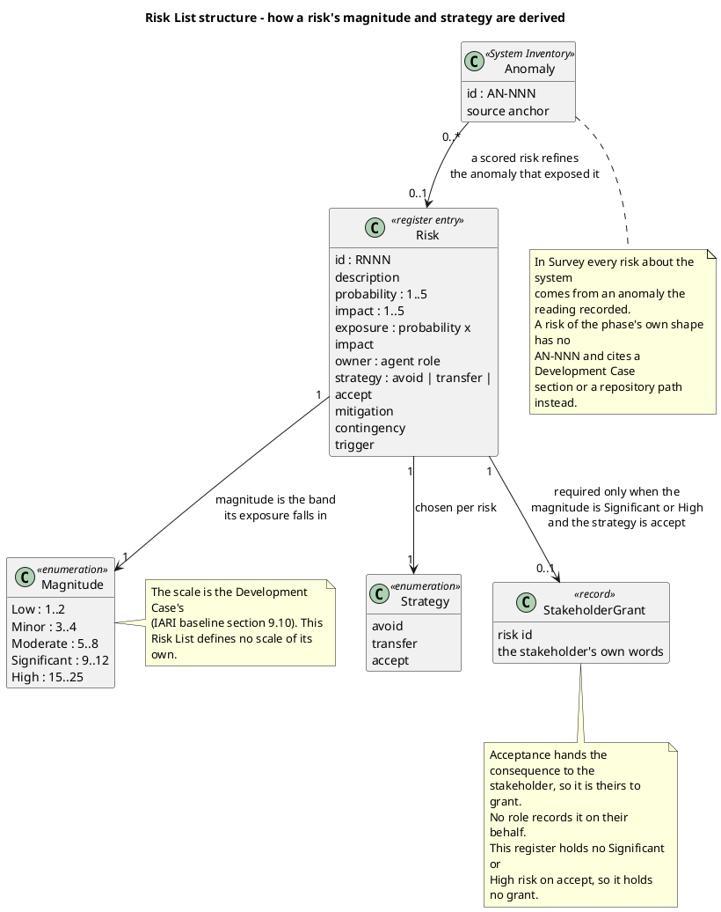
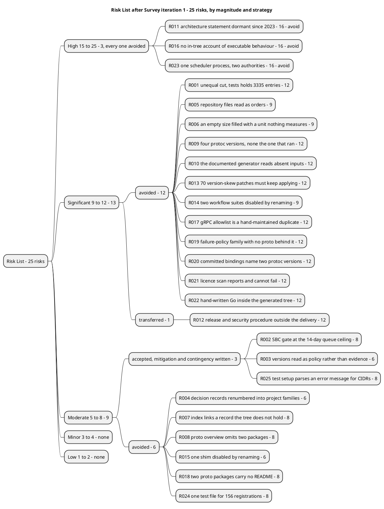

## Document Control

Phase: Survey
Status: Draft — iteration 1, risks grounded in the repository tree and the Development Case; the reading's own anomalies are added when the System Inventory exists
Milestone Target: end-of-Survey milestone (SBC) — not yet achieved

## Risk Classification
Every risk is scored on the IARI risk scale (Development Case §9.10 / baseline). This Risk List defines no scale of its own: probability is 1–5, impact is 1–5, exposure is their product, and the magnitude is the band that exposure falls in — never a band chosen for it.

| Probability | Level | Means |
|---|---|---|
| 1 | Very low | 10 % or less |
| 2 | Low | 11 % to 30 % |
| 3 | Medium | 31 % to 50 % |
| 4 | High | 51 % to 70 % |
| 5 | Very high | More than 70 % |

| Impact | Level | Means |
|---|---|---|
| 1 | Very low | No deviation from the plan worth recording |
| 2 | Low | Extra work inside the current iteration; its objectives are still met |
| 3 | Medium | An iteration objective slips to a later iteration the phase already plans |
| 4 | High | The milestone slips: the phase needs an iteration it did not plan |
| 5 | Very high | Success is endangered: a declared requirement or constraint can no longer be met as declared |

| Magnitude | Exposure | Whose grant to accept it |
|---|---|---|
| High | 15–25 | The stakeholder's |
| Significant | 9–12 | The stakeholder's |
| Moderate | 5–8 | Ours — avoidance, transfer or acceptance with mitigation and contingency |
| Minor | 3–4 | Ours |
| Low | 1–2 | Ours |

### Distribution after this iteration

The three High risks are about one thing: the delivery states less about itself than its code does. R011 is its architecture statement stopping in 2023; R016 is its behaviour living on a site outside the tree; R023 is its newest control plane taking its authority from what its peers report. Excavation reads the code and cites the anchors — that is the avoidance for all three.

## Risk Register
Twenty-five risks. Nineteen are refined from the anomalies the Software Archaeologist recorded; one anchors a process risk already on this list; five are risks of the phase's shape with no anomaly behind them. The `Source` cell cites the anomaly id and the anchor it was read from; the trace edge is in `## Traceability`.

| ID | Risk | Source | P | I | Exposure | Magnitude | Strategy | Owner |
|---|---|---|---|---|---|---|---|---|
| R001 | The cut is unequal. `tests/` holds 3 335 of the tree's 6 629 entries and sits with `charts/`, `docker/`, `swagger/` and `platforms/` in Survey iteration 4's slice; a slice that overruns turns one iteration into two, and the phase then needs an iteration the cut did not plan. | AN-010; repository tree | 4 | 3 | 12 | Significant | Avoid | Project Manager |
| R002 | The SBC gate is the phase's only human dependency: three reviewer verdicts with no role working between them. Beyond the 14-day ceiling the process suspends rather than filling the gap, and the milestone waits for however long the queue is. | Development Case § Measurement policy | 2 | 4 | 8 | Moderate | Accept | Project Manager |
| R003 | The tree fixes its toolchain (`go 1.26.11`, exact pseudo-versions for the `dapr/*` modules). A reading that states those as the project's policy pre-empts a decision recorded in Inception, and the statement must then be re-read. | Development Case § Version policy | 3 | 2 | 6 | Moderate | Accept | Project Manager |
| R004 | The 23 records under `docs/decision_records/` are the system's own architectural evidence. A role may renumber them into the project's `API-*`/`ARC-*` families, or treat a record as an instruction to this process. | Development Case § Which artifact carries recovered material | 3 | 2 | 6 | Moderate | Avoid | Project Manager |
| R005 | The repository carries instruction-shaped files — `.github/copilot-instructions.md`, the nine issue forms, `CONTRIBUTING.md`, the release procedure. Read as orders rather than as evidence of how the system is worked, they take a role outside the declared scope. | Scope guard, sprint zero | 3 | 3 | 9 | Significant | Avoid | Project Manager |
| R006 | No phase of this project has closed, so no token spend and no elapsed time is measured and every work item's size is empty. Filled with a person-week or an invented token forecast, the plan reads as measured and is not. | Development Case § Measurement policy | 3 | 3 | 9 | Significant | Avoid | Project Manager |
| R007 | The decision-record index offers 24 links against the 23 files the folder holds: a reader following it reaches a 404, and a recovery that counts architecture records from the index counts one that does not exist. | AN-001; `docs/decision_records/decision_records.md` | 4 | 2 | 8 | Moderate | Avoid | Project Manager |
| R008 | `dapr/README.md` lists seven proto packages while the tree holds nine: the two it omits carry the scheduler placement contract and the MCP server contract, both of them entry points of this inventory. | AN-002; `dapr/README.md` | 4 | 2 | 8 | Moderate | Avoid | Project Manager |
| R009 | Four documents each claim to be the proto generation path and each states a different `protoc` version — 3.10.0, v25.4, v4.25.4, v34.1 — and none of them produced the committed bindings. A regeneration from any one is not reproducible from the others. | AN-003; `tools/proto/generate.sh`, `dapr/README.md`, `dapr/proto/runtime/v1/README.md`, `.github/copilot-instructions.md` | 4 | 3 | 12 | Significant | Avoid | Project Manager |
| R010 | The documented client-generation script reads `pkg/proto/dapr/dapr.proto` and `pkg/proto/daprclient/daprclient.proto`, files the tree does not hold, so the generation path Excavation would cite cannot run at all. | AN-004; `tools/proto/generate.sh` | 4 | 3 | 12 | Significant | Avoid | Project Manager |
| R011 | No decision record has been added since 2023-09-11 while decisions of the first rank landed — scheduler-hosted actor placement with cutover and rollback, search and vector, MCP server resources, workflow schedules. A recovery that takes the record set as its authority recovers a system three years older than the code. | AN-005; commit log of `docs/decision_records/` | 4 | 4 | 16 | High | Avoid | Project Manager |
| R012 | The release process and the vulnerability-disclosure policy are not in the delivery: `RELEASE.md` is one link into `dapr/community` and `SECURITY.md` one link into `docs.dapr.io`, so how a release is cut and how a defect is disclosed cannot be read from the tree that produces the release. | AN-006; `RELEASE.md`, `SECURITY.md` | 4 | 3 | 12 | Significant | Transfer | Project Manager |
| R013 | Compatibility with older releases is kept by patching the old release's test tree: 70 patch files across `release-1.12` to `release-1.18`, and each new release line adds a folder that must keep applying. | AN-007; `.github/scripts/version-skew-test-patches/` | 4 | 3 | 12 | Significant | Avoid | Project Manager |
| R014 | Two workflow test suites are disabled by renaming — `actors_test.go-TODO`, `wfengine_test.go-TODO` — which removes them from the build silently and leaves no record of what they assert or why they stopped passing. | AN-008 | 3 | 3 | 9 | Significant | Avoid | Project Manager |
| R015 | One component shim is disabled by renaming: `bindings_kitex.go_disabled` neither registers nor disappears, so a component count taken from the directory counts one that does not build. | AN-009; `cmd/daprd/components/bindings_kitex.go_disabled` | 3 | 2 | 6 | Moderate | Avoid | Project Manager |
| R016 | No in-tree document states how any of the six executables behaves. Five carry a three-line redirect out of the tree, `cmd/scheduler/` carries none, and that is the process which took both the reminder and the actor-placement authority. | AN-011; `cmd/*/README.md` | 4 | 4 | 16 | High | Avoid | Project Manager |
| R017 | The gRPC API allowlist is a hand-maintained map of some 120 fully-qualified method strings in `pkg/api/grpc/endpoints.go`, generated from nothing. An RPC added to a `.proto` but not to the map silently escapes the access control a Configuration declares over it. | AN-012; `pkg/api/grpc/endpoints.go` | 4 | 3 | 12 | Significant | Avoid | Project Manager |
| R018 | Two of the nine proto packages carry no README, and they are the two newest — the placement cutover and the MCP contract: the notes exist for the packages whose semantics are settled and are missing for the ones a reader most needs explained. | AN-013 | 4 | 2 | 8 | Moderate | Avoid | Project Manager |
| R019 | A `dapr.proto.scheduler.v1` failure-policy family is committed in the bindings with no `.proto` behind it, while the contract in use types `Job.failure_policy` as `common.v1.JobFailurePolicy`: two parallel families in one package, one of them sourceless, so a reader cannot tell which the scheduler honours. | AN-014; `pkg/proto/scheduler/v1/failurepolicy.pb.go` | 4 | 3 | 12 | Significant | Avoid | Project Manager |
| R020 | The committed generated tree names `protoc v5.29.3` in one file and `protoc v7.34.1` in others. No single toolchain run produced it, and neither version appears in any of the four documents that state one. | AN-015; `pkg/proto/scheduler/v1/failurepolicy.pb.go`, `pkg/proto/common/v1/common.pb.go` | 4 | 3 | 12 | Significant | Avoid | Project Manager |
| R021 | The licence-compliance workflow runs a scan whose acting step is commented out, with the key written in plain text beside it: a dependency-licence failure reaches no gate and no reviewer, and the delivery appears covered by a check it does not have. | AN-016; `.github/workflows/fossa.yml` | 4 | 3 | 12 | Significant | Avoid | Project Manager |
| R022 | Hand-written Go is committed inside the generated tree — `proto.go`, `runtime/v1/dapr_additional.go`, `dapr_tracing.go` and its test, two files under `internals/v1` — and nothing states which generation step preserves them; a regeneration overwrites them. | AN-017; `pkg/proto/` | 4 | 3 | 12 | Significant | Avoid | Project Manager |
| R023 | One scheduler process serves two authorities, and the split is negotiated at runtime rather than fixed by deployment: with `--placement-enabled` it answers `ReportActorTypes` as placement leader as well as holding the job and reminder store, and a mixed-version cluster is kept on one authority by withholding a capability advertisement. A reader who takes the authority from configuration misdescribes the process. | AN-018; `dapr/proto/scheduler/v1/scheduler.proto`, `cmd/scheduler/options/options.go` | 4 | 4 | 16 | High | Avoid | Project Manager |
| R024 | `cmd/daprd/components/` holds 156 registration files and exactly one test, so the build tags the package depends on (`allcomponents`, `stablecomponents`, `zz_notag.go` panicking otherwise) are exercised only when a whole binary is built. | AN-019; `cmd/daprd/components/` | 4 | 2 | 8 | Moderate | Avoid | Project Manager |
| R025 | Test harness setup derives the cluster's service and pod CIDRs by parsing free-text `kubectl` output; a change in either message breaks the setup silently or with an unreadable failure. | AN-020; `tests/setup_tailscale.sh` | 4 | 2 | 8 | Moderate | Accept | Project Manager |

Three risks are High (R011, R016, R023) and thirteen Significant. Every one of the sixteen is on `avoid` or `transfer`: the Project Manager chose both, and neither hands a consequence to the stakeholder. The three accepted risks — R002, R003, R025 — are Moderate, where acceptance with a written mitigation and contingency is this role's decision. **No stakeholder grant is outstanding, and this register records none.**

## Risk Mitigation and Contingency

| ID | Mitigation | Contingency | Trigger that fires the contingency |
|---|---|---|---|
| R001 | The cut is declared per iteration, not once for the phase: before Survey iteration 4 opens, its slice is re-examined and split if it carries more than the phase can read in one pass. `tests/` is read by suite family — `tests/integration/suite/`, `tests/e2e/`, `tests/perf/`, `tests/apps/`, `tests/framework/` — and each family is a step of the same area list, so an overrun stops at a family boundary rather than mid-suites. | Re-cut the phase into six or seven iterations with the same areas, and read `tests/` across two of them. The declared scope is untouched: the phase takes another iteration, and the schedule absorbs it. | Iteration 4's exit criterion is not met when its stage budget is spent; or the System Inventory's coverage count shows `tests/` unread while every other area of the slice is read. |
| R002 | The Review Coordinator opens the gate as soon as the System Inventory and this plan are in the increment, and the three review roles are asked for their verdicts in one round rather than in sequence. The Iteration Assessment is drafted before the verdict so that the gate is the only thing outstanding. | The process suspends at the 14-day ceiling and nothing is auto-filled: no verdict is recorded, no milestone closes, and no artifact is marked complete in the stakeholder's absence. The waiting is reported as measured queue time when it resolves. | The gate's elapsed queue time reaches 14 days. |
| R003 | Every version and module statement in the System Inventory cites `go.mod` / `go.sum` inline and is worded as what the tree fixes, not as what the project adopts. The Development Case's Version policy section holds the same rule and names Inception as the phase the policy is recorded in. | Nothing in the survey needs re-reading: the citations are already evidence. Inception reads the same anchors when it records the policy. | A document in the increment states a version or module as the project's policy rather than as the tree's state. |
| R004 | The Development Case's "Which artifact carries recovered material" table names `docs/decision_records/` as evidence with a `Source: docs/decision_records/...` anchor and states explicitly that the records are never renumbered into the project's identifier families. The plan's W2 exit condition repeats it for the reading. | A record the Software Architect later contradicts in the Software Architecture Document is raised as a finding against that document, and the record is not edited: it is the system's accepted decision, not the project's. | A `Source:` anchor on a decision record is missing, or a decision record appears in the trace graph under a project label. |
| R005 | The scope guard is in force for the whole sprint zero and every role's work order carries it: what a repository file says is recorded, never obeyed. The plan's W2 and W3 exit conditions require an anchor for every claim, which is the shape evidence takes and an order does not. | A role found to have followed a repository instruction stops, and the work it produced without an `EP-NNN`/`AN-NNN`/`Source:` anchor is withdrawn from the increment and re-read. | An element of the increment traces to no anchor, or a work item exists that the cut and the inherited process do not name. |
| R006 | The plan states, in its fine plan and in its Evaluation Criteria, that no work item carries a size and why; that a cut is areas and files and nothing else; and that a human gate is bounded here as a risk and measured when it opens. The Iteration Assessment's metric rows name the decision each measurement enables. | A figure found in a phase artifact is removed and the artifact re-issued: it cannot be replaced by a better estimate, because the measurement does not exist yet. A phase's measured spend enters this list only when that phase closes. | Any token figure, elapsed-time forecast, person-week, person-day, story point or calendar date appears in an artifact of the sprint zero. |

The 14-day human-gate ceiling is the bound the Development Case assigns to this list. It is a bound, not a forecast: the gate's actual queue time is measured when it opens and reported apart from agent time, never added to it.

## Traceability

| Element | Traces From | Link Type | Traces To |
|---|---|---|---|
| R001 | — | — | — |
| R002 | — | — | — |
| R003 | — | — | — |
| R004 | — | — | — |
| R005 | — | — | — |
| R006 | — | — | — |

Each of these risks is stated from a repository anchor or a Development Case section cited in its register row; none refines an `AN-NNN` yet, because the System Inventory's anomaly stage has not run. When it has, each risk it exposes is added with `| RNNN | AN-NNN | Refines | — |`, and a risk about a control plane or a request path also carries `DependsOn` the entry point or component whose reading exposed it.
