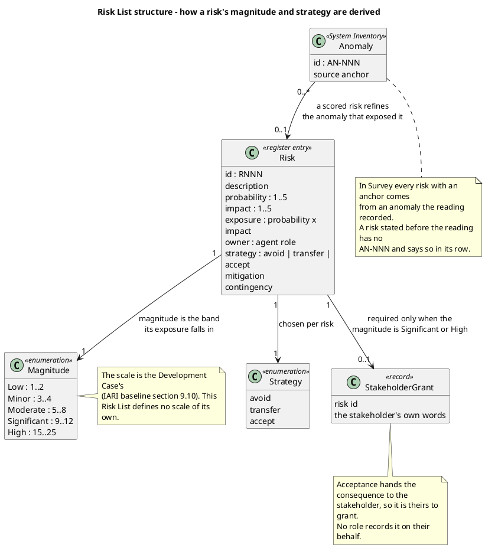

## Document Control

Phase: Survey
Status: Draft — iteration 1, risks grounded in the repository tree and the Development Case; the reading's own anomalies are added when the System Inventory exists
Milestone Target: end-of-Survey milestone (SBC) — not yet achieved

## Risk Classification

Every risk is scored on the IARI risk scale (Development Case §9.10 / baseline). This Risk List defines no scale of its own: probability is 1–5, impact is 1–5, exposure is their product, and the magnitude is the band that exposure falls in — never a band chosen for it.

| Probability | Level | Means |
|---|---|---|
| 1 | Very low | 10 % or less |
| 2 | Low | 11 % to 30 % |
| 3 | Medium | 31 % to 50 % |
| 4 | High | 51 % to 70 % |
| 5 | Very high | More than 70 % |

| Impact | Level | Means |
|---|---|---|
| 1 | Very low | No deviation from the plan worth recording |
| 2 | Low | Extra work inside the current iteration; its objectives are still met |
| 3 | Medium | An iteration objective slips to a later iteration the phase already plans |
| 4 | High | The milestone slips: the phase needs an iteration it did not plan |
| 5 | Very high | Success is endangered: a declared requirement or constraint can no longer be met as declared |

| Magnitude | Exposure | Whose grant to accept it |
|---|---|---|
| High | 15–25 | The stakeholder's |
| Significant | 9–12 | The stakeholder's |
| Moderate | 5–8 | Ours — avoidance, transfer or acceptance with mitigation and contingency |
| Minor | 3–4 | Ours |
| Low | 1–2 | Ours |

## Risk Register

No risk below is anchored to an `AN-NNN` anomaly: the System Inventory does not exist yet. They are risks of the reading and of the phase's shape, each cited to the repository path or Development Case section that exposes it. The risks the reading itself exposes are scored when the System Inventory's anomaly stage has run.

| ID | Risk | Probability | Impact | Exposure | Magnitude | Strategy | Owner |
|---|---|---|---|---|---|---|---|
| R001 | The five slices of the cut are unequal. `tests/` alone holds 3,335 tree entries, of which 2,261 are integration suite files and 631 perf files, and it sits with `charts/`, `docker/`, `swagger/` and `platforms/` in Survey iteration 4. A slice that overruns turns one iteration into two and the phase then needs an iteration the cut did not plan. | 4 | 3 | 12 | Significant | Avoid | Project Manager |
| R002 | The SBC gate is the phase's only human dependency: three reviewer roles plus a verdict, with nobody able to work between them. If the stakeholder is unavailable beyond the 14-day ceiling the process suspends rather than filling the gap, and the milestone slips by however long the queue is. | 2 | 4 | 8 | Moderate | Accept | Project Manager |
| R003 | The tree fixes a toolchain (`go 1.26.11` in `go.mod`, exact pseudo-versions for the `dapr/*` modules) that the project has not yet declared a policy for — the version policy lands in Inception. A reading that states versions as policy rather than as evidence pre-empts a decision that is not the reader's to make, and the statement must then be re-read. | 3 | 2 | 6 | Moderate | Accept | Project Manager |
| R004 | The repository carries 23 accepted decision records under `docs/decision_records/`. A role may renumber them into the project's `API-*`/`ARC-*` families, or treat a record as an instruction, when they are the system's own architectural evidence and belong to no project identifier family. | 3 | 2 | 6 | Moderate | Avoid | Project Manager |
| R005 | The repository carries instruction-shaped documents — `.github/copilot-instructions.md`, the nine issue forms, `CONTRIBUTING.md`, the release procedure. In the sprint zero every one of them is evidence of how the system is worked, never an instruction to this process; a role reading one as an order works outside the declared scope. | 3 | 3 | 9 | Significant | Avoid | Project Manager |
| R006 | No phase of this project has closed, so no spend or elapsed time has been measured. The plan's work items therefore carry no size at all. A role may fill that empty size with a person-week, or invent a token forecast for the stakeholder to accept, and the plan then reads as measured when it is not. | 3 | 3 | 9 | Significant | Avoid | Project Manager |

The two Significant risks carried on a strategy other than acceptance — R001, R005, R006 — need no grant: avoidance is the Project Manager's to choose. R002 is the only accepted risk in the register and its exposure of 8 puts it in the Moderate band, where acceptance with a written mitigation and contingency is the Project Manager's own decision. No risk in this register is High or Significant-and-accepted, so no stakeholder grant is outstanding.

## Risk Mitigation and Contingency

| ID | Mitigation | Contingency | Trigger that fires the contingency |
|---|---|---|---|
| R001 | The cut is declared per iteration, not once for the phase: before Survey iteration 4 opens, its slice is re-examined and split if it carries more than the phase can read in one pass. `tests/` is read by suite family — `tests/integration/suite/`, `tests/e2e/`, `tests/perf/`, `tests/apps/`, `tests/framework/` — and each family is a step of the same area list, so an overrun stops at a family boundary rather than mid-suites. | Re-cut the phase into six or seven iterations with the same areas, and read `tests/` across two of them. The declared scope is untouched: the phase takes another iteration, and the schedule absorbs it. | Iteration 4's exit criterion is not met when its stage budget is spent; or the System Inventory's coverage count shows `tests/` unread while every other area of the slice is read. |
| R002 | The Review Coordinator opens the gate as soon as the System Inventory and this plan are in the increment, and the three review roles are asked for their verdicts in one round rather than in sequence. The Iteration Assessment is drafted before the verdict so that the gate is the only thing outstanding. | The process suspends at the 14-day ceiling and nothing is auto-filled: no verdict is recorded, no milestone closes, and no artifact is marked complete in the stakeholder's absence. The waiting is reported as measured queue time when it resolves. | The gate's elapsed queue time reaches 14 days. |
| R003 | Every version and module statement in the System Inventory cites `go.mod` / `go.sum` inline and is worded as what the tree fixes, not as what the project adopts. The Development Case's Version policy section holds the same rule and names Inception as the phase the policy is recorded in. | Nothing in the survey needs re-reading: the citations are already evidence. Inception reads the same anchors when it records the policy. | A document in the increment states a version or module as the project's policy rather than as the tree's state. |
| R004 | The Development Case's "Which artifact carries recovered material" table names `docs/decision_records/` as evidence with a `Source: docs/decision_records/...` anchor and states explicitly that the records are never renumbered into the project's identifier families. The plan's W2 exit condition repeats it for the reading. | A record the Software Architect later contradicts in the Software Architecture Document is raised as a finding against that document, and the record is not edited: it is the system's accepted decision, not the project's. | A `Source:` anchor on a decision record is missing, or a decision record appears in the trace graph under a project label. |
| R005 | The scope guard is in force for the whole sprint zero and every role's work order carries it: what a repository file says is recorded, never obeyed. The plan's W2 and W3 exit conditions require an anchor for every claim, which is the shape evidence takes and an order does not. | A role found to have followed a repository instruction stops, and the work it produced without an `EP-NNN`/`AN-NNN`/`Source:` anchor is withdrawn from the increment and re-read. | An element of the increment traces to no anchor, or a work item exists that the cut and the inherited process do not name. |
| R006 | The plan states, in its fine plan and in its Evaluation Criteria, that no work item carries a size and why; that a cut is areas and files and nothing else; and that a human gate is bounded here as a risk and measured when it opens. The Iteration Assessment's metric rows name the decision each measurement enables. | A figure found in a phase artifact is removed and the artifact re-issued: it cannot be replaced by a better estimate, because the measurement does not exist yet. A phase's measured spend enters this list only when that phase closes. | Any token figure, elapsed-time forecast, person-week, person-day, story point or calendar date appears in an artifact of the sprint zero. |

The 14-day human-gate ceiling is the bound the Development Case assigns to this list. It is a bound, not a forecast: the gate's actual queue time is measured when it opens and reported apart from agent time, never added to it.

## Traceability

| Element | Traces From | Link Type | Traces To |
|---|---|---|---|
| R001 | — | — | — |
| R002 | — | — | — |
| R003 | — | — | — |
| R004 | — | — | — |
| R005 | — | — | — |
| R006 | — | — | — |

Each of these risks is stated from a repository anchor or a Development Case section cited in its register row; none refines an `AN-NNN` yet, because the System Inventory's anomaly stage has not run. When it has, each risk it exposes is added with `| RNNN | AN-NNN | Refines | — |`, and a risk about a control plane or a request path also carries `DependsOn` the entry point or component whose reading exposed it.
